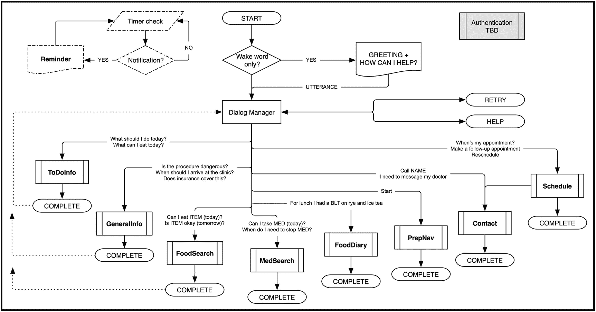

# 排版后的内容

添加一个或两个原型句子，即能够引导任务完成的、格式良好的用户请求的代表性示例。你已经在这方面有了良好的开端。你需要一种方法来引用每个意图中的变量信息。这些就是你在第 1 章至第 3 章中也了解到的槽位（或实体）。如果你将意图视为动词，那么槽位就是名词：食物或药物的名称。我们通常使用全大写字母来表示填充槽位的变量信息的占位符，并且为了便于搜索，我们会添加花括号或像`$`这样的符号，例如`$FOOD`和`$MED`。将这些内容添加到你的发现文档中（表 4-7）。

**表 4-7** 针对手术准备语音应用的每个核心用户发起意图的目的和目标的详细描述

| 意图 | 功能描述 | 原型句子 | 任务完成 |
| --- | --- | --- | --- |
| `ToDoInfo` | 用户根据手术日期询问即将进行的准备任务。未指定时间 = “今天”。 | `<What should I do today?>` | 用户听到任务响应。 |
| `GeneralInfo` | 用户询问与其手术相关的问题。 | `<How long will the procedure take?>` | 用户听到对其问题的响应。 |
| `FoodSearch` | 用户询问是否可以吃或喝某个命名的食物项目。未指定时间 = “现在”。 | `<Can I eat $FOOD (today)?>` | 用户听到对其食物问题的响应。 |
| `MedSearch` | 用户询问是否可以服用某个命名的药物项目。未指定时间 = “现在”。 | `<Can I (still) take $MED?>` | 用户听到对其药物问题的响应。 |
| `PrepNav` | VUI 引导用户完成多步骤指令，以准备和服用准备溶液。 | `<Continue>`; `<Pause>` | 每个步骤完成，并达到任务终点。 |
| `Contact` | 用户想要联系他们的医生或手术机构。 | `<Message my doctor>`; `<Call $NAME cell phone>` | 用户听到护理团队成员的电话号码。提供拨号功能（如果可用）。 |
| `Schedule` | 用户想知道他们的预约时间，或者想要更改或取消预约。 | `<I need to reschedule>`; `<When is my appointment?>` | 用户听到并确认预约。预约被创建（如果可用）。 |
| `FoodDiary` | 用户列出他们在特定餐次中消费的 >=1 个食物和 >=1 个饮料项目。VUI 确认。记录结果。 | `<(For $MEAL) I had $FOOD1, $FOOD2, and DRINK>` | 所有必要信息被收集并添加到他们的食物日记中。 |

接下来，是时候定义成功的任务完成了。思考你的语音应用需要哪些信息来满足每个意图。答案就是槽位。一个餐厅预订请求必须填充三个槽位：`TIME`、`DAY`和`GUESTS`的数量。在准备应用中，大多数意图只需要填充一个槽位，但食物日记可能需要填充多个槽位，每个食物和饮料项目各一个。对于联系护理团队成员，可能是一个槽位（要联系的人）或两个（人加上哪个电话，如果有多个）。表 4-7 中的信息将作为你本章后面高级 VUI 对话流程的输入。

利用这些信息以及你在发现过程中收集的其他信息，来草拟对话流程，以便在后续设计中扩展。图 4-2 展示了这个手术准备 VUI 的最高级别语音对话流程的样子。此时，每个意图只是一个没有细节的方框。你将在下一章开始扩展这些细节。

**图 4-2** 示例手术准备语音应用的高级对话流程

## 步骤 3：识别潜在复杂性

一旦你定义了想要包含的功能，就需要确定每个功能将面临哪些语音解决方案的挑战。你的结论将直接影响你如何构建对话流程，正如你在本书中所学到的。它还能识别出哪些功能最好留待以后处理。在这里，理解语音变得至关重要。

本章的其余部分将精确地围绕这一重点进行详细发现，询问：“在现有资源、平台选择、时间线等条件下，语音的复杂性在哪里，哪些地方可能出错？”复杂性的两个核心方面是变化性和成本。

从变化性开始，再看一下图 4-2。你可能马上就能看到一些潜在的挑战：你在第 2 章中学到，用户话语中不受约束的变化性对 VUI 来说是一个挑战。嗯，人们可以询问的食物种类非常多！而且有些食物是模糊的：如果用户询问米饭是否可以，VUI 需要澄清或消除歧义，因为白米和糙米的纤维含量不同。所以`FoodSearch`会很棘手。而且由于变化性和复杂性会随着需要填充的槽位增多而增加，`FoodDiary`甚至更棘手：有人可能在一个单一话语中列出整餐的食物。`MedSearch`需要一些努力——你不仅需要理解成千上万种药物的名称，还需要数据访问权限来提供正确的响应。`Contact`意味着访问某个联系人列表，以及找到实际连接的方法。但名字列表是受限的，所以它应该比所有食物更容易处理。`Schedule`呢？假设信息已经输入，告诉某人他们的手术时间并不困难，但创建或更改预约则要复杂得多。

成本呢？这里的成本不是指金钱，而是误解某事的后果。如果你的 VUI 误识别了一个食物的名称，如果问题是关于卡路里数量或寻找餐厅，其成本要低于涉及手术前一天可以吃什么的问题。潜在错误的成本越高，你就需要投入越多的精力来最小化其发生。对于这个应用，任何导致准备不充分的响应都会带来不良手术结果、重新安排、时间和金钱损失等后果。显然这不好。再次强调，`FoodSearch`和`MedSearch`是危险信号。对于`Contact`，风险在于联系错了人；对于`Schedule`，风险在于提供了错误的预约时间。

你最终会得到类似表 4-8 的内容。每个人都需要这些信息。销售人员需要这种意识来提供准确的报价。包括设计师在内的技术团队，既用它来确定方法，也用于详细的开发和测试。产品和项目经理需要这种级别的信息和理解，来规划详细的时间线，并评估在 MVP 和完整项目中应包含哪些功能。你也会参考这些信息来决定成功指标。

**表 4-8** 手术准备应用的每个功能因请求变化性和错误处理成本引起的复杂性

| 意图 | 预期变化 | 示例 | 错误成本 |
| --- | --- | --- | --- |
| `ToDoInfo` | 部分同义变化。 | `我今天能/应该做什么？` | 低–中 |
| `GeneralInfo` | 措辞模糊或歧义。主题宽泛；部分答案可能不包含在内。 | `这种情况常见吗？` `我这个年龄有多少人做过这个手术？` | 低 |
| `FoodSearch` | 歧义且搜索空间大：大量食物和饮料名称。发音：从其他语言借用的名称。 | `我能吃奶酪吗？`（不同种类）`nasi goreng` `还能吃吗？` | 中–高 |
| `MedSearch` | 歧义（相似名称、不同版本）：大量药物名称。药物名称不熟悉且可能难以发音。 | `我能吃泰诺吗？`（不同种类）`idarucizumab` `可以吗？` | 高 |
| `PrepNav` | 不同的导航指令。部分同义词。 | `下一步，重复/再说一遍，返回。` | 低–中 |
| `Contact` | 歧义（同名联系人、多个电话）。联系人列表因用户而异且规模有限。 | `打电话给乔。` `给布朗医生发消息。` | 低–中 |
| `Schedule` | 歧义。可能涉及多步骤对话，填写时间、日期、预约类型、地点。依赖于用户和医疗团队日历的访问权限。 | `我想把预约改到 2 月 12 日星期五。` | 低–中 |
| `FoodDiary` | 歧义：大量食物和饮料名称。发音：来自其他语言的食物。一次表述中可能包含多个项目。 | `早餐我吃了烤面饼配培根酱、瑞士奶酪和一些咖啡。` | 低 |

### 业务需求：为什么要构建它？

所有语音实现都受益于“做对做好”。即使只是你为了好玩而构建的东西，你做出的选择（平台、领域、范围、任务、流程等）也会影响你的开发工作和 VUI 的性能。有意识地做出选择——这将在你以后构建更复杂的应用和产品时对你有所帮助。

牢记语音的特点，你的业务需求需要聚焦于影响 VUI 解决方案的范围、时间线、预算、业务规则和法律约束：

*   确定范围和功能。

*   确定为什么语音是首选解决方案，以及它能最大程度改善哪些痛点。

*   确定如何衡量成功——特别是当这与你的报酬挂钩时！

*   确定 VUI 是否以及如何与其他通信方式连接，以及是否支持降级方案。

*   识别现有的品牌和风格指南——或者是否需要创建这些指南。

*   识别任何可能影响设计或开发的法律或合规需求。

*   验证对所有必要数据源和专家知识贡献者的访问权限，包括如果 VUI 是多语言时所需的资源。

*   规划性能改进活动。

# 语音用户界面设计考量

一个基本决策是你的 VUI 将运行在哪种类型的设备上。是 Alexa/Google 实现、硬件设备、手机上的多模态应用、电话 IVR、固定或移动机器人，还是车载解决方案？识别是在云端进行，还是由于用户位置需要在设备本地进行？设备是否有屏幕？为了保持讨论的中立性并使其与任何语音解决方案最大程度相关，我们假设它是一个可能有也可能没有屏幕的设备。在语音优先的开发中，用户不应依赖任何视觉反馈。

## 成功提示 4.5 语音的 MVP 是不同的

答案在于为语音设定正确的限制。是的，人们可以说任何话，但他们不会。那会违反格莱斯的合作原则。明确你的应用能做什么，设定期望，并满足这些期望。语音用户最大的抱怨是“它不理解我”，意思是“我以合理的方式提出了我期望它做的事情，但没有得到我想要的结果。”获得一星评价最快的方式就是设定你无法满足的期望。限制功能的**数量**，而不是你的**覆盖范围**，以及用户为访问这些功能必须说的话。将用户引导到详细说明如何准确表述规则的 FAQ 也会违反格莱斯的合作原则。专注于更少的功能，并通过处理用户表述中的预期变化并满足任何请求来使这些功能更健壮。一些用户会尝试询问你尚未包含的内容，但如果你明确说明了功能限制，那就没问题。在手术准备应用中，如果用户被告知可以询问食物，你必须处理一个庞大的项目列表（例如，不仅仅是*奶酪*，而是所有常见的奶酪类型）以及人们用来提问的载体短语（*我能吃……吗*，*我能吃……吗*，*……可以吃吗*等）。但你可以让用户知道你不处理食品品牌名称或餐厅特色菜。如果有用户试图在这个对话中订餐，那不是你的问题。☺

## 总体目的与目标

你将如何衡量成功？这在一定程度上取决于你的总体目标——以及任何为你的工作付费的人的目标！这意味着这可能是一个有点敏感的话题。一个将自动化置于首位的解决方案可能会试图将用户留在系统中，隐藏与真人客服交谈的选项；其他解决方案则为简单任务提供自动化，以便在需要时解放那些客服人员。IVR 呼叫者通常乐于为简单任务与 VUI 打交道，只要他们知道在需要时可以找到客服人员，但如果你在他们要求与真人交谈时设置障碍，他们不会给 VUI 好评。无论目的和目标是什么，你对语音了解得越多，就越有可能很好地衡量成功。

### 主要和次要目标

你只是为自己在家使用而创建一些东西或制作一个演示，还是在为他人构建一个产品？当为一家成熟的公司构建语音代理时，你将处理许多约束，包括语音角色、数据流和性能期望。每一个约束都会影响你设计和开发中的选择。

有时，次要目标会影响设计。你是否在推广某个特定产品或品牌？是否有理由让用户进行长时间对话或快速给出回复，或者你是在试图与其他产品区分开来？答案可能是“未来的变现”。无论是什么，都要诚实且明确地说明，因为它会影响你的对话和 VUI 响应。如果你的目标是自动化客户服务，要注意如果你试图阻止用户与真人交谈，可能会引起用户反弹。有更好的方法，正如你将学到的那样。

## 成功指标

你如何知道自己是否成功？这就是成功指标。语音用户界面（VUI）的性能表现常常与开发者的奖金挂钩。如果你心中已有具体的量化指标，应该在开始构建任何东西之前就确定下来，因为你的对话流程会影响诸如完成时间等因素。你可能需要一种方法来衡量用户是否以最少的步骤或在特定时间范围内到达了对话流程中的某个特定点。如果准确性很重要，你就需要某种方式来追踪和衡量它。你对成功指标的选择会影响设计决策：更高的准确性意味着需要对识别结果进行更明确的确认。如果对话需要简短，你就需要避免多余的对话表达。追踪特定变更部署的时间，以便与客户满意度、错误转接电话或已解决的客服工单等统计数据进行比较。如果用户参与度、重复使用率或满意度很重要，你的对话流程就需要最大化这些指标。第 16 章和第 17 章将对此进行更详细的讨论。

> **来自语音一线**
>
> 在一个医疗领域的纯语音系统中，每提高一个百分点的“问题解决率”（containment），客户就会向语音服务组织支付相应费用。通过更改提示语和流程，并调整识别和语法，问题解决率提高了 10%，用户满意度（CSAT）也随之提升。所有人都很高兴。在一个银行领域的纯语音系统中，提高客户满意度是关键，这是设计变更与语音调优相结合的结果。

## 领域、设备及其他模态

VUI 可以为任何领域构建：医疗、健康、体育、娱乐、信息、教育等等。对于“术前准备”这个应用，其领域是“健康与医疗”以及“饮食”。领域会影响对话流程、你在回复中使用的术语、对确认和准确性的需求，以及你可以预期的用户话语和行为。准确理解涉及用户金钱或健康的话语，比确保播放他们请求的歌曲更为重要。你的流程将反映这一点。

表 4-9 总结了本节关于“术前准备”应用的内容。由于领域是健康，准确性至关重要。该任务的一个有效成功指标是提高用户成功完成术前准备的比例。次要目标可能是鼓励用户为了更广泛的健康而持续使用。如果你还没有某些需要的信息，可以做一个简单的备注，例如使用 `TBD`（待定/待决定）。

**表 4-9** 术前准备应用的业务目的及主要和次要目标

| **目的和主要目标？** | 创建一个生产级的术前准备助手，易于使用、高度准确且安全。 |
| --- | --- |
| **次要目标？** | 为未来的应用积累用户数据；通过用户参与创造粘性，以鼓励更好的饮食习惯。 |
| **成功指标？** | 完成术前准备的用户显著增加。百分比 `TBD`。 |
| **领域？** | 健康与医疗。 |

## 底层服务与现有自动化

思考你的语音应用所提供的服务。如果是一个真人执行同样的任务，他们的角色会是什么？朋友、DJ、老师、娱乐者、领域专家？VUI 与用户之间的关系是什么：平等、师生、医患？这将影响助手的“人设”——说话风格、用词选择、正式程度、情感表达等等。任何现有的类似交互都会影响用户对步骤顺序以及如何回应的预期。这是用户心智模型的一部分——你需要利用现有的对话预期，并且不要无故打破它们。如果你打破了，用户可能会以你未曾预料的方式行事，因此你可能需要一些即时（JIT）提示或增加额外的路径来帮助更多用户成功。对于餐厅查找应用，你希望有一个当地的朋友——而不是那个你会向其寻求医疗建议的人。

是否有可用的真人后备支持，比如呼叫中心或医生办公室？如果有，在某些条件下加入一个转接流程。如果一天中不同时间有不同的后备方案，你需要了解这一点，以便做出不同且恰当的回应。如果你提议将用户连接到某个人或企业，请确保你的系统能够访问呼叫中心或营业时间，这样你就不会把用户送到一个已关闭的队列中！表 4-10 展示了“术前准备”语音应用所需的内容。

**表 4-10** 术前准备应用的隐喻和人设要求

| **底层服务？** | 随时可用的、针对特定主题的指导、信息和及时提醒。 |
| --- | --- |
| **如果由人执行，角色会是什么？** | 护士或医生，经验丰富且值得信赖的健康专家，对用户的具体情况有专门了解。不提供医疗诊断。 |
| **目前存在什么？当前的痛点？** | 存在一些医疗和健康相关的语音应用，但大多侧重点不同。医生或护士并非随时可用。 |
| **可用的后备方案？** | 信息性消息。提供护理团队的联系信息，可能包括拨号功能。 |

## 品牌与术语

如果你的语音应用需要强大的产品品牌，你需要考虑你的系统语音选项。如果你的提示语使用了大量行话，用户能理解吗？如果你的用户使用了大量专业词汇，你的语音系统能理解吗？

隐喻和人设的问题会渗透到 VUI 的品牌中。如果你是为一家公司构建产品，这是一个非常重要的考量。品牌需要在 VUI 的风格、语音和术语中得到全面体现。它需要与其他渠道良好配合。如果音效适合该任务，品牌也会影响它们。你需要谨慎对待品牌要求——它们绝不能妨碍用户成功的能力。带有音效和多余提示语的强硬品牌推广很容易阻碍成功。同时也要思考公司品牌如何与语音平台品牌共存。

> **来自语音一线**
>
> 一家银行希望吸引更年轻的用户群体，于是将语音应用的问候语从“欢迎”改成了“嘿”。不幸的是，这并没有达到预期效果，反而在（幸运的是）早期测试中招致了尖锐的批评。
>
> 一家手机公司更换了他们的语音配音演员，使其听起来更“时髦”，认为这样能吸引年轻群体。这也引发了用户的负面反应。

### 提示格式：文本转语音或录音

这里最大的问题是使用文本转语音（TTS）合成还是使用配音演员的录音。两者各有利弊，你的选择会影响你的系统架构和工作量。如果公司有一位著名的代言人，你能使用他们的声音吗？你应该使用吗？如果你使用的是 Alexa 或 Google 环境，TTS 是一个不错的选择（假设你不需要品牌定制），因为它在大多数情况下质量都很高。

### 术语与发音

如果采用 TTS（文本转语音）方案，你可能需要修改某些词汇的发音，例如人名或产品名。正确发音对于建立用户对 VUI（语音用户界面）的信任以及确保用户能够理解至关重要。发音还必须与语音识别结果相匹配，因为用户会从听到的内容中学习。你需要从所有渠道（包括网站和邮件，如果适用）收集术语和品牌名称的列表。你将在第 [18](https://doi.org/10.1007/978-1-4842-7005-9_18) 章中了解更多关于语音输出的内容。健康应用的品牌要求摘要见表 4-11。第 15 章将进行更详细的讨论。

**表 4-11** 手术准备应用的品牌与术语要求

## 数据需求

你的语音应用很可能需要访问某些数据。这包括数据集（例如药物或食物名称）、用户偏好或历史使用信息、支付信息、评分以及许多其他类型的数据。思考你需要哪些数据；在本章后面，我们将探讨如何获取这些数据。当你开始设计对话流程时，你需要确定在流程的哪个环节需要获取数据、哪些内容需要确认、以及哪些数据需要保存以供后续访问。设计和开发需要就此协同工作。表 4-12 展示了手术准备应用中每个意图的数据需求。

**表 4-12** 手术准备应用的数据类型需求

| | 需要的外部数据 | 需要的用户数据 |
| --- | --- | --- |
| **待办信息** | 与手术相关的信息；经过整理并与手术时间对应。 | 手术日期和时间；手术类型详情。 |
| **通用信息** | 手术信息及一般健康信息；经过整理。 | 手术地点。 |
| **食物搜索** | 食物名称和成分；经过整理。 | 手术日期和时间。 |
| **药物搜索** | 药物名称和类别；经过整理。 | 正在服用的药物。 |
| **准备导航** | 食物名称和成分；经过整理。 | 过往的食物日记记录。 |
| **联系人** | 访问最新更新的说明。 | 准备类型详情。 |
| **日程安排** | 护理团队的联系信息。 | 用户通讯录。 |
| **待办信息** | 护理团队的日程和空闲时间。 | 用户日历。 |
| **食物日记** | 食物名称和成分；经过整理。 | 过往的食物日记记录。 |

## 访问与可用性

隐私不仅仅关乎纯粹的数据安全。想象一下，如果你的 VUI 在旁人附近突然开始谈论手术准备需求，可能会给用户带来多大的尴尬。在我们多模态手术应用的早期 alpha 版本中就发生过这种情况，让一位测试用户惊恐不已。

你的用户必须能够轻松访问自己的数据，同时相信这些信息是安全的。你的 VUI 是否应该对提出相同问题的不同用户做出不同回应？是否应该对同一用户在不同情境下做出不同回应？

### 隐私与安全考量

你是否需要处理任何安全或私密的用户数据？你的答案会影响后端集成和对话设计：你可能需要在流程中合适的时间以正确的方式对用户进行身份验证，并且可能需要谨慎地回读哪些信息。这是一个高度依赖于 VUI 运行平台和设备领域：与在手机上作为应用运行相比，如果作为 IVR（交互式语音应答）运行，你可以对用户身份做出不同的假设。并非语音应用中的所有功能都需要相同级别的安全性。

### 基于时间或地点的访问限制

内容访问和自动化功能是否存在基于一天中的时间或地理位置的限制？自动化功能应全天候可用，但选项和响应可能取决于一天中的时间或一周中的某天。这会影响流程设计以及如何处理超出范围的请求。如果你的应用限制了地理覆盖范围，即使你已经明确了范围，也需要对超出范围的请求做出响应。如果你的应用涉及提供最近位置，你能假设它离用户当前所在位置最近吗？本地人和访客对导航的需求不同。如果你的应用包含处方续方功能，在药房关门前是否有截止时间？你何时以及如何明确告知这一点？你是否甚至知道用户在哪里，以便能正确回应“现在什么还开着？”这样的问题？如果有可能不知道用户所在的时区，用“早上好！”打招呼是否值得冒出错的风险？表 4-13 总结了健康应用的这些预期需求。

**表 4-13** 手术准备应用的访问与可用性要求

| **有任何隐私或安全需求吗？** | 有，涉及个人健康信息；需遵守 HIPAA 法规。 |
| --- | --- |
| **使用的地理范围是什么？** | 美国。假设覆盖所有州，但会逐步扩展。 |
| **构建方有任何安全或隐私要求吗？** | 用户数据必须保持安全和私密。 |
| **可用性有任何限制吗：一天中的时间、一周中的某天、使用次数？** | 信息全天候可用。涉及“现在”或“今天”的用户请求需要准确的时间敏感响应。除非有语音信箱，否则只应在有人值守电话时尝试拨打电话。 |

#### 来自一线语音实践

一家医疗公司曾想“不识别”用户关于某个特定主题的问题，这样他们就不必回应了。问题在于：你无法做到不识别某些内容，但你可以选择如何回应。而且，如果这是一个对应用来说合理的请求，用户为什么不问呢？相反，你应该告诉用户为什么无法满足他们的需求。

### 特别公告

一些公司有想要传达给用户的公告，例如节假日关闭或特别优惠。这本身并没有错，但重要的是要考虑此类公告的放置位置和播放频率。用户会欢迎其中一些公告，但一旦他们听过，再让他们听完同一个公告的结尾只会感觉浪费时间。提供以特价升级应用的优惠是好的；但每次用户与 VUI 交互时都播放同样的优惠则是不好的。通知用户有关新更新或服务中断是好的；但在凌晨 3 点通过卧室里的设备用语音通知他们则是不好的。一个发生了巨大变化的 IVR（例如从按键式变为语音式），可以以一个非常简短具体的说明开始；说“请仔细听，因为我们的选项已更改”是毫无意义的（如果这些选项本身不能提供清晰说明，那你就面临更大的问题）。屏幕上的弹出窗口很烦人但容易关闭，有时你可以“绕过”它阅读。因为是音频，语音公告更具侵入性——在公告结束前，你无法与 VUI 交谈或聆听。你将在第 15 章中了解更多相关信息。在定义阶段，要确定哪些公告是必要的，以及在什么情况下播放它们。

#### 成功提示 4.6 意外的语音可能影响表现

如果用户必须听 VUI 谈论他们不关心的事情，他们就会走神。这可能导致他们在需要集中注意力时错过 VUI 所说的内容。

## 法律与业务约束

法律免责声明可能是必需的，尤其是在处理医疗或财务建议及记录等敏感信息时。遵循最佳实践以减轻对用户的影响至关重要。能否只询问一次，或者将其拆分成更小、更易于听取的片段？能否通过电子邮件或短信获得用户同意？能否调整措辞，使其不那么“法律化”？如果你提供的服务允许用户访问外部内容，他们是否需要注册并关联其他内容提供商？如果是，能否通过电子邮件中的链接完成？

如果你收集用户话语用于系统调优（你肯定会想这么做，正如你将在第 17 章中看到的），你需要以某种方式提醒用户。这在电话中确实如此（*您的通话可能会被监控或录音*……），但也适用于其他设备。这类约束可能很棘手；此类提醒的措辞可能会对提示语的措辞产生负面影响。你可以在表 4-14 中看到我们如何在示例应用中处理这些约束。任何医疗应用都会对措辞施加约束，以将责任从自动化系统中剥离：如果从用户那里收集症状，VUI 不会说*你得了流感*或*不用担心*，而是会说*所描述的症状提示可能为流感*，并频繁建议*联系你的医生*。

**表 4-14** 手术准备应用的其他产品约束

| **你是决策者吗？** | 不是。提供给用户的信息需要医务人员签字确认。屏幕上的产品图片需要获得批准。 |
| --- | --- |
| **需要法律免责声明吗？** | 需要。因为是医疗应用，所以需要。在收集用户话语用于调优时也需要。 |
| **预计有多少用户？** | 待定。不太可能有很多并发用户或每天大量使用。 |
| **与其他渠道或系统的交互？** | 有。饮食日记、手术日历、联系信息、手术准备变更。 |
| **成本控制问题？** | 假设对最终用户免费。不太可能出现高使用量影响成本或服务的情况。 |
| **使用约束？** | 无限制。用户可以持续提问，如果未被识别可以继续尝试。期望正常的响应率和延迟。会跟踪一些行为以供后续使用。预计需要调优和更新以保持用户满意度和数据可靠性。 |
| **物流与时间表？** | 待定。任务紧急，但质量实现比时间表更重要。 |

### 合规性

请求、访问和存储个人数据不仅仅是关于找到合适的数据库、存储空间或遵循最佳实践的问题。随着时间的推移，任何类型的电子收集和存储的用户数据都可能遭到泄露，因此必要的监管措施会越来越多。如果你收集了任何关于用户的信息，无论是音频还是文本日志，这些数据都必须保持安全，尤其是财务或健康数据。一个警告：对于医疗系统，不同国家的法规有所不同——例如，在美国，你需要使用符合 HIPAA 标准的服务器来完成许多任务。你还需要一份商业伙伴协议（BAA）。这些法规会随时间变化——遵守法规是你的责任。如果你的应用是国际性的，请确保你了解每个国家的法规。

### 身份识别与认证

#### 来自语音前线

一家银行通过改变认证方式，在纯语音解决方案中显著提升了客户成功率。他们根据任务所需的安全级别提供不同的方法，并根据用户已知的信息提供不同的途径。

你会知道每个用户的身份吗？你需要知道吗？请仔细考虑这一点，因为它会影响对话流程、用户体验和系统架构。对于大多数在家庭助手设备上运行的简单对话，你可能无需担心安全问题。我们区分`身份识别`（识别说话者是谁）和`认证`（验证其身份以授予安全访问权限）。如果多个人可能在同一设备上访问VUI，并且你想结合过去的上下文和用户偏好，那么你可能需要进行身份识别。只有在涉及安全和隐私时才需要认证，但也仅限于此。

对于许多任务，用户身份并不重要：`今天会下雨吗？`这个问题的答案，对于你和我在同一地点对设备提问来说是一样的，而且问题或答案本身没有任何隐私性。在这种情况下，重要的是用户位置，这是用户的一个特征，但不足以识别其身份。有些任务则受益于知道谁在说话：我要求`播放我的健身音乐`可能和你的不同。当处理财务或医疗信息时，知道谁在说话显然至关重要。实现这两种功能有多种方法；你将在第15章中了解更多。现在，请确定你是否需要知道用户是谁。对于手术准备语音应用，你需要了解用户的一些信息：手术日期和时间、手术类型、手术地点、联系人列表，或许还有他们的日历。你需要确保只将健康信息提供给正确的用户。你还需要跟踪用户的饮食日记。如果同一家庭中的多个人使用同一设备跟踪他们的食物摄入量，你如何访问正确的日记？再次强调，你目前只是在记录你的顾虑，而不是潜在的解决方案。

### 错误处理与导航行为

你从第2章了解到，误解会发生，用户需要重试。或者他们错过了你的VUI刚才说的话，想再听一遍。如果VUI播放内容或涉及多步骤任务，用户会想要`跳过`、`停止`或`返回`。在手术准备VUI中，你需要同时处理重试和导航行为。针对不同的对话类型存在最佳实践，你将在第9、12和13章中学习。现在只需意识到这是你需要考虑的事情，至少要确定你的平台是否内置了所有这些功能（表4-15）。

**表4-15** 手术准备应用所需支持功能

| 需要认证吗？ | 需要一些。可以是基于设备的一次性认证，在给出任何响应之前进行，或者根据需要即时进行。 |
| --- | --- |
| 需要身份识别吗？ | 可能需要。同一家庭中的多个用户可能有不同的偏好和使用历史。 |
| 错误处理？ | 针对任务和领域采用标准处理方式。 |
| 导航与控制行为？ | 需要，用于准备任务（暂停、下一步、重复）。 |

## 系统需求：你将如何构建它？

如果你正在创建一个小而简单的项目，你可以依赖平台基础设施。但如果你超出了这些限制，需要对数据（包括收集用户话语）有更多控制，那么系统细节就变得至关重要。

**成功提示4.7 为用户和计算机而构建** 人们常说你应该为人类设计，而不是为计算机设计。我们认为这过于简单化了。你的目标应该是为成功而设计。要成功，你需要考虑对话的双方及其不同的优势和劣势。为人类设计意味着为与听起来和行为像人类的计算机进行交互的人类而设计。通过创建对话式VUI，你设定了用户期望。只有当你满足这些期望时，你才能成功。

## 识别器、解析器与解释器

### 来自语音前线

在一款银行应用中，营销活动期间推出了新的账户类型。但令人失望的是，只有极少数用户似乎对到达对话流程该部分的用户数量感兴趣。问题在于语音应用无法理解任何关于新产品的提问，因为这些产品名称尚未添加到语法规则中。

你会使用哪种识别器？这是一个重大且基础的问题。如果你坚持使用Alexa、Google或其他功能全面的平台，答案已经明确：你将利用内置的意图处理功能。如果不是，你可能需要自行编写更多代码（参见第10章和第11章）。在每个平台内，你都会找到针对特定语音用例的产品：

- `物联网（IoT）用例`：`AGENT，调暗客厅灯光`或`AGENT，将温度设为70度`——通过向Alexa Echo设备或Google Home设备发出的语音指令来控制家电。家电本身没有用于语音响应的麦克风或扬声器。这些是联网设备，通常被称为`智能家居`。其词汇量更为有限，以避免与其他请求冲突。

- `内置麦克风和扬声器的第三方设备，利用Alexa或Google的识别和自然语言“智能”`：`AGENT，播放皇后乐队的音乐`。语音指令针对的是拥有自身麦克风和扬声器、但被其中一位语音助手“占据”的设备。这些是内置设备。

通用的VUI最佳实践适用于所有情况，但细节有所不同，因为用户需求不同，设备功能各异，且不同的重叠架构和生态系统需要交互。自定义技能和操作需要调用，而智能家居和内置设备则不需要，但需要明确的指令目标，例如`在厨房里`。由于智能家居和内置应用具有平台特定的需求，本书不重点讨论这些内容。

请记住你在第2章和第3章中学到的关于语音的知识。哪些任务对计算机来说是挑战？任何用户发音或措辞变化较大的内容都需要额外努力才能妥善处理；这些集合越大，挑战就越大。表4-16展示了我们医疗应用中每个意图的情况。待办事项信息并非挑战，因为我们预期的是像`我今天应该做什么？`这样的简单请求。准备说明只是像`下一步`这样的导航命令。另一方面，食物和药物名称则相当具有挑战性，因为它们是包含各种发音的大量可能词汇的集合。

**表4-16** 程序准备语音应用中各功能的预期识别、解析和解释挑战

| | 识别挑战 | 解析或解释挑战 |
| --- | --- | --- |
| 待办事项信息 | 低。 | 低。 |
| 通用信息 | 中。 | 中。广泛的开放式集合。预期存在歧义。 |
| 食物搜索 | 高。列表庞大，发音多样。 | 低。预期存在歧义。 |
| 药物搜索 | 高。列表庞大，难以发音，发音多样。 | 中。用户可能包含与任务无关的信息（药效）或遗漏相关信息（完整药物名称），或使用通用名称。 |
| 准备导航 | 高。列表庞大，发音多样。 | 中。用户可能一次性说出整餐内容，包括份量和数量的细节。 |
| 联系 | 低。可能免提使用。 | 低。 |
| 日程 | 中。来自有限列表的个人姓名。 | 低。 |
| 待办事项信息 | 中。个人姓名、日期、时间。 | 中。用户可能向错误的护理团队成员预约。 |
| 饮食日记 | 高。列表庞大，发音多样。 | 中。用户可能一次性说出整餐内容，包括份量和数量的细节。 |

当你从智能家居，经由自定义技能/操作，过渡到完全自定义的解决方案时，你需要对识别性能、自然语言处理和流程拥有更多控制权。如果你正在为医疗或金融用途创建语音应用或IVR，你将负责确保一切正确无误。你需要确切知道哪些地方做对了，哪些地方做错了。

除了亚马逊和谷歌提供的方案之外，还有其他识别、解析和解释的选择，包括开源的`DeepSpeech`、`Kaldi`和`Sphinx`，以及来自`Nuance`等公司的付费解决方案。

你的选择取决于你对识别准确性和功能的需求，包括地址或名称识别、大型数据集或长字母数字字符串等具有挑战性的任务。你组合模块的能力相当有限。谷歌和Alexa提供了统计语言模型，让你无需进行大量自己的解析和解释工作就能快速取得进展。但最终，由于为了简化集成而为你做出的决策，你会在可控性方面遇到限制。在第11章和第12章中，你将学习一些更具实践性的技术，这些技术能为你提供更大的灵活性，并要求访问语音数据。

**成功提示4.9 语音数据是听得见且多样化的** 语音的内容数据具有特定的复杂性，需要为语音进行策划。即使你能找到一个食物项目或药物名称的数据库，这些内容也不太可能为识别而策划，或为你的意图处理需求而分类。处理大型数据集是实现准确识别和意图解析的关键组成部分。正确整合这些数据，能让餐厅查找器理解对`"The Brisbane Inn"`的请求，即使转录结果给出的是`"the brisbane in"`。你如何处理包含符号的艺术家名称——以及人们如何发音这些名称？你可以获取所有当前药物名称的官方列表，但它们是按化学性质和用途分类的，而不是按常见的名称误读方式。即使你找到了所有食物术语的全面本体或列表，它也不会包含某些食物的所有地区名称。这意味着需要有人确保`"grinder"`、`"hero"`、`"hoagie"`、`"sandwich"`、`"spuckie"`、`"sub"`、`"submarine"`和`"zeppelin"`都被同等处理，尤其是在当地菜单上很常见的情况下。并且，这个人必须验证`"faisselle"`、`"有机小凝乳白软干酪"`和`"自制白软干酪"`能被识别并映射到同一种食物——假设在VUI的上下文中应该如此。即使你创建了一个包含所有所需发音和同义词细节的内部版本，你也需要为更新做好计划。当新的药物列表发布时，谁来更新你的数据并重新测试所有内容？这非常耗时，也极其重要。

### 外部数据源

数据是识别与意图解析的核心，也是输出内容和响应的基础。你从哪里获取这些数据？是购买或授权，还是需要自行创建？如果集成他人的数据，是否存在成本或访问限制？对于音乐或视频这类内容，用户是否需要拥有自己的直接账户访问权限？谁来维护数据的时效性？你需要处理变更信息的更新，还是订阅更新？涉及医疗或财务记录等安全信息时，需要何种级别的身份验证？

构建和维护数据是否有额外收益？答案是肯定的。即使你能从某些来源获取数据（例如食品名称或药物名称数据库），也需要针对语音场景调整格式，比如提供替代发音或适合听觉而非阅读的内容。

你需要有资质的人员来创建和验证语音回复。这既是内容创作，也是质量保证测试——当信息涉及健康问题时尤为关键。回复不仅要准确传达内容，还需设计成适合对话式语音交互的格式。很少有人能同时精通这两项技能。请记住第 2 章的内容：你永远无法确保语音用户界面（`VUI`）完全正确理解了用户。后续你将学习如何最大限度降低提供错误回复的风险。目前，流程准备应用中的每个意图都依赖于一定级别的数据处理（用于查询和更新），以及精心策划的内容回复管理。

#### 数据存储与数据访问

如果依赖亚马逊或谷歌等平台，数据存储和访问并非棘手问题；但若能收集用于调优的语音数据，这一点就至关重要。语音数据占用空间很大——请提前规划。

如果访问数据库存在延迟，你需要通过提示掩盖延迟，让用户知道请求仍在处理中。大约静默 2 秒后，用户就会开始疑惑。纯语音系统需要音频反馈（语音提示或声音）；物理设备也应具备声音功能，同时可借助灯光（如亚马逊 Echo 或谷歌 Home 设备）。让 `Alexa` 或谷歌按名称播放一首歌曲。响应看似瞬间完成，但若录制交互过程并测量从你结束说话到歌曲开始播放的时间，可能长达 7 秒甚至更久。这段时间足以处理请求、在庞大的搜索空间中找到歌曲并启动播放。7 秒的静默会让人感觉无比漫长，但人们通常能接受约 2 秒的静默——这正是你在此场景中获得的体验，随后会伴随语音回复播报歌曲名称。关键要点见表 4-17。

表 4-17 示例流程准备语音应用的数据存储需求

| 是否收集语音数据？ | 是。 |
| --- | --- |
| 是否收集/更新用户数据？ | 是。 |
| 安全需求？ | 是。 |
| 预期延迟问题？ | 需调查。预计数据查询速度较快。 |

#### 其他系统相关问题

如果你正在构建商业产品，需要与业务内的其他系统（如网站、呼叫中心或移动应用）进行交互和协调。即使不涉及这些，你也可能需要与外部系统交互以获取评分、发送电子邮件或接通电话。或者你可能需要输出内容（如音乐）。你需要处理数据协调的过渡以及措辞。

#### 多模态要点

某些交互更适合纯语音方案，而另一些则更适合多模态方案。尽早确认你的 `VUI` 是否配备输入/输出屏幕、屏幕的尺寸和格式，以及可能的交互类型（触摸/点击或遥控器指向点击）。是否存在已部署的、你正在为其添加语音功能的系统？先前实现的导航控件可能会限制你的实现选择（或至少拖慢进度），并影响语音交互的效果。如果预期大多数用户会通过屏幕查看选项和结果，你就无需依赖冗长的解释性提示或暂停语音信息。如果支持面部检测或识别，你可以利用它来判断用户是否在看屏幕，并实现个性化响应。屏幕上的按钮标签需要与语音提示协调一致——它们必须足够简短以适配屏幕，同时足够清晰以便准确识别。尽早建立流程，确保在开发的所有阶段语音提示与图像保持同步。

本书聚焦于美式英语系统；如果你处理其他语言，可以想象会有其他注意事项。表 4-18 快速总结了我们的流程语音应用的相关问题。

表 4-18 示例流程准备语音应用的额外系统问题

| 交互方式？ | 发起通话。 |
| --- | --- |
| 语言？ | 美式英语。 |
| 内容输出（音乐、视频）？ | 无。 |
| 多模态（屏幕）？ | 为多模态设备集成图像。 |

多语言 `VUI` 的默认方法是先以一种语言设计应用，开始原型设计和实现，然后再添加其他语言。在规划阶段，为翻译和本地化工作，以及每种额外语言的各类测试和调优预留时间。规划架构：`VUI` 语音提示在所有语言中是否使用相同文件名并存储在不同目录中，还是每个文件名都包含语言标签？用户如何选择语言？在交互式语音应答（`IVR`）系统中，通常通过前置菜单选择。移动应用可以依赖屏幕菜单或设备设置。如果是全新的硬件设备呢？明确最终由谁负责翻译和本地化——你不能将其外包给没有语音经验的人，也不能依赖在线翻译工具。更多内容见第 15 章。

### 下一步是什么？

信息量很大！你在此学到的内容将直接应用于第 5 章，你将学习如何寻找真实数据来回答这里提出的问题，以及这些数据如何融入设计。

### 总结

*   学会从语音角度审视发现与资源需求的各个方面。
*   你无法限制无限的可能性，但可以设定范围，先做好少数事情，再逐步增加功能。
*   前期技术选择可能以意想不到的方式限制后续的努力和成功。需要权衡取舍以妥善处理期望的范围。
*   不同的语音任务具有不同的风险和需求；计算错误成本至关重要，并影响每一步的设计与开发。在规划期间，设计师、开发人员和产品负责人需要在每个规划阶段拥有平等的代表权和发言权。
*   数据库和内容需要针对语音进行专门策划，无论是信息查询还是结果输出。
*   你需要了解用户的期望、他们使用的词汇，以及他们为何在特定时刻与你的应用对话。
*   在发现阶段避免设计——这是理解实际需求背后因素（用户愿望、业务目标、资源限制）的时机。

脚注 1 2