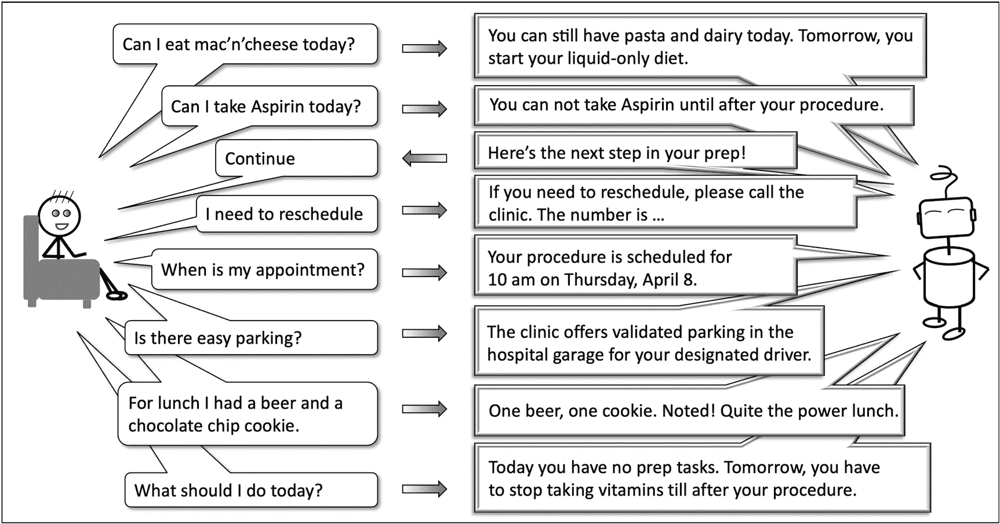

# 5. 从探索到用户体验与用户界面：语音设计工具

你已经来到了第二部分的最后一章。在此之后，你将进入从规划阶段到核心构建阶段：详细设计与开发。在本章中，我们将探讨如何以及在哪里找到有助于回答探索问题的数据，这些数据可以在你拥有用户之前或用户访问受限时指导你的设计。幸运的是，如果你知道该问什么问题以及如何提问，你可以快速且低成本地完成很多事情。你将了解一些通用的语音用户界面设计文档方法，这些方法适用于任何平台。这不是关于工具的操作指南，而是概述一些经验丰富的语音用户界面设计师使用什么工具及其原因。如果你负责组织中的语音用户界面设计，本章将为你提供一些可供选择的方案。如果你加入一个现有组织，你当然会使用其标准工具。但谁知道呢：也许你能带来改变！本章最后介绍了一些测试用户界面假设的强大方法及其结果能告诉你什么。你将在第 16 章中了解更多关于如何测试的内容。

## 如何在任何预算下找到早期用户数据

在语音世界中，数据就是黄金。正确的数据可以告诉你人们想要什么、他们会如何提问、他们期望听到什么、他们是否满意，以及你是否理解了他们的意思。数据可以指引你进行正确的对话设计，帮助选择功能，并帮助你改进现有的语音应用。你的设计是建立在你基于所拥有数据做出的假设之上的。你可以在许多地方找到数据，有些是免费的，有些是便宜的，有些是昂贵的。好消息是：昂贵的东西并不总是最好的。本章重点介绍如何在拥有来自实际用户的语音数据之前，找到能为你的设计提供信息的数据。在本书的最后部分，你将了解当人们使用你的语音应用时，你可以从语音录音和文本日志中学到什么。你将理解为什么访问这些数据将成为未来语音领域的战场。

现在，让我们看看你能学到什么以及需要注意什么。我们将这些方法大致分为三类：第一，通过搜索或积极参与众包方法在线找到的数据；第二，直接观察数据；第三，通过积极参与观察和提问获得的数据。请记住，这只是一个概述。每种方法都可以成为一本书的主题。对于每种方法，细节中总是藏着魔鬼。以正确的方式提出正确的问题并分析答案需要经验和实践。我们的目标是防止你犯大错误，而不是教你关于这个主题的所有内容。

`成功提示 5.1 数据越多越好`

……前提是你对其来源有足够了解，以便评估数据和相关论断。数据的相关性取决于许多方面，包括问题的呈现方式、提供的选项、上下文、参与者特征、模态（文本 vs. 语音）以及每个问题的确切措辞。

**来自语音前线**

请记住，语音和文本是不同的。差异包括错误类型（发音 vs. 拼写）和情感（韵律 vs. 表情符号）。话语在词汇选择、标点、犹豫和整体结构上也存在差异。我们在健康应用中从语音和文本用户输入收集的数据表明，使用完整句子与仅使用关键词和短语之间存在显著差异。对人类来说，这种差异微不足道。但对语音系统来说，这至关重要。

### 在线研究与众包选项

在第 4 章中，我们介绍了尽早进行快速在线研究的好处。通过阅读他人的研究并向最终用户提问，你可以学到很多东西。

#### 博客与文章

| **是什么？** | 基于个人经验或观察的评论。 |
| --- | --- |
| **优点** | 易于获取——别人已经为你完成了工作。免费或廉价。可以提供有趣的、以用户为中心的见解。作者通常独立。 |
| **缺点** | 质量参差不齐，取决于作者的知识、洞察力和目的。可能不准确或反映某种目的。结果和结论通常更像是轶事而非具有重大意义。 |
| **要点** | 阅读你能接触到的任何内容，但要带着批判的眼光去读。了解哪些人和事值得信任及其原因。 |

#### 行业研究

| **是什么？** | 由营销或咨询公司（如 Gartner 等）进行的调查和研究。基于大量参与者撰写的书面报告，配有精美的图表。在线搜索“语音营销行业研究”等关键词。 |
| --- | --- |
| **优点** | 轻松快速获取——别人已经为你完成了工作。提供用户行为或偏好的通用定量数据，以及对某些技术未来方向的预测。可以提供可以进一步研究和发展的见解。 |
| **缺点** | 非常昂贵。可能不针对你的特定需求。问题通常不是由语音专家制定的，可能从其他研究中复用，或者可能不关注语音输入/输出。作者有压力提供见解和预测；关键细节被忽略，导致过度简化或完全误导性的结论。参与者通常是众包的：参与者离自己的具体经验越远，他们在回答时不诚实或不投入的风险就越高。 |
| **要点** | 阅读你能接触到的任何内容，但要带着批判的眼光去评估所有结论和问题的相关性。 |

#### 客户评论

| **是什么？** | 对现有或类似产品的评论，或 reddit 等网站上的评论。 |
| --- | --- |
| **优点** | 快速且廉价。评论者希望被倾听，并且可以在真实生活条件下从广泛的背景中提供有价值的信息。 |
| **缺点** | 被动的信息流；你无法跟进提出澄清问题。人们通常不知道为什么某些东西有效或无效。负面评论比正面评论更常见——有些人只是想发泄。数据高度轶事化。投诉可能涉及产品不相关的方面。 |
| **要点** | 不要将其作为设定方向的主要数据来源——尝试理解每条评论背后的含义。 |

#### 辅助材料

| **是什么？** | 收集并阅读与你的任务相关的任何材料，特别是针对任何有专业重点的内容。例如，医疗程序的说明样本、股票交易的金融规则和术语，以及酒店或邮轮预订的可用选项。 |
| --- | --- |
| **优点** | 容易快速上手。提供关于用户会说的词语以及完成任务所需信息的关键信息。网站和印刷材料的布局指向使用频率，可用于设计流程和提示。 |
| **缺点** | 你需要的材料可能对“外人”不可用。大多数数据可能不是针对语音的。 |
| **要点** | 为你感兴趣的领域和任务建立自己的参考库。 |

#### 众包数据

| **是什么？** | 从亚马逊土耳其机器人（Amazon Mechanical Turk）、Figure Eight 及类似机构收集数据。每位参与者在某项任务或话题上提供反馈、回应或行为数据后，会获得少量报酬。更多关于调查的内容，请参阅第 16 章和第 17 章。 |
| --- | --- |
| **优点** | 成本低廉且快速。问题和任务可以精准定位到你感兴趣的特定主题。你可以指定参与者的数量和类型。能够从非常广泛的人群中获取大量有价值的信息。 |
| **缺点** | 信息流是被动的；你无法跟进提出额外的澄清问题。你越远离询问参与者的具体经历，他们不诚实或敷衍了事的风险就越高。问题必须措辞严谨才能产生有效答案；如果你不熟悉用户体验或调查创建，请在细节上寻求帮助。 |
| **要点** | 如果你能提出正确的问题，并识别出哪些数据需要剔除，那么这是获取普通人群数据的绝佳资源。 |

**来自一线声音**

我们以及其他人都充分利用了在线众包。只需很少的钱，众包平台就能让你向随时可用的互联网用户提问，从而从广泛的人群中快速获得数据。你可以播放音频提示，并提出理解性和偏好性问题。或者播放一组你正在考虑用于产品的名称，看看哪个最令人难忘。或者询问参与者早餐吃了什么。或者让他们先想一个关于程序 `X` 的问题，然后像问医生一样大声说出来，最后输入他们大声说出的内容。你不能做的是捕捉参与者的音频或要求澄清，因此你必须仔细考虑如何措辞问题，并在开始大规模调查之前进行试运行。

### 对话参与者观察

下一组方法侧重于观察潜在用户及其行为。观察比其他组别中介绍的方法更为被动，但同样重要——并且它在所有其他方法中都扮演着角色。无论你是在为现有的人机交互创建语音版本，还是将人机交互扩展到包含语音，甚至是在现有语音产品的新版本上工作，都去观察吧！方法是相同的，但你对用户的访问权限不同。如果可以进行录音，那就去做。但要注意安全和隐私。

**来自一线声音**

在为一家财富 500 强公司做一个语音项目时，我们看到了关于客户联系其大型呼叫中心原因的详细数据。数据的来源是客服人员自己，他们在每次通话后使用一大组预定义的类别对通话进行分类。看起来大多数人打电话的原因只有少数几个。在后来的一次客服观察会议中，我们了解到，由于客服人员急于接听下一个电话，他们通常只从几个通用类别中挑选一个。要从一个多级下拉菜单的长列表中找出更精确的类别，这根本不可能发生。如果我们仅仅依赖数据报告，而没有进行额外的客服观察，我们就会在流程的多个节点做出错误决策，这很可能会对系统性能产生负面影响。

`成功秘诀 5.2 学会观察——你会喜欢的`

观察、分析并得出恰当结论是你应该学习的事情。即使你在一个更大的团队中工作，不是主要负责数据收集或设计的人，你越是理解其中的含义，大家就越能更好地利用时间，你整体上也会更成功。此外，理解人们想要什么真的很有趣！

#### 实际或潜在主要用户观察

| **是什么？** | 观察和倾听人们如何与现有技术或其他人互动，以完成你希望在语音应用中实现的目标。可以是正式或非正式的，样本数量可多可少。详细记录每次互动，包括说了什么、做了什么、哪些有效、哪些无效。 |
| --- | --- |
| **优点** | 可以快速且廉价地进行，即使只观察几次也能学到很多东西。应该成为你创建任何东西的一部分。 |
| **缺点** | 如果你正在创建全新的东西，或者无法接触到代表性用户，那么在合适的环境中找到合适的互动可能会很棘手。在不影响数据的情况下做笔记或录音也很棘手。 |
| **要点** | 在不打扰用户的前提下，找到最具代表性的用户和场景。 |

#### 次要对话参与者观察

# 语音数据收集与VUI设计探索

## 观察与倾听

| **是什么？** | 观察和倾听人们如何与人工客服、代表、店员、护士或任何当前执行你的语音应用将要处理的任务的人互动。记录他们的互动风格、使用的词语、完成任务流程、所做的假设等等。 |
| :--- | :--- |
| **优点** | 信息量非常大。可以展示用户当前面临的问题，并提供关于哪些有效、哪些无效的见解。 |
| **缺点** | 并非总是可行。如果你的语音应用在任何人机互动的方面有所突破，要知道原因（可能有充分的理由），并计划提供额外的用户指导。 |
| **要点** | 如果你要自动化任何现有的人机语音交互，这是至关重要的信息来源。 |

### 专家评审与启发式评估

| **是什么？** | 审查现有方案的设计，看看做了什么并理解原因。观察自己与现有方案、人际互动或应用的交互过程；记录哪些有效或无效，以及你的假设和需求是什么。 |
| :--- | :--- |
| **优点** | 没有比观察自己更容易的途径了——而且你很可能还会给自己行个方便！如果你本身就是具有代表性的目标用户，那就更好了。 |
| **缺点** | 你只是一个人。专家与新手用户的视角不同。 |
| **要点** | 你可以从自己的互动和分析中学到很多东西；只是不要完全依赖这种方法。 |

**成功秘诀 5.3 你不是用户，而且……**

你可能听过“你不是用户”这个警告。除非你是唯一的用户，否则这是一个有效且重要的警告。在处理语音问题时，很容易陷入一个陷阱，即认为每个人都和你一样使用语音和语言。事实并非如此。你需要确保他们都能被成功理解。所以，是的，“你不是用户。”永远不要假设你可以把自己置于用户的位置；了解他们所处环境的一切，或者他们将如何表达请求。同时，也不要假设你与他们完全不同。这只是同一枚假设硬币的另一面。只有有效的用户语音数据和话语才能展示用户的行为。在你获得这些数据之前，请利用你自己的经验和关于语音工作原理的知识，并尝试拓宽你的假设范围。只是要准备好改变你的假设。

**来自一线声音**

细节很重要——甚至是谁在提问也很重要。在创建我们的一款健康相关语音应用时，我们组织了一个全部由女性乳腺癌幸存者组成的焦点小组。可以这么说，由于主持人是你的女性合著者而不是男性合著者，参与者公开分享的意愿要高得多。

### 焦点小组、访谈与调查

最后一组数据来源方法与其他方法的不同之处在于，你更积极地参与其中——你的参与者也是如此。观察也是这些方法的一部分，但在这里我们侧重于你与数据源互动、提出澄清或后续问题，或了解更多关于每个参与者信息的能力。这些方法通常面对面进行，并且需要更多的准备工作。

#### 深度访谈与焦点小组

| **这是什么？** | 正式或非正式的详细对话，通常为一次性互动，形式包括一对一访谈或由能够回答你深度问题的同类用户组成的小组。针对医疗流程，应将患者和医护人员分为两组。若为某个企业或组织创建产品，可通过他们获取参与者名单进行招募。 |
| :--- | :--- |
| **优势** | 具有共同背景的参与者能激发其他参与者的想法。当话题较为敏感时，一对一访谈会更有帮助。 |
| **劣势** | 焦点小组应由经验丰富的人主持。难以让小组保持专注并确保每个人都参与其中。某个参与者可能会主导讨论。 |
| **要点总结** | 提前做好功课，以最大化每个人的时间价值。这是适合受过训练者的任务。 |

#### 专家小组

| **这是什么？** | 一种特殊类型的焦点小组，由一组愿意在未来回答额外问题并保持互动的人员组成。创建你自己的“VIP”小组，成员需具备与你所创建内容相关的经验或知识。寻找那些诚实且有空回答你各类问题的人。例如，针对医疗流程应用，你需要寻找经历过该流程的人、即将经历的人以及医护人员。 |
| :--- | :--- |
| **优势** | 是后期测试和反馈你构建内容的绝佳纵向资源。能提供有针对性的有效信息，并帮助你快速验证假设。通常成本低廉；人们乐于参与并提供反馈，仅需一张礼品卡作为回报。通常可以从朋友和家人开始。 |
| **劣势** | 某些任务需要找到合适的人员。部分人会有强烈的主观意见，有些人会记错或对细节记忆不清——因此需要足够多的参与者才能获得有效结论。 |
| **要点总结** | 这是一项价值连城的资源。 |

#### 定向调查

| **这是什么？** | 针对经过验证的相关目标用户分发包含特定问题的调查问卷。若为某个企业或组织创建产品，可通过他们获取参与者名单进行招募。通常与参与者仅有一次互动，因此不具备交互性，但你能了解每位参与者的某些信息，例如人口统计特征和其他相关背景。 |
| :--- | :--- |
| **优势** | 数据质量和相关性高于在线众包调查或通用研究。 |
| **劣势** | 可能难以找到合适的参与者。 |
| **要点总结** | 另一项价值连城的资源。 |

#### 应用内数据收集

| **这是什么？** | 如果你已有一个正在运行的应用，且该应用在你构建的任务中未使用语音功能，同时你有数据访问权限，则可以添加一个让用户感觉是在理解语音的步骤。或者添加一个简短的调查或反馈问题。收集数据用于分析。 |
| :--- | :--- |
| **优势** | 用户数据高度相关，因为内容以自然的口语或文字形式呈现。一旦基础设施就位，成本低廉且灵活。更多数据相关内容见第 16 章和第 17 章。 |
| **劣势** | 提示语必须精心设计才能获取相关数据。需要具备收集用户数据的能力。 |
| **要点总结** | 如果你处于这种情况，那真是太幸运了！ |

**成功技巧 5.4 尽可能接近真实用户**

这可能是所有关于寻找数据以指导设计的技巧中最重要的一个。目标用户比普通用户提供的信息更有价值。语音数据比书面数据更相关。在预期环境中执行任务的人的行为，比此人描述过去经历或未来功能更能告诉你信息。收集所有数据，但要根据相关性进行分配。

**来自语音一线**

一位项目经理分享道：“我想分享两个经验。第一：不要急于进入开发阶段。从设计开始，甚至在此之前，要清楚你拥有什么资源。了解你能控制什么、不能控制什么，这样你才能关注正确的事情。仅仅选择一个语音平台（如 `Google` 或 `Alexa`）是不够的。每个平台内部都有多种方法和依赖关系，会直接影响你的设计和开发选择。第二：信任团队中具有语音经验的人。与他们合作——他们通常是热衷于解决问题的极客。他们知道什么可行，并且能针对任何限制条件制定规范。但前提是他们必须了解这些限制条件。”

一位 `VUI` 设计师在开始一份创建语音产品的新工作时，谈到了期望落差。“很明显，团队中没有人理解哪些信息对 `VUI` 架构和设计选择至关重要。我被雇来从第一天起就创建 `VUI` 设计，所以当我没有立即投入工作，而是开始询问关于现有技术和数据的问题时，大家都感到惊讶。麦克风在语音结束后会自动关闭吗？有哪些确认方式可用？错误处理的灵活性如何？使用的是什么识别引擎？我们能否跟踪并利用用户之前的请求和账户信息？…… 这整个过程对所有人来说都是一次学习。”

## 探索如何影响VUI设计决策

还记得我们说过，设计 `VUI` 交互从来不止一种方法吗？这对于所有方法和平台都是如此。然而，你的选择可能会受到平台、工具、语音服务以及开发环境所提供的功能和可行性的限制。

例如，如果你选择的平台允许你区分自己指定的错误条件，那么你可能会认为，如果你能精确选择如何措辞回应，以清晰说明哪里出了问题，这对用户会很有帮助。但并非所有平台或环境都允许你这样做。如果你必须将 20 种错误条件映射到仅有的三个通用提示响应中，这显然会影响你的整体设计和有效性。大多数情况下，你面对的是远未成熟且不断变化的平台和技术。如果你依赖当前的功能，或者更糟，依赖一个承诺的功能，那么当你需要它时，它可能不存在，或者其实现方式与你的预期不符。我们两位作者在依赖“打包”解决方案来加速开发时，都遇到过这两种情况。一如既往，选择是一种权衡。天下没有免费的午餐。

**成功提示 5.5 不要埋没你的需求**

你的探索结果应以某种需求规格说明的形式记录并共享，并且它应该是一份动态文档。保持随手可得，经常参考，并在修改功能或了解用户或数据访问情况时进行更新。添加注释以提醒自己原因。如果你与团队合作，请尽早让所有人达成一致，确定一个对所有人都有效的格式和位置，并经常参考。永远不要丢失解释原因的笔记。

探索的一个目标是确定开始定义意图所需的信息。意图应具有有意义的名称，以便设计师和编码人员能以相同格式使用。重要的是，它们应从用户的角度捕捉请求。这意味着尽量减少你方的解读，而不是基于你当前认为会在应用中处理的内容。稍后你将了解更多关于这背后原因的信息。

在适当的粒度级别上指定意图会影响你的设计、代码和架构。意图通常由用户方面的语义和语法组合以及各种集成需求来界定。在每个核心意图内，你还会拥有子级别的意图。可以将其视为一个包含一组更详细意图的意图家族。与设计和实现的其他方面一样，如何划分意图很少只有一个标准答案，但需要深思熟虑和规划。

我们倾向于在意图定义中非常详细，因为我们发现这会使事情更灵活、更精确。命名选择和细节实际上会影响你和你的团队对整个语音交互的思考方式；它们会影响对话流程以及任何模块和提示的重用。当意图标签清晰时，与其他团队成员和利益相关者讨论细节会更容易。试图忽略细节并将行为归并到一个标签下几乎没有什么好处。你可以轻松地以相同方式处理两个意图，但如果你试图拆分已合并为一个意图的两个用户请求的处理，则必须做额外的工作。

### 探索指导设计：一个示例

让我们看一个例子。

图 5-1 应该看起来与第 4 章类似，只是我们对其进行了扩展，添加了一些响应。在第 4 章中，我们为程序准备应用确定了八个核心意图。其中一个核心意图是食物搜索。图中的第一个请求（*我今天能吃芝士通心粉吗？*）显然属于这个意图。用户想要了解特定食物的信息。所以让我们将核心意图标签设为类似 `foodInfo` 或 `foodSearch`。第二个请求（*我今天能吃阿司匹林吗？*）从用户角度来看是相似的，但细节不同。食物和药物不一样。所以让我们将其命名为类似的 `medInfo` 或 `medSearch`。它捕捉了差异和相似性，从设计和开发角度来看似乎也是合适的：两者都涉及对大型数据库的开放搜索。你能把它们都称为 `Info` 或 `Search` 吗？可以，但考虑到这些将是常见请求，并且会访问不同的数据库，我们会立即将它们作为单独的意图来处理。

**图 5-1** 原型用户请求及代表性语音应用响应

你还没完成。再看一下*我今天能吃芝士通心粉吗？*。用户指定了食物和时间范围。你不想忽略这些信息，所以最好也捕捉它们。我们可能会从类似 `foodSearch.specific.day` 这样的标签开始。这告诉我们，我们认为用户正在询问特定食物项目的信息，并且他们指定了日期。他们可能没有指定其中一项或两项（`foodSearch.day`、`foodSearch.specific`、以及 `foodSearch.general` 或 `foodSearch`），这意味着我们要么需要提出后续问题，要么给出一般性回答。稍后会详细介绍。如果很多用户指定了具体时间，你可能会添加 `.time`。如果区分“吃”和“喝”的问题有意义，那么你会添加一个 `drinkSearch` 意图家族。你明白这个意思了。

你的功能需求通过指出你的 VUI 设计需要在何处加入确认或消歧以填充多个槽位，直接影响到你如何布局对话流程。请记住前面章节的内容，槽位（或实体）基本上是用于捕获特定内容片段的变量，例如食物项目或时间：

- 当多条信息填充槽位时，你需要填充所有必需的槽位才能达到目标。这意味着每一种组合，包括所有槽位、无槽位或部分槽位，允许用户自然说话并继续，而无需重新开始或重复。你的响应理想情况下应在详细程度上与用户请求匹配。你通过原型句子（代表最典型请求的话语，例如*我能吃什么？*或*我能吃 `$FOOD` 吗？*）来跟踪这一点。你还需要跟踪任务完成情况和预期变化。
- 如果出错的代价很高，你需要某种类型的确认。如果这也是一个棘手的识别任务，你需要更明确的确认。根据准确性重要性以及识别和解析挑战来确定你的确认流程。
- 如果可能存在歧义的用户请求，你需要一种方法来缩小可能性范围，可以基于上下文和逻辑，或者通过询问用户。这基于预期变化以及风险和识别与解析挑战。
- 在任何用户可能说话的地方，他们都有可能不被理解。因此，你需要让他们回到正轨，给出提示该说什么，或者重新开始。你需要在每个对话轮次中都有所准备。预期变化、任务完成情况以及识别和解析挑战有助于解决这个问题。