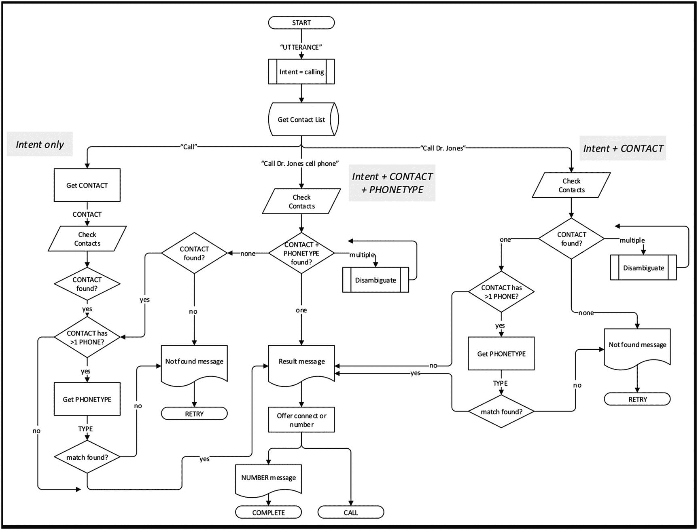
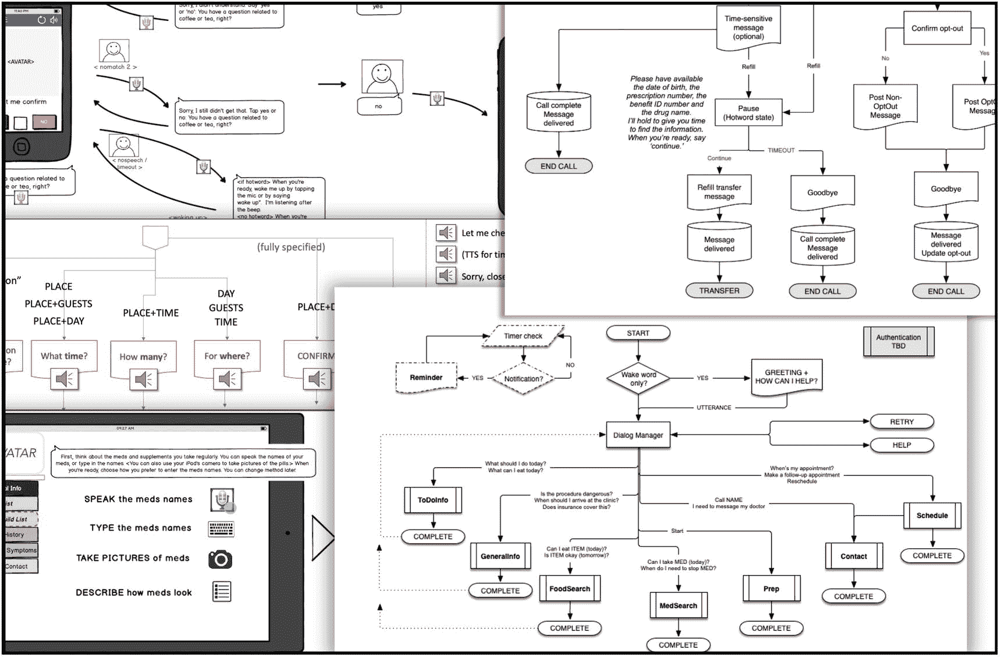
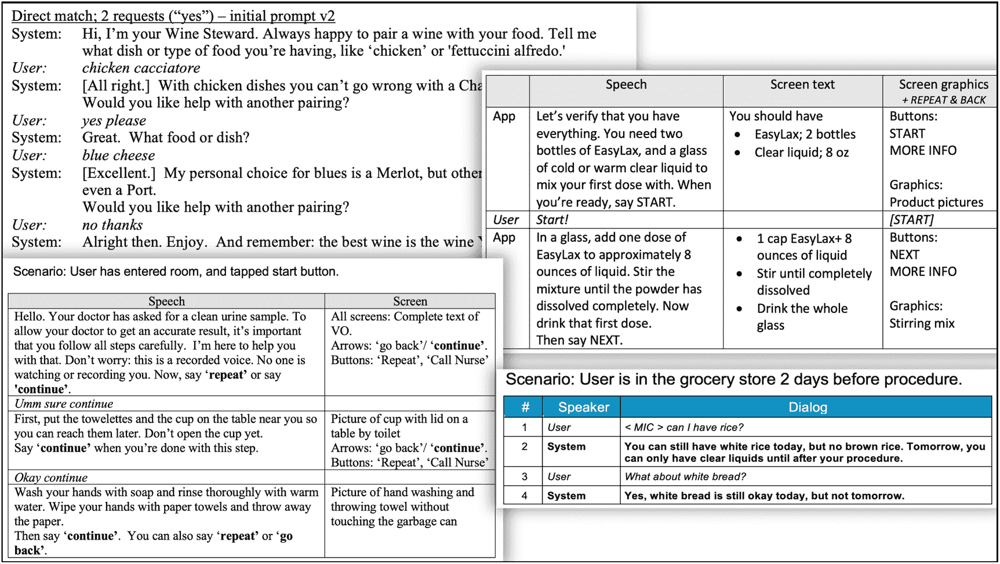
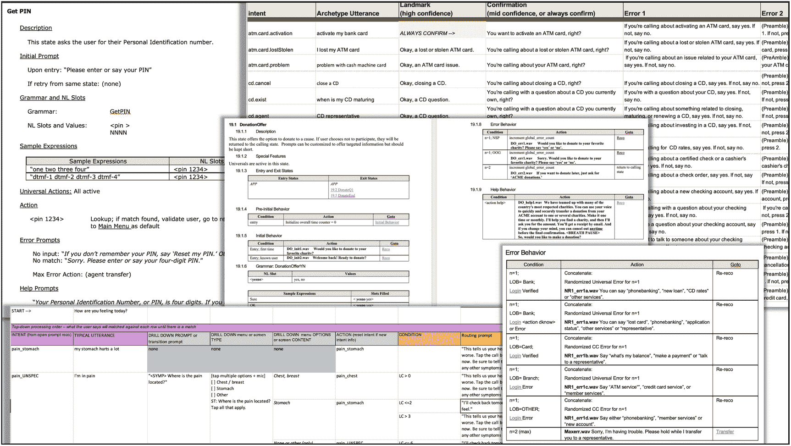

如果数据需要从用户以外的来源获取，或者结果需要保存以供后续使用，亦或是需要完成某些内容交付，那么你就需要访问数据或外部设备。你可以根据功能、任务完成情况和数据需求来了解这一点。请记录在流程的哪个节点需要某些数据，即使你尚不清楚从何处获取。身份验证和识别需求也是如此。

## 理解意图与数据需求

让我们看看这如何应用于其中一个手术准备意图：联系患者的护理团队。表 5-1 总结了第 4 章表格中的部分意图需求。你可以预见到两个槽位（`name` 和 `phone type`）。在发音上存在一些棘手之处，并且可能存在的歧义需要通过了解用户通讯录中的内容来加以限制。就成本或风险而言，最坏的情况就是打错电话。

### 表 5-1 联系意图需求摘要

| **功能** | 用户想要致电其医生或手术机构。 |
| --- | --- |
| **原型句子** | `<拨打我医生办公室的电话>` `<拨打史密斯医生的手机>` |
| **任务完成** | 用户听到护理团队成员的电话号码。可能会提供拨号选项。 |
| **预期变化** | 用户的请求可能含糊不清（同名、多部电话）。数据依赖于用户（通讯录）。 |
| **成本/风险** | 低–中 |
| **所需外部数据** | 护理团队的联系信息。 |
| **所需用户数据** | 用户的通讯录。 |
| **识别挑战** | 中等。来自有限列表的个人姓名。 |
| **解析挑战** | 低。 |

假设你的护理团队有多个联系人，那么你会有一个核心意图（`call`）和两个槽位，一个是必需的（`contact name` 或 `identity`），另一个是可选的（`phone type`；如果我们假设有默认电话，则为可选），从而产生四条路径：

1.  仅核心意图（`Make a call`）需要后续对话来获取致电对象。

2.  核心意图 + 联系人（`Call my doctor`，`Call Doctor Jones`）可能是一个完整的请求，或者如果存在多位琼斯医生，或者琼斯医生有多个电话号码，则可能需要消歧。

3.  核心意图 + 联系人 + 电话类型（`Call Doctor Jones’ cell phone`）是一个完全指定的请求，但它可能与用户通讯录中的任何姓名或电话类型都不匹配。

4.  核心意图 + 电话类型（`Call the cell phone`）是不完整的，也不太可能出现，但可能是识别失败的结果，因此你需要处理这种情况，以防万一。

如果没有匹配项，请告知用户并提供一些指导性建议。如果琼斯医生没有手机号码，你应该如实告知用户以提供帮助，而不是仅仅回复 `Sorry`。根据你的集成方式，更有帮助的回复包括提供其他选项，或者直接说 `There’s no mobile listing for Doctor Jones. Calling the office instead`。如果你的用户问：`What’s Doctor Jones’ phone number`？你可以将其整合到流程中，并提供朗读号码或连接用户的选项。你将在后续章节中了解更多关于如何决定这些处理细节的内容。图 5-2 展示了路径 1–3 的初始中级语音对话流程可能的样子。

**图 5-2** 示例手术准备 IVA 的部分联系意图的中级对话流程

人们会创建这样的流程吗？当然会。无论你使用简单的绘图程序还是生成功能代码的工具，我们都强烈建议使用某种类似这样的流程。它有助于你跟踪行为，避免忘记正常路径或错误条件。它有助于确定流程中预期进行数据获取的位置，这会影响设计和编码。

### 是对话管理器图，而非层次化决策树

养成将图 5-2 中的内容称为“流程”而非“树”的习惯。一个常见的错误是认为语音交互只遵循逻辑步骤，认为用户不会在一定程度上重新开始或跳转，认为他们不会犯错或重复某个步骤，或者认为每个终点只能通过一条路径到达。

人们有不同的心智模型——没有理由不允许他们以多种不同的方式提出请求。查找账户余额可能有一条逻辑上的最佳路径，不涉及询问账单支付，但用户有各种理由以不同方式行事。他们的理由对你来说并不重要——如果他们达到了想要的结果，并且乐意用五步而不是一步来完成，你凭什么说你更短的方式更好？如果你因为觉得这是额外的工作，并且认为*人们不会/不应该那样做*而阻止他们的方式，猜猜会怎样？你的用户不会喜欢你创造的东西，他们会认为你的智能语音应用听起来和表现得都很愚蠢。相反，应将交互视为从 A 到 B 的路径，从启动到完成。B 可以通过众多路径之一到达，包括导致重试的不同条件、不同用户的不同上下文，以及具有不同措辞和信息量或歧义程度的表述。当你的逻辑判定满足条件时，即当你拥有完成用户请求所需的必需和可选信息时，就到达了 B。你并不真正关心用户是如何到达 B 的，只关心你确保他们选择的路径将他们带到了那里。

一些语音交互让用户觉得愚蠢的一个主要原因，是将每个用户请求都扔进同一个 NL 解释中，而没有充分考虑用户的上下文。人们基于之前说过的话来构建对话，并期望对话伙伴具有环境感知能力。作为用户，我会记住我刚才说的话以及由此产生的结果，以及我周围各种事情的发生情况；这是我当前的前景短期上下文。我也了解关于我自己的事情，比如我有哪些相关账户、我的地理位置、一天中的时间等等；这是一个更长期的上下文，一个恒定或可预测的背景。我的对话建立在这些上下文之上。这意味着语音应用需要跟踪并更新之前的“状态”。那个最近的状态，即短期上下文，需要根据每次对话轮次的结果进行修改，就像之前发生的事情的一个狭窄时间切片。你将在第 14 章中了解到很多关于上下文的知识。

### 成功提示 5.6 选择有意义的意图名称和标签

为流程、代码和提示使用意图名称——理想情况下，你团队中的每个人都引用它们，因此名称应该合乎逻辑、易于编写、记忆和搜索。选择一个命名约定，让你只需查看标签就能大致了解用户请求的内容和方式。至少，你的意图名称数量应与该意图所需的槽位数量相同。例如，名称 `foodSearch.item`、`foodSearch.day` 和 `foodSearch.item.time` 告诉你一般意图是关于食物的提问，以及还指定了什么。你需要为两个槽位都未填充的情况添加一个名称。这有助于你系统地指定每种上下文所需的提示和行为。同时也要考虑已知的未来变化。因此，如果你已经计划将联系功能拆分为电子邮件、短信和电话，那么即使你还没有处理方案，也最好立即进行拆分。

### 来自语音实战一线

当被问及什么构成一份优秀的 VUI 设计规范时，一位开发者表示：“如果你是一位刚接触语音领域的开发者，你会对高质量 VUI 规范中的细节程度感到惊讶。非语音领域的开发者自然会想‘这能有多难？’，而我的回答通常是‘比你想象的要难！’对话设计有其微妙的复杂性。一位称职的 VUI 设计师会花时间和精力详细阐明一切应如何运作，不留任何解读空间。使用明确指定的逻辑是极好的。优秀的对话设计师必须理解基本的编程逻辑，而优秀的开发者也需要明白 VUI 设计师的所作所为自有其道理。建立共同的认知基础至关重要。要定期开会并互相提问。”

一位产品经理指出：“要清晰地将预期行为与实现细节分开。假设你正在构建某个设备。不要写成‘功能 X 具有设置 A、B、C，通过拨动开关控制’，而应从‘功能 X 具有设置 A、B、C’开始。然后链接并指定不同界面的 UI：对于一种界面，写成‘X 通过顶部面板上的拨动开关控制’；对于另一种界面，写成‘对 X 的典型请求是“将 X 设为 A”或“将 X 改为 B”。如果请求 D 或 E，则回复这些不受支持’。这有助于你平等对待不同的 UI，同时记住它们并不相同。”

### 捕获与记录 VUI 设计

VUI 设计通常通过三种方式捕获和记录，每种方式各有其优势和目的。你应该充分利用这三种方式：对话流程、示例对话（模拟）和详细设计规范。让我们逐一简要了解。

#### 对话流程

有些对话流程是核心意图和体验的高层概览；另一些则非常详细。这是团队中每个人确定例如数据访问发生在何处、以及包含多个槽位的多步骤对话中整体步骤顺序的最佳工具。你希望在进入详细设计之前先确定整体逻辑流程。当你添加提示语措辞时，使用表示草稿状态的标记。我们经常使用全大写或尖括号。一旦详细设计完成，你可以用提示语措辞更新你的流程。图 5-3 展示了一些实际示例。

**图 5-3** VUI 对话流程形态各异——字面意义上的

### 成功提示 5.7 在早期流程中坚持逻辑与描述

为了让每个人在早期专注于流程和逻辑，而不是提示语的措辞和其他细节，在这些流程中排除完整的提示语，但使用描述。例如，所有错误消息可能写成“错误消息 + 提供选项”，而不是像*琼斯医生没有办公室电话。想改打实验室电话吗？*这样针对具体上下文的完整句子。一旦进入详细设计阶段，你可以轻松地将描述符改为完整的提示语。

#### 示例对话

# VUI 设计与规范

## 示例对话与流程

展开流程中的每个框涉及创建你在第 2 章和第 3 章首次看到的示例对话。它们也被称为 VUI 模拟，是一组简短的对话，每个对话都展示了用户与 VUI 之间对话的一个代表性快照或路径。每个对话都应包含对该对话上下文和条件的清晰描述。你当然需要包含成功的理想路径。你还必须向用户展示不成功的交互会是什么样子。你将在后续章节中了解更多关于错误条件的内容。重要的是，示例对话应以书面交互（为方便起见）和音频录音（为相关性起见）两种形式存在。

示例对话是详细设计的基础。它们是 VUI 设计的原型线框图。示例对话和对话流程共同构成了展示任何语音应用的预期风格和功能、以及使`用户故事`具体化的绝佳工具。你可以将一份完整的 VUI 设计规范视为一套完整的示例对话，并附有逻辑或伪代码以及流程。可以公平地说，所有经验丰富的 VUI 从业者在开始创建语音交互时，都会使用示例对话和流程的某种组合。图 5-4 让你一窥书面示例对话可能的样子。

### 多模态角落

从第一套示例对话开始，就在每一套中包括所有预期的多模态交互示例，即使最初只是简单的描述性注释。在视听模拟中包括一个简单的视觉版本。重点展示模态如何协调，并适应具有模态差异（如免提与免视）的用例。展示如何启动监听（唤醒词、按即说等）、不同的输入模式（语音、按钮、键盘），以及如何指示监听、空闲或处理等动作状态（图标、灯光等）。

图 5-4 示例对话示例

### 成功提示 5.8 以音频形式呈现示例对话

示例对话的文本版本有助于思考设计并与他人讨论，但切勿忘记口语和书面语是截然不同的。在评审中，始终从音频版本开始，如果可能，使用真实语音预先录制；否则，大声朗读，甚至进行角色扮演。避免过早展示书面文本。事实上，评审文档有时会包含“请勿翻页”的警告。例如，对于选项列表或对不熟悉名称或数字的长描述，很容易看出问题所在。一份书面的配料清单很容易通过视觉扫描来确保你拥有所有东西，但对于同一份食谱的纯语音版本，如果没有暂停或导航命令，你很可能会遗漏某些内容。在设计过程中，要对自己说话，并向你周围的人朗读示例。这就是 VUI：一切都关乎声音。

## 详细设计规范

你的详细 VUI 设计显然应致力于覆盖足够多的细节，以便在开发过程中的每个上下文和条件下都能清晰呈现预期行为。这对于任何模态的设计来说都是显而易见的，但相比包含屏幕截图、精确尺寸和颜色代码的视觉界面，语音设计如何做到这一点可能不那么明显。详细的 VUI 设计文档至少应涵盖以下内容：

- 每个意图、名称和描述

- 对于每个意图：

    - 原型话语及任何预期词汇

    - 槽位名称和值（必填和可选）

    - 每种上下文和条件组合下的结果及下一步操作

- 上下文：用户身份或类别、用户偏好、环境、之前的用户请求及结果（对话路径）、当前系统活动等

    - **条件**：针对每种预期用户请求状态（已识别并处理、已识别但未处理、未识别等）的行为

    - **提示**：针对每种上下文和条件的参考标签及确切措辞，包括错误处理、重试、随机化等

    - **清晰且一致地描述行为的逻辑和伪代码**

    - **数据需求**：类型、格式、来源及存储位置

当然，你用于记录设计的工具取决于你的工作地点、合作对象以及所使用的平台和语音服务。请使用能够捕捉影响设计的任何系统或平台限制的文档风格或工具。并且要使用能轻松记录可实现内容的工具！对于多步骤对话任务与单步“一次性”请求，你可能会采用不同的方法。无论如何，随着情况变化，你当然需要澄清并调整你的设计。

### 成功技巧 5.9 选择一种标记法

为了传达设计（或按预期解读设计），你需要一种清晰易用、便于在流程和规范中键入，并能良好地在设计与开发之间传递的标记法。我们喜欢使用全大写字母加上某种符号来指示变量内容，以便于搜索，例如 `$FOOD`。你的选择会受到开发环境、编程语言和工具的影响，但它应适用于所有相关人员。对于原型话语，重要的是不要忘记它们只是示例，而非承诺能处理精确的话语。同样重要的是避免过早进行详细设计。请标记提示的“建议性”或草稿性质。我们常用尖括号来实现这一点，但你可以使用任何适合你情况的符号，例如 `<好的，正在呼叫 $NAME，$PHONETYPE>`。伪代码很有用，因为它减少了解读需求且易于搜索。在确保覆盖所有用例时，它也有助于设计过程。我们曾大量使用简单的伪代码来处理上下文和条件，例如 `is_muted = TRUE` 或 `$AMOUNT >= maxAmount`。无论你使用什么，请确保每个人都理解并清楚其含义。

## VUI 设计文档方法

让我们来看看记录 VUI 设计最常用的几种选择。

### 独立设计工具

| **是什么？** | 用于 VUI 设计的图形化软件工具。目标是尽量减少编码和对细节的担忧，从而快速创建可在 Alexa 或 Google 或两者上运行的功能性 VUI 对话。示例：Voiceflow、Witlingo、Jovo、Voice Apps 等。 |
| :--- | :--- |
| **优点** | 快速。可以规划出设计并将其转化为功能性对话。非常适合概念和简单场景。无需编程知识即可让某些功能运行起来。 |
| **缺点** | 功能和特性通常有限。许多工具尚不成熟，仍在变化中。所有工具都强调创建速度，而非灵活性和高质量设计。有些工具偏向某个平台。需要一定的上手时间。 |
| **总结** | 非常适合小型项目和示例对话。找到适合你且不限制你的工具，同时要忠于你将开发和运行的平台。 |

### 开放平台特定工具

| **是什么？** | 示例：Google Dialogflow、Alexa Conversations。 |
| :--- | :--- |
| **优点** | 仅限于平台或语音服务提供的功能，这自然能防止你设计超出范围的功能，并允许你不必处理每个细节。因此可能非常强大。 |
| **缺点** | 仅限于平台或语音服务提供的功能。始终在演进；新版本可能不稳定。通常涉及一些编码，这对某些设计师来说可能是个缺点。需要一定的上手时间。 |
| **总结** | 如果你确定将为常见平台之一进行设计，这些工具非常值得研究。 |

### 专有或封闭平台特定工具

| **是什么？** | 高度灵活且强大的 VUI 设计工具，通常经过长期大量投入创建而成。示例：Nuance Application Studio (NAS)、Nuance Mix 等。 |
| :--- | :--- |
| **优点** | 功能强大且通常成熟。通常能将各种设计文档整合在一起，自动更新所有相关位置的变更以保持同步。可以生成代码和提示列表，甚至原型设置。提供与平台可用功能相对应的特性，且仅提供这些特性。 |
| **缺点** | 除非你与掌控该工具的公司有关系，否则无法使用。自动生成的代码除非经过全面优化，否则不适合生产环境，并且通常需要为更大规模的实际复杂系统进行返工。与特定公司的平台相关联；不具备通用性。上手难度可能较大。 |
| **总结** | 顶级中的顶级——如果你能获得访问权限，就使用它们。 |

## 标准文档工具

| **这是什么？** | 标准办公软件，有时会添加定制的脚本。示例：文本（`Word`）、电子表格（`Excel`、`Google Docs`）、流程图（`Visio`、`Balsamiq`）。可连接数据库并生成提示列表。 |
| :--- | :--- |
| **优点** | 完全灵活，可精确满足你的需求。不依赖他人更改功能可用性。无需培训上手时间。易于获取。 |
| **缺点** | 所有工作都得你自己完成。任何自动生成功能仅限于你创建的内容。确保所有引用文档的人使用相同的符号。 |
| **要点** | 这可能是目前最广泛使用的 VUI 设计工具——不要低估简洁性的力量。 |

在图 5-5 中，你可以看到来自不同 VUI 设计规范的几个示例。电子表格方法最适合宽而浅的交互，例如不超过一两轮对话的初始开放式交互。它能轻松呈现整体概览和跨上下文的模式。对于较长的交易型对话，结合流程图和带有可点击链接的文字处理格式通常是更好的选择。在更大的实施项目中，你可能会将两者结合使用。

**图 5-5** VUI 对话规范可以是电子表格中的几个标签页，也可以是数百页的文档，但它们都比示例对话或流程图包含更多细节。

如你所见，你有很多选择。没有一种“唯一方法”适用于所有语音从业者的 VUI 文档。你需要根据多种因素确定适合自己的方式：你的工作风格、团队结构、对语音的熟悉程度、公司需求、语音平台、基础设施、现有设计、工具可用性、语音交互类型、多模态或内容。我们以各种组合方式使用了这里提到的所有方法，结果和满意度各不相同。研究你的选项——随着工具的兴衰，选项也在不断变化。利用任何已有的东西。可能是设计模式，也可能是类似语音对话的现有设计。这些可能会影响你的文档选择，或让你更快上手。有时你几乎没有选择，因为方法和格式已经确定。

# 来自语音一线

一位从开发者转型的 VUI 设计师评论如何审查 VUI 设计：

> “如果有配对的对话流程，我总是从它开始。对我来说，这最有意义。很多开发者不关心对话流程，我完全不知道他们为什么这样。我一直都关心。先看大局，再看小细节。
>
> 我无论如何强调对话流程的重要性都不为过，尤其是在面对混合受众时。业务人员能理解它们。这是最容易被最广泛人群理解的文档。它非常适合在更大的系统中引导人们。在对话流程和 VUI 规范之间来回参考很有帮助；甚至同时打开两者，让人们能对照你讲过的内容。
>
> 我喜欢逐个模块地讲解规范，首先在高层面上解释该模块的功能，这样当我们进入细节时，人们就能将其与我之前说的联系起来。前几个模块可能花的时间长一些，但如果它清晰且可预测（比如类似的条件以相同方式编写），即使是非技术人员也能学会术语并理解任何详细的 VUI 设计。然后我通常会逐个节点讲解到一定程度。当有无数条件时，可能会变成‘在场景 A 中，我们走这条路径’，然后顺着走完，再回到场景 B。规范必须有可点击的链接，让你能逐步浏览任何场景。
>
> 解释需要注意什么以及为什么，有助于那些技术视角较弱的人，即使是简单的模块，比如‘这是你的转账模块……我们设置了检查机制，确保有足够的资金，这条业务规则在这里被捕获，等等等等。’谈论业务规则能激发他们的兴趣，因为每个人都知道转账模块是做什么的。这些前置的小细节有助于让他们感兴趣，也让他们知道你‘懂了’。
>
> 我是一个一直关心设计的开发者。我喜欢开发者说：‘如果你这样处理这部分，体验是一样的，但对我来说编码会容易得多。’这是一个好迹象，表明他们理解了，在关注，并且能够妥协。”

如今许多工具旨在让开发者无需太多语音或设计专业知识就能直接上手。这很酷，也是语音开发爆发的原因之一，但对于企业级语音系统，你可能需要其他东西来跨团队协调和跟踪细节。而且你肯定要从设计开始，而不是开发。

## 多模态角落

在详细规范中包含屏幕的缩略图。并行展示屏幕上预期的内容（图形/图像、静态文本、用户识别话语的文本、按钮/键盘）以及代表性请求。不要忘记展示当话语被正确处理以及发生错误时会发生什么（第 13 章）。

详细设计引用了另一组重要的文档化信息：VUI 风格指南。风格指南的核心目的是建立一致性。这意味着在每一个层面上的一致性：对话内和跨对话的提示措辞和传递、VUI 行为、解释，以及与任何品牌相关的内容。当有多个设计师共同负责一个 VUI 或公司内相关的 VUI 时，风格指南至关重要，但即使是单独的设计师也需要风格指南来保持对话的一致性。开发者和语音科学家需要它来确保用户行为得到一致处理，并且词语和短语得到一致解释。

## 成功提示 5.10 警惕委员会式设计

VUI 设计期间最大的挑战是汇集项目中所有相关方（通常良好的）意图。由于媒介是语音，每个人对用户会说什么以及如何最佳回应都有自己的看法。*我会说这种语言。这能有多难？* 是一种自然的想法。你的解决方案是使用录制的示例对话来确定整体对话风格。将决策记录在你的风格指南中，以保持风格和行为的一致性。一个有用的方法是展示多个对话，其中一些明显是糟糕的体验，另一些则很棒但也涉及大量实施工作。让团队参与进来，请他们找出每个对话中的优点或缺点。早期设计是确定提示中你将包含多少变化的好时机，因为这可能会影响开发工作量。详细记录所做的决策及其原因。

# 来自语音一线

实验室内的用户测试绝对可以为你提供有效数据。在开展一项关于驾驶时使用语音发短信的研究时，我们曾担心数据的相关性，因为整个研究是在实验室中使用驾驶模拟器进行的。任务涉及比较（1）使用手机发短信和（2）使用语音听写时的驾驶表现——要求参与者在实际驾驶中完成第一项任务既危险又违法。然而，当一名用户举起手机以便更好地看屏幕，而其他所有参与者都将手机放在膝盖上“以避开视线”时，我们知道数据具有代表性——而且人们仍然在开车时发短信（实验室设置如图 5-6 所示）。

**图 5-6** 实验室内参与者驾驶模拟器及主持人观察设置。

## 原型设计与假设验证

随着你创建的真实世界 VUI（语音用户界面）在复杂度和功能广度上不断提升，并面向不同的用户群体和领域，验证你的假设就变得愈发重要。在你家设备上运行的 `Alexa` 技能或 `Google Action`，就是一个在优化或`调优`之前的功能原型示例。如今，组装这类原型进行快速测试比以往任何时候都更容易。但出于几个原因，你也应该利用非功能性和低保真原型，例如纸质原型和“绿野仙踪”（`WOZ`）设置——即由一个人扮演计算机角色，来引发用户的特定反应。

功能原型存在一个关键局限：没有任何语音实现能拥有完美的性能，尤其是在基于真实用户数据进行调优之前。一个功能原型，尤其是在早期开发阶段，很可能在某些用户请求上失败，从而限制了你对功能和用户行为进行针对性测试的能力。使用功能系统进行测试的另一个重要限制是，无论它们调优得多么好，你都无法强制产生特定的行为。因此，举例来说，如果你想测试用户如何响应特定的错误处理，你唯一的选择就是制作一个单独的副本或进行其他代码更改，以便在你希望的地方强制发生错误。

包括“绿野仙踪”设置在内的低保真方法，则提供了这种控制能力。低保真非功能原型还能让你在投入时间和金钱之前，快速测试那些需要付出一定努力才能实现的想法。你甚至可以模拟数据交互。

### 成功秘诀 5.11 验证假设，永远不嫌早

无论你是在创建一个餐厅查找器、一个面向老年用户的伴侣，还是一个投资工具，一旦你能找到几个有代表性的用户，就去验证你的想法。描述你心中的构想；询问他们认为什么有用，以及他们有什么顾虑。如果你心中已有提示语，看看他们如何回应。无需任何工具，只需角色扮演，并留意他们的反应。你处理的是语音，所以所有交互都应该是口头的，回应也应该是被听到的。仔细记录测试用户的反应，并将其作为你用例中的原型话语。同样仔细地记录你正在测试的提示语措辞。如果你对提示语的措辞或传达方式稍作改动，用户的反应可能会发生巨大变化。

## 语音用户体验与原型设计方法

虽然原型设计和用户测试是一项需要比本书所能涵盖的更深层次细节的技能，但你将在后续章节中了解更多关于它及其所提供数据的内容。现在，先来介绍一下用于测试语音应用的主要方法。它们都是收集针对性主要语音数据的有效且重要的技术。请注意，它们都侧重于定性测试。这是你在开发的这个阶段所需要的。一旦你从已调优并投入生产的语音应用中获得了真实用户数据，你才能进行最佳的定量测试和分析。

### 走廓“游击”研究

| **是什么？** | 顾名思义：非常快速的手动面对面测试，通常没有任何道具，例如描述一个简单的场景、朗读一个提示语，然后要求参与者回应。也用于询问在某个场景下的预期行为。任何被测试的提示语都由测试者朗读。 |
| **优点** | 开销极低，成本低廉。可以在“不知情”的朋友、家人和同事身上进行测试。灵活：可以即时追问和修改测试。 |
| **缺点** | 极其低保真且非正式；参与者的体验不真实。难以保持提示语传达的一致性。如果任务不真实或不一致，结果会产生误导。 |
| **要点** | 非常适合对一般性假设和简单的短语音交互进行“合理性检查”；不太适合较长的对话、特定的用户群体或场景。 |

### 低保真模型（语音版“线框图”）

| **是什么？** | 比走廊研究稍进一步，语音模型可以通过本章前面提到的许多工具创建，或者简单地将一组音频文件导入到你想要测试的流程图像中。只需依次点击每个文件来回应测试参与者的发言。这是对示例对话的手动测试。任何被测试的提示语都应预先录制或使用 `TTS`（文本转语音）以确保一致性。可以测试较长的对话。 |
| **优点** | 开销低，成本低廉。修改快速。无需编码或后端访问。无需调优的功能交互，因此易于测试替代路径。 |
| **缺点** | 体验不真实。提示语通常不使用最终产品的声音或最终措辞，因此结果可能具有误导性。 |
| **要点** | 只要你的提示语和参与者具有代表性，就非常适合发现重大问题。 |

### 绿野仙踪（“WOZ”）

| **是什么？** | 这个名字来源于《绿野仙踪》故事中“帘子后面的人”的概念：看似是机器的东西实际上由人控制。测试者（巫师）使用图形用户界面以预定的方式响应用户的语音请求。通常涉及一名巫师和一名主持人，主持人负责设定场景并提出追问。一些 `VUI` 开发平台包含 `WOZ` 工具，但你也可以自己创建。更多关于 `WOZ` 测试的内容见第 16 章。 |
| **优点** | 可以精确控制体验和“系统行为”。参与者不知道他们在与非功能性系统交互。当参与者和场景具有代表性时，数据高度有效。可以在实验室或远程进行。 |
| **缺点** | 很难保持巫师行为的一致性。巫师需要非常熟悉设计和语音技术，才能提供真实的体验。 |
| **要点** | `VUI` 设计的主力方法。找到最适合你环境的设置，并学习如何使用它来收集有价值的数据。 |

### 功能原型

| **是什么？** | 多个平台和语音服务允许你使用功能性识别和解释来测试你的设计，让参与者可以像使用最终产品一样说话和交互。更多关于功能原型的内容见第 16 章。 |

| **优点** | 真实的体验，尤其是当通过预期的硬件输出时。创建基本体验相对快速且成本低廉。 |
| **缺点** | 未经调优时准确性有限。结果不可预测且难以控制。如果使用 Google 或 Alexa 语音服务，你需要捕获结果，因为你无法直接访问参与者数据。 |
| **要点** | 为参与者提供真实的环境能产生有价值的数据，尤其是你投入越多精力使其更健壮时。 |

## 来自语音一线

几年前，我们参观了一家本地科技公司，那里的用户体验研究人员抱怨说，一些观察他们自己构建的功能可用性研究的开发者，会嘲笑并质疑那些行为方式超出其实现预期的参与者的智力。不要成为那样的开发者。我们在可用性研究的观察室里也观察到过类似反应。是的，有时用户行为确实很有趣——但永远不要嘲笑一个尝试使用你创造的东西却失败了用户，因为失败的原因是你没有理解他们的心智模型或需求。不要自欺欺人，也不要感到难过：捕捉人们想要用你的应用做事的各种方式需要付出努力，但这并非不可能，你也不必在第一天就做到“完美”。所以，尽你所能，并计划在收集更多数据的过程中进行未来的迭代改进和更新。

### 接下来是什么？

如果你想在基础层面进一步了解语音设计及相关实现主题，我们推荐《设计语音用户界面》（Pearl, 2016）^(⁴⁰)、《语音用户界面设计》（Cohen, Giangola, and Balogh, 2004）^(⁴¹)以及《语音交互设计》（Harris, 2004）^(⁴²)。如果你觉得其中有些书过于陈旧，不值得花时间，请记住：技术的变化远比人类快得多，尤其是在人类基本感官和沟通方面。因此，请信任这些资料，并将它们与当前特定平台的素材结合使用。

本章结束了第二部分。现在，你已比大多数人拥有更坚实的基础，能够创建出色的语音解决方案。第 6 章将深入探讨语音设计与开发的第一个专题。

### 总结

-   示例对话应以音频形式呈现，而不仅仅是书面形式，因为聆听对话能带来书面版本无法捕捉的洞察。
-   使用来自多个来源的数据，以最佳方式指导你的设计假设和高层次 VUI 设计选择。
-   基于代表用户群体的数据来制定设计和实现决策。
-   不同用户在对话中会走不同的路径。你的设计和实现必须考虑到这种变化。
-   VUI 文档有多种选择。你的选择取决于你手头的资源以及所从事的 VUI 项目类型，但你应该养成习惯，始终将示例对话、流程图和详细设计规范结合起来，因为每一样都服务于特定目的。

脚注 1 2 3