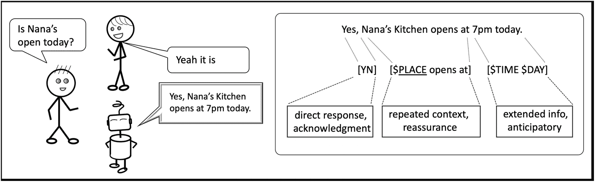
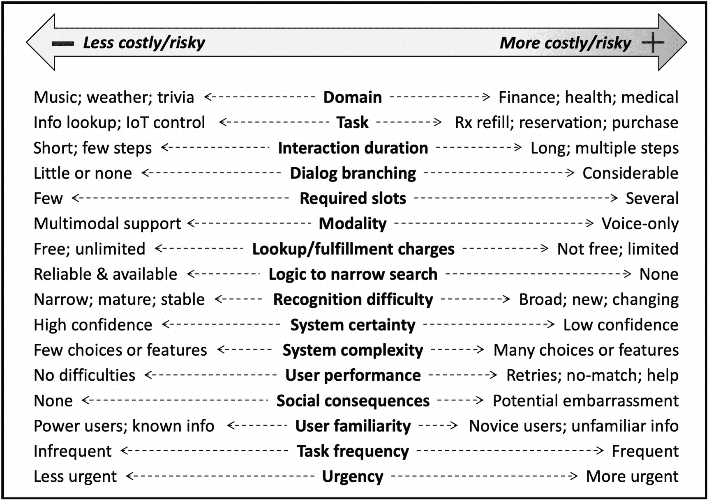
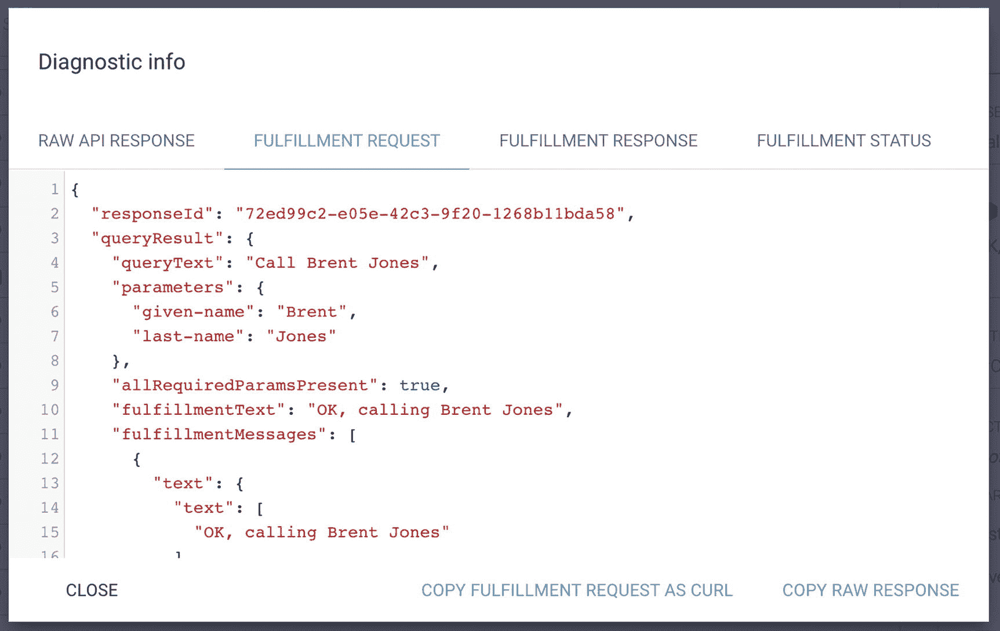
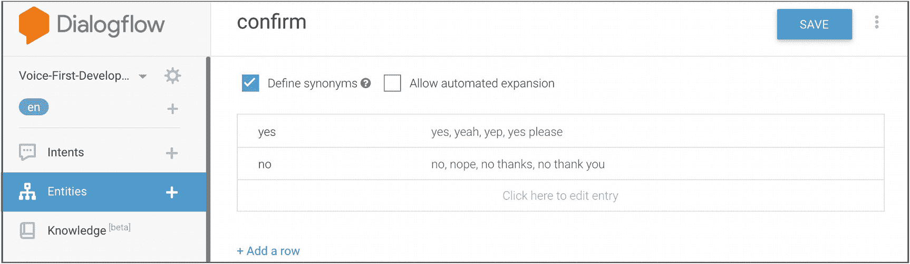
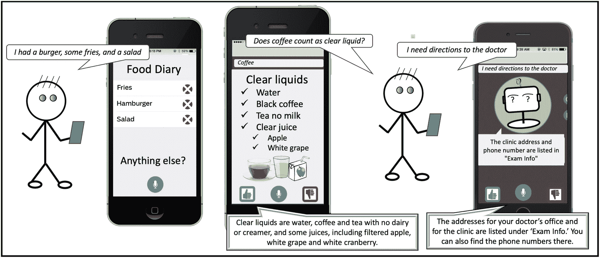
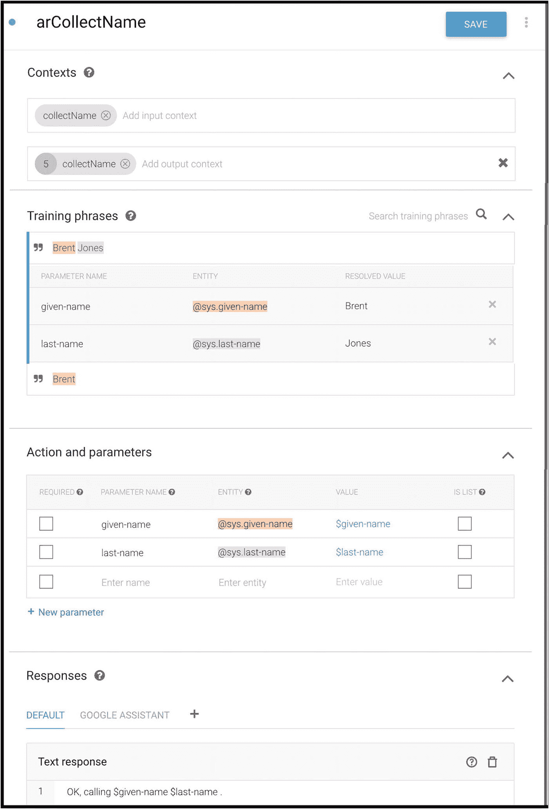
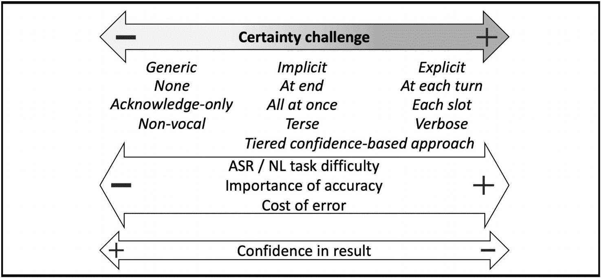

# 8. 通过信心与确认传达安心感

每一次对话都依赖于共同的理解。无论是两个人交谈，还是其中一方是计算机，这一点都同样成立。当你与某人交谈时，你如何知道自己是否被理解？通过听者的回应。他们要么让你安心，表明你被理解了，要么暗示需要一些纠正。当事情很重要时，你甚至会通过与听者确认（肯定、说*是的*）信息来检查他们是否在注意听。而当你作为听者时，你有时也想核实自己的理解，或表明你仍在倾听。当你在电话中与某人交谈，无法看到对方的面部表情和肢体语言时，口头上的安心感就显得更为必要。本章重点介绍如何创建一个能让人安心、且仅在必要时使用最佳方法确认信息的 VUI。

安心感在语音系统中是一个重要话题，原因有三，且相互关联：

- VUI 的准确性，验证识别和解释是否正确
- 用户对 VUI 正确理解的信心，有助于建立用户对 VUI 的信任
- 整体成功率，帮助对话以最少的回溯达成目标

## 传递安心感与共同确定性

在任何涉及金钱、健康或隐私的对话中，你都希望得到被理解的安心感。作为用户，如果你说*从我的 VISA 卡支付 900 美元给假日游轮公司*，而只听到一句*好的*作为回应，你确信你的钱会去往正确的地方吗？恐怕不会。你希望得到更多确认，确保自己没听错，从而知道谁将收到你的钱。你甚至希望在错误付款发生之前有机会说*不*。

即使是简单的问题也需要清晰的回应。以下是与当今某款语音助手的真实交互记录：

- **用户** *14 乘以 15 等于多少？*
- **语音用户界面** *答案是 29。*

不，这不对！单词“by”暗示的是乘法，而非加法。安心感很容易添加：回应可以是*14 加 15 等于*……对比*14 乘以 15 等于*……虽然没长多少，但清晰得多。如果你向朋友提问，他们的回答很可能与语音用户界面不同（图 8-1，面板 1）。部分原因在于向朋友寻求澄清很容易，以及你能感知他们回答的确定性。你与对话者或话题越不熟悉，就越需要安心感。当理解出现偏差时，你需要重回正轨，这可能会拖慢对话。但我们仍然能如此轻松地完成大量修正和安抚工作，以至于感觉这就像是自然对话的一部分。对于语音用户界面而言，通过**修正**来重回正轨（即**恢复**）是一个更大的挑战，因此从一开始就保持在正轨上才是关键。我们将在第 13 章回到修正的话题。



图 8-1

安心感的核心要素：确认、表示理解、回应和预判

再看一下图 8-1 中的示例对话。它们形成了一种模式（面板 2）。请求需要回应。在语音中，回应可能是*是*或*否*或*29*，或者表示任务完成的*好的*。上下文通常包含在内：娜娜的*厨房在……开门*、*14 加 15*……或*900 美元支付给*……正是这些上下文提供了安心感。如果你知道人们通常会接着询问某些具体信息，你可以通过预判并包含这些信息来让用户的生活更轻松，即使这些信息严格来说并非对初始请求的直接回应。例如，当问题只是*开门了吗？*时，就包含实际营业时间。在语音用户界面中，这可以节省用户时间并提高成功率。

在第 2 章中，你了解了语音界面的特性，以及它们与视觉和触觉界面的不同之处。最大的区别在于连续性和反馈。图形用户界面交互是离散的：用户点击或轻触某物；是否有结果以及结果是什么都很明显。语音用户界面交互是连续的：正如你在第 7 章所学，用户的请求可能不完整或含糊不清。重要的是，用户并不认为自己表达不清。在对话的另一方向，语音用户界面的口头回应需要被听者理解。如果用户对回应不确定，他们会经历更高的认知负荷，并对语音用户界面产生更低的信任。风险越高，传递安心感并对任何回应的准确性充满信心就越重要。

安心感的诀窍在于在清晰度和速度之间找到恰当的平衡。你的指导原则应该是“出错的‘代价’是什么？”这既涉及语音用户界面识别或解释错误的情况，也涉及用户误解或需要安心感的情况。这种代价会累积——误解低风险请求通常意味着用户不会信任语音用户界面来处理更高风险的请求。

**成功秘诀 8.1** 简洁“绝不”比清晰更重要

不要用冗长的语音提示让用户不堪重负。同时，在合理范围内，清晰几乎总是比简洁更重要。不要为了加快对话速度而删掉几个词。在保留预期含义、风格和认知模型的同时，去掉“废话”。有时甚至不是字数的问题。当缺少停顿时，人们会抱怨提示太长。所以请确保你对提示进行“分块”。这有助于解决认知负荷问题。

花点时间头脑风暴一下：什么时候安心感和确定性很重要？当然是在涉及金钱和健康的任务中。还有呢？有很多因素需要考虑。识别复杂度、用户尴尬风险、用户紧迫感以及用户对任务的熟悉程度只是其中一部分。在多步骤交互中，从一开始就确信对话正朝着正确方向进行，可以避免后续可能出现的回溯等等。好消息是，这一切都归结为同一件事：在任何层面上平衡成本/风险与速度和简洁性。思考一下这个成本究竟意味着什么。请看图 8-2。



图 8-2

决定出错代价的众多因素和维度中的一部分

我们将在本章末尾回到细节。现在，不必焦虑。只需记住不要忽略这些细节。

## 通过暗示设定预期

理解并非简单的开或关、真或假。在对话的说话方和听话方，无论是用户还是语音用户界面，都存在一个确定性和信心的连续区间。在人类对话中，我们的措辞、语调和非语言线索传达着我们对所说所听内容的信心。人物 Q 可能会对一个问题得到四种不同的回答：

- **人物 Q** *你知道特古西加尔巴在哪里吗？*
- **人物 A1**（高信心）*当然，那是洪都拉斯的首都。*
- **人物 A2**（中等信心）*嗯，我想可能是洪都拉斯……？*
- **人物 A3**（低信心）*特古……你问的什么？*
- **人物 A4**（高信心，但错误）*当然，那是墨西哥的首都。*

当我们对自己的回应（既理解问题又知道答案）有把握时，我们会使用“当然”、“是”和“不”这样的词。当我们不太确定时，我们会用语调和“我想”这样的词来含糊其辞，或者在回答前再次确认理解。当确定性低于某个水平时，我们甚至不会尝试回答。

你的语音用户界面通过其回应来设定预期，就像人类一样。语音用户界面只有在确定答案和请求本身时，才应回应*当然*，绝不能像前面的人物 A4 那样。交互式语音应答和其他语音系统长期以来一直采用含糊其辞和多层级回应。如今的语音助手尚未同等程度地利用信心。你将在本章和第 12 章中了解更多关于这个强大主题的内容。

**成功秘诀 8.2** 低承诺优于高承诺

我们人类是模仿者。如果语音用户界面在提示中使用了某些词语，用户就会期望在使用相同词语时被理解。如果一个任务中接受了多个槽位，用户就会期望语音用户界面在其他地方也能处理多个槽位。在暗示和承诺什么时要小心谨慎。一旦语音用户界面未能兑现承诺，它听起来就不那么聪明了，用户的信心开始动摇——他们的行为也会随之改变。

## Webhooks 2

即使某个平台没有提供内置功能来为你的 VUI 提供所需的确认保障，也有办法自行实现。你在第 7 章中使用了 `webhooks` 来处理姓名拨号这一更复杂的逻辑。当启用 `webhooks` 时，`Dialogflow` 会向 `Web` 服务发送一个 `webhook` 请求，并期望收到一个 `webhook` 响应。你已经学会了如何为整个应用以及按意图启用 `webhooks`。现在，让我们同时审视这两种方式，并利用 `webhooks` 来提供确认保障。

### JSON

`Dialogflow` 使用 `webhook` 请求来启动与 `Web` 服务的对话。`JSON` 是请求和响应的格式。`JSON`，即 `JavaScript` 对象表示法，是一种轻量级的数据交换格式，常用于在软件组件（尤其是 `Web` 服务）之间来回传递信息。代码清单 8-1 展示了一个 `JSON` 示例。

```json
// 字符串值，用双引号括起来
{"stringValue":"string",
// 数值，无引号。可以是整数或浮点数。
"numberValue":-1234.567,
// 布尔值，true 或 false
"booleanValue":true,
// 空值
"nullValue":null,
// 对象值。对象由花括号 {} 指定。
// 一个对象嵌套在整体对象中。
"objectValue":{"stringValue2":"string2","numberValue2",123},
// 数组值。数组由方括号 [] 指定。
// 数组中的值可以是任何其他类型的值，包括数组。
"arrayValue":["string3",456,false,{"stringValue3","string3"}]}
```

代码清单 8-1

`JSON` 示例

主要概念如下：

- **对象**，由花括号 `{}` 括起来。一个对象包含一组逗号分隔的键值对。每个键值对由一个键（一个字符串，本质上是值的名称）、一个冒号和值组成。键是字符串，因此用双引号括起来。

- **数组**，由方括号 `[]` 括起来。一个数组包含任意数量的逗号分隔的值。

- **值**可以是：
  - 字符串，用双引号括起来


数值，可以是整数或浮点数，不带引号；或者布尔值，可以是`true`或`false`（不带引号，否则就是字符串！）

空值，即`null`（同样不带引号！）

对象

数组

你传递给服务或从服务接收的JSON可以是任何类型或值，但通常是一个对象或一个包含其他值的数组。对象和数组可以嵌套。

### Webhook 请求

扩展第 7 章中最后的 webhook 示例，这里是一个 webhook 请求的示例。代码清单 8-2 展示了当用户说“呼叫 Brent Jones”时触发的内容——它正是代码清单 8-1 中的JSON。

```
{
# 请求的唯一标识符：
"responseId": "72ed99c2-e05e-42c3-9f201268b11bda58",
"queryResult": {
# 用户所说的内容：
"queryText": "Call Brent Jones",
# 从用户文本中填充的参数：
"parameters": {
"given-name": "Brent",
"last-name": "Jones"
},
"allRequiredParamsPresent": true,
# Dialogflow 在 webhook 之前计划回应用户的内容：
"fulfillmentText": "OK, calling Brent Jones",
"fulfillmentMessages": [
{
"text": {
"text": [
"OK, calling Brent Jones"
]
}
}
],
"intent": {
"name": "projects/voice-first-development/agent/intents/60bbb90d- \
b0e7-408d-9efb-a7ab50ffc1b9",
# 触发的意图名称：
"displayName": "arCallByName"
},
"intentDetectionConfidence": 1,
"languageCode": "en"
},
"originalDetectIntentRequest": {
"payload": {}
},
"session": "projects/voice-first-development/agent/sessions/d02a16a8- \
5dc6-8dfa-6089-c90740aba732"
}
```

代码清单 8-2
针对“Call Brent Jones”的 fulfillment 请求

逐步解析这个请求：

- 以请求的唯一 ID 开始。

- 整体值是一个包含多个键值对的JSON对象。你可以通过它以左花括号`{`开头来判断。

- `queryResult`对象的`queryText`键显示了你的 VUI 对用户所说内容的解释，此处为 Call Brent Jones。

- 在`queryResult`对象内的参数JSON对象中，你看到了从`queryText`中填充的参数。该对象中的JSON键与 Dialogflow 意图的“操作和参数”表中的参数名称完全相同（将代码清单 8-2 与 Dialogflow GUI 进行比较）。

- `queryResult`的`fulfillmentText`值包含一个字符串，该字符串是 Dialogflow 在发出 webhook 请求之前仅基于 Dialogflow 信息生成的响应。这来自 Dialogflow 的“响应”部分。

- 参数和响应都是在发出 webhook 请求之前由 Dialogflow 确定的。这一点很重要：如果 webhook 在一定时间内（使用 Actions on Google 时为 10 秒，其他情况为 5 秒）没有响应，Dialogflow 会继续对话，就好像从未涉及 webhook 一样。

- 在`queryResult`的`intent`对象中，有一个非常长的字符串和一个`displayName`字符串，你会认出这是 Dialogflow 中的意图名称。

- Dialogflow 会向你显示某个意图已启用 webhook。虽然并非所有意图都需要启用 webhook，但稍后你会为所有意图启用它们，因为 webhook 提供了很好的功能，例如详细的日志记录。

### Webhook 响应

实现 webhook 的 Web 服务会以 JSON webhook 响应的形式进行响应。代码清单 8-3 展示了 VUI 对用户“Call Brent Jones”的响应。

```
{
"fulfillmentText": "OK, calling Brent Jones"
}
```

代码清单 8-3
针对“Call Brent Jones”的 Webhook 响应

就是这么简单！你只有一个包含`fulfillmentText`字符串的JSON对象，该字符串显示了 Dialogflow 的语音响应。如果 webhook 响应设置了`fulfillmentText`，Dialogflow 就会使用该内容进行响应。如果 Web 服务没有设置`fulfillmentText`——或者拼写错了关键字！——Dialogflow 会按照计划，使用意图“响应”部分中的短语以及 webhook 请求中的`fulfillmentText`字段继续执行。

目前，响应非常简单，只有`fulfillmentText`。稍后，你将向响应中添加更多组件，包括：

- `上下文`：意图可以设置输出上下文。你也可以在 webhook 中执行此操作（第 7 章）——如果用户只说“Call Brent”，VUI 会通过询问是哪个 Brent 来消除歧义。这需要从`arCallByName`webhook 设置输出上下文，以仅允许`arCallByNameDisambigLastName`意图。

- `事件`：有两种方式触发意图：通过语音或文本，或者通过从 webhook 触发事件。

- `负载`：对于某些依赖于集成的功能，仅靠`fulfillmentText`是不够的。你需要添加自定义负载。

#### 自定义负载

除了 Actions on Google 之外，Dialogflow 还提供与许多其他平台的集成。根据平台的不同，你可以提供仅对该特定集成有意义的自定义响应信息。例如：

- 如果你与多模态平台（如 Slack）集成，则可以显示图像或指示仅对 Slack 有意义的状态。

- 对于音频输出，Actions on Google 支持语音合成标记语言 (SSML)，这对于非语言音频 (NVA) 以及提供详细的输出发音指令（如何说出一个名字、在哪里停顿、停顿多长时间）非常有用。

- 结束对话。还记得在 Dialogflow 中设置“将此意图设置为对话结束”开关吗？它表示在意图响应后结束对话。使用 webhooks，你需要通过 Actions on Google 自定义负载来结束对话。

#### 实现 Webhook

`Dialogflow`并不关心 Webhook 是如何实现的，只要它能够接收并理解请求，并使用正确的格式提供响应即可。只要 fulfillment 页面中指定的 URL 能够接收请求并提供响应，`Dialogflow`就满意了。

实现`Dialogflow`的 Webhook 有多种方式：

- 在`Dialogflow`的 fulfillment 页面内置的内联编辑器中，使用`Node.js`实现。出于多种原因，我们不会使用内联编辑器，包括：

    - 单页面限制了你能开发的代码的规模和复杂度。你会发现，你已经开始将代码拆分成功能模块，这对于良好的软件开发至关重要。

    - 你希望将软件开发原则（如源代码控制）应用于你的语音应用——而内联编辑器无法实现这一点。

- 使用你选择的软件语言（例如`Node.js`、`Python`或`Java`）自行搭建 Web 服务器。由于我们专注于语音应用开发而非 Web 服务器管理，我们将采用另一种方法进行部署。

- 使用无服务器平台，例如`Google App Engine`或`AWS Lambda`，让你专注于重要的代码，而不是 Web 服务器的运行机制。因为你正在使用`Dialogflow`，所以你将选择`Google App Engine`选项。

你可能想知道我们是如何获得清单 8-2 和 8-3 的示例的。如果你在`Dialogflow`中使用文本输入进行测试，你会在底部看到`DIAGNOSTIC INFO`。点击它，你会看到各种详细信息，包括 Webhook 请求（图 8-3）和响应。



图 8-3

来自测试短语的诊断信息，包括 fulfillment 请求和响应

有了这些背景知识，让我们回到确认方法。

### 确认方法


某种形式的确认总是重要的；问题只在于哪种类型最适合每种情境。就像有不同的消歧方法一样，也有不同的确认方法。选择哪一种取决于犯错成本：正确执行越重要，你的确认策略就越明确（或越强硬）。永远不要基于犯错成本而采取比必要程度更强硬的方式：确认越明确，交互所需的时间就越长。

表 8-1 展示了在相同情境下四种主要的确认方法。在本章的其余部分，你将了解这四种方法，包括编码和使用方式——以及为什么在这个特定示例中某些方法优于其他方法。

**表 8-1：针对同一用户请求的四种主要确认类型对比**

| 角色 | 对话 |
| :--- | :--- |
| **用户** | 把音响静音。 |
| **类型** | 非语言 | 通用 | 隐式 | 显式 |
| **VUI** | -- | 好的。 | 客厅音响已静音。 | 想把客厅音响静音吗？ |
| **动作** | <音响静音> | <音响静音> | <音响静音> | <VUI 等待响应> |

### 非语言确认

行动胜于言语。如果你让同房间的某人打开窗户，看到他们正在开窗或感觉到空气流动，即使他们什么也没说，也足以确认。同样，你的 VUI 并不总是需要用语言确认某事已完成：

- **用户** 打开客厅的灯。
- **VUI** <打开灯。>

如果客厅变亮了，并且你有信息可以判断用户与灯在同一房间并能看到结果，那么一句好的或客厅灯已打开就是多余的。当结果能被听到时也是如此，比如要求将正在播放的音乐静音。我们将在第 14 章中再次讨论如何融入这种上下文信息。

确认可以使用声音来指示成功或失败。非语言音频可以使交互更快捷，并且受到一些用户的青睐。

#### 非语言确认的代码

我们将在本章后面再次讨论这段代码，向你展示如何通过使用你刚刚了解到的 Webhook 请求和响应，以及`Actions on Google`的自定义 payload 和 SSML 功能，来添加非语言音频。

#### 关于非语言确认的说明

看得见或听得见的动作是否永远需要语言确认？哦，是的。想想那些语音提示对于 reassurance 仍然有用的情境。存在无障碍场景，比如向盲人用户 reassurance 一个视觉请求已成功。有些人更喜欢语言 reassurance，因此允许用户自定义。如果动作发生在用户无法验证结果的地方，或者用户正忙于其他事情（例如眼睛没空），那么就需要 reassurance。了解用户相对于动作结果的位置并非易事，因此也很有趣（第 14 章）。

语言确认并不总是一个好主意。如果内容涉及隐私，不要假设用户希望听到信息被重复念出来。因此，不要回读输入的 PIN 码或登录信息。如果需要额外验证且没有屏幕可用，还有其他方法。你可以询问两次并比较结果，而无需请求用户确认。你将在第 16 章中了解这种“幕后”技术。

### 通用确认

通用（或称开放式、一般性）确认，例如`okay`，最好与过渡到下一件事相结合——`好的。（那有多少？）`——或隐式确认`好的，新建一个预约`。单独使用时，`okay`的作用并不大。

一个让你听起来不聪明的好方法，就是在非常确信自己正确时给出错误回应，或者忽略对人类而言显而易见的细节。请记住：用户不知道也不关心请求为何失败，他们只知道它失败了。好消息是，只要你的 VUI 表现得越真实，人们就越愿意对它宽容一些。

更多的回应粒度能带来更丰富、更自然的用户体验。但这同时也意味着需要追踪更多内容，并付出更多努力。你的回应必须在内容、句法和确定程度上符合用户的请求。这三者都有助于增强用户的安心感。`Okay`和`Alright`在确定性上是不置可否的，而`Sure`则暗示了你答案的确定性。看看下面这两个基于与语音助手实际交互的回应：

- **用户** `播放《Let It Be》`
- **VUI1** （仅确认）`好的`。 → [播放《Let It Be Love》]
- **VUI2** （带隐式确认的确认）`好的。这是《Let It Be Love》。` → [播放《Let It Be Love》]

用户不仅听到了错误的歌曲；两个 VUI 还都暗示这是正确的歌曲。这根本不会让人安心！如果你的 VUI 允许用户开关灯，请确保当错误的灯被打开或关闭，或者什么也没发生时，它不会回应`Okay`。有一些方法可以缓和回应，包括使用诸如`我想您问的是……`或`这是我找到的结果`之类的短语。在第 12 章中，你将学习当 VUI 无法满足请求时使用的`识别并拒绝`方法。回应粒度在该方法中扮演着重要角色。

这个话题比你想象的要复杂。练习在你的回应中找到合适的承诺程度。在第 11 章中，你将了解标记指南如何帮助实现回应粒度。

**来自语音前线**

我们两位作者都参与过拥有数百个意图端点的语音优先项目。这些端点可以是信息回读、多轮对话、交易、进一步消歧，甚至是连接到真人通话。这需要额外一点工作，但你会很快掌握要领。总体而言，精心措辞的隐式确认提示通常能带来更高的用户满意度，因为用户会感到安心和被理解，所以这些额外努力是值得的。

### 隐式确认

隐式确认在 VUI 中非常常见，尤其是在允许通过“闯入”打断对话的情况下。它基于“沉默即同意”的理念。看看下面的对话对比：

- **用户** `播放《Let It Be》`
    - **VUI1** （隐式且正确） `这是披头士乐队的《Let It Be》。<歌曲>`
    - **VUI2** （隐式但不正确） `这是克雷格·阿姆斯特朗的《Let It be Love》。<歌曲>`
    - **VUI3** （不正确） `<歌曲>`

- ~ ~ ~ ~ ~ ~ ~ ~ ~

- **用户** `我想在娜娜餐厅订个位。`
    - **VUI1** （隐式且正确） `好的，为娜娜餐厅新建一个预约。什么时间？` …
    - **VUI2** （隐式但不正确） `好的，为巴拿马餐厅新建一个预约。什么时间？` …
    - **VUI3** （不正确） `什么时间？`

- ~ ~ ~ ~ ~ ~ ~ ~ ~

- **用户** `给琼斯医生打电话。`
    - **VUI1** （隐式且正确） `布伦特·琼斯医生，办公室电话。正在拨打`…
    - **VUI2** （隐式但不正确） `琳达·乔纳斯医生，办公室电话。正在拨打`…
    - **VUI3** （不正确） `正在拨打`…

其理念是，在不过度拖慢速度的前提下，给用户足够的信息来确认双方理解一致——只需足够让用户能在错误操作发生前及时阻止。对于订位请求，隐式确认能立即让用户清楚对话是否即将偏离正确方向，从而避免浪费多轮对话。对于打电话，它则能避免潜在的尴尬和成本：

- **用户** `我想在娜娜餐厅订个位。`
- **VUI2** `好的，为巴拿马餐厅新建一个预约。什么` …
- **用户** `重新开始。`

- ~ ~ ~

- **用户** `给琼斯医生打电话。`
- **VUI2** `琳达·乔纳斯医生，办公室` …
- **用户** `取消！`

#### 隐式确认的代码

清单 8-3 中的 Webhook 响应仅包含`fulfillmentText`值。要实现隐式确认，还有两件事要做：

- 添加非语言音频。
- 在适当时结束对话。

我们先来看一下完成这两项添加所需的 Webhook 响应^(⁶⁰)（清单 8-4）。

```
{
  "fulfillmentText": "好的，正在呼叫 Brent Jones",
  "payload": {     # A
    "google": {     # B
      "expectUserResponse": false,     # C
      "richResponse": {
        "items": [
          {
            "simpleResponse": {
              "textToSpeech": "DING 好的，正在呼叫 Brent Jones"     # D
            }
          }
        ]
      }
    }
  }
}
```

*清单 8-4：结束对话并添加 NVA 后的 Webhook 响应*

以下是清单 8-4 中的详细步骤：

- 通过添加`payload` JSON 对象及其下的`google` JSON 对象，来添加`Actions on Google`自定义负载部分（A）。
- 将`expectUserResponse`的值设置为`false`，添加到`Actions on Google`自定义负载中（B, C）。这是通过 Webhook 结束对话的方式。
- 按所需格式添加`richResponse`信息（D）。最后填入`textToSpeech`字符串值，该值包含 NVA 所需的 SSML 标记以及响应文本。SSML 包含以下部分：
    - `<speak>`标签，每个 SSML 命令都以它开头。
    - `<audio>`命令，用于播放来自 URL 的音频。`<audio>`命令有三个属性：
        - `src`，指向音频的 URL。
        - `clipBegin`，告诉`Actions on Google`何时开始播放音频。注意其特定格式`1.5s`；这是由 SSML 标准规定的。
        - `clipEnd`，指定何时停止播放。格式要求同上，但此处为`3s`。

# SSML 与 VUI 中的音频和语音处理

- 一些文本（此处为 `DING`），当音频无法加载时，VUI 会朗读这些文本。
- 以 `</audio>` 结束音频部分。
- NVA 之后希望朗读的 TTS 响应文本。
- 以 `</speak>` 结束 SSML 部分。

你将在第 15 章了解更多关于 SSML 的内容；SSML 可以防止你的设备说出诸如 `<speak><audio></audio></speak>` 之类的内容……没错，这是一个真实世界的例子！

你从哪里找到实现所需的音频？从技术上讲，你可以从任何 URL 获取音频，但它必须符合 Actions on Google 的格式。要避免某些音频突然无法播放的情况（URL 变更、权限变更、许可问题等）。因此，明智的做法是坚持使用平台默认提供的音频。刚开始时，可以使用 Actions on Google 提供的一些库存音频示例，就像我们做的那样。Google 开发者网站上有许多很好的参考资料。你可以找到关于 SSML 的文档、`<audio>` 标签可接受的音频格式，以及 Actions on Google 的音频库。^(⁶¹) 如果你需要其他音频，除了加入通知以告知你后备音频已播放之外，还应硬编码可接受的后备音频，以便在代码外部音频不可用时始终播放。

## 为了结束对话并添加 NVA

你按如下方式使用了 Webhook：
- 初始化变量，用于标记是否结束对话和是否播放 NVA（两者初始值均为 false）。
- 在对话结束语处，将结束对话变量设为 true。
- 当执行隐式确认时，将播放 NVA 变量设为 true。
- 在创建 Webhook 响应 JSON 时，添加自定义负载和 Actions on Google 部分（如果需要）。如果要结束对话，则添加 `expectUserInput=False`，并为任何 NVA 添加 `richResponse` 和 SSML 信息。你可以在清单 8-5 中看到添加新自定义负载信息的结果。变量 `addPayload` 的值始终与 `endConversation` 相同，因此无需检查它是否已添加。

让我们看看清单 8-5 中创建 Webhook 响应的细节，该代码来自文件 `webhook_response.py`。（A）是设置输出文本的主要部分；到目前为止你只使用了这一部分。在（B）中，你添加了对话结束信息，在（C）中，你添加了 NVA，两者都符合清单 8-4 中要求的 Webhook 响应格式。在（D）中，你设置了输出上下文——你在第 7 章中看到过它用于消除歧义。最后，在（E）中返回 Webhook 响应的 JSON。

```python
def response_json(self):
    """
    返回 JSON 响应字典。
    """
    # 设置响应文本。
    self.respdic['fulfillment_text'] = self.output_text.    #A
    # 是否添加了 Actions on Google 负载？
    add_payload = False
    # 如果相关，则结束对话。        #B
    if self.end_conversation:
        self.respdic['payload'] = {}
        self.respdic['payload']['google'] = {}
        self.respdic['payload']['google']['expectUserResponse'] = False
        add_payload = True
    # 如果执行 NVA 前处理，则为 Actions on Google 添加负载。 #C
    if self.do_pre_nva:
        if not add_payload:
            self.respdic['payload'] = {}
            self.respdic['payload']['google'] = {}
            self.respdic['payload']['google']['richResponse'] = {}
            self.respdic['payload']['google']['richResponse']['items'] = []
        tmpdic = {}
        tmpdic['simpleResponse'] = {}
        tmpdic['simpleResponse']['textToSpeech'] =\
            f"DING{self.output_text}"
        self.respdic['payload']['google']['richResponse']['items']\
            .append(tmpdic)
    # 如果需要，设置输出上下文。      #D
    if len(self.output_contexts) > 0:
        self.respdic['outputContexts'] = self.output_contexts
    # 返回 Webhook 响应。    #E
    return self.respdic
```
*清单 8-5 生成 Webhook 响应的核心代码，包括结束对话和添加 NVA*

告诉 Webhook 响应结束对话并播放 NVA。之前在你的对话逻辑文件（例如 `ar_call_by_name.py`）中，你通过修改 `df_response` 对象来设置文本：
`df_response.output_text = …`

现在，每当你这样做时，还需要结束对话：
`df_response.end_conversation = True`

并且，如果你正在确认呼叫联系人，则播放 NVA：
`df_response.do_pre_nva = True`

当你使用 NVA 测试代码时，需要从 Actions on Google 模拟器或 Google Home 设备上进行；你不能仅在 Dialogflow 内测试，因为 SSML 是 Actions on Google 的自定义负载和功能。Actions on Google 模拟器为测试 SSML 提供了一些不错的调试功能。

### JSON 与 Python

JSON 中的各种值（字符串、数字、对象、数组）与处理 JSON 的各种编程语言之间存在相当强的映射关系。对于 Python 来说，JSON 对象映射到 Python 字典，JSON 数组映射到 Python 列表。字符串是字符串，数字是数字，Python 中的布尔值如 `true` 和 `false` 映射到 JSON 中的 `true` 和 `false`。Python 有一个 `json` 模块，它可以将字典或列表转换为 JSON（`json.dumps()`，在清单 7-3 中使用过）。它还有一个读取器（`json.loads()`），可以将表示 JSON 值的字符串转换为相应的 Python 对象。你在读取 Webhook 请求并解析必要信息时使用了 `json.loads()`。其他编程语言也有类似的例程。

### 如果用户说“不”怎么办？

你可能已经注意到，在隐式确认的情况下，我们会播放“好的，正在执行……”的提示语并附带一些非语言音频（NVA），然后结束对话。但等等！如果用户说“不”呢？处理这种情况正是关键所在！

在撰写本文时，在 Dialogflow 的限制内还（尚）无法自定义对话。缺失的关键功能是能够将 `noinput` 超时设置得非常短，比如一秒钟。你无法用通常几秒钟的 `noinput` 超时来实现隐式确认；这么长的超时会让用户感到非常困惑。相反，让我们看看如何在更高层面上支持隐式确认：
- 播放隐式确认提示语和 NVA，就像你在这里做的那样。
- 设置一个上下文，表明你刚刚播放了隐式确认提示语。
- 等待用户的回应，或者没有回应。记住，在隐式确认中，“沉默即接受”。不要等太久，也许一秒钟左右。
- 创建一个针对“不”及其变体的意图，该意图仅在 VUI 刚刚播放了隐式确认提示语的输出上下文期间激活。如果用户说“不”，则用类似“好的，取消……”的适当内容回应，然后结束对话。
- 如果用户什么也没说（这是常见情况），你就继续执行操作，拨打电话或执行任何操作；然后结束对话。

### 关于隐式确认的说明

经常使用隐式确认来安抚你的用户。想象一个对话，其中每一步都隐式地向用户确认他们被理解了：
- **用户**  *我想预约。*
- **VUI**  *好的，一个新的预约。在哪家餐厅？*
- **用户**  *在娜娜餐厅。*
- **VUI**  *好的，娜娜厨房。什么时间？*
- **用户**  *7:30。*
- **VUI**  *今晚 7:30。几位客人？*
- **用户**  *六位。*
- **VUI**  *让我查一下……有位置*……

注意，对时间的隐式确认包含了日期：*今晚*。如果大多数人在这家餐厅都是当天预约，并且用户清楚如何更改日期，这是一个不错的方法。但如果用户没有主动提供日期，你最好再问一个问题，比如*是今晚吗？*

看看最初的 VUI 回应。它不仅仅是“好的”。单独的“好的”只传达了“我听到了，并且我认为我理解了你，所以我准备采取行动。”但用户不知道他们是否被理解了，只知道 VUI 听到了某些东西。一个通用的确认通常本身是不够的，它只能作为进一步安抚的前奏。

短语*一个新的预约*确认了对整体意图的理解：用户想要预约，而不是更改或取消预约。想想看，如果第一个请求被误识别，或者隐式确认短语太宽泛或太狭窄，对话会如何中断。如果短语只是*一个预约*会发生什么？让我们看看：

- **用户** *我想* **更改** *一个预约。* → 误识别

- **VUI** *好的，一个预约。在哪家餐厅？* → 短语太宽泛

- **用户** *在娜娜餐厅。*

- **VUI** *好的，娜娜厨房。什么时间？*

- **用户** *7:30。*

- **VUI** *今晚 7:30。几位客人？*

- **用户** *六位。*

- **VUI** *让我查一下……有位置*...

- **用户** *我知道！我想更改它！*

这次用户想更改预约，但因为确认短语只是*一个预约*，没有任何信息向用户传达他们实际上是在进行另一个预约而不是查找现有预约，直到交互结束。

“隐式”意味着很多事情。你会发现“隐式”这个术语被应用于几个相关但不同的语音功能。对我们来说，“隐式”意味着在不获得明确回应的情况下传达安抚：说话者说了些可能清楚也可能不清楚的话，而听者以“这是我理解的内容”的方式回应。你还会看到“隐式”指代将设备指定为播放某些输出的端点，要么是基于某些上下文的“粘性”指定，要么是预定义的默认值。这允许用户不必每次都消除歧义或指定该端点。这是一个重要的特性——总是寻找使用上下文和设置的方法——但它更多地与解决歧义或设置命令快捷方式的逻辑相关，而不是与沟通安抚相关。除非你在一个只使用一种含义的框架中工作，否则要小心确保你团队中的每个人都使用这个词表示相同的意思，而不需要，嗯，去确认它！

## 显式确认

在显式确认中，对话只有在得到口头许可后才能继续。在 VUI 中，当在继续之前理解很重要时，你会使用它。因为显式确认会增加对话的长度和复杂性，所以它们主要用于额外步骤比处理出错更值得的情况。同样，这是一个成本平衡，不是因为开发对话更费力，而是因为用户体验可能会受到影响。在语音世界中，显式确认通常指的是 VUI 在继续之前要求用户确认某事，而不是反过来。

- **用户** *从我的 VISA 卡支付 900 美元给假日游轮公司。*

- **VUI** *那是从您尾号为 5098 的 VISA 卡支付 900 美元给假日游轮公司。对吗？*

- *~ ~ ~ ~ ~ ~*

- **用户** *给琼斯医生打电话。*

- **VUI** *您想给布伦特·琼斯医生打电话，对吗？*

- **用户** *是的，没错。*

- **VUI** *正在呼叫……*

- *~ ~ ~ ~ ~ ~*

- **用户** *我想预约。*

- *…* [预约对话] *…*

- **VUI** *娜娜厨房在明天，周六晚上 7:30 有一个六位客人的位置。*

- *需要我预订吗？*

- **用户** *好的，请预订。*

### 成功秘诀 8.3 在确认提示语中取得平衡

简洁和清晰是你的指路明灯。它们需要足够宽泛，以包含用户请求的内容（即使他们使用了不同的词语），但也需要足够狭窄，以涵盖含义（即使词语不同）。避免使用*您说了……*，因为用户可能使用了具有相同含义的同义词。当需要用户回应时，要明确提示。

### 显式确认代码

要在应用中添加显式确认功能，我们需要完成以下几项工作：^(⁶²)

- 在 Dialogflow 中添加一个确认意图及其关联实体。

- 修改 webhook 代码，将隐式确认改为显式确认。

- 修改 webhook 代码以处理确认结果。

首先，让我们添加确认所需的意图和实体：



**图 8-4** 新的 `confirm` 实体

- 创建一个新的实体 `confirm`，包含两个值 `yes` 和 `no`，以及一些在 *你想这样做吗？* 这类问题语境下有意义的同义词（图 8-4）。你可以在任何确认意图中复用此实体。

现在你需要修改 webhook，使用显式确认代替隐式确认，并处理新的意图 `arConfirmName`。

首先，进行显式确认的修改。之前的代码是：

```
df_response.output_text = df_request.fulfillment_text
df_response.end_conversation = True
df_response.do_pre_nva = True
```

现在将其改为显式确认逻辑（代码清单 8-6），来自 `ar_call_by_name.py`：

```
if df_response.explicit_confirmation:  # A
    df_response.output_text = \        # B
        f"您想呼叫 {GIVEN_NAME} {LAST_NAME}，对吗？"
    df_response.output_contexts.append(      # C
        confirmation_context(GIVEN_NAME, LAST_NAME)
    )
else:
    df_response.output_text = df_request.fulfillment_text  # D
    df_response.end_conversation = True
    df_response.do_pre_nva = True
```

**代码清单 8-6** 添加提供显式确认的选项

`GIVEN_NAME` 和 `LAST_NAME` 来自不同位置，具体取决于你处于对话的哪个阶段。对象 `df_response` 中的变量 `explicit_confirmation`（A）决定了是否进行确认。如果进行确认，则设置不同的输出文本（B）来确认。然后，使用定义在单独文件中的新函数 `confirmation_context`（C）向响应中添加输出上下文。如果不进行确认，则执行之前的操作（D），包括结束对话和添加 NVA。

其次，添加代码以支持新的意图 `arConfirmName`，如代码清单 8-7 所示。如果用户确认 *yes*（A），则播放确认信息 *好的，正在呼叫…* 并执行 NVA。如果用户否认 *no*（B），则暂时回复 *抱歉* 并结束对话。我们很快会修复这个不友好的占位响应。

你会注意到，我们时不时会引入新的辅助函数，比如前面用到的 `confirmation_context`。通常，它们会被放在各自的 Python 文件中，以实现最大程度的模块化和可读性。这些函数创建 Dialogflow 所需的 webhook 响应元素格式。你无需担心它们，但如果感兴趣，当然可以查看。具体来说，`confirmation_context` 函数添加了输出上下文 `confirmName`，并将名字和姓氏作为参数添加到该上下文中——请记住，Dialogflow 意图 `confirmName` 正在寻找该输入上下文。我们将在下一节讨论为什么需要添加这些名字。

```
def ar_confirm_name(df_request, df_response):
    """
    显式名称确认的结果
    """
    if 'confirm' in df_request.parameters:
        if df_request.parameters['confirm'] == 'yes':     # A
            # 呼叫者已确认姓名。播放确认信息。
            df_response.output_text = '好的，正在呼叫。'
            df_response.end_conversation = True
            df_response.do_pre_nva = True
        elif df_request.parameters['confirm'] == 'no':    # B
            # 否定确认
            df_response.output_text = '抱歉。'
            df_response.end_conversation = True
```

**代码清单 8-7** 支持新的意图 `arConfirmName`（位于 `ar_confirm_name.py` 中）

### Dialogflow、App Engine 与无状态性

让我们深入探讨为什么必须将名字添加到输出上下文中（代码清单 8-6 中的 C）。与许多框架一样，当将 Google App Engine 与 Dialogflow 一起使用时，webhook 是**无状态**的，这意味着它不会记住之前请求的任何信息。任何你希望 webhook 代码从先前请求中了解的信息都必须传入。值得重复强调：**任何你希望 webhook 代码从先前请求中了解的信息都必须传入。**

这听起来很麻烦，在请求之间保留某种记忆似乎很有用，但这会引发各种可扩展性问题。由于是无状态的，App Engine 可以在其认为合适的任何位置部署代码，而无需担心它是否仍能访问对话历史。这是 App Engine 和其他类似框架的特性之一；无论你每小时处理一个请求还是一百万个请求，你都不必担心代码在哪里，或者它是否能访问历史记录。想象一下，如果代码运行在分布在全球的多个服务器上，那将是一场噩梦；你如何确保所有位置执行的请求都能访问到任何历史记录？下一个请求可能就在距离当前请求一千英里之外的地方执行。随着大部分代码迁移到云端，无状态性已成为关键。

好吧，所以这不是一个缺陷，而是一个特性。但这会增加你的一些开销；如果你需要维护某些对话状态，你需要在 webhook 响应中将其发送出去，然后在任何后续的 webhook 请求中将其传回。如何做到这一点？通过上下文及其参数。webhook 响应将历史信息（例如你正在呼叫的人的名字）添加到输出上下文中，而意图的处理程序必须从输入上下文中获取这些参数。如果你真的要呼叫某人，你会在 `arConfirmName` 的处理程序中执行此操作；这次没有必要，因为你所做的只是回复 `好的，正在呼叫…` 和一些 NVA。

## 成功秘诀 8.4 使用数据库处理历史记录

当你学习与数据库交互时，你会意识到还有另一种方法。回顾代码清单 8-2，webhook 请求有一个唯一的会话 ID。你可以将其与数据库结合使用，构建自己的对话会话存储。现在你需要同时担心代码执行的位置以及因访问远程数据库而可能产生的延迟。关键在于理解无状态并不等同于无上下文。

### 关于显式确认的注意事项

实现稳健显式确认的关键在于明确被确认的具体内容。如果你将对话从隐式确认 `好的，一个预订` 改为显式的 `一个预订，对吗？`，那么同样的模糊性依然存在。作为用户，我不知道这是指所有预订请求类型，还是仅指其中一部分。确认提示的措辞至关重要。

如果你的语音系统包含许多意图或端点，措辞需要经过深思熟虑和反复测试。一个好的方法是准备几个措辞更具体的选项（例如，`一个新预订`、`一个现有预订`），以及一个更通用的选项（`一个预订`）。这样，你可以通过仅对不符合具体措辞的请求以及回退策略（详见第 11 章和第 13 章）使用更宽泛的短语，来实现最稳健的处理。

注意确认语的措辞方式。不同的问题会引发不同的回答——请确保你能妥善处理预期的回答：

- `你想打电话给布伦特吗？` → 更多回答是 `是的（我想）` 和 `不（我不想）`

- `你想打电话给布伦特。对吧？` → 更多回答是 `（那）对`、`错`、`不对`

- `你想打电话给布伦特。这样对吗？` → 更多回答是 `是的，对的`、`正确`、`不，不对`

我们见过一些情况，加入像 `请说“是”或“否”` 这样的显式短语确实提高了用户成功率，但不要一开始就使用它。这是恢复阶段的最后手段（第 13 章），因为它不符合自然对话，并且是其他问题的征兆。措辞清晰的显式确认应该让这个短语变得多余：如果你的 VUI 问 `你想打电话给布伦特吗？`，自然的回答是 `是` 或 `否`。搞定。无需额外解释。

不要确认一个“是/否”问题。如果你必须确认，可以再问一次，然后比较两次结果来决定下一步。这不是任何用户应该经历的对话体验：

```
VUI  百忧解续方。这样对吗？
用户  当然不是。
VUI  那是“不”的意思吗？
用户  一个“不”……是，不！
```

你应该预料到有些人会主动提供超出 `是` 或 `否` 的额外信息。这是一种混合主动交互。之所以这么称呼，是因为 VUI 发起了对话，但用户暂时接管了发起者的角色：

```
用户  订购续方。
VUI  你想续方处方药，对吧？
用户  是的，百忧解。
```

格式是：直接回答 + 新信息。如果这个新信息恰好是一个必需的槽位，你应当捕获它，这样就不必稍后再询问。

## 成功技巧 8.5 是/否问题——你的成功之门

一般来说，较少的对话轮次更可取，原因包括速度快和降低引入误解的风险。话虽如此，在对话早期提出一个易于回答的是/否问题，是帮助新手用户即使在复杂对话中也能成功完成首次对话的可靠方法。几乎没有比最大化用户早期成功机会更好的方式来建立用户信心了。这能为后续可能不那么顺畅的交互积累好感，并且你的用户在那之后会给你的 VUI 更多机会，否则他们不会这样做。

## 多模态角落

如果你有屏幕，隐式和显式确认可以轻松地通过屏幕完成。你在第 7 章中看到了一个显式是/否屏幕的例子。图 8-5 展示了隐式确认的程序准备示例。食物日记列表显示每个被识别出的单独项目，并提供用于添加食物项目的键盘和用于删除误识别项目的“X”按钮。开放式问题的回答提供了足够的反馈，以确保用户的问题被理解——注意顶部的文本字段显示了识别出的语句，可以是抽象内容或逐字原文。语音提示通常包含更多细节，但音频和图像可以独立存在，供那些只依赖其中一种的用户使用。



**图 8-5** 多模态隐式确认：列出已识别的食物，回应开放式问题

## 确认位置：槽位 vs. 意图

你已经决定了要确认什么。但何时进行确认呢？在预订对话中，你有一个意图（新预订）加上四个槽位（地点、人数、时间、日期）。你是否必须对每个槽位和意图使用相同的确认方法？不，你不必对每个槽位都使用相同的方法，也不必对 VUI 中的每个意图都这样做。你是逐个确认还是一次性确认所有内容？嗯，这取决于具体情况。

如果识别和解释表现良好，你可以不必在每一轮对话中都进行确认。如果结果与默认设置匹配，或者某些信息对用户不重要，你也可以减少确认，就像更简洁的 VUI2 那样：

```
用户  我想看 Chef  → 默认输出=客厅电视；默认提供商=MoviesRUs
VUI1  Chef，2014 年上映。现在从 Movies R Us 在客厅电视播放。
VUI2  这是 Chef。
```

你最终通常会采用某种组合方式。以下是一些指导原则：

```
用户  我想在娜娜家订个位，明天。
VUI  好的，一个预订，明天在娜娜厨房。
VUI  什么时间？
用户  7 点半。
VUI  几位客人？
用户  六个人。
VUI  [查询] 抱歉，娜娜家明天没有空位了。
用户  ……#￥@！！
```

- **首先，确认你走在正确的轨道上。** 对于多轮次、多槽位的对话尤其重要。你通常希望在继续之前，通过确认意图来确定请求的主题。
  - 如果用户的语句同时填充了意图和某些槽位，例如 `我想和琼斯医生预约一次复诊，周一`，你通常应该先确认一般意图（一个新预约），然后再确认你捕获到的槽位信息，而不是试图一次性完成所有确认。只是不要丢弃用户已经提供的槽位信息，那会惹恼他们。
- **避免多次确认相同的信息。** 这正是对话管理大显身手的地方。如果用户回溯并更改了某些内容，不要重新确认之前已经确认过且仍然有效的信息。
- **确认任何可以用来缩小后续选项范围的信息。** 这能简化用户的任务或更快地满足他们的请求。例如，如果你已确认某人想在周六预订，而只有下午 5 点有空桌，那么剩下的对话就会很快。
- **将逻辑分组作为一个整体来确认。** 例如，卡片有效期可以一次性确认月份和年份，而不是分两步。
- **利用上下文将多个槽位合并到一次确认中。** 你将在第 16 章学习 N-best 列表和跳过列表。
- **永远不要要求用户确认你无法提供的东西。** 如果一家餐厅只有一张能容纳大团体的大桌，或者根本没有桌子，不要要求用户完成整个对话流程后才告诉他们没有空位。在交互中尽早进行数据查询，如果需要，可以进行多次查询，除非你有非常充分的理由不这样做。你应该避免这种情况：

相反，你可以这样做：

```
用户  我想在娜娜家订个位，明天。
VUI  好的，一个预订，明天在娜娜厨房。让我查一下……
VUI  [查询] 抱歉，娜娜家明天没有空位了。
```

如果只有少数几个选择可用，请确保你知道这些选择是什么，以便提供给用户：

```
VUI  ……让我查一下……
VUI  [查询] 娜娜家可以在下午 5:30 或晚上 9 点安排六位客人。
```

## 否定确认：处理“不”的情况

到目前为止，我们基本忽略了用户否定确认（否认、拒绝、说“不”）时会发生什么。但人非圣贤，任何语音用户界面（VUI）也不例外：

```
用户  打电话给琼斯医生。
VUI  您想打给布伦特·琼斯医生，对吗？
用户  不是。
VUI  您想打给谁？
用户  莉娜·琼斯医生。
VUI  莉娜·琼斯医生。正在拨号……
```

第 13 章将专门讨论如何从误解中恢复；现在，我们只关注确认环节。您需要做到：

*   最小化“不”的风险。
*   确保用户知道如何否定确认。

让您能够轻松修改并继续，而无需从头开始。

您可能已经注意到，确认和隐式确认通常看起来一模一样。我们之前忽略了它们的区别：隐式确认实际上意味着用户可以回应，要么接受要么拒绝该确认。这意味着用户需要能够打断，例如，仅通过说*取消*（在交互式语音应答（IVR）中常见），或说唤醒词加*取消*（在语音助手中常见），或通过其他交互方式，比如按下按钮启动麦克风。

当然，这只有在用户知道如何打断时才有效！因此，隐式确认通常包含一些关于如何否定确认的提示——这可能很重要，因为确认听起来像是一个陈述句，而不是一个问句。您可以根据具体情况，加入类似*如果这不是您想要的，请说“取消/返回/重新开始”*这样的提示。

如果用户拒绝了 VUI 提供的内容，您该怎么办？如果他们已经填写了其他槽位，您不希望强迫他们重做所有事情。通常有几种选择：

*   再次询问。这是最常见的情况，尤其是在显式确认被拒绝之后。如果清楚是哪个槽位出了问题，或者这是初始意图，您可以使用重试方法。

*   询问用户要更改哪个槽位，然后获取新信息。如果用户清楚该说什么，这种方法可行，但如果多个槽位都错了，就会变得棘手。

*   在用户填写每个槽位时进行确认。这种交互可能会变得过于冗长。

*   猜测！提供另一个匹配项。您需要谨慎处理，正如您将在第 13 章中学到的那样。如果只有两个选项，那么在选项 A 被拒绝后，不再次确认就直接继续使用选项 B 是相当安全的。

*   放弃所有内容并重新开始。如果逐步修正需要更长时间，这可能是正确的方法。

#### 否定确认的代码

还记得您添加显式确认的时候吗？如果来电者回答*不*，他们会听到一句草率的*抱歉*，然后对话结束。这是一种糟糕的体验。现在让我们修复它，为用户提供更顺畅的否定确认：



图 8-6

用于处理否定确认的新 `arCollectName` 意图

*   添加一个 `arCollectName` 意图，仅用于收集姓名：

    *   训练短语与 `arCallByName` 相同，但去掉“打电话给……”

    *   响应可以与 `arCallByName` 中的相同；由于您使用的是 webhook，这无关紧要。

    *   您需要在输入和输出上下文中添加 `collectName` 上下文。

    *   启用 webhook！图 8-6 显示了新意图。

*   对 webhook 代码进行修改：

    *   对于否定确认，添加新的响应，而不是说“抱歉”并结束对话。

    *   将新的 `collectName` 上下文添加到输出上下文中。

    *   处理 `arCollectName` 意图。

webhook 代码的更改发生在两个部分：

首先，为了处理新意图 `arCollectName`，您将使用与 `arCallByName` 完全相同的代码。只需将意图 `arCollectName` 添加到 `main.py` 中的那个逻辑测试行即可。因此，将：

```
if df_request.intent_display_name == 'arCallByName':
```

改为：

```
if df_request.intent_display_name == 'arCallByName' or \
df_request.intent_display_name == 'arCollectName':
```

接下来，在否定确认时，您添加一个更友好的新响应，并使用另一个新的辅助函数 `new_context` 来创建一个新的输出上下文：

```
df_response.output_text = '您想打给谁？'
df_response.output_contexts.append(new_context('collectName'))
```

您可能会想：*为什么我们不直接重用 `arCallByName`，并稍作调整使其仅识别姓名，而不是添加一个新的 `arCollectName` 意图呢？* 这是我们之前已经暗示过的一个原则：偷工减料不会带来优秀的界面。如果我们扩展 `arCallByName` 使其能够识别“布伦特·琼斯”，那么这在对话的顶层就会成为一个有效的请求。换句话说，用户可以说“布伦特·琼斯”而不带任何意图。如果 VUI 只能打电话，不能做其他任何事情，那可能没问题。但这并不是我们想要的，您可能也不希望一个通话应用这样做，因为它会限制其他有效功能，比如更新通讯录。您还希望最大化两种上下文中的识别率（这是您将在接下来几章中学到的另一个原则），因此，根据用户在上下文中可能说的话来适当地约束它，才是您真正想要的。

#### 关于否定确认的说明

在第 12 章中，您将学习**一步纠正**，即一个*不*后面跟着纠正后的内容。这是人们在对话中自然而然会做的事情。这是一种混合主动交互，用户首先回应 VUI——这是**系统主动**——然后立即在同一句话中提供 VUI 尚未询问的信息——这是**用户主动**。正如您将看到的，一步纠正可以显著提高您的 VUI 成功率：

*   **用户** *打电话给布伦达·琼斯医生。*

*   **VUI** *您想打给布伦特·琼斯医生，对吗？*

*   **用户** *不，是布伦达！*

*   **VUI** *布伦达·琼斯医生。正在拨号……*

在不重新开始的情况下重新确认时，保持上下文很重要。在这里，我们很清楚用户想打电话给某人，只是不是布伦特。用户要么会重述完整的请求，要么会重述他们认为足以识别要更改内容的部分。您的 VUI 必须保持意图并保持正确的上下文来处理这两种情况（第 16 章）。

在其他平台上，您有几种拨打电话的选项，但基本组成部分非常相似。几年前，这是一个相当复杂的过程，涉及电话硬件和与电信提供商（如 AT&T 或其他公司）的专用连接。如今，这可以简单得多。Twilio 等公司负责处理硬件和电信部分，因此您只需处理 VUI 对话。您还需要一个应用程序服务器，其行为类似于我们见过的 Dialogflow 或 webhook；通信提供商会向您的服务器发送请求，服务器则会响应它想要对用户说的话。

###### 来自一线语音实践

安的手机通讯录里只有一个联系人叫“Ronda”，没有其他类似的名字。即使将 Ronda 的地址设置为常用目的地，语音请求*到 Ronda 家需要多长时间？*也会因为一个原因失败：文本解释返回了*Rhonda*。这两个名字发音相同，但对用户来说，这种未能关联信息的做法令人恼火，而且本可以也应该避免。在另一个 VUI 中，当要求*打电话给 Ann*时，姓名搜索失败，要么是因为映射到了不定冠词“an”，要么是因为映射到了拼写为“Anne”但不在通讯录中的名字。

### 额外的确认技巧与常见陷阱

确定性和确认感几乎影响着成功 VUI 的方方面面。识别准确率越高、自然语言处理越精准、搜索越精确，结果就越好，交互就越简单，用户也越愿意参与和探索。我们之前提到过，目前用户对 VUI 最不满的地方，就是感觉不被理解以及得不到预期的回应。因此，你需要专注于 VUI 中与准确性相关的每一个细节。

**成功秘诀 8.6** 确认感是细节中的魔鬼

传达确认感涉及许多精细的细节；这是 VUI 设计中区分功能型与卓越型的关键领域。它对你的 VUI 成功至关重要。所以请记住，细节决定成败，思考你的设计，分析用户反馈，并随时准备做出调整。

#### 系统发音

我们其中一位作者住在加利福尼亚州的布里斯班。加州布里斯班的发音与澳大利亚布里斯班的发音并不相同。听到错误的发音不仅令人恼火，还会影响用户对 VUI 的信任。以下对话是来自与语音助手实际交流的记录：

- **用户** *今天布里斯班的天气怎么样？*

- **VUI** *今天布里斯班有雨，预计最高气温 84 华氏度……*

- **用户** *那加利福尼亚州布里斯班的天气呢？*

- **VUI** *布里斯班气温 62 华氏度，局部多云……*

如果发音相同，且缺乏像“澳大利亚”或“加利福尼亚”这样的上下文确认信息，用户只能通过了解两地可能的天气情况，才能判断出听到的是哪个布里斯班。请避免这种情况。

发音错误是导致用户对 VUI 失去信任的最快方式之一。这也是你可能不想直接用名字问候用户的原因之一——如果你这样做了，请提供一种简单的方法让用户纠正发音错误。如果你为了方便而依赖内置的 TTS 和数据库，发音可能不在你的控制范围内，但请尽力而为。同样重要的是，要根据上下文在句子中正确重读单词。强调某个单词是在向用户发出信号：“请注意这一点”。你将在第 15 章了解更多相关内容。

那么，像药物名称或外国地名、食物、艺术家名字这类不常见词汇的发音呢？药物名称对任何用户来说都很难发音。你会使用一些技巧来扩展识别端可接受的内容。在确认环节，如果官方发音与用户所说的相去甚远，那将是一个挑战。如果你能依赖屏幕显示，那就更好了。回读给用户的内容必须易于理解且正确无误。用户会学习你的发音，所以如果你的系统发音有误，当用户模仿时，识别率也会受到影响。

在本章前面，你使用了 SSML 来添加 NVA。SSML 是 Google Actions 用来控制发音、重音和停顿的工具。既然你已经知道如何在 webhook 响应中添加 SSML 作为自定义负载，那么你现在“只需”了解 SSML 如何控制所有这些内容，这是一个更大的话题，我们将在后续章节中讨论。

**成功秘诀 8.7** 发音至关重要

学习如何在你的平台上编辑 TTS 输出。这值得你花功夫。如果你录制提示语，请确保你的配音演员了解如何在上下文中正确发音。用户会从 VUI 的发音中学习，这会影响未来的识别成功率。

## 反馈信号

**反馈信号**是听者发出的言语（词汇性或非词汇性）和非言语的声响，用于向说话者确认他们正在倾听，而不会打断对话。反馈信号通常传达一定的情感内容（表 8-2）。

**表 8-2** 反馈信号的类型与示例

| 类型 | 示例 |
| --- | --- |
| **言语性，词汇性** | *真的吗？、对、嗯、不会吧！* |
| **言语性，非词汇性** | *嗯哼、嗯、* 笑、叹气 |
| **非言语性** | 点头、面部表情、注视 |

反馈信号符合格莱斯的合作原则：它们有效地向说话者提供反馈。其中的情感内容也会影响说话者如何继续。

人们在对话中经常使用反馈信号。你的 VUI 也应该这样做吗？可能不需要太多。避免让它听起来太像人类，原因之一：它毕竟不是人类。在 VUI 中使用反馈信号的危险在于承诺过多。除非你真的能做到，否则不要表现得像人类一样能理解对话。反馈信号是人类特征，且不够精确，因此常常导致误解和对话修复（第 12 章和第 13 章）。话虽如此，在某些情况下你可以谨慎地使用反馈信号。通过发出“我还在听”的信号，反馈信号可以鼓励当前的说话者继续说下去。例如，想想你向别人报信用卡号的方式：每四位一组，中间稍作停顿，给对方时间记下来。你甚至可能会等待对方给出“继续”的反馈。当听者是 VUI 时，你需要考虑到用户也会这样停顿。复杂之处在于，用户不知道是否应该等待反馈。而且不同的人自然会采用不同的方式，所以你需要同时兼顾两种情况，并继续倾听。反馈信号在这里可以有所帮助：

- **用户** *4 1 9 8…*
- **VUI** *好的。*
- **用户** *9 2 6 5…*
- **VUI** *嗯哼。*

## 话语标记语

话语标记语是说话者用来推进或改变对话方向的“那些小词”——比如“那么”、“和”、“但是”、“首先”、“虽然”、“顺便说一下”、“另一方面”、“实际上”等等（表 8-3）。这些词在对话中其他内容的基础上，承载了相当多的含义。它们将短语和句子中的想法联系起来，增加含义，并降低认知负荷——没有它们，交流会变得奇怪且不连贯。

**表 8-3** 话语标记语、其传达的概念及示例

| 概念/含义 | 示例 |
| --- | --- |
| **添加、连接** | *并且、也、此外、然后* |
| **对比、限定** | *然而、虽然、但是、另一方面、反而* |
| **比较** | *像、类似地、同样地* |
| **因果** | *所以、因为、因此、结果是* |
| **举例** | *例如、比如、譬如* |
| **说服** | *显然地、明显地、出于那个原因* |
| **观点** | *看起来、我认为、就个人而言* |
| **强调** | *实际上、事实上、特别是* |
| **列举、顺序** | *第一、第二、接下来、之前、之后* |
| **总结** | *最后、总之、概括来说* |

人们在对话中经常使用话语标记语。你的 VUI 也应该这样做吗？是的——并且你应该小心地恰当使用它们，因为它们在不同类型之间是不可互换的。

**成功秘诀 8.8** 不要过度使用话语标记语

你可能还记得人们刚开始能轻松更改字体和颜色时网站的样子。那简直是一团糟，因为太容易做到那样了。仅仅因为你知道人们使用话语标记语，并不意味着你应该毫无理由地在各处添加它们。更多并不代表你的 VUI 看起来更聪明或更人性化，只会显得啰嗦。

### VUI 架构

将“*好的，一个新的预订。在哪家餐厅？*”视为一个、两个还是三个独立的提示，这重要吗？是的，这很重要。如何拆分内容取决于你的整体架构、任务数量以及通用对话流程。关键在于将确认视为对前一段对话的收尾回应。通常，将确认与下一段对话的开端分开是合理的，因为这能保持模块化和灵活性。

思考一下，当一个对话行为结束、下一个对话行为开始时，提示会发生什么变化。示例对话通常会将对一个对话的回应与下一个对话的发起放在一起展示：

- `用户` *我想预订。*
- `VUI` *好的，一个新的预订。在哪家餐厅？*

这就是听众听到的效果，仿佛它是同一轮对话的一部分。但实际上，这是同一位说话者的两轮独立对话：

- `用户`（发起）*我想预订。*
- `VUI`（回应）*好的，一个新的预订。*
- `VUI`（发起）*在哪家餐厅？*

这是一个隐式确认，随后跟一个用于填充第一个空槽位的问题。这个细节很重要：它会影响你对提示播放的设计流程和架构的思考。当你处理具有分支流程和组合逻辑的大型 VUI 时，你希望在开始下一个对话之前“完成”当前对话。在实现重试机制时（第 13 章），你会看到这一点的重要性。

### 选择正确的确认方法

考虑到所有这些因素，如何选择正确的确认策略？与所有语音相关的事情一样，不要惊慌。如果你感到不知所措，只需遵循以下指南：

- 如果错误的结果对用户代价高昂（经济上或对话时间上），则进行显式确认，除非这可能会影响他们的隐私（被其他人听到）。
- 避免对对话中的每一步都进行显式确认（这会使对话变得冗长）。
- 你不必在所有地方都使用相同的策略。事实上，你可能不会这样做。

图 8-7 总结了你在本章中学到的确认策略的关键特征。



图 8-7 选择确认方法的指南

如果你能获取 `ASR` 和 `NL` 的置信度分数，你可以根据 `VUI` 对其理解和回应的置信度使用不同的确认方法（第 12 章）。

**成功提示 8.9 确认方法之间的一致性**

在具有多个意图（因此有多个确认方法）的大型 VUI 中，通过保持语音、角色、措辞和正式程度的一致性，来保持用户体验的一致性。

### 总结

- 在确认需求与误解代价之间取得平衡。
- VUI 的回应应体现出对回应本身的准确性以及正确理解用户这两方面适当的置信水平。你的实现应允许根据上下文使用话语标记和确认。
- 不信任 VUI 回应的用户未来更不愿意与其互动。
- 缺乏确认会严重影响 VUI 对话的整体成功率。
- 确认意图与确认槽位值有本质区别：前者缩小了后续对话的范围（*您想预订，对吗？*）；后者则在可能造成代价高昂的错误之前验证信息（*是明天晚上 7 点，五位客人，对吗？*）。
- 无状态不等于无上下文。
- 选择正确的确认级别，以提高交互的整体成功率，同时平衡尽可能缩短交互时间的需求。
- 通过添加代码和启用 webhooks，你可以灵活地让 VUI 响应用户请求中的细微差别。这使你在工具和平台变更时拥有更多独立性，同时仍能利用平台处理许多细节的优势。

脚注 1 2 3 4 5


