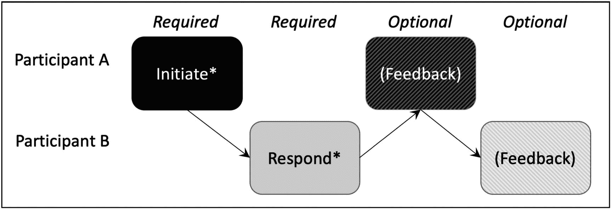
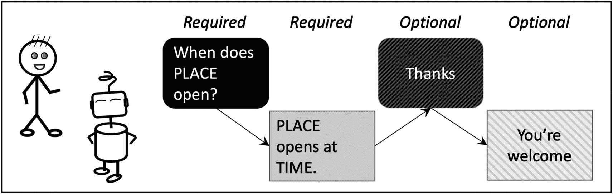
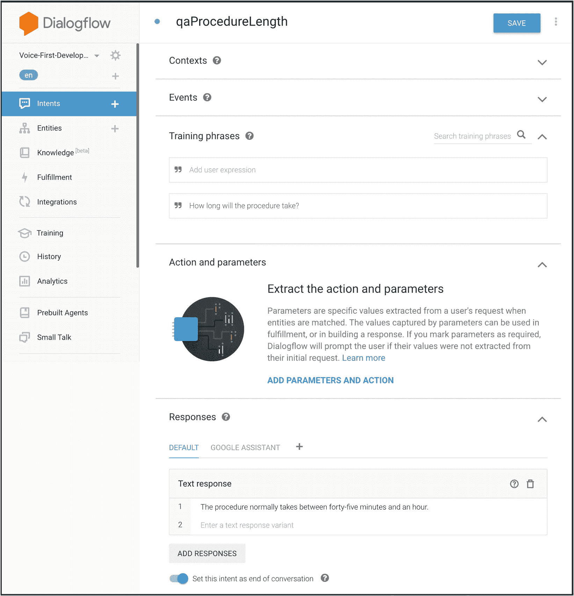
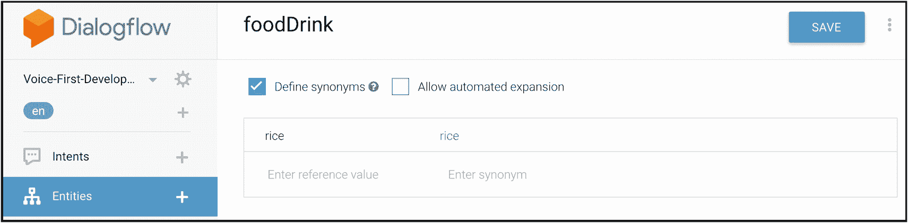
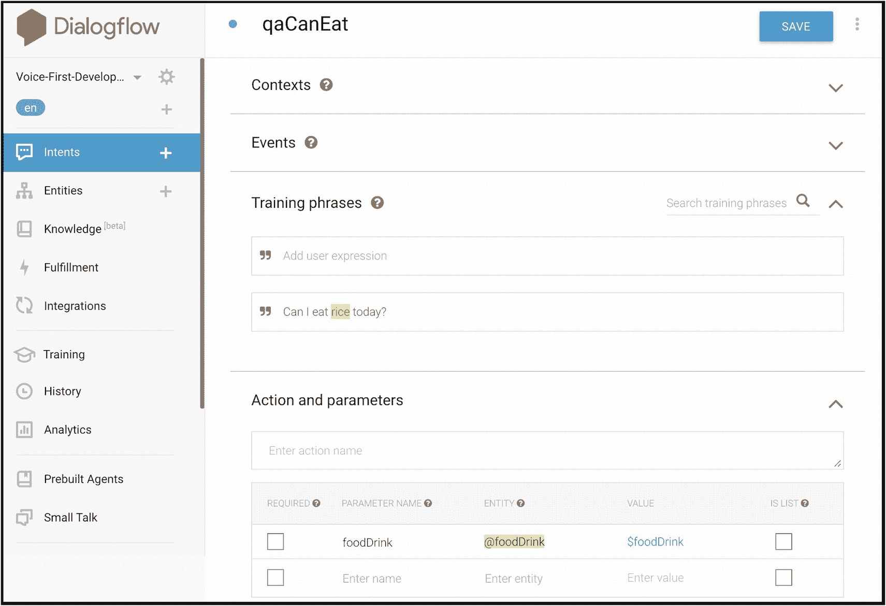

# 6. 应用人类“对话规则”达成对话解决

这是第三部分的第一章，你将一次一个关键主题地深入学习语音设计与开发的方方面面。*别为细节烦恼*或许是生活中的好建议，但正如你开始看到的，在语音开发中，一切皆关乎细节。要让一个对话式 UI 显得“聪明”，它不仅要让语音听起来像人、添加对话短语、识别并理解用户所说的话、获取上下文、了解该用户以及世界的一般知识——它还必须出色地完成所有这些，才能显得至少和普通的三岁小孩一样聪明。

本章涵盖对话式 VUI 对话的基本构建模块。你首先将熟悉三种对话模式及其各自的特点。这之所以重要，有两个原因。首先，无论设备类型或主题如何，这些模式覆盖了你将构建的大部分语音交互。其次，通过理解人们在每种对话模式中的期望，你可以预测响应并构建稳健的语音交互，甚至可以将其作为任何平台的可复用模板。你将学习如何为核心对话模式编写提示，以避免陷入困境。代码示例涵盖话轮转换、发起与响应、单槽与多槽、问答（QA）、动作请求和任务完成请求。

### 对话行为、对话游戏与话轮——兼谈格莱斯

当今所有语音用户界面设计的核心都是对话式交互，即对话。当本书两位作者最初在纽昂斯工作时，负责指定流程和设计细节的常见职位实际上就是“对话设计师”。无论你是在为移动应用、家庭助手、交互式语音应答系统、游戏还是汽车创建语音用户界面，在很大程度上，相同的对话设计模式都适用（基于多模态和上下文会有可预见的差异），因为你面对的是人类语音交流的相同优势和局限：语音用户界面对话是两位参与者之间基于音频的联合活动。

本书聚焦于可描述为**目标导向的合作性对话**。这些对话涵盖了当今大多数语音用户界面交互。在此类对话中，假设参与者 A 在与参与者 B 发起对话时怀有某种意图（没错，这就是我们称之为“意图”的原因），而 B 被期望对此做出回应。语音用户界面的工作假设是，A 和 B 对 A 的目标有共同理解，并且如果可能，他们会合作实现该目标。一个对话由两个或更多话轮组成：最少的情况是，A 发起，B 回应，然后……结束。一个话轮是指一位参与者通过说话或做某事“掌握话语权”；话轮转换是参与者在发起者与回应者，或说话者与倾听者角色之间切换的行为。话轮转换受你在第 2 章学到的所有潜意识语言规则支配。一组话轮及其通过话轮转换产生的预期交互有时被称为**对话游戏**；话轮则是具有特定特征的**对话行为**或**言语行为**。高级对话行为的例子包括问候、是非问句、特指问句^(⁴³)、陈述、确认、模糊限制语、感谢和请求。

> **成功技巧 6.1 在语音用户界面设计中使用对话行为标签**
>
> 对话行为术语在早期设计和设计模式中效果很好。如果你不想，不必拘泥于特定的理论框架；只需利用那些有助于你工作的部分。你还会发现，一些自然语言处理和机器学习工作会以各种方式积极使用这些类别。

每个对话游戏都有必需话轮和可选话轮，它们可以嵌套，但在高层次上，它们都遵循相同的模式。如图 6-1 所示，其中星号表示必需话轮，括号表示可选话轮。

**图 6-1** 语音用户界面对话模式原型

这样思考的美妙之处在于，你可以从人们潜意识的对话模式中抽象出来，设计和实现稳健的语音用户界面交互，将特定模式应用于特定上下文。^(⁴⁴) 你将在本章学习如何做到这一点。在当今语音助手的许多语音用户界面对话中，参与者 A 是用户（发起者），参与者 B 是语音用户界面（回应者）。在交互式语音应答系统的语音用户界面对话中，一旦呼叫被发起，情况往往相反。以下是另外两个定义，适用于你在创建语音用户界面时最感兴趣的对话类型：

> *对话表现为话轮的交替，每个话轮由同一行为者执行的一系列言语行为组成……每个话轮可能由多个言语行为构成。*^(⁴⁵)
>
> *对话游戏是信息交换的合作活动：参与者努力基于观察和深思熟虑的意见，就某个问题或疑问达成一个真实且信息丰富的答案的共同理解。*^(⁴⁶)

现在你可能会说，*等等，我经历过很多并不特别合作的对话，有些还非常一边倒！* 确实如此。程序准备应用中的一个功能会引导用户完成一系列指令。你将在后面学习如何处理上下文之外的请求，但如果你的用户想捣乱你的语音用户界面，你能做的也有限——你回应得越多，产生的期望就越高。任何本质上具有对抗性的对话，比如政治辩论，虽然有趣，但不在本书讨论范围内。我们也不关注完全自由形式的语音转文本，比如听写——那太一边倒了，算不上合作性对话。社交机器人和冒险游戏也不是我们关注的重点，因为篇幅有限。然而，一旦你意识到这些对话是由一系列较短的独立对话或对话行为通过额外的“交战规则”串联起来的，我们所涵盖的细节也同样适用于这些应用。

话轮转换在不同设备类型和实现方式中有所不同。虽然常见的对话规则说要避免打断当前说话者，但作为人类，我们经常这样做。电话允许打断，因为人们可以同时说话和听。这是**全双工**；你在电话语音用户界面（如交互式语音应答系统）中利用这一点，通过实现**插入**功能：允许用户只需说话就能打断语音用户界面，而不必先说唤醒词或按按钮（**半双工**）。

我们将目标导向的对话游戏分为三种相似但不同的使用模式：**问题回答**、**动作请求**和**任务完成请求**。表 6-1 展示了每种类型的示例，包括用户可能说的话以及语音用户界面可能如何回应。

**表 6-1** 目标导向对话，附通用话语示例、对话行为和语音用户界面回应

| | 问题回答 | 动作请求 | 任务完成请求 |
| --- | --- | --- | --- |
| **用户话语** | 娜娜餐厅几点开门？ 托尔斯泰写了《战争与和平》吗？ | 把电视静音！ 播放 ABBA 的《滑铁卢》。 | 给大卫发条消息说：“我十分钟后到。” 在娜娜餐厅订一张今晚 7 点六个人的桌子。 |
| **对话行为** | 特指问句，是非问句 | 命令 | 命令 |
| **语音用户界面回应** | 陈述 | 动作 +（陈述） | 动作 + 陈述 |

现在请看表 6-2，了解程序准备助手应用中三种对话类型的示例。这些话语应该看起来很熟悉：它们是第 4 章的原型。

**表 6-2** 程序准备助手应用意图的目标导向对话

| | 问题回答 | 动作请求 | 任务完成请求 |
| --- | --- | --- | --- |
| **用户话语** | 手术需要多长时间？ 我今天能吃米饭吗？ | 给我的医生办公室打电话。 我今天应该做什么？ | 预约一个时间。 带我完成我的程序准备。 午餐我吃了一个汉堡、薯条和一杯健怡可乐。 |
| **对话行为** | 特指问句，是非问句 | 命令 | 命令 |
| **语音用户界面回应** | 陈述 | 动作 +（陈述） | 动作 + 陈述 |

#### 深度解析：通过格莱斯合作原则达成对话目标

语言哲学家保罗·格莱斯分析了大量对话录音后得出结论：人们会对对话参与者的行为方式做出预设。^(⁴⁷) 我们期望对话具备真实性、相关性、简洁性和清晰性，目标是高效达成双方共享的对话"终点"。格莱斯将其概括为合作原则（*根据你所参与对话的公认目的或方向，在对话发生的阶段，做出符合要求的贡献*）以及四条人们下意识遵循的对话准则：

- **质量准则**：说话者诚实守信，不故意说谎。
- **数量准则**：说话者提供理解所需的信息量。
- **方式准则**：说话者力求清晰简洁，避免歧义和含糊。
- **关联准则**：说话者力求与当前对话相关。

当然，对话还涉及更多方面，包括礼貌、不确定性以及文化差异的影响。这些并不会削弱格莱斯的洞见，只是意味着具体细节可能需要根据语言和领域进行调整。如今的语音设计师和开发者，无论是否了解格莱斯，都默认遵循这种对话行为模式。

### 问答系统

你可能从信息检索领域熟悉了问答（Q-A）系统。问答（更准确地说是 QA）对话顾名思义：用户提出**问题**，VUI（语音用户界面）给出**答案**。用户期望获得信息性回复，理想情况下是问题的直接答案，或至少是解释为何无法提供帮助的回复。随后可能有一方发起后续对话，另一方做出回应（本章后续会详述）。最基本的形式是一方发起，另一方回应——这就是你在第 2 章学过的对话轮次相邻对：

- **发起** **用户** *<必要时唤醒 VUI>*
- **发起** **用户** *娜娜餐厅几点开门？*
- **回应** **VUI** *<数据查询>*
- **回应** **VUI** 娜娜中餐厅今晚 7 点开门。
- *（反馈）* **用户** *谢谢！*
- *（反馈）* **VUI** *不客气*。

图 6-2 基于此示例对话展示了 QA 对话模式——注意它如何更具体地实例化了图 6-1 中的模式，并展示了表 6-1 中的一个话语示例。

图 6-2 以餐厅为例的问答（QA）对话模式

#### 构建问答示例

现在让我们回到 Dialogflow，将这个示例对话变为现实。^(⁴⁸) 再看两个具有代表性的 QA 示例对话，这次是关于手术准备助手（为简洁起见，我们不再包含让 VUI 保持监听的提示）。

- **用户** *手术需要多长时间？*
- **VUI** *[查询]*
- **VUI** *手术通常需要 45 分钟到 1 小时。*

~ ~ ~     ~ ~ ~     ~ ~ ~     ~ ~ ~

- **用户** *我今天能吃米饭吗？*
- **VUI** *[上下文查询：米饭 + 今天]*
- **VUI** *你今天仍然可以吃米饭。*
- **用户** *耶！*

如你所见，它们遵循图 6-2 中的相同通用模式。QA 交互有两种基本类型：答案始终相同的（**上下文无关**）和存在依赖关系或变量的（**上下文相关**）。第一个问题"手术需要多长时间？"更简单，因为 VUI 的回复是固定的；这是一个不依赖用户上下文的通用答案（尽管显然可以个性化）。在具备常见问题解答功能的助手中，可以合理假设用户还有许多其他符合此模式的问题，因此让我们从构建一个可复用的上下文无关 QA 对话开始：

图 6-3 添加`qaProcedureLength`意图后 Dialogflow 应呈现的效果

1.  登录 Dialogflow 控制台。确保你处于 Voice First Development 代理中。如果不是，请点击左侧导航栏并选择该代理。
2.  更新欢迎提示以反映名称和任务。选择意图 ➤ 默认欢迎意图 ➤ 回复。将"欢迎使用 Voice First Development"改为"欢迎使用手术准备助手"。点击保存。
3.  删除任何旧意图。由于你已删除唯一的"常规"意图，你会看到相应提示，并提供"创建第一个"的选项。
4.  创建新意图。点击"创建第一个"；将其命名为`qaProcedureLength`。
5.  添加示例短语。选择训练短语 ➤ 添加训练短语；然后输入"手术需要多长时间？"点击保存。请注意，点击保存后会出现一个新的空白框，用于输入更多短语。你暂时无需添加更多。
6.  添加回复。在意图的回复部分，点击添加回复。在"输入文本回复变体"中，输入示例对话中的回复："手术通常需要 45 分钟到 1 小时。"点击保存。
7.  设置对话完成。点击"将此意图设置为对话结束"旁边的滑块。点击保存。你的 Dialogflow 应类似于图 6-3。
8.  现在测试！如你在第 3 章所学，你有多种选择：如果条件允许，可以使用 Google Home 设备或移动版 Google Assistant 进行测试。开始时，说"*OK, Google. Talk to Voice First Development*"。尽早并频繁测试（第 16 章）。

本章我们不展示任何代码清单，因为我们目前完全在 Dialogflow 中构建交互，而不是从头编写 Python 代码。请记住第 3 章的内容，你可以将配置导入 Dialogflow：

1.  点击 VUI 代理名称 Voice First Development 右侧的齿轮图标。
2.  点击"导出和导入"。
3.  点击"从 ZIP 恢复"。选择你需要的代码示例文件，此处为`6-1.zip`。

查看从`.zip`文件中更完整代码中提取的代码示例。这是你的第一个对话模板，一个基础 Q-A 对话的模式。

接下来，基于"我今天能吃米饭吗？"^(⁴⁹)构建一个可复用的上下文相关 QA 对话。

1.  创建一个新意图。将其命名为`qaCanEat`。
2.  从示例对话中添加示例短语"我今天能吃米饭吗？"
3.  添加回复："你今天可以吃米饭。"

4.  确保意图被标记为对话的结束。

5.  点击 `Save`。测试一下！

如果人们只吃米饭，并且流程的时间无关紧要，那么这种方法效果很好。幸运的是，我们大多数人的饮食比这更均衡。你可以为每种食物设置单独的意图，但这会导致管理变得非常复杂。因此，开始使用**槽位**，或者也被称为**实体**。你在前面的章节中已经了解了槽位；现在你正处于“构建”阶段，所以是时候了解具体细节了。

回想一下，槽位（或实体，这是 Google 使用的术语）是在语音或文本请求中捕获信息片段的变量。理解槽位的一种方式是将其视为请求中来自列表的元素：如果你更改了请求中的列表元素，它仍然完全合理。在语句 *Can I eat rice today?* 中，rice 是填充槽位的众多候选之一——你可以用任何食物替换“rice”，句子仍然有意义。

槽位可以出现在问答、动作请求或任务完成请求的对话中。一次对话轮次中可以有一个或多个槽位。这两个术语都被该领域的人使用，所以我们希望你了解两者——你使用哪个术语取决于你最初在哪里学到它们，以及你在 VUI 工作中使用什么框架。在 Google 框架中，实体是撰写本文时常用的术语。

从技术上讲，“rice”本身不是槽位，而是分配给槽位的槽位值。槽位本身可能被称为类似 `foodDrink` 的名称。在将“rice”定义为 `foodDrink` 实体的一个值后，你可以向其中添加更多可能的值。养成使用有意义的槽位名称的习惯，并与团队其他成员商定这些名称，以便在设计和实现过程中使用相同的名称。

槽位的伟大之处在于，你可以将句子的意图（*Can I eat this or that?*）与所询问的项目（*rice*）分离开来。如果没有槽位，你就必须为你可能询问的每一种食物或饮料至少准备一个示例短语。这太疯狂了，也不是你想要的。有了实体，你可以添加越来越多的可能值，而无需更改示例短语。意图的载体短语（用户表达请求的方式，同时保持相同含义，如 *Can I*…, *Is it OK*…）在你的意图中保持不变，而槽位值的数量可以任意大。

这非常类似于在代码中编写函数，将频繁使用的部分分离出来，这样你只需定义一次，就可以随意重用。让我们将示例短语中的“rice”变成一个槽位或实体：

**图 6-4** 添加了 `foodDrink` 实体（仅包含“rice”作为其值）后的 Dialogflow

1.  选择 `Entities` ➤ `Create Entity`。

2.  在 `Entity Name` 中，输入 `foodDrink`。

3.  选择 `Click Here to Edit Entry`，然后输入“rice”。点击 `Save`。你的 Dialogflow 现在应该类似于图 6-4。

你已经完成了第一部分，定义了槽位 `foodDrink`。现在你需要告诉 Dialogflow 它在示例短语中的位置：

**图 6-5** 在示例短语中将“rice”定义为 `foodDrink` 实体的值后的 Dialogflow

1.  找到 `qaCanEat` 意图。

2.  找到训练短语“Can I eat rice today?”，然后双击单词“rice”。

3.  出现一个包含多个选项的菜单。选择顶部的 `@foodDrink`。点击 `Save`。

4.  你的 Dialogflow 顶部现在应该类似于图 6-5。你会注意到以下几点：
    *   既有实体也有参数。它们是不同的概念，并非同一回事。请参阅“深入探讨：实体、参数和槽位”部分。

