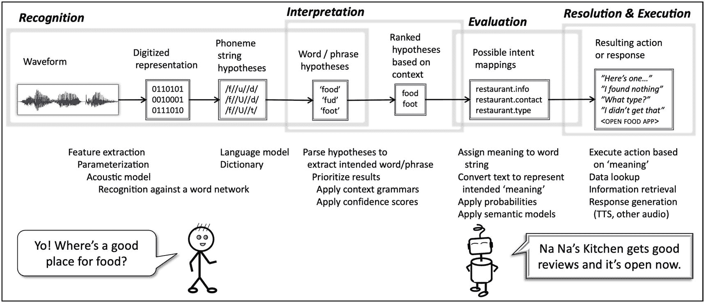
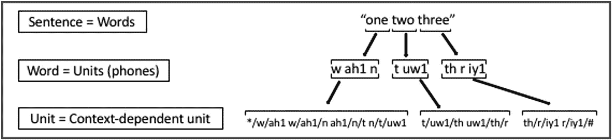
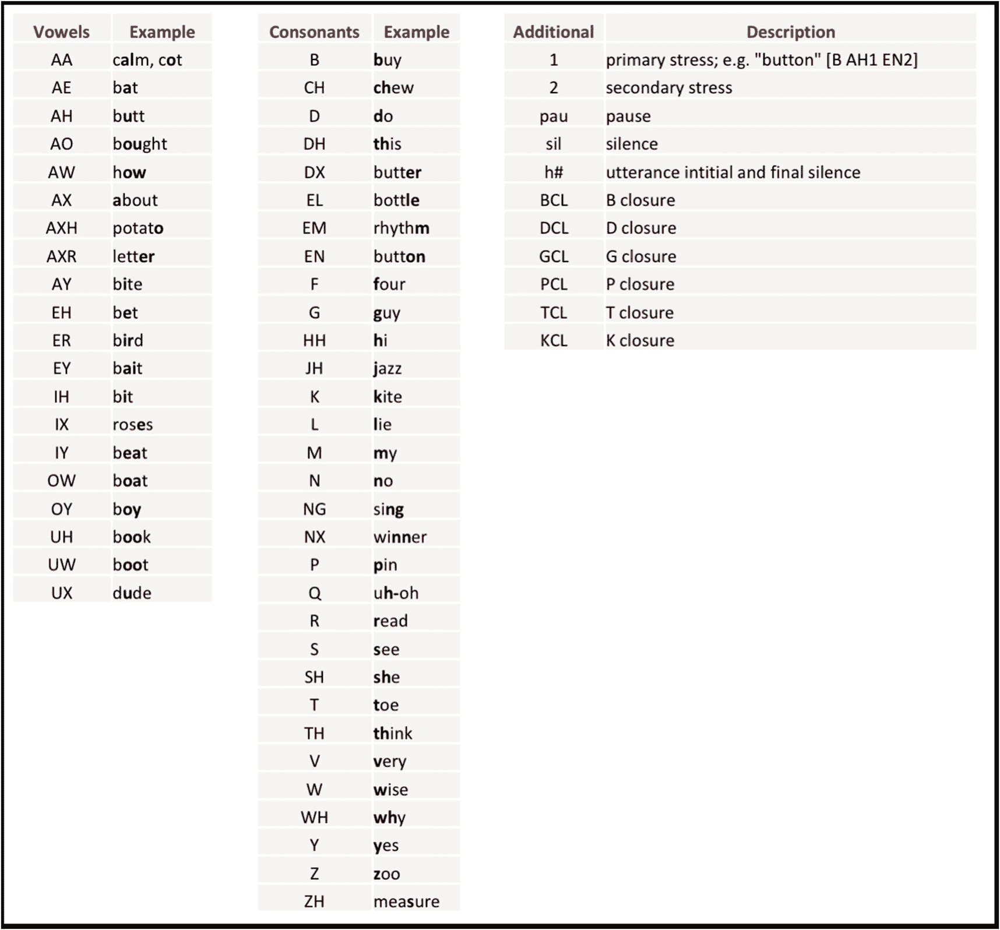
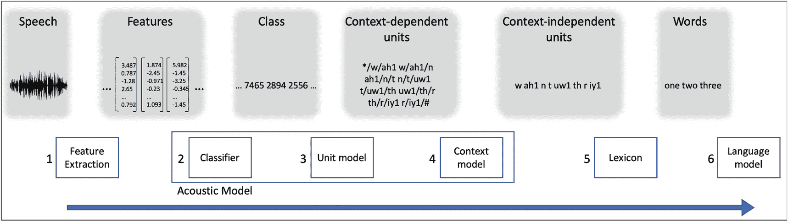
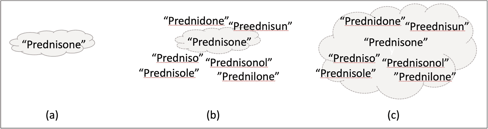
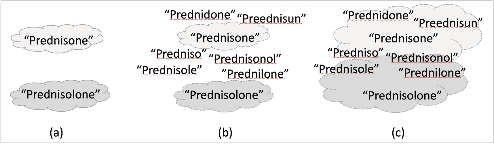
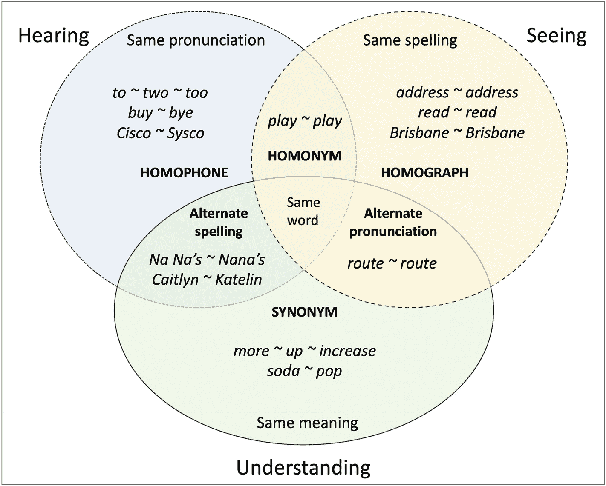
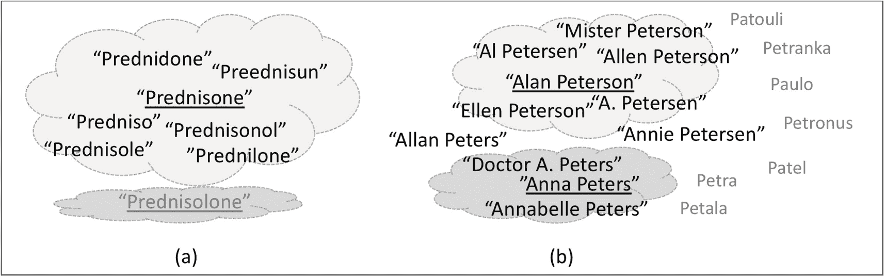
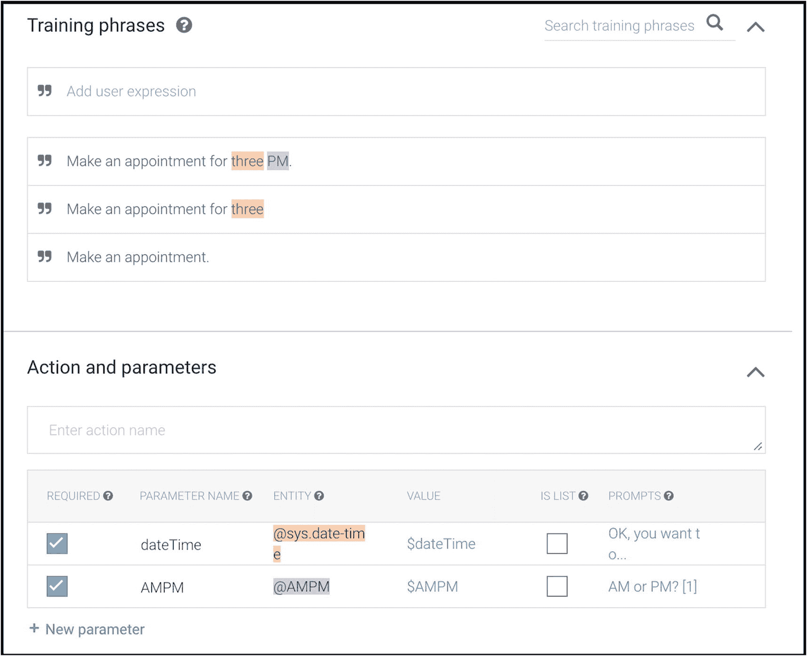

# 10. 为语音转文本解析创建鲁棒覆盖

如今的语音识别引擎令人惊叹，比以往任何时候都更好，但它们仍然不完美。如果你在手机上使用听写功能，就会看到可能出现的错误。将口语话语正确转换为文本具有挑战性——而所有后续的意义解读和响应都依赖于它。

多轮对话使情况更加复杂：识别过程中早期出现的任何错误，都会在后续每一步中被放大，产生奇怪的结果。如果声音未被识别，用户的话语就会被误解，这意味着语音转文本是错误的。如果语音转文本产生了不正确或意外的词语和短语，自然语言处理和意图评估就无法成功。

任何有语音设计和开发经验的人都知道，成功的理解始于正确捕捉用户所说的话。而这依赖于出色的语音识别和鲁棒的语法，即用于捕捉用户话语的模式和模型，通过匹配话语中的词语并将其转换为意图评估的表示形式。

接下来的四章将深入探讨如何通过准确性和纠错来最大化理解，当识别和理解失败时。本章是第一步：语音转文本和语法。我们的目标是向你展示，即使你无法直接访问核心识别器，在设计和开发中也有一些方法可以改进语音转文本。我们将深入探讨相当多的细节，但会保持足够的非技术性，以便每个人都能理解问题和解决方案。

## 语音识别即语音转文本的解读

至此，你已经熟悉了语音系统的各个组成部分。现在，是时候深入了解第一个组件——`STT`（语音转文本）了。它的输入是用户的语音表述，输出则是该表述的一种表示形式（通常是文本）。此处复制了图 2-11 以供参考（图 10-1）。



图 10-1：计算机理解并响应口语表述过程的详细但过于简化的示意图

语音识别是困难的。避免或至少最小化“灾难性失败”是识别与解读的共同目标，这也应成为你的关注重点。我们特意使用了“解读”一词：尽管如今的`ASR`（自动语音识别）令人惊叹，但它并非完美无缺；文本结果仅代表识别器对用户所说内容的“最佳猜测”。无法保证这种表示形式能准确对应用户的实际表述。解读与转写不同：转写是由经过训练的人类聆听录制的用户语音后打出的文本。转写结果非常准确，它们是用于性能调优的基准真相。这种区别常被忽视，这具有误导性，因为它掩盖了识别并非完美这一重要事实，并模糊了在更深层次上处理这一理解问题的必要性。开发高性能语音系统需要人类参与聆听实际语音内容，以分析任何性能问题的原因，并对其进行转写以用于调优。关键在于数据要保持安全、匿名化并得到恰当使用，而非仅仅为了改善`VUI`（语音用户界面）体验而让人监听。为调优`VUI`而进行转写是良好且必要的。^(⁶⁷)

### STT 黑盒内部

到目前为止，我们大多将语音转文本（`STT`）组件视为一个黑盒，仅暗示了为何需要了解这个黑盒的输出，以便创建与`STT`匹配的实体和训练短语。现在，是时候看看这个`STT`黑盒内部究竟有什么了。

#### 用更小的片段构建句子

一个短语或句子具有相当复杂的结构。图 10-2 展示了如何将相对简单的短语 *one two three* 分解成更小的基本片段，就像乐高积木一样。



图 10-2：说明句子如何由更小的单元构建而成

句子 *one two three* 可以分解如下：



图 10-3：包含美式英语示例的`ARPAbet`常用符号清单

*   句子是单词的序列。
*   每个单词是单元（即语言构建块）的序列。从单词到单元的映射称为词典。这些单元通常对应音素，即语言中最小的区别性声音。在标准美式英语中，大约有 50 个音素。这反映在`ARPAbet`或`SAMPA`中数量相近的符号上，它们是常见的机器可读音标符号集，代表元音、辅音以及单词重音。例如，单词“two”表示为“t uw1”，其中“t”是辅音，“uw1”是元音的发音，包括主重音。这些方案被广泛用于`STT`和`TTS`（文本转语音）中表示声音和单词。你可以在图 10-3 中看到`ARPAbet`清单的一个版本。
*   由于协同发音效应，一个声音的产生方式会因周围单元的不同而发生显著变化。周围音素的上下文会影响每个单元的发音。我们可以利用上下文相关单元的概念来提高识别效果。例如，单词“one”和“fun”会有不同的`/ah/`单元，一个跟在`/w/`之后，另一个跟在`/f/`之后。

什么构成最小单元因语言而异；单元清单也是如此。在英语中，基本单元是音素。例如，在汉语中，单元通常是声母和/或韵母，它们可能对应音素，但也可能不对应。

#### 使用语音转文本技术构建句子

图 10-4 展示了语音转文本组件的流程。



图 10-4：构成语音转文本流程的组件

许多语音转文本组件是通过机器学习技术，利用大量语音和语言数据自动训练而成的。这些组件包括：

*   **特征提取**：接收语音波形，并自动生成特征——一组周期性（通常每 10 毫秒）产生的数字，以机器可用的格式表示波形，供后续步骤使用。
*   **分类器**：接收每组特征，并输出多个类别中的一个。通常有数千个类别，其生成频率与特征相同。与特征提取一样，分类器的输出实际上并不对应我们通常认为的清晰声音类别。可以将其视为寻找分布模式和特征向量的下一步，为后续步骤提供输入。
*   **单元模型**：接收类别序列，并生成你在上一节中看到的上下文相关单元。这通常涉及隐马尔可夫模型（`HMM`）。基本上，对于每个上下文相关单元，存在一个数学模型来描述特征类别随时间的变化。这会产生大量单元：假设有 50 个可能的音素，训练左上下文/中心/右上下文的所有可能性意味着 50 × 50 × 50 = 125,000 个可能的上下文相关单元。实际数量会略少一些，因为许多左/中心/右组合并不存在。但即便如此，数量仍然庞大；你不会有足够的数据来训练每一个。幸运的是，训练过程非常智能。它会找出如何在相似组合之间共享训练数据，并且仅在数据充足时才训练完整的上下文相关单元（称为三音素）；否则，当数据非常有限时，它可能只使用一个上下文（左或右双音素），甚至完全不使用上下文（单音素）。
*   **上下文模型**：将上下文相关单元映射到上下文无关单元。单词“one”在词典中被指定为上下文无关单元“W AH N”。对于元音 `AH`，你可能有一个完整的三音素模型 `W/AH/N`，左右双音素模型 `W/AH` 和 `AH/N`，甚至还有一个单音素模型 `AH`。上下文模型结合了可能的单元模型，为单词“one”中的 `AH`，或任何其他处于 `W/AH/N` 上下文中的单词（如“once”、“swung”、“wonder”）提供最佳模型。
*   **词典**：词典将单词映射到单元。它基本上是一个大型表格，通常不是通过训练得到的，而是由语言学家手动生成（或至少经过人工校对）。一个常见的英语词典——`CMU发音词典`——包含超过 134,000 个单词。^(⁶⁸) 随着新词进入和旧词退出语言，它是一份不断更新的文档。`CMU发音词典`对“one two three”的指定如下——注意单词可能有多种发音：
    *   `ONE HH W AH1 N`
    *   `ONE W AH1 N`
    *   `TWO T UW1`
    *   `THREE TH R IY1`
*   **语言模型**：一个关于允许的单词序列以及每个单词与其他单词共现可能性的模型。一个优秀的语言模型对于顶级性能的语音转文本至关重要，因为它基本上将声音片段假设与最可能的单词进行匹配。

分类器、单元模型和上下文模型通常统称为声学模型。一个好的模型需要在数千小时和数 `TB` 的数据上进行训练——这就是为什么美式英语的性能仍然优于大多数其他语言，这要归功于大量的训练数据。

## 识别引擎

你从头开始创建自己的自动语音识别引擎的可能性非常小——如果你目前正在自动语音识别开发团队工作，感谢你的阅读！人们不创建自己的识别引擎，是因为这需要巨大的努力，并且要获得高质量的结果需要海量的语音数据。相反，我们建议你使用由拥有持续改进资源的人创建的几种自动语音识别引擎之一。你的精力最好花在语音优先设计和开发的所有其他方面。

你需要了解可用识别器之间的差异，因为选择识别器不仅仅取决于原始准确率或预算。你是在购买一个既有优势也有局限性的生态系统。哪个适合你取决于许多因素，包括响应延迟、云端或设备端处理、多语言支持、工具、参数访问、原始数据访问、领域、对话任务、设备类型等等。不久前，由于处理能力和内存要求，在设备上实现顶级质量的自动语音识别几乎是不可能的。这种情况正在改变，但控制着最佳自动语音识别引擎的大型公司很可能出于多种原因希望将处理保留在云端，包括控制对语音数据的访问——而语音数据反过来又能提升识别器的性能。以下是撰写本文时一些识别器选项的概述——这始终是一个动态变化的目标：

# 语音转文本技术概述

### 云端 API
主要人工智能公司的云端 API：谷歌、微软和 IBM 都拥有性能出色的美式英语模型和功能齐全的 API。亚马逊拥有相同的功能，但相对不那么开放；例如，你目前无法在不使用整个 `Alexa` 技术栈的情况下单独访问语音转文本功能。Facebook 和苹果则更加封闭，因为它们（在撰写本文时）不提供语音/语言层面的开发者 API。虽然美国人工智能公司支持多种语言，但像科大讯飞和百度这样的中国公司也提供 API，并且在亚洲声调语言上通常表现更好。你主要通过添加语言模型所基于的示例短语来为自己的语音应用定制这些 API。

### 特定领域和渠道的服务器端解决方案
Nuance 等公司长期以来一直为应用程序提供高性能的服务器端解决方案，主要用于呼叫中心自动化。这些方案也位于云端，而非设备端，但通常比上一组方案更加封闭，也更加专业化。基于电话的模型有所不同，因为它们基于 8 kHz 采样的电话语音，而使用移动设备麦克风（不经过电话网络）的云端 API 通常使用 16 kHz 采样的音频。由于 8 kHz 电话和 16 kHz 移动设备之间的音频差异很大，针对这两种情况分别训练的声学模型会带来更好的性能。对于相同的用例，词典和语言模型通常是相同的。这些方案通常涉及统计模型和基于规则的语法的混合。

### 设备端
语音转文本可以直接在设备上运行。目前的主要应用是你在家用设备上看到的唤醒词（`Alexa`……，`OK, Google`……）。设备唤醒后，其余的语音转文本处理在云端进行。另一个设备端用例是命令与控制，适用于无法访问云端或快速响应对用例至关重要的情况。直到最近，大词汇量自动语音识别还必须在只能通过云端访问的强大服务器上完成。如今，我们看到了高性能设备端识别模型未来的良好迹象。这令人兴奋：它为可穿戴设备以及安全和隐私应用创造了新的用例。作为起点，可以了解一下 Sensory 和 PicoVoice。

# 语法概念

到现在为止，你应该已经注意到我们多么强调编写精心设计的提示语。清晰的提示语有助于用户自信地知道如何回应，从而使他们的回应具有可预测性，进而让你的语音用户界面能够成功回应。只有当语法创建者、设计者与应用程序开发者相互协调时，这一切才能实现。

## 覆盖率

`覆盖率` 可能是语法中最核心的概念。它指的是已被纳入或训练过的词汇和短语；通常，覆盖率越高，语音用户界面（`VUI`）的性能就越好。

不同的人会用不同的词语表达相同的意思，即使用同义词。你的语法需要考虑到用户在你处理的所有请求中可能使用的同义词变体，并将其映射到单一的槽位值，而不是多个不同的值。为了获得最佳的同义词覆盖率，你需要了解用户会使用哪些词汇，包括方言变体和对话题的熟悉程度。`I’d like a soda` 和 `One pop for me please` 是同义词；它们含义相同，因此应产生相同的槽位值。

**成功秘诀 10.1 识别同义词并不意味着要据此采取行动**

用户使用的同义词中蕴含着关于他们的线索，例如他们的籍贯。这很酷，但要注意不要过分强调你听到的变体。不要仅仅因为某人说 `pop` 而不是 `soda`，就断定他来自某个特定地区。出于同样的原因，如果用户被认为带有某种特定的地域口音，也不要据此定制你的 `VUI` 语音。你不仅可能判断错误，而且也不了解用户对自己籍贯的感受。这样做风险极高，可能会冒犯或迷惑用户，甚至导致他们改变回应方式，最终造成 `VUI` 失败。

不同类型的语法处理同义词的方式不同，你将在本章后续内容中了解到。要理解覆盖率，区分核心内容和载体短语内容（或填充词）会很有帮助。核心内容是填充槽位并捕捉 `VUI` 执行操作所需含义的单词或短语。在 `Let’s see. I take Lipitor and also Motrin`、`Yeah, this is for more Wellbutrin please` 和 `Metformin` 这些例子中，药物名称是核心内容；其他所有内容都是载体短语。载体短语并非不重要——它们承载着句法含义和上下文，因此对于解析和正确理解至关重要。

核心内容是 `VUI` 继续执行所需的必要信息——你可以将其视为填充槽位的那部分内容。载体短语通常是可选的，但语法需要考虑到它们，因为人们会使用它们——可以将它们视为内容的载体或容器。上下文很重要：某些词语或信息并非天生就是核心内容。同一个词在一个语法中可能是核心内容，在另一个语法中则可能是填充词。如果 `VUI` 询问 `Do you want to refill your Wellbutrin prescription?` 而用户回答 `Yes, the Wellbutrin`，那么只有 `yes` 是严格必需的，这使得药物名称在此处成为可选项（类似于填充词）——你需要在这两种上下文中都能识别它，以便在两种情况下都能处理。当错误代价高昂时，要小心处理载体短语。想象一下购买可能很昂贵的剧院门票的场景：

- **`VUI`** `现在想买这张` Hamilton `的管弦乐队座位吗？`
- **用户** `我需要考虑一下。`
- **`VUI`** [丢弃了 `think`；`to` 被解释为“two”。]
- **`VUI`** `你运气真好！两个座位是你的了。玩得开心！`

## 识别空间

覆盖率会影响识别空间。语法中词语之间的相似度越高，一个词被误认为另一个词的风险就越大。一种方法是让语法在可接受的内容上非常狭窄，迫使用户在发音或选词上非常小心。到现在，你应该清楚为什么这是一种一厢情愿的想法了。当然，你需要一些限制，但你也希望允许自然语言以及措辞和发音上的正常变化。我们的餐厅查找器包含“Na Na’s Kitchen”。这是官方名称，但大家都叫它“Na Na’s”。由于当地没有其他名称相似的餐厅——而且当地人都知道这一点——用户应该可以说出这两个名称中的任何一个。这两个名称都应该被处理。如果还有一家“Nanny’s”或“Na Na’s Cafe”，你就需要考虑潜在的混淆风险。

现在看看药物名称：许多药物名称在书写和发音上都非常相似。请看图 10-5。每个灰色云团代表一个药物名称的识别空间。



**图 10-5** 单个项目的识别空间（由灰色云团表示）：(b) 狭窄，(c) 宽广

在图 10-5 (a) 中，识别空间狭窄：用户每次以预期的“正确”方式说出药物名称时，都能被高置信度地识别。但如果他们在说出名称时结巴，由于识别空间狭窄 (b)，他们很可能会被拒绝。这对于那些确实努力尝试说出这些奇怪名称的非专业用户来说，是令人沮丧的。如果我们稍微扩大空间，将一些即使技术上不正确但也视为同义词的名称包含进来 (c) 呢？现在覆盖率更高了，允许更多成功的语音转文本（`STT`）。很酷。但等等。如果存在其他相似的药物名称呢？这就是图 10-6 的情况。



**图 10-6** 两个项目的交互识别空间（由灰色云团表示）：(b) 狭窄，(c) 宽广

在图 10-6 (a) 中，出现了第二个药物名称（是的，两者都是真实名称）。在狭窄空间下，只有正确的发音才能被准确识别 (b)。如果你想通过添加同义词来处理更多变体，空间会变得非常宽广以至于重叠 (c)！这意味着用户有时会被识别并解释为说了他们本意并非如此的话。这就是**过度生成**。既不是太窄也不是太宽是完美的解决方案；根据任务中准确性的重要程度，一种情况可能比另一种更糟糕。通常，当精确匹配很重要时，目标是更狭窄的空间；当你想允许更模糊的匹配时，则使用更宽广的空间。

这里还涉及另一个因素：词典。自动语音识别（`ASR`）词典对单词的发音进行编码，以将用户所说的内容与预期的单词进行匹配。大多数平台都提供某种方式让你向自定义词典添加发音。在药物名称的例子中，如果你碰巧知道有些人将“Prednisone”这个名称发音为 `Preednisun`，并且没有与此名称冲突的情况，那么你可以添加相应的音标表示，从而相应地扩大识别空间。词典在 `STT` 准确性中扮演着重要角色：一位语音科学同事指出，他如何根据用户的实际发音，为航空语音系统中的 `Heathrow` 添加了 42 种不同的发音。你将在第 17 章学习调优时了解更多相关内容。

图 10-7 总结了语音转文本和自然语言（`NL`）必须处理的词语级歧义，包括同义词。同音异义词（发音相同，含义和拼写不同）在某些语法或领域中可能会成为问题：不要鼓励用户以 `bye` 结束股票购买交互——它听起来和 `buy` 一样！



**图 10-7** 语音转文字需要处理的词汇级歧义


```
if (condVar > someVal) {console.log("xxx")}
```

根据经验法则，你的提示词应避免使用非同义词的同音词和同形异义词，这能防止用户说出容易混淆的词语。你很可能依赖核心识别器来处理不同的发音，但在这里，你也会通过 VUI 的发音方式来影响用户。如果你预计用户会以不常见的发音或多种发音说出产品名称，请务必添加这些发音。同时，也要添加识别器尚未处理的任何预期同义词。

当你的 VUI 期望识别一个与统计上更常见的词语发音相似（或相同）的词语时，近音词对识别来说尤其棘手。例如，一个允许用户询问`stents`（支架）的医疗语音应用，如果使用未修改的语法，其中包含`stints`（限量分配）这个词，就会遇到麻烦。

#### 静态或动态，大型或小型

语法可以是静态的或动态的。静态语法始终不变；你不会期望它因上下文或说话者不同而产生差异。动态语法则根据上下文以某种方式变化，例如识别的短语或每个项目被说出的可能性。动态语法通过限制或倾斜识别搜索空间以偏向某些匹配项，从而改进识别效果。这使得动态语法非常适合名称列表，例如乘客名单或邮政编码中的街道名称，也适用于与特定用户相关的情景，比如通讯录中的名字或该用户仅服用的药物名称。动态语法在发音上给用户更多自由度，因为识别目标范围更大，更容易匹配成功。一个只服用本节示例中两种药物之一并正在续药的用户，其发音可以更随意，仍能被正确识别（图 10-8 (a)），而同时服用两种药物的用户则不行。GUI 设计师会看到这与点击目标的大小和间距有相似之处。对于像药物这样重要的事项，你仍然需要限制未经确认就接受的发音。如果一家医疗诊所的员工姓名中只有两个名字的首字母是 A. P.，那么动态语法允许这些名字有一些变体，同时忽略所有其他以 P 开头的姓氏（图 10-8 (b)）。



**图 10-8** 动态语法的识别空间。(a) 只有 Prednisone（泼尼松）有效；(b) Alan Peterson 和 Anna Peters 都是诊所的员工

如果可能的项目集合很大，例如所有交易股票的名称或当前药物的完整国家药品编码（NDC）数据库，每个集合包含数万个唯一项目，那么寻找缩小搜索空间的方法就非常重要。

**成功提示 10.2** 提示词直接影响用户响应

用户的响应与提示词的措辞密切相关。因此，所有提示词的更改都必须至少包含语法审查，并且通常涉及语法更改。一个常见的新手错误是只考虑内容覆盖范围，而没有意识到提示词的更改对用户话语中填充部分的影响有多大。

#### 端点检测

语音转文字需要一个良好的端点检测器，这是一种算法，用于确定用户何时说完话，以便停止监听并开始处理。端点检测非常复杂且非常重要。如果它触发得太早，用户会在说完话之前被截断。如果它结束得太慢，侧边语音和其他噪音可能会被拾取并误认为是词语。无论哪种情况，结果都不能准确代表用户所说的内容，对话就会失败。

#### 多重假设

在 STT 过程中，并且在仍在监听时，识别器会保持多个关于正在说什么的活跃假设。原因是，只要还有语音输入，就会有信息改变对话语最可能的解释。一旦用户停止说话，识别器就会确定一个最佳假设。这有很多用途，我们将在第 12 章中再次讨论。

#### 多模态提示

如果你的 VUI 使用按键通话（PTT），即一个控制麦克风并开始和结束识别的按钮，那么端点检测对检测语音开始和结束的影响就不那么大了，但会有其他时序上的困难。用户可能很难准确把握按下按钮和说话的时机。音频提示音（earcons）有所帮助，但还不够。这在一定程度上取决于你的特定用户。在 22otters 的多模态手术准备辅助应用中，我们使用了 PTT 和提示音来标记应用开始和结束监听的信号。我们发现，由于基于云的识别造成的轻微延迟，有提示音提示的用户成功率更高，他们的话语也更完整。如果你对着带有屏幕的多模态 VUI 口述，你可能会看到一种解释在你说话时逐字显示。一旦端点检测器判定你说完了，你可能会看到这些词语突然改变——有时变得更好，有时则不然！你看到的是最佳假设的最终切换。这对某些用户来说可能令人困惑和不安，因此，如果你的 VUI 有显示屏，你可能希望或不希望实时显示这些假设。在我们自己的手术准备辅助应用中，我们选择不显示实时结果。我们也没有显示实际的逐字字符串解释，而是显示一个经过精心策划的版本，去除了多余的词语或口吃，同时仍提供足够的信息让用户隐式地确认他们被理解了（图 10-9）。


**图 10-9** 不同的文本结果字段：(1) 逐字结果转换为仅内容；(2) 逐字，完美识别；(3) 逐字，接近识别；(4) 逐字，较差识别

### 语法类型

存在不同类型的语法，它们之间差异很大。但所有类型都有一个共同点：必须有人做些什么来创建它们。它们不会凭空出现。要么你自己创建它们，要么从别处获取。如果是由其他人创建的，你可能可以修改它们。它们可以是完全手工制作的字符串匹配，也可以是基于数据语料库自动训练的统计匹配。你可能可以访问某些特定领域或主题的预填充语法，例如邮政地址、金额或日期。当存在这样的语法时，请使用它们——其他人已经花费了大量时间来调整其鲁棒性，让你能够专注于 VUI 特定的语法。

在本节中，我们将介绍你可能会创建或遇到的四种语法类型。你将了解覆盖范围和识别空间如何影响在 VUI 中为每个上下文选择正确的语法类型。之后，你将获得关于如何创建语法的具体经验。

#### 基于规则的语法

基于规则的语法是一种模式，旨在精确匹配语音用户界面（VUI）中每个预期的用户表述。它们可以是静态的，也可以是动态的。如果你会写正则表达式，你就能编写基于规则的语法。编写健壮的基于规则的语法需要大量工作：覆盖范围是通过精确匹配每一种可能的表述来实现的，包括核心内容和填充词。但如果你知道自己在做什么，就能快速构建一个像样的语法。对于结构化的、填充词相对受限的多槽位表述来说，它们是一个不错的选择。由于它们是手工编写而非根据统计分布生成的，因此擅长处理低频词条。它们还能通过追踪匹配的模式，让你更清楚地了解某个特定表述为何会产生特定结果。这对于医疗和金融领域的 VUI 实现至关重要。基于规则的语法的一个核心难点在于平衡覆盖范围与过度生成（图 10-5 (c)）。识别空间越拥挤，匹配到错误词条的风险就越高。

#### 统计模型

统计语言模型（`SLM`）并非手工编写，而是从训练数据中生成的。训练数据由大量用户表述组成，这些表述是在与 `SLM` 将在 VUI 中使用的相同语境下收集的，然后经过转录并输入到合适的软件中。重要的是，训练数据需要是对 VUI 中与 `SLM` 配合使用的同一提示语的回应。训练一个 `SLM` 需要大量的前期投入。如果你无法获得所需的数据，你的模型就会表现不佳。但一旦你拥有了良好的 `SLM`，它们几乎可以说是天生就健壮。由于内置了统计分布，常见的请求更容易被处理。

而且，表述在近似匹配时也更容易成功，因此当用户的回应变化多端，以至于难以识别出用于编写规则的固定模式时，`SLM` 就是你的好帮手。有时你甚至会根据不同的语境使用不同的 `SLM`。某些复用是可能的，训练数据越多，`SLM` 就越健壮。但如果提示语发生变化，用户的表述也会随之改变，因此需要新的训练数据来保持高性能。由于 `SLM` 是基于训练数据生成的表示，因此它比基于规则的语法更像一个黑盒。这使得精确预测什么会与什么匹配变得更加困难，尤其是对于不常见的表述，也更难解释为什么某个表述会匹配到特定的意图。这对于医疗领域的 VUI 来说是个问题，因为可预测性和可问责性是首要任务。稍后你会看到，结合基于规则和统计的方法可能是解决方案。假设数据是“真实的”，并且不同意图没有使用相同的表述，那么过度生成就不是问题。

#### 热词、唤醒词和调用名

热词语法只查找一个单词或短语，没有同义词或只有非常有限的同义词。很像《远方》漫画中描绘的狗听到的内容（*blah blah blah Ginger blah blah*），热词语法进行的是单词检测，忽略所有其他单词，同时保持麦克风开启并监听。这使得它们非常适合用于导航命令，或者用于恢复已暂停的对话，例如，当用户正在查找处方编号或完成多步骤对话中的某一步时。如果处理得当，用户即使在嘈杂的房间里或有旁人在交谈，直到识别器捕捉到那个“魔法词”为止，系统都能正常工作。可以想象，当这个单词或短语独特、易于说出和识别——但又不会轻易被误触发时，效果最好。


在语音技术领域，这种情况很常见：人们使用的术语及其所指代的内容各不相同。“热词”这个术语已经变得含义过载。谷歌现在用它来指代*Hey, Google*这部分。我们发现区分不同的用例很有用，因此我们倾向于用“热词”来指代在正在进行的对话中暂时暂停的某个东西。对我们来说，*Siri*、*Alexa*、*Hey, Google*以及类似的词，最好被视为唤醒词，这是一种与“始终监听”的智能设备相关联的热词，用于在新对话中打开麦克风以捕获用户表述。你只有在相关公司的团队中工作，或者正在创建一个不基于这些平台的独立平台或设备时，才需要处理唤醒词。调用名是你的Google技能或Alexa操作的名称：它是你的用户需要说出才能启动你的特定VUI交互的名称。

调用名必须遵循每个平台施加的特定要求——最好查看每个平台当前的在线规则。在这里，我们将重点关注通用的识别和用户体验问题。唤醒词是终极热词：语法中只有一个词，但这个词需要被所有用户在各种语境和条件下理解。并且，相似的词理想情况下应该被忽略。由于通常涉及品牌因素，创建一个好的调用名可能很困难。理想的名称应该令人难忘、有意义、易于说出和识别。这出奇地困难。单词越短，越容易说出，但越难被准确识别。并非每个语音系统都需要处理唤醒词或调用名。对于基于电话的IVR系统，调用就是拨打电话的开始；对于移动应用，调用就是打开应用；对于带有自己麦克风的专用设备，调用可能是按下手动即按即说（PTT）按钮。

热词使得家用助手成为可能，但为所有用户将触发级别调整得“恰到好处”是一个持续的挑战。谷歌现在允许你调整这个灵敏度，这很棒。而且，把它调整正确很重要。当它不能按预期工作时，用户要么抱怨它听不懂他们，要么抱怨它在偷听并非针对VUI的对话。你需要避免这两种情况。

### 使用语法

你最有可能做的是编写自己的正则表达式，或者利用每个平台提供的工具来使用或扩展SLM。你可以为整个程序准备阶段的VUI使用基于规则的语法。真的。特别是，你可以将它们用于食物日记、联系人以及任何涉及药物或食物名称的内容。SLM最适合用于常见问题解答（FAQ），因为人们提出一般性问题的方式千差万别。出于篇幅考虑，我们不会详细介绍从头创建SLM的细节。

**成功秘诀 10.3** 让每个人都尝试构建语法

值得再说一遍：在语音领域取得成功的最佳方式是让团队中的每个人都理解什么困难以及为什么困难。没有比尝试创建健壮的语法更好的方法了。这并不意味着每个人都会成为这方面的专家——远非如此——也不意味着他们应该编写用于生产的语法。但尝试一下很有启发意义，而且非常有趣！

#### 编写基于规则的正则表达式

到目前为止，你已经通过在Dialogflow中提供训练句子来指定用户对每个意图的预期表述。这本身并不是编写语法；而是提供示例，Dialogflow会在内部将这些示例转换为某种语法，通常是前面描述的那种统计类型。提供示例所需的技能远低于手动编写语法，而且如今我们有相当不错的技术，可以从示例中自动创建出像样的（并非完美的）语法。另一种指定用户预期表述的方式是提供基于规则的语法。

##### 正则表达式定义

基于规则的语法通常基于正则表达式，程序员对此可能并不陌生。正则表达式是包含通配符的短语，可以非常轻松地指定多种可能性。正则表达式允许你说“这里可以放任何内容”，而不必逐一列举所有可能。你可以使用正则表达式来指定特定语境中预期的单词序列。你可以在网上轻松找到教程和测试工具，因此我们这里只通过一个简单示例来引导你。假设你的语音用户界面（VUI）刚刚询问用户*您想续配该处方吗？*；一个常见的回答是*是的*，因此正则表达式可以写成：

```
yes
```

听起来很简单，对吧？但并非所有人都只说一个词。正如你所了解的，有些人会在末尾加上*请*；所以你最好添加一个可选的“请”：

```
yes( please)?
```

你可能注意到空格很重要，就像在Python中一样。单词末尾的`?`是一个通配符结构，表示该单词是可选的。假设有些用户会在句子开头加上*嗯*，那么再添加一个可选的“嗯”：^(⁶⁹)

```
(well ?) yes( please)?
```

当然，用户并不总是说*yes*。有些人会说*yeah*，甚至更不常见的短语。将多个单词放在括号内，并用`|`（管道符）分隔，表示其中任何一个选项都是有效的。因此：

```
(indubitably |well )?(yes|yeah)( please)?
```

正则表达式简单而强大，且易于获取；还有专门为定义语法而设计的其他更复杂的语言。^(⁷⁰) 使用正则表达式，如果你发现某些话语模式未被正确识别，还可以扩展现有语法。你的语法需要处理预期话语的反面/否定情况，例如，确保当患者对健康检查做出回应时，*not very good*不会映射到*very good*。思考一下，你将如何测试、实现并处理类似*I take Prednisone but not Prednisolone*或*My husband takes Prednisolone. I only take Prednisone*这样的语句。

##### 语法与训练短语

表 10-1 展示了示例语法的覆盖范围——这只是用户对问题*您想续配吗？*做出肯定回答的众多方式中的一小部分。

**表 10-1** 语法与训练短语的关系

| 语法规则 | 短语 |
| --- | --- |
| `(indubitably &#124;well )?` | yes | well yes | indubitably yes |
| `(yes&#124;yeah)( please)?` | yes please | well yes please | indubitably yes please |
|   | yeah | well yeah | indubitably yeah |
|   | yeah please | well yeah please | indubitably yeah please |

这里的关键点是，即使像*yes*这样简单的词，可能的短语数量也很大。想象一个更复杂的问题，其回答尚未定义。将所有示例短语都写成训练短语会很快变得笨拙且容易出错。一些平台还对示例短语的数量有限制——你很快就会惊讶地发现达到了上限。这就是为什么正则表达式类型的语法如此有用。通过非常简短的描述，你可以指定覆盖成百上千种可能的话语。

##### 子语法

就像你编写代码时使用函数来处理重复执行的任务一样，语法也可以由其他语法或子语法构建而成。使用相同的语法示例，将其重写为对*yes*部分使用子语法：

```
(well )? YES ( please)?
YES =: (yes|yeah)
```

大写的`YES`指的是子语法；它使用`=:`结构进行“定义”。现在你可以在其他语法中重复使用`YES`，只需定义一次。

如果你将正则表达式与Google Cloud ASR结合使用，你会创建一组子语法，例如`YES`和`YEAH`，它们使用简单的AND/OR逻辑来指定或忽略其周围的所有其他单词。这些仍然是基于规则的，但它们将大部分工作留给了平台，使其更像热词语法，因此你无需指定包含所有可能说*yes*方式的完整句子，就能将*Well, I guess I'd have to say yes to that*解释为*yes*。这在大多数情况下效果良好，但并非所有情况都适用，特别是当你为一个新领域或新语言构建自己的系统时。了解你有多种选择是件好事。

Dialogflow也有子语法；它们就是你使用过的实体。在第 7 章中，你添加了用于预约的训练短语。图 10-10 提醒你当时是如何操作的。



**图 10-10** Dialogflow中预约意图定义的片段

你将如何使用正则表达式实现同样的功能？像这样：

```
make an appointment (at TIME)?
TIME =: NUMBER AMPM?
NUMBER =: (one|two|three|four|five|six|seven|eight|nine|ten|eleven|twelve)
AMPM =: (AM|PM)
AM =: (am|morning)
PM =: (pm|evening|afternoon)
```

这里你大量使用了子语法。请注意，你可以将多个单词和/或子语法用括号括起来，并使用问号使整个组变为可选。你必须显式写出表示时间的`NUMBER`，因为这里没有第 7 章中使用的`@sys.date-time`。像`@sys.date-time`这样的系统实体省去了显式编写语法的工作，但请记住，你需要谨慎使用它们。

**成功秘诀 10.4** 一个“是”并不总是同一个“是”

在创建和使用子语法时，请注意回答会受到具体问题的影响。`yes` 根据其是对“你想要……吗？”（“是的，我愿意”）还是“这是正确的吗？”（“是的，没错”）的回答，会采用不同的同义词。并且某些用户群体有特定的方式来表达“是”，例如“affirmative”。子语法最好在精确定义并为每个用例正确选择时使用。

### 大型子语法

在第 5 章中，你添加了短语 *Can I eat rice today?* 以下是使用子语法实现的方法：

```
can i eat FOOD today
FOOD =: (rice|hamburger|bananas|…)
```

`FOOD` 语法中的那个“…”占位符部分引发了一些复杂性问题，因为：

*   它非常庞大。这是一个包含所有你能吃的东西的语法！

*   它不是静态的。如果你最喜欢的快餐店推出了新的特色菜品，它应该被包含进去！因此你需要维护这个语法，不仅要添加名称，还要添加每个项目的属性，以便将其纳入本体论，从而得出正确的答案。

### 发音

假设 `FOOD` 语法中缺失的一个词条是“lumpia”（一种菲律宾春卷）。你将这个词添加到语法中，但这就足够了吗？也许吧。

回想一下，存在一个词汇表或词典，其中包含所覆盖语言中每个单词的发音。单词甚至可以有多种发音；还记得单词“one”在 CMU 发音词典中有两种发音。发音是将单词映射到 ARPAbet 音标或类似体系的过程。对于任何成熟的语音平台，你都会拥有一个处理大多数常见发音的基础词汇表——语音科学家和其他专家会花费大量时间创建和完善这个词汇表，因此你无需亲力亲为。如果一个单词不在词汇表中，任何语音识别器都有一个自动发音模块，可以为词汇表中不存在的单词提供最佳发音猜测。自动发音方法虽然不错，但并不完美。因此，理想情况下，特别是对于具有非标准发音的单词，你希望能够添加额外的发音。我们在处理医疗药物名称时就遇到过这种情况。例如，对于药物名称“Enbrel”，使用标准词典的识别器很可能会返回 `umbrella`。你可以将其作为快速修补手段添加到语法中。但任何此类修补都会导致无意的过度泛化和潜在的识别错误。更好的做法是添加一个自定义发音，使其能够与所说的内容正确匹配。使用 ARPAbet 音标，你需要添加的两种发音是 [`EH1 N B R EH2 L`] 和 [`EH1 M B R EH2 L`]。

## 如何成功创建语法

语法创建显然是一个大话题。在本节中，我们为你提供一些需要注意的指导原则。

### 初始引导

你怎么知道人们会说什么？简短的回答是，你实际上并不真正知道——除非你从生产系统中获得真实的用户数据。但如果完全如此，你就永远无法开始！以下是一些你应该用于早期语法创建的数据来源：

*   用户研究和背景调查，这些能显示人们在执行任务时当前使用的词汇，包括品牌术语、措辞和同义词。

*   对人们通常如何说话、如何提问、如何提出请求以及如何回应的扎实理解；哪些变体更常见或更不常见；等等。

*   其他 VUI 中用于类似任务的语法。

*   VUI 流程中的提示措辞和分支，人们在流程的每个节点可能询问的内容，他们可能提出的澄清问题，以及可能出现的消歧情况。如果存在多槽位话语，请确保捕获所有组合。如果用户可能过度指定响应，也请记录下来。在第 12 章中，你将学习如何利用这一点进行一步修正。

*   当你能够访问此类数据时，来自真实用户的数据。你可以通过“绿野仙踪”研究收集有用的语音数据——这些研究模拟自动识别，但由“幕后的人”控制——记录自由形式的用户请求，然后使用定向语法进行跟进，并从其他模态（如文本聊天）获取数据。你可以从每一条数据中学到东西；只需记住数据来源——口头和书面命令的措辞方式并不相同。

### 规范化标点符号和拼写

如果你使用手机进行听写，你会看到名字的拼写方式往往与你想要的不同。你打字的方式也与你说话的方式不同，在缩写、标点、大小写等方面的使用也不同。名字和姓氏的拼写变化尤其多样：名字“Katelyn”有超过 100 种不同的拼写方式！如果你使用书面数据来创建语音语法，你需要将所有内容规范化。规范化可以让餐厅查找器将文本解释 `<nanas>` 或 `<nannas>` 匹配到 [Na Na's]。

**来自语音实践一线**

一个很好的例子说明了语音和文字之间的差异，当我们要求语音助手播放加拿大乐队 La Volée d’Castors 的音乐时，语音提示的响应是。相当出乎意料的响应是一个 Spotify 播放列表，其名称包含 *spouting whale upside down face sun face poo*（图 10-11）。在 `insights.spotify.com`（或 [`https://redef.com/source/541b6febb6f3a22559bee547`](https://redef.com/source/541b6febb6f3a22559bee547)）上，你可以看到有超过 3500 万个用户创建的 Spotify 播放列表在标题中包含表情符号。想想这带来的识别挑战！


**图 10-11** 仅由表情符号组成的实际播放列表名称

### 处理不寻常的发音

你已经看到了药物名称识别的困难。品牌名称以及外来词和名称的发音也可能具有挑战性。方言呢？

如果品牌名称是生造词，可能会很难处理。用户不一定知道公司的“官方”发音。这意味着你的语法需要捕获各种发音，而不仅仅是官方发音。如果你正在构建一个技能或操作，而平台要求将单一发音训练到一个巨大的 SLM 中，这可能会成为一个问题。当用户使用 VUI 的语言说出外来名称和词汇时，需要能够识别它们。因此，如果你正在为美式英语构建一个旅行 VUI，那么当典型的美国英语用户说出其他语言的地点或兴趣点时，需要能够被理解。想想提示语中外来词的发音。它如何与识别相关联并相互作用？更多内容将在后面的章节中介绍。

方言呢？令人惊讶的是，这并非问题。原因如下。方言可能在两个层面上发挥作用：使用不同的音素来发音单词，以及音素本身听起来不同。

要理解第一点，请查看 CMU 发音词典中 `tomato` 的词条（ARPAbet 符号见图 10-3）：

```
TOMATO      T AH0 M AA1 T OW2
TOMATO      T AH0 M EY1 T OW2
```

这两种发音有何不同？`EY` 音是 *bait* 中的元音，这是大多数美国英语使用者发音 *tomato* 的方式。`AA` 音类似于 *balm*，许多英国英语使用者会这样发音。因此，完善的词典会处理常见的变体。第 15 章提供了添加发音的详细信息。

好的 STT 系统是在数万或数十万小时的实际现场语音数据上训练的，这些数据包括不同方言的使用者。如果一个音素或声音因方言而略有不同，它将以相同的方式出现在训练数据中，系统将学会它。如果差异非常大，那么它可能实际上是一个不同的音素，需要在词汇表中处理——就像 `tomato` 一样。

### 利用领域知识

当你为某个领域（例如某地区的药品、食品或餐厅名称）创建语法时，不必从零开始。这是一项庞大的任务，而且你可能会遗漏某些内容。网上有许多可用资源，有些免费，有些则需付费。对于餐厅名称和位置，可以查阅 Yelp、谷歌及其他目录。餐厅自己的网站会提供菜单详情。对于食品名称，维基百科和其他在线网站是不错的起点，美国农业部（USDA）还提供了一个可搜索的食品数据库，包含营养信息（[`fdc.nal.usda.gov`](https://fdc.nal.usda.gov)）。对于药品，根据你的构建需求有多种选择。你需要药品名称、剂量与规格、化学成分以及通用名吗？请查阅 `fda.gov` 上的国家药品代码（NDC）目录。构建数据集后，你仍需针对语音对数据进行修改，包括发音和词汇变体。你将在第 11 章学习如何创建基于大数据集的语法。

### 理解语音转文本（STT）的优势与局限

你已经了解到，不同的语法适用于不同的任务，甚至适用于任务中的不同步骤。你也了解了依赖通用机器学习的局限性：STT 会丢弃其未设定为显式捕获的信息。词序和语调承载着意义、强调和情感的信息，但大多数系统都无法很好地捕获这两者；一旦话语被转换为表征，这些信息就会在后续的解释和逻辑处理中丢失。

我们示例中使用的餐厅查找器是针对加利福尼亚州布里斯班镇（Brisbane）的。这个名称与 *lane* 押韵，这与澳大利亚那个更大、更知名的布里斯班（其发音结尾类似 *Ben*）不同。两者发音相近，足以被识别，但由于两个城市的拼写完全相同，文本解释中无法捕获这种差异。发音差异所携带的信息被丢弃了。在探讨解析和自然语言理解时，你将学习如何解决这个问题。

**成功秘诀 10.5 语法并不等于合乎语法**

我们谈论“语法”和“句法”，并依赖你对所创建语音系统语法的语言知识。同时，如果不符合语法的短语与人们实际说的话相匹配，那么将它们包含在你的语音语法中也是完全正确的。语音语法是**描述性**的，而非**规范性**的（这是说给那些语言爱好者听的）。

### 动手实践：掌控覆盖范围

我们已经讨论了不少理论；现在通过一个简单示例将它们整合起来：选取一个我们目前在 Dialogflow 中为其提供训练短语的意图，并将这些短语迁移到 webhook 中，以说明如何指定你自己的正则表达式语法。既然你刚刚接触了通用语法，我们就使用其中一个：`repeat`。高级计划如下：

- 从 Dialogflow 意图中移除训练短语（但保留意图），因为你现在希望 webhook 来处理这些短语。
- 让该意图处理一个事件，这是 Dialogflow 中意图触发的第二种方式。我们稍后会回到事件这个话题。
- 对 webhook 进行必要的修改以支持这些短语。

## Dialogflow 中的更改

### 移除现有示例短语

首先，进入 Dialogflow 中 `repeat` 意图，移除所有训练短语。只需点击垃圾桶图标，然后保存即可。

### 添加事件

现在，回到事件的话题。触发 Dialogflow 意图有两种方式：

- 用户说出与示例短语匹配的内容。这是本书到目前为止你所采用的处理方式。
- 触发一个意图响应的事件，例如来自 webhook 的事件。为此，你需要在 `repeat` 意图的“事件”部分添加一个 `repeat` 事件。

如果 webhook 触发了一个 `repeat` 事件，该意图会像往常一样被触发，系统会说出指定的响应。接下来你将学习如何触发事件。

实际上，我们说事件是新的，这有点不准确。你一直在使用事件，但到目前为止它们都是隐藏的。如果你查看默认欢迎意图（Default Welcome Intent），你会看到一个名为 `Welcome` 的事件。每个 Dialogflow 智能体在创建时都带有这个确切的事件。这就是 Google 上的操作（Actions on Google）知道如何启动应用的方式。当你说“OK, Google, 与 APP_NAME 对话”时，Google 上的操作会触发 `Welcome` 事件，进而触发默认欢迎意图。

## Webhook 中的正则表达式

以下是在 webhook 中实现语法的总体思路：

- 在 webhook 中，添加逻辑来处理默认回退意图（Default Fallback Intent）。
- 在该逻辑中，使用正则表达式检查用户话语的文本表示是否与你期望的短语匹配。
- 如果匹配，则从 webhook 触发 `repeat` 事件，该事件会激活 `repeat` 意图，并执行其通常的响应行为，无论是 GUI 中的内容还是 webhook 中指定的内容，就像你一直在做的那样。

为什么要处理回退意图？当用户的话语（在任何上下文的约束下）与任何现有意图都不匹配时，就会触发此意图。如果你使用显式语法，这必须在用户语音不匹配示例短语的意图中完成；这就是默认回退意图。请记住，在上一节中，你从 Dialogflow 中移除了 `repeat` 短语，因此现在这些短语会命中回退意图。正如你所料，为了获得更多控制权，你也需要处理更多相关内容。

### 处理其他意图未匹配的短语

代码清单 10-1 展示了处理默认回退意图的 webhook 代码。和之前一样，你在自己的文件 `fallback.py` 中定义了一个函数 (A) `fallback`。一如既往，两个参数是 webhook 请求和响应对象 (B)。在请求对象（你之前未使用过）中搜索 `query_text`，使用正则表达式 (C) 查看用户是否说出了 `repeat` 短语。如果是，我们设置要在 webhook 响应中触发的事件 (D)。在 `main.py` 中，与其他意图一样，我们必须将默认回退意图添加到处理函数字典中 (E)。

```python
def fallback(    # A
df_request,    # B
df_response):
"""
回退
"""
if re.search('((say( that)? )?again|repeat( that)?)( please)?',   #C
df_request.query_text):
# repeat
# 触发 repeat 事件。
df_response.event_to_trigger = 'repeat'    # D
# ...... 在 main.py 中 ......
dialog_functions = {
# ...... 为聚焦代码而省略的代码 ......
'Default Fallback Intent': fallback,    # E
# ...... 为聚焦代码而省略的代码 ......
'transfer': universal_transfer}
```

**代码清单 10-1** 处理 `repeat` 的默认回退意图

你几乎完成了。现在，在 `webhook_response.py` 的 webhook 响应中添加一些 JSON，以让 Dialogflow 触发 `repeat` 事件，如代码清单 10-2 所示。检查事件是否设置为触发 (A)。如果是，则将所需的 JSON 添加到 webhook 响应中——这里是事件名称——以及语言 (B)。

```python
# 如果需要，触发一个事件。
if self.event_to_trigger is not None:                   # A
self.respdic['followupEventInput'] = {}
self.respdic['followupEventInput']['name'] = /
self.event_to_trigger                               # B
self.respdic['followupEventInput']['languageCode'] = 'en-US'
```

**代码清单 10-2** 使用 webhook 告知 Dialogflow 触发事件

就是这样！现在你已经看到了如何通过两种方式实现这一点。这是一个非常简单的示例；代码清单 10-1 中的逻辑可以复杂得多，例如访问数据源并进行处理，以确定系统响应并触发适当的事件。你还可以在触发事件时向事件添加参数，以便 Dialogflow 在响应中使用这些参数。

### 为何采用这种方式？

以下是采用此方法的几个原因：

- 这种方法的一个优点在于其简洁性，以及支持多种可能短语的便捷性。从清单 10-1 的 (C) 部分可以看出，一行正则表达式就相当于 Dialogflow 中的五个示例短语。实际上还不止，因为我们在末尾悄悄加入了可选的“请”字。
- 正如我们之前提到的，使用 webhook 为利用数据库等数据源动态创建语法开辟了许多可能性，而这仅靠 Dialogflow 或其他类似平台工具可能无法实现。
- 此外，正如我们之前提到的，通过正则表达式进行匹配可以让你非常精确地控制对话行为。如果你正在构建一个很酷的新 VUI（语音用户界面），而你又无法方便地使用经过训练的 SLM（统计语言模型）或大量可用于训练自己模型的语音数据，这一点就非常重要。
- 它可以是多轮处理策略的一部分。首先尝试用精确的窄范围表达式进行匹配，如果没有匹配到，再使用更广泛的统计模型作为后备方案，这是一种极佳的方法，能让你两全其美。它还能提高你正确匹配那些不常出现内容的几率，否则这些内容在纯统计方法下可能会遇到问题。我们将在下一章中再次讨论这一点。

我们将在下一节探讨其局限性。你需要根据自身情况权衡利弊。还想再要一个理由吗？这真的很有趣。☺

### 编程小贴士：调试 Webhook

随着我们越来越多地使用 webhook，Python 程序员可能会好奇：如何进行调试，无论是打印输出语句还是使用 `pdb` 调试器？到目前为止，我们一直将 webhook 代码推送到 Google App Engine，但还有另一种方法，对调试很有用：

- 在 ngrok 上注册一个账户，网址是 [https://ngrok.com](https://ngrok.com)。Ngrok 会提供一个重定向到你本地机器的 URL，这样你就可以在本地运行 webhook，包括进行任何调试。
- 下载 ngrok 软件。
- 在安装 ngrok 的目录中，启动它：`./ngrok http 8080`。这会提供一个重定向到你本地机器 8080 端口的 URL。
- 进入 Dialogflow 的“Fulfillment”部分，将 webhook URL 更改为 ngrok 提供的 URL（使用 https 版本；ngrok 会同时提供 http 和 https 两种）。
- 在包含你的 webhook 代码的目录中：
    - 如果尚未创建，请启动一个 Python 虚拟环境。确保 Python 版本与你上传到 Google Cloud 的 `app.yaml` 文件中的版本一致。
    - 将所需的模块安装到你的环境中：`pip install -r requirements.txt`。

## 部署与测试

-   启动你的 webhook：`python main.py`。这会使 webhook 开始监听你本地的 8080 端口。对于那些对 `main.py` 底部那段代码感到好奇的人来说，这就是它存在的原因。这段代码在 webhook 本地运行时执行，而在 Google Cloud 上，则由另一个进程运行服务器。

-   测试！现在，任何 webhook 请求都会通过 ngrok 到达你的机器，你可以进行任何需要的调试和测试。随时使用 `Ctrl-C` 停止本地运行的 webhook。

-   调试完成后，部署到 Google Cloud，并将 Dialogflow 的 fulfillment URL 更改为使用 `gcloud app deploy` 部署应用时提供的 URL。

在我们测试这段代码时，我们注意到 webhook 请求中的 `query_text` 字段（清单 10-1 的 (C) 部分）有时没有被填充。我们无法找到关于这种情况何时发生或不发生的可靠原因。

我们提出这一点，是因为它强调了我们在讨论工具和平台时提到过的一个问题。请记住，这些都是复杂的系统；如果你遇到需要处理或绕开的问题，不必感到惊讶。在行业实践中，这是众所周知的，尤其是在目标变化很快的情况下。回想一下我们在第 3 章中关于是使用较旧的 `Dialogflow` Essentials 还是一些较新工具的讨论；正是这类问题促使我们经常选择更旧但更稳定的路径。

## 语法创建与使用的局限性

创建自己的语法有利有弊。请务必了解您将面临的情况。为了支持针对特定用户和主题的以用户为中心的设计，掌控识别和意图解析，是真正通过语音进行创新的唯一途径。创建和维护任何类型的健壮语法都是一项需要练习的技能，但潜力巨大。首先，请确定您是否需要自己创建。我们已经讨论过您可能需要这样做的原因：新领域、特殊词汇或发音、不支持的语言、有限的训练数据等等。如果您选择自己创建，请意识到只要您的 VUI 处于“活跃”状态，您就需要持续维护它们。这可能工作量很大，但绝非不可能。如果您是产品经理/负责人，您需要将其纳入您的计划，并且需要建立一套测试流程，确保语法不会“过时”。您的回报是能够创造卓越的用户体验，这得益于对整个 VUI 对话的更强掌控。如果您与一个没有指定语音科学家的团队合作，请找出团队中谁有兴趣和能力处理语法。这并不自动就是一项工程任务——对语言和人类说话者的理解更为重要。

您在第 7 章中了解了一些关于内置语法的知识，包括一些陷阱。请记住，即使是像区分上午和下午这样简单的事情，以及使用内置实体 `@sys.date-time` 所引发的问题，都体现了其复杂性。依赖内置语法有其自身的挑战：您依赖于可能并不与您共享相同关注点和优先级的其他人。此类语法也将与其他人完全相同，因此您的 VUI 将无法脱颖而出。

即使您有能力自己处理语法工作，在您的平台上自由控制语法仍然是一个问题。您甚至需要这样做吗？至少从 21 世纪初开始，SLM 就已经被用于语音优先的 VUI，包括 IVR。得益于大量数据收集（这非常耗时），强大的呼叫路由过去是——现在也是——可能的。SLM 也是当今语音助手快速普及的背后推手。它们允许任何拥有平台访问权限的人无需编写语法即可创建语法，只需提供一些训练短语作为种子，平台的机器学习算法就会“填补空白”。大致如此。

这些空白对于您正在构建的内容来说可能不完整或错误。您未提供的任何短语都需要由算法覆盖，这些算法虽然强大，但（出于必要）仍然比您的特定需求更通用。

当使用像 `Dialogflow` 或 `Alexa Developer Console` 上的工具这样的平台工具时，您不会显式地编写本章前面看到的那种语法。这在一定程度上是为了方便：无需成为语音专家就能创建 VUI 的承诺很诱人，并且它正在推动 VUI 交互的爆炸式增长。这意味着必须有一些限制，以避免开发者陷入困境。部分原因在于 NLP 技术使得您实际上可以通过指定有限数量的训练短语来生成相当不错的结果。

您之前了解到，理论上您可以详尽地指定与语法所有可选组件相对应的训练短语，但您可能不想这样做，因为涉及的短语数量太多。平台也存在内置限制。例如，在撰写本文时，`Dialogflow` 不允许一个意图拥有超过 2,000 个训练短语，实际上，当您达到 400 或 500 个时，速度会明显变慢。您可以从文件导入训练短语，但仍然存在这些限制。

## 下一步

我们将通过重申为什么您应该关心识别（即使您不是语音科学家）来结束本章。提示语必须写得清晰：如果用户确信该说什么，他们就会减少犹豫或搜索如何表达，这意味着您对“语法内”内容的预测更可能正确，这反过来意味着用户更可能被正确识别，从而成功。提示语还必须避免鼓励用户说出语音相似但含义不同的词（例如 `buy` 与 `bye`）。如果无法避免同音词（例如股票交易应用中的 `Sysco` 和 `Cisco`），那么设计人员和开发人员需要知道需要特殊的确认策略。任何负责语音系统最终性能或报价和规划资源的人员都需要知道何时需要关注识别空间以及解决该问题的方法。Stephen Morse 和 Alexander Beider 撰写了一篇信息量很大的文章^(⁷²)，内容涉及使用 `Soundex`（一种用于基于发音索引的常见语音算法）进行名称语音匹配的复杂性和解决方案。这篇文章很详细，但面向非技术受众，因此所有人都很容易理解。

如果存在一个对所有用户和开发者都可用的顶层，那么您的 VUI 成为更大 VUI 生态系统一部分的平台架构会限制您添加自己语法的能力。一个经过训练的顶层 SLM 需要考虑每一个话语，以避免在该层产生歧义。但是，如果您的 VUI 是独立设备上的独立对话，并且您可以访问原始识别结果来仅为该 VUI 构建语法（静态、动态或 SLM），那么您的世界将豁然开朗。您可能能看出我们认为这有多重要。无论您拥有什么平台、关注点和资源，您从本书中学到的内容都适用。您越能自由地构建不那么依赖平台的东西，您的潜在回报就越大。能够编写自己的语法为更复杂的对话行为打开了新的大门，因为它们如何馈入语义模型和自然语言理解。这是下一章的主题。

## 总结

-   尽可能高的识别和 STT 准确率对于 VUI 的整体成功至关重要，因为所有“下游”工作都依赖于它。

-   理解识别空间意味着您有时可以允许用户说“错误的话”，有时则不能，从而在鲁棒性和准确性之间取得平衡。

-   依赖内置语法和少量训练短语并不总能创造卓越的语音用户体验。当您需要时，您可以通过基于规则的语法对识别结果拥有更多控制权。

-   平台可以让您快速上手，但它们也会对您的 VUI 施加限制，除非您能融入更高级的技术，否则这些限制可能会限制其表面上的智能程度。

脚注 1 2 3 4 5 6


