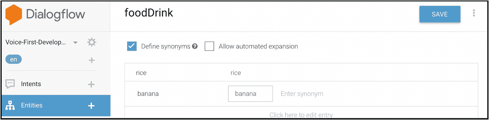
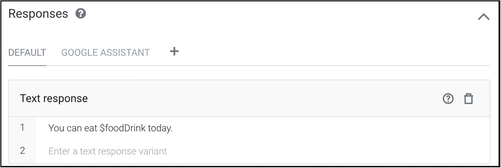
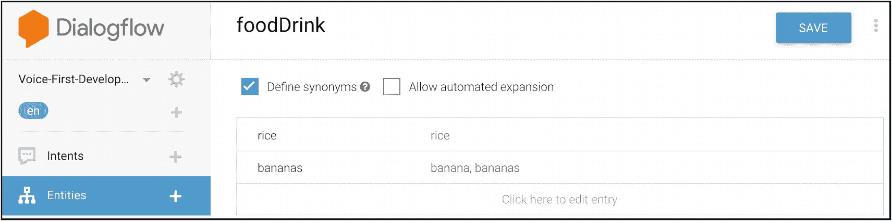
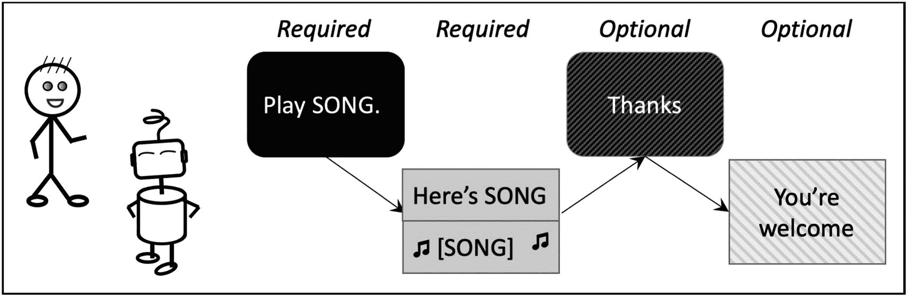
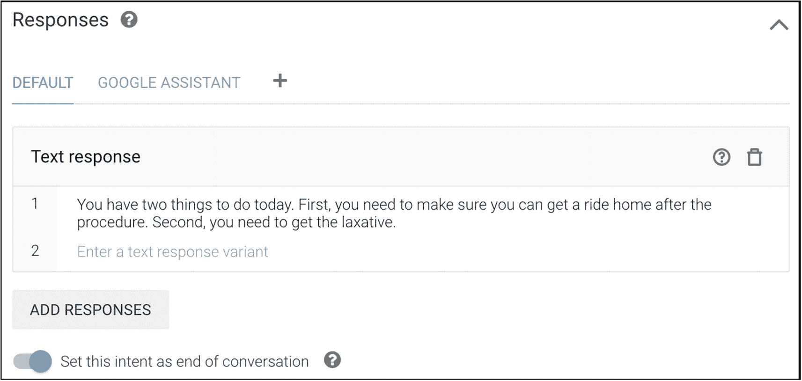
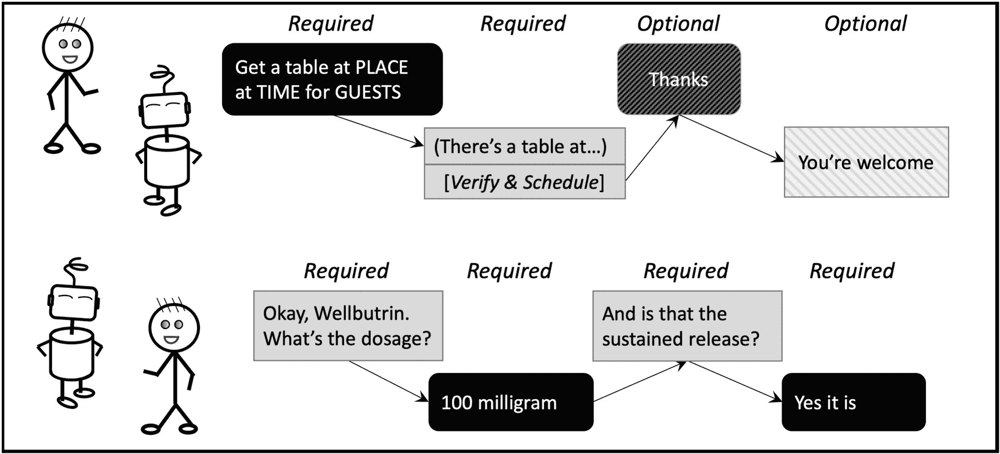
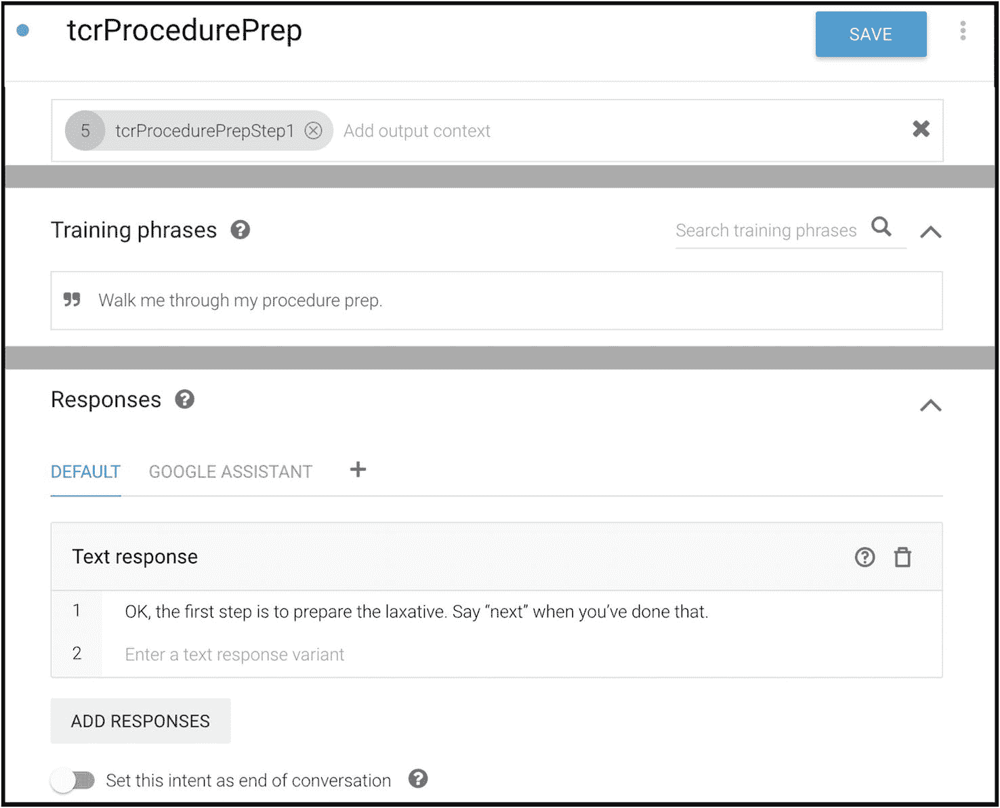
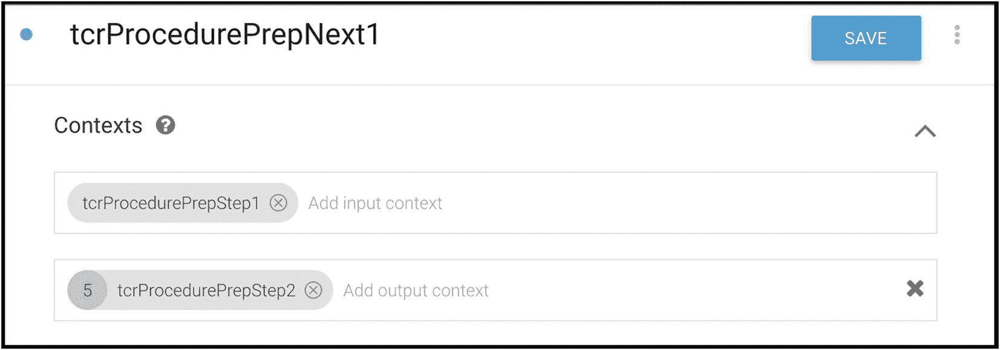
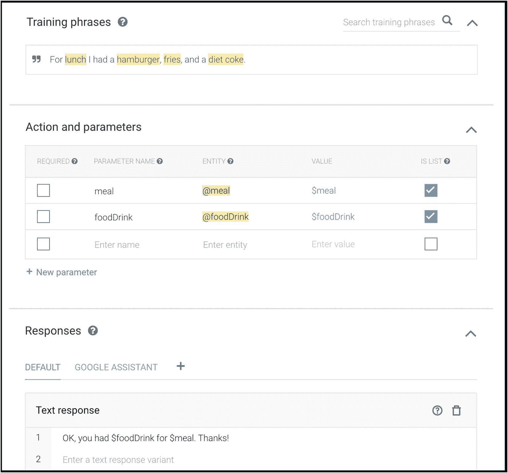

# 排版后的文档

在 Training Phrases 中的示例短语“Can I eat rice today?”下方，你会看到一个区域，该区域定义了当你说出该短语时将设置的*参数*，以及它*填充*的实体。此处，`@foodDrink`是你刚刚定义的实体，而*解析值*（实体值）填充了该实体；该值和参数都被设置为“rice”。请注意，通常我们在 Dialogflow 中用`@`前缀来指代实体，以便将它们与参数区分开来。

Actions and Parameters 部分之前是空的；现在它包含了一个新`foodDrink`参数的项目，该参数是在你指定“rice”填充`@foodDrink`实体时自动定义的。对于在意图的所有示例短语中被填充的每个实体，在 Actions and Parameters 部分都会有一个关联的参数。我们稍后会回到参数的有用性这个话题。

5.  你应该得到类似于图 6-5 所示的结果。测试一下！

等等。它的表现和之前完全一样；这有什么大不了的？别急。我们马上就会讲到。

图 6-6

将“banana”添加为`foodDrink`实体的另一个值后的 Dialogflow

1.  回到`foodDrink`实体。

2.  编辑 rice 值。在“Click Here to Edit Entry”处，输入“banana”。保存。你的 Dialogflow 应该看起来像图 6-6。

1.  测试应用：不要说*Can I eat rice today?*，而是说*Can I eat bananas today?*

你会注意到几件事：首先，仅仅通过添加“banana”，它仍然识别出了这个短语！这就是这类平台中槽位的便捷魔力。你完全没有改动示例短语。其次，回复仍然提到了 rice。哎呀。你有两个修复选项。一个是让回复更通用，例如*You can still eat that today.*问题解决了，对吧？嗯，从编码角度来看，是的，但从用户界面角度来看，在这种情况下，情况更糟。你需要向用户传达你理解了他们的问题。想象一下，如果你的 VUI 听到的是*bangers and mash*而不是*bananas, mashed*，可能会带来潜在的健康问题。开始思考如何证明你给了患者正确的答案——你将在本书中学到更多相关内容。

**成功提示 6.2 证明你理解了**

用户需要相信他们被理解了。有时动作响应能清楚地表明这一点：用户就在附近，目睹了音乐被静音或灯被打开。在其他时候，你的提示措辞需要向用户反映他们的请求。这是优秀 VUI 设计的一个关键方面，每个人——设计师、编码人员和业务所有者——都需要认同这一点。

另一个选项是更具体的回复。参数来救场！当你用值“rice”填充槽位`@foodDrink`时，它会将参数`foodDrink`设置为“rice”。让我们来使用它：

图 6-7

将“rice”替换为`foodDrink`参数后的 Dialogflow `qaCanEat`回复

1.  找到`qaCanEat`意图并打开 Responses 部分。

2.  在“You can eat rice today”回复中，双击单词“rice”。

3.  输入美元符号`$`。出现一个菜单，其中包含一个项目：`foodDrink`。选择它。保存。Responses 部分应该看起来像图 6-7。

1.  测试！同时说出*Can I eat rice today?*和*Can I eat bananas today?*现在两者都应该能正常工作。请注意，你需要重新开始交互才能进行第二次测试话语，因为你调用了`qaCanEat`意图，对话就结束了。你很快就会修复这个问题。

“bananas”发生了什么？为什么它说的是*banana*？这是因为“banana”是你给实体值起的名称，因此它填充了`foodDrink`参数。让我们修复它：

图 6-8

更改为“bananas”后的`foodDrink`实体

1.  在 Entities 中，找到`foodDrink`实体。

2.  点击最左边的“banana”并将其更改为“bananas”。

3.  现在添加另一个同义词“bananas”。我们不需要对“rice”这样做，因为它在“You can eat rice today”中工作正常。保存。它应该看起来像图 6-8。

4.  测试它！现在它应该能按你想要的方式工作了。

**成功提示 6.3 更多的回复通常比更少更好**

当你选择如何回复时，不要偷工减料。你的 VUI 的回复需要与用户的请求良好匹配，以建立信心并生成你期望处理的回复。这些细节将使你的 VUI 与众不同，显得更精致、更自然、更智能、更善于理解。

我们花了相当多的时间来讲解这些，因为实体和参数是重要的概念。在继续之前，请确保你对这些概念感到熟悉。而且，对于这个看似简单的请求，你还没有完全完成。在第 7 章中，你将学习如何处理相对时间，比如“today”。

有了这些理解“如何做”的背景，你可能已经迫不及待地想为自己的 VUI 进行修改了。我们也希望你精通“为什么”，所以让我们先看看一些更精细的设计问题。

#### 深入探讨：实体、参数和槽位

你可能对实体和参数之间的区别感到困惑，尤其是因为它们并不总是被明确区分，有时也被称为槽位。实体是 Dialogflow 的构造，它允许你理解包含大量可能值（例如城市或名字）之一的句子，而无需将所有选项都定义为训练短语。参数是当用户说出特定实体时，实体所填充的变量。例如，对于城市名称，实体可能会用“Boston”填充参数，你可以在回复或 fulfillment webhook 中使用它。通常，实体和参数看起来是同一回事，但你可以改变这一点，有时也需要这样做。对于*I want to fly from Boston to New York*，你使用了两次城市实体，填充了两个不同的参数：一个用于出发城市（“Boston”），另一个用于目的地城市（“New York”）。

你刚刚完成的示例中的“banana/bananas”问题是你还会再次遇到的。使用实体时，你需要确保系统能够识别你所说的内容，无论你如何表达（*Can I eat a banana today?* 或 *Can I eat bananas today?*），并且回复是良好的（回复*You can eat banana today*是不好的）。

在识别/理解方面，你（还）没有添加更多的训练短语，比如“Can I eat X?”或“Can I eat a X?”，并且别忘了对于像“apple”这样的食物，还有“Can I eat an X?”。即使只有我们现在拥有的这一个短语，Dialogflow 也可能会识别出来；这是机器学习 NLP 的优势之一。但我们想提出这个问题，以便你理解它，因为你不能总是指望系统会自动为你处理好。

在 VUI 回复方面，你可能会想，*这有什么大不了的？它仍然有效；它给出了正确的答案。* 没错，内容是正确的。用*banana*回复和用*bananas*回复都是可以理解的。而且 VUI 需要理解两者；这是用户的口误。但正是这种细节将优秀的 VUI 与一般的 VUI 区分开来。用户会注意到，即使是无意识的。即使是这么小的事情也会影响用户的信任以及他们与 VUI 互动的意愿。

当你以后使用大型列表或数据库（如食物或药物名称）时，这个问题会变得更有趣。如果你用其他语言进行 VUI 工作，请思考这个问题会如何不同，是更复杂还是更简单。

#### 问答功能的设计说明

正如你所料，用户通常会用类似疑问句的话语来发起问答对话，即特殊疑问句（*娜娜家今天几点开门？*）或使用动词“**是**”（*娜娜家今天开门吗？*）或“**做**”（*娜娜家今天营业到很晚吗？*）形式的一般疑问句。但人类并非总是遵循语法规则的逻辑生物，然而听者通常仍能理解。用户可以用陈述句的形式提问，并通过语调（*娜娜家开门了*，句尾上扬）或措辞（*娜娜家现在开门了，对吧？*）来表明这是疑问句。或者，也可能仅仅是一个陈述句，因为问题隐含在主题中（*娜娜家的营业时间*），或者是一个间接表达的一般疑问句（*你知道娜娜家现在是否开门吗？*）。

为什么这很重要？有两个原因：覆盖范围和回复措辞。首先，你的覆盖范围需要处理所有合理预期的提问方式——你不能仅仅依赖他人预先构建的模型，因为上下文至关重要。你将在第 9 章和第 14 章中了解更多。其次，你的语音用户界面（VUI）的回复需要同时反映用户提问的风格和 VUI 自身的风格。当人们互相交谈时，对一般疑问句的默认回答当然是*是*或*否*，并附带可选的其他内容。对于听者来说，表 6-3 中的两种回复都是可接受且恰当的；这里的*是*实际上是可选的。最下面一行显示了每种回复的恰当程度，对勾表示良好，叉号表示不佳。

**表 6-3** 一般疑问句的回复不需要“是”或“否”

| 说话者 | 对话 |
| --- | --- |
| **用户** | *<唤醒 VUI（如果需要）>* |
| **用户** | *娜娜家 7 点开门吗？* |
|   | **A** | **B** |
| **VUI** | *是的，娜娜家今天下午 7 点开门。* | *娜娜家今天下午 7 点开门。* |
| **–** | **√√** | √ |

即使在此处回答“是”在对话中是恰当的，你也有充分的理由可能不想仅仅回答“是”。你将在第 7 章中了解这些原因。如果用户针对相同内容提出了一个特殊疑问句呢？请看表 6-4。在这里，只有不带“是”的选项才是好的，因为人们认为对特殊疑问句回答“是”或“否”非常奇怪，其奇怪程度甚至超过在一般疑问句中不包含“是”或“否”。

**表 6-4** 特殊疑问句的回复可以与一般疑问句的回复相匹配

| 说话者 | 对话 |
| --- | --- |
| **用户** | *娜娜家几点开门？* |
|   | **A** | **B** |
| **VUI** | *是的，娜娜家今天下午 7 点开门。* | *娜娜家今天下午 7 点开门。* |
| **–** | **X** | √√ |

为了处理用户这两种提问风格以及以句子形式提出的问题，你有两个选择：要么以对两者都可接受的方式回复，要么分别处理它们。如果你选择前者，你可以将它们视为单一意图。对于后者，你需要将它们分成两个意图，或者一个意图下设置不同条件。后者工作量更大，但能实现更有针对性、听起来更智能的回复。也许这正是你想要的。这里没有放之四海而皆准的方案。首先选择更简单的方法是恰当的，直到你找到理由去选择更复杂的方法。在这里，这种方法也适用于前面提到的其他措辞方式，如表 6-5 所示。

**表 6-5** 不回复“是”或“否”可以带来更大的灵活性

| 说话者 | 对话 |
| --- | --- |
| **用户** | *娜娜家 7 点开门。* *娜娜家 7 点开门，对吧？* *你知道娜娜家 7 点是否开门吗？* |
|   | **A** | **B** |
| **VUI** | *是的，娜娜家今天下午 7 点开门。* | *娜娜家今天下午 7 点开门。* |
| **–** | **√√** | **√** |

回复的这种精细度是一个重要话题，它区分了精心设计的 VUI 与较为初级的实现。不要吝啬：花些心思来实现这一点。你愿意并且能够投入多少精力？在第 12 章中，你将学习如何根据 VUI 的确定程度让它听起来更聪明。

还记得之前的示例代码中，你确保在回复中说出已理解的食品名称。这看起来可能不那么重要——毕竟用户得到了答案——但它能微妙地增强用户的信心，让他们听到一个在各方面都符合其问题的回复。当你查看来自生产环境中 VUI 的用户数据转录时，有时可以精确地找到回复在鲁棒性方面失败的地方：用户非常乐于嘲笑你的语音应用或评论其回复。

到目前为止，我们的示例相当通用，甚至有些平淡，因为它们没有关注 VUI 的风格。你的 VUI 回复可以是*娜娜家今天下午 7 点开门*，或者*娜娜家是个不错的选择。他们每周三晚上 7 点开始供应晚餐，而且周中通常不忙*，或者其他内容。两者都是不错的回复，根据 VUI 系统角色的不同，其中一个会比另一个更合适。你将在第 15 章中学习如何设计系统角色。

**成功提示 6.4 在即兴发挥之前先打好基础**

提供正确的 VUI 系统角色很重要；它与提示措辞紧密相连，但也可以分开讨论，并且两者都依赖于底层的自动语音识别（ASR）和自然语言（NL）系统性能。提示的清晰和简洁必须优先考虑。没有任何风格和表达方式能够修复不清晰或不准确的提示内容。

### 操作请求

我们称之为操作请求的对话与问答对话的不同之处在于，用户的目标是直接且相当即时的操作：改变音量、打开或关闭某物、播放音乐等等。用户提出请求或发出指令，VUI 做出响应。同样，用户可能会有后续操作，此时 VUI 做出响应可能是恰当的。图 6-9 展示了操作请求对话模式。

请注意，该模式再次与图 6-1 中的基本模式相同，但这里的响应包含一个操作，在本例中是播放一首歌曲。

**图 6-9** 操作请求对话模式

预期的 VUI 响应是一个操作，可能伴随也可能不伴随语音回复——记住那句老话“行动胜于言语”。实现需要与执行环节良好协调，包括处理延迟并根据交付内容做出适当响应。以下是一些具有代表性的操作请求对话：

*   **用户** *播放 ABBA 乐队的《滑铁卢》。*
*   **VUI** *这是 ABBA 乐队的《滑铁卢》。* → [请求的歌曲开始播放]
*   ~ ~ ~
*   **用户** *将电视静音。*
*   **VUI** [电视静音]
*   ~ ~ ~
*   **用户** *给我的医生办公室打电话。*
*   **VUI** *好的，正在拨打琼斯医生的办公室电话。* → [开始拨打电话]

#### 构建操作请求

让我们来实现一些程序准备辅助操作请求。第一个示例表面上很简单：*拨打我医生办公室的电话*。创建一个新的意图 `arCallDoctor`，添加训练短语“拨打我医生办公室的电话”和回复“好的，正在拨打您的医生电话”，并且不要忘记设置对话在此之后结束。别忘了测试！你会注意到在这个示例中，你实际上还没有真正拨打电话。操作允许我们通过向执行后端发送信息来实现这一点，在那里可以执行某些操作。目前，我们只关注对话本身。

类似地，一个非常简单的静态实现*我今天应该做什么？*也很直接。启动一个新的意图 `arTodaysTasks`，按照示例对话中列出的内容添加训练短语和回复。请注意，你需要将文本合并为一个回复；多个回复是为了让 Dialogflow 能够随机选择播放哪一个。完成后，该意图应该看起来像图 6-10 中的那样。测试！

**图 6-10** 一个包含单一静态回复的初始 `arTodaysTasks` 意图

你已经意识到，对于真正的应用程序，你不会像这里这样硬编码任务。稍后，你将构建更复杂的逻辑，考虑当前时间和日期以及程序的日期，计算出今天的任务是什么，并支持动态内容回复。你将通过将“今天”、“明天”甚至“今晚”视为槽位值来实现这一点。

#### 关于操作请求的设计说明

操作请求是命令，因此默认的用户话语将是命令形式：*静音音响*、*播放 ABBA 的《Waterloo》*、*早上 6 点打开厨房灯*、*停止！*等等。但当然，用户提出请求的方式也有很多变化。有些人比其他人更有礼貌，因此你的覆盖范围需要包括*请播放*……和*播放*……*请*。无需为不同的回复跟踪礼貌程度——除非你的 VUI 正在训练孩子要有礼貌！只需确保处理各种载体短语即可。这似乎显而易见，但如今有很多容易找到的例子表明这一点并未正确实现。操作请求通常可以表面上被表述为一个问题（例如，*你能播放*……），甚至与礼貌用语结合（*你能请播放*……）。

让我们看看是什么决定了你的 VUI 如何响应操作请求。唯一必需的回复是所请求的操作，因此如果请求是静音音响，那么就静音音响。如果请求是播放某首歌曲，那么就播放它。但 VUI 要说些什么（如果有的话）呢？嗯，这取决于具体情况。目前的简短答案是构建你以后可以使用的灵活性。如果你认为口头回复不是必需的，无论如何也要以这样一种方式实现它：它是空的，但有一个引用。原因如下：如果请求是*静音音响*，想想会发生什么。假设没有问题，音响静音了。在默认条件下，你不需要 VUI 告诉你：很明显它已经生效了，所以让操作本身来说话。如果你坚持要有口头回复，请让它简短。一个字就足够了，只要它相关——比如说*已静音*而不是*好的*，后者不提供任何信息。不要啰嗦：这很烦人且没有帮助。在某些情况下，口头回复是合适的。如果用户离设备不够近，听不到它已静音，或者请求与某些默认设置不同，那么口头回复是合适的（表 6-6）。

**表 6-6** 根据上下文变化的回复

| 谁 | 对话 |
| --- | --- |
| **用户** | ***静音音响。*** |
| **操作结果** | ***<音响静音>*** |
| | **A** | **B** | **C** | **D** | **E** |
| **VUI 回复** | ***已静音。*** | ***音响已静音。*** | ***好的，我已将音响上的音乐静音。*** | ***好的。*** | **--** |
| **音响在附近** | **√X** | **X** | **X** | **X** | **√√** |
| **音响不在附近** | **X** | **√√** | **X** | **X** | **X** |

思考一下对请求*关闭车库*或*锁门*的最佳 VUI 回复。无论门或车库是否在附近，正确执行这一点更为重要，因此在你的回复中要明确：*门已锁*。

### 任务完成请求

我们所说的**任务完成请求**是指所请求的结果通常不那么直接、间接或更复杂的操作请求。目前可能还不清楚为什么这被视为一种单独的对话类型，但很快就会明了。操作请求并不总是需要 VUI 的口头回复，而任务完成请求则需要。它们通常涉及多个步骤，并且经常交替“谁拥有发言权”，即用户或 VUI。任务完成请求是企业领域中更复杂任务的核心，例如金融交易、预订或健康相关任务。这是 VUI 交互需要超越简单命令、大放异彩的地方。图 6-11 展示了任务完成请求的对话模式。上面的示例由用户发起并驱动。下面的示例是由 VUI 驱动的对话的一部分。

**图 6-11** 任务完成请求对话模式

看看几个具有代表性的任务完成示例，并注意它们在用户初始请求中提供的信息量有何不同——我们将在本章后面讨论其影响：

- **用户** *我想今晚七点在娜娜餐厅预订六个人的位子。*
- **VUI** *娜娜餐厅今晚 7:30 有六个人的桌位。您想……*
- ~ ~ ~ ~ ~ ~
- **用户** *我想支付我信用卡的当前余额。*
- **VUI** *正在安排从您尾号 13 的支票账户支付 510 美元……*
- ~ ~ ~ ~ ~ ~
- **用户** *午餐，我吃了一个汉堡、薯条和一杯健怡可乐。*
- **VUI** *太好了！感谢您在饮食日记中记录您的午餐。*

#### 构建任务完成示例 1

让我们来实现任务完成功能^(⁵¹)，从*预约*开始。你会从示例对话中注意到，要完成这个任务，你需要收集一些后续信息。回想一下，这正是任务完成请求的定义特征之一：你需要语音用户界面（VUI）和用户之间进行多轮对话才能完成工作。幸运的是，Dialogflow 让这件事变得非常简单。首先，你需要理解**内置实体**和**必填参数**。

还记得将“rice”分配给`@foodDrink`，然后在实体菜单中看到一大堆实体吗？这些就是内置的系统实体，它们能让你的工作更轻松。Dialogflow 包含了一些对话中常用的实体。类别包括日期和时间（“七月十三日下午两点三十分”、“明天”、“中午”）、数字（“一”、“十”、“第三”）、带单位的数量（“十平方英尺”、“两升”）、地理位置、名和姓等等。你可以通过它们的“`sys`.”前缀来识别系统实体。^(⁵²)

你已经了解了参数以及当实体被填充时它们是如何被设置的。Dialogflow 允许你在一个意图中将参数标记为必填，这意味着它会在生成响应之前自动收集设置该参数所需的信息。如果没有这个功能，你就必须自己手动完成。

Dialogflow 如何知道要询问这些信息呢？是你告诉它将其设为必填的！让我们使用内置实体和必填参数来实现预约功能：

*   **用户**     *预约。*
*   **VUI**     *好的，您想预约。请问具体日期和时间？*
*   **用户**     *8 月 5 日，星期四，下午 2 点。*
*   **VUI**     *好的，我已为您安排好，8 月 5 日，星期四，下午 2 点。*

1.  创建一个新的意图 `tcrMakeAppointment`，并添加训练短语“预约”。
2.  指定第一个必填参数。在“操作和参数”下，点击第一行“必填”下的复选框。
3.  在“参数名称”下，将参数命名为 `dateTime`。
4.  在“实体”下，从菜单中选择 `@sys.date-time`。“值”字段会自动填入 `$dateTime`。
5.  在“提示”下，点击该列；会出现一个输入框。输入你的信息提示，例如“好的，您想预约。请问具体日期和时间？”。保存。
6.  创建文本响应“好的，我已为您安排好。`$dateTime.original`。”还记得你之前使用 `$foodDrink` 来回放用户说出的食物名称吗？这里你使用系统实体做了同样的事情。`.original` 指定了 `dateTime` 是如何被说出的。将此响应设置为对话结束。保存。测试！

通过这个详细的逐步讲解，你应该能清楚地看到 Dialogflow 如何让自动收集复杂信息变得简单，以及系统实体如何让开发变得更简单，并省去你手动操作的麻烦。当然，你应该尽可能利用任何预构建的功能，而这是一个快速构建出像样功能的好方法。很快，你会遇到一些不那么简单的情况，并了解到为什么仅仅使用内置实体往往是不够的。这也是我们从一开始就悄悄引入对话模式的原因。不要指望用简单的即插即用模块就能创建复杂的语音系统——但请开始构建你自己的核心模板集。

#### 构建任务完成示例 2

你刚刚完成的示例涉及多轮对话，因为用户一开始并没有提出一个完全明确的请求。现在让我们来处理一个总是需要多轮对话的任务：流程准备任务^(⁵³)。这就是上下文发挥作用的地方。上下文是每个对话的关键部分，正如你将在第 14 章中学到的那样。到目前为止，你所有的上下文都是全局的：无论上下文或条件如何，一个话语都会被识别并以相同的方式处理。但情况并非总是如此。对于流程准备任务，第一个“下一步”仅在初始步骤之后适用；第二个“下一步”只有在你告诉用户第二步之后才有意义。在许多对话中，你需要跟踪对话的**状态**：识别哪些短语、如何解释它们以及响应是什么，都取决于你当前所处的状态，而状态是由多个上下文（包括对话中之前说过的话）组合而成的。

Dialogflow 通过上下文实现了对话状态或对话流程中“位置”的概念。Dialogflow 上下文非常类似于对话状态，用于跟踪你在对话中的位置。要使用这个机制，需要修改意图的“上下文”部分。你可以指定输入上下文（基本上意思是“只有当对话的当前上下文之一与意图的输入上下文之一匹配时，此意图才会被训练短语触发”）并通过意图的输出上下文来设置对话的当前上下文（“在意图 A 之后，激活上下文 X 和 Y，并将它们设为当前上下文”）。这里有一个具体示例：

图 6-12

`tcrProcedurePrep` 在设置训练短语、响应和输出上下文后的状态

*   **用户**     *带我完成我的流程准备。*
*   **VUI**     *好的，第一步是准备泻药。完成后，请说“下一步”。*
*   **用户**     *下一步。*
*   **VUI**     *现在将泻药全部喝完。完成后，请说“下一步”。*
*   **用户**     *下一步。*
*   **VUI**     *做得好！*

1.  创建一个新的意图 `tcrProcedurePrep`，训练短语为“带我完成我的流程准备”。
2.  添加响应：“好的，第一步是准备泻药。完成后，请说‘下一步’。”
3.  **不要**像之前那样将此意图设置为对话结束。对话需要继续进行。
4.  现在开始设置上下文。在意图的“上下文”部分，点击向下箭头展开。
5.  在“添加输出上下文”中，输入 `tcrProcedurePrepStep1` 并按回车。这意味着执行步骤 1 然后等待。保存。它应该看起来像图 6-12。我们稍后会讨论输出上下文中的 5 是什么意思。

图 6-13

`tcrProcedurePrepNext1` 意图，同时包含输入和输出上下文

1.  用户接下来能说什么？是第一个“下一步”。创建一个新的意图 `tcrProcedurePrepNext1`，训练短语为“下一步”，响应为“现在将泻药全部喝完。完成后，请说‘下一步’。”
2.  这次，你将同时设置输入和输出上下文。在“添加输入上下文”中，开始输入“tcr…”，它会自动补全 `tcrProcedurePrepStep1`，因为这是你目前唯一定义过的上下文。选择它。
3.  在输出上下文中，它会自动添加输入上下文 `tcrProcedurePrepStep1`。使用 X 将其删除，然后输入一个新的上下文 `tcrProcedurePrepStep2`，并按回车（图 6-13）。保存。
4.  再次操作。创建一个新的意图 `tcrProcedurePrepNext2`，训练短语为“下一步”，响应为“太好了！全部完成了！”
5.  将此意图设置为对话结束。

3.  在“上下文”中，添加输入上下文 `tcrProcedurePrepStep2`。和之前一样，删除自动添加的同名输出上下文。保存。

4.  现在你已经构建了一个多步骤对话。你知道接下来该做什么：测试！

你现在有了一个程序准备对话的雏形。让我们看看另一个任务完成型对话：更新饮食日记：^(⁵⁴)

1.  创建一个新的意图 `tcrFoodDiary`，训练短语为“饮食日记”，响应为“好的，饮食日记。你吃了什么？”，并添加输出上下文（这是与上一个示例不同的新内容！）`tcrFoodDiary`。别忘了：不要将此意图设为对话的结束！保存。

2.  现在添加实际收集食物的意图。创建一个新的意图 `tcrFoodDiaryCollection`，训练短语为“午餐我吃了汉堡、薯条和健怡可乐”，响应为“好的，你午餐吃了汉堡、薯条和健怡可乐。谢谢！”将其设为对话的结束，并添加输入上下文 `tcrFoodDiary`（别忘了移除自动生成的输出上下文）。保存。

3.  接下来，你需要在训练短语中定义一些槽位。还记得本章前面你将“米饭”转换为 `foodDrink` 槽位的操作吗？现在你要继续这样做。

4.  在训练短语中，双击“午餐”。会弹出一个菜单。你尚未定义此槽位；请滚动到菜单底部并点击“创建新项”。

5.  你会被引导至创建新实体的界面。将其命名为“meal”。注意，它已根据我们的训练短语预填充了示例项“午餐”。保存。

6.  定义好 meal 实体后，返回 `tcrFoodDiaryCollection` 意图，再次双击“午餐”，并从菜单中选择 `@meal`。保存。
    *   你可以直接从训练短语进入定义新实体的流程。这是一个非常便捷的快捷方式。但请记住，定义新实体后，你需要返回意图，并将该词或短语（此处为“午餐”）设置为新实体 `@meal`。

7.  对“汉堡”重复此操作。定义一个新实体……等等。没必要！还记得“我能吃米饭吗？”吗？你定义了一个 `@foodDrink` 实体。你可以直接使用它！双击“汉堡”并选择 `@foodDrink` 作为实体。保存。
    *   打开 `foodDrink` 实体。注意，“汉堡”已被添加，无需手动输入。这是定义实体的另一个巨大优势。在构建应用程序时，你可以为这个新意图重用 `@foodDrink` 实体。现在返回意图。

8.  对“薯条”执行相同操作；将其定义为 `@foodDrink`。

9.  现在该把“健怡可乐”定义为 `foodDrink` 了。你不能直接双击，因为它由两个词组成。点击并拖动选中“健怡”和“可乐”；然后将其定义为 `@foodDrink`。保存。

10.  再次返回实体，确认“健怡可乐”已被添加。

11.  快完成了！静态响应中包含“午餐”；将其替换为 `$meal` 参数，因为用户可能说的是其他餐次或未提及餐次。保存。

12.  在响应中，点击并拖动选中整个短语“汉堡、薯条和健怡可乐”，并将其替换为 `$foodDrink`。保存并测试！

你的意图现在应该如图 6-14 所示。

图 6-14

`tcrFoodDiaryCollection` 意图

你可能已经注意到，Dialogflow 和 Google Home 在回读食物项目时神奇地做出了正确的处理！请记住，你将“汉堡”、“薯条”和“健怡可乐”都定义为填充实体 `@foodDrink`。当有多个项目填充一个实体时，这被称为列表实体，因为实体和参数的值是一个列表。你可能无法预先知道列表中有多少项——你并不总是吃三样东西！

注意，在你将“薯条”设为 `@foodDrink` 后，在意图的“操作和参数”部分，`foodDrink` 现在会自动勾选“是列表”列中的复选框，表明这确实是一个列表，即使它只包含一个项目。`@foodDrink` 本身并非列表实体，但在 `tcrFoodDiaryCollection` 意图中被定义为列表。在之前使用 `@foodDrink` 的 `qaCanEat` 意图中，该实体并未被定义为列表。另外，请注意 Dialogflow 甚至在最后一个列表项前添加了“和”。相当酷！

#### 关于任务完成的设计说明

如果你对示例对话的反应是“这些看起来太简单了”和“如何确保正确性？”，那么恭喜你！我们很快就会解决你的疑虑。现在，请注意这些响应与操作请求相比要冗长得多。还要注意它们的表达方式：所有相关的信息片段都会回读给用户，因为这是他们获得“被理解”反馈的唯一方式——这里没有像关灯这样的操作来传达理解。什么都不说，或者只说*好的*，都是糟糕的选择。信息应该被清晰地回读，并符合用户基于其对话认知模型所产生的期望。由于人们可能以不同的顺序提供信息项，你需要捕捉这种变化，但无需改变 VUI 的响应来反映它。事实上，保持一致更好。稍后会详细讨论。还要注意，用户会给出一些初看可能不明确的含义提示：用户请求*今晚 7 点*或*晚餐 7 点*显然是指晚上 7 点，但你的 VUI 可以坚持使用“*晚上 7 点*”以保持清晰和简洁。以下是一些额外的提示指南：

*   既不要啰嗦也不要过于简短——提供所有必要的内容，不多不少。

*   不要为了省一两个音节而含糊其辞——“晚上 7 点”比仅仅说“7 点”更好，即使从上下文看似乎很清楚。

*   根据人们通常提供信息的方式，逻辑性地对信息进行分块，通常从更通用的主题内容开始——这可以减轻认知负荷。

*   用简短的引导性短语开始响应，甚至是一个定冠词或不定冠词——这可以帮助用户不错过第一个信息片段。

表 6-7 向你展示了一些如何应用这些指南的具体示例。思考一下为什么某些响应可能比其他响应更好。

表 6-7

在清晰与简洁之间取得平衡

| 说话者 | 对话 |
| --- | --- |
| **用户** | *在娜娜餐厅订一张今晚 7 点六位的桌子。* *在娜娜餐厅预订今晚七点六位的晚餐。* |
|   | **响应 A** | **响应 B** | **响应 C** | **响应 D** | **响应 E** |
| **VUI** | *好的。已在娜娜厨房餐厅为六位客人预订了今晚 7 点的桌子。* | *今晚，六位，* *7 点，娜娜厨房餐厅。* | *好的。这是个热门地方！* *我为你找到了一张可爱的桌子。7 点已安排妥当！* | *完成。* | [沉默] |
|   | **√√** | **X** | **X X** | **X X** | **X X** |

### 完全指定的请求

VUI（语音用户界面）和语音驱动设备的主要目标是准确、快速地实现用户请求的意图。换句话说，一旦 VUI 拥有了执行请求所需的全部信息，就应该立即执行。我们称这类请求为**完全指定的请求**。本章到目前为止的所有示例都是完全指定的：没有歧义或模糊之处，用户发起一轮对话，VUI 响应一轮，然后大功告成。

这些是**一次性**对话，或称**一次完成**。迄今为止，一次完成对话仍然是最常见的 VUI 交互方式，因为技术和实现使其成为“唾手可得的果实”。它们也是处理更复杂、更有趣的 VUI 行为时需要处理的基础情况。一次完成对话有两种形式：较简单的**单槽位请求**和更复杂、也更强大的**多槽位请求**。

意图是用户请求的总体目标，而槽位则是成功处理该意图所需的相关变量。必须填充所有槽位，意图才能被完全指定并得以实现。槽位可以由用户显式填充，也可以由 VUI 根据某些编码逻辑隐式赋值。要确定合适的槽位数量和类型，你需要了解用户会请求什么、对他们而言怎样才算成功，以及他们可能掌握哪些信息。

#### 单槽位请求

本章中的三种核心对话模式都可以是只有一个必需槽位的意图。必要的信息要么存在，要么不存在（表 6-8）。

**表 6-8** 不同对话模式中的单槽位

| | 问答 | 操作请求 | 任务完成请求 |
| --- | --- | --- | --- |
| **用户话语** | *《战争与和平》是什么？* | *播放一些 Rammstein 的歌。* | *支付我的信用卡。* |
| **意图与槽位** | 意图 = `queryInfo` 槽位 = {thing} 槽位值 = `war_and_peace` | 意图 = `playMusic` 槽位 = {artist} 槽位值 = `rammstein` | 意图 = `pay` 槽位 = {payee} 槽位值 = `credit_card` |
| **VUI 响应** | 《战争与和平》是俄国作家列夫·托尔斯泰创作的一部长篇小说。 | 这是 Rammstein 的《Links 2 3 4》。[歌曲在默认设备上播放。] | 正在安排从您的支票账户向您的 VISA 信用卡支付 240 美元 63 美分。 |

##### 实现单槽位请求

*我今天能吃米饭吗？* 是一个单槽位请求的例子，填充的槽位是 `@foodDrink`。

##### 单槽位请求的设计说明

显然，这背后还有更多细节。首先，VUI 需要正确理解每句话。然后，需要执行适当的查找来满足请求。对于任务完成请求，可能需要一些预先设置。关键在于，这里只有一个必需的槽位，它被填充了，因此意图是完全指定的。VUI 对任务完成支付请求的响应假设已设置了用于解释支付细节的默认值。

#### 多槽位请求

三种对话模式中的每一种也可以包含任意数量的槽位。对于外行来说，这些一次完成的请求令人印象深刻，近乎神奇。像《真实的谎言》中阿诺德·施瓦辛格扮演的角色叫什么名字？或者“预订一张明天早上 8 点从洛杉矶到圣地亚哥、周日下午 4 点返回的单人往返机票”这样长而复杂但完全指定的请求，并不一定比短请求更难处理，前提是用户说话清晰且语音识别良好。事实上，请求越精确，处理起来就越容易。表 6-9 展示了更多示例，每个示例都展示了三个或更多槽位的样子。请注意，在这个任务完成示例中，VUI 响应与单槽位示例相同，但这里所有槽位都是由用户填充的。

**表 6-9** 不同对话模式中的多槽位

| | 问答 | 操作请求 | 任务完成请求 |
| --- | --- | --- | --- |
| **用户话语** | *在 1956 年电影版《战争与和平》中，谁扮演了娜塔莎这个角色？* | *在客厅用 Spotify 播放 Rammstein 的《Links》。* | *从我的支票账户支付 240 美元 63 美分到我的信用卡账单。* |
| **意图与槽位** | 意图 = `queryActor` 槽位 = {movieTitle: war and peace} 槽位 = {movieYear: 1956} 槽位 = {role: natasha} | 意图 = `playMusic` 槽位 = {artist: rammstein} 槽位 = {song: links} 槽位 = {service: spotify} 槽位 = {endpoint: living room} | 意图 = `pay` 槽位 = {payee: credit card} 槽位 = {amount: 240.63} 槽位 = {fromAcct: checking} |
| **VUI 响应** | 在 1956 年的电影《战争与和平》中，娜塔莎由奥黛丽·赫本饰演。 | Rammstein 的《Links》。正在客厅播放。[歌曲播放。] | 正在安排从您的支票账户向您的 VISA 信用卡支付 240 美元 63 美分。 |

##### 实现多槽位请求

你已经在我们的流程准备助手中看到了填充多个槽位的示例：

*   “午餐，我吃了一个汉堡、薯条和一杯健怡可乐”为 `tcrFoodDiaryCollection` 意图填充了 `@meal` 和 `@foodDrink`（作为列表）槽位。
*   “8 月 5 日，星期四，下午 2 点”为 `tcrMakeAppointment` 意图填充了 `@sys.date-time` 内置实体。

这两个示例本身都很有趣，原因各不相同。在食物示例中，有多个信息片段：`@meal` 的 *lunch*，`@foodDrink` 的 *hamburger*、*fries* 和 *diet Coke*。这是两个槽位还是四个？实际上是两个，但如前所述，`@foodDrink` 是以**列表**形式填充的。区分填充多个槽位和用一个（或多个）槽位填充多个槽位值非常重要。这里，你用一个值填充了一个槽位（`@meal`），并用一个列表填充了另一个槽位（`@foodDrink`）（请注意，这个列表可以只包含一个项目，但当你开始编写实现代码时，你会发现单项目列表与非列表或标量是不同的）。

对于预约时间，你可以指定一个内置实体 `@sys.date-time`，但该实体包含不同的组成部分：星期几（*Thursday*）、日期（*August 5th*）、小时（*2*）和 *PM*。如果你查看系统实体文档，会发现 `@sys.date-time` 可以匹配一个日期**或**一个时间**或**一个日期加时间**甚至**更多内容，比如一个时间间隔（例如，它只匹配 *August*，返回一个从 8 月 1 日午夜开始到 8 月 30 日午夜结束的间隔）。因此，填充 `@sys.date-time` 槽位可能包含预约所需的 1 到 4 个槽位组成部分。

在这里，你看到了一个新概念：用一个列表或多个值来填充单个槽位及其关联参数。为什么我们需要列表？如果没有列表，你需要为只有一种食物的情况准备一个训练短语，为两种食物的情况准备另一个，以此类推。任何有编程经验的人都会意识到这不是一个好方法，这也是为什么列表槽位填充被作为一个特性添加进来。在某些上下文中，用户甚至会指定一个列表，因此你需要对话和代码足够灵活，能够智能地处理所有情况。如果不使用列表，另一种选择是先问“你吃的第一样东西是什么？”，接着问“下一个呢？”，以此类推。除非确实需要作为后备策略，否则应避免这种方法；这显然不是一种愉快的用户体验。

##### 多槽位请求的设计笔记

从技术上讲，可以将所有请求视为独立的意图，但这很快就会变得不切实际，因为你需要为每个意图实现处理逻辑，而不是利用实用的分组方式。你可以定义没有槽位的意图来进行语音交互——如果你确信自己只会处理一个非常小的静态请求集，这甚至可能是合适的。但我们建议从一开始就养成将意图拆分为槽位的习惯——这有助于编写更清晰的模块化代码，并便于未来的扩展。如果某个内容适合作为槽位处理，就将其设为槽位，以便将来轻松扩展。例如，如果你决定微妙地鼓励用户保持礼貌（我们并不是说你应该这样做；这只是一个例子——我们将在本章后面评论这一点），那么每当用户包含*请*字时，你就可以填充一个“礼貌”槽位——你回复的信息内容不会受到影响，但它允许在回复中进行有针对性的变化，使其更加自然。

### 成功技巧 6.5 命名槽位和意图

在你最喜欢的编程语言中，你可能已经有命名变量的惯例。你也应该并且将会建立一个标准来命名你的语音槽位和意图。使用简短、有意义且无歧义的名称，并根据需要组合它们。你和他人应该能够通过查看意图或槽位的名称，大致了解预期的交互、内容和话语。我们使用过的一些实际意图名称示例包括 `GetZip`、`GetLastName`、`GetFromAcct`、`PlayArtistAlbum`、`ReadStockPrice` 和 `YNConfTrx`。槽位名称可能是 `month`、`amount`、`DOB`、`zip code` 等。智能的命名约定有助于讨论和审查，也有助于通过模块化进行扩展。

### 基于功能发现确定对话行为

我们已经详细讨论了各种类型的请求和对话，并展示了如何实现它们的代码。表 6-10 总结了到目前为止你设计和实现的每个流程准备核心功能的对话特征：

**表 6-10** 到目前为止设计和实现的流程准备辅助对话的功能

| 功能 | 请求类型 | 示例短语 | 槽位 | 轮次 |
| --- | --- | --- | --- | --- |
| **一般信息** | 问答 | *手术需要多长时间？* | 0 | 1 |
| **食物搜索** | 问答 | *咖啡还能喝吗？我今天能吃米饭吗？* | 1–2 | 1 |
| **待办事项信息** | 问答 | *我今天应该做什么？* | 0 | 1 |
| **联系人** | 动作请求 | *给我的医生打电话。* *打给布伦特·琼斯医生的手机。* | 1+ | 1+ |
| **日程安排** | 任务完成 | *预约明天早上。重新安排。* | 0–N | 2+ |
| **准备任务** | 任务完成 | *带我完成准备工作。下一步。* | 0 | 2+ |
| **饮食日记** | 任务完成 | *饮食日记。* | 0–N | 2+ |

- **功能**：在第 4 章中，你首先制定了 VUI 将执行的操作的总体摘要，然后定义了用户可能期望的任务——即功能特性。之后，你开始设计细节并编写代码。
- **请求类型**：三种面向任务的请求类型之一：问答、动作请求和任务完成请求。
- **示例短语**：用于启动或与任务交互的话语示例。
- **槽位（实体）**：为完成请求需要填充的预期和必需槽位数量。例如，*预约*不填充任何槽位，但随后的日期收集（通过一个或多个轮次）会填充多个槽位。饮食日记也是如此。
- **轮次**：用户完成一项任务所需或预期的对话轮次数量。在许多情况下，你还不知道会有多少轮次；可能包括多个步骤，甚至用于消除歧义。

### 对话完成

一旦所有槽位都被填充，并且你的 VUI 生成了回复，你就完成了吗？嗯，是也不是。或者可能吧。简单的答案是*当 VUI 拥有提供用户所请求内容所需的一切时，你就完成了。* 但当然，这比那要复杂一些。从技术上讲，某个意图或任务的对话已经完成，但整个对话可能仍在继续，就像人与人之间的对话一样。用户可能会提出后续请求，要么是完善第一个请求（*播放金属乐队的版本*），要么是用不同的槽位值询问相同的问题（多个股票价格请求或不同座位的票价）。正确跟踪和利用短期上下文是构成对话的关键——因此也是本书的主题。做好这一点很有挑战性，但并非不可能，而且非常值得。就像语音领域的许多挑战一样，实现起来并不困难，但需要仔细跟踪细节。

一些平台实现了某种类型的短期对话上下文。例如，Alexa 的可选后续模式允许在回复结束后的一段固定时间（4 秒）内，无需唤醒词即可提出额外请求。其关键点有两个。首先，在人类对话中，后续请求是语义和上下文相关的，而不仅仅基于时间。其次，我们期望他人记住对话主题的时间很短，但并不是一个固定的秒数。在对话中，人们通常不会突然从一个话题跳到另一个话题——你可以利用这一点来提高解释的成功率。

此外，即使用户获得了他们要求的信息或结果，如果你的回复含糊不清或措辞与他们的预期不同，他们可能意识不到——甚至不信任这个回复。你已经见过这种情况：在回答 WH 问句时包含*是*或*否*。这很重要，因为它会影响用户的认知负荷。

##### 多模态角落

多模态交互也遵循对话规则：轮次适用，任务完成是目标。在某些情况下，口头请求会更简单，因为细节和引用是通过指向或点击来处理的。如果用户在屏幕上查找餐厅信息，多模态后续请求可能是*在这里预订*。显然，你的架构需要协调跨模态的信息流。多模态界面可以在单个请求中允许同时使用多种模态（口头说*这里* + 点击/指向），或者允许为每个回复选择模态（口头说*下午 6 点* vs. 输入或点击预订时间）。关于这个主题的更多信息，请阅读 Sharon Oviatt 的任何著作。

#### 回应“再见”和“谢谢”

人类对话通常以某种口头结束语收尾。这对于对话式 VUI 来说是必要的吗？通常不是——助手通常不需要结束语，用户感觉完成时就会停止交互，这取决于任务和平台。但要注意用户何时说*再见*或*谢谢*。某些文化、年龄群体和个人对待你的 VUI 就像对待人一样礼貌，并且他们欣赏甚至期待得到礼貌的回应。所以，是的，即使你没有明确回应“对话结束语”，你至少也不应该将其解释为其他内容！

##### 来自语音前线

我们见过一些 IVR 系统，用户直到 IVR 说了*再见*才挂断电话，或者期望在他们说*再见*后 IVR 结束通话。如果你没有预料到这一点并且没有处理它，交互可能会迅速陷入失败，达到最大错误计数，因为用户等待它结束。有人担心孩子们会对语音助手大声发号施令（我们个人并不认同这种担忧^(⁵⁵)）。作为回应，家用语音助手增加了对礼貌行为做出回应的功能，以鼓励用户保持礼貌。但这可能会适得其反。事实上，在与她的 Google Home Hub 互动时，Ann 的母亲——属于大多数互动都包含*请*和*谢谢*的一代人——随着 VUI 对她出色的礼貌行为进行评论，她逐渐变得不那么礼貌了！

#### 实现对话的结束

在目前已实现的对话中，你只是在最终任务完成后直接结束对话，没有允许用户说*再见*或*谢谢*。你可以添加最终的意图作为支持；这些意图将成为新的对话结束标志。是否需要对话结束标志取决于平台（IVR 比默认几秒后进入待机状态的家用助手更需要）——我们在此添加一些，仅用于练习和演示。你甚至可以为不同的回复设置单独的意图，例如，针对*谢谢*与*再见*：

1.  创建一个新的意图 `goodbye`，训练短语为“再见”，输入上下文为 `end`，回复为“再见！回头聊！”结束对话。

2.  创建另一个新的意图 `thanks`，训练短语为“谢谢”，输入上下文为 `end`，回复为“不客气。再见！”结束对话。

3.  选择一个适合添加额外礼貌的对话，例如预约完成后。在意图 `tcrMakeAppointment` 中：
    *   添加输出上下文 `end`。
    *   在“回复”中，将对话结束滑块设置为关闭状态。
    *   在回复末尾添加一些礼貌用语：“完成后，请说再见。”

4.  保存。测试！

你可以在任何对话的末尾执行此操作，并且通常这种行为会支持几乎所有对话。此功能的后续实现将更微妙一些，不会强制用户保持礼貌，但会提供选项，并在用户一段时间不说话后“超时”或结束对话。

### 下一步是什么？

现在，你已经正确了解了创建绝大多数 VUI 所需的主要对话模式。这些模式可以针对不同目的进行组合，并为特定用途呈现特定风格。

当你在处理食物日记代码时，可能曾想过：*哇，我们可以询问的食物种类真多。我们真的要在 Dialogflow 图形界面里输入所有这些内容吗？* 别担心。回顾第 3 章，Dialogflow 有一个 API，允许你以编程方式编辑意图和实体。事实上，你将在第 7 章中学习这部分内容。

### 总结

*   格莱斯合作原则以及对话语结构的基本理解，有助于你理解 VUI 设计的三种核心模式，进而帮助你创建可复用的设计模式和代码模板。
*   三种核心模式涵盖了绝大多数 VUI 对话：问答、动作请求和任务完成请求。每种模式都有其自身的特点，你需要朝着这些方向进行开发。
*   理解每种模式内的交互有助于你创建更稳健的提示，从而带来更好的用户体验，增强用户对你的信任。
*   用户的话语可以是完全指定或部分指定的。当部分指定时，你可以让 VUI 自行填充缺失信息，或者要求用户完成空缺的槽位。
*   内置的自然语言功能会处理你可能忘记处理的用例和话语，但你仍然需要知道如何回复。
*   你的功能发现会反馈到三种核心模式以及你需要填充的槽位数量的预测中。
*   对话的结束并不总是意味着交流的终结。

脚注 1 2 3 4 5 6 7 8 9 10 11 12 13 14

