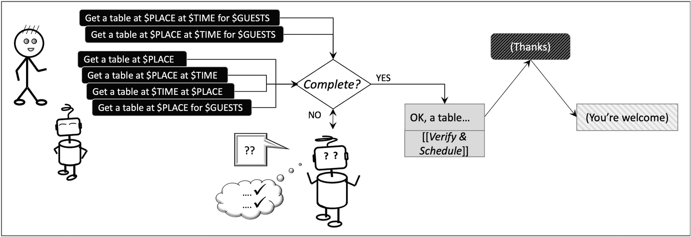
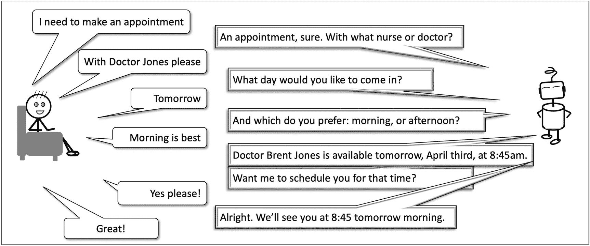
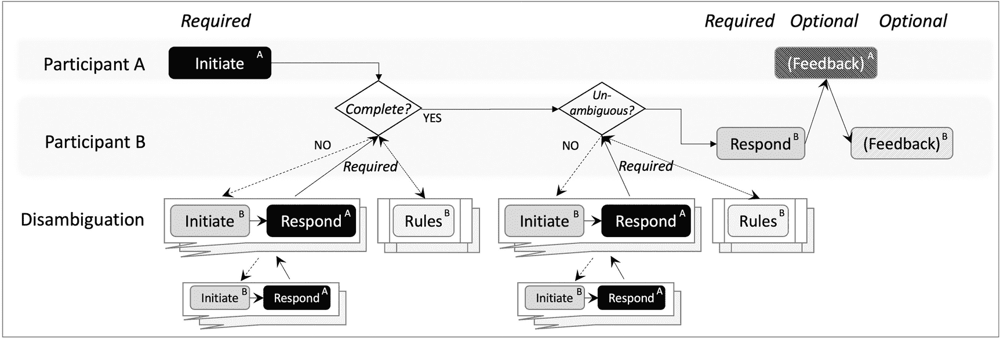
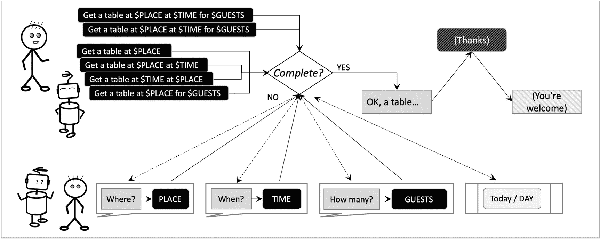

# 7. 通过消歧解决不完整的请求

在人类对话中，人们通常只会在他们认为必要的范围内表达清楚，不多也不少。人们假设听众能跟上思路，因此会采取一些可能导致信息不完整的捷径。或者他们表达模糊，从而导致歧义。如你所知，在人类对话中，这种情况时有发生。当说话者表达不清时，听众会要求澄清，或在脑海中“填补空白”。有时他们猜对了，有时则不然。VUI 对话中也会出现同样的情况，这就是为什么歧义消除是语音设计和开发中最重要的主题之一。在其他时候，听众甚至直到很久以后才意识到自己误解了——如何回到正轨是第 13 章的主题。在本章中，你将学习消歧：它是什么，为什么重要，以及如何以及何时实施不同的方法。你还将了解为什么需要对话管理来适应用户不同的心智模型。代码示例涵盖了消歧、多轮对话以及使用 webhooks。


### 不完整的请求

请重新审视第 6 章中一些完全指定的用户话语示例：

*   *今晚七点在娜娜餐厅订一张六人桌。*
*   *从我的支票账户支付 240 美元 63 美分的信用卡账单。*
*   *在 1956 年电影版《战争与和平》中，谁扮演了娜塔莎这个角色？*
*   *在客厅用 Spotify 播放 Rammstein 乐队的《Links 2 3 4》。*

用户在提出请求时总是如此精确吗？不，当然不是。我们两位作者都见过许多稳健语音交互的实例，在这些实例中，只有一小部分多槽位交互能在第一轮对话中被完全指定。当语音用户界面（VUI）缺乏完成用户请求所需的信息时，我们将该意图称为不完整或欠指定。欠指定有几种原因，包括：

*   用户认为自己提供了所有必要信息，但实际上没有。
*   用户提供了所有信息，但被 VUI 误解了。
*   用户不知道哪些信息是必要的，因此让 VUI 控制对话以询问缺失的部分。
*   用户不想让 VUI 不堪重负，所以先提出主要请求，知道后续会有追问。
*   用户不关心某些细节，因此让 VUI 来“填补空白”。

所有这些情况在任何对话中都会发生，并且完全正常——嗯，只要不是两个律师在互相宣读法律合同，因为如果言语交流中不能进行假设，那么所有对话都会变成那样。对于语音系统来说，如果人们能像法律条文一样说话，那将非常棒——本章也就无关紧要了！但当然，人们不会那样说话。

如果一个意图期望有 N 个槽位，用户能够并且将会以几乎任意顺序、使用任意槽位组合来提出请求。你必须处理每一种情况，要么通过询问用户，要么通过其他方法填充槽位。

在餐厅查找 VUI 示例中，假设你想处理预订。添加一个意图`makeRes`，然后看看*今晚七点在娜娜餐厅订一张六人桌*。好的，看起来完成这个请求至少需要四条信息——日期、人数、地点和时间——这些对应四个必需的槽位或实体。你很快会意识到人们开始预订的其他方式：*订一张桌子*，后面跟着*……在娜娜厨房*，*……今晚七点在娜娜*，*……在娜娜厨房为六个人*，以及*……为六个人在娜娜*。暂且不提*订一张桌子*的不同说法，你会意识到人们可能只提供预订所需信息的一部分，而且这些信息可以以不同的顺序出现。该怎么办？你需要一种快速准确完成用户请求的方法。你有两个选择：询问用户或“猜测”答案（图 7-1）。



图 7-1

扩展任务完成对话模式以处理欠指定请求的第一步

事实证明，这两种方法各有其适用的时机和场景。对于预订来说，询问似乎是明智之举。一个基础但有效的消歧对话如下：

*   **用户** *我能在娜娜餐厅订一张明晚的桌子吗？* → `$地点`，`$日期`
*   **VUI** *什么时间？*
*   **用户** *七点* → `$时间`
*   **VUI** *几位用餐？*
*   **用户** *我们一共六位。* → `$人数`
*   **VUI** *好的，一张桌子在……*

用户通过指定*任意顺序*的*任意槽位*来发起请求，这符合他们的心智模型，之后 VUI 接管成为发起方，以填充完成请求所需的缺失槽位值。通常，用户对任务越熟悉，他们一次性填充的槽位就越多——这就是为什么为高级用户以及具有明确定义槽位值的任务（如股票交易）创建成功的语音解决方案更容易。

表 7-1 展示了每种槽位组合的两个示例。16 种情况中只有一种是完全指定的；其他所有情况都需要 VUI 以某种方式完成。请注意，槽位几乎可以以任何顺序填充，尽管某些顺序比其他顺序更常见：大多数人会先说出餐厅名称，然后再提供其他信息，因为地点是最先应用的相关筛选条件。“复活节星期日”的请求增加了复杂性：日期会随年份变化。

表 7-1

四槽位请求中需要处理的代表性变化

| 示例用户话语 | 未指定的槽位 |
| --- | --- |
| *一个预订，晚上 8 点，两位，明天在娜娜餐厅。* *今晚六点在娜娜餐厅订一张五人桌。* | 无 |
| *今晚七点在娜娜中餐馆订个位。* *我想要今晚七点在娜娜餐厅的预订。* | 人数 |
| *请给我在娜娜餐厅订一张四人桌，六点钟。* *为娜娜餐厅做一个四人六点的预订。* | 日期 |
| *请订一张两人桌，明天晚上八点。* *我们两个人想今晚七点十五分在某处吃晚餐。* | 地点 |
| *明天在娜娜餐厅吃晚餐，请安排三位。* *我想要今晚在娜娜餐厅的两人预订。* | 时间 |
| *我想明天去娜娜餐厅。* *请问我能在周日订一张娜娜餐厅的桌子吗？* | 时间，人数 |
| *请给我在娜娜餐厅做一个下午 6 点的预订。* *下午六点在娜娜餐厅的晚餐预订。* | 日期，人数 |
| *娜娜餐厅的桌子，我们一共五位。* *请在娜娜厨房为五位客人做一个预订。* | 日期，时间 |
| *我想要一个周五六点的预订。* *请为明天下午 6 点做一个预订。* | 地点，人数 |
| *能帮我订个桌吗，六个人下午 5 点？* *给我做一个六人七点的预订。* | 地点，日期 |
| *今晚为三位成人和一个幼儿预订。* *本周五为五位客人预订一张桌子。* | 地点，时间 |
| *请请求在娜娜餐厅订一张桌子。* *请给我一个娜娜餐厅的预订。* | 日期，时间，人数 |
| *在日落时分预订。* *在七点半左右订一张桌子。* | 地点，日期，人数 |
| *下周日订一张桌子。* *我在找复活节星期日吃晚餐的地方。* | 地点，时间，人数 |
| *我需要一个六人的预订。* *我在哪里可以订到大概十人的桌子？* | 地点，日期，时间 |
| *我需要一个晚餐预订。你能做预订吗？* | 地点，日期，时间，人数 |


#### 通过对话管理实现完整性

填充未指定的槽位变成了一场组合游戏。这正是**对话管理**的关键所在。当你对对话进行分支处理，并通过后续提示来填充空槽位时，要避免询问用户已经提供过的信息。这样做不仅显得愚蠢，还会浪费用户的时间，导致他们不太愿意与你的语音用户界面互动。重复询问还会增加第二次获取错误信息的风险。图 7-2 展示了预约准备助手中一个不完整的请求。



图 7-2  
语音用户界面填充一个不完整的预约准备助手请求

你的目标是在良好的用户体验与健壮且可维护的代码之间取得平衡。这里有一种方法：找到一种用户熟悉且符合逻辑的流程来填充所有缺失的槽位。将其转化为一种模式，使得无论用户最初提供了什么信息，每个填充槽位的对话都能遵循相同的步骤顺序。请看表 7-2 的第三列：每种情况下缺失的槽位都按照相同的逻辑顺序列出，即 `{地点 → 日期 → 时间 → 人数}`。这让你能够创建一个单一的流程，依次执行必要的提示，并跳过不必要的提示。

表 7-2  
针对四槽位请求的简单对话管理器

| 步骤 | 如果 `{槽位}` 需要 | 跳转到提示 | 提示措辞 |
| --- | --- | --- | --- |
| 1 | `{地点}` | `GetPlace_init` | 在哪家餐厅？ |
| 2 | `{日期}` | `GetDay_init` | 哪一天？ |
| 3 | `{时间}` | `GetTime_init` | 什么时间？ |
| 4 | `{人数}` | `GetGuests_init` | 几位用餐？ |

你有一组嵌套的“发起-回应”对话行为，其中主对话包裹着那些有时需要的填充槽位子对话。表 7-3 逐步展示了一个使用对话管理器填充部分指定语句的示例。对话管理器正如其名：管理对话。它接收用户表述的表示形式作为输入，并根据其在所追踪的上下文和条件（包括领域、对话历史、重试次数、身份验证、设置等）下对语句的解释，来决定语音用户界面的下一步行动。对话管理器最直接的决策点是判断是否有任何必需信息缺失，即是否有任何槽位为空。如果是，则应用对话管理器规则来填充这些槽位，要么通过向用户提出额外问题，要么基于其他设置或假设。

你的语音应用的成功取决于你的对话管理器。这是你在语音体验中拥有最大控制权的部分。你可以拥有最好的语音识别引擎、出色的自然语言处理/自然语言理解以及顶级的文本转语音技术，但如果你不能对结果做出恰当的回应，那么这一切都毫无意义。^(⁵⁷)

表 7-3  
详细示例对话，说明填充缺失槽位值、通过显式对话或隐式规则达成解析的过程

| 角色 | 轮次 | 槽位填充逻辑需求 | 解析结果 |
| --- | --- | --- | --- |
| **用户** | 我¹ | 检测到新对话。 | *在娜娜餐厅订个明天晚餐的位子*。 |
| **语音用户界面** | -- | `{地点 娜娜家}`, `{日期 明天}`, `{时间 空}`, `{人数 空}` | 将明确的值分配给槽位。 |
| **语音用户界面** | -- | 应用规则填充空的必需槽位，或在不通过对话的情况下澄清歧义。 | `{日期 明天}` → 展开为绝对日期和星期几 |
| **语音用户界面** | 我¹ | 通过对话填充下一个空槽位：填充 `{时间}`。 | 询问：*什么时间？* |
| **用户** | 你² | `{地点 娜娜家}`, `{日期 20190816}`, `{时间 9}`, `{人数 空}` | 回应：*九点。* |
| **语音用户界面** | -- | 应用规则填充空的必需槽位，或在不通过对话的情况下澄清歧义。 | `{时间 9}` → “晚餐”意味着下午 → 转换为 `{时间 2100}` |
| **语音用户界面** | 我³ | 通过对话填充下一个空槽位：填充 `{人数}`。 | 询问：*几位用餐？* |
| **用户** | 你³ | `{地点 娜娜家}`, `{日期 20190816}`, `{时间 9}`, `{人数 6}` | 回应：*我们一共六位。* |
| **语音用户界面** | 我¹ | 所有槽位已填充；无歧义。 | *好的，这是为您找到的信息*… |

成功提示 7.1 利用数据和逻辑简化用户任务

始终尝试通过使用数据和逻辑来让对话对用户更轻松。当用户因为期望选择而留下未指定的细节时（例如*明天订个位子*），要提前考虑，在提出下一个问题之前先查询预订数据库。如果只有一个时间可用，就直接提供该时间，而不是问一个开放式的*什么时间？*。如果在人际对话中某件事令人厌烦，那就避免让你的语音用户界面去做，即使这意味着额外的工作。

##### 实现请求的完成

你希望用能够反映底层语义解释（即含义）的值来填充槽位，同时也要简化任何数据库访问和值分配的需求。查看表 7-3，你可能已经在思考这作为一个类似以下结构的效果如何：

```
{"地点": "nanas_kitchen",
"日期": {"工作日": "friday",
"日期": "20180608"},
"时间": "2100",
"人数": "6"}
```

之前的预约示例是一个完全指定的请求，其中所有需要的槽位组件都已填充。我们填充了一个内置槽位 `@sys.date-time`，但它包含多个可能的子部分，例如日期、时间和上午/下午。你可以想象许多其他请求，比如*明天*（你需要时间），*三点钟*（你需要日期），等等。因此，你需要逻辑来确定填充什么以及语音用户界面应该如何询问。为此，你需要编写代码来实现填充逻辑，而不是使用内置逻辑。你将在本章后面学习如何做到这一点。


#### 关于实现请求补全的注意事项

再看一下表 7-1 中的表述。它们只是请求同一件事的几种不同方式。存在许多可能的载体短语，这些典型句子通常是疑问句或命令句，并且包含构成意图的动词（*我想要一个预订*……、*订一张桌子*……、*给我安排一个*……等等）。信息的顺序也有很大差异：例如，餐厅名称可能出现在句首或句末。思考一下这会如何影响你的代码。你是否注意到数字方面可能存在一些混淆？很好。我们稍后会回到这一点。

我们在表 7-3 中对于如何处理时间问题有些含糊其辞。在这个特定示例中，你可以依赖第一个表述中的 *dinner*，并将“PM”捕获为一个单独的槽位，或作为结构化 `{time}` 槽位的一部分。如果娜娜餐厅全天供应餐食，或者用户没有指定用餐时段，你可能需要明确询问是 *AM 还是 PM*。也许你可以基于假设来加快对话速度：只接受晚餐预订，或者娜娜餐厅只在晚餐时段营业。这里要传达的关键信息是，你需要理解领域知识以及用户可能期望的内容。虽然有预置的时间处理模块，但你仍然需要了解用户可能会做什么和说什么。

用户常常会“过度回答”，提供比语音用户界面（VUI）所问的更多的信息。如果 VUI 问 *什么时间？*，一些用户会回答超出时间范围的信息，例如，*九点，六个人*。他们是在提供帮助——这很好！但这可能会搞乱你的 VUI——哦不！请捕获用餐人数，而不是忽略它并立即追问，*请问几位？*

不要要求用户一次性回答所有剩余字段——那样会变得混乱。但如果用户确实这样说了，也要接受。当多个字段在用户逻辑上相关联时，比如信用卡到期月份和年份，一次性询问多个字段是可以的。

语音开发平台通常会包含对日期或星期几等内容的处理。没人想重复别人已经做过的工作，所以如果你能利用这些处理模块，那就用吧。但是，每当你依赖内置模块时，也需要理解用户在该特定语境下会说什么，以确保他们的表述能被覆盖。他们会说一个日期或日期的一部分（“十九号”）、一个绝对日期（“周日”）、一个相对日期（“明天”），还是这些的组合（“周日十九号”）？

因为我们教授的是最佳实践，无论平台提供什么模块，我们大多会避免使用内置模块。

早些时候，我们决定，没有明确日期的预订请求可能意味着“今天”。做出这个假设可以使对话更简短、更快捷。但你的选择会影响你的恢复方法（第 13 章）、确认提示（第 8 章），甚至覆盖范围和性能（第 10 章和第 12 章）。

最后，用户会提供你可能不需要或没想到要处理的信息——甚至是一些乍看之下无关的信息：

*   *我想在复活节周日找个地方吃晚餐。* 这个人并非故意隐瞒地点信息；他们需要帮助来找到那天能去的地方。
*   *预订一张七点半左右的桌子。* 这个人在时间上比较灵活。你是否应该记录并利用这一点？当然应该。你会怎么做？取决于你的范围和计划。
*   *今晚为三个大人和一个幼儿预订。* 这算是一张三人桌还是四人桌？这对餐厅来说可能很重要。你会如何处理这个信息？
*   *你们能预订吗？* 这很可能既是一个问题也是一个请求。你只会回答 *可以*，还是会主动提出帮忙预订？

你可以将这些信息捕获为额外的 `可选槽位`。你满足或至少智能回应的可选槽位越多，用户就会对你的 VUI 印象越深刻、越满意。

**成功秘诀 7.2** 不要丢弃用户提供的信息

如果你只关心填充必填槽位，就会错失良机。说真的，充分利用用户说出的和未说出的所有信息，是让你的 VUI 听起来“聪明”的最佳方法之一。除了必填槽位，还要包含可选槽位。例如，一个可选槽位 `tableType` 可以记录“安静”、“靠窗”或“靠近厨房”等请求，以备将来使用。


### 歧义请求

你刚刚完成了槽位填充，这在任何非一次性完成的语音交互中都会频繁出现。有时在槽位填充过程中会产生歧义——你需要解决这个问题。

如果`意图`是用户的真实意图，你如何能知道用户想表达什么？你无法读懂他们的心思！想想你自己，有多少次不确定是否完全理解了对方刚说的话，或者对方是否理解了你的观点。语音用户界面（VUI）必须处理所有这些情况，却没有你作为人类所拥有的优势。即使我们说着同一种语言，对世界有着相似的理解，对方也可能表达含糊、喃喃自语、提及你不知道的事物，或者发音不同。他们可能把请求表达成疑问句（*你能把电视静音吗？*），而实际上这是一个命令（*把电视静音！*）。那么，你如何知道用户的意图？答案是，你永远无法百分百确定，但你可以通过依赖你在第 2 章学到的“交互规则”，并提供在出现误解时重回正轨的方法，来最大化成功的几率。一位资深的 VUI 设计师曾说，你 50%的 VUI 设计精力应该花在处理非最佳路径的交互上；另一位 VUI 设计师则认为这个数字还太乐观了！

我们这里所说的歧义，指的是用户表达含糊，VUI 需要解决这种含糊才能继续并完成用户的请求。用户含糊的原因有很多：措辞模糊、回答不完整、同音异义词（发音相同但含义不同的词）、匹配到多个同名项、近义词、VUI 识别错误，以及其他原因。

解决歧义的过程称为消歧。这是语音交互最重要的方面之一，也是你需要理解并恰当实现的内容。让我们用更多预订场景的语句来说明歧义：

- *给我订一个六人七点的位子*。
    - **问题**：数量没有指定单位，这两个数字都可能指代人数或时间。
    - **解决方案**：介词是关键：*for six*（六人/六点）可能指人数或时间，但*at seven*（在七点）不会指代人数。应用逻辑解析为`$TIME`。

- *我想今晚订一个娜娜餐厅的双人位*。
    - **问题**：“Two”可以指时间（下午 2 点，晚午餐）或人数。
    - **解决方案**：预订“今晚”的位子不太可能指凌晨 2 点或下午 2 点，因此可以假定*two*指人数。应用逻辑解析为`$GUESTS`。

- *我需要订一个六位的位子*。
    - **问题**：*Six*可以是时间或人数；*for*可以引出每一条信息：*为娜娜餐厅预订周日晚上 7 点五位客人的位子*。
    - **解决方案**：正确理解这一点至关重要。请用户来澄清。

- *下周日订个位子*。
    - **问题**：人们对*next DAY*（下个某天）的理解不同。对有些人来说，是一周或更久以后；对另一些人来说，就是即将到来的下一个。
    - **解决方案**：正确理解这一点至关重要。请用户来澄清。

人们有时在说话时能意识到自己表达不清，有时则不能。有时对话的其余部分会通过排除法来处理歧义。这属于高级内容。需要深厚的语言和文化知识；不同语言和用户群体之间的细节也不同。想想不同文化中什么是“晚餐时间”。由于篇幅限制，我们专注于标准美式英语，但你的用户并不都是母语者，也不会始终语法完美。远非如此。

你的消歧需要承认用户已经尝试过，但你需要澄清——如果你只是简单地重复问题，用户第二次还是会同样含糊。相反，要基于用户已经提供的信息进行追问，这样他们就不必重复整个语句，包括新增的澄清内容。同时要跟踪上下文。比较表 7-4 中的两个示例。对话 A 保留了上下文；对话 B 没有。

人们不应该需要重复完整的表述*拨打琼斯医生的手机*，尽管有些人会这样做。这不符合对话习惯。相反，要在消歧的范围内处理所有相关回应，并假设回应是在已指定的当前上下文范围内做出的。所有类型的上下文都是对话式交互（无论是人类对话还是 VUI）不可或缺的一部分，这就是为什么你在本书中（包括整个第 14 章）都会听到相关内容。

**表 7-4** 消歧示例对话，展示保留上下文的重要性

| 谁 | 对话 |
| --- | --- |
|   | A | B |
| --- | --- | --- |
| **用户** | *拨打琼斯医生的电话。* | *拨打琼斯医生的电话。* |
| **VUI** | *布伦特·琼斯。哪个电话：家庭电话还是手机？* | *布伦特·琼斯。哪个电话：家庭电话还是手机？* |
| **用户** | *手机。* | *手机。* |
| **VUI** | *正在拨打布伦特·琼斯的手机……* | *手机是阿拉巴马州海岸线上的一个港口城市……* |
|   | **√** | **X** |

歧义解决和处理未明确指定请求的一般模式如图 7-3 所示。参与者 B（VUI 或人类听众）会“卡住”，直到所有必需的槽位通过询问参与者 A 或应用预定义逻辑被明确填充。你可能需要在一次对话中多次填充槽位或解决含糊的槽位值——甚至两者都要做！正如你所见。两者的过程相同：在发起方和响应方之间切换。区别在于，在歧义解决中，用户已经尝试提供必要信息，而在未明确指定请求中，用户尚未尝试。这一点很重要，原因有二。首先，某些消歧技术在不同情况下效果不同。你需要了解如何为你的任务和用户选择合适的技术。其次，为了听起来更智能，你的提示语在这两种情况下应略有不同。这很微妙，也是许多语音系统不愿做的额外工作。但你想显得聪明，对吧？除了听起来聪明，这还能帮助用户成功。



**图 7-3** 解决歧义和完全指定 VUI 对话的核心对话模式

图 7-3 相当抽象。它涵盖了你在构建任何 VUI 对话时所需的内容，尽管架构细节将取决于你的环境。在本章后面，你将看到它如何紧密反映 Dialogflow 处理歧义的方式。它看起来像一个调用返回子程序——这在你以后学习如何在无状态模型中保持上下文时很重要。

将图 7-3 应用于图 7-1 中的示例对话，你会得到类似图 7-4 的结果，其中包含逐步的槽位填充，这被称为引导式对话。



**图 7-4** 任务完成请求中多个槽位的消歧对话模式


