# 将另外两种核心对话类型的示例对话结合起来，就得到了图 7-5。这些图表通过仅展示槽位填充进行了简化。在学习了消歧方法后，我们强烈建议你重新审视这些图表。将它们展开，以查看包含多个槽位和歧义的几个示例对话。对于语音团队中的不同角色来说，这是一个非常有用的工具，可以帮助他们专注于预期行为，而不会陷入细节中。

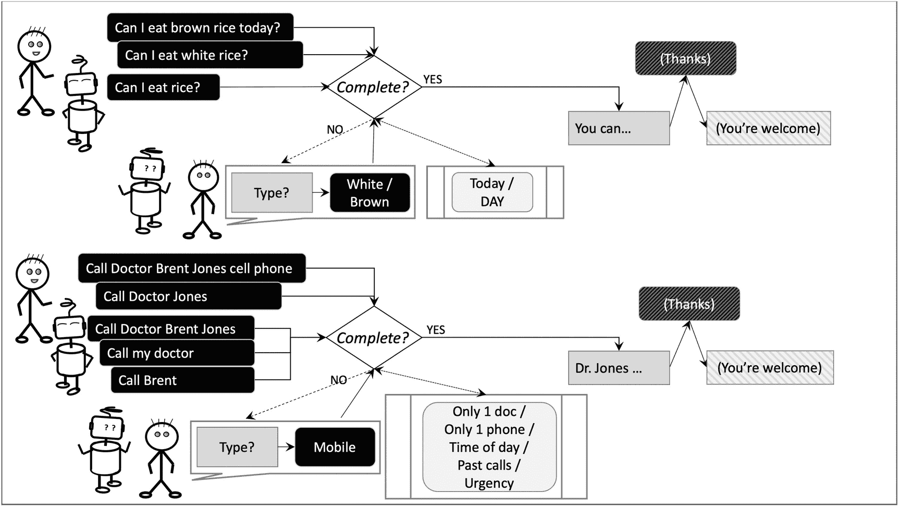

**图 7-5** 将消歧对话模式应用于问答交互和动作请求

##### 多模态角落

在多模态 VUI 中，歧义问题不那么突出，也更容易解决——图片有时确实能胜过千言万语。将初始语音搜索与后续显示可能选项的屏幕相结合，是一种快速简便的消歧方法。如果选项模糊不清，图像可以起到澄清作用。

### 消歧方法

有几种成熟的消歧方法。正如你将看到的，你的选择取决于任务、内容类型、用户特定选择的可能性以及选项的总数。

#### 基于逻辑的假设

规则 #1：只在必要时进行消歧。口头或显式的消歧是一个额外的步骤，因此它会减慢交互速度，并增加额外沟通失误的风险。当你能够在没有显式消歧的情况下做出准确假设时，就去做。

你之前看到了一个例子：如果用户要求在八点预订*晚餐*，你不需要问*是上午还是下午？* 同样的逻辑也可以用于填充槽位。

#### 来自语音一线

一家音频硬件提供商有一个 Alexa 技能，要求用户消歧以确定将命令应用于哪个连接的扬声器。这很好——但如果用户只有一个设备，就没必要了。永远不要在你能够依靠逻辑时进行显式消歧。

#### 是非问句

规则 #2：你不可能总是猜到用户的意图——你经常需要询问他们。是非问句是最简单的消歧方法。用户易于处理，也易于识别响应。当一个选项比其他选项更有可能，并且选错的代价高于直接假设时，请使用此方法。

如果用户有一个名为 Brent 的联系人，该联系人在通讯录中有两部电话，请使用一些逻辑来选择最可能的那一部，并在问题中将其作为“是”的响应提供。典型的逻辑包括“最常用”和“最近使用”：

*   **用户**  *打电话给 Brent。*  `{"name": {"first":"brent", last:"jones",}`
*   **VUI**  *Brent Jones，手机吗？*  `"phone ": {"type":"mobile", "number":"4155551212"}`
*   **用户**  *是的。*
*   **VUI**  *正在呼叫 Brent Jones，手机*…

如果大多数用户在订购披萨时更喜欢普通饼底，那么提供这个选项比每次都列出所有选择更简单且更不易出错：

*   **用户**  *我想点一个大披萨。*
*   **VUI**  *普通饼底吗？*
*   **用户**  *是的，请。*
*   **VUI**  *那要什么配料*…

在医疗领域，一个是非问句的例子可能涉及确保紧急情况不会被转接到应答服务。有理由说明为什么你在现实生活中不会看到完全相同的对话——想想为什么——但这很好地说明了是非问句：

*   **用户**  *打电话给我的医生。*
*   **VUI**  *你打电话是关于危及生命的紧急情况吗？*
*   **用户**  *不是。*
*   **VUI**  *好的。正在致电 Maple 诊所的医生*…

##### 实现是非问句

让我们在呼叫医生办公室之前添加一个消歧轮次——加载 `6-8.zip` 中的示例代码以便跟进并轻松更新。在第 6 章中，你在 `tcrProcedurePrep` 对话中有一些后续问题，以及几个“下一步”意图。你学习了如何使用上下文来实现这些，部分原因是我们想介绍这个重要的概念。现在你将学习**后续意图**，这是 Dialogflow 中的一个相关概念。后续意图是仅跟随某个特定意图的意图。后续意图有一些针对常见后续操作（如“是”或“否”）的预构建训练短语。其他预构建短语包括导航命令，如“更多”、“下一个”和“上一个”，以及通用命令，如“取消”和“重复”（第 9 章）。让我们使用后续意图。完成后，你的意图列表应该如图 7-6 所示。

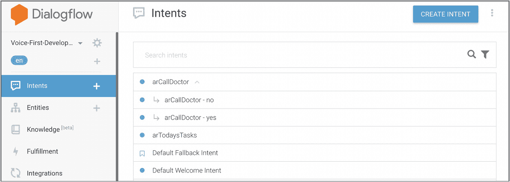

**图 7-6** 向 `arCallDoctor` 添加后续“是”和“否”意图后的意图列表

1.  将现有 `arCallDoctor` 意图的响应更改为新的“你打电话是关于…”提示。关闭标记 `arCallDoctor` 为结束对话的滑块。

2.  点击左侧的“意图”。在 `arCallDoctor` 意图中，点击右侧的“添加后续意图”。会打开一个菜单；选择“是”。

3.  已创建一个新的子意图 `arCallDoctor-yes`。你可能需要点击意图名称旁边的向下箭头才能看到它。点击该意图。注意已经填充好的“是”训练短语。

4.  添加一个响应：“立即拨打 911。”将此意图设置为对话的结束。

5.  对“否”执行相同操作。在 `arCallDoctor` 中，点击“添加后续意图”。选择“否”，然后选择 `arCallDoctor`——否子意图。

6.  添加一个响应：“好的，正在呼叫你的医生。”将意图设置为对话结束。测试！

##### 关于实现是非问句的说明

你需要小心处理“否”响应。这听起来可能有点奇怪，但用户会知道“否”意味着什么吗？它是“是”的反义词吗？有时是。如果你口述一封电子邮件，听到*你想现在发送吗？*你可能会犹豫；是的，你想发送，但不是现在，不是在你审阅之前。“否”会保存它以便稍后发送还是删除它？仔细思考用户如何在“否”的情况下成功，并根据需要澄清提示。

在一个健康保险 VUI 中，超过三分之二的用户交互是关于处方续药的。通过将“续药”作为几个选项之一提供，改为从一个简单的*你打电话是关于续药吗？*开始，整体成功率显著提高。

#### A/B 集合

*A 或 B* 的选择听起来像是在两个选项之间做选择，但它可以在不同程度上**受到逻辑约束**。当用户理解存在约束时，他们就知道需要选择其中一个。当选项**互斥**时，这种方法效果最好。*上午还是下午？* 是一个完美的例子。*热的还是冷的？* 是另一个例子。

*   **用户**  *我想预约明天 7:30 的电话会诊。*
*   **VUI**  *上午还是下午？*  [假设这是一个可选的日程安排]
*   **用户**  *上午。*
*   **VUI**  *好的，预约时间定在*…

如果在日常对话中存在选项的自然或标准顺序，请在 VUI 中使用相同的顺序。因此，你的提示应该问*上午还是下午？* 而不是*下午还是上午？* 如果没有这样的顺序，你可以按字母顺序、最近使用频率、使用频率，或者只是听起来更顺耳的顺序来排列！


##### 实现 A/B 集合消歧

预约对话框是 A/B 消歧（上午与下午）的一个很好的例子。在解析内置的 `@sys.date-time` 实体结果以确定你掌握了哪些信息之前，你无法知道是否需要消歧。以下是实现消歧的另一种方法。

当你在第 6 章构建 `tcrMakeAppointment` 时，你了解了**必需参数**，即如果信息未填写，后续提示会自动收集所需信息。你曾用此来填充时间：在*预约*中，时间是一个带有自动提示的必需参数，例如*好的，一个新的预约。什么时间？* 如果用户说过*预约三点*，该提示就不会出现，因为你已经掌握了信息。如果你觉得这很像图 7-3，那你是对的。Dialogflow 内置了使用必需参数来判断请求是否完整，并在不完整时进行提示的概念。在这个例子中，时间（*三点*）已经确定。

让我们来编写上午与下午的消歧代码。首先，添加一个用于消歧的实体（图 7-7）。

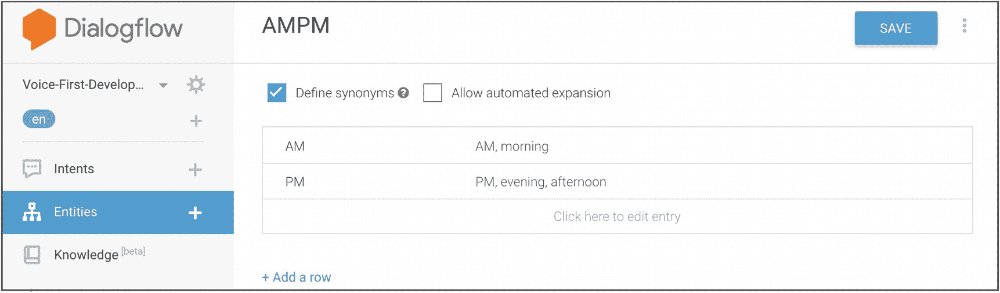

图 7-7 用于上午/下午消歧的实体

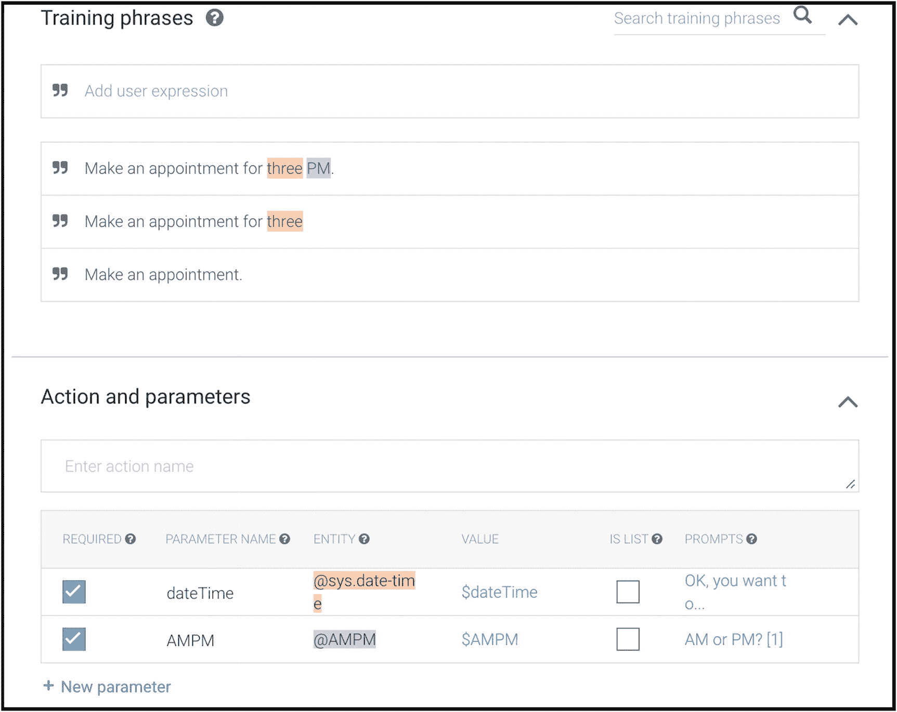

图 7-8 将上午/下午消歧作为必需参数添加到 `tcrMakeAppointment`

1.  点击左侧栏的“实体”。
2.  创建一个名为 `AMPM` 的新实体。添加一个参考值“AM”，同义词为“morning”；再添加另一个参考值“PM”，同义词为“evening”和“afternoon”。
3.  保存（图 7-7）。现在添加必需参数（图 7-8）。
4.  点击意图 `tcrMakeAppointment`。
5.  添加一个新参数：名称 `AMPM`，实体 `@AMPM`（我们刚创建的），值 `$ampm`。将 `AMPM` 设为必需参数。
6.  点击“提示”列中的“定义提示”。添加提示“上午还是下午？”
7.  通过添加几个示例训练短语来测试自动消歧。首先，添加“预约三点”。双击单词“three”，右键单击，然后选择 `@sys.date-time:dateTime`。这将把已定义的参数 `dateTime` 设置为值“three”。
8.  接下来，添加训练短语“预约下午三点”。再次双击 `three` 并选择 `@sys.data-time:dateTime`。然后，双击 `PM` 并选择 `@AMPM:AMPM`。
9.  验证 `AMPM` 是否在响应中返回。将 `$AMPM` 添加到现有提示中：“好的，我已经设置好了，`$dateTime.original $AMPM`。完成后，说再见即可。”你的意图应该看起来像图 7-8 中的那样。
10. 在 Dialogflow 控制台中使用所有三个示例短语进行测试。它只应在需要时才询问信息。图 7-3 正在运行！

一切看起来不错，但实际上你还没有完成。在这里，你看到了 Dialogflow 系统实体加速开发的一些强大功能。但要小心！你需要在设备上测试这个对话框，以发现其他问题，这些问题要求你更深入地了解系统实体内部发生了什么。

你是在消歧还是在填充必需参数？两者都是！必需参数是实现图 7-3 中通用消歧框架的一种强大方式。所有消歧都是这样的吗？*预约*、*预约三点*和*预约下午三点*都是非常可能的。但*给我的医生打电话；不危及生命*则非常不可能。

##### 关于实现 A/B 集合的说明

由于用户熟悉这些选项，互斥的 A/B 集合很容易编写消歧提示。在约束较少的集合中可能引起问题的措辞，对于*上午还是下午？* 来说没问题，因为“早上还是晚上”的含义暗示了“二选一”。

选项对你来说可能是互斥的，但对你的用户来说可能并非如此。当你自己不是普通用户时，这是一个常见错误，并且会导致问题。如果用户熟悉一些午餐选项，他们会知道*汤还是沙拉*是二选一。但这里在逻辑上并没有互斥性，不像上午与下午。因此，一些用户会说*是*或*否*，甚至*都要*：

-   **用户** *我想要一份午餐特价。*
-   **VUI** *汤还是沙拉？*
-   **用户** *汤/沙拉/不/是/都要/有什么汤？/我能换成薯条吗？*

这个问题看起来如此简单！预测什么会让用户困惑很重要，因为你需要尽量减少意外响应，并处理消歧引入的任何变化。当人们互相交谈时，他们经常使用“是/否”格式，但实际上意思是“选一个”而不是“说是或否”。除非你能处理所有响应，否则请避免这种措辞。如果你改用 WH 问句（以谁、什么、哪里等开头的问句），例如*我们的午餐特价配有汤或沙拉。您想要哪一个？*，选项对用户来说会清晰得多。

导致问题的具体细节因语言而异，但概念是通用的，即无论你为哪种口语开发，都需要非常清楚哪些结构和词语容易混淆。保持简单也有助于你的非母语用户。

**来自语音一线**

在一个金融服务系统中，仅将“是/否”结构改为 WH 结构就显著提高了用户成功率。诸如*您打电话是为了 __、为了 __、还是为了 __？* 的提示被改为*您打电话是关于什么？__、__ 还是 __？* 在一个允许用户插话的航班信息系统中，*是今天、明天还是昨天？* 导致了许多*是*和*是，今天*的响应，因为用户在只听到*是今天吗？* 后就立即回答了。

#### 静态列表

静态列表是小列表，不超过四到五个项目，始终包含相同的选项集。如果列表更长，用户将记不住，但如果允许插话，较长的列表也能奏效。当有几个不明显的选项，或者你想提醒用户你正在寻找的措辞时，你可以使用列表。

如果用户熟悉美国的披萨订购流程，他们理解尺寸选项是互斥的：

-   **用户** *我想订一个披萨。*
-   **VUI** *好的。什么尺寸：小、中、大还是超大？*
-   **用户** *中份。*
-   **VUI** *那要什么配料*……

因为用户说他们想要一个披萨，VUI 期望在响应中得到四个尺寸之一。现在试试这个：像对人说话一样大声说出来，*我想订披萨*，不包括“一个”。注意到很难听出是否有“一个”吗？对 VUI 来说也很难！想想如果你不确定用户想订多少个披萨，或者这是一个大型多披萨订单，你会怎么做。如果大多数人只想要一个，避免问每个人*您要订几个披萨？* 但你可以从提供一个特例开始，比如*如果您要订四个或更多披萨，请咨询我们的团体订单。否则，什么尺寸……* 你也可以暗示有机会订多个：*第一个披萨什么尺寸……*

如果用户正在启动一个包含多个选项的任务，你可以提醒他们这些选项——如果他们是高级用户，你可以缩短为*哪一餐？*：

-   **用户** *在我的饮食日记中添加一餐。*
-   **VUI** *哪一餐：早餐、午餐、晚餐还是零食？*
-   **用户** *晚餐。*
-   **VUI** *好的。你晚餐吃了什么？*……


##### 实现静态列表

最后一个示例对话是食物日记功能的一个绝佳范例。在 `tcrFoodDiaryCollection` 意图（第 6 章）中，你添加了用于餐食和食物类型的参数。现在，你需要像本章前面为 `dateTime` 和 `AMPM` 所做的那样，将餐食设为一个必填参数。新的意图将如图 7-9 所示。

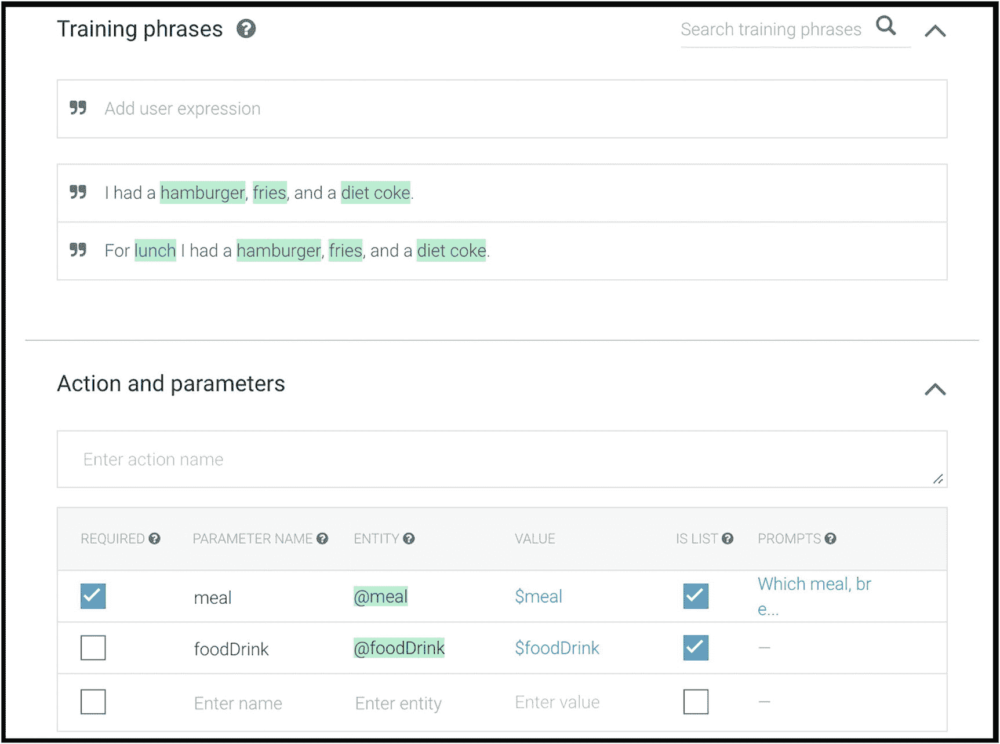

图 7-9

将“餐食”设为消除歧义的必填参数后的 `tcrFoodDiaryCollection` 意图

1. 打开 `tcrFoodDiaryCollection` 意图。
2. 在“操作和参数”部分，将 `meal` 参数设为必填。
3. 在新的“提示”列中，点击“定义提示”，并输入示例对话中的提示：“哪一餐：早餐、午餐、晚餐还是零食？”
4. 添加一条不包含餐食的新训练短语：“我吃了一个汉堡、薯条和一杯健怡可乐。”注意它如何自动用正确的食物项目填充了槽位。保存。
5. 用这条新短语进行测试。它应该会询问餐食类型。

##### 关于实现静态列表的说明

设计列表时最棘手的问题在于载体短语的措辞。要注意与 A/B 集合相同的措辞问题。当选项在逻辑上互斥时，你可以放宽心。但即使通过仔细的语调来强调选项，听到诸如*你想要糖屑、坚果还是葡萄干？*这样的问题时，也可能让用户感到困惑。他们的回答可能是三个项目的名称，也可能是*全部都要*、*是*或*否*。要妥善处理所有这些回答。*是*是指全部都要吗？还是指其中之一，而用户正在等待你下一个问题*哪一个？*。你会惊讶地发现，对于这些听起来很普通的问题，话语日志中竟会频繁显示用户的困惑。通过使用 WH 疑问句（*你想要哪一个*：*……？*）来尽量减少“是”和“否”的回答。或者准备好处理各种变体，并注意语调在不同语言中效果并不相同。

语音交互的常见方法是让用户通过说出选项名称来从列表中选择，而不是说*那个*。要准确把握时机，将*那个*与预期的选项正确匹配，这很棘手。如果你发现用户会这么说，请缩短选项之间的停顿时间。

#### 动态列表

动态列表与静态列表具有相同的特征，不同之处在于列表项是上下文相关的，对于不同的用户或上下文（如一天中的时间、账户类型或联系人列表中匹配姓名的数量）会有所不同。项目的顺序可以按字母顺序、按某种通用标准（如时间）或按最可能的选项优先排列。如果用户有四个名为 Brent 的联系人，但通常拨打给 Brent Jones，你可能会进行如下对话：

-   **用户** *打电话给 Brent。*
-   **VUI** *哪个 Brent：Jones、Adams、Barnes 还是 Carletti？*
-   **用户** *Brent Jones。*
-   **VUI** *正在呼叫 Brent Jones* …

在过滤后的搜索结果中进行选择是动态列表的一个常见用例：

-   **用户** *今晚在 Na Na’s 餐厅预订四人位。*
-   **VUI** *Na Na’s Kitchen 在下午 6:30 或晚上 9:00 有四人桌可用。* *您想要哪个时间？*
-   **用户** *请选 6:30。*
-   **VUI** *好的* …

##### 实现动态列表

使用你目前用过的“静态”Dialogflow，要创建真正基于上下文或用户依赖内容的“动态”语法是很棘手的。这一点很重要，原因在于识别：动态覆盖范围只接受有效的槽位值，这允许用户表达不那么精确，但仍能被理解。因此，你现在开始更多地依赖代码而非内置功能，尽管你可以用类似的方式处理这两种列表类型。更多内容见下文。

##### 关于实现动态列表的说明

注意载体短语的措辞，与静态列表相同。如果列表中的项目数量很大，如果用户不熟悉这些选项，或者选项数量时常变化，那么明确说明选项数量（*以下五个中的哪一个*……；*有五个*……）会有所帮助。设定预期并让听者做好准备是很有用的。当每个选项都很长时（例如街道地址），你可以提供几个项目，并询问*您想要哪一个：第一个还是第二个？*

利用关于选项的任何额外信息：将最可能的选项放在列表首位。但不要过于频繁地更改列表结构，以至于用户不得不去关注他们原本以为已经了解的内容。

在一个本地交通和导航系统中，用户必须听完消除歧义的提示，因为所使用的结构取决于歧义项目的数量。一个“是”可能意味着使用备选目的地（*您想改用那个吗？*）或听取其他选项（*您想听听其他的吗？*）。这会使交互变长并增加认知负荷——应追求并行选项。

#### 开放集

**开放集**指的是由于认知负荷原因，项目数量过多而无法逐一列举的列表。从列表中选择对用户来说更容易，除非集合很大，因此对于开放集，你不会提供明确的选项列表；你只需提出问题。如果用户想在一家餐厅预订，你不会一开始就报出镇上每家餐厅的名字：

-   **用户** *预订。*
-   **VUI** *好的，预订。在哪家餐厅？*
-   **用户** *哦……嗯……Na Na’s。*
-   **VUI** *好的，Na Na’s Kitchen。哪一天？*

这适用于较大的名称或数量集合，也适用于有限的、众所周知的集合，如一周中的几天或一年中的几个月。没有必要列出*哪个月份？一月、二月*……

##### 实现开放集

我们之前提到过，你不希望在 Dialogflow GUI 中手动添加长列表，而是应该使用 API。实现开放集消歧与小型集合没有太大区别，只是实体包含的项目要多得多。

##### 关于实现开放集的说明

处理开放集的诀窍在于，当用户说出你未处理的内容时，要知道该怎么做。开放集就像你在餐厅里，服务员问“您想喝点什么？”时面临的情况。就像你可能会回答“嗯，呃，你们有什么？”，你需要准备好回应这种索取更多信息的请求。为*我有哪些选择？*添加同义词以及一个回复。这个回复通常可以与*我不知道*的回复相同——确保两者都处理。在开放列表中，给出一两个代表性示例可能是一个很好的方法。你将在第 12 章学习相关技术以及如何融入示例。

#### 菜单

菜单本身与其他列表并无不同，但选项通常是附加选项的“桶”，或者是多步骤对话的起点。它们甚至可以是其他桶的桶！菜单对于许多客户服务 VUI 来说很重要，因为它们在一个庞大且可能令人不知所措的搜索空间中缩小了范围，这在大多数用户并非专家用户且需要一些引导时非常有用。

你可能认为菜单只属于 IVR，但它们的用途更广，包括提供少量选项以避免决策瘫痪：

-   **用户** *我想今晚预订五人位。*
-   **VUI** *我们今晚可以在 6:15 或 9:15 为您安排五人位。您更喜欢哪个时间？*
-   ~ ~ ~ ~ ~ ~
-   **用户** *甜点可以配什么酒？*
-   **VUI** *我可以为任何食物配酒。什么样的甜点：甜的、咸的还是奶酪？*
-   **用户** *是奶酪。*
-   **VUI** *美味！什么类型的奶酪：牛奶、羊奶还是山羊奶？或者混合的？*
-   **用户** *我想要牛奶酪。*
-   **VUI** *是硬质、半软质、软质还是蓝纹奶酪？*
-   **用户** *绝对是蓝纹奶酪。*
-   **VUI** *好的。蓝纹奶酪配酒可能有点棘手。不如这样……*


##### 实现菜单

对于程序准备助手，设想在功能中增加一个询问你正在使用哪种药物的环节。表 7-5 展示了新增对话的示例。

**表 7-5** 带有新菜单用于消除歧义的程序准备功能。灰色行代表新增的对话轮次^((58))

| 说话者 | 对话内容 |
| --- | --- |
| **用户** | *我准备好进行程序准备了。* |
| **语音用户界面** | *好的，让我们开始准备。首先，您使用的是哪种药物：Miralax、Dulcolax 还是 Colase？* |
| **用户** | *我使用 Miralax。* |
| **语音用户界面** | *对于 Miralax，第一步是准备一剂药量。每剂药量为一满瓶盖。现在，量取一剂，加入 8 盎司的水中。搅拌至溶解。完成后，请说“下一步”。* |
| **用户** | *下一步。* |
| **语音用户界面** | *很好。现在请完全喝下这剂药。完成后，请说“下一步”。* |
| **用户** | *下一步。* |

现在你可以构建与表 7-5 中灰色行对应的代码补充。这将类似于调用示例——为消除歧义添加一个额外的意图，并使用上下文来控制对话流程：

1.  在意图 `tcrProcedurePrep` 中，将响应更改为表 7-5 中新的下一步提示“好的，让我们开始……”。

2.  在 `tcrProcedurePrep` 中，将输出上下文更改为一个新的上下文 `tcrProcedurePrepLaxative`。保存。

3.  创建一个新的实体 `laxative`，包含项目 Miralax、Dulcolax 和 Colase。保存。

4.  创建一个新的意图 `tcrProcedurePrepLaxative`，训练短语为“Miralax”。注意它会自动将“Miralax”分配给 `@laxative` 槽位！

5.  添加 `tcrProcedurePrep` 的响应“对于 Miralax，第一步是……”。

6.  添加我们之前定义的输入上下文 `tcrProcedurePrepLaxative` 和输出上下文 `tcrProcedurePrepStep1`。保存。测试！

##### 关于实现菜单的说明

每个菜单选项的措辞需要传达每个“桶”中的内容——用户不应需要四处摸索才能找到正确的路径。使用简短、独特且风格平行的名称。让用户清楚该说什么以减轻认知负担，但避免过度重复：

*   ☹ *要听说明，请说“听说明”。要订购表格，请说“订购表格”。*

*   ☺ *您可以说“听说明”或“订购表格”。*

*   ☺ *您可以“听说明”或“订购表格”。您想要哪个？*

除非用户确实知道这些名称，否则要非常谨慎地使用公司特定的产品名称。并且始终包含广泛的同义词以实现稳健的覆盖。

如果你使用菜单，也要处理所有直接请求，这些请求可能涉及这些“桶”内的任何内容。常见的问题是，为现有图形用户界面（带有下拉菜单）启用语音功能时，只实现了相同的逐步导航。这很糟糕。语音的优势之一是用户可以跳过任何步骤或“桶”，直达目标。当用户知道自己想要什么时，不要强迫他们经历逐步流程；他们不会喜欢，会讨厌你的语音用户界面，并且会增加误识别的风险——最终所有人都不满意。

所有这些并不意味着菜单不好——恰恰相反。它们可以引导不熟悉语音用户界面的用户。新用户和高级用户可以和谐共处。语音用户界面绝不应强迫所有用户走同一条路径。不同的路径允许不同的心智模型达到相同目标；你的语音用户界面应该处理所有这些模型和路径。

交互式语音应答系统曾因“让用户无法与真人通话的树状结构”而名声不佳。这不是技术的错；相反，根本原因包括由于未能理解用户需求或行为而导致的设计或实现不佳、不合理的进度安排，或过于激进的业务规则。

##### 多模态角落

图 7-10 展示了多模态界面的一些可能性，这是 22otters 应用几个屏幕的概念版本。在每个屏幕上，都会播放音频提示。你可以用图片澄清模糊的选项（1），并且可以根据问题和预期的用户响应提供不同的输入方式。注意，是/否问题（2）、小菜单（3）和开放式问题（4）在提供的输入控件上有所不同：每个都有用于语音输入的麦克风；是/否问题和小菜单还有用于封闭选项集的按钮，而开放式问题则有一个键盘选项和一个链接到程序准备说明在线版本的按钮。

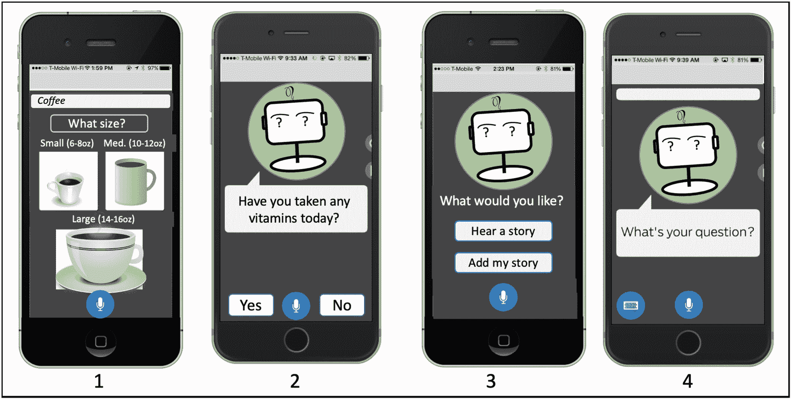

**图 7-10** 多模态消歧与选择。(1) 澄清尺寸，(2) 是/否问题，(3) 小菜单，(4) 开放式集合

#### 来自语音实战前线

菜单，如同列表，可以是静态的或动态的。某个银行系统有五个可能出现在选项菜单中的项目。并非所有项目在任何时候都与所有用户相关，而是取决于账户类型和日历月份。根据相同的变量，某些选项比其他选项更适用，因此银行希望用户按个性化的相关顺序听到选项。这适合采用动态实现。每个用户会听到包含两到五个选项且顺序不同的菜单。管理动态提示是一项巨大的工程。这值得付出努力吗？不清楚——我们没有这个系统与静态菜单的对比数据。但它确实有效，并且没有引起混淆或投诉。


### 在设备上测试以发现并解决问题

让我们回顾一下使用 Google Assistant 测试时会发生什么。说一句*预约下午 3 点*。哦不，出问题了！它问了一句*上午还是下午*？理解为何失败很重要，所以让我们逐步分析。如果你按照我们描述的操作，应该会收到*上午还是下午？*的回复。你可能会纳闷：*嘿，怎么回事？我明明说了下午，它不应该再问啊！* 让我们看看发生了什么。

在第 3 章中，我们解释了为什么不仅需要在控制台中测试，还需要在设备（如 Google Home）上测试。在设备上测试还能提供对话历史记录，方便你查看具体过程。借助对话历史，你可以调试对话中一些难以发现的问题。Dialogflow 提供了查看对话历史记录的便捷功能（图 7-11）。

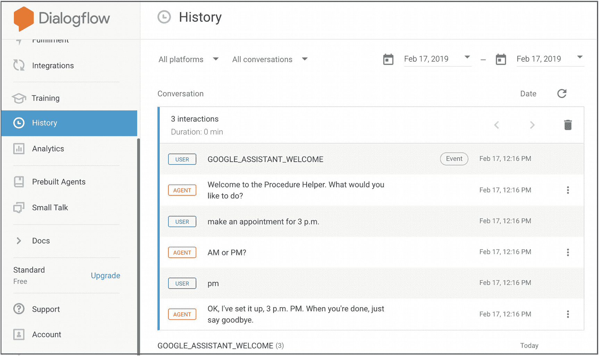

图 7-11

查看历史中的对话

让我们利用历史记录来调试上午/下午的问题：

1. 在 Dialogflow 左侧窗格中，点击“历史记录”。你会看到一系列对话列表（图 7-11）。
2. 找到并点击你测试“预约下午 3 点”的最后一次对话。对话历史会显示用户话语（USER）和系统回复（AGENT）。你会看到关于预约的陈述，以及用于消除歧义的上午/下午回复。

将历史记录中的用户话语与我们之前编写的内容进行对比：

- **文本**：“Make an appointment for 3 PM.”
- **Dialogflow 历史记录**：“make an appointment for 3 p.m.”

它们并不相同！一个是首字母大写的 M，另一个是小写 m。事实证明，这并不重要。还有什么不同？有“PM”和“p.m.”的区别；会是这个原因吗？如何找出问题？记住，“PM”是你定义的 `AMPM` 实体的一部分。如果将“p.m.”添加为 `PM` 实体的同义词，并对 `AM` 也做同样处理，会怎样？让我们仔细操作：第一个句点和字母 m 之间没有空格。你必须完全按照这个格式添加。完成后，实体应如图 7-12 所示。

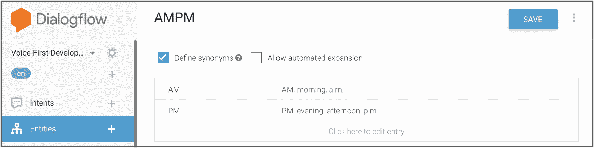

图 7-12

添加了“a.m.”和“p.m.”后的新 `AMPM` 实体——注意没有空格

再次测试（使用 Google Home）。它仍然在问“*上午还是下午？*”！另外，查看系统的最终回复：*好的，已设置，下午 3 点 PM。完成后请说再见。* 为什么它说了两次“PM”？是时候深入探究了。

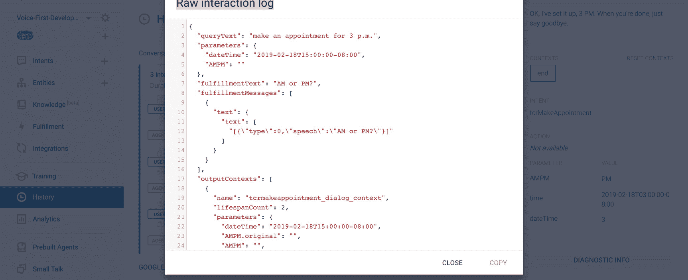

图 7-13

失败对话中“上午还是下午？”的原始交互日志

找到上次测试步骤的对话。在右侧 AGENT 回复“上午还是下午？”处，点击三个点并选择“原始交互日志”（图 7-13）。这里面包含大量信息。目前你关注的是 `queryText` 下的第一个“参数”部分。还记得你在 Dialogflow 意图中如何定义参数的吗（图 7-7）？这个原始交互日志告诉我们 Dialogflow 实际是如何设置这些参数的。随着你开始在 Dialogflow 之外编写更多代码并使用 fulfillment，这种详细程度将变得越来越重要：

- `dateTime` 被设置为字符串“2019-02-18T15:00:00-08:00”，这本质上是日期、时间和时区。时间是 15:00，即下午 3 点。有意思。
- `AMPM` 为空；它没有被填充任何内容！有意思。

实际情况是这样的。你原本想将 `dateTime` 设置为 3，将 `AMPM` 设置为 PM。但 Dialogflow 却将 `dateTime` 设置为（代表）下午 3 点的值，导致没有剩余内容来填充 `AMPM` 参数，因此 `AMPM` 留空了。我们先修复这个问题，然后分析原因以及需要注意的事项：

1. 在 `tcrMakeAppointment` 意图的“操作和参数”下，将 `dateTime` 参数的实体从 `@sys.date-time` 更改为 `@sys.number`。左键单击“实体”列中的 `@sys.date-time`，然后选择 `@sys.number`。
2. 现在查看训练短语。你会注意到所有数字 3 现在都使用了新的 `@sys.number` 实体。
3. 再次使用 Google Home 设备测试。*预约下午 3 点*。终于成功了！
4. 找到这次成功对话的交互日志。你会看到 `dateTime` 现在按预期设置为 3，`AMPM` 设置为 PM。修复结果体现在交互日志中（图 7-13）。

在测试应用时，请注意 `GOOGLE _ ASSISTANT _ WELCOME`。这是任何由 Google Home 设备触发的对话中的第一条用户话语。它本质上是一个虚假的用户陈述，意思是“我正在从 Google Home 开始对话”。随后会立即进入默认欢迎意图，即开场提示的来源。在 Dialogflow 控制台中测试时你不会看到 `GOOGLE _ ASSISTANT _ WELCOME`，但在使用 Actions on Google 或实际的 Google Home 设备测试时则会看到。


#### 两大教训

在区分早晨和傍晚的简单消歧过程中，你发现了两个重要问题。我们并非针对 Dialogflow 或其他任何工具——这本身就很复杂，这些问题普遍存在。我们深入探讨是因为希望你能理解，在不验证实现细节（此处指系统实体）的情况下依赖任何平台都存在隐患。通过更精确的控制，你可以避免这类问题——或者因为疏忽而陷入同样的困境。这很容易发生，我们都有过类似经历。

**教训 1**：了解 STT 黑箱内部。语音系统的语音转文本（STT）组件会将一串单词输入自然语言理解（NLU）模块（图 1-3）。到目前为止，我们一直将 STT 视为“黑箱”，不太关心其内部运作。大多数情况下，你无需了解。但在这里你发现，有时需要关注它。对于 `PM` 实体，你设置了同义词“PM”和“evening”，但没有设置“p.m.”，而 STT 返回的正是“p.m.”。并且它返回的是“3”而不是“three”。在大多数平台上，STT 返回的内容不受你控制。因此，只需了解它返回什么，并包含与之匹配的训练短语和实体同义词即可。如果你只在 Dialogflow 控制台中用文本测试，就不会发现这两个问题；只有在结合 STT 进行语音测试时，问题才会显现。

**教训 2**：了解系统实体黑箱内部。“3 p.m.”并未按预期设置参数。这个问题比 STT 问题更棘手一些。系统实体可以节省大量时间和精力。但有时它们会产生你需要留意的意外行为。具体来说，`@sys.date-time` 实体支持多种时间表达方式，包括“3”和“3 p.m.”。Dialogflow 可以根据 `@sys.date-time` 或 `AMPM` 实体设置 `dateTime` 和 `AMPM` 参数（图 7-14）。

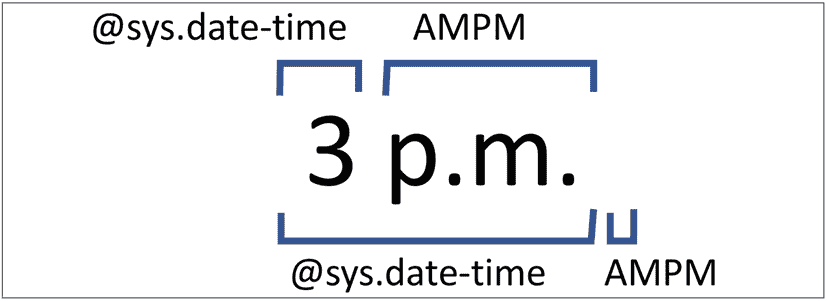

图 7-14

`@sys.date-time` 和 `AMPM` 实体解析“3 p.m.”的两种不同方式

Dialogflow 会选择哪种方案？我们无法确切说明。通过更多训练短语，它有可能选择你期望的上方方案，但在这里它选择了下方解析方案，即将 `dateTime` 设置为表示下午 3 点的字符串，而 `AMPM` 设置为空。由于 `AMPM` 被设置为空且它是一个必需参数，Dialogflow 不仅会询问上午或下午，还会在输出响应中同时包含时间中的 PM 和消歧产生的 AM/PM。

你是如何解决这个问题的？通过将 `dateTime` 实体切换为 `@sys.number`（它只理解“3”，不理解“3 p.m.”），短语“3 p.m.”只能通过 `@sys.number` 以一种方式映射（图 7-15）。


图 7-15

Dialogflow 使用 `@sys.number` 和 `AMPM` 解析“3 p.m.”的唯一方式

现在 `AMPM` 被设置了，在不需要消歧时它就不会进行消歧，并且响应中也不会出现多余的 PM。

为什么不直接使用 `@sys.date-time`？它能理解“3”和“3 p.m.”，并返回正确的 24 小时制时间。如果有人说*3 p.m.*，那么单独使用 `@sys.date-time` 确实没问题。但如果他们只说*3*或*3 a.m.*，`@sys.date-time` 实际上会返回相同的结果：一个单独的*3*。你无法知道用户是否说了*a.m.*，因此也就不知道是否需要消歧。

### Webhooks 1：迈向代码独立

在本章前面部分，你了解了动态列表。我们希望你在实现它们之前，先理解扎实的 VUI 交互背后的概念，因为这涉及从“纯”Dialogflow 转向使用 webhooks 以及大多数开发者认为的“代码”。从本书现在开始，你将看到更多在 Dialogflow 之外使用 webhooks 和代码的情况。在撰写本书时，你无法在 Dialogflow 内部实现某些设计，并且应用程序的某些方面使用外部代码更易于管理。但工具和软件会变化，我们希望你能尽可能保持平台无关性。

首先，动态列表——如果需要复习，请回顾该部分的对话。步骤 1 的目标是创建一个意图，用于呼叫联系人列表中的任何人，而不仅仅是某位特定的医生：

1.  创建一个新意图 `arCallByName`。^(⁵⁹)

2.  添加一些训练短语：“Call Brent Jones”和“Call Brent”。这允许通过全名和仅名字进行询问。

3.  在训练短语中，设置将使用的实体和参数。点击每个“Brent”，将实体设置为 `sys.given-name`。点击“Jones”，将实体设置为 `sys.last-name`。参数部分会自动填充。

4.  将响应设置为“OK, calling `$first-name $last-name` 。”请注意，`$last-name` 和句点之间需要有一个空格，否则 Dialogflow 会认为你在访问 `$last-name` 的一部分。

5.  现在进行一些新操作：在“履行”部分，选择第一个滑块，为此意图启用 Webhook 调用。这告诉 Dialogflow 使用你的 Web 服务来处理该意图。保存该意图。

你还没有完成。对于示例问题 *Which Brent*:…，你需要一个意图来消歧姓氏：

1.  创建一个新意图 `arCallByNameDisambigLastName`。

2.  添加示例短语“Jones”和“Brent Jones”。与 `arCallByName` 一样，将训练短语的实体设置为 `sys.given-name` 和 `sys.last-name`。

3.  添加上下文 `callbyname`——稍后你将在代码中设置它。

4.  添加与 `arCallByName` 相同的响应：“OK, calling `$given-name $last-name` 。”

5.  像对 `arCallByName` 所做的那样，启用 Webhook 履行。保存。


#### 实现与 Webhook

现在你已经有了意图，下一步就是 webhook 代码。当你为某个意图启用实现功能时，Dialogflow 会调用你指定的 Web 服务中的代码，并传递大量关于该意图的信息（触发了哪个意图、用户说了什么、填充了哪些参数、上下文是什么），以及 Dialogflow 将对该意图做出的响应（对用户的回复、输出上下文和参数）。发送到 Web 服务的这些信息就是 **webhook 请求**。

简化来说，各组件的交互方式如图 7-16 所示：

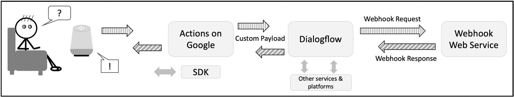

图 7-16 从系统角度看的 Dialogflow 架构

- **Google Home（或类似）设备**
- **Actions on Google**：用于为 Google Home 构建应用的平台
- **Dialogflow**：用于开发对话式交互的平台
- **Webhook Web 服务**：用于实现实现功能的 webhook 的 Web 服务
- 你也可以使用 Actions on Google SDK 来访问和编写 Actions on Google 的应用，但 Dialogflow 是最简单的入门方式，并且还提供了对 Skype、Twitter、Slack 等其他平台的额外集成。

你的 Web 服务中的代码会接收所有这些信息，并返回一个 webhook 响应：另一组信息，这些信息可能会修改 Dialogflow 原本仅基于意图所采取的行为。代码可以更改响应文本、输出上下文和参数，还可以触发一个事件，进而触发另一个意图。Web 服务返回 webhook 响应后，Dialogflow 会对其进行处理。你的 webhook（即 Web 服务代码）本质上是在对 Dialogflow 说：“按你原本的计划执行”、“播放意图中的提示”等等。或者它也可以说：“不，你需要换一种方式来做。” 在动态列表消歧中，你会看到这两种情况的示例。请求和响应都有特定的格式，稍后你将看到。

Google Cloud 及相关组件周围有大量的基础设施——这只是实现功能所涉及内容的一个缩影（图 7-17）。

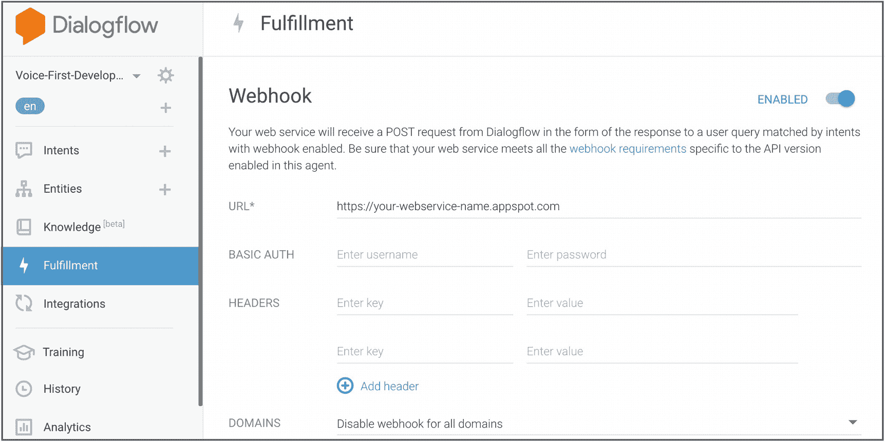

图 7-17 启用实现功能并指定 Web 服务的 URL

1. 如果你还没有，请获取一个 Google Cloud 账户。这与 Dialogflow 账户不同。[`https://cloud.google.com/`](https://cloud.google.com/) 是一个很好的资源。
2. 在 Google Cloud Console 中，创建一个项目。它会生成一个项目 ID，供以后使用。
3. 下载 Google Cloud SDK。[`https://cloud.google.com/sdk`](https://cloud.google.com/sdk) 是一个很好的资源。你将使用此 SDK 来设置、认证和部署代码。
4. 在 Google Cloud Console 中，启用 App Engine。然后，导航到 Compute ➤ App Engine ➤ Dashboard。
5. 启动你的 App Engine 应用程序。选择 Python 和标准环境；它们是默认选项。
6. 应该已经为 App Engine 创建了一个服务账户。在“名称”列中，找到“App Engine 默认服务账户”。在“操作”下，选择“创建密钥”。
7. 选择 JSON 格式 ➤ 创建。
8. 一个文件将下载到你的机器上；此文件的路径就是 `KEYFILE`。请妥善保管！
9. 在终端中，创建一个工作目录，导航到该目录，并使用你刚刚创建的 `KEYFILE` 激活服务账户：`gcloud auth activate-service-account –key-file=KEYFILE`。
10. 将项目设置为你创建 Google Cloud 账户时创建的项目。在 Google Cloud Console（你的项目主页）中，这就是项目 ID：`gcloud config set project PROJECTID`。
11. 将 `7-5b.zip` 文件下载并解压到你的工作目录中。你应该会看到以下文件：
    - `app.yaml`
    - `main.py`
    - `webhook_request.py`
    - `webhook_response.py`
    - `ar_call_by_name.py`
    - `ar_call_by_name_disambig_last_name.py`
    - `requirements.txt`
12. 启动你的 Web 服务：`gcloud app deploy`。
13. 稍等片刻后，你会看到大量类似于清单 7-1 的输出。找到 `target URL` 所在的行，并复制该 URL。

```
Services to deploy:
descriptor:        [/Users/.../app.yaml]
source:            [/Users/.../]
target project:    [voice-first-development] target service: [default]
target version:    [20190825t121121]
target url:        [https://voice-first-development.appspot.com]
Do you want to continue (Y/n)? y
清单 7-1
gcloud app deploy 的输出（路径已省略为“...”）
```

在 Dialogflow 中，选择“实现”。在“Webhook”下，启用 webhook。在“URL”处，粘贴你刚刚复制的 URL。保存。你的 Dialogflow 应用现在指向了你已在 Google Cloud App Engine 中部署的 Web 服务。

#### Webhook 概述

在深入 webhook 代码之前，我们先做一个概述。目前，先不要担心 `app.yaml` 和 `requirements.txt` 文件；只需关注其他 `.py` 文件：

| Brent Jones |
| Brent Adams |
| Brent Barnes |
| Brent Carletti |
| Joe Jones |
| Kim Smith |
| Mary Poppins |

1. 从 webhook 请求中提取信息，以便后续使用。这一步在单独的文件 `webhook_request.py` 中完成。
2. 接下来是实际的对话逻辑。你将使用这个姓名列表——稍后你会使用更真实的数据库：
   - 如果意图是 `arCallByName`：
     - 如果用户同时指定了名和姓（*Call Brent Jones*），则不需要消歧。这是“按原计划执行”的情况：webhook 不会修改 Dialogflow 原本要执行的操作。
     - 如果用户只指定了名（*Call Brent*），则检查是否需要消歧姓。
     - 然后更改响应，以提出“哪个 Brent……”的问题。
     - 添加输出上下文 `callbyname`。当你创建 `arCallByNameDisambigLastName` 时，你将其添加为输入上下文，并且可能曾疑惑过在哪里设置它。答案就在这里。
     - 向 `callbyname` 上下文添加一个参数 `context-given-name`。向上下文添加参数非常有用，你将会看到。
     - 如果不需要消歧（例如只有一个名字：*Call Mary*），则找到姓并以此作为响应。无需提问。记住，除非必要，否则不要消歧！
     - 如果列表中不包含该名字（*Call Donald*），则播放相应的响应。
   - 如果意图是 `arCallByNameDisambigLastName`：
     - 从之前的 `arCallByName` 意图中，通过 `callbyname` 上下文中设置的 `context-given-name` 参数获取名。用户可能以全名 *Brent Jones* 来回应“哪个 Brent……”的问题，而不仅仅是 *Jones*。你需要考虑到这两种情况。
     - 如果消歧中提供的姓是有效的，则播放“好的，正在呼叫……”的响应。操作完成。
     - 如果该姓不在列表中，则做出相应的响应。
   - 对于任何其他意图，只需返回 Dialogflow 原本要执行的操作；不要修改行为。
   - 你还没有完全完成。你需要在 webhook 响应中设置正确的参数，并将响应返回给 Dialogflow。否则，所有这些逻辑都是无用的。`webhook_response.py` 文件包含以正确格式创建响应的代码。


#### Webhook 深入解析

让我们更详细地了解 webhook。`main.py` 执行三项操作：

- 使用 `webhook_request.py` 中的代码，将 webhook 请求信息加载到 `df_request` 对象中。
- 根据被激活的 Dialogflow 意图来引导逻辑。每个意图函数接收 `df_request` 对象并修改 `df_response` 对象。
- 从 `df_response` 对象返回格式化后的 webhook 响应。

我们稍后会回到格式化 webhook 请求和响应的细节。现在，请专注于你在上一节中创建的两个新意图的逻辑。首先，清单 7-2 展示了 `arCallByName` 意图的逻辑。

```
def ar_call_by_name(df_request, df_response):
"""
按姓名呼叫。
"""
given_name = df_request.parameters.get('given-name')
last_name = df_request.parameters.get('last-name')
if (given_name and not given_name == '' and
last_name and not last_name == ''):
# 如果呼叫者同时指定了名字和姓氏（例如“呼叫 Brent Jones”），
# 我们不需要消歧，直接执行即可。这是“按原计划执行”的情况，
# webhook 不会修改 Dialogflow 原本要执行的操作。
df_response.output_text = df_request.fulfillment_text
elif (given_name and not given_name == ''):
# 这部分代码非常特定于我们设置的名字列表。
# 以后我们可以使其更通用，并接入数据库等。
# 如果呼叫者只指定了名字
if given_name == 'Brent':
# 如果需要消歧姓氏（例如“呼叫 Brent”）
# 将响应改为询问“哪个 Brent...”的问题。
df_response.output_text = \
'哪个 Brent：Jones、Adams、Barnes 还是 Carletti？'
# 添加输出上下文 callbyname。
# 还记得你创建 arCallByNameDisambigLastName 时，
# 将其添加为输入上下文，并且可能想知道在哪里设置它吗？就在这里。
new_context = {
'name': ('projects/${PROJECT_ID}/agent/sessions'
'/${SESSION_ID}/contexts/callbyname'),
'lifespanCount': 5,
'parameters': {}
}
# 完整的上下文名称很长；“callbyname”只是最后一部分。
# 向 callbyname 上下文添加一个参数 context-given-name。
# 你可以向上下文添加参数，稍后你会看到这有多有用。
new_context['parameters']['context-given-name'] = given_name
df_response.output_contexts.append(new_context)
else:
# 如果不需要消歧，只有一个名字（例如“呼叫 Mary”），
# 找到姓氏，并用该姓氏响应。无需询问。
# 记住，除非必要，否则不要消歧！
if given_name == 'Kim':
df_response.output_text = '好的，正在呼叫 Kim Smith。'
elif given_name == 'Mary':
df_response.output_text = '好的，正在呼叫 Mary Poppins。'
else:
# 如果没有那个名字（例如“呼叫 Donald”），
# 播放一条说明此情况的响应。
df_response.output_text = \
f"抱歉，您的列表中不存在 {given_name}。"
清单 7-2
arCallByName 意图的逻辑
```

其次，清单 7-3 展示了 `arCallByNameDisambigLastName` 意图的逻辑。

```
def ar_call_by_name_disambig_last_name(df_request, df_response):
"""
从之前的 arCallByName 意图中获取名字，该名字来自在 callbyname 上下文中
设置的 context-given-name 参数（我们说过这很有用）。呼叫者可能在
对“哪个 Brent...”的响应中说了名字，例如“Brent Jones”而不仅仅是“Jones”，
但你无法确定，所以需要去获取它。
"""
context_name = ''
given_name = None
last_name = df_request.parameters.get('last-name')
for context in df_request.input_contexts:
fullname = context.get('name')
parameters = context.get('parameters')
if parameters:
given_name = parameters.get('context-given-name')
if fullname:
# fullname 是一个非常长的字符串；我们只需要最后一部分，
# 即最后一个 / 之后的部分。
match = re.search('/([^/]*)$', fullname)
if (match and match.group(1) == 'callbyname') and given_name:
context_name = parameters.get('context-given-name')
if (last_name in ['Jones', 'Adams', 'Barnes', 'Carletti']):
# 如果在此消歧步骤中提供的姓氏有效，
# 则播放“好的，正在呼叫...”响应，然后完成。
df_response.output_text = f"好的，正在呼叫 {context_name} {last_name}。"
else:
# 如果姓氏无效，则说明情况
df_response.output_text = \
f"抱歉，{context_name} {last_name} 不在您的列表中。"
清单 7-3
arCallByNameDisambigLastName 意图的逻辑
```

清单 7-2 和 7-3 中的逻辑针对我们特定的示例姓名列表定制了许多分支。实际上，你可能会使用某种姓名数据库。熟悉数据库和 SQL 的人可能会想象一个类似 `select first_name, last_name, phone_number_type, phone_number from directory where` … 的查询，其中 `where` 子句的元素来自你已经收集到的信息，包括任何消歧结果。根据返回的结果，你将决定是否需要额外的消歧以及下一步该做什么。当你最终从数据库中只得到一条记录时，你会进行确认并可能拨打电话。

是时候测试了！尝试各种情况以验证它们是否都能正常工作：

- “呼叫 Brent Jones。”
- “呼叫 Mary Poppins。”
- “呼叫 Mary。”
- “呼叫 Brent”然后“Jones。”
- “呼叫 Brent”然后“Brent Jones。”
- “呼叫 Brent”然后“Smith。”

内联编辑器呢？为什么用 Python？当你启用 webhook 并为其提供 URL 时，你可能注意到了内联编辑器部分。它允许你为 webhook 指定代码，而无需经历你刚才经历的所有步骤。那么为什么不直接使用它呢？有几个原因。

首先，内联编辑器使用 Node.js，但我们的示例使用的是 Python，并且我们假设你也在用 Python 编写代码。这使得 Google App Engine 更合适。我们使用 Python，因为它是当今自然语言处理的首选语言，而这与你正在做的事情密切相关。此外，我们用于部署 Web 服务的 Google App Engine，目前对 Python 的支持比 Node.js 更完善。我们优先考虑让我们的 Python 代码示例对非专业人士易于阅读，而不是优化它们——毕竟，我们在这里是教你关于语音的知识，而不是 Python。☺

其次，使用内联编辑器之类的工具，你会遇到代码管理、扩展到多个意图和复杂交互等方面的限制。只要遵循规则，你可以使用任何现有基础设施来开发 webhook。当你的解决方案变得工业级时，你会需要这些工具和流程，那么为什么不现在就开始呢？


### 上下文、上下文参数与后续意图

你在第 6 章中为`tcrProcedurePrep`意图设置了上下文。此外还有**上下文参数**：即与特定上下文关联的参数。它们是意图之间进行通信的方式，用于传达“以防你需要知道，上一个意图中发生了这件事”。在联系人呼叫示例中，`arCallByName`期间说出的名字需要被保留，以便播放正确的响应。更多关于上下文的内容，请参见第 14 章。

你可以通过 Dialogflow 图形界面设置输出上下文，但需要借助 webhook 来设置参数。参数名称可以是任意内容，但必须小心：如果你给上下文参数起的名称与意图“参数”部分中的某个参数相同，可能会引发一些意外行为。当意图被处理时，参数会从所有活跃的输入上下文以及用户话语（例如槽位）中填充的任何参数中获取。

如果你通过上下文或后续意图来实现追问问题，如何判断该用哪一种？以下是一个指导原则：

- 如果下一个问题可能出现在多个意图之后，请使用上下文。否则，你将不得不多次重复短语和响应。当然，有时你确实需要一些重复，但暂时不必担心这个。可以将其视为已完成当前对话，并进入下一个对话。
- 如果下一个问题仅在当前意图之后或其范围内才有意义，并且该问题是“是/否”问题或像*下一步*这样的导航命令，请使用后续意图。它们已经包含了常见的训练短语，因此你无需担心上下文。可以将其视为尚未完成当前对话。

迟早，你需要自定义后续意图短语，以便更全面地控制与用户的对话方式，或为预构建版本中没有的同义词添加支持。你将在第 17 章中深入学习调优。目前，在上下文和后续意图之间选择有点像抛硬币，但后续意图可以让你更快上手。

### 下一步

我们用一个重要的占位符来暂时结束对话完成这个话题。你可能已经注意到，我们并未讨论在流程的哪个环节与后端进行联系。如果你的用户要进行餐厅预订，你何时确定哪些时段可用，这又如何影响对话？如果用户要求*预订 Na Na’s 餐厅下午 5 点的位子*，但 Na Na’s 餐厅下午 6 点才开门，或者晚上 8 点前都没有空桌，你是否应该先询问用餐人数，然后才回复*抱歉，这个时段不可用*？很可能不应该。你将在接下来的第 8 章中了解更多关于此内容以及 webhook 的其他用途。

### 总结

- 工具并不能保护你免于遗漏或误解用户话语中的细节，这些细节可能导致意想不到的不良后果。
- 用户只会精确到他们认为必要的程度。这意味着你的 VUI 通常需要请求澄清。VUI 完成请求所需的信息越多，你需要的对话轮次就越多。
- 用户可以通过他们措辞请求的方式，间接提供关于他们想要什么的线索。这些线索帮助你通过“填补空白”而非提问来满足请求。
- 用户会倾听你的 VUI 如何提问。你可能认为你的 VUI 精确且清晰，但你的用户可能不这么认为。为任务实施正确的消歧方法能显著提高用户成功率。
- 当你使用对话管理器方法时，你的用户可以更加灵活，并以更符合其心智模型的方式提出请求。
- 调试时，请务必在 VUI 最终将运行的设备上进行测试。
- 使用手头的工具（如历史记录和原始交互日志）来了解应用程序中真正发生了什么。
- 有时，语音转文字可能是一个你无需担心的黑盒；但有时，你需要了解它。
- 使用系统实体时要小心。有时，它们会带来意想不到的结果。

脚注 1 2 3

