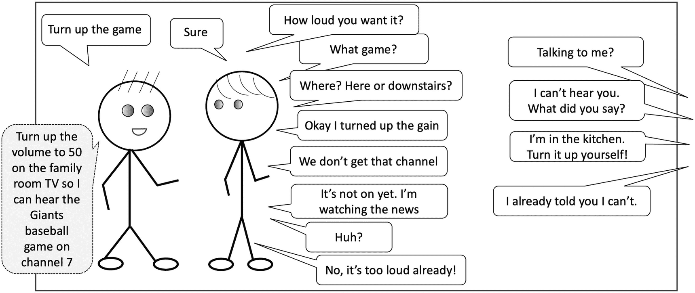
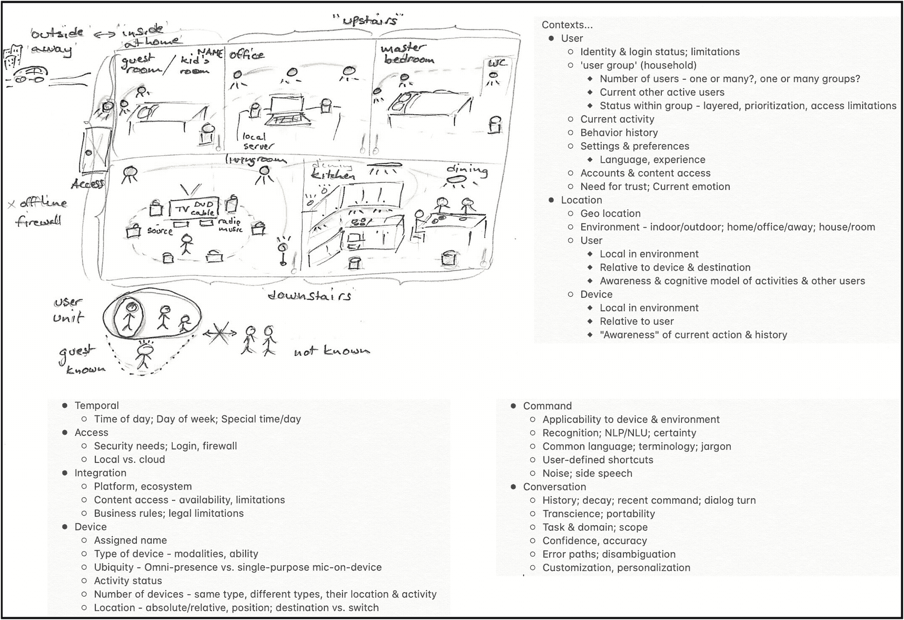
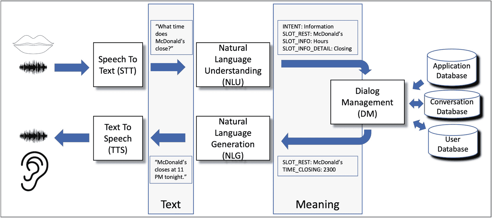
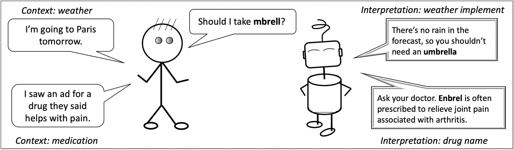
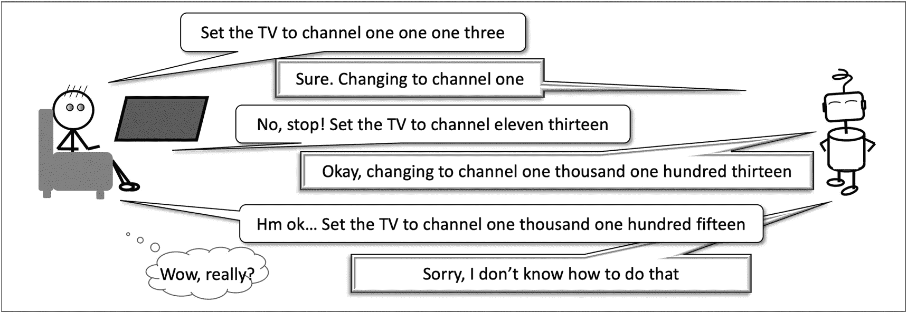
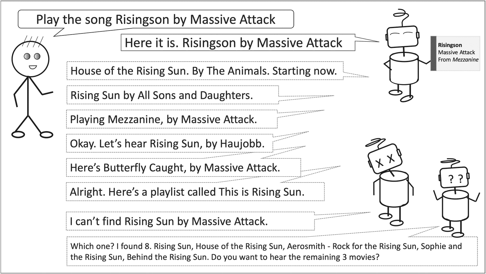

# 14. 利用上下文和数据创建更智能的对话

上下文指的是影响对语句和对话进行准确解释的所有知识、感知、语言和环境。要理解上下文，请思考一个你向他人提出的简单请求——比如“打开楼上的窗户”、“调低音量”或“我们什么时候需要出发？” 你在说这句话时做了哪些假设？你的措辞如何根据你与谁交谈、他们当前的位置以及你自己的位置、他们对你和话题的了解程度、附近还有谁、他们在做什么以及你周围正在发生什么而变化？根据你所做的假设，回答可能会有什么不同？

上下文的重要性足以单独用一章来讨论。我们将涵盖为短期和长期上下文进行设计、如何利用主动数据和领域知识来改善用户体验，以及如何处理动态数据。在大部分讨论中，当我们指代人类交流中基于情境和细节来解释含义的一般概念时，我们会使用“上下文”。当我们向你展示如何在 Dialogflow 中将上下文实现为字符串时，从上下文来看——会很清楚！——我们指的是平台特定的细节。

### 为何没有上下文就无法对话

请看图 14-1。通过要求“调高游戏音量”，说话者假设了双方共享大量上下文。一位听者距离足够近，能看到和听到说话者所见所闻；另一位则在另一个房间。这里的所有回应，都是听者解读的结果，以及说话者对共享知识（什么运动、什么队伍、在哪里、调高多少）、信息准确性（何时播放、哪个频道）、听者距离（听者还在做什么、能否满足请求、甚至是否知道在对自己说话）、先前对话（请求是否已提出多次）、歧义、帮助意愿和能力等方面的假设。此外，还存在误认和误解。如果任何假设不正确，听者的回应就会体现出来，而说话者则会根据新的上下文做出回应。这对人来说轻而易举，但对语音系统而言绝非易事。



图 14-1
多种上下文属性和维度相互作用，导致说话者和听者做出各种假设

上下文在 VUI 对话和人类对话中都至关重要。每一轮对话，都是基于了解（或不了解）用户的即时环境和位置、过往经历、喜好、时间与日期，以及世界上可能或不可能发生的事情，来创建和完善共享理解。人们通常不会用完全明确单一的语句进行交流——就像图 14-1 中灰色气泡里显示的那种语句——也不会提出令人印象深刻的“一次性”完全明确的 VUI 请求：“找一部我今晚可以在线免费观看、由威尔·史密斯主演、且不超过 5 年的电影”。你需要同时处理明确表述的请求以及模糊或不完整的请求；在某些上下文中，用户会非常精确地提出要求，比如下注或下达股票期权订单的高级用户。但大多数自然对话都是你来我往，每个人都在提问、解释、澄清、缩小范围、核实理解——更不用说还有犹豫、不完整的短语和话题跳跃。每一步都建立在前几轮对话的基础上，完善和改变整体上下文，直接影响下一个回应和对话轮次。如果你的 VUI 在麦克风停止收听后就“忘记”了请求的上下文，它就无法处理对话式交互。VUI 需要上下文感知能力才能做出合理的回应；人们期望能够基于前几轮对话中的信息来优化搜索，只在必要时被要求澄清，并且当相关上下文已经建立时不必浪费时间。

对话上下文是复杂的；它涵盖多个维度——基本上任何影响某人说什么、怎么说以及他们做出何种假设的因素都包含在内。有些上下文，比如一天中的时间，很容易量化并应用于对话。其他上下文，比如用户的心境，则不那么容易。请查看表 14-1 中的上下文示例。

表 14-1 常见上下文类型示例

| 上下文类型 | 示例 |
| :--- | :--- |
| 领域与主题 | 医疗、餐饮、娱乐 |
| 任务 | 信息查询、播放音乐、预约、打电话、订购、获取说明 |
| 用户身份 | 已识别、未识别；已知用户数量；儿童/成人 |
| 时间（时钟与日历）时区 | 绝对时间：凌晨 2 点、“1 月 4 日”、“2021 年”；每周日、工作日相对时间：“明天”、“在我预约之前”、“上次”。用户空闲时间、日历事件 |
| 位置（环境） | 地理位置：布里斯班、伦敦、加拿大环境：室内、在家、在厨房、靠近 VUI |
| 设备 | 单个设备、多个连接设备、有屏幕、可穿戴、固定式、物理专用或内置 |
| 对话历史 | 代词指代（“他们”什么时候开门？）、第一个、返回、重复那个。识别置信度自用户上次说话以来的时间 |
| 过往交互 | 过往预约历史 |
| 个性化设置 | 语言、音量、用户专业水平、音乐偏好 |
| 设备活动 | 设备空闲/关闭/播放其他音频；回应的紧迫性 |
| 用户心境与活动 | 分心、手忙、眼忙、驾驶、心烦、紧张 |
| 安全与法规 | 法律、商业、有限数据访问 |

这看起来像是一座难以逾越的大山。我们理解。请记住：我们指出了当今语音实现可以改进的许多领域，而上下文就是其中之一。这并不意味着你需要在产品发布前设计、实现并测试所有可能适用于你 VUI 的上下文。我们只是想让你意识到上下文的重要性，以及融入上下文能让你实现什么。你要做的是，找出对你的特定 VUI 任务和用户来说哪些上下文是重要的，然后从最重要的一两个开始。例如，对于手术准备助手来说，最重要的上下文是相对时间，这样用户就可以问“我今天能吃 __ 吗？”。如果你的 VUI 允许用户在不同房间的扬声器上播放音乐，那么最相关的上下文就是扬声器上的当前活动（开/关/空闲/播放）和扬声器位置（“在厨房”播放 __ 或“在这里”播放 __）。

#### 来自语音实战一线

安在她厨房吧台下安装了声控灯。当她让家里的一个语音助手“打开吧台灯”时，VUI 的回应竟然是像狗一样叫！一阵恼火之后，她急切地录下了这次交互，作为事情不该如此运作的绝佳反面教材。这里的问题在于，在将话语与意图匹配时，撞上了语音相似性（“bark” 与 “bar counter”），同时错误地优先处理了上下文（架构倾向于优先使用一个从未用过的、会汪汪叫的技能，而不是用户为其本地设备命名的名称）。

你的 VUI 的回应应该是所有已实现的相关上下文共同作用的结果——而且你通常需要综合评估它们！例如，如果你的 VUI 询问日历日期，用户的回应会因任务而异：人们通常像信用卡上写的那样说有效期（“1 0 2 4” 或 “ten twenty-four”），但其他人会将其转换为“十月（二十）二十四”。但如果 VUI 收集工作经历，你可以预期开始或结束日期的回应会包含月份名称，而不是数字。

当存在多种可能的回应时，需要适当分层并优先考虑上下文，同时考虑相关性。在这个例子中，用户命名的设备“吧台灯”应该优先于会汪汪叫且用户从未使用过的东西。而且，不，限制用户给灯取什么名字从来都不是正确的解决方案，前提是这个名字是一个可发音的单词。

#### 成功提示 14.1 为每种上下文量身定制回应

这是核心的 VUI 最佳实践。如果 VUI 能够很好地响应跨对话的不同语境，并理解用户话语中的语境假设，人们就会认为这些对话有趣、智能且成功。你的设计和实现应专注于融入这种变化。诚然，更量身定制的响应需要更多努力。但在产品首次发布前，你无需加入太多内容。即使只添加一个恰当的语境，也能让你的 VUI 显得更智能，用户会注意到这一点。从简单开始，然后迭代。

这种复杂性体现在任何定义良好的详细 VUI 对话设计规范中。事实上，这也是我们处理过的许多规范采用表格或电子表格格式的核心原因。当涉及多个维度时，这是最高效且最易读的格式，并且它反映了复杂设计中的对话管理器方面。读完本章后，你就会明白原因。

图 14-2 让你大致了解语境可能变得多么复杂——以及为什么你只选择一两个来开始。这幅图来自一次非正式讨论，内容是关于影响用户与家中联网设备（灯、音箱、屏幕、恒温器、锁等）进行对话的语境。我们一直画到纸上没地方了才停下来！



图 14-2
说明影响用户与家中各种设备交互行为的语境复杂性示意图

##### 动手实践：语境复杂性思维实验

为了理解语境如何相互作用以提供良好的用户体验，任何从事语音技术的人都应该尝试这个练习：为家庭创建语音定时器。

假设你的家中有多个房间，每个房间都有多个属于同一生态系统且可能互联的 VUI 助手设备。你与他人同住，可能是室友，也可能是家人。你将如何设计一个定时器语音应用，以便为家中的所有成员提供最大的灵活性和便利性？思考用例、语境和影响。以下是一个起点：

交互流程：定时器的数量是否应该有限制？如果有，限制是多少？用户是否希望听到所有当前定时器的列表？如果是，你如何以简洁而有意义的方式呈现这个列表？何时以及如何需要消除歧义？何时以及如何提供重试和帮助？哪种类型的重试是合适的？用户如何知道时间已正确设置？用户如何更改、增加或取消定时器？在对话的不同部分，哪种类型的帮助是有用的？教程有用吗？或者示例呢？如果停电了，定时器应该如何处理？

用户位置：行为是否取决于用户设置定时器时所在的房间？如果用户在房间之间移动（假设每个房间都有 VUI 访问权限），比如在一个房间启动定时器，在另一个房间查询或结束它，应该发生什么？如果你离开家，用户能否——以及是否应该能够——通过移动设备或汽车与定时器交互？

### 数据访问

要利用上下文，你需要及时获取相关且准确的数据。你已经看到过一些示例，其中数据被用来为智能对话设置正确的上下文：获取营业时间和预订可用性、访问联系人列表以拨打电话、请求从特定音乐提供商播放某首歌曲、在音乐播放时调节音量、订购剩余续药、询问与手术时间相关的饮食限制、缩小餐厅搜索范围等等。

你需要具备从多个来源读取数据、捕获数据、追踪对话中收集信息所导致的变化，甚至对更持久的用户设置和账户进行更新的能力。你还需要决定何时停止追踪每条信息、将这些信息保留多久以供后续对话使用，以及当不同信息相互影响时该如何处理。

VUI（语音用户界面）对话受到来自两个来源的数据影响：用户（通过话语或回应）和 VUI（基于查询、置信度和可用性）。一旦用户数据被捕获并解释，你的集成系统会将其转化为可在一定时间内访问的信息，直到它对当前或未来的对话不再相关，此时你可以将其释放。不同信息在上下文持久性和相关性上有所区别：

*   **静态**：不变的信息。并非它永远不会改变，只是在对话过程中不会改变。例如当前分配的设备名称（`吧台灯`）或餐厅地址。

*   **动态**：在对话过程中因收集到更多信息而被填充或改变的信息。例如餐厅预订的时间、账单支付的金额以及处方的剩余续药次数。

*   **相对**：相对于对话外部上下文（如当前时间和日期、设备状态、当前播放的歌曲，或用户状况与环境的变化）而改变的信息。例如，随着用户接近手术日期而改变的饮食建议。

*   **短暂**：在活跃对话中，从一个对话轮次“记住”到下一个轮次的信息。这可能是最棘手的方面，因为它与人们的思考和交谈方式有关。如果用户要求重复，用户上一个话语的意图以及他们得到的 VUI 回应是相关的，但仅持续几秒钟。对话中的重试次数、哪些槽位被填充以及填充的值、甚至填充的顺序，都会影响对话流程，但仅在达成对话目标前的短时间内有效。这些数据要么临时保存在你的 VUI 中，要么通过某些外部服务被更持久地拥有和更新。

#### 外部账户与服务

通用上下文（如一天中的时间）和对话上下文（如用户行为和识别结果）已经足够棘手，难以正确处理，但至少它们是本地的且可访问的。有时你需要设置依赖于从外部账户或服务（如娱乐内容提供商、药品名称数据库、营业时间和酒店房间可用性）访问数据的上下文。这完全是另一个层面的复杂问题——不仅因为技术问题，还因为业务规则和法律访问限制。

想象一下，你在飞机上要一杯`健怡百事可乐`，但航空公司与可口可乐有协议，所以你得到的是零度可乐。或者反过来——我们并非偏袒任何一方。如果你是无糖可乐的爱好者，你知道它们的味道不同。如果你喜欢其中一种而不喜欢另一种，你会不高兴。你希望提前知道这一点，以便调整预期或选择其他饮料。语音解决方案的履约也是如此。

假设你的 VUI 支持音乐搜索。用户请求`播放莱昂纳德·科恩的《哈利路亚》`。你可以用身边的任何智能音箱亲自试试。在识别出所说内容后，VUI 必须做出一些选择：

1.  我被要求播放的这东西是什么？
    1.  是一首歌？一张专辑？还是一整部音乐剧？有确定的版本吗？科恩是表演者还是创作者，或者两者都是？
2.  我从哪里获取它？
    1.  用户关联了哪些音乐服务？也许它在本地服务器上可用？是否有默认来源——如果那里没有怎么办？
3.  如果我找到多个匹配项，如何选择？
    1.  我应该播放哪一个？质量最高的？最新的？录音室版还是现场版？翻唱版本可以吗？到底什么是“最接近的匹配”？播放歌曲更重要还是播放艺术家更重要？
    2.  是否有业务规则来优先选择某个匹配项？基于地理位置的访问内容法规呢？用户从一个提供商那里能播放的歌曲数量有限制吗？
4.  选好了！我准备播放了……但在哪里播放？
    1.  有多少台设备？有默认设备吗？它开着吗？它现在正在播放其他内容吗？用户附近有什么设备？

这些不仅仅是假设性的脑筋急转弯或只有一个正确答案的技术问题。事实上，在这些情况下，技术很少是限制因素。业务目标、数据所有权、平台交叉功能和法律法规都创造了你需要处理的上下文；它们可能会限制你完全按照用户期望的方式满足其请求的能力。这里上下文的意义在于，无需用户指定每一个细节，就能提供他们想要的东西。为了简单起见，为所有搜索条件设定默认值。将目录最大的音乐提供商设为默认音乐来源。将当前活动的音频播放器设为默认设备；如果所有设备都空闲，并且用户正在与之对话的设备可以播放音乐，那么就在那里播放。对于选择具体内容，也应用默认规则，这样用户就不必总是指定`播放`*艺术家*的*歌曲*。你的默认值还会解释请求中任何名称的媒体类型：优先选择歌曲而非专辑或播放列表。如果你有用户过去播放过的歌曲历史，则返回相同的版本。否则，播放被请求频率最高的版本。当你这样分解时，问题就变得相当可控，并为你提供了一套规则集，以后可以用更详细的默认值进行扩展：优先选择原唱而非翻唱版本，优先选择录音室版而非现场版，等等。你的默认值让用户无需长篇大论就能听到他们的音乐。请记住，这些只是默认值：如果用户指定了媒体类型（`专辑`、`现场版`）或来源（`我的本地服务器`）或目的地（`在我的办公室`），你将使用这些信息来执行搜索。以上是从系统视角看待的外部数据。

# 第 14 章 数据库与上下文

在第 1 章中，你了解了语音系统的一般架构（图 14-3）。回想一下对话管理（`DM`）组件及其连接的三个数据源：包含用于回答查询的有用信息的应用程序数据库、跟踪`VUI`中发生情况的对话数据库，以及与个性化行为相关的用户数据库。这三个数据库都参与决定了你的`VUI`如何响应的上下文。



**图 14-3** 通用语音优先系统

与应用程序和用户数据库的交互可能是部署工作中最具挑战性的部分之一，因为你无法控制其细节。这是一个很大的话题，我们在这里没有足够的篇幅全面展开，但我们将就这三个方面讨论几个要点。

## 数据库的总体评论

首先，是一些高层次的评论。当我们谈论“数据库”（图 14-3 及其他地方）时，我们不一定指的是开发者熟悉的正式数据库，如`MySQL`、`Elasticsearch`或云服务提供商的产品。它可能是一个“概念性”数据库，因为我们存储的是关于对话或用户的信息，而不一定是严格意义上的“数据库”。或者，你可能从一个为此目的专门开发的定制`API`（常见于应用程序数据库）获取信息。你将在当前和后续章节中看到不少这样的例子。关键是，我们在图 14-3 中是在一般意义上使用“数据库”一词，正如你将在下面通过几个你已经如何存储对话信息的例子中看到的那样。

## 对话数据库

首先，对话数据库通常是最容易管理的，因为你通常通过定义和构建`VUI`交互来对其拥有最大的控制权。在`Dialogflow`的上下文中，已经存在一些有限的“对话数据库”功能；例如，回想一下必需参数的概念，以及如果用户尚未指定它们，应用程序将如何询问它们。这是跨对话历史的“简易版对话数据库”的开端。一个更完整的对话数据库会存储用户的详细对话历史，例如在之前的对话中询问过哪些餐厅。这样，你不仅可以避免再次提出相同的建议，还可以改进未来的建议，并进行更智能的引用，比如“最后一个地方”。为此，你需要一个实际的数据库；这将超出`Dialogflow`简单的上下文传递能力。除了跨对话上下文，对话内上下文是你自己处理的事情；你很快就会看到更多这方面的例子。

## 应用程序数据库

其次，应用程序数据库包含回答查询所需的信息，例如营业时间、产品可用性、预订状态等。其中一些最大的挑战如下：

- 你需要的信息可能已经存在于某个数据存储中，所以你会想“太好了，我少干活了！”。是的，但是有许多这样的数据库、系统和协议用于保存、访问、列出和删除这些信息；将你的`VUI`与这些源连接起来本身就是一个项目。除非数据已经面向语音应用，否则它不会涵盖你需要的发音和其他格式。

- 你需要的所有信息可能不在一个地方。例如，营业时间和预订信息在不同的地方。在某些项目中，组织中的某个人提供一个单一的应用程序编程接口（`API`）来访问任何所需信息，完成与这些不同数据源集成的繁重工作。但并非总是如此！

- 这些数据通常由构建语音系统的组织之外的另一个组织“持有”。你可能会像我们一样想“好吧，不都是同一家公司吗？”，结果却发现出现了组织政治问题。如果数据来自外部来源，情况就会更加复杂。

## 用户数据库与挑战

第三，对于用户数据库，你面临以下挑战：

- **账户访问：** 你如何识别和验证用户？对于 Google 应用或操作，或 Alexa 技能，你可以使用现有的 Google 或 Amazon 账户；否则，你可能需要一个全新的、独立的、你必须用这个数据存储来管理的基础设施。在许多方面，这既是一个`VUI`问题，也是一个存储问题。

- **重大的隐私问题：** 用户对于被监控以及他们的个人信息存在于某个组织的系统中非常敏感——考虑到他们经常听到的数据泄露事件，这是理所当然的。

- **依赖于位置的法规：** 组织可能有特定的隐私政策，并且可能存在国际法规，例如欧洲的`GDPR`，这会影响你的`VUI`。

- **依赖于领域的法规：** 在保持数据安全方面有重要的法规，违反规定会受到严厉处罚。在美国医疗保健领域，`HIPAA`法规限制了个人健康信息（`PHI`）的存储和访问方式。

## 你已经在使用上下文

好消息是，随着你阅读本书的进展，你一直在为你的`VUI`逐步添加越来越多的上下文。以下是一些例子：

- 你一直在为意图添加多个响应。`Dialogflow`会随机选择一个，但不会选择上次被选中的那个。这是一种上下文形式：知道上一个响应是什么，并且不选择它。

- 在第 6 章中，你使用`Dialogflow`的必需参数功能实现了一个预约对话，该功能会自动询问缺失的信息。这是上下文：知道用户提供了哪些信息，以及还需要什么。

- 同样在第 6 章中，你实现了一个程序准备对话，引导用户完成一系列步骤来完成一项任务。这里的上下文是知道用户在对话流程中的位置，并给出相应的下一步响应。

- 第 7 章处理了不完整请求和消歧。在这里，上下文包括跟踪信息：需要什么、缺少什么以及已经指定了什么。

- 第 9 章全部关于通用功能，正如我们提到的，这些功能本质上是依赖于上下文的；响应取决于最近的意图。你构建了这种跟踪，并添加了更多上下文来处理连续出现多个通用功能的情况。

- 在第 12 章中，你实现了一步纠正，允许说“不，是 1984 年”。那里的上下文是出生日期收集。

- 在第 13 章中，你实现了升级提示和最大错误次数，这两者都需要了解用户经历了多少次错误的上下文知识。

所以，你看，即使没有正式存储在数据库中，你已经在使用相当多的上下文了。

## 持久化追踪

来自语音前线

最近在安家中发生的一次互动，展示了不正确的持久化处理：

```
**安** *我的通知是什么？*

**IVA** *您有一条通知……* <配送信息>

**安** *重复一遍。*

**IVA** *您没有新通知。*

**安** *{不宜刊印的回应}*
```

持久化是将对话轮次串联成连贯对话、而非孤立短语的关键。它是信息在对话内部及跨对话间的粘性。良好实现的持久化能支持更接近人类的混合主动式对话，让用户能在当前对话乃至后续对话中构建和完善请求。在人类认知中，短期记忆和工作记忆支撑着当前对话中与聆听、理解修正、问答环节相关的活跃临时语境。长期记忆则负责追踪和存储姓名、偏好或账号号码等信息——这些信息能被记住，无需明确提及即可带入对话。而短期记忆和工作记忆正是大多数语音用户界面复杂性的根源。

简单的聆听方式是让麦克风保持开启固定秒数。简单的对话内持久化方式是持续聆听并保留信息，直到所有必要槽位被填满，或用户停止回应、说出*谢谢*。此时，你更新后端数据并清除槽位值和意图，因为认为对话已结束。这是个起点，但对自然对话而言远远不够。

持久化之所以棘手，在于它并非等待固定秒数那么简单。它不仅关乎聆听时长，更关乎语境如何影响你记住什么、记多久。人类不会永远逐字记住每段对话；你的语音用户界面也不该如此。它也不应在停止聆听的瞬间遗忘一切。唉，这比那要更灵活一些。

更好的短期记忆和工作记忆处理方式是使用记忆衰减机制，同时结合用户最近的请求或回应细节、任何重试、语音用户界面的回应、执行结果、用户位置等信息——就像人类所做的那样。如果我在你给出信息后 2 秒说*重复一遍*，我期望你再次告知相同信息。但若我 30 秒后回来说*重复一遍*，我预期你会回应*重复什么？*，因为对话已自然结束，你很可能已转而思考其他事情。如果我曾要求*播放莱昂纳德·科恩的《哈利路亚》*，歌曲结束后 2 分钟我说*再放一遍那首歌*，我期望你能记住——前提是此期间没有其他类似对话或行为发生，且之后没有播放其他歌曲。任何中间事件都会改变语境。如果我当时在厨房，最初要求是在客厅播放，我可能预期仍在同一位置播放，除非我说*在厨房再放一遍那首歌*——因为作为懒惰的人类，我会期望信息持久化，只需指定变化的部分。持久化影响着解读的范围。

如你在图 14-2 中所见，语境包含时间、地点、通信类型与历史、在场或缺席人员等多个维度。更通用的语境（如当前地理位置和日期）持久性更长，不会随对话切换而改变——除非经过相当长的时间，或者我们都身处某个拥有即时传送虫洞的科幻故事中。更具体的语境（如请求中的槽位内容）变化更快，因此记忆衰减时间应更短。

## 语境感知与语境依赖型对话

你的语音用户界面对话只有在融入语境时才能大放异彩。这看似微妙——也确实如此——但对交织语境中的细微差别做出不同回应，能让你的语音用户界面更接近自然与智能。有了语境，语音用户界面的回应可以更精准、信息更丰富。让我们深入探讨一些利用语境能实现的酷炫功能、为何需要它们，以及它们如何影响对话流程。正确融入不同语境后，你可以构建如下对话：

```
* **用户** *能告诉我巨人队下一场比赛是什么时候吗？*

* **VUI** *当然。旧金山巨人队明天晚上 7 点对阵道奇队。*

* **用户** *那场比赛在哪里？*

* **VUI** *那场比赛将在道奇体育场举行。*

* **用户** *巨人队这周有主场比赛吗？*

* **VUI** *没有，他们的下一场主场比赛是 9 月 9 日周一对阵红人队。*
```

这段对话运用了多种语境：指代（*那*、*他们的*）、日期时间、领域知识以及地理位置（“巨人队”也是一支美式足球队，但目前正值棒球赛季，且我们两位作者都在旧金山）。让我们进一步了解如何利用语境。

在大多数对话中，人们不会随机跳跃话题，尤其是针对语音用户界面的对话。事实上，当对话尚未完成时，人们在下一轮对话中的回应方式在很大程度上是可预测的——如果对话似乎转向不同方向，通常是由于需要澄清或消除歧义。这一点很重要，因为自动语音识别和自然语言处理依赖于此，并在对话管理器中加以利用。利用可预测性，语音用户界面可以更倾向于选择更可能的语句解读。你在第 10 章和第 11 章中学习了语境语法，在第 17 章中还将学到更多。

## 上下文感知对话的代码

上下文感知的一个典型例子是：当用户连续两次提出相同请求时，系统给出不同的响应。这并非简单的随机化，而是有充分理由的：当语音用户界面（VUI）在极短的时间窗口内两次听到相同的请求时，这通常意味着它第一次没有正确理解用户。我们将再次使用 `dialer` 这个名称。^(⁹⁵) 你会注意到本节中的代码与第 12 章中的跳过列表实现非常相似。这是有意为之，以便让你更容易理解；只是这次的重点略有不同。隐式确认会告知用户其意图是否被正确理解。显然，你需要避免再次给出相同的错误答案，并且需要使用不同的话语标记来确认这一点：

*   **用户**    呼叫 Brent Jones。

*   **VUI**    正在呼叫 Brenda Jones。

*   **用户**    停止！呼叫 Brent Jones。

*   ~~~ VUI-1:  再次给出相同的错误响应 ~~~

*   ~~~ **VUI**     正在呼叫 Brenda Jones。☹

*   ~~~ VUI-2:  进行解释，但不执行呼叫 ~~~

*   ~~~ **VUI**    我找不到叫这个名字的人。 

当你收到姓名拨号意图时，请检查在极短的时间窗口内（目前可尝试 30 秒；实际应用可能会使用更短的时间窗口）是否已经收到过包含相同姓名的相同意图。如果是，那么我们就播放一条不同的隐式确认提示。从编码角度来看，你需要进行三项更改：

1.  在意图上下文中保存名字和姓氏。

2.  查找最近的姓名意图并存储该姓名。

3.  利用最近的姓名来提供替代行为。

让我们详细地逐步了解这些步骤：

### 步骤 1：

首先，在姓名拨号意图中，将名字和姓氏保存到你于第 13 章创建的意图上下文中（这将会再次派上用场！）。请记住，该意图上下文的名称中包含时间戳，因此你可以判断它是否是最近的。相关代码清单见清单 14-1。

在新的 `context.py` 中，为 `new_context()` 添加一个新的 `params` 参数，其默认值为 `None`（A）。如果新的 `params` 参数不为 `None`，则将参数添加到新的上下文中（B）。在 `webhook_response.py` 中，将意图上下文的参数初始化为一个空字典（C）。在 `main.py` 中，传入意图参数（D）。如果是姓名拨号意图，则设置名字（如果有）（E）和姓氏（如果有）（F）。我们在上下文中使用 `given_name2` 和 `last_name2` 作为参数名的原因是，Dialogflow 会从上一次话语的槽位中填充 `given_name` 和 `last_name`——这样命名是为了确保不会产生混淆。

```
# 在 new_context.py 中：
# 添加一个参数 params；将 params 添加到上下文中
def new_context(name, params=None):   #A
# ...... 为聚焦清单而省略的代码 ......
# 如果有 params，则添加它们
if params is not None:
    for key in params:
        context['parameters'][key] = params[key]   #B
return context
######
# 在 webhook_response.py 中：初始化 params
class WebhookResponse():
    # ...... 为聚焦清单而省略的代码 ......
    def __init__(self):
        # 意图上下文中的参数
        self.intent_params = {}   #C
######
# 在 main.py 中：将 params 添加到新的上下文
def main():
    # ...... 为聚焦清单而省略的代码 ......
    output_intent_name = df_request.intent_display_name.lower().replace(' ','_')
    df_response.output_contexts.append(
        new_context(f"intent_{output_intent_name}",
                    params=df_response.intent_params))  #D
######
# 在 ar_call_by_name.py 中：
# 根据输入参数设置意图参数
def ar_call_by_name(df_request, df_response):
    # ...... 为聚焦清单而省略的代码 ......
    given_name = df_request.parameters.get('given-name')
    last_name = df_request.parameters.get('last-name')
    # 在意图上下文中将名字和姓氏设置为参数
    if given_name and not given_name == '':
        df_response.intent_params['given-name2'] = given_name  #E
    if last_name and not last_name == '':
        df_response.intent_params['last-name2'] = last_name  #F
```

清单 14-1
向意图上下文添加参数

### 步骤 2：

在遍历请求的上下文时，找到一个最近的姓名拨号上下文，并检索其中的名字和姓氏。清单 14-2 展示了如何搜索最近的姓名意图：在 `webhook_request.py` 中初始化变量。将重复窗口设置为 15 秒。这是你向后查找相同意图的时间范围（A）。设置最近一次姓名意图的时间（B）。设置最近一次意图中的名字和姓氏（C）。检查在重复窗口内是否存在 `arCallByName` 意图（D）。在 `set_most_recent_intent.py` 中，设置最近的姓氏（E）和最近的名字（F）。

# 重复窗口

`repeatWindow = 30` # A

# 最近的名字、姓氏以及最近一次 `arCallByName` 的时间
`mostRecentNameTime = 0` # B
`recentGivenName = None` # C
`recentLastName = None`

# 我们始终创建的意图上下文中的参数
`intentParams = {}`

# 获取当前时间
`currentTime = time.time()`

# 提供的参数，可能来自
# 用户的语音/文本，或来自上下文。
`parameters = []`

# 要触发的事件
`eventToTrigger = None`

# 初始化输出上下文
`outputContexts = []`

if `'queryResult'` in `requestJSON`:
    `queryResult = requestJSON['queryResult']`
    `queryText = queryResult.get('queryText') or ''`
    `parameters = queryResult.get('parameters') or []`
    if `'intent'` in `queryResult`:
        `intentDisplayName = queryResult['intent']['displayName']`
    `fulfillmentText = queryResult.get('fulfillmentText') or ''`
    `inputContexts = queryResult.get('outputContexts') or []`
    for `dic` in `inputContexts`:
        `fullname = dic.get('name') or ''`
        `m = re.search('/([^/]*)$', fullname)`
        if `m`:
            # 检查这是否是最新的意图。
            `m2 = re.search('^intent_\\d+_(.*)$', m.group(1))`
            if `m2`:
                if `'parameters'` in `dic`:
                    `contextTime = dic['parameters'].get('timestamp') or 0`
                    if `contextTime > mostRecentIntentTime`:
                        if not `isSkippableUniversal(m2.group(1))`:
                            `mostRecentIntentName = m2.group(1)`
                            `mostRecentIntentTime = contextTime`
                    if `contextTime > mostRecentNonFallbackIntentTime`:
                        if `m2.group(1) != 'default_fallback_intent'`:
                            `mostRecentNonFallbackIntentName = m2.group(1)`
                            `mostRecentNonFallbackIntentTime = contextTime`
                if `currentTime - contextTime < mostRecentNameTime`:
                    `mostRecentNameTime = contextTime`
                    `recentLastName = dic['parameters'].get('recent-last-name')` #E
                    `recentGivenName = dic['parameters'].get('recent-given-name')` # F

清单 14-2
查找最近的姓名意图并存储该姓名

**步骤 3：** 如果当前意图是姓名拨号意图，并且我们有最近的名和姓且两者都匹配，则播放不同的提示。清单 14-3 (`ar_call_by_name.py`) 展示了如何使用最近姓名来提供替代行为：检查是否有最近的名和姓，以及它们是否与当前姓名相同 (A)。上下文相关的替代响应 (B)。

```
givenName = parameters.get('given-name') or ''
lastName = parameters.get('last-name') or ''
if givenName:
    intentParams['recent-given-name'] = givenName
if lastName:
    intentParams['recent-last-name'] = lastName

if givenName and lastName:
    # 如果呼叫者同时指定了名和姓（“呼叫布伦特·琼斯”），
    # 我们不需要消歧，直接执行即可。这是“按原计划执行”的情况，
    # 即 webhook 不修改 Dialogflow 原本要执行的操作。
    if givenName == recentGivenName and lastName == recentLastName:  # A
        outputText = (
            '我无法识别这个姓名。'
            '也许它不在您的联系人列表中？'  # B
        )
```

试试看！在 30 秒内连续说两次“呼叫布伦特·琼斯”，您将看到新的上下文相关响应。

#### 回指解析

这是一个常见的回指示例：

- 基思需要搭车去机场。你能开车送**他**吗？
- 当然。**他**需要什么时候到**那里**？

像 *him* 和 *he* 这样的代词，以及 *there* 这样的副词，都是代词和回指词的例子，它们用于指代对话中已经提及的内容，在本例中是指一个人和一个地点。我们一直都在使用回指，因为它能让对话更简洁。如果不使用或不理解回指引用，我们的对话会变得更冗长，听起来像法律诉讼程序。没有回指，就无法实现自然的对话。

回指词必须与其所指对象在语法上保持一致。在英语中，这通常包括性别（男/女）、数（单数/复数）和格（主格/宾格）。在示例中，“基思”是一个人且为男性；因此使用了“he”和“him”。这里没有混淆的风险，因为只讨论了一个人。问题在于，有时很难确定回指词具体指代什么：

- 乔提出让鲍勃开这辆车。不幸的是，**他**找不到钥匙。

根据语法，无法确定是乔还是鲍勃找不到钥匙。当回指模糊时，人们会依赖语义和上下文来解析：包括对世界的认知、特定主题的知识，以及对话中先前和紧接着建立的信息。当我们理解错误时，会在听到更多澄清信息后在脑海中自行澄清或纠正，或者产生误解，导致对话混乱。回指解析非常具有挑战性，是自然语言处理中的一个重要课题，远远超出了本书的讨论范围。如果您的目标是实现自然对话，您的语音用户界面（VUI）需要既能理解回指引用，也能在提示中恰当地使用它。解析歧义是听众注意到冲突时的一大乐趣来源。一个经典的例子来自《钦定版圣经》：“他对儿子们说，给我备驴。他们就备好了驴”。

#### 多模态角落

“把那个放在那里”是多模态回指的完美示例，其中语音和手势共同实现了简短、高效且精确的交互。它也是一个早期重要系统^(⁹⁶)的名称，该系统展示了多模态通信。

将初始语音搜索与点击或指向点击相结合，以在一小组结果中进行选择是很有用的：例如，通过语音搜索餐厅（“娜娜餐厅周五晚上六个人有什么可选的？”），然后查看可用的餐桌时间结果，思考选项，并通过点击选择一个。这基本上是两全其美，利用了每种模态的优势，加快了对话速度，并最小化了认知负荷。请注意，模态可以相互叠加或重叠，但回指意味着一定的上下文感知能力。如果您的 VUI 是多模态的，用户能否看着屏幕上的内容问：“这张图片是什么？”如果不能，那就没有恰当地利用上下文。

由于回指解析非常困难，您的主要目标应该是尽量减少提示中的混淆，并确认任何需要在后续对话轮次中保持清晰的内容。当响应模糊时，不要仅仅依赖回指。比较以下两个响应：

- **用户**：“香港现在几点？”
- **VUI1**：“**那里**是下午 4 点 02 分。”
- **VUI2**：“**香港**是下午 4 点 02 分。”

尽管人们在回应时可能会使用 *那里*，但 VUI 更明确地表达会更安全，以避免用户产生不确定性。为了简洁而删减几个词并不值得，不过如果您的 VUI 是多模态的，并且屏幕或其他操作提供了某种隐含的理解证据，那么这样做或许可以接受。

注意回指不匹配的问题，即使用了不适合当前情境的回指词。回指不匹配正是为什么即使您认为像“我不知道那个”这样的通用错误响应也需要小心的原因。请看以下对话：

- **用户**：“上次瑞典女子冰壶队赢得奥运会时，队长是谁？”
- **VUI**：“我不知道那个。” → ☺（问答）
- **用户**：“把音量调到最低。”
- **VUI**：“我不知道那个。” → ☹（动作请求）
- **用户**：“呼叫妈妈。”
- **VUI**：“我不知道那个。” → ☹（动作请求）

“我不知道那个”是对问题的合理回应，但对动作请求来说则很糟糕，而“我不知道怎么做那个”则要好得多。一个通用的“我无法帮您处理这个”可以适用于以上三个示例。通过将所有具有相同含义、功能和置信水平的响应分组，然后在该组内随机选择，可以避免这种常见的随机响应陷阱。这对于听起来智能来说是一个微妙但重要的点；您将在本章中了解更多相关内容。

**成功提示 14.3 小心使用那些指代**

有时，多使用名字和名词比冒险以奇怪、模糊或错误的方式使用回指更安全。而且这还只是在英语中。如果您正在构建具有语法性别的语言的`VUI`，您不能仅仅使用“它”和“那个”的对应词而不了解它所指代的具体词汇，因此您的设计会变得更加复杂。

## 后续对话与关联请求

正如你刚刚学到的，持久性与作用域密切相关：即某事物在对话中保持活跃和适用的时长。后续对话是回指的理想用例，因为回指将含义链接回之前的对话轮次。回指和后续请求通常生命周期较短；引用在某个其他项目或话题介入之前，或在该话题数秒未被讨论之前保持"活跃"。但这个时间窗口并非恒定不变；它会随着从工作记忆中淡出而迅速衰减，除非通过对话中持续的引用得到强化。这一点在许多实现中都被忽视，却至关重要。

采用固定的`N`秒延迟来关闭麦克风和清除活跃内容虽然易于实现，但实际上可能比完全没有麦克风关闭延迟更让用户困惑。用户不应需要查看指示灯来判断设备是否仍在监听，而一个在语义和结构上基于先前交互的后续问题，其超时时间可能比您希望麦克风保持开启的时间更长。在当前因"*他们一直在监听我们的对话*"这种想法引发的担忧氛围下，保持麦克风开启意味着会有更多情况导致`VUI`响应并非针对其"耳朵"的内容，从而加剧信任问题，并影响语音技术的未来使用。

答案在于理解人们何时回应以及何时不回应。精确的措辞、与主题及前一个对话轮次的相关性、对话结构、话语的来源和方向，以及音量和韵律，都会影响人类听众对下一个听到话语的解读。一个配得上"智能"之称的`VUI`应能正确选择何时以及如何回应。

您需要避免在"持久性追踪"一节的`Voice Trenches`示例中看到的对*我的通知是什么？*的后续响应。您也不能硬编码一个通用的后续问题来对应特定响应：*那`CITY_NAME`呢？* 并非*`CITY_NAME`的天气如何？*的同义词，除非它直接跟在关于其他地方天气的问题之后（这也是一个真实语音助手的例子）。

这正是追踪最近活动派上用场的地方。因为人们大多会跟进与先前对话有某种关联的对话，您可以限制或优先选择那些基于先前对话构建的解释，并使用话语标记和回指创建自然的对话流。通过追踪最近的请求和结果，您可以创建如下对话：

*   **用户** *把厨房的音量调大。*

*   **VUI** <调高音量>

*   **用户** *再大一点。*

*   **VUI** <调高音量>

*   *~~~ ~~~ ~~~*

*   **VUI** *车库的灯亮着。要关掉吗？*

*   **用户** *好的。露台上的也关掉。*

*   **VUI** *好的。现在都关了。*

**成功技巧 14.4 寻找后续线索**

当后续请求包含回指、像*那……呢*或*……怎么样*之类的短语，或具有不同槽位值的相似意图时，应基于最近的请求和结果，优先选择逻辑上合理的后续解释。

### 后续对话的代码

之前你创建了一个支持诸如*我今天能吃米饭吗？*这类短语的意图。一个后续问题可能是*那明天呢？*或*那星期三呢？*为此，你首先需要一个新的`Dialogflow`意图`qaHowAboutOtherDay`，作为已有`qaCanEat`意图的可能后续，不要忘记向`qaCanEat`添加输出上下文，并在`qaHowAboutOtherDay`中添加相同的输入上下文，因为*那明天呢？*只有作为`qaCanEat`的后续才有意义。同时，别忘了在新意图中启用webhook，就像你现在对所有意图所做的那样。

接下来，你需要保存`qaCanEat`中查询的食物，以供后续意图使用，就像你对名字和姓氏所做的那样。代码清单 14-4 和 14-5（`qa_can_eat.py`）分两部分展示了这一点。^((97)) 首先，在代码清单 14-4 中，你添加了一个函数`can_eat()`，用于判断是否可以吃某种东西。代码量不大，因为你是在之前工作的基础上构建。现在，使用一些假的业务逻辑来决定是否可以吃某种东西（A）。结果可能是好消息或坏消息，取决于你对球芽甘蓝的看法（B）！时间参数稍后将在后续问题中派上用场。

```python
def can_eat(
    food,
    time=None)
    if food == 'brussels sprouts':   #A
        return False                 #B
    return True
```

代码清单 14-4 创建 `can_eat()` 函数

代码清单 14-5 展示了如何处理该意图（A）。在生产系统中，这类业务逻辑通常会变得相当复杂。在这里，你将食物或饮料保存在意图上下文中（B），并调用假的业务逻辑（C）。根据结果，告知用户他们可以吃（D）或不能吃（E）。

和往常一样，当需要支持新意图时，将新的处理程序`qa_can_eat`添加到`main.py`的`dialog_function`字典中。否则，webhook将找不到你的新处理程序，只会执行`Dialogflow`中的内容。

```python
elif intentDisplayName == 'qaCanEat':  # A
    # 在意图上下文中保存食物
    foodDrink = parameters.get('foodDrink')
    # foodDrink 槽位在意图定义中未标记为必需
    # 意图不太可能在没有槽位的情况下触发，但请小心！
    if not foodDrink:
        outputText = '抱歉，请再试一次？'
    else:
        intentParams['foodDrink'] = foodDrink  # B
        # 待定：查询数据库以获取逻辑
        if canEat(foodDrink):  # C
            outputText = f'你今天可以吃 {foodDrink}。'
        else:
            outputText = f'抱歉，你今天不能吃 {foodDrink}！'
```

代码清单 14-5 支持 `qaCanEat` 意图并保存到上下文中

现在，像之前一样，你需要搜索之前最近的意图上下文，以获取有趣的信息，比如食物。之前你依赖固定的时间（错误时 30 秒，重复请求时 15 秒）。现在你将更通用一些，引入"你还在同一个对话中吗？"的概念。在当前示例中，假设答案是肯定的。不必为每个新的特殊上下文创建新变量，而是将所有信息保存在一个`conversationContextParams`字典中（代码清单 14-6）。既然我们更多地涉及保存上下文，我们将使用这个变量作为通用存储，保存对话轮次之间需要保留的任何基于上下文的信息。我们正越来越接近通用上下文数据存储的概念，即使我们并未将其存储在正式的数据库中。

和之前一样，你将分两步完成。首先，添加一个函数来检查对话是否仍是同一个（代码清单 14-6）。目前它只依赖于时间戳，但依赖关系可能是其他东西，例如过敏或与其他药物的相互作用。

```python
def sameConversation(timestamp):
    return True
```

代码清单 14-6 向通用对话上下文添加参数

接下来，在 `set_most_recent_intent.py` 中，使用此函数来决定是否应将参数保存到上下文中（清单 14-7）。同样，您需要根据参数（此处为时间 (A)）检查是否仍在同一对话中。如果是，则将意图参数添加到对话上下文 (B) 中。

```python
for dic in inputContexts:
    fullname = dic.get('name') or ''
    m = re.search('/([^/]*)$', fullname)
    if m:
        # 检查这是否是最新的意图。
        m2 = re.search('^intent_\\d+_(.*)$', m.group(1))
        if m2:
            if 'parameters' in dic:
                # ...... 为聚焦清单而截断的代码 ......
                if sameConversation(contextTime):      # A
                    for param in dic['parameters']:
                        conversationContextParams[param] =\
                            dic['parameters'][param]  # B
```

清单 14-7 如果需要，将参数存储到对话上下文中

快完成了。您需要处理新的 `qaHowAboutOtherDay` 请求。这应该相对容易，因为食物现在已经存储在对话上下文中了。最后，在清单 14-8（`qa_how_about_other_day.py`）中，添加对 `qaHowAboutOtherDay` 的处理，使用用户语句中给出的时间。检查 `foodDrink` 是否在对话上下文中 (A)。添加一个新的“你可以吃这个”子句，包含日期 (B)，以及一个新的“你不能吃这个”子句，包含日期 (C)。如果上下文中没有 `foodDrink`，则需要一个适当的响应——我们已为您添加了一个占位符。

#### 处理“明天怎么样？”

```python
def qa_how_about_other_day(df_request, df_response):
    params = df_request.conversation_context_params
    food_drink = params.get('foodDrink')
    date = params.get('date')
    date_original = params.get('date.original')
    if food_drink and not food_drink == '':    #A
        if can_eat(food_drink ,time=date):     #B
            df_response.output_text = \
                f"You can eat {food_drink} {date_original}."   #C
        else:
            df_response.output_text = \
                f"Sorry, you cannot eat {food_drink} {date_original}!"
    else:
        df_response.output_text = "I don\'t recall you asking about a food."
```

您会注意到我们使用了两个日期参数，`date` 和 `date.original`，它们用于不同的目的。如果用户说*明天怎么样？*，Dialogflow 会用一个格式化日期填充 `date` 值，例如“`2021-02-14T12:00:00-08:00`”，这是因为使用了内置的 `@sys.date` 参数。这种格式化日期正是您希望用于实现业务逻辑的后端函数（如 `can_eat()`）的输入。另一方面，`date.original` 将精确填充用户所说的内容，即*明天*，这正是您在此用例中希望用于响应的内容。

请注意，当您浏览上一章和本章的示例时，您已经在对话历史中保存了大量上下文，以便以后可以访问它，无论是姓名、食物还是对话中的任何其他有趣信息。这正是实现上下文敏感对话的全部意义所在！从开发角度来看，这需要额外的工作，但它为对话带来的自然性使其物有所值。

### 主动行为

大多数 VUI 行为是`被动`的，是对请求的直接响应结果。`主动行为`包括在对话中主动提供或完成步骤，而不是等待用户提出要求。它包括使用计划事件进行时间敏感的提醒和操作，例如告诉用户该吃药了或该去赴约了——就像一个乐于助人的人类助手一样。这就是您的 VUI 如何显得智能，同时让对话对用户来说更轻松、更相关的方式：

*   **VUI**    *您的信用卡余额 46.23 美元将在 5 天后到期。现在想支付吗？*
*   **用户**    *好的，请。*
*   *~~~ ~~~*
*   **VUI**    *外面的灯还亮着。要我关掉吗？*
*   **用户**    *关掉它！*

主动行为基于计划事件、过去的用户行为、设置、提醒、预期的后续请求等。上下文可以是用户相关的（*是时候开始你的准备了！*）或用户无关的（*报税日还有两周*）。它可以基于静态信息，如用户设置和收藏夹（*Massive Attack 乐队 11 月 5 日在 The Arena 的演唱会门票刚刚开售。要我找票吗？*），或与某个事件相关（*布伦特正在路上，所以我打开了烤箱。大约 10 分钟后温度会升到 425 度*）。

请确保任何主动行为对用户是有帮助且受欢迎的：
*   考虑一天中的时间和其他活动。我们很多人都经历过设备在半夜说话或亮起，抱怨连接丢失或更新固件的情况。问问自己这条消息是否真的需要。
*   考虑个人通知的措辞。不要大声宣布*是时候做结肠镜检查了*，这可能会让用户难堪（是的，我们差点就这么做过一次），而是为移动应用使用文本框弹出窗口，或使用模糊的*您有一个任务提醒*类型的提示。处方续药和其他医疗服务 IVR 需要对药物细节和预约含糊其辞。
*   提供关于主动行为的类型、时间和频率的设置，并在初始设置时非常清晰地说明。有些人希望听到这些语音通知；其他人则不希望。还要确保用户以后可以更改这些设置。

实施主动行为可以在用户无需自己采取任何步骤的情况下提供个性化服务。优秀的 IVR 长期以来一直利用主动行为，提醒来电者即将到来的截止日期，并根据上下文（通常是时间或日期）提供不同的选项或示例。即时信息是基于上下文的主动性。一个程序准备助手有许多主动行为，既有用户相关的，也有时间敏感的上下文。正如您所料，我们在 22otters 构建的多模式程序准备助手结合了多种上下文来发送其主动通知，包括程序类型、程序日期、药物详细信息以及当前时间和日期等。图 14-4 说明了几个主动提醒的概念：饮食变更通知和开始准备的提醒。应用中的大多数屏幕都有画外音；语音和图形相互协调，以强化信息，同时通过提供交互替代方案（每种模式独立运作）覆盖更多用户和上下文。语音更适合某些通知，而不是其他通知——我们已经提到过大声宣布用户即将进行的程序可能会让用户难堪的风险，但在准备阶段，音频通知是有帮助的。


**图 14-4** 多模式系统中的主动提醒（22otters 程序准备助手）

我们这里没有足够的篇幅来充分讨论这个主题，但我们鼓励您思考是否以及如何在您自己的 VUI 中融入主动行为。我们将在下一章中再次讨论它，因为它与个性化密切相关。

#### 主动行为的代码

既然你已经记录了时间，添加主动行为就很简单了！代码清单 14-9 展示了 webhook^(⁹⁸) 中的一个新部分，其中包含一个虚拟函数（位于 `utils.py` 中），用于检查即将发生的事件，并将此类事件的通知添加到现有提示中（位于 `main.py` 中）。该检查在意图测试之后进行；它可以应用于任何意图。

```python
def upcoming_events(timestamp):
    """
    pylint: disable=unused-argument
    返回即将发生事件的主动列表
    """
    return []

def main():
    # ...... 为聚焦代码而截断 ......
    # 添加一个可选的主动提示，作为即将发生事件的提醒。
    for message in upcoming_events(df_request.current_time):
        df_response.output_text = f"{df_response.output_text} {message}"
```

**代码清单 14-9** 添加即将发生事件的主动通知

### 主题、领域和世界知识

上下文会影响人类的识别和解读，因此机器也需要如此。上下文决定了如何解读`同音异义词`，即发音相同但含义不同的词语，以避免出现以下真实的语音助手对话。因缺乏对话上下文而导致混淆的经典例子是古老的 Abbott 和 Costello 喜剧短剧《谁在一垒？》，剧中虚构棒球队的球员绰号有“谁”、“什么”和“我不知道”。你可以轻松在网上找到它的录音。看看“here”可能出什么问题：

- **用户** *香港现在几点？*
- **VUI** *现在是早上 7 点。*
- **用户** *那这里呢？*
- **VUI** *“你听到我所听到的吗？”是一首歌……* → ☹ 把“这里”听成了“听到”

幸运的是，了解一些上下文通常会让对话更清晰，而不是更模糊。它还能帮助我们作为听者理解那些可能含糊不清的词语——这对 VUI 也同样适用。

图 14-5 展示了基于领域的解读与识别/解读之间的交互。



**图 14-5** 对话的上下文主题影响 ASR 和 NL 对语句的解读

你的 VUI 需要为每个任务匹配用户的领域知识。即使你知道花生严格来说不是坚果而是豆类，但如果你要查询在售的坚果酱列表却没有得到任何花生酱信息，并且当你询问 VUI 时它告诉你花生酱不是用坚果做的，你也不会高兴。没人喜欢自作聪明的 VUI。

如果你与一个和你对某个主题有相同深度知识的人交谈，你们的对话方式会与和一个对此一无所知的人交谈时不同。你也可以在 VUI 中利用这一点。多年来，我们看到过一些出色的语音解决方案，它们并不被认为是“自然的”，因为它们不像喝咖啡时的闲聊；相反，它们之所以成功，是因为融入了人们在特定情境下如何说话的知识，比如下注赛马、预约货运或买卖股票期权。专家与新手领域知识是你应该关注的一种上下文。

如果常用词因领域不同而有不同说法，请确保你的 VUI 既能理解，也能在提示中按预期说出这些词。想想看，如果数字 *1120* 指的是时间、金钱、街道地址或电视频道，你会如何说出它？图 14-6 中不理想的情况是基于真实的 VUI 交互构建的。



**图 14-6**

# 语音助手设计的上下文与环境因素

## 领域影响常用词的发音方式；提示必须反映预期，ASR 和 NL 必须正确解读

来自语音前线

一位语音助手用户说：“我问 [IVA 名称] `天气怎么样？` 它告诉了我圣罗莎的天气。我从未在任何 [公司] 网站字段中输入过我的位置，所以它只是告诉了我 ISP 节点所在位置的当前温度。该应用通过其首页内置的天气 API 进行地理定位，告诉我实际位置的当前温度。为什么它不把这个信息推送给自己的设备呢？”

### 基于地理位置的行为

天气、交通、电影时间、餐厅搜索结果——这些都依赖于用户的位置。如果你能利用位置信息让用户的生活更轻松，那就去做。但同时，不要总是假设他们想知道当前位置附近的信息。根据任务做出最可能的假设，同时允许用户指定其他位置，并想办法告诉用户如何更改位置或设置自己的默认位置。

再次思考人们是如何说话的。如果他们处于同一位置，那么在询问时间和天气时，默认假设就是“这里”。所以，如果你问家庭助手`天气怎么样？`或`现在几点？`，就不应期望明确的位置信息。如果一个位置名称与另一个位置有歧义，但距离用户足够近可视为本地，那么应优先选择本地位置。

地理位置还应用于正确发音地名：`Versailles` 在指法国宫殿（结尾类似 `sigh`）和匹兹堡附近的行政区（结尾类似 `sails`）时发音截然不同。澳大利亚的 `Brisbane`（结尾类似 `Ben`）与加利福尼亚的 `Brisbane`（结尾类似 `bane`）也是如此。这在技术上并不困难；只是另一个需要处理的细节。但这很重要。

由于与内容访问相关的商业和法律规则，地理位置也变得复杂。在欧洲，VUI 需要明确询问用户是否可以根据其位置来提供响应；而在美国，目前则不需要。如果有人请求的内容因商业原因在用户所在位置不可用，你需要优雅地处理这种情况。

来自语音前线

安正在一个支持语音的扬声器上听音乐，并说`跳过`到下一首歌。音乐继续播放，而语音集成却试图启动“SkipIt TiVo”，这是一个与当前媒体流和设备都无关的应用程序，并且家里从未有人启动过它。

### 邻近性与相关性

`邻近性` 适用于对话式交互设计的多个层面。它通常指物理上的接近程度：用户、`VUI`以及交互目标对象（如果有的话）之间的相对位置。当人们彼此靠近时，我们共享物理环境信息，比如知道灯是否亮着。我们期望智能自动化系统也能拥有这种共享环境信息——否则，它就算不上真正的智能。如果我在一个房间设定了闹钟，然后在另一个房间询问同一个助手还剩多少时间，我期望它能知道。

相关性与邻近性有关。相关的事物在重要性或意识层面是接近的，因此即使物理上不接近，也属于心理上的邻近。这包括所有权、账户、家庭、住户等。`我的健身歌单`与我的邻近性，是`鲍勃的健身歌单`或`一个健身歌单`所不具备的。如果我在办公室刚问过我的歌单，那么我的办公室音箱在时间和相关性上，就比其他所有音箱与我更邻近。

你如何追踪邻近性，会影响你如何解读潜在的模糊请求以及如何回应。回指（Anaphora）基于邻近性，因为它指的是对话中“附近”已经建立的内容。如果只有一台设备在播放内容，那么询问正在播放什么或要求调高音量的请求，就与那台设备最相关。

你需要决定何时进行假设，何时进行询问。这是一种平衡：只有从用户角度出发确实需要时才询问。用户创建的内容和个人设置应始终优先于默认设置；适用于当前设备或环境的解读，应优先于不适用的情况。在第 16 章中，你将学习如何在响应后立即请求用户反馈，以判断`VUI`是否理解正确。

来自语音前线

安问道：`从旧金山飞到纽瓦克需要多长时间？` 她的关联日历上恰好有一个相同行程的航班，导致语音助手过度解读了她的问题，将其理解为关于那个特定航班，而没有回答实际的问题：`您的日程上有一个航班。阿拉斯加航空 266 号航班，从旧金山飞往纽瓦克，于 7 月 21 日上午 9:40 起飞。` 如果答案中同时包含，例如，`计划飞行时间为 6 小时 30 分钟`，那么这将是一个不错的回答。返程方向也有答案：`从纽瓦克到旧金山的直飞航班大约需要 5 小时 55 分钟。` 但两个方向的飞行时间并不相同。而且一旦返程航班被添加到日历中，返程的飞行时间信息就不再可用了！

### 设备的数量与类型

理解人们期望设备如何交互。不同的设备应该“知道”彼此的存在吗？如果它们能够做到，那么答案很可能是“是的”。如果你家中有多个设备连接，它们如何交互？如果你在厨房设置了一个计时器，然后去另一个房间等待，你不仅希望在那个房间听到计时结束的通知，还希望能够询问还剩多少时间。

如果你的家中有两台设备，A 和 B，A 正在播放音乐而 B 没有播放任何内容，你是否需要明确指出要调低哪台设备的音量或进行消歧？很可能不需要。但如果两台设备同时播放不同的内容，那么就需要——除非一台设备有屏幕而另一台没有，并且你在一台设备上播放视频内容，然后要求`调高亮度`。

设备的输入模态是另一个环境因素。如果用户通过语音提出请求，他们很可能期望得到口头回应，而不是屏幕上的无声列表。但正如你所见，这并非总是如此。例如，像开灯或调高音量这样的设备控制，会通过其动作本身提供回应。类似地，如果输入是键入的文本或点击按钮，你的默认假设不应是以语音回应。然而，这并非绝对；任务和用户偏好具有优先权。

### 时间与日期

如果你的`VUI`执行任何与时间、日期相关的操作，请追踪当前时间、星期和日期。本章中你已经看到了这些环境因素的例子。这些环境因素应用广泛，可以单独使用，也可以与其他因素结合使用。你可能希望使用相对时间参考，如`今晚`或`4 小时后`，进行主动对话，并根据一天中的时间、一周中的某天甚至月份给出不同的回应。如果你的`VUI`涉及任何人工交接，例如转接给护士或客服代表，请确保你的行为考虑了时区和营业时间。如果无人可用，就不要提供转接选项！

在过去的几章中，我们已经看到你如何越来越多地追踪时间，无论是当前时间还是最近意图的时间戳。借助你已经在`webhook`中构建的基础设施，添加时间敏感逻辑相对简单，就像你之前处理主动通知那样。

### 用户话语的措辞

在本书中，你将了解到提示措辞的细微差异如何对用户的反应和回应产生惊人的巨大影响。看看下面的示例对话；用户询问的是相同的信息，但措辞不同：

*   **用户**    `告诉我今天下雨的可能性有多大。`
*   **VUI**    `今天你很可能会遇到一些降雨。`
*   *~~~ ~~~*
*   **用户**    `今天会下雨吗？`
*   **VUI**    `是的，今天可能会下雨。`
*   *~~~ ~~~*
*   **用户**    `今天这里预报的降雨概率是多少？`
*   **VUI**    `目前，今天这里预计的降雨概率是 80%。`

你的`VUI`能否用同一个回应来回答这三个问题？当然可以。试着用这个回应来读一下三个用户话语：`今天降雨概率很高。目前是 80%。` 这样可行，对吧？但它丢失了一些对用户提问的呼应。特别是，它没有用`是的`来回答那个“是/否”问题。这在英语中可行，但在其他语言中可能不行，而且听起来会有点像是你忽略了用户所说的话。

### 系统状态

除了环境、意图和词槽之外，还有一个重要的环境维度与第 12 章和第 13 章相关联。这个缺失的维度是错误处理，包括重试次数、系统错误结果和识别置信度。我们称这些为状态。可以将环境视为基于用户特征的变量，而状态则是语音系统的特征。当然，你怎么称呼它们并不重要，但考虑它们却至关重要。对于每一种环境组合，你可能都有多种状态，每种状态都会导致不同的提示和后续步骤：高置信度、中等置信度、重试、哪些其他词槽已被填充，等等。你需要考虑的另一个系统状态是最终结果或任务完成情况，你将在下一章中了解这一点。

### 在模块化与多轮对话中追踪上下文

您已经注意到各种上下文如何相互影响，以及它们的组合数量增长得有多快。这正是需要对话管理以及超越简单示例对话的详细 VUI 设计规范的核心原因。当您拥有，比如说，十个意图、六个槽位和五个上下文时，您需要一种方法来传达您期望在每种情况下发生什么，并追踪每个响应是否恰当。而这甚至还算不上一个大型系统。

所有这些组合的结果是产生了许多用例，每个用例都需要根据识别到的内容及其分配的意图、结果的置信度、关于新信息与已知信息的假设、用户偏好和位置、先前的对话、请求的措辞方式等等，进行恰当的处理。

自然对话既不是所有入口和出口路径都预先定义好的独立模块，也不是一轮轮对话中完全自由、“百无禁忌”的大杂烩。当然，对话有其规则；但它们更像是可预测的建议，而非法律。对话是关联模块的链条，其中一些模块出现的可能性高于其他模块，并且可能突然切换到新的模块。

当您设计和构建一个更大的系统时，您需要一种方法来追踪用户在对话中可能采取的步骤，考虑到所有上下文和条件，以便您能正确解释逐步的请求并做出恰当的响应。正如您所见，回指和话语标记依赖于上下文的组合。如果您独自处理整个系统，要把它做对已经够难了。如果您与他人分工合作，挑战就更大了。您需要一个计划。答案在于结合您目前学到的几个概念：

-   追踪所有相关的上下文和可用条件：
    -   意图标签，它基于到目前为止所说的所有内容（包括已确立的对话主题或领域）来编码当前话语的含义。
-   编码言语行为、置信度、重试次数等的标签。
-   将上下文标签与措辞和行为模式关联起来，并对其进行调整以匹配意图。

# 对话管理与执行结果

## 轮次处理与上下文匹配

- 在移交到下一轮对话之前处理确认：
    - 确认应尽可能具有针对性，但不应超出其上下文的针对性范围。

- 参考高层流程和详细规范，并使用对话管理器策略来追踪整个对话过程是否从始至终都能正常工作：
    - 由于对话建立在先前发生的事件之上，对话中的下一轮对话更有可能与上一轮相关，而非无关。利用这种可预测性：首先，尝试匹配最详细的上下文，并给出最精准的响应；如果上下文不匹配，则转向更宽泛、更通用的响应。

这种方法的美妙之处在于，它将 UX/UI 设计的最佳实践与可实现的东西结合了起来。其基本概念足够通用，您可以针对任何平台以及您选择处理的任何上下文复杂度级别进行修改，包括从少量且宽泛的上下文开始，并在后续阶段进行扩展。

## 规范覆盖与意图管理

您的详细规范——因此也包括您的实现和测试用例——需要涵盖所有组合。这意味着，对于每个意图，您需要为每个相关上下文（在我们的术前准备应用案例中，包括手术前的天数）下的每个履行结果（找到、未找到）指定所有条件（快乐路径、重试 1-N 次）下的行为（提示、流程、多模态操作）。此外，您可能还需要为一个"家庭"中的不同用户提供不同的行为，以及多层行为。

规模扩张可能会失控，但答案不是忽略它或减少更粗略的上下文，而是找到模块化和重用模式的方法。将意图名称与您确定的一组言语行为标签结合起来，这些标签要能覆盖您跨意图处理的变体。例如，您可以使用 `_cm` 表示"接近匹配"，`_vm` 表示"模糊匹配"，`_nm` 表示"无匹配"。请看下面这个简单的响应示例，您可以想象用于术前准备问题的场景。这里，标签 `faq.food-5_cm` 告诉我们，这是对手术前五天关于特定食物（*我今天能吃米饭吗？*）的问题的响应，该问题被识别为接近匹配；数据库查询确定该食物仍然可以食用：
- `faq.food-5_cm` *是的，你今天仍然可以吃 `$FOOD`。*
- `faq.food-5_vm` *`$FOOD` 今天可以吃，如果…… <澄清>。*
- `faq.food-5_nm` *我不确定。它和什么其他食物类似？*
- *~~~   ~~~*
- `faq.drink-5_cm` *是的，你今天仍然可以喝 `$DRINK`。*
- `faq.drink-5_vm` *`$DRINK` 今天可能可以喝。*
- `faq.drink-5_nm` *我不确定。它和什么类似？*
- *~~~   ~~~*
- `faq.med-5_cm` *是的，你今天仍然可以服用 `$MED`。*
- `faq.med-5_vm` *请问你的医生 `$MED` 今天是否可以服用。*
- `faq.med-5_nm` *我不确定。如果它有其他名称，请用那个名称问我。*

这几个提示就能处理大量的请求。您可以通过使用"吃/喝/服用"来合并 `_cm` 响应，但我们不会这样做：一些变化是好的，通过使用更具体的动词，您间接地教会用户也这样说，这反过来又允许您为食物/饮料/药物给出更有针对性的 `_nm` 响应，即使特定项目是无匹配——这是一个很好的回退策略。

## 外部数据依赖

您对数据的直接控制越多，就越能解决解释和履行方面的问题。但保持数据最新是一项繁重的工作，甚至可能无法实现。如果您的 VUI 有一个依赖餐厅菜单的饮食日记，您就需要依赖外部数据。如果您的 VUI 播放音乐，您首先需要理解用户要求的艺术家和曲目名称——这已经很困难了！它涉及搜索包含外国名称甚至符号的音乐目录。一旦您认为找到了，您还需要知道用户有权访问哪些服务，以便在这些服务中进行搜索。那么，您如何知道是否找到了一个好的匹配，如果找不到又该如何回应呢？

随着内容提供商的分裂以及平台对其数据保护得越来越严密，它们之间合作的意愿也越来越低。最终用户成了受害者。而他们会责怪您和您的 VUI。您需要应对这些限制，以尽可能提供良好的体验。

## 执行结果

你的 VUI 需要根据执行结果做出适当响应。执行结果是指当请求预期会引发某个动作（如关灯或预约）或内容交付（如播放特定电影或歌曲）时的最终结果。你的语音识别和意图解析可能完美无缺，但如果缺少正确的数据来执行动作或回答问题，对话就失败了。识别错误、意图映射错误和执行错误之间存在重要区别。你的 VUI 响应应体现这些区别，以避免用户产生误解和厌烦。大多数用户并不关心他们为什么没有得到自认为请求的内容；他们只知道没得到。他们也不关心哪些环节是你无法控制的。他们正在与你的 VUI 对话，提出了完全合理的要求，却得到了意想不到的结果。

如果你无法保证数据或内容的访问（因为这超出了你的控制范围），你需要在响应中体现这一点。关键在于追踪所有可用的上下文，包括执行确定性，并利用这些信息尽可能准确且信息丰富地做出响应。这样你就能避免图 14-7 中的情况。以下是当前语音助手对 *播放 Massive Attack 的歌曲《Risingson》* 的实际响应，这是一个完全明确的请求，人类 DJ 很容易通过找到该艺术家演唱的这首歌来处理。问题不仅在于执行结果不正确，还在于伴随的语音响应没有承认存在问题。


图 14-7 次优的音乐请求执行结果，伴随的响应提示与结果不匹配。所有示例均来自近期的智能音箱。

预期结果与实际结果之间的这种不匹配很重要，因为它会削弱用户对语音解决方案的信任，并降低他们未来使用语音的意愿。作为用户，如果我要求播放“那首歌”，就不要给我一个播放列表——除非你告诉我你没有那首歌。如果你开始播放整张专辑，而这首歌并非第一首，那会显得很奇怪。不要给我一个不同的曲目——除非你以某种方式表明你对你的响应不确定。不要给我其他艺术家的版本——除非你没有我要求的那一版。也永远不要漫无目的地罗列一些不相关的选项，或者表现得比你应有的更确定——直接说你做不到。使用简短的短语就能达到很好的效果，比如 *我找不到那个版本，但我找到了这个*…… 或者 *这或许能回答你的问题*……

即使是最有经验的语音开发者也可能陷入思维定势，忘记 NL 解析和执行结果不是一回事。我们曾就规范中的示例短语是否因无法执行而“无效”发生过短暂分歧。幸运的是，在我们讨论了*请求*逻辑上有效的内容与*接收*到它之间的区别后，分歧很快就消除了。那次对话的内容与表 14-2 中的内容类似。想象一个处理来自不同来源的音视频内容请求的 VUI。该表中的所有五个请求都是结构良好的英语请求，易于解析并赋予含义，但并非所有请求都能因不同原因而成功执行：

表 14-2 不同媒体类型的内容请求及其对应的执行行为

| 请求（媒体内容 VUI） | 解析 | 在范围内 | 可能执行 | 实际匹配执行 |
| :--- | :--- | :--- | :--- | :--- |
| 1. 播放 Amazon Prime 上的《绿皮书》。 | 良好 | 是 | 是 | 成功 |
| 2. 播放 Netflix 上的《绿皮书》。 | 良好 | 是 | 是 | 失败 |
| 3. 播放 Massive Attack 的《Risingson》。 | 良好 | 是 | 是 | 成功 |
| 4. 播放 The Beatles 的《Risingson》。 | 良好 | 是 | 否 | 失败 |
| 5. 播放我的语音留言。 | 良好 | 否 | 否* | 失败 |

*   请求 5 不在该 VUI 的范围内，因为它不是媒体内容请求；因此，在不更改 VUI 的情况下，出于业务原因无法执行。
*   请求 1 和 2 都是潜在可行的：从电影内容源请求指定电影显然在该应用的范围内。但在撰写本文时，该电影不在 Netflix 上。因此，执行失败不是逻辑问题（电影存在），而是当前的可用性问题。将来，请求 2 很可能会成功。
*   请求 3 和 4 都是范围内的音乐请求。但请求 4 无法执行，因为 The Beatles 从未录制过这首歌。

为什么这很重要？因为你需要根据不同的结果做出不同的响应，并反映导致这些结果的不同原因。表 14-3 展示了响应如何反映结果。对于如何处理执行失败，你会有多种选择。如果可能，帮助用户得到他们想要的东西；请仔细查看请求 2 和 4 中“失败”的响应。

表 14-3 响应反映了每个请求的媒体类型和执行结果

| 请求 | 可能的响应 |
| :--- | :--- |
| 1. 播放 Amazon Prime 上的《绿皮书》。 | 《绿皮书》。正在投放到您的客厅电视。 |
| 2. 播放 Netflix 上的《绿皮书》。 | a. Netflix 上目前没有《绿皮书》。 |
| | b. Netflix 上没有《绿皮书》，但您可以在 Prime 上以 5.99 美元租借。想从 Prime 上播放吗？ |
| 3. 播放 Massive Attack 的《Risingson》。 | *这是 Massive Attack 的《Risingson》。* |

| ***4.***  *播放* `The Beatles` 的《`Risingson`》。 | *我找不到 `The Beatles` 的《`Risingson`》，但这是 `Massive Attack` 的版本。* |

| ***5.***  *播放* 我的语音留言。 | *我只能播放音乐和视频内容。* |

正是这种细节程度让用户觉得“智能”。这“只是”更多的工作，但值得。作为内容消费者，我们希望随时轻松访问任何歌曲或电影。技术已经存在，有时我们当然可以进入某个应用或上网，精确选择我们想要的内容。但内容在提供商之间变得越来越分散，他们限制我们在某些时间访问某些电影，或将流媒体限制在某些生态系统和设备上。如果是现场活动，我们还需要依赖准确的最新时间表。如果你的 `VUI` 无法完全控制执行的每一步，你最好有能力调整你的响应以匹配实际情况。

### 成功提示 14.5 先了解情况，再做出响应

当你无法控制内容执行或无法访问所有元数据时，了解你拥有什么至关重要。在 `VUI` 中，你能做的最糟糕的事情之一就是言行不一。如果你的 `VUI` 从外部来源返回内容或信息，请始终先确定执行结果，然后用反映该结果的提示进行响应。这可能需要额外的代码步骤并带来潜在延迟，但在你确定能否真正满足用户请求之前，切勿做出响应。只要用户感到被理解、觉得你尽力了，并且明白为什么无法得到他们想要的东西，他们就能接受不完美的执行结果。

### 接下来是什么？

你可能会担心：如果每种上下文和路径条件的组合都需要定制后续行为，实现过程会不会失控？对于上下文相关的回复，正如我们目前讨论的其他主题一样，语音实现始终是一种平衡艺术。你可以加入非常精准的行为，从而产生听起来更智能的对话。代价是需要更多测试，尤其是意图边界情况的测试，以确保在所有上下文中回复都清晰合理。而采用更粗粒度的回复，则可以更快地成功投入生产。

我们推荐的方法是先从小处着手，在第一阶段使用较少的意图和更粗粒度的回复集。请记住，你需要处理语音中所有合理的请求——不能直接忽略那些你无法满足的请求。但你可以从一些通用回复开始，收集数据，观察用户如何表述请求以及他们试图做什么。然后，在下一阶段，拆分意图和回复，以便更直接地回应问题和请求。你仍然会使用第一阶段更宽泛的意图作为未覆盖请求的默认行为。话虽如此，我们也坚信，从现在起，能否良好地实现上下文将是区分成功语音系统的关键。以下是一个简单且富有洞察力的练习，任何人都可以尝试并从中获益良多：

1.  与你能够访问的几个语音用户界面进行对话。仔细聆听你得到的回复，尤其是当你的表述不在明显的“快乐路径”上时：

    1.  将相同的请求表述为陈述句、一般疑问句和特殊疑问句。尝试部分指定和完全指定的请求，甚至超出范围的请求。

    2.  以本章学到的任何方式改变你的上下文。

2.  回复是否因上下文而异？如果是，回复是如何反映你的上下文的？它们是否精准？它们是没有做出假设，还是做出了错误的假设？回复中的哪些内容让你得出这个结论？

3.  你会做出哪些改变？编写反映你上下文的示例对话，使其听起来更智能。思考你需要跟踪和实现哪些内容才能让这些对话成为现实。

### 总结

-   上下文是多维度的，影响对话中的一切。你融入的上下文越多，你的语音用户界面对话就越智能、越有趣。

-   通过采用一种能够编码并优先处理设计模式、上下文和条件的对话管理器策略，最大限度地减少糟糕的对话转换，并最大限度地提高模块化程度。

-   用户留存很大程度上取决于他们对语音用户界面的信任。在“有帮助且主动”与“烦人且侵扰”之间只有一线之隔。

脚注 1 2 3 4


