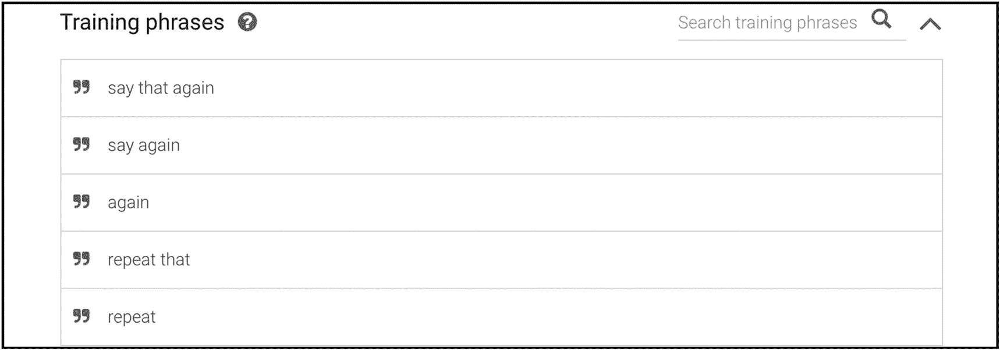
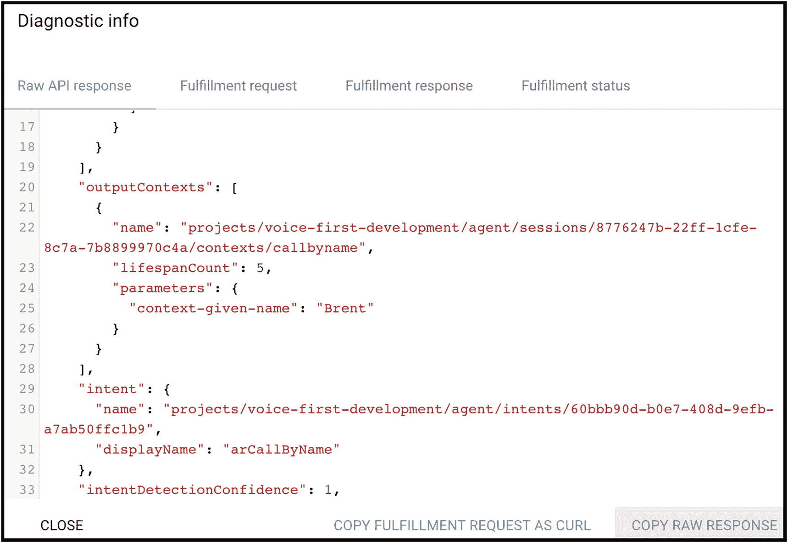
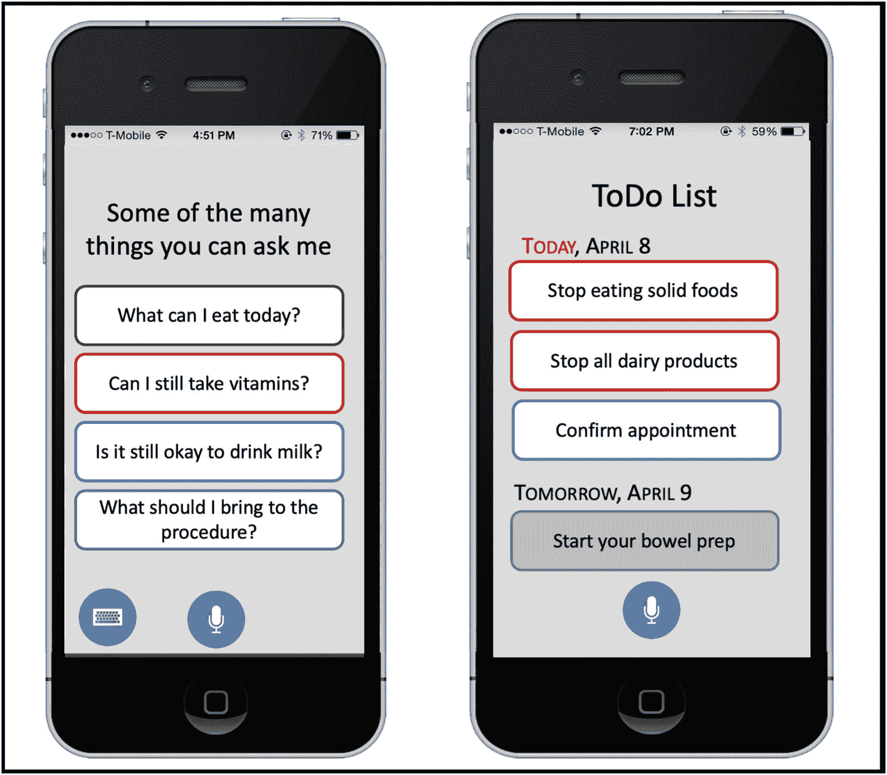
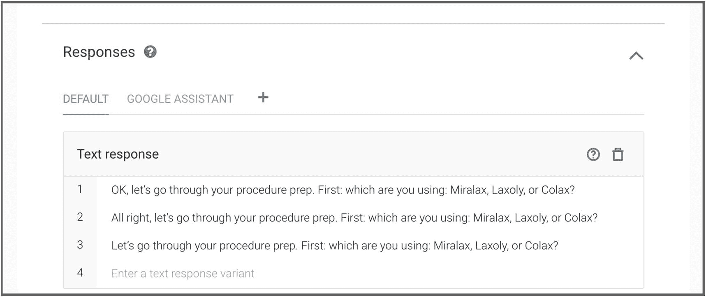

# 9. 通过一致性帮助用户成功

在第 8 章中，你了解了确保用户和 `VUI` 都正确理解请求的重要性。用户确认还有另一个方面：感觉在掌控之中。如果用户能够通过导航 `VUI` 获得他们想要的东西，知道如何重新开始，或在需要时获得帮助，那么他们就会对整个交互感到舒适。结果是他们更愿意探索和尝试新的请求，并且在达成目标方面更成功；这提高了可发现性和可查找性。当用户感觉能掌控自己的命运时，他们会是更快乐的用户——即使他们没有达成目标！如果你熟悉可用性启发式，你会在这章中识别出几个：一致性、标准、熟悉的隐喻和语言、帮助、反馈和用户控制。一致性通过以下方式实现：

- 在整个过程中保持一致的对话策略、提示措辞和语音
- 如果用户使用了 `VUI` 使用的词语，则能识别用户所说的内容
- 在整个 `VUI` 中——甚至跨 `VUI`——对相同的词语和短语做出相同的回应
- 在整个 `VUI` 中，在相同的上下文中以相同的方式处理和完成请求

你可以轻松地在网上和书籍中找到大量关于可用性启发式的信息；我们当然会重点关注它们如何应用于语音优先交互。本章是关于帮助用户自助的。

### 通用指令

通用指令（或称全局指令）是一组用户在任何任务、领域或当前在 `VUI` 中进行的任何操作下都能使用的小型命令集。通用指令为用户提供了获取澄清（`重复`、`帮助`）、重做部分或全部任务（`重新开始`、`返回`），或暂时/永久结束 `VUI` 对话（`暂停`、`停止`、`取消`、`退出`、`转接`）的方式。通用指令有助于建立熟悉感和一致性，使用户更加自主——它们是用户的安全毯。用户依赖它们来澄清问题和摆脱困境，因为它们对用户而言是固有的熟悉指令：

- **VUI** *您的处方号码是 5 9 2 2 7 6 9。*
- **用户** *能请您重复一遍吗？*
- **VUI** *当然。您的确认号码是 5 9 2 2 7 6 9。*
- *~~~  ~~~*
- **用户** *呼叫黛博拉·琼斯。*
- **VUI** *本·琼斯医生。正在拨打手机…*
- **用户** *不，停止。取消！*
- **VUI** *已取消。*
- *~~~  ~~~*
- **VUI** *患者最新的 MELD 评分是多少？*
- **用户** *嗯…那是什么意思？*
- **VUI** *肝脏疾病的 MELD 评分是基于…得出的一个 6 到 40 之间的数字。*

作为命令，通用指令应始终可供用户使用，但其内容和行为是上下文相关的。如果用户要求 `重复一遍`，系统应始终重复某些内容，但具体重复什么取决于用户请求之前立即发生的事情。

当用户错过 `VUI` 所说的内容并想再听一遍时，通用指令就派上用场了。或者当他们需要在回应或选择选项之前获得澄清时。或者当他们在多步骤交易中陷入困境或改变主意，想要更改请求中的某些内容时。或者当他们需要暂停对话以查找 `VUI` 所需的某些信息时。或者当他们完成操作或只是不想再与 `VUI` 打交道时。通用指令基于人们常见的反应和行为，即使他们之前从未与特定 `VUI` 交互过。用户应该能够期望从任何 `VUI` 对话中获得相同的一般行为，无论平台或开发者是谁。Alexa 和 Google 平台都包含一些内置的通用指令，这可能会让你的工作既轻松又复杂。稍后会详细介绍。

通用指令之所以“通用”，不仅在于其可用性；要运作良好，它们需要基于真实用户在各种 `VUI` 中自然说出的话语。通用命令不应需要教导；其覆盖范围应包括人们无需指导就会自然说出的词语和短语。理想情况下，它们应该简短、无歧义、易于说出，并且听起来不像其他命令。将最常用的几个短语映射到每个通用指令。你希望这些短语能良好运作，而不会冒影响其他请求的歧义风险。在后续章节中，你将了解为什么这很重要，以及如何使映射到通用指令的可能性更高或更低。一旦实现了通用指令，该功能在 `VUI` 的任何地方都可用。

#### 成功秘诀 9.1 协调你的通用指令

确保在 `VUI` 的任何地方都能识别相同的同义词。同时，检查你添加的通用指令与任何内置的平台指定通用指令行为之间是否存在冲突。如果你的 `VUI` 是多模态的，请协调所有模态，以检查屏幕上显示的和语音提示中说的任何命令词是否产生相同的行为，并且能被 `VUI` 良好识别。这并不意味着提示的全文也应该出现在屏幕上。这意味着，如果你的语音提示说 *…然后说“下一步”*，那么前进的按钮也应该显示“下一步”，而不是“前进”或“继续”或“往下”。如果用户说出这些词，它们都应该被识别，但为了最小的认知负荷，你期望人们说出的实际命令词或短语——或者你想鼓励他们说的那个——应该在所有模态中保持一致。

##### 提供澄清和附加信息

第一组通用指令涵盖了用户对澄清的请求：用户要么想再听一遍，要么再做一次，要么获取更多信息以帮助他们更接近某个目标。`重复`和`帮助`是我们对这些意图的简写名称，但它们并不是用户能说的唯一短语。两者在恢复策略中都扮演着重要角色，这是第 13 章的主题。

澄清总是与上下文相关的，因此你的 `VUI` 响应必须考虑用户刚刚做了什么或说了什么，以及正在发生什么其他事情：

- **用户** *播放“时光流逝”。*
- **VUI** *[播放歌曲，直至结束]*
- **用户** *重复一遍。 →* 含义：我想再听一遍同一首歌。
- **VUI** *[从头开始再次播放歌曲]*
- *~~~  ~~~*
- **VUI** *[作为流媒体的一部分播放歌曲]*
- **用户** [歌曲播放时] *这是什么歌？*
- **VUI** *这是由杜利·威尔逊演唱的“时光流逝”。*
- **用户** [几秒钟后] *重复一遍。 →* 含义：我想再听一遍这个信息。
- **VUI** *这是“时光… →* 在歌曲结束时有点模棱两可，所以你需要决定如何解释。猜错的成本很低，所以不要问用户他们指的是信息还是播放歌曲——如果你猜错了，他们会用更明确的方式再次询问，而说出信息的开销更小，所以这里是最佳选择。
- *~~~  ~~~*
- **VUI** *[作为流媒体的一部分播放歌曲]*
- **用户** *音量增加 5。 →* 歌曲播放时
- **VUI** *[增加音量]*
- **用户** *重复一遍。 →* 含义：我想再调高五格音量。

表 9-1 总结了需要牢记的要点。第 14 章全是关于上下文的内容，这是创建对话界面最重要的主题之一。短期记忆决定了不应该发生这种情况：

- **VUI** *您有一个来自联邦快递的通知：您的冷冻食品已到达。*
- **用户** *重复一遍。 →* 含义：我想再听一遍，因为我错过了一些细节。
- **VUI** *没有可重复的内容。*

**表 9-1** 成功的重复和帮助对话指南

| 通用指令 | 用户期望 VUI 执行的操作 | 默认短语 | 复杂性 |
| --- | --- | --- | --- |
| `重复` | 再次说出/执行最近一次的操作。 | `重复（一遍）`，`（再说）一遍` | 什么是“最近”一次？回溯多远进行重复。重复什么（提示、内容或操作）。 |
| `帮助` | 提供信息以澄清如何回应（示例、详细描述）。 | `帮助`，`更多信息`，`告诉我更多`，`我能做什么？`，`我有哪些选项？` | 保持简洁且信息丰富。之后麦克风是打开还是关闭？保留上下文（关于什么的帮助）。处理脱离上下文的请求。 |

##### 提供重做功能

第二类通用功能涵盖用户在继续操作前请求更改内容的情况。这可以是完全重做（重新开始）或逐步重做（返回上一步）。

- **语音用户界面** *接下来，处方编号 2 1 0 0 5 4 6……*
- **用户** *返回上一步。*
- **语音用户界面** *好的。以下是您可用的五张处方……*
- **语音用户界面** *处方编号 2 1 0 0 5 4 6 已续配。这是您的确认编号……*
- **用户** *返回上一步。*
- **语音用户界面** *您的处方已配好。如需续配其他处方……*
- **用户** *[已为饮食日记提供了四种食物]*
- **用户** *重新开始。*
- **语音用户界面** *重新开始什么？*

处理重做请求的关键在于追踪上下文，包括语音用户界面提供的内容、用户的输入，甚至过去对话轮次中走过的路径。你需要处理在交易中途说出的请求：如果对话涉及多个轮次，请确认语音用户界面的理解无误，并且用户明白某些信息将会丢失。

用户期望 `重新开始` 能“忘记”一切。几乎是一切。如果用户已完成某些登录流程，不要忘记他们的身份。但如果他们尚未完成登录，则应当忘记并回到登录起点。如果用户正在续配处方或向饮食日记添加项目，`重新开始` 应作用于当前正在进行的任务内部。这意味着回到该意图或任务的起点。有时它只是“主页/顶层/主菜单”的同义词，但当区分有意义时，它应保持重新启动该任务的意图。

`返回上一步` 的操作主要适用于列表导航、内容播放、浏览以及某些多步骤交易。但人们请求该操作的方式非常相似，因此它很适合作为通用功能。如果你在语音用户界面的所有地方都包含 `返回上一步`，则需要仔细测试以确保一切按预期工作。在某些情境下，你需要告知用户无法返回，例如在完成某些金融交易之后。请思考如何应对这种情况。表 9-2 涵盖了要点。

# 重新开始、返回与退出功能

## 重新开始与返回

**表 9-2** 成功实现“重新开始”和“返回”对话的指南

| 通用功能 | 用户期望语音用户界面执行的操作 | 默认短语 | 复杂性考量 |
| --- | --- | --- | --- |
| **重新开始** | 停止当前对话，忘记所有已提供的信息和对话轮次，并保留意图。 | `重新开始` | 是否保留意图？避免误操作导致重启。是否忘记之前已确认的信息？自开始以来的外部变化会影响当前选项。何时无法重新开始？ |
| **返回** | 后退一步，仅撤销最后提供的信息，并保留其余上下文。 | `返回上一步`，`返回`，`上一个` | 用户心理模型中的“一步”是否与你的模型匹配？一步可能包含多个提示。何时无法返回？ |

## 提供退出功能

第三组也是最后一组通用功能涵盖用户请求退出当前任何操作的情况。这可以是暂时退出任务以争取时间查找某些信息（暂停）。或者退出任务和当前对话，但打算开始新的对话（取消、主页/主菜单）。或者从语音用户界面退出到其他地方，无论是转接给人工客服还是其他自动化系统，包括语音信箱（转接）。或者完全退出交互和任何后续对话（再见）。

请注意，虽然 `主菜单` 主要用于基于电话的呼叫中心应用，但“主页”、“顶层”或“起点”的概念适用于广泛的语音应用。我们在此将其作为任何顶层的简称。在你的语音用户界面提示语中，应使用最适合你任务的词语或短语——但同时也应处理符合 `顶层`、`主页` 或 `主菜单` 概念的其他常见用户表述，特别是当你发现用户无法被理解时。这会使你的通用功能更加通用，对用户更有帮助。

在一个处方续配的交互式语音应答系统中，我们允许用户在查找处方编号时暂停交互。暂停期间，每 10-15 秒，用户会听到提示音，提醒他们在准备好时说“继续”：

- **语音用户界面** *如果您需要一些时间查找您的处方编号，请说“请稍等”。*

- **用户** *好的，请稍等。*

- **语音用户界面** *好的。我会等您准备好。当您回来时，只需说“继续”……*

- *[10-15 秒] 当您准备好时，请说“继续”……*

- **用户** *好的，我回来了。继续。*

- **语音用户界面** *太好了。您的处方编号是多少？*

由于这个语音用户界面对话是通过电话进行的，暂停是唯一能让语音用户界面不忘记信息、用户无需回拨并重新开始的方法。用户操作成功了；只要用户需要查找他们不熟记于心的信息，这种方法都适用。如果你的语音用户界面是移动应用、智能家居助手技能或操作，具体细节会有所不同，但保留上下文以便用户能够“暂存一切”的重要性丝毫不减。

与重做类通用功能类似，请仔细思考当你的语音用户界面处于未完成的交易中间时，应如何处理退出请求。如果语音用户界面误解了用户怎么办？如果他们正在进行交易，比如预订，该怎么办？你需要在执行操作前确认语音用户界面“听对了”。如果退出对话可能因任何原因给用户带来高昂代价，请运用你在第 8 章学到的关于确认策略的知识。

**成功秘诀 9.2** 谨慎处理“取消”

当你的语音用户界面将用户所说的话解释为 `取消` 时，不要取消用户所做的所有操作，除非你确定那是他们想要的。有时你需要明确确认该请求。`取消` 和 `停止` 是很好的例子，用户或多或少会下意识地说出这些命令，但根据当前上下文，它们会产生不同的后果。你应该在所有地方识别并处理它们，但**如何**处理将取决于上下文和流程。

从语音用户界面转接请求在交互式语音应答系统中很重要，但其他语音用户界面也完全有可能涉及从自动化系统转接到人工对话。随着语音对话变得越来越复杂，并涉及金钱和健康交易，拥有人工后备支持将变得越来越重要，尤其是对于纯语音对话。在转接过程中包含适当的确认信息，以向用户保证他们将被转接。

**表 9-3** 成功暂停或退出对话的指南

| 通用功能 | 用户期望语音用户界面执行的操作 | 默认短语 | 复杂性考量 |
| --- | --- | --- | --- |
| **暂停** | 等待用户输入；记住上下文直到“`继续`”。 | `暂停`，`等待`，`稍等` | 可以/应该等待多久？告知用户如何结束暂停。保留上下文。平台限制。 |
| **取消** | 停止当前对话轮次，并忘记部分或全部已提供和已请求的信息。 | `取消`，`停止` | 避免误取消。如果是多轮对话，应取消什么？何时取消为时已晚？ |
| **主页** | 停止当前对话；忘记所有已提供的信息和对话轮次，包括意图；前往“主基地”。 | `主菜单`，`主页`，`返回顶部（语音用户界面名称）` | 如果在交易中途，是否应忘记一切？避免误操作导致忘记。 |
| **转接** | 连接人工客服（通过语音或聊天）。 | `客服代表`，`客服`，`（找）人工/真人` | 何时提供或不提供转接。非工作时间及时区会影响提示语和可用性。 |
| **再见** | 停止收听和说话；处理任何必要的记账以完成交易。 | `再见`，`谢谢`，`我结束了`，`退出` | 避免误操作导致结束。避免歧义“购买”~“再见”。避免歧义“退出”~“下一个”。 |

## 通用意图的编码

要构建通用意图，首先需要添加与相关通用意图对应的意图。然后，添加用于正确响应的代码。^(⁶⁵) 你将扩展辅助 VUI 的流程，从 `repeat` 开始。在英语中，人们自然会使用像 *repeat* 或 *again* 这样的词，因此你通常会在提示语中利用这些词来指导用户如何再次听到或执行某个操作。使用熟悉的词语可以降低认知负荷，而 *repeat* 也是一个易于识别的词。

重复请求可能具有歧义：用户是想再次听到 VUI 说的话，还是想重播最近播放的歌曲？或者再次执行某个操作，比如把音量调得更大？有时用户知道这存在歧义，会自动澄清，例如说 *Repeat that song* 或 *Say that again* 或类似的话。永远不要忽略此类信息。要为此做好准备，以便能够捕获并利用这些信息。这才是真正的智能。但不要浪费时间进行明确的消歧——根据上下文对“repeat”的含义做出最佳猜测。以下是一些通用指南——与大多数语音相关的事物一样，它们基于可能性，而非绝对性：

*   正在播放或刚刚结束一首歌曲或视频 –> “repeat” = “再次播放相同内容。”

*   用户在几秒钟内提出了一个合理的、可以再次执行的请求 –> “repeat” = “再次执行我上次要求的事情。”

*   VUI 最近播放了一条提示语 –> “repeat” = “再次播放相同的提示语。” 如果提示语由多个拼接的语音片段组成，请确保你的逻辑从一个合理的起点播放所有片段。这并非易事！

**成功提示 9.3 预判重复**

如果你的 VUI 说出了一些重要且不熟悉的信息，例如参考编号或联系电话号码，请自动播放两次该信息，就像人们会不假思索地重复此类信息一样：*您的处方订单号是 4522890。重复一遍，是 4522890*。

在继续之前，我们将深入探讨为什么通用意图很特殊，并描述实现它们的两种方法。通用意图非常依赖上下文；VUI 如何响应取决于用户一直在说什么和做什么。这很合理：作为用户，你对 *help* 的期望完全取决于你在对话中听到的最后一句话以及你试图完成什么。通过两种方式创建这种上下文依赖性：

*   为每个上下文设置一个单独的通用意图，并将响应放在 Dialogflow GUI 中。你会有一个帮助意图 `help_arCallByName`，另一个用于 `help_arCallByNameDisambigLastName`，以此类推，用于所有其他通用意图。可以想象，这简直是一场噩梦，绝对不是最佳实践。

*   为每个通用意图设置一个意图，并在 webhook 中进行上下文相关的处理。这要好得多，也是你现在要做的，首先从添加通用意图的意图开始。

### 步骤 1：创建意图

创建一个新的意图 `repeat`，使用本章前面列出的训练短语（图 9-1）。不指定任何响应；你将通过 webhook 来完成这些操作。不要忘记启用履行，因为通用逻辑很快将在 webhook 中编码。



**图 9-1** Dialogflow 中的重复意图示例

对所有其他通用意图执行相同操作：`help`、`startOver` 和 `goBack`、`pause/continue`、`cancel`、`main_menu` 和 `transfer`。`goodbye` 已经存在；你在第 6 章中添加了它。但你需要对现有的进行一点修改；我们现在就来处理。`main_menu` 和 `goodbye` 对于 IVR 很重要，对于家庭助手则不那么重要，尽管一些观察结果可以在设备和交互类型之间传递。如第 6 章所述，即使呼叫者被 IVR 明确指示在完成后“直接挂断”，其中一些人也不会在不说 *Goodbye* 或 *Thank you* 并听到一些结束响应的情况下挂断。这是值得关注的细节之一，是你可以赢得或失去用户对系统信任的地方。这里小细节能起大作用；不要过度。你的目标不是引起用户注意这些短语，而是在他们说这些短语时优雅地处理。

你没有为这些意图指定任何响应，因为 webhook 会处理这些。你也没有指定任何输入上下文；这些新意图始终可用。这是通用意图的关键特性：它们始终处于活动状态。因此，你需要移除 `goodbye` 的 `end` 输入上下文，使其在对话的任何时刻都可用。你还需要为 `goodbye` 启用履行，因为你在第 6 章创建它时并未启用。

## 第二步：编写 Webhook 代码

现在进入有趣的部分：在 webhook 中添加响应。之所以需要这样做，是因为你在 Dialogflow GUI 中尚未设置任何响应。

你已经了解到，通用意图是依赖上下文的。对话中的其他方面也是如此。响应取决于用户说出通用意图时 VUI 对话的当前状态、他们正在进行的操作、已填充的槽位以及最近的 VUI 动作。但包括 Dialogflow webhook 在内的许多方法，本质上都是无状态的。这就是通用意图的核心问题：当用户说出某个通用意图时，你如何知道他们在对话中的“位置”，从而根据上下文做出响应？除非你采取特殊措施，否则你无法获知对话中之前发生了什么。现在，我们来解决这个问题。

我们如何知道“用户在哪里”，从而知道如何响应？目前，你可以通过追踪最近的意图来近似判断。在许多情况下，这种近似已经足够，但并非适用于所有情况，本章后面你会了解到这一点。由于 Dialogflow 是无状态的，你首先需要“保存”对话处理的上一个意图。这可以通过输出上下文来实现。回想一下，你有一个 Python 函数 `newContext`，用于创建新的上下文并将其发送到 webhook 响应中。在代码清单 9-1 中，你会看到在 webhook 响应之前需要包含该函数的位置。我们将输出上下文命名为 `intent_xyz`，其中 `xyz` 是当前请求意图名称的小写版本。将其转换为小写对于比较很重要，因为 Dialogflow 在发送下一个请求的上下文时会自动应用小写。你还需要使用字符串的 `replace` 方法将意图名称中的空格替换为下划线。如果不这样做，并且原始意图名称包含空格，当你用 Google Home 测试时，会收到应用程序无响应的错误。

```
# 添加一个包含意图的输出上下文，
# 以便我们能够确定通用意图的上一个意图。
output_intent_name = df_request.intent_display_name.lower().replace(' ','_')
df_response.output_contexts.append(
new_context(f"intent_{output_intent_name}"))
```

代码清单 9-1 添加输出上下文以记录对话处理的意图（`main.py`）

现在，看一下代码清单 9-2（来自 `new_context.py`）中的函数 `new_context`；它与之前的版本略有不同。

```
def new_context(name):
"""
返回一个具有给定名称的新输出上下文。
"""
context = {
'name': ("projects/s${PROJECT_ID}/agent/sessions/"
f"${{SESSION_ID}}/contexts/{name}"),
'lifespanCount': 5,
'parameters': {
'timestamp': time.time()
}
}
return context
```

代码清单 9-2 函数 `new_context()` 用于创建新的输出上下文以放入响应中

该代码向意图输出上下文添加了一个参数 `timestamp`。Python 开发者会认出 `time.time()` 是一个内置函数，返回以秒为单位的当前时间。你需要这个参数是因为：

-   你需要一种方法来找到最近的意图，以近似对话状态。

-   根据 Dialogflow 的默认设置，上下文的生命周期为五个对话轮次，因此同时会有多个 `intent_xyz` 上下文处于活动状态。你需要最新的那个。

-   你可以将意图输出上下文的生命周期设置为 1，这样它只持续一轮，但有一些原因不这样做，你很快就会看到（提示：“重复，重复”）。

在代码清单 9-2 中，我们在上下文名称中添加了字符串 `${PROJECT_ID}` 和 `${SESSION_ID}`。Dialogflow 会用项目 ID 和会话 ID 填充这些字符串。你可以在诊断信息中找到这些 ID——图 9-2 展示了意图 `arCallByName` 的示例。第 22 行的上下文名称与代码清单 9-2 中的相同，只是变量已被填充。



图 9-2 诊断信息显示意图 `arCallByName` 的上下文名称填充情况

代码清单 9-3 展示了如何获取用于上下文近似的最新的意图。我们使用正则表达式从最后一个“/”到字符串末尾进行匹配，检查该上下文是否为 `intent_xyz` 上下文（A）。获取上下文的时间戳（B），并检查该意图上下文是否更新（C），以及最近的意图是否不是可跳过的通用意图（D），稍后你将了解更多关于可跳过通用意图的内容。如果这是最近的意图，则设置意图名称（E）和时间戳（F）。

```
def set_most_recent_intent(df_request, intent_name, context):
"""
检查这是否是最新的意图。
"""
match2 = re.search('^intent_(.*)$', intent_name)   #A
if match2:
if 'parameters' in context:
if 'timestamp' in context['parameters']:
context_time = context['parameters']['timestamp']   #B
if (context_time > df_request.most_recent_intent.get('time') and #C
not is_skippable_universal(match2.group(1))):   #D
df_request.most_recent_intent["name"] = match2.group(1)   #E
df_request.most_recent_intent["time"] = context_time   #F
```

代码清单 9-3 获取最新的意图（`set_most_recent_intent.py`）

## 第 3 步：添加重复功能

现在你已经（基本）基于上一个意图获得了对话状态上下文，就可以为通用重复功能添加逻辑了。让我们为 `arTodaysTasks` 实现这个功能。今日任务需要重复功能，因为它可能会告诉你今天需要做的一系列事情。代码清单 9-4 展示了重复逻辑主代码的新部分（位于 `universal.repeat.py` 中）。首先，从 Dialogflow 请求中获取最近的意图（A）。检查 `arTodaysTasks` 是否是最新的意图（B）。如果是，则再次回复今日任务——别忘了在前面加上表明这是重复内容的短语（C）。最后，如果你尚未实现完整的“重复”处理逻辑，请包含一个安全出口（D）。

```
def universal_repeat(df_request, df_response):
"""
重复通用功能
"""
most_recent_intent_name = df_request.most_recent_intent.get("name") #A
if most_recent_intent_name == 'arTodaysTasks'.lower():  #B
df_response.output_text = \
("再次提醒：你今天有两件事要做。首先，你需要   " #C
"确保手术后能搭车回家。"
"其次，你需要服用泻药。")
else:
df_response.output_text = "抱歉，此处未启用重复功能。"  #D
```

代码清单 9-4 为 `arTodaysTasks` 添加重复逻辑

这里需要注意几点。首先，你可以看到为什么我们强调了使用小写意图名称来比较最近意图的重要性：Dialogflow 会自动将上下文名称转换为小写。

其次，你可能会想，是否有办法不必重复 `arTodaysTasks` 的内容，而只需指定一次。你可以通过使用**事件**来实现这一点，这是触发意图的另一种方式，而不是通过语音输入。但你可能并不希望这样，原因如下。你在主 `arTodaysTasks` 提示前添加了*再次提醒：*；你需要类似这样的效果。如果用户反复听到相同的短语，却没有任何提示表明系统已理解他们想要重复，这会让人感到困惑。但你也需要变化。你需要一种方法，能够控制哪些话语标记最适合每个上下文，从而将单个对话轮次串联成自然的对话。

### 第三，既然你现在依赖 webhook 代码来输出上下文，你需要为**所有意图**启用履行功能，而不仅仅是那些由 webhook 生成响应的意图。回想一下，这是在 Dialogflow 图形界面中为每个意图完成的。即使你没有对其进行任何特殊处理，启用 webhook 也是可以的，因为默认的 webhook 响应就是直接返回 Dialogflow 图形界面中为某个意图预设的内容。

#### 第 4 步：检查上下文的鲁棒性

> *“好了，我们刚才说到哪儿了？把最后一行读给我听。”*
>
> *“‘把最后一行读给我听，’”会速记的下士复述道。*
>
> *“不是我的最后一行，笨蛋！”上校吼道。“是别人的。”*
>
> *“‘把最后一行读给我听，’”下士再次复述。*
>
> *“又是我的那句台词！”上校尖叫道，气得脸色发紫。*
>
> *“哦，不，长官，”下士纠正道。“那是我的最后一句台词。我刚才读给您听的。您不记得了吗，长官？就在刚才。”*
>
> ——摘自约瑟夫·海勒的《第二十二条军规》（西蒙与舒斯特出版社，1961 年）

如果用户想重复同样的内容怎么办？试试看：说“*我今天应该做什么？*”然后说“*重复。*”很好，成功了。现在再说一次“*重复。*”哎呀！你收到了“*重复功能未实现*”的提示。发生了什么？记住，你添加了使用意图时间戳来获取最近意图的逻辑。当你第二次说“*重复*”时，最近的意图变成了……重复！当然，你没有为重复重复内容设置处理程序。你真正想做的是重复最后一个非重复意图。如果 VUI 刚刚提供了像今日待办事项列表这样的重要信息，用户想听两三次也并非不合理。

因此，你需要稍微修改一下“最近意图”的逻辑，添加一个测试，只允许非通用意图成为最近意图。代码清单 9-5 展示了判断上一个意图是否为通用意图的新函数，你可以在 `utils.py` 文件中找到它。回想一下，你在代码清单 9-3 中使用了这个函数。

```python
def is_skippable_universal(intent_name):
    """
    这是可跳过的通用意图吗？
    """
    return intent_name in ['cancel', 'continue', 'goBack', 'goodbye', 'help',
                           'pause', 'repeat', 'startOver', 'transfer']
```

代码清单 9-5 最近的意图不能是通用意图

代码清单 9-5 使用意图的实际名称来判断该意图是否为通用意图。Dialogflow 中没有特殊的标签可以设置来指示意图的这一特殊属性，因此你必须依赖意图名称。

现在，你已经拥有了必要的组件，可以根据用户是请求信息并想再次听到，还是听到一首歌并想重复，来重复正确的内容。让我们为其他通用意图构建核心逻辑（代码清单 9-6）。它包括你在代码清单 9-4 中看到的 `arTodaysTasks` 的帮助消息，以及一个主菜单处理程序（位于 `universal_main_menu.py` 中），该处理程序不依赖于上下文。

```python
dialog_functions = {   # A
    'arCallByName': ar_call_by_name,
    'arCollectName': ar_call_by_name,
    'arCallByNameDisambigLastName': ar_call_by_name_disambig_last_name,
    'arConfirmName': ar_confirm_name,
    'cancel': universal_cancel,
    'continue': universal_continue,
    'goBack': universal_go_back,
    'goodbye': universal_goodbye,
    'help': universal_help,
    'mainMenu': universal_main_menu,
    'pause': universal_pause,
    'repeat': universal_repeat,
    'startOver': universal_start_over,
    'transfer': universal_transfer}

# 根据意图名称获取处理函数。
handler_function = dialog_functions.get(df_request.intent_display_name)  # B
if handler_function:
    # 核心逻辑。
    # 如果找到处理函数，则使用请求和响应调用它。
    # 这就是在事先不知道调用哪个函数的情况下调用函数的方法。
    # 参数始终相同，即使处理函数不使用它们，因此有时我们会关闭 pylint 警告。
    handler_function.__call__(df_request, df_response)  # C
else:
    # 如果意图是其他任何内容，只需返回 Dialogflow 原本要执行的操作；不要修改行为。使用 Dialogflow 提供的响应。
    df_response.output_text = df_request.fulfillment_text  # D
```

代码清单 9-6 通用意图的核心处理代码

让我们更详细地查看清单 9-6 中 `main.py` 的核心对话逻辑。首先，定义一个字典，将来自 Dialogflow 的意图名称映射到处理函数（每个函数都有自己的 `.py` 文件）（A）。在运行时，你从意图中获取处理函数（B），并使用 webhook 请求和响应对象作为参数调用该处理函数（C）。最后，如果因为意图不在字典中而未找到处理函数，则响应为 Dialogflow 原本要说的内容（D）。

在（C）中，你看到了一种你可能不习惯的 Python 函数调用方式。我们使用处理函数的 `__call__()` 方法，并且始终传入相同的两个参数：webhook 请求和响应对象。为什么这样做？另一种方式，在现在有更多意图的情况下，会变成一堆 `if/elif/else` 语句；而这段代码要清晰得多。在字典（A）中存放的是实际的函数对象本身（而不是处理函数的名称）；这就是为什么我们可以对字典中的值执行 `__call__()`。

你在清单 9-4 中看到了 `repeat` 的处理函数；许多新的通用处理函数除了说“此功能不支持”之外什么也不做，但“repeat”和“main menu”则更完整。关于 `mainMenu` 的一些说明：

*   你会注意到 `mainMenu` 处理函数不依赖于上下文；它会播放一段修改过的开场提示，之所以修改，是因为返回的上下文与第一次听到时的上下文不同。如果你的 VUI 是一个带有明确主菜单的复杂纯语音交互，那么像“你已返回主菜单”这样的提示是一个合适的导航地标。

*   在任何大型复杂的 VUI 中，用户的思维模型都包含某种“大本营”。在 IVR 中，它通常是一个主菜单，提示语中也会这样称呼。在其他 VUI 中，将其称为“主页”、“开始”或与 VUI 名称或角色相关的其他名称可能更合适。

*   一个安全的默认 VUI 响应是简单的“好的”，后跟一个地标提示和一个返回顶层的重新进入提示。

*   记录用户在请求主菜单之前做了什么——如果他们接下来说的是“返回”，如果你能让他们在不丢失细节的情况下返回，你会显得很聪明。

此时，`output_text` 字段是尚未启用的通用功能的占位符。即使某些通用功能未启用，你的响应也应该比这些提示更具信息性和对话性。

当你启用其他通用功能时，你会发现需要更多更改。考虑以下请求序列：“我今天应该做什么？[VUI 读取今天的任务] → 主菜单 [VUI 返回主页] → 重复”。应该重复什么？主菜单。按照你在清单 9-5 中的写法，你会重复 `arTodaysTasks`，因为通用功能不允许成为最近的意图。然而，主菜单是一个有效的最近意图。也许你需要修改代码，使得通用功能不能成为最近的意图，但 `mainMenu` 除外。新的 `isSkippableUniversal()` 函数执行了清单 9-5 中 `isUniversal()` 的功能，但它不包含 `mainMenu`，并且你在查找最近意图时使用了这个函数。

你还没有完成：帮助提示可以被重复——也许其他通用功能也可以。我们稍后再讨论这个问题。关键点在于，我们一直强调，为了做对用户有益的事情，一定的复杂性是必要的；过于简单的方法相对容易设计和编码，但通常不会带来最佳的用户体验或系统性能。

**成功提示 9.4 在开发期间使用占位符提示内容**

确定一个易于查找的临时提示措辞，例如“更新食物日记的帮助占位符”，并使用与正式语音明显不同的声音录制。在开发期间，当设计仍在变更但编码正在进行时，使用此提示。这样在后续开发中更容易查找和替换，并且在测试期间也更容易注意到。

#### 步骤 5：结束对话

到目前为止，你一直在播放完像 `arTodaysTasks` 这样的答案后结束对话。既然现在可以重复了，你就不再想这样做了。回到所有意图（除了 `goodbye`！），并移除结束对话的滑块。这就是现在 `goodbye` 的用途。

你已经添加了通用功能！好吧，你只添加了 `repeat`，并且只针对一个意图，但你已经有了核心。你可以修改清单 9-6 中的逻辑来添加其他通用处理。

# 对话设计范式与语音导航

有几种范式可用于审视语音应用开发的对话设计。Dialogflow 采用了一种“以意图为中心”的范式，其基本单元是用户想要做什么。这种范式对于大多数“一次性”对话来说效果很好，并且无需太多介绍就能理解。但大多数大型企业级语音应用，尤其是那些具有复杂事务的应用，都采用“以对话状态为中心”的范式，它更关注用户在对话中“处于”哪个位置。这是一种更复杂的工作，但使得许多事情更容易实现，例如跟踪对通用功能至关重要的上下文依赖性。你将在后续章节中了解更多。Dialogflow 并未融入以对话状态为中心的方法，但试图使用上下文等元素来近似其某些要素。

### 成功提示 9.5 “通用”意味着“始终”可用

顾名思义，“通用”意味着始终可用。当存在潜在歧义时，有充分的理由限制可用性，正如你在本章中学到的。通用功能之后发生什么也取决于上下文。但即使你需要限制通用行为，你仍然应该识别常见的通用短语，以便至少可以告诉用户为什么这次无法满足他们的请求。

### 侧边栏：清理代码

我们希望我们的代码易于阅读，尤其是我们在这里讨论的 Python 代码。为了帮助实现这一点，我们在代码上使用`pylint`工具。它会标记出明显的错误，如未定义的引用，以及风格问题，例如：

*   空格或空行不足或过多

*   行过长（我们实际上修改了`pylint`的运行配置，以标记超过 80 个字符的行，以便文本中的代码清单更易读）

*   类实例变量过多

*   注释不足

*   函数中的分支过多（这实际上是我们开始在清单 9-6 中使用`__call__()`函数的原因）

总的来说，我们推荐使用像`pylint`这样的工具来提高代码结构和可读性。你可以有选择地禁用`pylint`警告。在清单 9-7 中，我们禁用了关于函数参数（此处为`df_request`）未使用的常见警告。通常，我们会移除`df_request`参数，但如果你回想清单 9-6，我们需要使用相同的两个参数来调用意图处理函数，因此这里唯一的解决方案是禁用该警告。

```python
def universal_cancel(
df_request,     # pylint: disable=unused-argument
df_response):
"""
cancel universal
"""
df_response.output_text = 'Sorry, cancel is not enabled here.'
```

清单 9-7 禁用特定的 pylint 警告

## 导航

语音导航指令是帮助用户在纯音频空间中移动的工具。显然，这对于没有屏幕可看或按钮可按的纯语音 VUI 来说尤为重要。一致的导航指令让用户能够利用语音的优势，快速跳过多层菜单、返回上级、重新开始、暂停等。在此过程中，音频反馈能迅速告知用户是否走在正确的轨道上，正如你在第 8 章所学到的那样。大多数通用指令允许用户按照自己的节奏在 VUI 中导航。流程导航与内容播放控制并非同一回事。

### 地标

地标相当于音频版的产品标签或门牌标识。它们是一些简短的短语或音频信号，用于告知用户正在与 VUI 的某个特定功能或区域进行交互。地标是一种快速为即将到来的对话设定基线预期的方式。如果你的 VUI 功能繁多且规模庞大，你可以使用地标来逐一介绍每个功能，例如 IVR 主菜单或我们流程 VUI 中的饮食日记。

默认情况下，地标应简洁明了，例如口头说出`主菜单`或`饮食日记`，或者如果非语言形式，则使用简短的提示音。是否以及如何实现地标，取决于 VUI 的复杂程度、交互平台和模式，以及用户对交互的认知模型。地标能提供“走在正确道路上”的 reassurance。当你分析来自具有多个分支路径的系统的真实用户数据时，可以观察到地标在发挥作用：在地标之后，用户话语中的犹豫和不确定性减少，更快速地插入对话，并更快地提出`重新开始`或`返回`的请求。总体而言，体验更快，错误更少。

#### 成功秘诀 9.6 实施交接策略

注意避免出现多个相邻的地标或确认信息。这在拥有众多路径且多人分别开发不同模块的大型系统中是一个常见陷阱。这种情况通常发生在一个地标属于“离开”（作为响应提示或呼叫路由确认提示），而另一个属于“到达”（在请求的子应用功能的第一个介绍提示开始时）：`你的饮食日记，好的。好的，饮食日记`……为避免这种情况，请确定一个惯例；最常见的是在“离开”时处理它们，因为它们属于响应。

### 非语言音频

在第 8 章中，你学习了如何为 VUI 添加非语言音频。非语言音频（NVA）是指除口语之外的声音。正如之前承诺的，我们现在将更深入地探讨如何将 NVA 用于导航和通用指令。

NVA 的另一个术语是`earcons`。好的`earcons`，就像图形图标一样，能减轻用户的认知负荷。一个声音可以象征一个功能或动作，而不是用一堆词语来表达。这就是声音象征。声音象征的主要问题在于，它不像许多视觉符号那样被大众普遍认知或认同。要使`earcons`有意义，用户需要以某种方式将其与预期含义联系起来。最好的方法是首先选择合适的声音。然后，在用户最初几次遇到该功能或动作时，将声音与之一起播放。通过关联来赋予含义通常比直接告诉人们某个声音代表什么意思更好。

由于简短独特的声音比句子中的词语处理速度更快，因此 NVA 地标对于能够学会将声音与成功或失败等含义关联起来的重复用户特别有用。

那么，如何选择合适的声音呢？`Earcons`可以是具象的——即与其所代表的事物自然关联的录音（或合成版本）。它们可以或多或少地具体：文件关闭时门关上的声音、马桶冲水声（不推荐！）或清空垃圾时的纸张揉皱声、表示快速奔跑的脚步声、表示开始或成功的升调和大调和弦，以及表示结束或失败的降调或小调和弦。`Earcons`也可以是抽象的，通过特定的旋律、节奏或乐器与某个功能或动作相关联。这对于品牌塑造可能很重要，并且在处理高级用户时可能很有效，但对普通用户来说可能难以学习。

`Earcons`的常见用途包括：VUI 活动状态（开始监听、停止监听、处理中、未找到结果、超时、成功完成、待机）、警报或通知、有用提示或更多信息、导航（后退、前进、主页/主菜单、应用的子区域）以及列表中的每个项目。在基于电话的 VUI 开始时使用一个简短的`earcon`，对于提示自动化并设定来电者预期非常有效。音频也用于掩盖处理延迟。研究表明，当延迟超过 3-4 秒时，你需要开始考虑如何告知用户`我还在`。用户与 VUI 保持联系越关键，静默时间就应该越短。这意味着对于纯语音 VUI 和 IVR、多轮对话以及涉及金钱和健康等“重要”主题，静默时间应更短；而对于多模态、一次性交互（如请求某位艺术家的音乐），静默时间可以更长。

就像视觉符号象征一样，声音象征部分具有普遍性，部分具有文化特异性。如果你的用户群体多样化，请记住这一点。在一种文化内部，人们对声音往往有相似的反应。这一点很重要，因为你在创建 NVA 时可以并且应该利用这一点。表 9-4 展示了一些西方文化中对声音的常见反应；例如，较高频率的声音通常被认为指向较小的事物，而较低频率的声音则与较大的事物相关联。

#### 表 9-4 西方文化中特定声音的典型感知示例

| 类别 | 声音特征 | 感知含义 |
| --- | --- | --- |
| **频率** | 低 // 高 | 大 // 小 |
| **节奏** | 快 // 慢 | 紧迫 // 等待、处理中 |
| **音调** | 上升 // 下降 | 开始、唤醒、开麦 // 结束、休眠、闭麦 |
| **和弦** | 大调 // 小调 | 成功 // 失败 |
| **旋律** | 和谐 // 不和谐 | 成功 // 失败 |
| **时长** | 短促、清晰 // 长、持续 | 行动号召 // 等待、空闲 |
| **音频** | 声音 // 静音 | 活动、“活跃” // 空闲、待机 |

NVA 可以是一个强大的工具。为避免重大陷阱，请遵循以下几条准则：

*   **恰当的象征意义**：避免使用其自然象征意义与意图相反的声音。例如，不要用不和谐的下降音表示成功，也不要用关门声表示 VUI 正在开麦等待回应。

*   **音质**：通常，你希望声音是悦耳的。即使是提示音，也不应过于刺耳，以免在你希望用户注意时，他们却捂住了耳朵。木管乐器通常优于铜管乐器，木琴和马林巴琴优于电颤琴和钟琴，因为金属的起音比木材更尖锐，不过由于同样的原因，八度音阶的选择也很重要。在预期设备上的真实条件下与真实用户进行测试。

*   **音量**：NVA 的音量应与整个 VUI 相匹配，不能明显更响或更轻。根据你音效的乐器配置，这不仅仅是纯分贝级别的问题。在真实环境中进行一些测试即可解决此问题。

*   **时长**：音效通常应短促，具有清晰的起音和结尾。可以尝试——一个好的起点是 50 毫秒。如果一个音效意在表示“VUI 正在聆听”，但音频逐渐减弱，用户将很难知道何时开始说话——他们甚至可能等待太久，以至于麦克风停止监听！延迟 NVA 应该是可以轻松循环播放以灵活控制时长的。

*   **主题**：为你的 VUI 角色和领域定义一组“家族”声音。如果是餐厅应用，那么与食物相关的声音可能是有意义的。如果是健康相关主题，不要使用“鬼屋”声音或救护车声音。你不想让用户心脏病发作！如果你的 VUI 与现有的强大音频品牌相关联，你可能希望融入其广告歌或旋律。

### 使用

保持一致。如果你的 VUI 为某些功能使用了音效，那么每次出现该上下文时都要播放它。但不要过度使用音效。你不需要为每种 VUI 活动状态或含义都配备一个音效。那样会变得令人不知所措和厌烦，而不是有用。

#### 成功技巧 9.7 NVA 很强大——少即是多

为某些内容使用“正确”的音频是快速传达含义的好方法。但如果用户在每种上下文中都听到一个声音，甚至听到多个声音串在一起，NVA 就会失去效果并变得烦人。在最有意义的地方使用 NVA。声音太多，用户就会充耳不闻。

##### NVA 的代码实现

在第 8 章中，你使用了 Actions on Google 自定义负载和非常基础的 SSML 来为我们的应用添加 NVA。现在你将添加另一个 NVA，这次用于主菜单。这意味着你需要稍微修改代码以指定使用哪个 NVA。清单 9-8 来自 `webhook_response.py`，展示了如何操作。当你创建 webhook 响应时，你需要初始化 NVA (A)。这里有四个组成部分：是否播放 NVA、源音频、以及源音频的开始和结束时间。在运行时，如果你尚未指定 NVA 源，则设置它 (B) 以及开始时间 (C) 和结束时间 (D)。然后使用源 (E)、开始时间 (F) 和结束时间 (G) 构建 SSML。

```python
# NVA
self.nva = {"do_pre": False, "src": None, "begin": None, "end": None}  # A
# ...... 为聚焦清单而截断的代码
# 如果我们要执行前置 NVA，则为 Actions on Google 添加负载。
if self.nva.get("do"):
    # 如果尚未指定，选择我们的 NVA 源、开始时间和结束时间
    if self.nva.get("src") is None:
        self.nva.update({
            "src": (https://actions.google.com/sounds/v1/   # B
            "cartoon/cartoon_metal_thunk.ogg"),
            "begin": "1.5s",     # C
            "end": "3s"})     # D
    if not add_payload:
        self.respdic['payload'] = {}
        self.respdic['payload']['google'] = {}
        self.respdic['payload']['google']['richResponse'] = {}
        self.respdic['payload']['google']['richResponse']['items'] = []
    tmpdic = {}
    tmpdic['simpleResponse'] = {}
    # 组合 SSML
    ssml = f"DING{self.output_text}"
    print(f"'SSML: {ssml}")
    tmpdic['simpleResponse']['textToSpeech'] = ssml
    self.respdic['payload']['google']['richResponse']['items']\
        .append(tmpdic)
```

现在 webhook 响应代码已修改，让我们来使用它。清单 9-9 展示了新的 `universal_main_menu` 处理器（位于 `universal_main_menu.py` 中），你可以在其中设置 NVA 源 (A)。

```python
def universal_main_menu(
    df_request,     # pylint: disable=unused-argument
    df_response):
    """
    主菜单通用处理器
    """
    df_response.output_text = \
        "你已返回主菜单。你想做什么？"
    df_response.nva.update({
        "do": True,
        "src": "https://www.soundjay.com/button/beep-01a.wav"})   # A
```

#### 内容播放导航

控制和传输命令是人们在浏览内容播放时使用的命令。我们不会深入探讨这些。导航命令通常与设备开发相关，因此它们涉及自己特定的硬件和软件需求，甚至有自己的专用平台。这会很快变得复杂和专业化，超出了本书的范围。但用于导航的词语——下一个、上一个、暂停、停止/取消和继续——是通用的，即使没有指示，人们也会使用相同的词语。并且导航也适用于列表，你将在接下来学习。

##### 成功技巧 9.8 导航需要快速响应

为了使导航良好运行，识别必须快速。如果你的 VUI 允许纯语音插播（即用户只需说话就能打断 VUI，而无需先说唤醒词或按按钮），这一点尤其重要。它们还需要易于准确识别，而不会与其他命令混淆。出于这些原因，语音系统为导航命令使用不同的识别器，并在设备本地而非云端处理识别，这种情况并不少见。

##### 列表导航

任何形式的浏览，例如列表导航，在语音交互中都很难做好。到目前为止，原因你应该不会感到意外。在屏幕上使用列表很简单：作为用户，你查看列表、滚动，一旦准备好就可以从中选择一项。但在语音交互中，情况则不同：你需要将所有项目保留在工作记忆中，直到做出选择；而且，如果你在每组中只听到几个选项，你需要知道如何在各组之间切换。

以下是一个用户与语音用户界面（VUI）之间可能发生的对话示例。用户正在浏览可供续药的药品名称列表。你极有可能听到用户说出最后一轮对话中列出的任何选项；你将如何处理每一种情况？

*   **VUI** *您有六种可续药。这里是前三种：二甲双胍、赖诺普利和泼尼松。*
*   *说出您想要的那种药的名称，或者说“下一组”。*
*   **用户** *下一个。*
*   **VUI** *这里是后三种：安非他酮、羟考酮和泼尼松龙。*
*   *说出您想要的那种药的名称，或者说“上一组”。*
*   **用户** *赖诺普利/第一个列表中的最后一个/上一组/返回/下一组/那个/重复一遍/再读一遍整个列表/第一个/泼尼松龙*

你需要允许用户灵活地使用与人交谈时相同的词汇和短语来与列表交互，同时保持简单明了，并确保用户确信你的 VUI 正确理解了他们的意图。可以预期命令如 `下一个`、`向前`、`上一个` 和 `返回`，但不要指望用户能区分 `下一个` 和 `向前` 或 `上一个` 和 `返回` 之间的区别，即使你指示他们这样做。你可以实现最令人惊叹的列表结构，但如果你期望用户记住任何关于如何导航和选择项目的特殊指令，它仍然会失败。

**多模态要点**

多模态 VUI 可以通过在最需要的时候提供一组通用命令以及用于从列表中选择项目，来很好地利用通用性。没有屏幕，VUI 可能需要播放冗长的提示来解释如何重复或重新开始——一遍又一遍地听会让人厌烦。在以语音优先的多模态移动应用中，常见做法是展示一些常见请求的示例——同时将这些示例做成可点击的按钮。屏幕可以在音频对话继续的同时，以视觉方式提供通用命令和提示。在多模态 VUI 中提及“主菜单”可能不是你想要的。屏幕变化本身就能说明问题，或者你可以使用一些图标或非语言音频。你对“主”屏幕的选择将取决于应用任务。对于 22otters 手术准备应用（图 9-3 中的概念图）来说，一个逐日的待办任务清单效果很好。



图 9-3 示例的多模态使用及目标主屏幕

### 一致性、变化与随机化

我们承认：当语音应用以我们认为欠佳的方式回应时，我们也会嘲笑它们。一个例子发生在我们家中，当语音助手每次都以完全相同的方式回答 *好的！* 时，包括当连接的灯没有打开，而助手仍然愉快地说 *好的！* 时。人们不会每次都完全一样地说话。你的 VUI 如果没有变化，听起来就会像机器人，缺乏趣味，甚至显得不那么聪明。诀窍在于在不影响一致性的前提下增加变化。一致性并不等同于缺乏变化。

你的 VUI 的回应可以在多个方面有所变化，包括使用的词语、它们的发音方式以及它们在流程中出现的时间：

*   如果你的 VUI 使用确认词，你可以随机化像“好的”和“行”这样的词语，但请记住，“当然”并不完全相同，因为它额外带有确定性的含义。在同一组话语标记内进行变化。
*   如果你依赖 TTS 生成输出，不同的发音可能难以管理，但可以使用可用的平台工具和标记语言来修改 TTS（更多内容见第 15 章）。如果你使用录制的提示，添加发音变化当然很容易，只是需要额外一点工作。
*   你的 VUI 可以通过在不同时间以不同顺序询问缺失的槽位来增加变化。这是变化，但不是聪明的变化。以影响用户回应方式的方式增加变化会使 VUI 不一致，增加用户的认知负荷，并为每个人创造更多工作。高级用户会特别沮丧，因为他们现在必须关注他们认为已经知道的东西，导致更多的重试。一致的结构尤其重要，特别是对于列表，正如你在第 7 章中学到的那样。它就像口头上的项目符号，帮助用户处理信息。

对于任何给定的上下文，不要改变结构或流程、固定列表中项目的顺序、语音和角色、指代通用功能的短语、术语（如果你称其为“食物日记”，不要有时又把它叫做“饮食日记”，但应能识别两者）、地标，或整个 VUI 中提示的整体呈现方式。相反，要寻找机会以听起来自然且不影响有意义的一致性的方式，随机化提示音频输出以及确认词和承载短语这类“对话粘合剂”。

#### 随机化代码

在 Dialogflow 中有两种随机化提示的方法：

- **使用图形界面**：在意图的“响应”部分，如果你为同一上下文定义了多个提示，Dialogflow 会随机选择一个。它也不会连续两次选择同一个提示——因此这是一种方便的内置功能，可以创建变化。

- **使用 Webhook**：因为你可以将 `outputText` 设置为你想要的任何内容，包括输入 `fulfillmentText` 的变体，所以这是一个很好的选择。你可以利用 Python 的全部功能来决定播放什么。

最佳方法取决于你想要的变体类型。如果你要对提示的变体进行大规模更改，Dialogflow 图形界面可能更合适。对于更小、更独立的调整，代码可能更简单。我们将向你展示这两种方法；你要实现的用例是随机化特定提示。在你的程序准备助手中，有几个提示以“OK”或“Alright”开头。正如你刚刚学到的，随机化这些短语通常是一种好做法，因此你将在 `tcrProcedurePrep` 意图中循环使用“OK”、“Alright”以及无确认词。

首先，在图形界面中。目前，`tcrProcedurePrep` 在“响应”中只有一个提示，以“OK”开头。添加两个提示，一个以“Alright”开头，另一个不带任何确认词（图 9-4）。



**图 9-4** 随机化提示开头部分后的 `tcrProcedurePrep`

现在，使用 Webhook 代码实现同样的功能。这相当简单（清单 9-10）。使用 Python 的 `random.choice()` 函数在提示变体之间随机选择。确保在代码中 `import random`。每个变体都是 Python 列表中的一个条目。

```
outputText = random.choice([
('OK，让我们开始你的程序准备。'
'首先：你使用的是哪种：Miralax、Laxoly 还是 Colax？'),
('好的，让我们开始你的程序准备。'
'首先：你使用的是哪种：Miralax、Laxoly 还是 Colax？'),
('让我们开始你的程序准备。'
'首先：你使用的是哪种：Miralax、Laxoly 还是 Colax？')])
return outputText
```

**清单 9-10** 在 Webhook 中随机化提示

对于这个用例，哪种方法更好？

- 在 Dialogflow 图形界面中，你需要找到所有以“OK”或“Alright”开头的提示，并手动添加变体。这有点麻烦。

- 在 Webhook 中（清单 9-8），你也必须做同样的事情，所以还不如在图形界面中完成。

- 实际上，还有一个仅存在于 Webhook 中的有趣的第三种选择：
    - 找到图形界面提示（`fulfillmentText`）；检查它是否以“OK”或“Alright”开头。
    - 如果是，则像之前一样使用 `random.choice()` 随机选择一个版本。
    - 用随机选择的版本替换现有的开头（可以为空）。

让我们看看它是什么样子（清单 9-11）。你将在提示的开头搜索“OK”或“Alright”（A），使用 `random.choice()` 随机选择一个替代的开头提示（B）。

```
# 可能用随机变体替换提示开头。
if (re.search('^OK,', self.output_text) or
    _re.search('^OK.', self.output_text) or
    _re.search('^Alright,', self.output_text) or
    _re.search('^Alright.', self.output_text)):
    random_intro = random.choice(['OK','Alright',''])
    if random_intro == '':
        self.output_text = re.sub('^OK,','',self.output_text)
        self.output_text = re.sub('^OK.','',self.output_text)
        self.output_text = re.sub('^Alright,','',self.output_text)
        self.output_text = re.sub('^Alright.','',self.output_text)
    else :
        self.output_text = re.sub(
            '^OK,', '%s,' % random_intro,self.output_text)
        self.output_text = re.sub(
            '^OK.', '%s.' % random_intro,self.output_text)
        self.output_text = re.sub(
            '^Alright,','%s,' % random_intro,self.output_text)
        self.output_text = re.sub(
            '^Alright.','%s.' % random_intro,self.output_text)
```

**清单 9-11** 自动随机化提示开头

清单 9-11 中的代码有点复杂，主要是因为你必须搜索不同的变体，并且当确认提示为空时处理方式不同，在这种情况下你需要删除开头文本后的任何逗号或句点。那么这个方案有什么好处呢？嗯，你不需要担心在图形界面中显式添加所有提示变体；只需在图形界面提示的开头包含一个“OK”或“Alright”即可进行潜在的替换。这使得它更加健壮；确认词并不总是有意义的，为了最佳交接，应该将其与内容分开。

### 使用内置全局意图

许多应用程序开发框架都包含一些内置通用功能的概念，因此设计人员和开发人员无需担心本章中你看到的复杂性。很棒，对吧？是的，正如你所见，确实存在复杂性。像通用功能这样的对话方面在语音应用程序中没有得到应有的充分关注，因为：

- 它们很复杂且依赖于上下文。我们甚至还没有解决是否或何时放弃的问题。在一个状态下经过两三次帮助请求后，用户成功的可能性可能会降低，可能需要另一种策略。
- 它们不是“最佳路径”，而是被视为“边缘情况”，因此很容易在对话其余部分完成后才将它们附加到末尾。但这种方法可能会严重损害可用性和长期用户参与度。

我们希望设计人员和开发人员从本节中获得的主要启示是：了解任何内置功能是如何设计的，你做出了哪些假设，以及平台架构是否支持你的假设。你不能仅仅因为通用功能看起来是“自动的”就停止思考它们是如何实现的。也许你可以将其视为一个黑盒，但如果你想改变某些行为，了解更多信息很重要。以下是你可能会在内置框架中看到的一些情况：

- **实现和覆盖范围不完整**：并非所有通用功能都已实现，尤其是一些困难的功能，如暂停和继续。
- **僵化的上下文依赖性**：一些内置的通用响应过于通用！有些响应如此通用，以至于 VUI 听起来对之前的操作和对话轮次一无所知。某些命令，如“停止”，可能内置了不适用于你特定 VUI 需求的假设。
- **肤浅的对话流程**：上下文依赖性的延伸：当通用功能被多次重复时会发生什么？
- **有限的语篇标记提示**：有时你所能做的就是绕回来，为某些上下文重放原始提示，但这不一定符合用户的心理模型，也无法给用户留下 VUI 理解水平的正确印象。如果 UI 只是不断循环并说同样的话，这对已经困惑的用户没有帮助。能够包含“这里有一些帮助”、“你已返回主菜单”或“再说一遍，那个数字是……”可以帮助用户摆脱困境。

在预期环境中对你的语音应用进行彻底测试，是发现任何差异并揭示错误假设的关键（第 16 章）。具体来说：

- 测试所有通用功能，甚至包括那些在某些上下文中可能没有意义的功能，如取消，并检查会发生什么。
- 测试每个通用功能的重复（“重复。重复。”）以及一个接一个地测试（“主菜单。重复。”），以检查响应是否合理。
- 检查你的语篇标记提示。如果你不总是听到同一个提示，那将获得额外加分。

### 跨 VUI 与框架的一致性与标准

# 对话标准的重要性与通用性

我们希望到现在为止，你已经意识到对话标准的重要性，尽管由于几个原因，你很难在语音领域找到明确的标准。有些任务需要导航，有些则不需要。纯语音 IVR 与移动多模态应用在帮助用户自助的方式上有着不同的需求。开发工作理所当然地专注于特定平台的实现。在设计方面，由于实现所提供的功能，处理特定对话的方式存在限制。但请记住，通用性与标准是用户所需一致性的途径之一。将基于人类能力和语音本质的一致性，与特定平台的限制区分开来。你需要理解并兼顾两者。新用户应该能够与任何新的 VUI 对话，并期望某些一致的行为，无论是`Alexa`、`Google Assistant`、`Siri`、`Cortana`、`Bixby`、IVR、移动应用、车载系统，还是其他任何设备。平台内的 VUI 之间需要有一致性，同时在合理层面上跨平台的一致性也能满足用户的期望。

语音领域有行业标准吗？整本书都在探讨理解和应用语音最佳实践。这本身就回答了这个问题：真正的行业标准是最大化交互的鲁棒性，预期并正确解读用户的变化，让用户能够自然地说话。一个 VUI 只有在允许用户在该语境下以自然的方式对话时才算成功。例如，存在一个标准的拼写字母表（*A as in alpha*），但这并不意味着你可以期望每个人都使用它，或者去教他们。

过去曾有过各种设定 VUI 标准的尝试。在线搜索当前的 VUI 标准——你可能会发现可用的内容非常有限，并且再次聚焦于特定的开发平台，而非所有平台和集成中实际的通用标准。嘿，语音从业者甚至没有统一的术语来指代基本的 VUI 构建模块，那我们又如何能期望用户知道什么是通用的呢？

人们会使用通用功能吗？和往常一样，答案是“视情况而定”。有些人会，有些人不会。有些人会尝试——你需要处理这些尝试。那些无需指导就能自然出现在人们脑海中的是`repeat`（重复）和`stop/cancel`（停止/取消）。通常，如果 VUI 在用户可能需要的语境中提及某个通用功能，用户就会使用它、记住它，并在其他地方使用。当在 IVR 中明确提供转接人工的选项时，你可以预期有从一小部分到 40%的来电者会请求转接。即使没有提及，5%的请求率也并不罕见。转接或帮助的请求往往与特定事件同时发生，比如账单到期日或新增了功能。你的 VUI 说话越自然、越鲁棒，用户就越有可能像对人一样对它说话。而核心在于，通用功能仅仅是人们在类似情境下自然对话行为的实现。通过处理常见短语，你就能预判用户的需求。这就是设计中的可发现性。

## 接下来是什么？

如果你对声音象征感兴趣，可以通过搜索本章“非语言音频”部分中读到的任何术语，找到大量相关研究。同时，留意声音在应用和其他场景中的使用方式，即使那不是 VUI。你对以下提示音有何反应：计时器结束、从收银台取走卡片、支付成功或失败的信号、关闭冰箱、GPS 指示左转或右转？

通用性、可查找性和可发现性在语音优先和纯语音系统中至关重要，因为人类音频处理能力有限，并且需要在不给出冗长指令的情况下，与多样化的用户群体进行清晰、快速的对话。第 10 章和第 11 章将深入探讨如何实现鲁棒的 VUI 理解。可查找性和可发现性在第 12 章和第 13 章中扮演重要角色，你将学习对话鲁棒性以及理解失败时的恢复策略。

## 总结

*   当用户能够依赖一致的 VUI 行为时，他们更容易成功。一致性有助于可发现性和用户信任。
*   当通用功能被可预测且鲁棒地设计时，它们有助于实现一致性；它们是用户的“安全毯”，帮助用户驾驭不熟悉的语音对话，并鼓励他们尝试新的交互。
*   **用户请求**帮助和系统导航时，无需用户学习和记忆特殊的命令列表。通用功能的全部意义在于，将任何用户想要这些行为时自然说出的词语和短语映射到系统理解上。
*   **VUI 对通用请求的响应**需要像在基于状态的系统中一样处理：根据任务、用户和之前的对话轮次，在正确的上下文中做出响应。
*   避免意外的“破坏性”请求。如果你将某个请求解读为取消或重新开始，请在删除用户在对话中提供的任何内容之前，请求用户确认。
*   合适的音频提示音可以帮助用户更快、更轻松地导航复杂的 VUI。
*   你可以通过使用 webhooks，让无状态系统表现得像基于状态的系统。
*   你修改通用功能行为的能力取决于平台。尽你所能，将 VUI 设计最佳实践融入到你正在使用的任何开发框架和架构中。当最佳实践被“内置”时，它们就能以最小的努力实现，而不是在时间压力下被舍弃。

脚注 1 2