# 11. 达成理解

第 10 章介绍了对话系统的第一个组件：语音转文本（`STT`）。现在轮到第二步：自然语言处理（`NLP`）和自然语言理解（`NLU`）。如果说第 10 章侧重于识别和理解用户说了什么，那么本章则侧重于这些词语的含义，因为 `NLU` 会接收 `STT` 的表示形式，并解读这些词语背后的意图，从而决定如何回应。在这里，你将了解“含义”对语音系统意味着什么，为什么它并非一个已解决的问题，以及如何仍然达成最佳结果。

如果你的识别出错，那么含义解读很可能也会出错：你无法从错误的词语中“理解出意义”——尽管有时通过巧妙的逻辑，你仍能得出正确的含义，比如将“too”理解为“two”。准确的理解能让你合理地回应用户，并满足他们的请求。它让你能够创建更复杂、更精密的 `VUI`，处理歧义和代词指代，并在出现错误时智能地应对（第 13 章）。在本章中，你将了解 `NLP` 和 `NLU` 所涉及的一些方法。`NLP` 为文本字符串赋予结构，而 `NLU` 则利用这些额外信息更准确地确定并分配用户含义的表示形式，以便 `VUI` 据此执行或回应。我们将讨论意图：为什么它们实际上是“语义解释的表示形式”，它们的用途是什么，以及它们缺少什么。你将了解如何通过中间层和多次解析传递来标注数据并提升对话解析效果。

我们将涵盖关于准备适合语音的数据这一重要要点。这将在你构建语音应用时占据很大一部分工作量，有时可能看起来相当艰巨。好消息是，你无需一开始就做到完美。回想一下第 1 章中的应用生命周期：部署后，你会根据真实的用户语音数据进行评估、快速迭代和更新。所以不要气馁！相反，请放松下来，让我们为你讲述如何为用户所说的话赋予含义，以便你能以正确的方式回应——这是我们在语音领域最喜爱的话题之一。在这里，你有机会让你的 `VUI` 大放异彩。

### 从词语到含义

从用户语音到 `VUI` 理解的路径如下所示（图 11-1）：

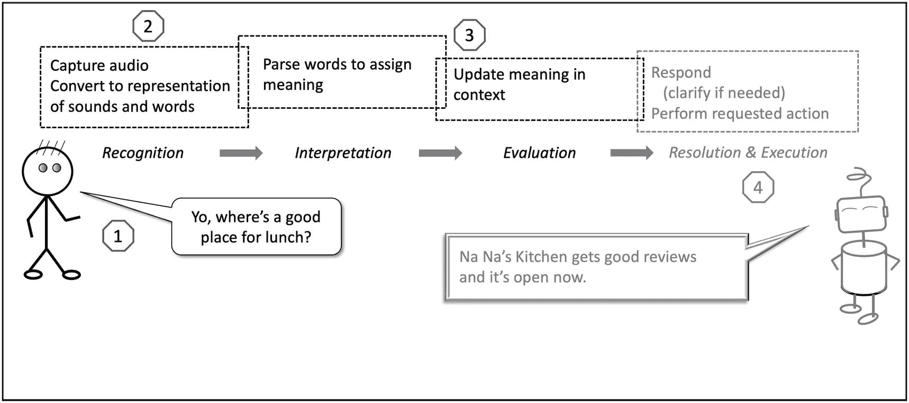

图 11-1

从用户语音到 `VUI` 理解的路径

1.  用户说出一些内容。
2.  语音识别器将这些语音转换为某种表示形式（通常是文本字符串），希望它能捕捉到用户所说的内容。
3.  文本（即词语字符串）经过解析和匹配算法，得出一种解释，希望它能代表用户话语背后的含义。
4.  确定代表用户话语含义、目的和目标的正确意图，是必要的首要目标——除非你弄清了含义，否则你无法恰当地回应——确定如何回应（第 4 步）必须等待。

为文本字符串赋予含义涉及将词语字符串解析为词性，然后查找并分类词汇项，最终在 `VUI` 所能处理的领域内，确定用户实际意图和需求的最可能假设。这很难！在了解赋予含义所涉及的内容时，将文本处理部分与解释部分区分开来会很方便，尽管并非所有人都以相同方式做出这种区分或划分。理解的输入是来自 `STT` 的词语字符串；输出是语音系统能在特定上下文和条件下执行的某种含义表示形式。`NLP` 可以被视为纯 `STT` 与 `NLU` 之间的粘合剂。`NLP` 更侧重于句法，而 `NLU` 更侧重于语义。在我们关于语音到理解过程的示意图中，我们将这些步骤显示为重叠的方框，尽管处理自然语言的挑战之一在于这些步骤无法完全模块化。

让我们看一个含义的例子（图 11-2）。在问题 *麦当劳几点关门？* 中，含义是意图（此处为信息请求或搜索）与捕捉细化该意图细节的槽位（此处为必需的搜索项名称和可选的额外搜索细化条件）的组合。

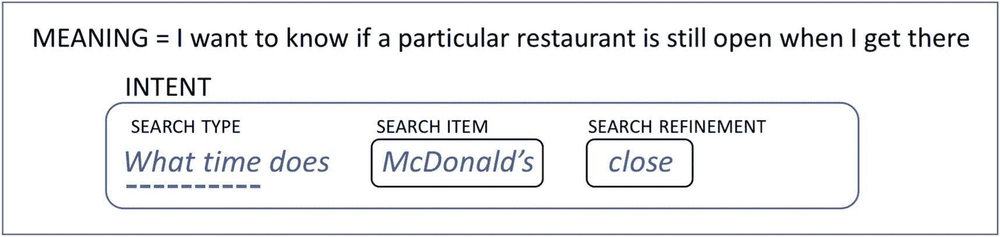

图 11-2

含义被编码为意图与槽位的组合

这并不是表示含义的唯一方式，但对于基于任务的系统而言，意图/槽位模型便于转换为类似 `SQL` 的结构化查询，以从数据库中提取信息，并便于对话管理（`DM`）判断是否存在需要后续跟进的缺失信息。对于非基于任务的用例，可能需要更通用的框架。

作为人类，我们通过世界知识、对话主题、对已知或新信息的假设、对话结构等过滤器来解读所听到的内容。即使听到不完整的句子、口吃、重新开始、发音错误，甚至短语中用错词语，我们也能出色地理解。`STT` 传递给 `NLU` 的内容主要是基于声音的最佳猜测，且远非总是正确。你大概能想到听写出错的例子，类似于图 11-3 中的例子。知道当时正在下雨，你认为最右边例子中实际说的是什么？大声读出来，你就会明白。

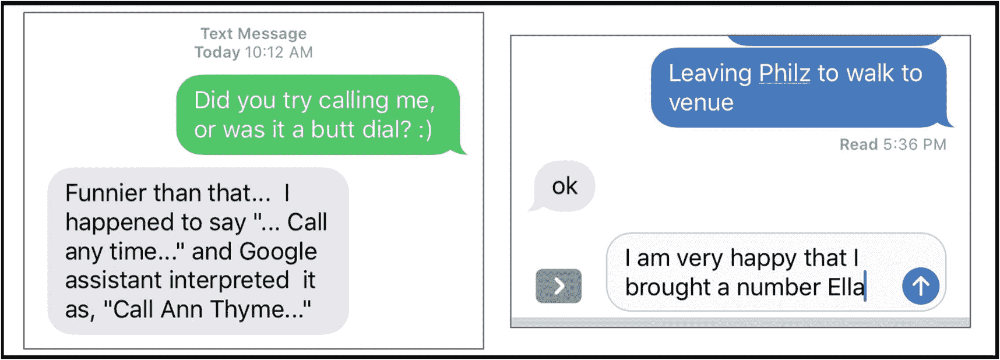

图 11-3

听写示例，其中文本结果基于声音，但用词错误

解决 `STT` 输出的任何错误表示的第一步是应用正确的“过滤器”来理解词语字符串。让我们先看看 `NLP` 如何做到这一点，然后再看看 `NLU` 如何从这种更具信息量的结构化文本中推断出含义。


#### NLP

NLP 是通过多种技术为文本字符串赋予结构的过程，这些技术对涉及的各个部分及其关系进行分类。这样做的目的是澄清和消除文本字符串的歧义，以便赋予正确的意图。请看这个你可能听到的指令示例：

> *从* ***瓶子里*** *取出* ***一片药*** *并吞下* ***它***。

大多数人无需费力就能理解这里的*它*指的是*药片*，而不是*瓶子*。对我们人类来说这很容易，这要归功于我们的世界知识，但这也涉及到词性分析，以解决**代词指代**和**回指**问题，即使用像*它*这样的词来指代别处定义的事物。有些语言学家毕生都在分析这类指代；它们就是如此复杂。这意味着语音用户界面（VUI）会在它们上面栽跟头。

NLP 可以基于规则，也可以基于统计；你在第 10 章中已经了解了这两种语法类型。以下是关于自然语言处理过程的一些有趣细节——你无需成为其中任何一项的专家就能创建优秀的 VUI，但对这个过程有更清晰的认识会有所帮助：

*   **词性标注**：标记字符串中每个单词的语法类别（名词、动词、冠词等）。在英语中，基本的语法类别不超过十个，但根据你的 VUI 的任务和领域，可能存在许多相关的子类别，因此使用 100 个或更多的标签并不罕见。标注在多个方面都很复杂。你是将“what’s”标注为“what”+“’s”还是作为一个整体？“play”是名词还是动词？在有语法性别的语言中，你应该将所有冠词标注为同一类别还是不同类别？

*   **实体提取**：也称为命名实体识别，是查找并标记某个类别的具体实例的过程，例如人名、药物或食物名称、或数量。这有点像查找某个槽位的所有值，可能会让你想起在第 10 章中学到的关键词识别。

*   **句法分析**：句子中的单词根据规则及其词性彼此之间存在句法关系。关键在于，分析规则通常适用于书面语言。正如你现在所知，口语完全是另一回事，充满了不完整性。然而，句法分析对于正确理解至关重要，因此它需要能够处理口语话语。

*   **共指消解与回指消解**：在使用代词（“它”、“它们”等）的同时保持清晰是会话式语言的特征。这显然加快了沟通速度。你的会话式 VUI 需要正确处理代词指代；如果你的 VUI 只接受完全指定的实体，用户会讨厌你。句法分析在此发挥作用。

在本章中，你将了解更多关于这些过程的内容，尽管我们只会触及 NLP 众多迷人主题的皮毛。

#### NLU

NLU 专注于将处理过的文本字符串转化为（希望如此！）在 VUI 主题和任务范围内有意义的内容，以便 VUI 能够据此采取行动。特别是，NLU 涉及在某个对话系统能够处理的范围内，将话语与正确的含义相匹配，或解析语义意图，同时避免将超出范围的请求强行匹配到范围内的内容。让我们看几个处理含义的例子：

> *我 10 点到 12 点之间有空。你能帮我预约修剪头发的时间吗？*

这个对美发沙龙的请求意味着*我可以在上午 10 点到那里，并且需要在中午前完成。你知道修剪需要多长时间；安排一下吧*。它并不意味着中午开始对他们来说可行。如果修剪需要 20-30 分钟，那就意味着开始时间不晚于 11:30。对人类来说很简单，对机器来说就没那么简单了，但并非不可能。

> *我能……* ***米饭*** *……它还能吃吗？*

在我们的手术准备应用程序中，仅凭*米饭*一词就足以给出准确回复吗？如果用户指定了数量或类型呢？在某些情况下，这可能会对回复产生影响。你应该预料到关于*熟米饭*、*白米饭*、*糙米饭*、*米布丁*、*米饼*、*石锅拌饭*、*米饭和豆子*等等的问题。而*吃几粒米饭可以吗？*这个问题很可能真正意思是*哎呀，我吃了可以吃的食物，但里面有一点米饭。希望我没有搞砸我的准备*，因此这需要的回复与*我能吃一碗米饭吗？*是不同的。

让我们快速了解一些 NLU 概念——再次强调，你并不总是需要处理这些，但了解一些相关知识是有好处的，尤其是当你更多地从头开始创建自然语言处理，而不是依赖平台提供的内容时：

*   **语义歧义**：同一个词可能因领域（或主题/科目/垂直领域）不同而具有不同的语义（或含义）。你需要为你的 VUI 赋予正确的含义。在调酒师 VUI 中，“Manhattan”是一个地方还是一种饮品？两者都是，取决于请求的上下文：*在曼哈顿找一家酒吧* 或 *曼哈顿鸡尾酒里有什么？* 而*在曼哈顿找到最好的曼哈顿鸡尾酒* 如果你的句法分析有效，这也不是问题！

*   **词汇表和本体论**：你可能需要根据含义，将替代词和同义词映射到正确的实体，这既包括通用情况，也包括针对你的 VUI 的特定情况。为此，你需要一个词汇表（或词汇库/词典）。并且它需要适用于口语词汇和短语，而非书面语。本体论则捕捉理解所需的词语和概念之间的关系。例如，它会显示所有米饭类菜肴是相关的，同时也会显示哪些是熟的，但可能不涉及米饭的量——另一个本体论部分则会专注于度量衡。

*   **情感分析**：情感指的是观点或态度；情感分析指的是从自然语言中提取情感或主观信息。讽刺、幽默和情绪基调是人类对话的一部分——有时听者能领会，有时则不能。这对任何 VUI 来说都非常困难。我们将在本书后面讨论原因。

*   **推理**：推断（通过推理得出结论）和处理新的自然语言短语对机器来说仍然具有挑战性，原因包括人们表达方式的无限变化和模糊性，以及对更深层次世界知识的需求。

不，你可能不需要显式地处理 NLP 和 NLU 的所有组成部分，但你了解得越多，就越能在遇到问题时找到解决方案。NLU 并非真正的智能。但如果你利用现有资源将其映射到正确的意图并做出恰当回应，你就能接近听起来很聪明的效果。


#### 深度解析：何为“智能”、AI 与理解？

尽管我们和其他人都在随意使用“意义”和“理解”这类术语，但这并不意味着当今任何 VUI 都具备人类级别的智能。真正的理解意味着能够将知识泛化到新情境下的新问题中。高度精确的跨领域 NLU（通用人工智能）才是语音领域的真正“圣杯”，而这一目标远未实现。许多局限于单一任务或领域的 VUI（依赖狭义或弱人工智能）在相同情境下，比大多数人类要脆弱得多。

什么是智能？图灵测试无法告诉我们答案；它测试的是人类对机器的感知。它检验机器能否模仿人类行为，使人类相信自己正在与另一个人类交谈。“什么是智能？”是一个极其复杂的问题，远超本书的讨论范围。但它又与对话系统高度相关。幸运的是，我们并不需要真正回答这个问题。我们真正需要做的是避免让用户失望。

历史上已经出现过几次“人工智能寒冬”——即人们对 AI 兴趣寥寥、资金投入有限的时期。这个术语通常指 20 世纪 70 年代的一次，以及 20 世纪 80 年代末至 90 年代的一次。人工智能寒冬的发生有多个原因，但核心在于，在一段时期的炒作和过于乐观的承诺之后，期望落空所带来的失望。

考虑到围绕“智能”语音应用曾有过如此多的乐观与希望，这对我们这些想要构建它们的人来说意味着什么？我们注定失败吗？当然不是。我们可以通过设定恰当的期望，并用满足甚至超越这些期望的语音解决方案（即让用户感到被理解的方案）来兑现承诺，从而避免潜在的“对话语音代理寒冬”。好消息是，利用当今已有的工具和方法，对话语音代理已经可以得到改进——而这正是你在本书中将要学到的。这并不难，关键在于关注细节。你的 VUI 逻辑和响应的精细度与鲁棒性，直接决定了它看起来是“聪明”还是“愚笨”。

#### 解析

我们两位作者都与解析打过交道——一位是工程师，另一位是语言学家。解析是为一个由单元（词语）组成的字符串分配句法（语法）结构以进行进一步分析的过程。解析的目的是确定该结果结构在某种语言（无论是自然语言还是计算机语言）中是否有效。换句话说，解析涉及将某个字符串与现有模式（表征）进行匹配，并根据匹配结果分配一个结构。解析字符串有助于“修正”像图 11-3 中那样的 STT 识别错误。它还有助于捕获那些原本超出语法覆盖范围的语句。解析（也称为浅层解析或组块分析）会分配一个粗略的结构，可用于生成通用响应。本章稍后会详细介绍。如果你依赖 `Dialogflow` 或其他类似工具，解析将由它们为你处理。但了解一些解析器的知识，仍然有助于你在问题出现时进行分析和修复，甚至能帮助你创建自己的解析器。

解析通常涉及词形还原（保留单词的核心词干，即词元）和分词（将单词切分为其语素，如前缀“un-”和复数后缀“-s”），并基于此过程进行分类。

解析自然语言最困难的问题之一是处理歧义（多种解析结果）和长距离依赖关系，例如代词指代（“它”指的是什么）。最终只能保留一种解析结果，才能从中推导出含义。还记得之前的例子吗？*从瓶子里拿出一片药然后吞下它*。当存在歧义时，人类听众要么会要求澄清，要么会根据世界知识、上下文等做出最佳猜测。计算机需要找到处理这个问题的方法。

解析的另一个困难在于我们处理的是口语。自然的对话式语音充满了口吃、语序混乱、犹豫、重新开始、停顿、咳嗽等等。从技术角度来看，结果往往不完整或不合语法。这就是为什么你要使用你学过的不同语法方法：寻找模式、匹配关键短语、基于概率的模糊匹配等等。

**成功秘诀 11.1** 词语是误解的根源

^(⁷³) 文本是口语表述的一种便捷表示形式。但请记住，书面语和口语是互不相同的。解析对话式语音必须处理重新开始、不流畅、句中停顿，甚至不合语法的句子。

图 11-4 展示了一个使用 Stanford Parser 进行解析的示例，这是一个常用的 NLP 解析器，你可以亲自在 [`http://nlp.stanford.edu:8080/parser/index.jsp`](http://nlp.stanford.edu:8080/parser/index.jsp) 尝试。^(⁷⁴) 示例与之前相同：*从瓶子里拿出一片药然后吞下它*。

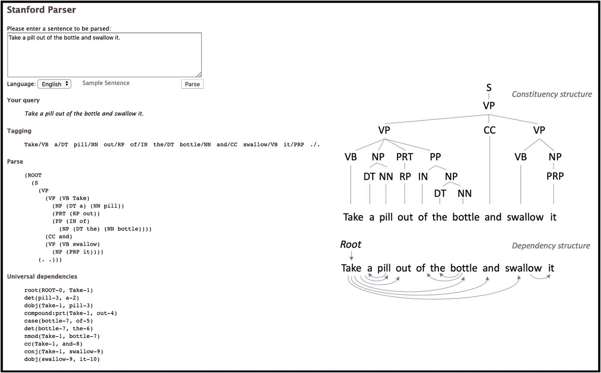

**图 11-4** Stanford Parser 及其关联解析树的示例

看看 NLP 解析器的一些不同组成部分：

- **词性标注**：确定每个单词的词性，例如 `NN` 表示名词，`VB` 表示动词。
- **句法分析**：使用层次树将句子划分为词性成分。这不仅仅是每个单词一个标签，而是整个句子的相对结构。你会看到诸如 `NN` 表示名词、`NP` 表示名词短语、`VB` 和 `VBP` 表示动词和动词短语等标注。^(⁷⁵)
- **通用依存关系**：创建一个树，其中最重要的词语靠近根节点，而“相关性”较低的词语位于树的叶子节点。这离句子的含义又近了一步。在这个例子中，动词 *take* 是树的根节点；动词通常如此。直接宾语 (`dobj`) 是被拿取的东西，所以你在 *take* 和 *pill* 之间看到了 `dobj` 关系。以此类推。比较一下成分结构树和依存关系树中词语之间的关系强度。

利用这些类型的解析结果，你可以指定规则来推导出意图（可能来自依存解析的根节点及其修饰语）和词槽（根节点的子节点）。

词袋模型是一些 NLP 应用中流行的方法。顾名思义，它就像把句子切分成单独的词语，然后放进一个袋子里，忽略句法结构和词序，但保留每个词语出现次数的信息。由于像“the”和“a”这样的冠词或“to”这样的介词是迄今为止最常见的词语，它们通常会以某种方式被规范化。这种技术对于文档分类或确定领域主题很有用，但显而易见，它无法为理解英语对话提供足够的信息：在英语中，词序很重要——请注意，并非所有语言都如此。那些小词，如冠词、代词以及“to”与“from”的区别，也同样重要。没有这些信息，你就会丢失重要的含义。例如，如果你的 VUI 无法区分*从我的支票账户转账 500 美元到乔的储蓄账户*和*从乔的支票账户转账 500 美元到我的储蓄账户*，你认为用户会作何反应？我们最近向一个语音助手询问*告诉我关于欧洲前往美国的旅行要求*，却被告知了美国前往欧洲的旅行要求。除非你有其他方法来捕捉这些重要的含义差异，否则不要期望在一种依赖词序来编码含义的语言中使用词袋方法。


#### 机器学习与自然语言理解

我们只浅尝辄止地介绍了深度学习（DL）及其如何推动语音转文本（STT）、自然语言处理（NLP）和自然语言理解（NLU）取得巨大进步。这个重要主题过于庞大，无法在此详述，但让我们快速了解一下。

深度学习使用分布式表示法；它接收一个数值特征向量（或向量序列）作为输入，并输出多个类别中的一个，其中每个类别代表你语音用户界面（VUI）中的某个意图（如意图识别）。深度学习需要数值特征，但你拥有的是文字。如何弥合这一差距？

`词嵌入`是将单词转换为 n 维空间中的向量的过程。基于“观其伴，知其意”^(⁷⁶)的理念，出现在相同语境中的词语应在语义上同义，并具有相似的特征向量。而邻居词截然不同的词语，其特征向量也会大相径庭。简单来说，餐厅名称常出现在相似的句子位置，因此一个新名称很容易被理解为餐厅：

*   *麦当劳几点关门？*
*   *娜娜家几点关门？*
*   *麦当劳几点开门？*
*   *娜娜家开门了吗？*
*   *_____ 几点开门？*

这些词嵌入是在数百万（甚至数十亿！）词的语料库上训练而成的。你可以使用预训练的词嵌入，也可以自行训练，或者基于预训练模型用你的特定语料库进行微调，但这都需要大量数据——这显然是深度学习的一个限制因素。

包括 Dialogflow 在内的大多数现代系统都大量使用深度学习来学习和泛化，因为它比浅层机器学习技术性能更优，且所需定制工作更少。双重优势！深度学习技术对措辞的细微变化更具鲁棒性，因此用户无需完全按照训练时的说法来表达；系统会学习哪些词语重要并据此做出响应。这就是为什么 Dialogflow 的意图不需要大量训练样本也能表现良好的原因。在本章后面，你会看到手工构建的自然语言处理仍有其用武之地。

#### 本体、知识库与内容数据库

在第 10 章中，你学习了如何创建和使用语法。但我们没有告诉你如何找到数据来填充大型内容语法，例如食物或药物名称。如果我们的手术准备语音用户界面能处理*“我能吃肯德基吗？”*，那是因为它被训练成将*“肯德基”*识别为`<食物 炸鸡>`，这在一定程度上要归功于本体。

本体就是知识库。它们展示了一组词语和概念在某个领域内是如何关联的。本体是连接同义词和反义词的大型层级结构，展示了每个条目具有哪些特征，以及哪些是其他条目的子集。有时你可以使用他人创建的本体——谷歌知识图谱就是一个例子。存在各种有用的大型口语语料库，例如英国国家语料库^(⁷⁷)，但你可能需要构建自己特定领域的本体。想想手术准备食物问题需要什么。为了让你的语音用户界面做出恰当响应，食物名称需要如何分类？哪些分类是相关的，哪些不是？你从哪里获取这些信息？针对语音交互需要做哪些改动？

创建这样一个知识库可能是一项艰巨的任务——再次强调，别担心！我们将向你展示如何一步步解决这个问题。正如你将看到的，这项努力非常值得。你或许可以从已有的资源入手，例如国家药品编码（NDC）目录，这是一个包含所有美国药物名称及其分类的数据库。但它不提供发音或人们说出这些名称的替代方式。你也不能上网抓取一个涵盖你食物日记或食物常见问题解答中所有食物的本体。你可以在食谱或菜单中找到菜肴和食物的名称，甚至营养信息。但你在哪里能找到关于食物及其人们如何称呼它们的全面知识库，包括如果对语音用户界面手术准备很重要的话，还包括颜色和纤维含量？就拿白软干酪这样简单的东西来说。有*有机白软干酪*、*低脂白软干酪*和*小凝乳白软干酪*。是*低脂*还是*低脂肪*还是*低-脂*？

或者*2%*？还有*脱脂*和*凝乳*——甚至组合形式：*脱脂小凝乳*。*里科塔奶酪*和*夸克奶酪*在此用途上相同吗？*印度奶豆腐*怎么发音？还有*草莓白软干酪*或*混合白软干酪*。哦，天哪。食物日记想要记录一切；食物常见问题解答想要基于所有这些细节给出正确答案。

现在想想药物名称。大多数药物既有品牌名版本也有通用名版本，许多药物还有不同剂量版本、不同剂型，甚至含有添加剂的不同版本。品牌名和通用名差异巨大，大多数患者不知道什么药叫什么，也不注意剂量。去国家药品编码在线数据库搜索^(⁷⁸)，查一下你最喜欢的头痛药或感冒药，看看有多少种变体。而且情况更糟。最常见的止痛药在世界不同地区有不同的通用名：在美国，对乙酰氨基酚的通用名是 acetaminophen，但在欧洲是 paracetamol。尝试在国家药品编码中搜索 Paracetamol——找不到，但有超过一千条 Acetaminophen 的条目。但等等。还有更多！Acetaminophen 不同于 Ibuprofen，两者都不同于 Aspirin。有些人错误地把所有药都叫做阿司匹林（图 11-5）！

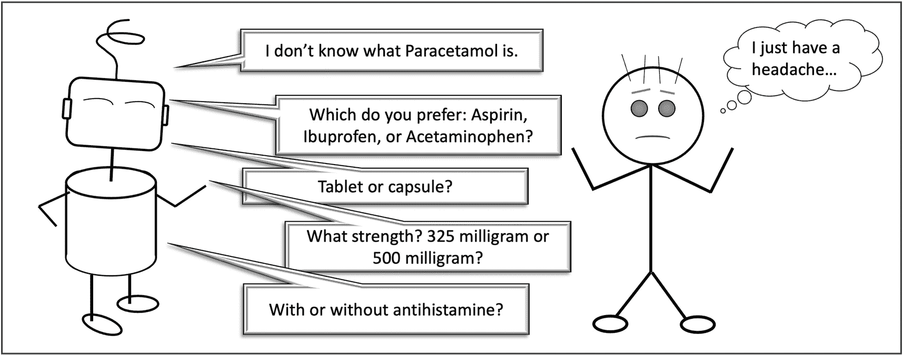

图 11-5

为用户提供符合其情境的合理选项


#### 这对 VUI 意味着什么？

归根结底在于上下文和用户期望。你的 VUI 是否应该同时理解 `paracetamol` 和 `acetaminophen`？很可能需要，因为你的用户可能来自不同国家。这两个词很可能会有不同的反应——而且肯定与 `aspirin` 不同。如果你使用 `NDC` 数据库（或类似数据库），你只会用到某些数据库字段，但你需要为语音需求添加其他字段：发音——针对 VUI 和常见用户变体——消歧需求以及槽位值。由此，你可以映射到后续步骤。如果用户是请求续方的患者，VUI 的响应将与查找剂量选项或 `NDC` 产品标签的医疗从业者不同。如果仿制药替代了品牌药，请小心如何向用户说明这一点。

比较以下三个 VUI 响应对话：

*   **用户**  *我想续方我的 Deltasone。*
*   *~ ~ ~  缺少解释*
*   **VUI1**  *好的，您的 Prednisone 续方将于明天发货。*
*   **用户**  *等等。什么？这不是我要求的！*
*   *~ ~ ~  Missing explanation*
*   **VUI2**  *您想要续方 Prednisone，对吗？*
*   **用户**  *我不知道你在说什么……*
*   *~ ~ ~  Includes clarification*
*   **VUI3**  *好的，您的续方将于明天发货。*
*   *您将收到 Prednisone，它是 Deltasone 的仿制药。*
*   **用户**  *太好了。*

### 成功技巧 11.2 启动你的标注工作

如果你需要标记或注释的数据集，请始终检查是否已有现成资源，这样你就不必从头开始。任何类型的标注都是一项巨大的工程，需要很长时间，并且必须准确。如果找不到完全符合你需求的内容，你通常可以找到一个起点，例如药物名称列表、食物、餐厅、名字或姓氏、城市名称等。如果其他模态中存在现有实现，例如产品名称数据库或网站，请从这些开始，并根据你的语音应用任务进行修改。一些专门为语音技术使用创建数据的业务正在开始出现。

正如本章引言中提到的，要把这一切做好听起来工作量很大。完全符合你需求的本体和数据库可能很难获得，因为其中大部分相当依赖于具体任务。因此，很可能你（或你的团队）至少需要完成部分工作。保持你的标注数据最新可能是一个挑战。标注指南（以及基于这些指南的测试脚本）将有助于完成这项任务——你将在接下来了解这些内容。请记住，你不需要立即把所有事情都做对，因为你将根据数据进行迭代和改进，在此过程中向本体添加短语和术语。这就是回退策略发挥作用的地方：如果你尚未实现最终产品的覆盖范围和变体，它可以为用户提供“出路”。这可以是与真人交谈，或指向在线材料或电子邮件，或一些包含通用、针对性较弱的答案的回退菜单。随着你扩展和调整语音系统，用户遇到这种回退策略的次数会越来越少，但很少有理由完全移除回退。总会有某些原因导致用户不被理解——也许仅仅是因为引入了像新处方这样的东西，而你尚未添加这个名称。

### 意图

你不需要在发布前为每个意图包含所有可能的训练短语，但你需要准备好快速迭代和更新训练短语，以反映真实用户的表述并捕捉预期含义。你的初始集越不准确，你的 VUI 在真实用户面前的表现就越差，正如你将在第 17 章（调优）中看到的那样。

#### 意图标注与标注指南

无论你使用什么平台，你都需要定义你的意图集。你会对人们可能对你的 VUI 说什么有一些预期，并将这些内容归类到你可以响应的通用意图中。至少，你会填写一些平台 NLU 可以基于其构建的示例表达。但你想做得更好，因此你收集了希望智能响应的表述数据。如何处理这些数据？嗯，你用自己定义的详细意图标签来标注它，然后你在标注指南中记录你所做的工作，这样你就不会忘记，并且其他人也可以提供帮助。

从一组已注释和转录的表述开始——既包括你预期人们会说的，也包括你在早期测试中能够收集到的。在某些平台上，这些数据很容易获得，包括 Google SDK；在其他平台上，则更具挑战性。你可以使用 `Dialogflow` 的训练功能来捕获 OOG 表述。你甚至可以设置一个单独的数据收集流程，记录并转录测试人员所说的内容。

这里值得提一下使用众包平台（如 Amazon 的 Mechanical Turk）来收集文本数据以进行早期系统启动。这对于获取简单日常任务的数据效果最好，例如对*你早餐吃了什么？*或*你在工作日通常设置什么时间闹钟？*的代表性常见回答。它成本低且速度快；我们自己也多次使用过这种方法。

一旦你有了数据，就开始标注：将所有文本结果放入电子表格的一列中，每个单元格一条表述（图 11-6 中的“表述”列）。在其他列中，开始按含义相似性和明确提及的内容细节对表述进行分类。随着你处理更多表述，你会重新排序并看到可用于形式化分组的模式。你开始添加标签（图 11-6 中的“标签”列）。

假设你有一些用户真的想在手术前喝点东西来镇定神经。你有一堆关于在手术准备期间可以喝什么的表述。答案是这不仅取决于手术还有多久开始或是否是酒精饮料，还取决于饮料的颜色和浑浊度。有些人问非常具体的问题，而其他人则问得更笼统。查看图 11-6 中标注集的摘录。注意填充短语、详细程度、内容、通用与具体（列中一个或多个 X）等方面的变化。而且它们并不都是完整的句子。一个可能的初始标注方案摘录已叠加显示。

随着你的进展，开始切分、添加和修改类别。无论你的标注方案和详细程度如何，关键在于一致性。以下是一些关于如何标注的指南：

*   你是在对用户的表述进行含义分类，因此不同的内容很重要，但如果整体含义保持不变，填充词和整体措辞则不重要。*我还能喝牛奶吗？* 和 *我还能喝咖啡吗？* 将被赋予不同的标签，但 *我还能喝牛奶吗？* 和 *我还能喝牛奶吗？* 会得到相同的标签。附注：`drink` 在 *我能喝牛奶吗？* 和 *我能喝一杯饮料吗？* 中含义不同——注意这个词的识别。

*   两条表述在含义上越相似，它们的标签就越相似；标签包含依赖相似性。

*   如果两条表述在相同上下文中总是导致不同的响应，它们应该有不同的标签；这意味着这些表述的含义不同。理想情况下，你的标注方案能让你看到标签就能很好地了解哪些表述属于该标签。

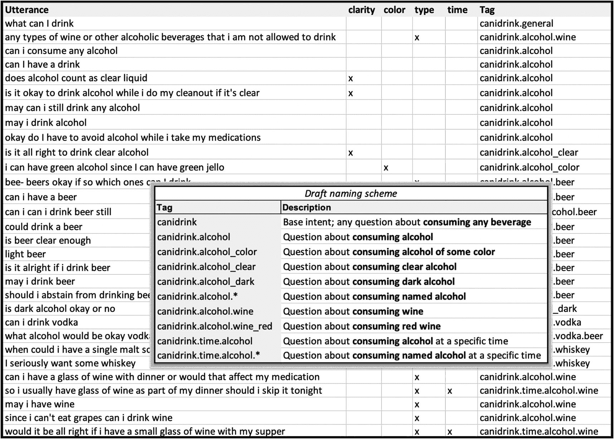

**图 11-6** 用户表述，按意图标签排序，以及初始标签集


花点时间仔细研究图 11-6 中的话语和映射。思考一下，由于提问方式的出人意料，你可能需要在哪些地方扩展原始的训练话语。同时，思考你需要了解哪些关于内容的信息。如果医疗程序前对某些颜色的食物和饮料有限制（这很常见），你需要知道葡萄酒和啤酒有不同的颜色和色调，并且`chartreuse`（查特酒）是绿色或黄色的。这只是所有关于允许喝什么的问题中极小的一部分——甚至只是所有问题中更小的一部分。没有一个重复的。情况会迅速变得复杂！

一旦你确定了标记方案，就将其记录在标记指南中。你的标记指南应包含每个标签、该标签意图的描述、一两个示例话语、关键词，以及任何使用该标签的额外有用说明。图 11-7 展示了针对这些数据，标记指南的一个片段可能是什么样子。

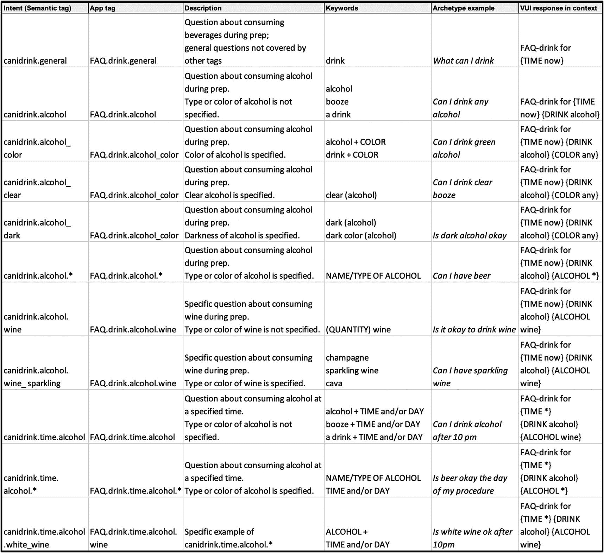

图 11-7

涵盖图 11-6 中代表性话语的标记指南摘录

你如何知道意图的粒度应该有多细？和往常一样，答案是“视情况而定”！一些指导原则：你的语义标签越细粒度，你就越有灵活性以听起来聪明的方式做出回应。但这工作量也更大。在这个集合中，你可以只有一个意图`canidrink`，它映射到一个关于手术前可以喝什么的一般性回答。但这并没有它本可以做到的那样有帮助：一个能识别所说内容的对话式 VUI 也应该对此做出回应。请注意，我们决定对具体时间（如*10 PM*）做出回应——我们通过计划在回答中更笼统地涵盖这一点来简化处理。

标记数据在你的语音项目的每个阶段都很有用，包括设计和开发阶段，以及测试和调优阶段（第 16 章和第 17 章）。

成功提示 11.3 标记，你被选中了！

将标记工作外包给一个与他们所标记数据脱节的团队可能很有诱惑力。如果你选择这条路线，或者你的组织要求这样做，请务必创建一个详细的标记指南，并在出现新的话语时保持联系以解决问题。标记人员本意是好的，但可能不熟悉领域、产品或任务，这使得他们更难知道什么是重要的。此外，请将你的标记指南视为你知识产权的一部分：如果你的意图模型是基于你投入大量时间创建它们的工作成果，那么它就是你的“秘方”的一部分。不要低估它们的价值。

#### 中间层：语义标签 vs. 系统端点

当我们在 Nuance 为呼叫中心路由创建 NL 解决方案时，我们区分了**语义标签**和**应用标签**。语义标签标记用户意图，尽可能贴近基于转录和上下文最可能代表用户话语意图的含义。应用（或 app）标签标记 VUI 行为，即系统对每个已解释请求的响应。这种区分迫使你将用户想要的东西与你能够提供的东西分开。语义标签代表基于转录和上下文的用户含义，而应用标签则编码了实现方式。语义标签往往比应用标签更细粒度，因此你最终会得到从语义到应用的多对一或一对一映射，但绝不会是一对多——事实上，那会导致歧义。因此，`canidrink.alcohol_clear`和`canidrink.alcohol_color`是两个语义标签，它们映射到应用标签`FAQ.drink.alcohol_color`，并且响应包含与两者相关的信息。将应用标签视为一种将用户的原始请求映射到 VUI 可以处理的槽位和意图的方法，而无需处理在特定情况下无关紧要的变体。这是一种控制变体失控的方法：通过忽略“无关的”变体来解释用户所说的内容，同时不丢失含义。如果一个应用标签涵盖了一组需要消歧才能让 VUI 适当响应的话语，那么语义到应用的映射将突出显示预期的消歧选项。

图 11-7 展示了这两者如何交互。“VUI 响应”列形式化了流程中的预期目标，或对话中预期的 VUI 响应类型。该列还可以通过你已有的任何命名约定链接到其他 VUI 模块和目标。对于大型系统，这种映射在测试上下文中的过渡是否听起来流畅时极其有用。

语义标签和应用标签之间的这种区别不仅对 IVR 有用，对任何涉及广泛主题或具有不同结果的请求的对话系统也很有用。我们已针对不同类型的语音系统和设备使用了这种方法。以下是它很方便的原因：

*   用户不了解你的故事。他们不是在请求特定的 VUI 行为或呼叫中心组；他们是在请求某些内容或信息，并且会以类似的方式向其他类似的 VUI 提问，即使这些 VUI 的响应方式不同。
*   应用标签作为一个中间层，可以比重新进行逐话语标记更快、更容易地与语义标签重新映射，这让人联想到依赖注入。
*   花费在大型数据集语义标记上的所有工作，可以通过更新标签之间的映射（而不是重新进行逐话语标记）来复用于相似的领域和任务，或用于其他客户。
*   当你的系统中发生某些变化时（例如添加了一个功能或转接给人工），可以快速修改应用标签的目标并更改响应。
*   如果你注意到很少有人区分你所做的区分，你可以将语义标签合并为更少的标签。或者，当你注意到可以进一步开发的模式时，将它们拆分。

创建用于话语标记的标记指南有很多原因：

*   设计
    *   为设计决策提供具体基础
    *   有助于微调响应措辞，使其与每个标签内的用户话语相匹配
    *   阐明需要哪些槽位和值来覆盖请求
*   语法开发
    *   有助于验证语法的健壮性和覆盖率
    *   在使用标记数据进行 SLM 训练时提供结构
*   测试和调优
    *   作为对话规范的补充，为创建测试用例提供基础
    *   有助于验证设计和实现是否处理了所有情况
*   生产力和团队沟通
    *   为其他人提供使用和参考的指南
*   洞察
    *   通过对话语进行分类，提供对语音变体的理解
    *   有助于跟踪随时间的变化并分析话语分布
    *   为确定未来的功能扩展提供数据

如果你的 VUI 给出尖刻的回应——我们并不是建议它应该这样——比如对“你能调高音量吗？”回答“是的”，那么你会为这个回答和“调高音量”使用不同的标签；如果你只是试图帮助用户，你会给它们贴上相同的标签，因为用户对两者的意图是相同的。

### 整合所有内容

我们已经介绍了大量关于如何理解用户话语的词汇和含义以将其映射到响应的信息。让我们看看如何将所有部分整合在一起，以最大限度地提高这个响应是最佳响应的机会。


#### 匹配宽泛与精确

将意图匹配想象为一组从精细到粗略的漏斗或筛子：如果用户表达具体，就给出同样精确的回应；如果用户表达笼统或模糊，就用更概括的内容回应。给出合理的回应，总比完全不回应或给出错误详细程度的回应要好。以下是四个示例对话：

1.  在本体中，`brown rice` 的详细程度足以给出精确的针对性回应。
2.  对更笼统的 `rice` 的回应，解释了不同具体类型之间的相关差异。
3.  假设 `sticky galangal rice` 不在本体中，回应会更笼统，承认它超出了 VUI 的知识范围，但仍基于它理解的内容（`rice`）给出谨慎的回应。
4.  如果项目未被理解，你仍知道这是一个关于食物的问题（`eat`），可以给出回答，而不是直接拒绝。或者向用户询问更多信息。例如，*我不确定那是什么。它含有高纤维、谷物或红酱吗？*

- **1.** **用户** *我今天可以吃糙米吗？ →* 具体，在本体中
- **VUI** *糙米在您的手术之前都不能吃。*
- *~ ~ ~*
- **2.** **用户** *我今天可以吃米饭吗？ →* 笼统，在本体中
- **VUI** *您仍然可以吃白米饭，但糙米不能吃……*
- *~ ~ ~*
- **3.** **用户** *我今天可以吃南姜糯米饭吗？ →* 具体，不在本体中
- **VUI** *我没听说过这个，但大多数米饭类食物在您的手术之前都不能吃。*
- *~ ~ ~*
- **4.** **用户** *我今天可以吃南姜吗？ →* 笼统，不在本体中
- **VUI** *我不确定那是什么。总的来说，今天您仍然可以吃一些固体食物。在您的手术之前，请不要吃高纤维食物。*

#### 多重语法，多次解析

在本章前面部分，您了解到解析可以让您捕获那些原本可能超出领域语法覆盖范围的语句。多次解析可以提供最稳健的意图解析。我们成功地将第一轮对精心排序的正则表达式进行精确匹配，与第二轮解析或 SLM 相结合。这样做的好处是，正则表达式是简洁地捕获复杂模式的强大机制——当它们匹配时，结果是可预测的，并且匹配（或不匹配）的原因很容易解释。SLM 在处理广泛的语句变体方面更强大，但可预测性较差。而且，由于它们是统计性的，SLM 可能会不必要地惩罚那些很少出现的请求，使得用户在这些情况下更难被理解。这种方法对于处理高风险领域的 VUI 尤其有用，在这些领域中，您需要能够解释某个内容被识别或未被识别的原因，例如在医疗领域。您甚至可以根据所采用的语法，在对话中实现不同的路径。由于正则表达式语法可以实现精确匹配，与仅使用捕获大致意思的 SLM 进行匹配相比，正则表达式的匹配结果通常更不需要确认或消歧（图 11-8）。

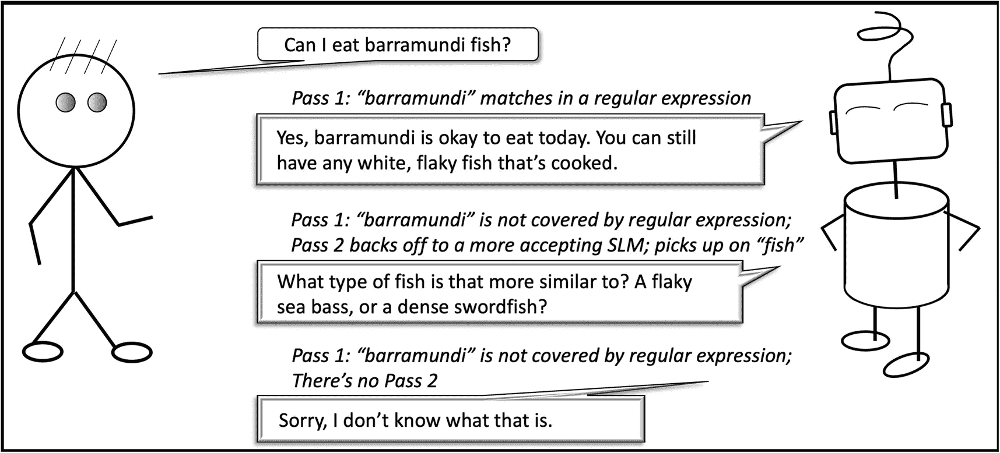

**图 11-8** 多次解析可以通过不同的对话路径实现更好的整体覆盖范围和回应

这种方法对于消歧场景也很有用。假设您有一个开放式提示，涉及广泛且大量的可能目的地或终点，例如一个购物应用。如果存在歧义，应用可能会跟进询问：*您想要哪一个：X、Y 还是 Z？* 实现此功能的一种方法是创建一个仅允许 X、Y 和 Z 的动态语法。一种更高效的方法可能是使用完整语法，但对结果进行后处理，只允许 X、Y 或 Z。这种后处理可以通过在 N-best 模式下使用 STT 来完成。N-best 列表返回一个按排名排列的可能匹配结果列表；从排名最高的结果开始，您遍历该列表，直到找到一个被视为有效的结果，然后返回该结果。您将在第 12 章中了解更多关于 N-best 的内容。

您也可以将这种方法与第三方 STT 引擎（如 Google 或其他）一起使用。即使您无法访问或控制所使用的主语法，您仍然可以对结果进行后处理，以返回在当前上下文中有意义的结果。


#### 重新审视斯坦福解析器

让我们使用其中一个意图来了解如何应用基于规则的 NLP 技术。再看一下 `tcrMakeAppointment` 意图，该意图用于编码用户与医疗服务提供者预约的请求。你为这个意图添加了以下示例短语：

- “预约。”
- “预约三人。”
- “预约下午三点。”

在“解析”部分，你首次接触了斯坦福解析器，这是一个常用于将句子解析为各种句法结构组件的工具包。访问 [`http://nlp.stanford.edu:8080/parser/`](http://nlp.stanford.edu:8080/parser/) 并输入第一个示例语句 *Make an appointment*，或者前往 [`https://nlp.stanford.edu/software/lex-parser.html`](https://nlp.stanford.edu/software/lex-parser.html) 下载解析器。查看“通用依赖关系（增强版）”部分的解析结果。你应该会看到类似清单 11-1 的内容。

```
root(ROOT-0, Make-1)
det(appointment-3, an-2)
dobj(Make-1, appointment-3)
Listing 11-1
“Make an appointment”的斯坦福依赖解析输出
```

在这里，依赖解析采用了“解析”部分中的经典句子解析，并利用大量规则创建了一种不同类型的解析树，该树试图将承载更重要含义的词语置于树的根部，而修饰语和填充词则位于更靠近叶节点的位置。

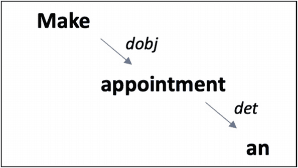

图 11-9

“Make an appointment”的斯坦福依赖解析树

图 11-9 展示了 *Make an appointment* 的依赖解析树：这是你在清单 11-1 中看到内容的图形化表示。清单 11-1 中的每个元素都包含以下组成部分：

- 树中父节点与子节点之间的关系类型，例如 `ROOT`、`dobj` 和 `det`。稍后会详细介绍这些关系。
- 父节点，例如 `ROOT-0` 或 `Make-1`。数字代表句子中词语出现的顺序。当句子中出现多个相同词语时，这些数字用于确保节点的唯一性。
- 子节点。

在这里，*Make* 是树的根节点。在依赖解析中，句子中的主要动词通常位于树的根部。树的下一个节点是“appointment”，它与根节点“Make”之间存在 `dobj`（直接宾语）关系。最后是“an”，它与“appointment”之间存在 `det`（限定词）关系。再次强调，最具“意义”的词语位于树的根部，而意义较小的词语则位于更低、更接近叶节点的位置。这意味着，要确定句子的含义，你应该关注依赖解析树的根节点。

接下来，输入三个句子中最长的一个 *Make an appointment for three PM*，并查看解析结果（清单 11-2 和图 11-10）。

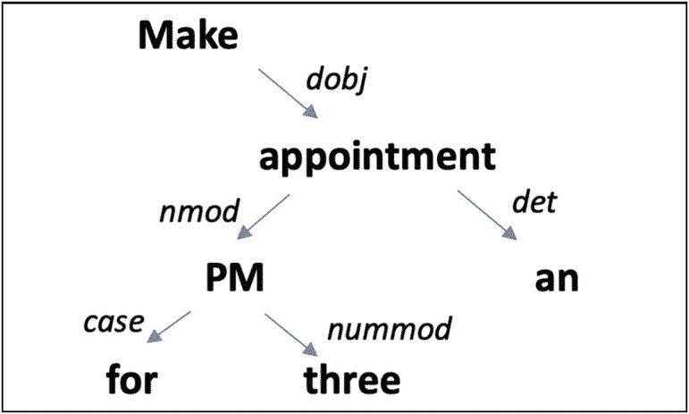

图 11-10

“Make an appointment for three PM”的斯坦福依赖解析树

```
root(ROOT-0, Make-1)
det(appointment-3, an-2)
dobj(Make-1, appointment-3)
case(PM-6, for-4)
nummod(PM-6, three-5)
nmod(appointment-3, PM-6)
Listing 11-2a
“Make an appointment for three PM”的斯坦福依赖解析输出
```

如你所见，树的根部分保持不变，但添加了 *for three PM* 后，主部分分支出了额外的元素。这正是你想要的：具有相同含义的句子在根附近应具有相同的结构，以反映这种相似性。

如果用户想要安排预约，但措辞不同（图 11-11）该怎么办？正如你所见，在许多平台上，你可以不必显式处理这种情况，这要归功于基于你提供的示例语句进行理解的统计模型。但情况并非总是如此。如果用户说了类似 *Arrange a meeting* 的话，用于训练 `tcrMakeAppointment` 的句子将无法处理。

```
root(ROOT-0, Arrange-1)
det(meeting-3, a-2)
dobj(Arrange-1, meeting-3)
case(PM-6, for-4)
nummod(PM-6, three-5)
nmod(meeting-3, PM-6)
Listing 11-2b
“Arrange a meeting for three PM”的斯坦福依赖解析输出
```

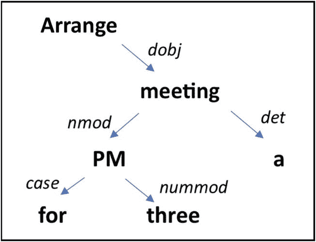

图 11-11

“Arrange a meeting for three PM”的斯坦福依赖解析树

#### 确定意图

解析树很有趣，但它们如何帮助确定意图呢？再看一下这棵树：

- 有一个根节点：“Arrange”。
- 有一个作为根节点子节点的 `dobj` 节点：“meeting”。

这听起来像是意图的含义！想象一下，有额外的规则用于确定槽位值，比如预约时间——这些规则将基于“meeting”节点的子节点。是时候为这些规则编写代码了。

##### 介绍 spaCy

对于代码，我们将使用另一个意图 `arTodaysTasks`（用于询问今天需要完成什么任务）。`tcrMakeAppointment` 很适合说明依赖解析的用处，尤其是在需要添加限定信息时。但在这个例子中，我们不想关注填充时间、上午/下午等槽位的复杂性，因此我们从一个不需要槽位的意图开始。

由于我们正在改变内容，我们还将使用另一个依赖解析器：开源的 spaCy。^(⁷⁹) 我们使用 spaCy 是因为：

- 我们想强调，市面上有多种 NLU 工具包；许多工具包提供非常相似的表示，并且都是同样不错的选择。
- 最近许多工业应用都在使用 spaCy。
- 使用 spaCy 的代码比使用斯坦福解析器稍微简单一些。
- 非基于 Web 的斯坦福解析器是用 Java 编写的，因此不太适合我们的 Python 框架。
- 基于 Web 的斯坦福解析器依赖于一个通常可用的 Web 服务，但我们曾遇到过它不可用的情况。
- spaCy 具有一些我们将讨论的性能优势。

让我们开始吧！

##### 加载 spaCy

首先是将 spaCy 加载到你的系统中。这涉及在 `requirements.txt` 文件中添加一些行，如清单 11-3 所示。

```
setuptools
wheel
spacy>=2.0.0,<3.0.0
https://github.com/explosion/spacy-models/releases/download/en_core_web_sm-2.3.1/en_core_web_sm-2.3.1.tar.gz#en_core_web_sm
Listing 11-3
为加载 spaCy 对 requirements.txt 所做的更改
```

我们不建议你手动输入这些内容；只需从代码示例中复制 `requirements.txt` 文件即可。最后一行很复杂（由于长度较长，在文本中跨了两行），它加载了 spaCy 用于执行 NLU 的模型。有多种语言的多个模型可用。^(⁸⁰)

更改 `requirements.txt` 后，你需要加载软件，具体方法取决于你的部署方式：

- 当你在 Google Cloud 上使用 `gcloud app deploy` 部署时，所需的新软件和模型会自动安装。
- 如果你在本地使用 `ngrok` 运行 webhook（如第 10 章所述），则需要通过 `pip install -r requirements.txt` 手动安装。


##### 调用 spaCy

下一步是调用 spaCy，为给定的文本提供依存句法分析。清单 11-4 展示了这个新代码，位于新文件 `spacy_parser.py` 中。首先，加载模型（A），确保使用与 `requirements.txt` 文件中加载的相同模型。然后，对输入文本运行 spaCy（B）。接下来，初始化空的依存句法分析节点列表（C），并遍历 spaCy 输出中的节点（D），将节点添加到依存句法分析节点列表中（K）。每个句法树节点由一个字典表示，包含：

- 文本（E）
- 词元（F），即词干（“run”是“run”、“ran”、“runs”、“running”等的词元）
- 标记在整个句子中的索引（G）（第一个词为 0，第二个词为 1，依此类推）
- 与父节点的关系（H），根节点为“ROOT”
- 父节点的索引（I）
- 节点的词性标注（J）

最后，返回依存句法分析节点列表（L）。

```python
def dependency_parse(text):
    """
    获取 spaCy 依存句法分析。
    每个节点包含：
    text
    与父节点的依存关系（根节点为 ROOT）
    父节点
    词性
    """
    # 加载 spaCy 模型
    nlp = spacy.load('en_core_web_sm')                  # A
    # 运行 spaCy
    doc = nlp(text)                                     # B
    # 初始化并收集依存句法分析
    parse = []                                          # C
    for token in doc:                                   # D
        node = {"text": token.text,                     # E
                "lemma": token.lemma_,                  # F
                "index": token.i,                       # G
                "relation": token.dep_,                 # H
                "parent_index": token.head.text,        # I
                "pos": token.head.pos_}                 # J
        parse.append(node)                              # K
    return parse                                        # L
```

*清单 11-4*  
*调用 spaCy 提供依存句法分析*

##### 使用 spaCy 的依存句法分析

既然你能从 spaCy 获取依存句法分析，那就来用它吧！首先，我们看一下 `arTodaysTasks` 意图中“What should I do today?”这个短语的依存句法分析。与你之前对 Stanford Parser 所做的类似，你可以在网页 [`https://explosion.ai/demos/displacy`](https://explosion.ai/demos/displacy) 上获取 spaCy 的句法分析。图 11-12 展示了句法分析的结果。

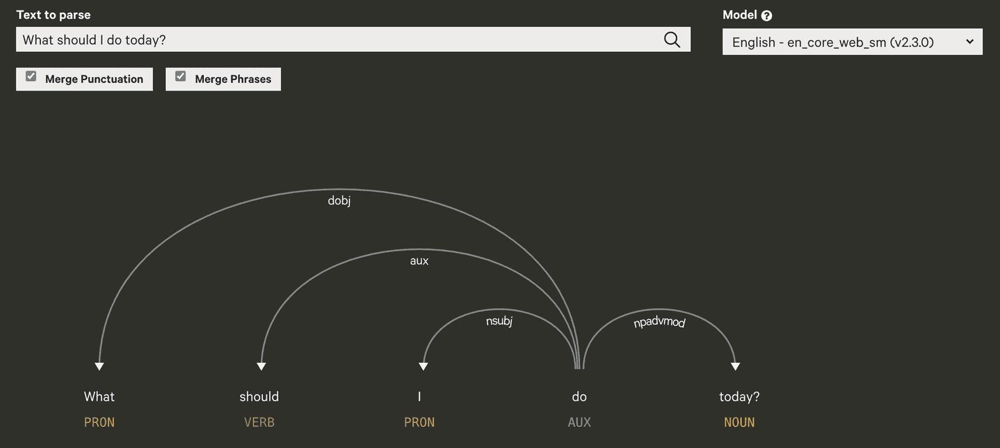

*图 11-12*  
*spaCy 对“What should I do today?”的依存句法分析*

它看起来与你之前看到的树状结构略有不同。这是依存句法分析常见的可视化方式（Stanford Parser 在图 11-4 中使用了类似的可视化）。我们有根节点“do”，然后所有其他词（NLP 术语中的“标记”）都挂在“do”下面，值得注意的是“What”与根节点之间存在 `dobj` 关系。

由此，我们可以为 `arTodaysTasks` 意图设想出一套合理的判断标准，如下所示：

- 根节点的词元是“do”。
- 根节点下有一个 `dobj`，其词元是“what”。

你可能会问，为什么这两个规则都基于词元而不是原始文本。通常，为了确定含义，主要关注的是目标词的词干，而不是它是否大写或小写、单数或复数、现在时或过去时——这些在原始文本中都是不同的。编写一个查找词元“do”的单一规则，比使用各种可能的原始文本（does、did、doing、done 以及所有大写形式）要容易得多。词元本质上捕捉了核心含义。

既然你有了一些合理的规则，让我们看看代码（清单 11-5，位于 `fallback.py` 中）。第一部分（A）可能在第 10 章中见过；这里你尝试在句子文本上使用正则表达式来查找重复意图。如果这没有成功（B），你就从 spaCy 获取依存句法分析（C），然后开始查找可用于规则的特征。第一个特征是根节点。遍历依存句法分析节点（D）；当你找到关系为 `ROOT` 的节点时，设置根节点的索引（E）和词元（F）。接下来，查找一个与其父节点（G）关系为 `dobj` 且父节点为根节点（H）的标记，找到后设置该特征（I）。最后，你可以使用这些特征实现规则（J）。当找到匹配时，触发意图（K），与第 10 章完全相同。如果依存句法分析没有找到任何内容，则返回 Dialogflow 原本要说的内容（L）。

将这个任务分解为确定特征然后基于特征应用规则的子任务，一个很好的“特性”是，只需少量特征，你就可以为许多感兴趣的意图实现规则。

这里你只查找一个意图，但你可以想象很多形式为“对那个事物执行这个动作”的意图，这些意图可以通过根节点动词对应动作，以及根节点下的直接宾语（`dobj`）对应事物来编码。

Stanford Parser 有一个名为 `semgrex` 的工具：基本上是用于依存句法分析树的正则表达式。它正是为了做我们这里所做的事情而设计的：在树中搜索模式。spaCy 全新的 3.0 版本包含了类似的 `semgrex` 功能，用于在依存句法分析中查找模式——这正是你在这里所做的，只不过你是手动完成的。

```python
if re.search('((say( that)? )?again|repeat( that)?)( please)?',   #A
             df_request.query_text):
    # 重复
    # 触发 confirmYes 事件。
    df_response.event_to_trigger = 'repeat'
else:     #B
    # 正则表达式未命中；尝试依存句法分析
    parse = dependency_parse(df_request.query_text)   #C
    # 从依存句法分析树中收集特征
    # 获取依存句法分析树中的根节点
    root_verb_index = None
    root_verb_lemma = None
    for node in parse:   #D
        if node.get('relation') == 'ROOT':
            root_verb_index = node.get('index')   #E
            root_verb_lemma = node.get('lemma')   #F
    # 获取根节点下的 dobj
    dobj_lemma = None
    for node in parse:
        if (node.get('relation') == 'dobj' and   #G
            node.get('parent_index') == root_verb_index):   #H
            dobj_lemma = node.get('lemma')   #I
    if root_verb_lemma == 'do' and dobj_lemma == 'what':    #J
        # "What should I do today?."
        # 触发 arTodaysTasks
        df_response.event_to_trigger = 'arTodaysTasks'    #K
    else:
        # 无依存句法分析匹配；执行 Dialogflow 原本的操作
        df_response.output_text = df_request.fulfillment_text   #L
```

*清单 11-5*  
*使用 spaCy 依存句法分析查找 arTodaysTasks*


##### Dialogflow 的变更

快完成了！你只需要对 Dialogflow 做一些修改，就像第 10 章中那样：

- 从 `arTodaysTasks` 意图中移除示例短语，这样当用户说出这些短语时，系统会触发默认回退意图。
- 向该意图添加 `arTodaysTasks` 事件。

##### 选择 NLU 引擎

本章介绍了两种 NLU 引擎：Stanford Parser 和 spaCy。它们只是众多引擎中的两个，这很好：你可以找到最适合你需求的引擎——请确保将此步骤添加到你的探索阶段（第 4 章）。许多人用于评估 NLU 引擎的两个性能标准是解析准确率和吞吐量（引擎每秒能处理的单词/句子数量）。Choi、Tetreault 和 Stent（2015）^(⁸¹) 基于包括这两个标准在内的一系列指标比较了十种不同的 NLU 引擎，并展示了 spaCy 为何在现实世界的工业应用中如此受欢迎的原因之一：它具有 89.6% 的中高准确率和最高的吞吐量（14000 个词元/秒）。此外，spaCy 可以通过 Python 访问，而 Python 仍然是自然语言处理和机器学习领域的首选语言。

### 深入理解：实践中的理解、解析与知识

本章介绍了一些相当高级的主题，因为我们希望你能够了解，在不付出巨大努力的情况下，今天可以做到哪些事情来提升理解能力，同时也能认识到为什么这个问题棘手且尚未解决。这是当今语言技术领域最令人兴奋和最具挑战性的领域，并且在未来几年内仍将如此。它涉及对认知的更深入理解和表征——我们将用一些补充说明来结束本章，并鼓励你在线搜索最新的进展和解决方案。

#### 重新审视意图

在本章和上一章中，你看到了两种截然不同的使用自然语言处理来确定用户意图含义的方法：

- 使用原始文本中的正则表达式（第 10 章）
- 使用更高级的自然语言结构来编写更通用的规则（本章）

还有其他基于知识的方法。spaCy 有一个基于规则的匹配器，允许你根据文本、词元、词性和其他属性编写规则。它与我们在本章中所做的有很多相似之处，但没有基于层级树结构的词元。你可以在 [`https://explosion.ai/demos/matcher`](https://explosion.ai/demos/matcher) 交互式地尝试基于规则的匹配器。

到目前为止，本书已经讨论了很多关于意图的内容，或者说用户想要做什么。意图是一个非常有用的结构，可以简化语音应用程序的开发；首先，你从语音和文本中确定意图，然后根据意图，决定在对话中下一步做什么。这在图 11-13 中进行了简化。

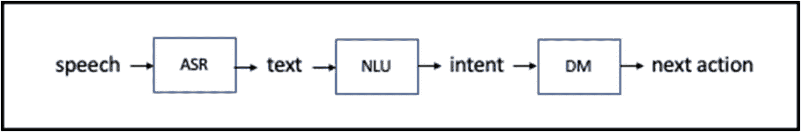

图 11-13

当前使用意图的对话系统流水线

最近，语音开发社区出现了一种趋势，即摒弃意图，认为意图是一种人为的创造，实际上阻碍了我们向更全面的对话系统演进。例如，参见 [`https://blog.rasa.com/its-about-time-we-get-rid-of-intents/`](https://blog.rasa.com/its-about-time-we-get-rid-of-intents/)，其中以下示例说明了一些复杂性：

- 用户  *我想找一家餐馆。*
- 系统  *中餐怎么样？*
- 用户  *我昨天吃过了。*
- 系统  *意大利菜怎么样？*

你可以理解为什么这种对人类来说很自然的对话处理起来会很棘手。在意图的上下文中，或者按照你在 Dialogflow 中的做法，“我昨天吃过了”会是 `confirmNo` 意图的一个示例训练短语。但你很可能永远不会将这样的短语用于如此通用的意图；它只有在那个非常特定的上下文中作为“不”的同义词才有意义。它仅在此上下文中暗示“不”，因此是领域特定的。这并不影响它作为一个有效回应，所以需要被正确处理，但不能作为通用“是/否”意图的一部分。它在 `restaurant.recommendation` 意图内是有效或显著的。当然，你可以（并且你在最后两章中也这样做了）通过在 webhook 中添加非常特定于当前领域（和意图）的自定义含义判定来扩展你的语法，然后触发否定确认。所有这些自定义工作都显著增加了复杂性，这就是人们寻找替代方案的原因，但其重要性正是最后两章中大量讨论的原因。其论点是绕过意图的概念，直接从训练短语中确定或训练下一步对话动作，而不是让意图“居中”。图 11-14 示意性地展示了这一点，其中意图可以被绕过，但并非必须如此。

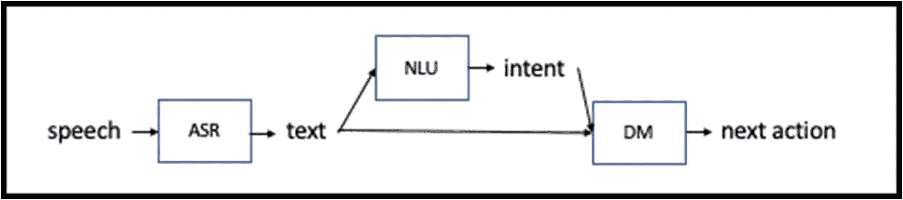

图 11-14

可选地绕过意图，直接从文本确定下一步动作

从实现全面对话系统的角度来看，这有一定道理，因为意图的概念限制了你在当今大多数平台上所能做的事情。然而，它仍然是一个有用的概念，特别是如果你将“意图”视为一种捕获“语义解释”或“在当前对话上下文中解释用户所说内容核心含义的结果”的方式，这正是我们对它的理解。专注于标准和指南的组织 W3C 这样表述：“需要的是一种计算机可处理的信息表示，即语义结果，而不仅仅是自然语言转录。生成代表自然语言话语含义的语义结果的过程称为语义解释。”^(⁸²) 这里的关键是不要良莠不分一起抛弃，而是保留有意义和有用的东西，同时改进用于创建更好、更复杂的对话式语音交互的工具和表示。事实上，语音领域的研究人员长期以来一直承认需要稳健的对话，既能允许用户灵活表达，又能识别其潜在含义。如果你有兴趣深入研究，可以查阅 Lemon 和 Gruenstein 的一篇内容密集但信息量大的论文。^(⁸³)

当然，问题是：如何直接从文本（即对实际所说内容的另一种解释）确定下一步对话动作，而无需上下文含义的中间表示？这是一个非常复杂的问题，也是需要更深层语义模型的地方，这些模型可以被整合到支持此类系统开发的框架或工具中。对话不仅仅是表面的统计预测。它们也不是无状态的，或者仅仅依赖于 5 秒前说过的某件事。这不仅仅是能够构建一个概念验证或原型。这是一个理解人们如何说话和思考的问题，并构建出他们会使用的东西，因为他们感到自己在特定的上下文中被理解，包括领域和言语行为，正如 Lemon 和 Gruenstein 所提到的。这也是一个如何扩展该过程的问题，以便像你这样的语音应用程序开发者能够做到这一点。这是该领域真正的前沿，未来充满希望。第 14 章全部关于上下文，这是对话的一个核心方面，你现在可能已经意识到了。


#### 机器学习与知识运用

你已经初步了解了两种截然不同的确定话语意图的方法：

- **统计方法**：机器学习（ML）能像我们之前展示的那样，从训练短语中自动学习意图，这也是 Dialogflow 所依赖的方法。
- **基于规则的方法**：更偏向知识驱动、需要人工介入的方法，比如我们刚刚用 Stanford Parser 演示的例子。

这两种方法之间的张力是真实存在的，并且长期以来一直是语音/自然语言处理领域的显著特征。早期 ASR 和 NLP 研究领域的知名人物弗雷德·杰里内克（Fred Jelinek）曾有一句名言：每当一位语言学家离开项目，他们的系统性能就会提升。^(⁸⁴) 当然，我们没必要对语言学家如此不敬（请阅读克里斯·曼宁（Chris Manning）的论文《词性标注从 97% 到 100%：是时候引入语言学了吗？》^(⁸⁵)）。正如我们在本章中所建议的，这两种方法都有其用武之地，甚至两者都是必需的。基于规则的方法需要那些既了解 VUI 领域又熟悉人们说话方式的人付出大量细致的工作。这使得规则精确且可预测，但规则无法涵盖所有可能的措辞。另一方面，统计方法只要在相关数据上进行训练，就非常强大。SLM 需要经过大量数据的训练，才能足够稳健，让人们愿意使用这样的语音系统。其本质是，以牺牲不常见请求为代价，优先处理最常见的解释。

随着过去几年深度学习的进步，使用自动机器学习技术，在以前难以企及的任务（如广泛的对话式 NLU）上实现高性能已成为可能。Dialogflow 尤其利用了这一点；15 年前，仅指定少量示例训练短语就能获得可接受的意图准确率是不可能的。如今，至少在某种程度上，你可以做到。但是，当你涉足那些不依赖成熟数据模型或要求可预测的高准确率的领域和任务时，你会希望加入一些规则。至少，规则能让你更快地投入生产，以便收集数据来喂养你的统计模型。

当前机器学习方法的一大好处是，它们让更多从业者能够进行语音开发。就像你一样！你可以愉快地使用机器学习，而无需担心规则。但请理解，在某些情况下，基于规则的方法能提供更好的答案，尤其是在数据量很少的情况下，这就是我们鼓励你学习它们的原因。你会变得更加独立，能够在新的领域创建健壮的 VUI，但你需要转向类似原始 Google Cloud Speech-to-Text API 这样的工具。规则迫使你仔细思考语言，这很好——毕竟，语音系统就是关于理解语言的。

#### 不远的未来？

将机器学习推向当前极致，OpenAI 最新的语言模型 GPT-3 ^(⁸⁶) 拥有 1750 亿个参数，并使用从网络爬取和书籍文本中获取的、包含近 5000 亿单词的 5 个数据集进行训练，不过 OpenAI 只用了“区区”3000 亿单词进行训练。^(⁸⁷) 训练该模型需要三百万亿亿次浮点运算，相当于在单个新款 Apple M 芯片上运行 3000 年。

GPT-3 专为所谓的少样本学习而设计：基本上，你只需给出几个针对不同短语的正确响应示例，模型就会完成其余工作。这听起来应该很熟悉。Dialogflow 使用训练短语做了类似的事情，但不如 GPT-3 那样通用。理论上，GPT-3 还被设计为不仅能提供意图，还能提供 NL 响应，因此它整合了我们通用语音系统中的 NLU、DM 和 NLG 功能。

那么，语音应用的未来是否就是一个满足你所有理解和对话需求的“一站式”API？也许吧，但是……不要等到那时才去构建你的下一个对话系统，尤其是那种为用户提供医疗建议的系统。如果你的知识表示基于与你领域无关的网站训练数据，并且 NLU 在你用户获得的响应方面是一个黑盒，那么你不能简单地启动它并指望最好的结果——OpenAI 会第一个警告你。^(⁸⁸) 你仍然需要处理一些上下文相关的领域特定知识。即使拥有 1750 亿个参数，一个通用训练的语言模型也不会知道你当地的麦当劳这周三几点关门。你在这本书中学到的东西仍然会很有用！

### 下一步是什么？

第 10 章和本章带你进一步深入语音科学的核心。没有稳健的识别和理解，就不可能拥有成功的对话式 VUI。良好的 VUI 设计可以弥补一些缺陷，但无法弥补所有。你越了解为你 VUI 所选平台上的 STT 和 NLU 是如何工作的，你就会越成功。在第 16 章中，你将学习如何根据收集到的用户数据来优化 STT 和 NLU。如果你对 NLP 和 NLU 感兴趣，我们强烈建议你了解一下现有的技术，包括开源选项。这个领域令人兴奋且日新月异。毫无疑问，语音的未来在于更深层次的理解，在于整合了语义、话语结构、现实世界知识以及某种规则表示的 NLU。

无论你的 STT 和 NLU 多么可靠，误解总会发生。第 12 章涵盖了如何从一开始就将其最小化；第 13 章则展示了当误解发生时如何重回正轨。

### 总结

- NLP 是 STT 输出经过句法和结构处理的管道，使其对 NLU 有用。
- 对话语数据进行标注有许多用途，有助于你的 VUI 变得稳健和成功。
- 使用不同语法类型和解析进行多遍处理，可以通过捕获更广泛的用户请求，同时处理不常说出的话语，来提高 VUI 性能。
- 如今，使用经典的 NLP 技术（如解析和基于知识的规则）以及机器学习技术（如 Dialogflow 所整合的那些）来确定意图，仍然占有一席之地。

脚注 1 2 3 4 5 6 7 8 9 10 11 12 13 14 15 16


