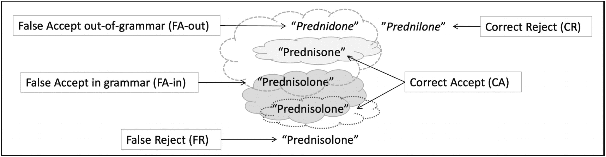
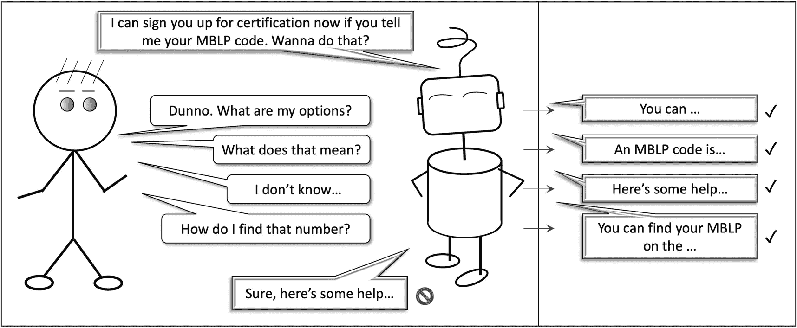
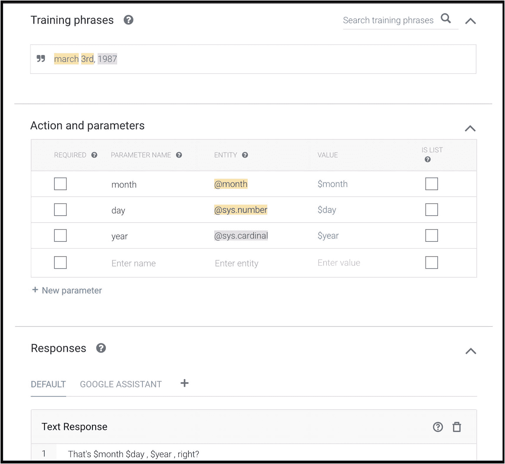
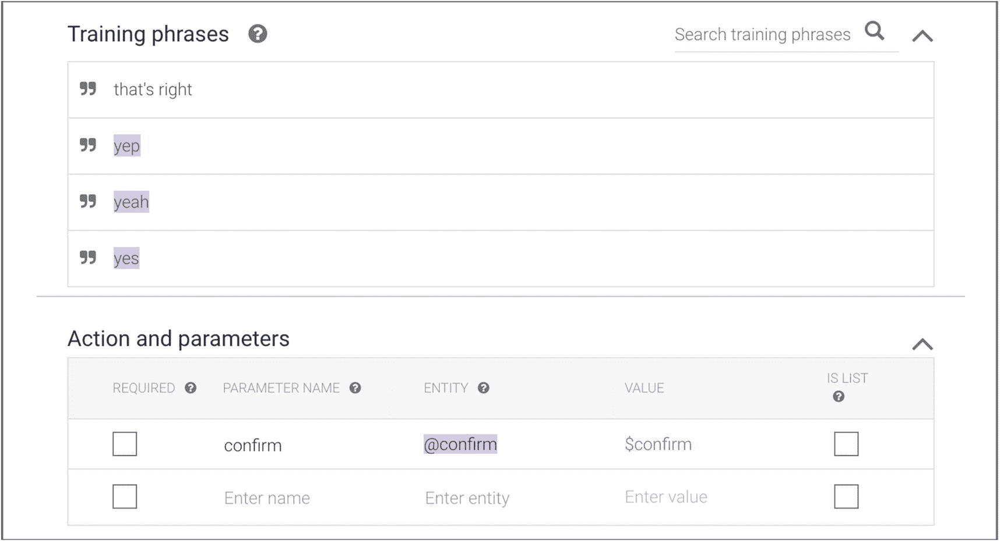
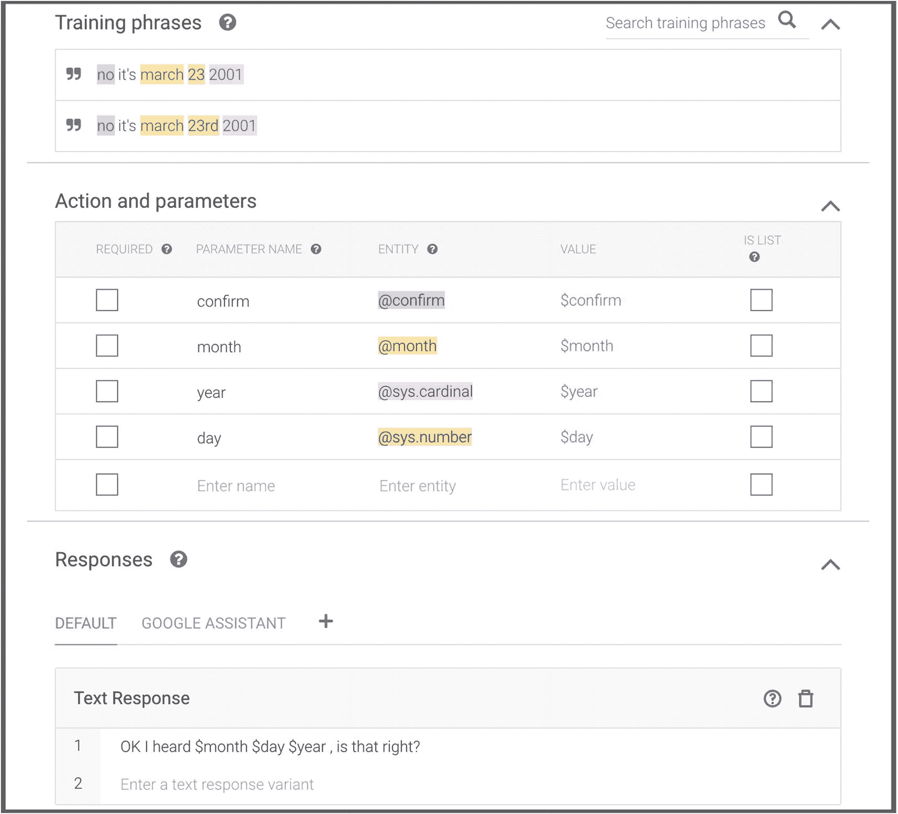
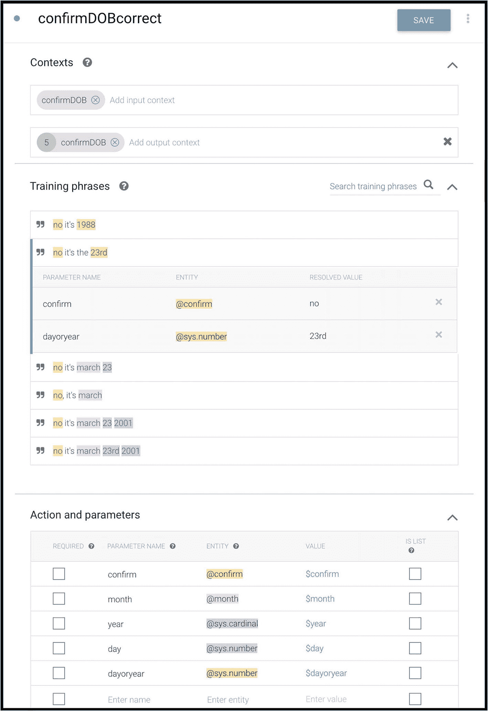

# 12. 应用准确性策略以避免误解

凭借你在第 10 章和第 11 章中获得的关于识别和意图的背景知识，本章是关于你可以应用的具体技术的两章中的第一章，这些技术旨在让 VUI 对话对用户更成功。这些策略侧重于提高 VUI 正确识别和解释的可能性，以及在发生误解时能够恢复的能力。

这实际上是我们最喜欢的话题之一。不，这不是因为我们喜欢误解——我们没那么疯狂。而是因为无论技术状态或用户专业水平如何，误解总会发生。弄清楚如何将这些误解最小化就像是为了一项崇高的事业而解谜；其回报是让用户满意、成功，并打造一个成功的 VUI。我们在企业解决方案方面的经验可能是我们对此感兴趣的原因。在 2019 年的一期播客节目《本周科技》中，主持人和嘉宾评论了他们不喜欢处理企业解决方案，同时也注意到他们很高兴有人愿意做这件事。企业级开发涉及大量工作，要求高准确性，并且通常设计上不那么“有趣”。但是，如果你学会了满足企业性能需求的技术，你就可以将它们应用于在任何平台上为任何领域构建卓越的对话式 VUI。相同的一般概念适用于所有 VUI。

我们在本章中介绍了很多准确性策略。我们不期望你在阅读本章后就能完全掌握它们，所以不要感到不知所措。相反，只需认识到存在多种方法是有原因的，你不需要一次性全部实现，并且如果你发现你的语音系统遇到问题，很可能有一种特定的方法可以解决该问题。我们在本章末尾总结了所有方法。

### 准确性与鲁棒性概念

首先，一些定义（图 12-1）。超出覆盖范围（OOC）及其超集超出语法范围（OOG）都是相关的概念：两者都可能导致识别错误和误解，但解决方案不同。你可以通过扩展语法中的词汇直接影响覆盖范围；噪音和片段可能超出了你的能力范围，但你将在第 17 章（调优）中了解更多关于它们的信息。

表 12-1

常见的语音准确性概念

| 如果话语是…… | 该话语是…… |
| --- | --- |
| **在语法内 (IG)** | 包含在相关语法中；与预期匹配。 |
| **超出语法范围 (OOG)** | 不在语法内，包括噪音、片段和旁白。 |
| **超出覆盖范围 (OOC)** | 在语言中有效但未被语法覆盖的短语。 |
| **如果结果是……** | **该话语是……** |
| **正确接受 (CA)** | 在语法内并成功处理。 |
| **正确拒绝 (CR)** | 超出语法范围并成功拒绝。 |
| **语法内错误接受 (FA-in)** | 在语法内，但被识别为另一个在语法内的话语。 |
| **错误拒绝 (FR)** | 在语法内，但未被识别为任何在语法内的内容。 |
| **语法外错误接受 (FA-out)** | 超出语法范围，但被识别为在语法内的话语。 |

图 12-1 使用两种实际药物名称——泼尼松和泼尼松龙，以及用户可能对它们的几种发音，说明了表 12-1 中的概念。两个较暗的云代表语法覆盖范围：最暗的云代表泼尼松龙的语法，较浅的灰色代表泼尼松的语法。两个白色的云代表被识别并映射到每个语法中内容的内容。有些话语足够相似，即使严格来说未被语法覆盖，识别器也能匹配它们；其他话语则因发音方式而被错误分类，甚至被识别器丢弃。

在这个例子中，一个泼尼松龙的话语被错误地匹配到了泼尼松的语法（使其成为语法内错误接受项，或 FA-in），另一个则未匹配到任何内容（被错误拒绝，或 FR）。泼尼尼龙不是一个真实的药物名称，并且被正确地未映射到语法内的任何内容（正确拒绝，或 CR）。泼尼尼酮也不是一个真实名称，但被错误地映射到了泼尼松的语法（语法外错误接受，或 FA-out）。当你在第 17 章学习调优时，你将进一步构建这些概念。



图 12-1

用药物名称说明的准确性概念

### 准确性与鲁棒性策略

最大化正确结果的比例同时最小化错误结果当然是目标。在本章中，你将了解其中涉及的一些策略。

成功提示 12.1 寻找鲁棒性线索

寻找改进鲁棒性思路的最佳方法是查看超出语法范围（OOG）话语的措辞和解释，以及当前话语在对话流程之前和之后的话语。

#### 示例

令人惊讶的是，人们非常擅长从示例中归纳——前提是这些示例是好的！好的示例比指令更好、更简短。Nuance^(⁸⁹) 所做的工作表明，精心挑选的示例可以帮助用户在统计语言模型（SLM）的开放式提示下成功构建他们的请求。使用自然的短语，并明确表明它们是示例，而不是两个选项的菜单。

最好的示例展示了可以请求的内容的深度和广度。使示例与每个用户相关，并包含常见请求；在程序准备 VUI 中，关于待办事项列表的内容是一个很好的示例。另一个询问特定食物项目的示例展示了请求可以有多详细：*例如，说“我今天有什么待办事项？”或者说“我还能吃全麦面包吗？...”* 如果你正在为银行构建一个 VUI，并且拥有用户账户类型的元数据，你甚至可以使用这些名称使示例比通用名称更贴合每个用户：*你可以说“从支票账户转账 200 美元到教育储蓄账户”或“我的下一笔信用卡还款什么时候到期？…”* 这对你来说前期工作量更大，但长远来看会带来更好的用户体验和更多成功的用户。

有趣的事实：多年来，我们看到了数量惊人的示例，人们没有将指令与命令分开。这就是为什么我们这样措辞提示：*例如，说“订购补充装”* 而不是*说，例如，“订购补充装”。* 或者*输入或说出您的 PIN 码* 而不是*说出或输入您的 PIN 码*。否则，有些人会说诸如*或输入您的 PIN 码*之类的话。

##### 实施示例

务必测试你告诉用户说的任何示例，以及你在 VUI 提示中明确提及的任何其他短语。要特别注意示例与用户可能说的其他短语发生冲突的风险。如果人们按照你告诉他们的内容准确说出来却无法被理解，他们不会高兴。这就是将基于正则表达式的规则语法与统计模型结合使用的好处：为你的示例短语使用规则，并在将话语传递给 SLM 之前，先通过该语法处理它。你在第 11 章中学习了如何通过 webhook 进行正则表达式。如果你的识别准确性是通过训练短语（如 Dialogflow）来处理的，请确保提示中提到的确切短语以及任何相近的变体都已作为训练短语添加。当你深入研究调优（第 17 章）时，你将了解更多相关信息。


#### 提供帮助

在第 9 章中，我们介绍了通用概念，包括“帮助”和“更多信息”。事实证明，寻求帮助是一个通用概念，即使用户并不确切知道它在 VUI 中存在，他们也会使用。除非被告知这是一个选项，否则人们可能不会说出“*帮助*”这个词。他们**会**做的是提出问题并表达困惑。因此，你需要为你的帮助意图添加同义词覆盖范围，以回应诸如*我有哪些选择？*、*那是什么意思？*、*我不知道*、*我如何找到我的处方号？*，或者用户在感到困惑时可能在该语境下说的任何其他内容。一个好的做法是以一个地标性短语开头来启动帮助提示（*这里有一些帮助*或*以下是……的方法*）。在 VUI 对话的每一步，都要思考什么可能会让用户困惑，以及哪些信息可以提供帮助。这就是你的上下文帮助提示。好的帮助能为用户提供所需的信息，使他们能够组织请求以反映其意图，同时又能被 VUI 理解。

对*帮助*或*告诉我更多*的通用请求总是被假定为与上下文相关：你的 VUI 响应应基于用户刚刚执行或询问的操作，以及他们正在进行的操作。我们也曾研究过允许非上下文帮助的系统。在这种系统中，用户不只是说*帮助*然后让系统自行判断上下文。相反，他们可以具体说明需要什么帮助，例如“*帮我*添加联系人”或“*告诉我更多关于*清流质的信息”。这允许用户在需要时针对特定主题寻求帮助——尽管这并非毫无限制。可用的主题仍然与用户在特定上下文中遇到的困难相关，并且除非相关，否则不会在对话中途出现。因此，例如，“*告诉我更多关于*清流质的信息”不会在预约日程安排的中途出现。这开始让人感觉像是一场有点智能的对话：

*   **VUI**    *手术后有人能开车送你回家吗？*
*   **用户**    *为什么我需要搭车？*
*   **VUI**    *手术后你会感到昏昏欲睡。自己开车不安全。*
*   *那么，手术后有人会开车送你回家吗？*
*   **用户**    *啊，是的，有人。*

**来自一线语音实战**

在一个纯语音的账单支付系统中，能够请求“*关于主题的帮助*”让用户可以自由地自助服务。他们可以提出更精确的问题，例如*帮我更改收款人地址*，而不是听到一个可能对他们没有帮助的、更通用宽泛的账单支付解释。通过这种方法，用户对系统建立了信心，支持人员接到的提问也减少了。双赢！

**成功技巧 12.2 在提供帮助后保持聆听**

在你的 VUI 提供一些帮助后，保持麦克风开启，以便用户无需额外步骤即可做出回应。由于帮助提示往往有点冗长，最后应直接告诉用户你期待他们回应，可以重复最初的提示，或者用措辞不同的提示。

##### 关于帮助设计的说明

*当然，这里有一些帮助*是一个很好的回应，前提是用户明确请求了帮助，并且你确信识别是正确的。避免以*好的*或*当然*这样的确认词开始帮助回应，除非你正在追踪用户提问措辞的细节。最好将确认词和地标性短语视为独立的提示片段，你可以根据上下文（例如用户请求的具体措辞）选择是否包含它们。这样，无论用户说了什么，都可以使用相同的帮助提示开场白；无论用户是否明确请求了帮助，核心提示都可以使用。要了解这个问题，请尝试用*当然，这里有一些帮助*……来回应本节前面提到的四个帮助请求。其中是否有任何一个作为回应听起来很奇怪？应该会，正如你在图 12-2 中看到的那样，同时还有一些更好的引导替代方案。



图 12-2

帮助信息不能在所有上下文中都以相同的开场白开始，否则会听起来很奇怪

#### 即时信息

即时（JIT）信息是一种提供帮助的方式。不同之处在于，用户并未请求帮助或表达困惑；它是在对话上下文使其相关时提供的一个有用提示。JIT 信息在用户刚刚完成某个请求或任务，但遇到了一些困难或用了比必要步骤更多的步骤来完成时非常有用：

*   **用户**    *我想在娜娜餐厅订个位。*
*   **VUI**    *在娜娜餐厅订位。什么时间？*
*   **用户**    *明天晚上。*
*   **VUI**    *几点？*
*   **用户**    *7:30。*
*   **VUI**    *几位用餐？*
*   **用户**    *六位。*
*   **VUI**    *好的。我已为您预订了……< 详情 >*
*   **VUI**    *顺便说一下，这里有一个更快的订位方法。*
*   *只需说“为娜娜餐厅预订明天晚上 7:30 六位用餐”。*

JIT 的关键在于，在用户逐步体验了对话之后立即展示如何更快地完成，这使得信息更具相关性，因此也更有用。如果你提供 JIT 信息，请跟踪并限制提供频率——有些用户知道他们可以用一句话完成，但更倾向于逐步处理复杂请求。让他们自己选择。

##### 关于 JIT 设计的说明

信息在内容上以及提供时机上与用户相关时才有帮助。一些 IVR 系统的一个错误是立即将呼叫者引导至公司网站。不要这样做：这个人刚刚打电话进来；如果他们想要网站，他们早就上网了。这会浪费呼叫者的时间，并以不相关的信息开始通话，导致人们不再关注。我们已经看到几个例子，说明移除不相关的信息和不必要的冗长措辞如何导致更少的转接人工请求。

**成功技巧 12.3 即时信息并非时时提供**

要谨慎使用你的 JIT 信息。仔细思考何时提供它有意义以及提供频率。跟踪每个用户何时收到过 JIT 信息，以避免下次或频繁重复。同时，严格限制将其用于任何感觉像是追加销售的内容，例如提供更高级的服务。


#### 隐藏选项与“以上都不是”

隐藏选项并不意味着你要隐藏如何提出请求的方式。它指的是 VUI 能够理解并处理、但未在提示中明确告知用户的一些选项。无论是否使用隐藏选项，语法规则都是相同的；不同的只是提示语。由于音频这种交互方式的局限性，你需要做到简洁，因此有些命令和选项不必在每条提示中重复。通用命令通常是隐藏选项。有时，出于某些原因，你可能不想提及某个选项，因为它会诱使用户出于错误理由选择它，甚至可能为某些用户群体设置一个隐藏的“入口”。

另一个常见用例是在任何登录或身份验证过程中提供一条出路，并帮助处理类似图 12-2 中的问题。关键在于要覆盖用户可能自然提出的各种方式，使处理过程既广泛又稳健——其目的是易于发现，并实现高成功率的识别与解决：

*   *~ ~ 带有隐藏命令的 VUI ~ ~*
    *   **VUI**    *请问您的会员号是多少？*
    *   **用户**    *呃，我没有会员号。*
    *   **VUI**    *好的，为您进行新会员注册。*

*   *~ ~ 带有显式命令的 VUI ~ ~*
    *   **VUI**    *请告诉我您的会员号，或者说“我没有会员号”，或者说“我忘了”。*
    *   **用户**    *呃，我没有会员号。*
    *   **VUI**    *好的，为您进行新会员注册。*

*   *~ ~ 没有隐藏命令的 VUI ~ ~*
    *   **VUI**    *请问您的会员号是多少？*
    *   **用户**    *呃，我没有会员号。*
    *   **VUI**    *抱歉，请告诉我您的会员号。*
    *   **用户**    *我说了我没有会员号！*

如果你的 VUI 涉及用户登录，务必包含对这些类型回复的处理，尽管你的开发平台可能会限制你的处理方式。注意：避免使用那些容易被误识别为语法内内容或提示中明确提及内容的隐藏选项。这会让用户感到困惑。

**成功技巧 12.4 隐藏于众目睽睽之下**

如果平衡得当，隐藏选项是强大的对话工具。一方面，被识别的措辞必须是用户在上下文中自然说出的，无需明确指示。另一方面，用户必须相信 VUI 能够理解那些在提示中未被明确提及的话语。因此，最好的隐藏选项是像*我不知道、我忘了、重复一遍、我有哪些选择？*以及*以上都不是*这样的请求。换句话说，就是你在卡壳时可能会对别人说的话。

像*以上都不是*或*这些我都不想要*以及类似的短语，是用户面对菜单或选项列表时常见的回应，因为这些选项没有涵盖他们想做的事情。这些回应是自然而然的——人们不需要被教导才会说。因此，这是一个特殊的隐藏选项用例。根据上下文，可以将其映射到一个提示，该提示能提供更多信息，解释当用户感到困惑时该如何继续，例如提供更详细的选项说明，甚至是额外的选项。

#### 识别并拒绝

`识别并拒绝`是最有用的技术之一，用于对 VUI 无法处理的事情给出智能回应。你将这个词或短语包含在语法中，这样即使你实际上无法满足用户的请求，也能识别它并给出有帮助的、信息丰富的回应。这是 VUI 设计中的“捕捉并释放”。与忽略一个超出覆盖范围（OOC）的请求相比，`识别并拒绝`对你和用户都更有用，也更少令人沮丧。这就是为什么区分“满足请求”与“意图解析”很重要。**意图解析**意味着“弄清楚用户的意思”，而“满足请求”意味着“给用户他们想要的东西”。如果有人告诉你“明天凌晨 4 点送我去机场”，你可以理解他们想要什么，而不必真的去做。将这项技术用于超出范围的请求，以及那些符合你 VUI 领域但尚未完全开发完成的请求。通过捕捉这些请求，你还能了解用户想做什么，从而决定下一步的工作重点。它还能使整体性能更准确，因为你控制了原本属于 OOC 的结果。当一个话语是 OOC 时，无法保证它不会变成 FA-out（错误接受-超出范围），即被错误地映射到语法内（IG）的内容。然而，如果话语是 IG，它更有可能匹配到 IG 的内容：

*   *~ ~ 没有使用识别并拒绝（且过于冗长） ~ ~*
    *   **用户**    *我想点外卖。*
    *   **VUI**    *抱歉，我没听明白。*
    *   **用户** *我说，点外卖。*
    *   **VUI**    *抱歉，我还是没听明白。*
    *   **用户**    *哦，天哪……你这蠢货……*

*   *~ ~ 使用了识别并拒绝 ~ ~*
    *   **用户**    *我想点外卖。*
    *   **VUI**    *抱歉，我目前还无法处理点餐服务。*

#### 一步纠错

当人们互相交谈时，如果一方听错了某些信息，另一方通常会使用一步纠错，这是一种结合了否定与更正内容的对话捷径。你的 VUI 可以也应该这样做：

*   **VUI**    *那您的出生日期是？*
*   **用户**    *1989 年 3 月 9 日。*
*   **VUI**    *是 1981 年 3 月 9 日，对吗？* → 年份识别错误。
*   **用户** ***不，是 1989 年***    *→* 一步纠错
*   **VUI**    *1989 年 3 月 9 日，对吗？*
*   **用户**    *对，没错。*

如果没有一步纠错，对话对每个人来说都会变得更长、更笨拙：先要说*不*，然后重新提示，最后才是更正后的内容。相反，多花一点功夫，你就能让用户提供自然的对话反馈。在实现它时，要记住有些人会直接跳到更正后的内容，而不先说*不*或*错了*或类似的话。作为人类，我们即使没有听到*不*，也能理解这是一种否定和更正——你的 VUI 能做到吗？

当人们对被更正的内容非常熟悉时，一步纠错对他们来说是很自然的。在一个医疗保健 IVR 系统中，我们在分析超出覆盖范围的话语后，为出生日期添加了一步纠错功能。仅此一项，就将语法内处理能力提高了约 10%。


##### 实现单步修正

让我们看看使用 Dialogflow 为出生日期示例实现单步修正所涉及的步骤：^(⁹⁰)



图 12-3

新的 `DOB` 意图

1.  创建一个意图 `arEnterDOB`，其中包含一些表示“提供出生日期”的训练短语。设置一个输出上下文 `DOB`，并添加一个询问出生日期的提示，例如“请告诉我您的出生日期。”不要忘记启用 webhook。

2.  创建后续意图 `DOB`，用于捕获出生日期（图 12-3）。

3.  添加一个输入上下文 `DOB`，以匹配 `arEnterDOB` 的输出上下文。

4.  为确认出生日期的后续意图添加一个输出上下文 `confirmDOB`：
    *   这里要小心：当你输入包含日期的训练短语时，Dialogflow 会自动选择 `@sys.date` 作为系统实体。你需要删除它，并将其改为图 12-3 所示的样子：拆分每个短语，并为月份、日期和年份定义槽位。`@sys.date` 可以毫无问题地识别日期，但当日期被回读确认时，听起来会像 *That’s 1987-03-03, right?*，这并非良好的用户体验。除非用户也使用相同的格式说出日期，否则这会增加认知负担。发生这种情况是因为 `@sys.date` 会以特定格式输出。再次提醒，请谨慎使用系统实体。

5.  你添加的参数 `$day` 应该是 `@sys.number` 而不是 `@sys.ordinal`，这样无论是 *March third, 1987* 还是 *March three, 1987* 都能被理解。用户两种说法都会用到。



图 12-4

新的意图 `confirmDOByes`

1.  添加一个自定义实体 `@month`。

2.  接下来，为出生日期正确的情况（快乐路径）提供处理逻辑（图 12-4）。创建一个意图 `confirmDOByes`。不要忘记将 `confirmDOB` 作为输入上下文。



图 12-5

初始的 `confirmDOBcorrect` 意图，仅允许完整的日期修正

1.  现在添加修正情况的处理逻辑。创建一个新的意图 `confirmDOBcorrect`（图 12-5）。不要忘记像为 `confirmDOByes` 所做的那样，添加相同的输入上下文 `confirmDOB`。目前，只添加一个包含完整日期修正的训练短语。记得像在 `DOB` 意图中那样更改参数和实体。

1.  测试一下。首先，说 *date of birth*，给出一个出生日期，然后说 *yes*。这应该能正常工作。现在，尝试用完整日期进行单步修正。说 *No, it’s [另一个包含月、日、年的完整日期]*。你应该会听到一个确认提示。说 *yes*。到目前为止，一切顺利！

事实证明，用户不仅会用完整日期进行单步修正（*No, it’s March third, 1987*），还会只修正错误的部分，比如 *No, it’s March*、*No, it’s the third*、*No, it’s 1988* 以及 *No, it’s March third*。让我们来处理这种情况。

1.  对于 `confirmDOBcorrect`，使用自定义实体 `@month` 添加一个训练短语 “No, it’s March”。

2.  再次测试。仅用 “No, it’s March” 进行修正。我们遇到了一个问题！意图 `confirmDOBcorrect` 被识别了，但没有响应。请注意，响应包含了所有参数 `$month`、`$day` 和 `$year`，而在这个例子中，只有 `$month` 被填充了，因为用户只说了这个。日期和年份来自上一个 `DOB` 意图，但它们现在不处于激活状态。我们该怎么办？

你需要去处理 webhook，对于单步修正你还没有做这一步。你需要 webhook 来保存来自 `DOB` 收集的日期参数，并在用户只修正日期的某一部分时使用它们。实际上，你需要为两个不同的意图做一些事情；我们一个一个来处理。

首先，对于 `DOB` 意图，你需要将日期参数 `month`、`day` 和 `year` 保存到输出上下文 `confirmDOB` 中。请记住，你可以从 webhook 设置与上下文关联的参数。这样，只要上下文仍然处于激活状态（回想一下上下文的默认生命周期是五个对话步骤，这应该没问题），这些参数在后续意图中就可以使用。代码清单 12-1 展示了这段 webhook 代码，来自一个新模块 `dob.py`，就像我们处理所有其他意图一样。使用你之前创建的 `new_context()` 函数（A）启动一个空上下文以便后续添加。如果查询输入参数中包含月份，则添加月份，并将其命名为 `currentmonth` 以避免与 `month` 混淆（B）。如果有日期和年份，则添加它们（C, D）。将新上下文追加到要设置的上下文列表中（E）。使用来自 Dialogflow GUI 的响应文本（F）。虽然代码清单 12-1 中没有显示，但一如既往，在 `main.py` 中，你需要将函数 `dob()` 添加到 `dialog_functions` 处理程序字典中。

```
def dob(df_request, df_response):
"""
出生日期
"""
# 使用日期参数设置 confirmDOB 上下文。
context = new_context('confirmdob')   #A
# 将月份、日期、年份参数添加到输出上下文中
# 以便后续使用。
if 'month' in df_request.parameters:   #B
context['parameters']['currentmonth'] = df_request.parameters['month']
if 'day' in df_request.parameters:
context['parameters']['currentday'] = df_request.parameters['day']  #C
if 'year' in df_request.parameters:
context['parameters']['currentyear'] = df_request.parameters['year']  #D
# 追加新上下文
df_response.output_contexts.append(context)  #E
# 使用 Dialogflow 中的响应
df_response.output_text = df_request.fulfillment_text  #F
代码清单 12-1
保存出生日期参数以备将来使用
```

第二步是在意图 `confirmDOBcorrect` 中使用你保存的参数。首先，从上下文 `confirmdob` 中提取日期参数。这些是你在代码清单 12-1 中保存的参数。现在，从修正短语中获取日期参数（如果有的话），或者从保存的参数中获取。例如，如果有人说 *No, October*，那么月份将来自这次单步修正，而日期和年份将来自保存的参数。代码清单 12-2 展示了这一点，从一个单独的函数开始，用于提取月份、日期和年份以进行确认。首先，初始化日期参数（A）。遍历输入上下文（B）。当找到 `confirmdob` 上下文时，获取参数（C）。获取月份，首先在查询参数中查找（D），然后在保存的上下文参数中查找（E）。然后，获取日期。处理参数查询有两种情况：要么是 day（F），要么是 `dayoryear` 且小于 32（G）。最后，获取年份。同样，需要查询参数的情况有两种：要么是 year（H），要么是 `dayoryear` 且大于 32（I）。使用收集到的日期参数提供确认文本（J）。


```python
def confirmation_month(df_request, params):
    """
    确认月份
    从参数中获取，然后从上下文中获取。
    """
    month = None  # A
    if (('month' in df_request.parameters) and
        (df_request.parameters['month'] != '')):  # D
        month = df_request.parameters['month']
    elif (params is not None) and ('currentmonth' in params):  # E
        month = params['currentmonth']
    return month

def confirmation_day(df_request, params):
    """
    确认日期
    当 dayoryear 大于等于 50 时触发，例如 "1985"。
    """
    year =    # A
    if 'year' in df_request.parameters and \
        df_request.parameters['year'] != '':
        year = df_request.parameters['year']    # H
    elif (('dayoryear' in df_request.parameters) and
          (df_request.parameters['dayoryear'] != '') and
          (df_request.parameters['dayoryear'] >= 50)):
        year = df_request.parameters['dayoryear']    # I
    elif params is not None and 'currentyear' in params:
        year = params['currentyear']
    return year

def confirm_dob_correct(df_request, df_response):
    """
    出生日期的一步修正。
    """
    # 从 confirmdob 上下文中获取参数。
    for idx, name in enumerate(df_request.input_contexts['names']):  # B
        if name == 'confirmdob':
            context = df_request.input_contexts['contexts'][idx]
            dob_context_params = context.get('parameters')    # C
    # 获取待确认的日期参数。
    # 如果请求参数中没有，则从上下文中获取。
    confirm_month = confirmation_month(df_request, dob_context_params)
    confirm_day = confirmation_day(df_request, dob_context_params)
    confirm_year = confirmation_year(df_request, dob_context_params)
    # 使用提取的参数生成确认文本
    df_response.output_text = (
        f"我听到的是 {confirm_month} {int(confirm_day)} "
        f"{int(confirm_year)}，对吗？")    # J
```

清单 12-2 用于确认修正后日期的意图 `confirmDOBcorrect` 的 Webhook 代码（`confirm_dob_correct.py`）

在测试过程中，我们遇到了一个导致 `webhook_request.py` 发生微小改动的问题。部分参数以列表形式而非单个值的形式从 Dialogflow 传来，因此我们添加了一段代码（清单 12-3），通过将所有参数转换为单个值来避免后续错误。我们指出这一点是为了提醒：在使用“黑盒”工具或平台时，你未必能预知数据何时会以意外格式出现，因此请记得在不同环境中进行测试。

```python
self.parameters = query_result.get("parameters")
# 遍历参数，将所有列表转换为单个值
for param in self.parameters:
    if isinstance(self.parameters[param], list):
        self.parameters[param] = self.parameters[param][0]
```

清单 12-3 确保参数为单个值

如果有人回答*不，是 8 号*或*不，是 1998 年*，会发生什么？这两种情况都是只修正日期或只修正年份的有效情况。但两者都是数字，那么如何知道要修正哪个呢？意图 `confirmDOBcorrect` 中的参数 `dayoryear` 可以配合 webhook 来区分。幸运的是，日期必须小于 32，而大多数 VUI 中的年份会大于 1900（暂时忽略*“我听到的是 2019 年 3 月 5 日。对吗？”* *“不，18。”* 这种情况）。你需要稍微修改意图 `confirmDOBcorrect`，如图 12-6 所示，并使用 webhook 代码来消除歧义。



图 12-6 处理 `dayoryear` 参数的 `confirmDOBcorrect` 意图新增部分

##### 关于一步修正的说明

你可以将此代码作为基础，并根据 VUI 的用例进行必要的修改。这里的所有示例都以*不*开头，但有些人只修正内容：*是 1985 年 6 月 12 日吗？是 7 月。* 对于人类听众来说，即使没有*不*，这也足够清晰。

在最后一个示例中，两个数字很容易区分，因为它们的范围不重叠。但情况并非总是如此：如果用户对日期和月份都使用数字，或者你询问的是药物剂量和数量之类的内容，该怎么办？请思考它们可能重叠的情况，以及你需要如何修改设计和代码。同时思考如何约束有效范围；任何此类信息对于实现最高准确度都至关重要。好消息是，人们在使用一步修正时通常能意识到哪些信息存在歧义，因此他们会提供足够的上下文。如果年份 *2009* 被误识别为 *2005*，大多数人会重复整个年份，而不仅仅是最后一位数字。

#### 教程

针对性的教程对于某些任务和用户群体可能很有用。教程的复杂程度可以有所不同。有时，只需录制一段简单的“用户”与 VUI 之间的示例交互，就足以说明如何完成某项操作。仅仅听到一段包含提示语和常见请求或响应的录制示例对话，就能提高用户的成功率和满意度。当对话涉及全新、复杂或存在任何风险的任务或设备时，交互式演示值得考虑。它让用户有机会在沙盒中“边做边学”，而无需承担任何风险。我们已实现过这两种类型，并看到了它们的好处。以下是一些需要牢记的简单准则：

- 保持简短。
- 为用户部分使用明显不同的声音。例如，如果你的 VUI 声音低沉，那么教程中的用户声音应该更高一些。
- 提供教程，但切勿强迫用户收听。并且不要在用户每次与 VUI 交互时都提供。当用户是新用户时，或者当你跟踪错误行为并注意到他们难以获得所需内容时，再提供教程。一句简单的*想听听我能做什么吗？*（或任何符合上下文的话）就很好，因为用户只需回答是或否。
- 请记住，每当你的功能或语法覆盖范围发生变化时，都要更新教程。与示例一样，教程必须反映 VUI 中实际有效的内容。

##### 多模态角落

如果你的 VUI 是多模态的，你希望利用屏幕来传达识别结果、提供消歧义等。当你拥有屏幕时，教程和实用提示尤其有用。如果某些操作涉及用户不熟悉的步骤，分步多模态教程是一种很好的方法（图 12-7）。


图 12-7 多模态教程是一个很好的工具

#### 拼写

最难的识别任务往往是一些看似最基本的任务：单个数字和字母表中的字母。这应该不会让你感到惊讶：你曾与某人通电话，对方使用像 *A as in apple* 或 *alpha* 这样的语音字母表来拼写名字。空中交通管制员和飞行员会说 *niner* 而不是 *nine*，以降低与 *five* 混淆或误解的风险。美式英语字母表的 **e-set**（B C D E G P T V Z）中的许多字母，在只听声音而看不到说话者嘴唇的情况下，很难区分。F 和 S 也存在问题。

如果你正在为军事或航空用途创建语音解决方案，可以期望用户知道并使用官方语音字母表。但在你余下的职业生涯中，只设计军事 VUI 的可能性很小。那么你该怎么办？一个部分解决方案是找出人们最常用的单词，并将它们包含在你的语法中。另一个解决方案是利用任何可用的逻辑与可能的答案进行交叉引用，这是我们下一个主题。


#### 缩小识别空间

提高准确率的一种方法是逐步缩小语音用户界面的搜索空间，从而降低识别任务的难度。这可以通过消歧、确认以及聚焦语法结构来实现。你已经知道，不应将用户限制在你强加的少数关键词上，而应允许自然变化——但有时用户会说类似*“Can I have a glass of red wine with my wife after dinner?”*这样的话，这可能会让你的 VUI 陷入混乱，因为你原本只预期了*“Can I have red wine?”*。

大多数数据集都具有一定的结构或限制。例如，银行的账号可能是数字，长度为 8 到 14 位，且倒数第三位总是 1 或 2。电话号码的长度取决于国家或区号。信用卡使用校验和数字。美国地址语法与邮政编码关联，这样并非所有街道名称都始终处于语法范围内，这大大有助于识别。可以对照检查一个庞大但稀疏的数据集。你应该整合任何可靠且能缩小识别空间的因素，以提高准确率。

现在回到如何处理拼写的问题。如果有人向航空公司应用拼写姓名以确认预订，那么该航班很可能有一份乘客名单可供核对。如果有人正在朗读一个字母数字组成的处方或确认号码，那么这个号码很可能可供核对，并且只有某些组合是有效的。如果你的 VUI 识别出`5 D 4 4 9`，但实际有效的只有`5 T 4 4 9`，那么很可能是`T`被误识别了。一种解决方案是尝试模糊匹配；VUI 将近似匹配作为单独结果捕获，并由用户验证：

- **VUI** *请拼写乘客的姓氏。*
- **用户** *J O N E S. →* 识别为 `J O M E S`
- **VUI** [未找到`Jomes`，但找到`Jones`]
- **VUI** *是 J O N（像 Nancy 中的 N）E S，对吗？*
- **用户** *正确。*
- *~~~ ~~~ ~~~*
- **VUI** *您的处方号码是多少？*
- **用户** *5 T 4 4 9. →* 识别为 `5 D 4 4 9`
- **VUI** [未找到`5 D 4 4 9`，但找到`5 T 4 4 9`]
- **VUI** *为确认，请再说一遍那个号码。*
- **用户** *5 T 4 4 9. →* 识别为 `5 T 4 4 9`

在低安全级别的情况下，你可以“自动纠正”或纠正并确认。其他时候，可以选择记录差异并再次询问。本章你将学到另一个有趣的解决方案。通过为特定上下文定制语法或理解能力，可以缩小识别空间。你在第 7 章中看到了一个基于自定义电话列表并了解列表中姓名来进行消歧的示例。

### 高级技巧

与语音技术打交道就是拥抱不确定性。在 IVR 的对话式语音设计与开发领域，长期以来有一些技巧有助于掌控不确定性，但尚未在其他语音界面中普遍应用。由于这些技巧非常强大，我们希望你能了解它们：用于多层识别行为的置信度分数，以及用于选择正确识别结果的 N-best 列表和跳过列表。

#### 多层行为与置信度分数

我们大多数人对自己是否听清某事或表达得如何都有相当好的判断。可能存在背景噪音，或者说话者声音轻柔、含糊不清，或者话题不熟悉。我们根据自身的确定程度来做出假设和回应：要么继续推进，要么先验证是否理解，要么请求澄清甚至重来。

这就是在 VUI 设计中使用**分层识别置信度分数**背后的概念。通常定义两层或三层，根据 VUI 对用户话语被正确理解的置信度，给出不同的 VUI 响应。每个识别结果都有一个基于结果与假设匹配程度的关联分数。多层设计允许你验证识别分数较低的语句，以避免后续问题，同时能更快地推进对话，并在不必要时避免额外步骤——就像人类的行为一样。以下是一个典型的多层设计：

- **VUI** *您的处方号码是多少？*
- **用户** *5 T 4 4 9.*
- ~ ~ 高置信度分数 ~ ~
    - **VUI** *谢谢。您的泼尼松还有两次续药机会……*
- ~ ~ 中等置信度分数 ~ ~
    - **VUI** *确认一下，是 5 T 4 4 9，对吗？*
- ~ ~ 低置信度分数 ~ ~
    - **VUI** *抱歉，请再说一遍那个号码。*

在高置信度分数下，VUI 假定其识别结果是正确的，不会向用户确认——尽管包含隐式确认仍然很重要。在中等分数下，显式确认会在继续之前验证结果是否正确。低于某个分数时，直接再次询问，因为出错的可能性太高了。

你可以利用置信度来定制确认策略（第 8 章），这基于 VUI 理解用户的可能性以及对响应准确性的确定程度。如果置信度高，就减少确认，主要采用隐式确认，并使用像*“当然”*这样的词语。在中等置信度下，显式确认并用*“我认为您想要……”*这样的短语来缓和回应。而在低置信度下，则拒绝并重试。

**来自语音一线**

我们都曾经历过家里的智能设备在我们没有对其说话时被触发，即使我们离它好几英尺远。你可能也有过类似经历。一段包含*“This is not acceptable”*的对话不知何故导致设备询问*“Should I play Blake?”*。如果多层置信度被广泛采用并正确设置，这类误触发就会少得多。


##### 实现多层确认

并非所有平台都向开发者提供置信度分数。在创建 VUI 时，设计师和开发者需要就可用性达成共识。这正是谷歌成为本书完美选择的原因：在撰写本书时，置信度分数可通过 Google Cloud Speech API 获取，但无法直接或一致地通过 Dialogflow 获取。这很好，因为它让我们能够应对这两种情况。

多层确认可以通过多种方式实现。当识别器提供置信度分数时，使用这些分数是最佳方法。一种在某些场景下有效的简单方法是字符串匹配：与多词短语中的已知项进行精确的逐词匹配，将产生“高置信度”，而非精确匹配则给出较低的置信度并触发不同的行为。这种方法最适用于较长的搜索短语，例如电影名称或餐食描述。

由于 Dialogflow 目前不提供置信度分数，你实施此类策略的能力会受到限制。如果将来它提供了——或者你正在使用提供该功能的平台——那么实现过程大致如下：

1.  创建一个用于收集数字的意图。将其命名为 `arCollectNumber`。
2.  创建一个用于回读信息的意图。将其命名为 `arReadInformation`。确保此意图响应 `readinformation` 事件。
3.  为中等置信度创建一个确认意图 `arConfirmNumber`。确保此意图响应 `confirminformation` 事件。
4.  将 `reject` 事件添加到现有的默认回退意图中。
5.  在 webhook 中添加逻辑以处理意图 `arCollectNumber`：
    1.  像本章前面收集出生日期时那样，将数字作为参数保存在输出上下文中。
    2.  如果来自 webhook 请求的置信度高，则触发 `readinformation` 事件。
    3.  如果置信度为中等，则触发 `confirminformation` 事件。
    4.  如果置信度低，则触发 `reject` 事件。

意图 `arReadInformation` 的 webhook 代码从上下文中获取数字，该数字是在响应 `arCollectNumber` 时设置的。结果类似于清单 12-4。

```
{
"results": [
{
"alternatives": [
{
"transcript": "1 2 3 4 5 6 7 8 9 0",
"confidence": 0.88398576
},
{
"transcript": "one two three four five six seven eight
nine zero",
"confidence": 0.9059588
},
{
"transcript": "one two three four five six seven eight
nine 0",
"confidence": 0.86726743
},
{
"transcript": "1 2 3 4 5 6 7 8 9 zero",
"confidence": 0.87917966
},
{
"transcript": "1 2 3 4 5 6 7 8 9 0 0",
"confidence": 0.8787717
}
]
}
]
}
清单 12-4
Google Cloud Speech-to-Text API 的输出
```

##### 关于基于置信度的多层设计说明

各层级之间的界限并非一成不变。它取决于在继续之前确保正确的重要性，以及整体平台的分数。将置信度分数视为百分比，其中 100%代表绝对确定。良好的通用起始点通常在 85%和 50-65%左右。通过反复试验，并在获得真实数据后进行调优，将帮助你确定这些界限。正确的层级能最大化高置信度桶中的正确接受（CA）结果，以及低置信度桶中的正确拒绝（CR）结果。那些本可能成为错误接受或错误拒绝（FA 或 FR）的结果，正是你希望放入中等置信度桶中的，这样你的 VUI 就不会基于错误信息做出决策，同时也不会使对话变得不必要的冗长。

你可能已经意识到，所有 VUI 交互实际上都使用了层级。只是默认情况下是两层：接受或拒绝。你不太可能在所有交互中都使用多层设计——想象一下确认“是/否”时的恐怖场景：*你说了“不”，对吧？* 你也可以添加更多层级和其他基于置信度的行为，例如在置信度较低时“含糊其辞”地回应：

*   **用户**    *我想找一家融合斯堪的纳维亚和日本风味的餐厅。*

*   ~ ~ ~ 高置信度分数 ~ ~ ~

*   **VUI**    *好的。SamurHej 是您的理想之选……*

*   ~ ~ ~ 中等置信度分数 ~ ~ ~

*   **VUI**    *您可能会喜欢 SamurHej……* ← 通过引导短语暗示的含糊其辞

关于 Actions on Google 中的置信度分数，你有时会在 webhook 请求的 `queryResult` 部分中找到一个名为 `speechRecognitionConfidence` 的字段。然而，当前的 Dialogflow 文档指出：“此字段不保证准确或已设置。特别是，此字段不会为 `StreamingDetectIntent` 设置，因为流式端点对 `StreamingRecognitionResult` 中的音频部分有单独的置信度估计。” 因此，你目前无法依赖在 Dialogflow 中访问置信度分数。如果你的实现需要一致地使用它们，则必须使用其他 STT 提供商，例如原始的 Google Cloud Speech-to-Text API。^(⁹¹) 此 API 提供置信度分数以及 N-best 列表，你将在接下来了解这些内容。

所有平台都有一些限制——你能实现什么取决于你的具体开发情况。企业级 IVR 平台通常允许访问置信度分数，但许多“即插即用”平台为了非专家的易用性而牺牲了这种级别的信息，这也没问题。根据你的目标和资源选择合适的设置，并确保所有相关人员了解这些限制，以确定正确的解决方案。

#### N-Best 和跳过列表

回想一下识别的工作原理：识别器会形成并跟踪多个假设，直到语音结束，然后得分最高的假设进入下一步解释。这种安排产生了一个得分最高的单一假设；这是一个“*N-best* = 1”的系统。如果你幸运的话，你使用的平台提供的不仅仅是最高分。你可以使用 N-best > 1（其中 N 可能是 5 或 10），结合其他查找来验证结果在上下文中是否有效，从而创建一些相当巧妙的对话。这就是我们在本章前面讨论识别空间以及如何在不询问用户的情况下移除无效选项时暗示的技术。对于一个包含字母数字的英国邮政编码系统，一位同事使用了 N-best=100！

N-best 通常与对话中的跳过列表结合使用：如果 N(1) 假设因某种原因被拒绝，它就会被放入跳过列表。然后评估 N(2) 假设，并对照现有的跳过列表进行检查，依此类推。这是处理具有挑战性的识别任务（例如长字母数字字符串）的常用技术。当相同的错误假设被多次返回时，它特别有用：

*   ~ ~ ~ 没有 N-best 和跳过列表 ~ ~ ~

*   **VUI**    *您的处方号码是多少？*

*   **用户** *5 T 4 4 9.*

*   **VUI**    *是 5 T 4 4 1，对吗？* ← 识别错误

*   **用户**    *不，是 5 T 4 4 9.*

*   **VUI**    *好的，5 T 4 4 1，对吗？* ← 再次识别错误

*   **用户**    *不对！！*

相反，以下是 N-best 和跳过列表可以为你做的事情：

*   ~ ~ ~ 使用 N-best 和跳过列表 ~ ~ ~

*   **VUI**    *您的处方号码是多少？*

*   **用户**    *5 T 4 4 9.*

*   **VUI**    *是 5 T 4 4 1，对吗？* ← 识别错误

*   **用户**    *不，是 5 T 4 4 9* ← “5T441” 被放入跳过列表。

*   **VUI**    *好的，5 T 4 4 9，对吗？* ← 再次识别错误；检查跳过列表；转到 N=2。

*   **用户**    *是的，正确。*


##### 实现跳表

与多层确认类似，Dialogflow（配合 Google 上的操作）并不会提供 N 最佳列表。如果它提供了，你可以这样做：

1.  创建一个意图 `arCollectNumber`。
2.  在 `arCollectNumber` 的 webhook 中，将识别到的数字保存到上下文参数中，就像你对出生日期所做的那样。
3.  创建一个处理数字确认的意图 `arConfirmNumber`；同样，你可以像处理出生日期那样进行一步修正。
4.  如果用户进行了修正，则从列表中的第 #1 项开始向下遍历 N 最佳列表，直到找到第一个尚未尝试过的项。使用该项进行确认；如果用户拒绝它，则将此项目添加到跳表中，再次询问，并跳过跳表中的所有项目，直到确认成功或达到最大尝试次数。这样，你就不会用错误的答案确认超过一次。

同样，与确认一样，你是否能访问 N 最佳列表取决于你的语音平台。目前，你在 Google 上的操作中无法访问，但如果你使用独立的 Google Cloud Speech-to-Text API（如清单 12-3 所示），则可以访问。在许多企业级 IVR 平台上，你也可以访问。

##### 关于 N 最佳列表和跳表设计的说明

N 最佳列表显然是一种强大的方法，可以以多种方式使用。但要小心：思考一下跳转到另一个选项会给用户带来怎样的感受。当我们在第 13 章讨论错误处理时，你将了解一些需要避免的陷阱。确保适当地重置跳表：它们是临时的跟踪工具，应在对话结束时失效。

#### 概率

另一种技术是根据预期的频率为单个单词和短语分配概率。概率会影响话语被正确识别和解释的几率。统计语言模型（SLM）凭借其统计特性会自动分配概率。但有些理由需要影响这个概率，而针对特定数据集进行训练并不总是答案。也许你知道某个特定短语存在季节性或者与事件相关的使用高峰，但你还没有训练数据。也许你使用正则表达式而不是统计模型，并且需要更重地权衡某些识别结果。也许你的通用实体被错误地识别为其他实体。所有这些都是合理的理由——并且即使事件罕见，也应基于真实的用户数据。因此，当你学习调优（第 17 章）时，你将了解更多关于概率的知识。

与置信度分数一样，不同平台提供的功能也不同。一些更明确的语法结构和企业级 IVR 平台允许这种功能，可以基于单个词槽或整个话语。目前，Google Cloud Speech API 向开发者提供了一些概率，但在撰写本文时，Dialogflow 并未提供一种方法来权衡特定话语的可能性。从某种意义上说，它是自动包含的，基于训练短语引入的偏差，这些短语会比其他选项或变体更侧重某些选项或变体。

#### 超时与延迟

如果你能够更改关闭麦克风和停止监听的超时设置，就可以避免这种情况：

*   **语音用户界面**    *您的卡号是多少？*
*   **用户**    *4143 … 9743* … ← 用户读出卡上的数字，停顿时间过长。
*   **语音用户界面**    *抱歉，卡号是 16 位数字。*
*   **用户**    *呃，我还没说完呢……*

某些情况需要比其他情况更长的超时时间。即使你无法访问该参数，你也可以识别出只识别了一半的数字，并给出更好的响应或提供另一种输入方法。不要让用户觉得是他们自己的错。

当今许多语音平台不向开发者提供在此级别进行自定义的能力。默认设置是设置一个比实际需要更长的超时时间，以避免你在示例对话中看到的截断行为。一些企业级平台确实允许更改超时持续时间，因此未来可能会提供此功能。默认长超时的一个缺点是，当用户的回答非常简短（例如“是”或“否”）时，他们必须等待。

支持 VoiceXML（一种用于指定语音交互的跨平台 W3C 标准格式）的企业级 IVR 实际上有两种超时：`incompletetimeout` 用于跟踪到目前为止所说的内容在当前上下文中是否有意义；`completetimeout` 在用户说了有意义的内容时启动。`Completetimeout` 总是更短，这样系统在用户说了对上下文来说是合理响应的内容后，就不会等待太长时间。有了这些不同的超时，你可以避免截断 16 位信用卡号等情况；`incompletetimeout` 在话语早期生效，给用户时间完成，而较短的 `completetimeout` 在系统检测到 16 位数字后应用。这样你就可以两全其美了！

### 下一步

我们希望本章能说明，如果你想实现超出基础功能的内容，为什么不能仅仅依赖工具，表明有些工具可能具备你所需的功能，而有些则没有，并且变化是常态。确保你选择的平台能够提供你的设计所期望的参数。

我们所有人自然都会想：“嘿，我会说这种语言，所以我是专家！”因为我们一直在使用语言，我们会自动“清理”我们所听到的内容。我们可以忽略口吃、沉默、发音错误、旁白、漏词和语法错误。我们甚至没有意识到自己为了维持对话进行了多少补偿。如果这让你感到惊讶，可以做这个实验：录一段自然的对话，然后仔细转录所说的每一个细节，包括沉默的时长、打断、不完整的词语等等。首先，你会注意到对话是多么断断续续。然后，你会开始好奇计算机究竟是如何理解我们所说的任何内容的！

关于会话和话语分析，有许多有趣的书籍。这里有两个入门推荐：N. J. Enfield 的《我们如何交谈：对话的内在运作》是一本非常易懂的核心主题快速入门读物——无需任何背景知识。Rebecca Clift 的《会话分析》是剑桥大学语言学教科书，因此更侧重于学术，但对于任何对该主题感兴趣的人来说仍然非常易懂。


### 摘要

表 12-2

策略总结

| 策略 | 关键实施要点 |
| --- | --- |
| 示例 | 在开放式提示中，给出两个示例以展示深度和广度。 |
| 帮助 | 对通用命令进行上下文相关的响应。 |
| 即时信息 | 在成功完成请求后，立即提供下次使用的简短提示和快捷方式。 |
| 隐藏选项 | 对用户自然话语（如“我不知道”）提供信息性响应，这些选项未在提示中明确给出。 |
| 以上都不是 | 在菜单中，当用户未选择任何提供的选项时，给出上下文相关的响应。 |
| 识别并拒绝 | 当答案和任务尚未实现时，给出比“无匹配并拒绝”更具信息性的响应。 |
| 一步修正 | 在明确确认中，识别用户的修正，无需经过“不”这一步。 |
| 教程与演示 | 针对新手用户或复杂任务，提供预先录制的 VUI 示例对话和清晰发音的“用户”；可以是交互式的。 |
| 拼写字母表 | 对于名称，允许用户使用军事拼写或常用词；用户无需在两者之间做出选择。 |
| 缩小识别空间与跳过列表 | 数字：将识别出的字符串与校验和匹配；跳过直到找到匹配项。动态/上下文语法：在较小的集合（如行程、联系人列表）中寻找匹配项。询问两次“以验证...”；匹配两个识别结果。 |
| 多层识别与置信度评分 | 仅确认低置信度的结果，以加快交互速度。 |
| N-best 与跳过列表 | 将未确认的结果添加到列表中，避免要求用户两次确认同一个错误结果。 |
| 概率 | 当一个不常见的词经常被误识别为更常见的词时，改进识别匹配。 |
| 用户控制暂停 | 针对访问、订单或支付，允许用户有时间查找所需信息，而不会重置对话。 |
| 超时时长 | 对于长数字串，允许在用户自然短暂停顿以分组数字时，有更长的静默时间。 |

-   要成功进行语义解析，必须从正确的识别开始。
-   你无法控制用户对你的 VUI 说什么，但你可以引导他们，并通过在正确的时间提供正确的信息来帮助他们成功。与他们合作，而不是对抗——假设人们确实想与你的 VUI 交谈，并且会欣赏相关且不突兀的帮助。
-   不同的平台提供不同的识别和语义解析信息。因此，你和你的整个团队了解在你的情况下设计和实现什么是可行的，这一点至关重要。
-   为了更接近人类能力的对话，请使用能够实现更精细响应的先进技术。例如多层置信度评分、N-best 列表和跳过列表。如果你无法获取这些所需的数据，你仍然可以使用更简单的技术创建更好的对话式交互，包括示例、上下文和用户指定的帮助、隐藏选项以及一步修正。表 12-2 总结了我们涵盖的策略。

脚注 1 2 3

