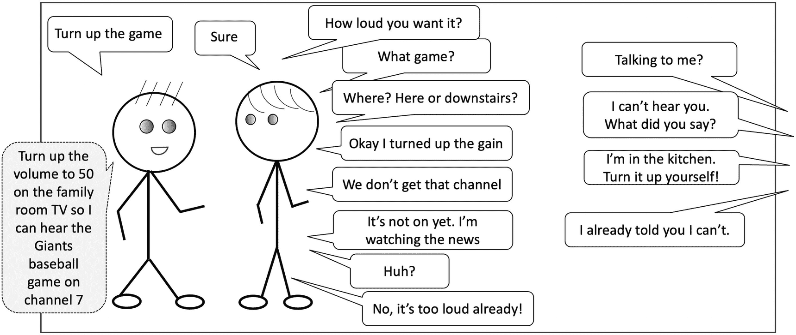
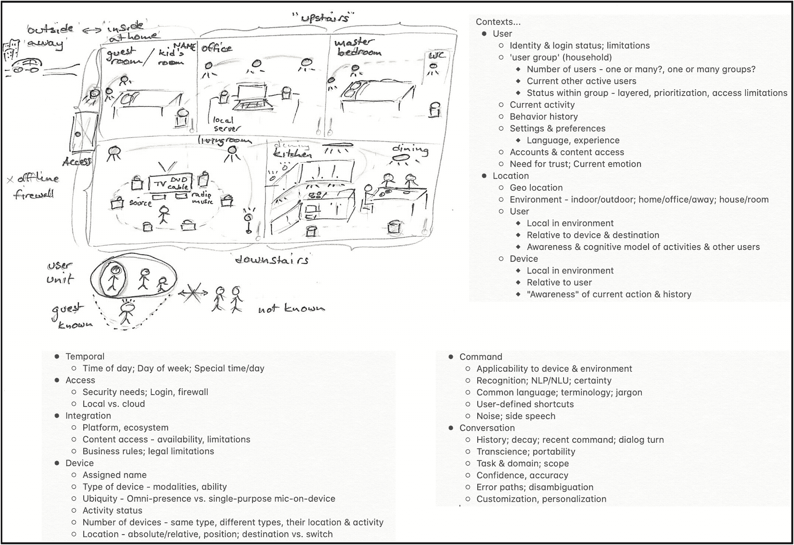

# 14. 利用上下文和数据创建更智能的对话

上下文指的是影响对语句和对话进行准确解释的所有知识、感知、语言和环境。要理解上下文，请思考一个你向他人提出的简单请求——比如“打开楼上的窗户”、“调低音量”或“我们什么时候需要出发？” 你在说这句话时做了哪些假设？你的措辞如何根据你与谁交谈、他们当前的位置以及你自己的位置、他们对你和话题的了解程度、附近还有谁、他们在做什么以及你周围正在发生什么而变化？根据你所做的假设，回答可能会有什么不同？

上下文的重要性足以单独用一章来讨论。我们将涵盖为短期和长期上下文进行设计、如何利用主动数据和领域知识来改善用户体验，以及如何处理动态数据。在大部分讨论中，当我们指代人类交流中基于情境和细节来解释含义的一般概念时，我们会使用“上下文”。当我们向你展示如何在 Dialogflow 中将上下文实现为字符串时，从上下文来看——会很清楚！——我们指的是平台特定的细节。

### 为何没有上下文就无法对话

请看图 14-1。通过要求“调高游戏音量”，说话者假设了双方共享大量上下文。一位听者距离足够近，能看到和听到说话者所见所闻；另一位则在另一个房间。这里的所有回应，都是听者解读的结果，以及说话者对共享知识（什么运动、什么队伍、在哪里、调高多少）、信息准确性（何时播放、哪个频道）、听者距离（听者还在做什么、能否满足请求、甚至是否知道在对自己说话）、先前对话（请求是否已提出多次）、歧义、帮助意愿和能力等方面的假设。此外，还存在误认和误解。如果任何假设不正确，听者的回应就会体现出来，而说话者则会根据新的上下文做出回应。这对人来说轻而易举，但对语音系统而言绝非易事。

图 14-1
多种上下文属性和维度相互作用，导致说话者和听者做出各种假设

上下文在 VUI 对话和人类对话中都至关重要。每一轮对话，都是基于了解（或不了解）用户的即时环境和位置、过往经历、喜好、时间与日期，以及世界上可能或不可能发生的事情，来创建和完善共享理解。人们通常不会用完全明确单一的语句进行交流——就像图 14-1 中灰色气泡里显示的那种语句——也不会提出令人印象深刻的“一次性”完全明确的 VUI 请求：“找一部我今晚可以在线免费观看、由威尔·史密斯主演、且不超过 5 年的电影”。你需要同时处理明确表述的请求以及模糊或不完整的请求；在某些上下文中，用户会非常精确地提出要求，比如下注或下达股票期权订单的高级用户。但大多数自然对话都是你来我往，每个人都在提问、解释、澄清、缩小范围、核实理解——更不用说还有犹豫、不完整的短语和话题跳跃。每一步都建立在前几轮对话的基础上，完善和改变整体上下文，直接影响下一个回应和对话轮次。如果你的 VUI 在麦克风停止收听后就“忘记”了请求的上下文，它就无法处理对话式交互。VUI 需要上下文感知能力才能做出合理的回应；人们期望能够基于前几轮对话中的信息来优化搜索，只在必要时被要求澄清，并且当相关上下文已经建立时不必浪费时间。

对话上下文是复杂的；它涵盖多个维度——基本上任何影响某人说什么、怎么说以及他们做出何种假设的因素都包含在内。有些上下文，比如一天中的时间，很容易量化并应用于对话。其他上下文，比如用户的心境，则不那么容易。请查看表 14-1 中的上下文示例。

表 14-1 常见上下文类型示例

| 上下文类型 | 示例 |
| :--- | :--- |
| 领域与主题 | 医疗、餐饮、娱乐 |
| 任务 | 信息查询、播放音乐、预约、打电话、订购、获取说明 |
| 用户身份 | 已识别、未识别；已知用户数量；儿童/成人 |
| 时间（时钟与日历）时区 | 绝对时间：凌晨 2 点、“1 月 4 日”、“2021 年”；每周日、工作日相对时间：“明天”、“在我预约之前”、“上次”。用户空闲时间、日历事件 |
| 位置（环境） | 地理位置：布里斯班、伦敦、加拿大环境：室内、在家、在厨房、靠近 VUI |
| 设备 | 单个设备、多个连接设备、有屏幕、可穿戴、固定式、物理专用或内置 |
| 对话历史 | 代词指代（“他们”什么时候开门？）、第一个、返回、重复那个。识别置信度自用户上次说话以来的时间 |
| 过往交互 | 过往预约历史 |
| 个性化设置 | 语言、音量、用户专业水平、音乐偏好 |
| 设备活动 | 设备空闲/关闭/播放其他音频；回应的紧迫性 |
| 用户心境与活动 | 分心、手忙、眼忙、驾驶、心烦、紧张 |
| 安全与法规 | 法律、商业、有限数据访问 |

这看起来像是一座难以逾越的大山。我们理解。请记住：我们指出了当今语音实现可以改进的许多领域，而上下文就是其中之一。这并不意味着你需要在产品发布前设计、实现并测试所有可能适用于你 VUI 的上下文。我们只是想让你意识到上下文的重要性，以及融入上下文能让你实现什么。你要做的是，找出对你的特定 VUI 任务和用户来说哪些上下文是重要的，然后从最重要的一两个开始。例如，对于手术准备助手来说，最重要的上下文是相对时间，这样用户就可以问“我今天能吃 __ 吗？”。如果你的 VUI 允许用户在不同房间的扬声器上播放音乐，那么最相关的上下文就是扬声器上的当前活动（开/关/空闲/播放）和扬声器位置（“在厨房”播放 __ 或“在这里”播放 __）。

#### 来自语音实战一线

安在她厨房吧台下安装了声控灯。当她让家里的一个语音助手“打开吧台灯”时，VUI 的回应竟然是像狗一样叫！一阵恼火之后，她急切地录下了这次交互，作为事情不该如此运作的绝佳反面教材。这里的问题在于，在将话语与意图匹配时，撞上了语音相似性（“bark” 与 “bar counter”），同时错误地优先处理了上下文（架构倾向于优先使用一个从未用过的、会汪汪叫的技能，而不是用户为其本地设备命名的名称）。

你的 VUI 的回应应该是所有已实现的相关上下文共同作用的结果——而且你通常需要综合评估它们！例如，如果你的 VUI 询问日历日期，用户的回应会因任务而异：人们通常像信用卡上写的那样说有效期（“1 0 2 4” 或 “ten twenty-four”），但其他人会将其转换为“十月（二十）二十四”。但如果 VUI 收集工作经历，你可以预期开始或结束日期的回应会包含月份名称，而不是数字。

当存在多种可能的回应时，需要适当分层并优先考虑上下文，同时考虑相关性。在这个例子中，用户命名的设备“吧台灯”应该优先于会汪汪叫且用户从未使用过的东西。而且，不，限制用户给灯取什么名字从来都不是正确的解决方案，前提是这个名字是一个可发音的单词。

#### 成功提示 14.1 为每种上下文量身定制回应

这是核心的 VUI 最佳实践。如果 VUI 能够很好地响应跨对话的不同语境，并理解用户话语中的语境假设，人们就会认为这些对话有趣、智能且成功。你的设计和实现应专注于融入这种变化。诚然，更量身定制的响应需要更多努力。但在产品首次发布前，你无需加入太多内容。即使只添加一个恰当的语境，也能让你的 VUI 显得更智能，用户会注意到这一点。从简单开始，然后迭代。

这种复杂性体现在任何定义良好的详细 VUI 对话设计规范中。事实上，这也是我们处理过的许多规范采用表格或电子表格格式的核心原因。当涉及多个维度时，这是最高效且最易读的格式，并且它反映了复杂设计中的对话管理器方面。读完本章后，你就会明白原因。

图 14-2 让你大致了解语境可能变得多么复杂——以及为什么你只选择一两个来开始。这幅图来自一次非正式讨论，内容是关于影响用户与家中联网设备（灯、音箱、屏幕、恒温器、锁等）进行对话的语境。我们一直画到纸上没地方了才停下来！

图 14-2
说明影响用户与家中各种设备交互行为的语境复杂性示意图

##### 动手实践：语境复杂性思维实验

为了理解语境如何相互作用以提供良好的用户体验，任何从事语音技术的人都应该尝试这个练习：为家庭创建语音定时器。

假设你的家中有多个房间，每个房间都有多个属于同一生态系统且可能互联的 VUI 助手设备。你与他人同住，可能是室友，也可能是家人。你将如何设计一个定时器语音应用，以便为家中的所有成员提供最大的灵活性和便利性？思考用例、语境和影响。以下是一个起点：

交互流程：定时器的数量是否应该有限制？如果有，限制是多少？用户是否希望听到所有当前定时器的列表？如果是，你如何以简洁而有意义的方式呈现这个列表？何时以及如何需要消除歧义？何时以及如何提供重试和帮助？哪种类型的重试是合适的？用户如何知道时间已正确设置？用户如何更改、增加或取消定时器？在对话的不同部分，哪种类型的帮助是有用的？教程有用吗？或者示例呢？如果停电了，定时器应该如何处理？

用户位置：行为是否取决于用户设置定时器时所在的房间？如果用户在房间之间移动（假设每个房间都有 VUI 访问权限），比如在一个房间启动定时器，在另一个房间查询或结束它，应该发生什么？如果你离开家，用户能否——以及是否应该能够——通过移动设备或汽车与定时器交互？

### 数据访问

要利用上下文，你需要及时获取相关且准确的数据。你已经看到过一些示例，其中数据被用来为智能对话设置正确的上下文：获取营业时间和预订可用性、访问联系人列表以拨打电话、请求从特定音乐提供商播放某首歌曲、在音乐播放时调节音量、订购剩余续药、询问与手术时间相关的饮食限制、缩小餐厅搜索范围等等。

你需要具备从多个来源读取数据、捕获数据、追踪对话中收集信息所导致的变化，甚至对更持久的用户设置和账户进行更新的能力。你还需要决定何时停止追踪每条信息、将这些信息保留多久以供后续对话使用，以及当不同信息相互影响时该如何处理。

VUI（语音用户界面）对话受到来自两个来源的数据影响：用户（通过话语或回应）和 VUI（基于查询、置信度和可用性）。一旦用户数据被捕获并解释，你的集成系统会将其转化为可在一定时间内访问的信息，直到它对当前或未来的对话不再相关，此时你可以将其释放。不同信息在上下文持久性和相关性上有所区别：

*   **静态**：不变的信息。并非它永远不会改变，只是在对话过程中不会改变。例如当前分配的设备名称（`吧台灯`）或餐厅地址。

*   **动态**：在对话过程中因收集到更多信息而被填充或改变的信息。例如餐厅预订的时间、账单支付的金额以及处方的剩余续药次数。

*   **相对**：相对于对话外部上下文（如当前时间和日期、设备状态、当前播放的歌曲，或用户状况与环境的变化）而改变的信息。例如，随着用户接近手术日期而改变的饮食建议。

*   **短暂**：在活跃对话中，从一个对话轮次“记住”到下一个轮次的信息。这可能是最棘手的方面，因为它与人们的思考和交谈方式有关。如果用户要求重复，用户上一个话语的意图以及他们得到的 VUI 回应是相关的，但仅持续几秒钟。对话中的重试次数、哪些槽位被填充以及填充的值、甚至填充的顺序，都会影响对话流程，但仅在达成对话目标前的短时间内有效。这些数据要么临时保存在你的 VUI 中，要么通过某些外部服务被更持久地拥有和更新。

#### 外部账户与服务

通用上下文（如一天中的时间）和对话上下文（如用户行为和识别结果）已经足够棘手，难以正确处理，但至少它们是本地的且可访问的。有时你需要设置依赖于从外部账户或服务（如娱乐内容提供商、药品名称数据库、营业时间和酒店房间可用性）访问数据的上下文。这完全是另一个层面的复杂问题——不仅因为技术问题，还因为业务规则和法律访问限制。

想象一下，你在飞机上要一杯`健怡百事可乐`，但航空公司与可口可乐有协议，所以你得到的是零度可乐。或者反过来——我们并非偏袒任何一方。如果你是无糖可乐的爱好者，你知道它们的味道不同。如果你喜欢其中一种而不喜欢另一种，你会不高兴。你希望提前知道这一点，以便调整预期或选择其他饮料。语音解决方案的履约也是如此。

假设你的 VUI 支持音乐搜索。用户请求`播放莱昂纳德·科恩的《哈利路亚》`。你可以用身边的任何智能音箱亲自试试。在识别出所说内容后，VUI 必须做出一些选择：

1.  我被要求播放的这东西是什么？
    1.  是一首歌？一张专辑？还是一整部音乐剧？有确定的版本吗？科恩是表演者还是创作者，或者两者都是？
2.  我从哪里获取它？
    1.  用户关联了哪些音乐服务？也许它在本地服务器上可用？是否有默认来源——如果那里没有怎么办？
3.  如果我找到多个匹配项，如何选择？
    1.  我应该播放哪一个？质量最高的？最新的？录音室版还是现场版？翻唱版本可以吗？到底什么是“最接近的匹配”？播放歌曲更重要还是播放艺术家更重要？
    2.  是否有业务规则来优先选择某个匹配项？基于地理位置的访问内容法规呢？用户从一个提供商那里能播放的歌曲数量有限制吗？
4.  选好了！我准备播放了……但在哪里播放？
    1.  有多少台设备？有默认设备吗？它开着吗？它现在正在播放其他内容吗？用户附近有什么设备？

这些不仅仅是假设性的脑筋急转弯或只有一个正确答案的技术问题。事实上，在这些情况下，技术很少是限制因素。业务目标、数据所有权、平台交叉功能和法律法规都创造了你需要处理的上下文；它们可能会限制你完全按照用户期望的方式满足其请求的能力。这里上下文的意义在于，无需用户指定每一个细节，就能提供他们想要的东西。为了简单起见，为所有搜索条件设定默认值。将目录最大的音乐提供商设为默认音乐来源。将当前活动的音频播放器设为默认设备；如果所有设备都空闲，并且用户正在与之对话的设备可以播放音乐，那么就在那里播放。对于选择具体内容，也应用默认规则，这样用户就不必总是指定`播放`*艺术家*的*歌曲*。你的默认值还会解释请求中任何名称的媒体类型：优先选择歌曲而非专辑或播放列表。如果你有用户过去播放过的歌曲历史，则返回相同的版本。否则，播放被请求频率最高的版本。当你这样分解时，问题就变得相当可控，并为你提供了一套规则集，以后可以用更详细的默认值进行扩展：优先选择原唱而非翻唱版本，优先选择录音室版而非现场版，等等。你的默认值让用户无需长篇大论就能听到他们的音乐。请记住，这些只是默认值：如果用户指定了媒体类型（`专辑`、`现场版`）或来源（`我的本地服务器`）或目的地（`在我的办公室`），你将使用这些信息来执行搜索。以上是从系统视角看待的外部数据。