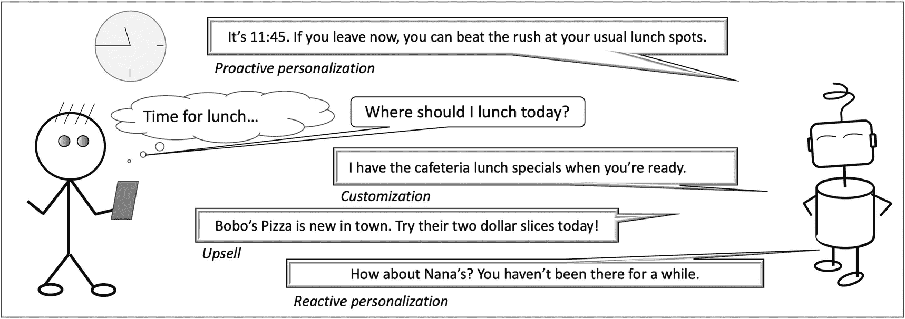
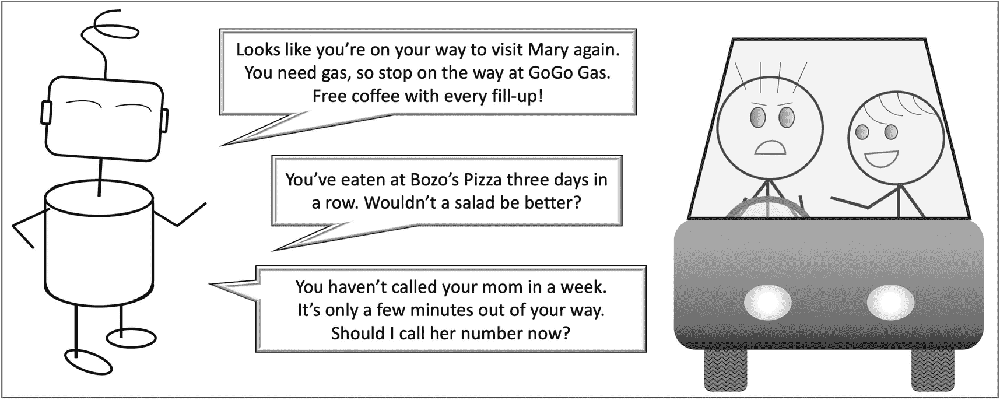

# 15. 创建安全的个性化体验

本章将基于你在第 14 章学到的关于上下文的知识，进一步探索如何创建用户信任的个性化语音界面。即使在撰写本章时，每周都有关于大公司数据泄露的报道，导致健康记录、财务信息和密码被曝光。在语音行业，有报道称工作人员会监听^(⁹⁹)你的私人对话，并且智能音箱应用容易受到网络钓鱼攻击，这些都加剧了人们对隐私侵犯的担忧。我们甚至不必提及任何国际政治或法律话题。

新闻头条利用每个人的恐惧。毕竟，恐惧能带来销量！这些担忧本身并非基于谎言——家用语音助手**确实**会在不该触发时错误地启动麦克风，而且安全漏洞没有任何借口。改进语音用户界面的唯一方法是收集用户数据、分析数据并迭代以提升性能。目前缺失的是对哪些事情值得担忧以及如何妥善应对的理解。

在本章中，你将多角度探讨这些主题：如何安全地处理用户数据，同时创建值得信赖的、满足每个用户个性化需求的语音解决方案。我们将讨论在默认设置与让用户自定义体验之间取得平衡，你将学习如何整合用户数据以创建量身定制的个性化体验，同时避免因“知道太多”而让用户感到不适。这引出了本章的第二个相关主题：系统人格。你的语音用户界面需要传达信任感，这通过它理解什么、如何以及何时回应，以及它对用户知道多少和不知道多少来体现。

### 知道谁在说话的重要性

有时你的语音用户界面需要知道谁在跟它说话，有时则不需要。如果你作为用户，向语音用户界面提问：“明天法国巴黎的日落时间是几点？”，无论这个语音用户界面是在你家注册的，还是你在朋友家问的，你都会期望得到相同的答案。但如果你问：“我的支票账户余额是多少？”，你希望听到的是你自己的账户信息，而你的朋友肯定不希望让你听到他们的信息！如果同一家庭的两个用户都说“播放我的播放列表”，你的语音用户界面能否根据说话者来理解“我的”？

在手术准备应用中，“我还能吃阿司匹林吗？”显然必须为正确的用户提供正确的答案，但“茶算清流质吗？”这个问题无论谁问，答案都是一样的。

知道谁在说话有两个目的：个性化定向行为和授权安全数据访问。个性化，或称为定制化，不一定意味着每次对话开始时都要明确身份识别，但也可以这样做。它确实意味着要识别出你之前与这个人交谈过，并记得关于他们的一些信息。这可以通过用户说出他们是谁、通过使用被视为个人设备的设备，或者通过语音生物识别技术（基于某种语音模式确定用户身份）来实现。授权访问是处理涉及私密或安全数据（如医疗记录或金融交易）的任务所必需的。这同样可以涉及各种类型的生物识别技术，或者涉及信息令牌，如账号和密码。个性化和安全访问都能提升用户的信任和满意度，因此让我们详细探讨每一个方面。

### 个性化定向行为

餐厅可能会提供儿童菜单、配菜选择或素食选项，因为他们知道并非所有人都有完全相同的需求。而这家餐厅经验丰富的服务员会根据不同客人的需求（无论是客人明确提出的还是服务员察觉到的）采取不同的互动方式：为家庭提供儿童菜单、向首次光顾的顾客解释菜品选择、或为常客主动端上"老样子"。最终结果和目标是一致的：准确愉快地接收客人的点餐，并送上他们要求的菜品。

要让语音用户界面（VUI）的交互对每个用户在不同场景下都具有相关性，就不要强迫所有人经历相同的交互流程。不，即使这样能减少开发工作量也不行。相反，应该多花些精力来定制体验。基于用户行为和偏好数据，打造对更多人有用且易用的产品。当主动建议基于对用户行为和需求的分析时，人们会认为这些建议确实有用。建议必须相关、简洁且频率适中。请看以下体验反馈。

**两位语音助手用户讨论设置闹钟**

用户 1：*为什么我设闹钟时，[IVA]要主动提议给我播放助眠音乐？？她说了类似"听起来您要睡觉了，需要我为您播放一首助眠音乐吗？"之类的话。现在才晚上 9 点！我只是设个闹钟！而且那段提示音又长又烦人，逼着你听完。估计会放些肯尼·G 之类的烂歌。那根本不会让我放松。哈哈。*

用户 2：*她问我是否要为整周设置闹钟。为什么？今天是周三！而且我从来没跟她一起设过闹钟！凭什么假设我需要这个？！*

对用户 1 来说，更好的解决方案是不假设她现在要睡觉（除非数据显示晚上 9 点是她通常的就寝时间）。对两位用户来说，一个非常简洁的"了解更多"提示会更合适。所以，要寻找主动服务的机会，但务必谨慎行事。做对了效果很好，但仅仅因为你添加了新功能，并不意味着用户想听你大谈特谈。

### 个性化与定制化概念

现在来定义一些术语：

* **主动 vs. 被动**：你在前几章已经了解了不少关于主动行为的内容。主动意味着基于某些信息或事件采取主动。被动则只是做出回应。主动是积极的，被动是消极的。

* **个性化 vs. 定制化**：你会看到这两个术语几乎可以互换使用，但它们在"谁来决定对默认设置的特定更改"这一点上有着关键区别。个性化是产品所有者和实施者基于对用户数据的分析所做的；定制化是用户自己单独修改其体验的行为。定制化由用户通过个人设置和偏好来实现（当然，这些设置和偏好必须由实施者提供）。

* **向上销售与交叉销售**：向上销售是指企业向用户提供升级账户或添加功能的提议。向上销售与基于用户数据分析的个性化主动行为不同，其重点主要在于为企业带来利益——至少用户是这样认为的。它通常涉及用户付费或注册某项服务。交叉销售则指相关或互补的产品，例如以特价提供额外的家庭助手设备。因此，以略高于中份披萨的价格提供大份披萨是向上销售；购买披萨时提供便宜的六罐装汽水是交叉销售。

图 15-1 展示了不同方法如何相互作用的示例。前三个 VUI 结果是由过去用户行为、一天中的时间、用户偏好和业务决策的某种组合触发的。只有最后一个 VUI 结果是对用户语音请求的响应。

**图 15-1** 个性化、定制化和向上销售既可以主动也可以被动

在图形用户界面（GUI）中，主动信息可能是一个用户可以轻松关闭的屏幕弹出框。但请记住，语音是转瞬即逝且狭窄的，需要用户集中注意力，并且不允许同时处理多任务。主动信息或即时提示很容易变得令人厌烦。如果用户曾有一次问过某个运动队的情况，不要假设他们从此以后就想收到该队比分的主动通知。相反，要长期跟踪用户行为，然后询问用户是否愿意添加该通知。同时，如果用户在类似场景下反复做同一件事，比如每个工作日上午开车去同一个地点，那就不要再每天问他们是否在开车去上班——尤其是当他们总是回答"是"的时候。除了令人厌烦和延长对话之外，在对话中不合时宜地提出无关问题或提供信息还会增加认知负荷——用户需要处理额外输入并做出回应。这反过来会增加出错、超时和遗漏相关信息的风险，从而影响整体成功率。

有帮助和强人所难之间只有一线之隔。向上销售和交叉销售尤其棘手。作为企业，你想销售更多产品，这没问题。但如果用户因不堪其扰或感到厌烦而无法成功完成任务，你就无法卖出更多产品。如果确实要进行此类操作，请确保其相关且简短，并跟踪用户是否说了"不"，这样你就不会在短时间内再次提出同样的提议。

**成功提示 15.1** 不要让人感到毛骨悚然

在主动为用户提供帮助与让用户感觉被监视之间，需要把握微妙的平衡。人们对隐私和数据安全日益敏感。最好谨慎行事，不要因自身能力而忘乎所以。在真实用户测试中，不仅要测试功能，还要测试提供帮助的方式和时机。允许用户选择接受或拒绝此类行为。一个人的“主动”可能是另一个人的“烦人”。在第 17 章中，你将看到示例，说明记录的用户话语如何精确揭示多少“帮助”才算过度。

总有一天，你的商业决策会与你认为的最佳用户体验发生冲突。我们见过很多次这种情况。好消息是：实现商业目标**与**提供卓越用户体验是可能的。解决方案始终需要团队中每个人通力合作，通过提供最佳用户体验来最大化投资回报率。这包括理解用户和商业的目标，以及理解上下文和技术挑战，从而提供有助于每个人成功的定制化和主动行为。

### 成功提示 15.2 不要以为你比用户更懂

永远不要忽视用户的明确请求。你不知道他们的理由。如果用户请求你能够提供的东西，就照做。如果你无法提供，请解释原因。如果你给他们替代方案，要让他们知道你明白这是替代方案，否则他们会觉得自己的诉求未被倾听或理解。一旦他们感到被忽视或欺骗，你就无法挽回他们的善意和信任。

在第 7 章中，你了解到，对任务更熟悉的用户比新手更有可能填写多槽位请求的全部或大部分槽位。他们整体上也不太可能犹豫或使用填充短语，比如*嗯，我想*……只要用户对复杂主题足够熟悉，他们就能非常成功地与语音用户界面交流。例如，一个股票期权交易请求，如*ACME 披萨，二零二零年十月十七日，六十二，看涨期权，两美元八十美分*，对我们大多数人来说听起来不太自然，但语音用户界面可以很好地处理。这并非你想象中那种特别对话式的表达，但它**确实**是一种使用语言的口头互动，这种语言对具有交易经验的用户来说很自然。迎合用户认为“自然”的方式是你成功的关键。股票交易语音用户界面必须处理这类一体化请求的语法，以及经验不足的用户可能说出的结构较松散的短语。你还需要与拥有适当级别官方股票交易认证的人员合作，就像构建健康类语音用户界面时需要与受过培训的医务人员合作一样。

新手模式与专家模式是设计和实现中的一个重要概念。简单来说，新手用户需要更多解释性提示，可能每一步都附带示例。专家用户通常只需要语音用户界面在某个步骤期望什么的提醒。因此，新手与专家的区别通常在于详细与简洁，但也可能涉及回读速度。选择哪种交互模式可以由每个用户明确决定，但更常见的是自动分配。你可以通过存储的与身份验证令牌关联的信息来了解用户的专业水平，从而进行分配。你也可以根据交互频率或最近 N 次交互中的错误次数来进行分配。

拥有两个版本的提示为你和用户提供了极大的灵活性。你可以利用它们根据对用户的了解来个性化体验，也可以为用户提供定制化选项。你将在下一节关于实现的内容中学习具体方法。

没有哪个产品能在没有选项和设置的情况下满足所有人的所有需求。我们坚信，为用户提供定制化选项能带来用户满意度。这一点对于语音和其他交互方式同样适用。请参考玛丽·米克尔 2019 年互联网趋势报告中的这些引述：^(¹⁰⁰)

> *在投资增长时，开发* *更好的用户体验* *能产生迄今为止最强大的病毒式传播效果和影响力。参与度推动从免费消费到付费订阅的转化。*
>
> ——巴里·麦卡锡，Spotify 首席财务官
>
> *最重要的事情是确保* *现有客户* *满意，而不是追逐新客户。*
>
> ——埃里克·袁，Zoom 创始人/首席执行官
>
> *去了解人们……我们销售的产品 100% 基于推荐。……造型师的成功在于* *倾听、共情并交付客户想要的* *，并且不带评判地做到这一点。*
>
> ——卡特里娜·莱克，Stitch Fix 创始人/首席执行官

### 成功提示 15.3 语音业务成功 = 给予用户他们想要的

反对定制化的常见理由是：它会让用户感到困惑、没人使用、投入大收益小。一如既往，要深思熟虑，提供最重要的选择。确定最可能的默认设置，并允许用户根据自身需求，在与其最相关的场景中更改这些设置。

#### 实现个性化体验

假设已获得用户许可，思考一下，如果你能获取用户的当前位置、典型日程安排、过往行为及偏好，你的餐厅查找器能提供哪些功能？能做的可太多了！

个性化可以基于几乎任何情境，并影响语音用户界面（VUI）对话的方方面面，包括内容、语言、音质、详细程度、提示措辞、提示回读速度等。餐厅查找器和手术准备助手都为主动式和响应式个性化与定制提供了大量机会。在交互式语音应答（IVR）系统中，可以为不同的来电群体分配不同的号码，提供量身定制的对话，旨在向这些来电者提供最常用的选项，并让他们快速完成操作。一个处方续方 IVR 系统能够根据拨打的电话号码，为患者和药剂师分别提供个性化体验。这是通过`DNIS`（即被叫号码识别服务）实现的。最初的几轮对话，包括选项菜单和登录格式，都可以针对每个群体的需求进行定制，而许多子模块则是相同的。通过两个入口点，你可以在避免重复工作的同时实现个性化体验。

同时——这一点很重要——要思考如何呈现主动建议，使其既实用又不具侵扰性。仅仅因为你了解用户的一些信息，并不意味着你必须提及它！请看图 15-2。语音机器人说的内容并非不实，但存在更安全的方式来分享相同的信息——当然，除非你刻意想塑造一个唠叨的 VUI 角色。☺ 更安全的做法是，像乘客或普通朋友会知道的那样使用地理位置和其他个性化信息：*看起来你在奥克兰*……或*根据你的位置/饮食目标*……或*这是你今天的提醒事项：“妈妈的生日”*……

图 15-2

主动和个性化行为不必明确提及个人信息

手术准备 VUI 建立在为每位用户提供个性化体验的能力之上，因此仔细的实现和措辞选择变得更加重要。具体响应的内容和时机不应由用户修改，因为该 VUI 处理的是由医生控制的医疗程序。但你可以想象根据用户特定的食物喜好来制定个性化的饮食限制。

来自语音前线

在一款多模态移动健康应用中，当用户被一个欢快的声音提醒他们下一个非常私密的医疗程序任务时，他们感到惊恐。在私密场合这没问题，但在公共场合大声宣布即将进行的程序，大多数用户并不欣赏。

#### 个性化体验的代码实现

在第 14 章中，你添加了上下文相关的代码，用于检查用户是否在同一对话（即短时间内）两次询问同一个名字。如果是，你将其作为错误处理，应用程序会做出不同的响应。当你最初在第 7 章的名称拨号器中实现消歧时，如果用户说*呼叫 Brent*，会出现消歧提示*哪个 Brent……？*现在，让我们继续使用名称拨号器，添加一个个性化的上下文相关体验。我们将指定一个“Brent”作为用户的“默认 Brent”。设置默认值的目的在于允许用户只说出名字，而无需每次都进行消歧或说出姓氏。这个选择可以是你主动提供的（*我注意到你经常呼叫 Brent Jones。是否要将此联系人添加到收藏夹以便更快呼叫？*或类似表述），也可以是根据呼叫频率自动分配的。如果你在未与用户确认的情况下这样做，还需要添加逻辑，以便在用户开始对*正在呼叫 Brent Jones*的提示说*取消*时重置该默认值——请注意，提示语仍然说出全名作为隐式确认。

首先，你需要一种存储用户上下文信息的方法。清单 15-1 展示了这一点。为简单起见，你将使用前几章一直在用的意图上下文，并在此基础上继续构建用户上下文，将当前上下文传递到 webhook 请求中，并将新上下文存储在意图上下文中。在`webhook_request.py`中，将用户上下文初始化为一个空字典（A）。添加一个函数来更新用户上下文（B），以及另一个使用先前定义的函数（D）来更新名称历史记录的函数（C）。在`set_most_recent_intent.py`中，如果定义了用户上下文，则从意图中更新它（E）。将请求的名字和姓氏添加到用户上下文中。请注意，这是在确认之前（F）。一旦名称最终确定，就用名称历史记录更新用户上下文（G）。清单 15-1 展示了在`ar_call_by_name.py`、`ar_confirm_name.py`和`ar_call_by_name_last_name_disambig.py`中执行此操作的一些位置。这些文件中还有其他位置；只要出现名称但尚未确认，就将其添加到用户上下文中（F）。当确认完成时（或者如果不需确认，则立即），更新名称历史记录（G）。

