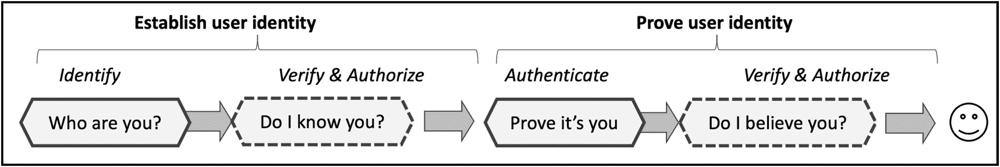
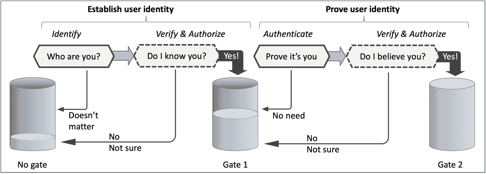

# 则播放“好的，正在呼叫...”的响应，然后结束。
if df_response.explicit_confirmation:
df_response.output_text = \
(f"您想呼叫 {context_name} {last_name}，对吗？")
df_request.update_user_context(   # F
df_request.current_time,
'requestedGivenName',
context_name)
df_request.update_user_context(   # F
df_request.current_time,
'requestedLastName',
last_name)
df_response.output_contexts.append(
confirmation_context(context_name,
last_name))
else:
df_response.output_text = f"好的，正在呼叫 {context_name} {last_name}。"
df_request.update_name_history(   # G
df_request.current_time,
context_name,
last_name)
df_response.end_conversation = True
df_response.nva["do"] = True
列表 15-1
存储用户上下文信息

在列表 15-1 中，我们只展示了一个用姓名历史更新用户上下文的地方：用户同时说了名和姓。还有几个其他需要更新的地方，这些都在完整的代码示例中。任何时候你确定要呼叫的名字，都应该更新历史记录。如果你正在进行显式确认，则需要等到名字被确认后再更新历史记录。

你刚刚使用了意图上下文来存储用户上下文和历史记录。这样做部分是为了简单起见。在实际应用中，你不会希望像我们这里所做的那样，将用户与应用程序交互的历史记录来回传递。在真实的应用中，你会使用某种数据存储，比如 SQL 数据库、NoSQL 表或 Redis 数据结构。我们不想让这本书变成关于如何设置和连接数据库（这本身就是一个大话题）的教程，所以我们保持了简单。如果你留在 Google 生态系统中，继续使用 Dialogflow 和 App Engine，你会有很多选择，比如用于 NoSQL 的 Bigtable 和 Cloud SQL。从 App Engine（webhook）访问这些选项特别容易，因为它们都属于 Google Cloud。实际上，你的选择将取决于特定环境中的可用性和约束条件。

现在你已经有了上下文并正在设置它，你可以使用它了！如果用户只说*呼叫 Brent*，检查上下文，看看是否所有叫“Brent”的人姓氏都相同，并且历史记录中至少有三次请求。如果是这样，就假定该姓氏，但使用显式确认来确保正确。列表 15-2（来自 `ar_call_by_name.py`）展示了这一点，它结合了用于使用已存储上下文的非常通用的代码，以及一个关于名字为“Brent”的拨号器的非常具体的示例。初始化一个名字字典来跟踪所请求名字对应的姓氏（A），然后是出现频率最高的姓氏的次数（B），以及出现频率最高的姓氏（C）。遍历用户上下文中的所有时间戳（D）。初始化或递增姓氏计数器（E）。如果姓氏数量大于当前最大值（F），则重置最大姓氏计数（G）和出现频率最高的姓氏（H）。如果字典中只有一个姓氏并且我们至少有三次请求（I），则假定该姓氏并使用显式确认（J）。如果个性化条件不满足（历史记录中所有姓氏相同且数量 >= 3），则询问是哪个姓氏，与之前相同（K）。


```python
def ar_call_by_name(df_request, df_response):
    # ...... 为突出重点而省略的代码 ......
    # 如果调用者只指定了名字
    if given_name == 'Brent':
        # 如果需要区分姓氏（例如，“呼叫 Brent”）
        # 个性化：查看 userContext。如果所有
        # Brent 的姓氏都相同且至少有 3 个，则假定
        # 为那个姓氏。逻辑可以更复杂，可以查看
        # 时间戳并应用不同规则等，但这只是一个
        # 简单示例。
        name_dic = {}    # A
        max_num = 0      # B
        max_name = None     # C
        user_context = df_request.user_context
        for timestamp in user_context:     # D
            context_given_name = user_context[timestamp].get('givenName')
            context_last_name = user_context[timestamp].get('lastName')
            if (context_given_name and
                context_given_name == given_name and
                context_last_name and
                df_request.current_time - float(timestamp) < 60.0):   # E
                if context_last_name not in name_dic:     # F
                    name_dic[context_last_name] = 0
                name_dic[context_last_name] += 1
                if name_dic[context_last_name] > max_num:   # F
                    max_num = name_dic[context_last_name]   # G
                    max_name = context_last_name      # H
        if len(name_dic) == 1 and max_num >= 3:    # I
            # 个性化：使用之前用过的姓氏。
            # 它必须是唯一的且被使用过三次或以上。
            # 假定为明确确认。
            df_response.output_text = \
                f"您想呼叫 {given_name} {max_name}，对吗？"  # J
            df_response.output_contexts.append(
                confirmation_context(given_name, max_name))
        else:
            # 更改回复，改为询问“哪个 Brent...”的问题。
            df_response.output_text = \    # K
                '哪个 Brent：Jones、Adams、Barnes 还是 Carletti？'
```

你可能会好奇为什么我们在 (L) 处加入了时间戳。它只将过去一分钟内发生的名字添加到 `name_dic` 中，因此这些名字才会被考虑用于个性化。这是为了测试，这样你就可以尝试不同的场景。如果你在一分钟内*呼叫 Brent Jones* 三次，那么*呼叫 Brent* 就会假定是 Jones。如果你等一分钟，这段历史记录就会离开时间窗口，一切重置，你就可以再次尝试。在生产系统中，你不会设置这个超时时间。在大多数情况下，你还会在更长的时间内跟踪使用细节。你还会使用更复杂的规则来实现个性化。

在测试期间，你不能连续多次说*呼叫 Brent Jones*，否则会触发你在第 14 章中添加的行为，该行为假定多次重复意味着某种问题。你可以绕过这个问题：在第一次*呼叫 Brent Jones* 之后，使用“默认 Brent”方法，然后说*呼叫 Brent*。

请注意，你正在实现一个非常简单的个性化规则；如果所有姓氏都相同，那么就假定为该姓氏。可能存在更复杂的规则，这些规则会考虑时间因素、查看过去几天或几周的行为，或者使用更低的阈值。你也可以针对不同情况设置多个规则。

##### 深入探讨：上下文还是历史记录？

你可能会想，我们存储的究竟是上下文，还是仅仅是用户所做过的有趣事情的历史记录。答案是后者，我们这么做是有原因的。另一种选择是，例如，将名字字典的内容存储在上下文中，这样可以使应用程序逻辑更简单。

我们选择更偏向“历史记录”的方式，是因为根据经验，你用来决定用户或上下文相关行为的逻辑可能会随着时间的推移而变化，或者取决于你在最初构建系统时未曾预料到的许多因素。我们的理念是尽可能推迟此类决策，并使我们存储的数据尽可能灵活。更改应用程序中的逻辑很容易，但如果存储信息时做出了错误决策，要从数据存储中恢复则更困难（并且需要更长的时间）。

还有一些实现问题需要考虑。如果每次历史记录更新都需要访问一个 RESTful Web 服务，并且该服务离 webhook 很远，那么存储每条历史记录项可能会带来相当大的延迟——这是将此类后端系统部署在靠近 webhook 位置的另一个优势。几十毫秒的额外延迟，在一轮又一轮的交互中累积起来，很容易让用户感到非常厌烦。因此，你可能需要考虑在对话结束前将数据保留在本地，然后再更新后端。同样，出于篇幅考虑，我们在此不深入讨论这类选项的细节。

### 授权安全访问

很少有语音话题比隐私和安全更重要。随着你学习更多知识，你会听到诸如**验证**和**身份验证**之类的术语；你会意识到并非该领域的每个人都以相同的方式使用这些术语。那样就太简单了。与其纠结于术语，不如先理解所涉及的步骤，然后看看一些常见的用于实现访问限制的语音优先选项。图 15-3 以 VUI 在每个步骤需要回答的问题为背景，概述了该过程的理想路径。



图 15-3

识别和身份验证的步骤

由于这些术语含义过载且应用方式常有细微差别，你会听到人们将这些步骤称为登录和密码，这与非语音访问步骤类似。无论你使用什么术语，只要确保与你共事的所有人对这些术语有相同的理解即可。让我们仔细看看每个步骤：

1.  **身份声明**：*你是谁？*用户直接或间接地声明他们是谁。在某些情况下，这涉及用户所代表的他人的身份，例如近亲、医生或财务顾问。成功的验证建立了一个声明的身份，但并不能证明用户就是那个人。这是个性化的第一道关卡：对于某些任务，比如根据说话者是谁来设置音乐偏好，这可能就是你所需要的全部。如果你要求播放*我的健身歌单*，并不是说这个歌单是私密的；它只是与你配偶或室友的歌单不同而已。

2.  **验证身份声明**：*我认识你吗？*在此步骤中，系统通过对照某些数据验证声明来确定身份声明的有效性。系统可以根据对声音是你本人的确定性来解读*我的*的含义。

3.  **证明用户身份**：*你能证明是你吗？*请求一些不重叠的信息，或者检查只有“正确”的人可能知道或拥有的设备访问权限。如果其他人正在弄乱你最喜欢的歌单，你可能会决定添加一个访问密码。

4.  **验证身份验证声明**：*我相信是你吗？*最后一步与步骤 2 类似：根据为声明的身份存储的某些数据确定其有效性，以授权完全访问，并证明声明的身份确凿无疑。你的歌单安全了，多亏了你那个晦涩难懂的密码选择！


#### 身份识别与认证方法

让我们看看每个步骤中常用的一些方法。你可能会疑惑，为什么有些方法重复出现，安全性是否因此不足——这是因为你通常可以在不同步骤中选择不同的方法。只需确保整个组合是安全的即可。同时请记住，如果用户处于非私密环境（例如在键盘上输入数字），应允许他们静默地提供安全信息：

- **身份声明**：“你是谁？”
  - **知识**：在许多需要确认身份的 IVR（交互式语音应答）及其他语音系统中，这通常基于你所知道的信息，例如唯一的身份标识，如账号或（在美国）社会安全号码（SSN）。请对文化差异保持敏感，注意哪些信息适合询问。
  - **生物特征**：当你与熟人通电话时，对方能识别出你的声音。在语音应用中，这被称为语音生物特征识别：通过声音特征来确认身份。这需要预先注册，在系统经过调优或用户群体较小时效果极佳，此时无需额外证明即可确认身份并应用该用户的设置。如今许多家庭助手都采用了这一技术。
  - **物理控制**：基于对物理设备的访问权限来确认身份，即你拥有或持有的物品。用户的手机通常被认为与个人绑定，因此常可用于身份验证。面对面时，出示身份证或护照也是一种身份声明。

- **验证身份声明**：“我认识你吗？”
  - **知识**：例如，将账号与数据库进行比对验证。此步骤有时会使用信用卡号的校验位或账号的 N-best（最佳匹配）算法。
  - **生物特征**：语音生物特征识别会将用户的话语与现有声纹进行比对，判断匹配质量是否足以通过某个阈值。如果你预期用户可能冒充他人，生物特征识别方案需要额外的处理路径，例如使用多个声纹或基于知识的降级方案。请参阅“语音生物特征识别”侧边栏。
  - **物理控制**：根据设备的历史使用记录进行识别。

- **证明用户身份**：“你能证明你就是你吗？”
  - **知识**：对于纯语音 VUI（语音用户界面），这通常涉及用户设置的 PIN 码或密码。类似于网站的安全问题，另一种方法是让 VUI 询问用户之前设置的易于记忆的信息，例如童年时的电话号码或祖父母的生日。
  - **物理控制**：使用密钥卡生成限时数字代码，由用户口头说出。

- **验证认证声明**：“我相信是你吗？”
  - 与验证身份声明类似，需与某个数据存储进行比对，但此处的匹配标准应更为严格。例如，不使用 N-best 算法。

长期以来，IVR 系统需要结合多种安全访问方法，以确保通话既安全又高效：任何人都可以拨打一个电话号码，那么如何在只与正确的人分享正确信息的同时，为他们提供最适合的访问选项？随着非 IVR 的 VUI 扩展到新平台和设备上的任务和领域，安全访问将变得越来越重要。

#### 语音生物特征识别

我们两位作者都从事过语音生物特征识别方面的工作，这是一种通过声音来验证你声称身份的方法。

这里需要区分验证（“这是否是他们声称的那个人？”）和识别（“这是谁？”）。验证适用于任何规模的用户群体，因为你只需与声称说话者的“声纹”进行比对；而识别仅适用于较小的群体，例如十人以内。近年来，语音生物特征识别取得了长足进步，在合适的场景下非常有用。

你可以想象一些识别功能很方便的场景，例如一个家庭成员共享的应用，每个成员都有自己的偏好和特定操作权限（如购买）。同时，你也需要考虑用户信任的问题。在你的任务中使用生物特征识别是否合适？

根据任务的不同，你的 VUI 可以在从步骤 1 之前到步骤 4 之后的任何阶段停止。真正的复杂性在于如何处理重试和匹配失败的情况。即使用户未能证明他们声称的身份，你是否能给予他们一定的访问权限？通常是可以的。图 15-4 总结了你刚刚学到的概念。这是一种“半杯满”的情况：每经过一个步骤，你都可以在不给用户或你自己带来安全或隐私风险的前提下，给予用户稍多一些的访问权限。不愿表明身份或验证失败的用户可以访问“无门”信息：如地点、营业时间和其他通用信息。在金融 VUI 中，门 1 的访问权限可能是被动信息，如近期交易记录；而门 2 的访问权限则包括主动资金操作，如转账。可以将门 1 视为只读权限，门 2 视为读写权限。



**图 15-4** 使用身份识别与认证方法实现分级数据访问

如何在给予正确用户正确访问权限的同时，让这一过程既简单又安全？访问方法可分为以下几类：

- **开放访问**：VUI 仅处理通用信息，因此无需知道每个用户是谁。它仍可能使用位置信息和其他非识别性上下文。所有内容均为“无门”。
- **仅首次登录**：所有必要的身份识别和授权仅在首次初始化设备或安装应用时进行一次，通常同时包含使用声明。这是许多技能、动作和移动语音应用的常见方法。无门，或仅有一道门。
- **前置访问**：一体化即时登录。无论用户想做什么或了解什么，在交互开始时即完成所有必要的身份识别和授权。所有内容的访问权限都在一个“位置”控制，如同大楼的前门。仅有一道门。
- **即时（JIT）访问**：延迟登录，直到需要时才进行。仅在任务需要时进行身份验证。这就像前门未锁，但某些单独的房间是锁着的。有一道或两道门。

所有选项都是有效的——你“只需”根据 VUI 的任务和主题，找出能让最多用户成功的方法。前置访问和即时访问在 IVR 以及其他可由众多用户访问并处理私密数据的系统中都非常常见。当你能够主动向用户提供内容，或者 VUI 中大多数任务都需要身份验证时，前置访问是更好的选择。如果相当一部分交互不需要完全身份验证，则即时访问更优，因为它能加快这些任务的交互速度。即时访问还具有心理上的优势：用户先说出他们想做什么，会感觉进展更快，而后续的身份验证也显得更合理。此外，如果呼叫者因登录问题被转接给客服人员，了解用户意图有助于将用户路由到正确的客服人员。

对于即时访问解决方案，设计和实现会变得更加复杂，因为需要额外的工作来跟踪是否需要身份识别，甚至需要跟踪所使用的访问类型。在你的设计流程和规范中，应包含简单的标志和条件逻辑，以显示何时需要什么，以及在成功和失败情况下应发生什么。

*来自语音前线*


