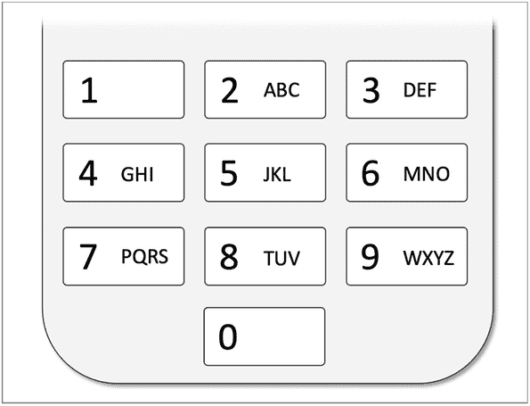
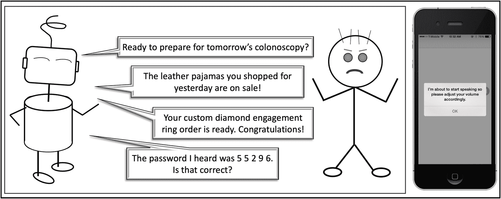
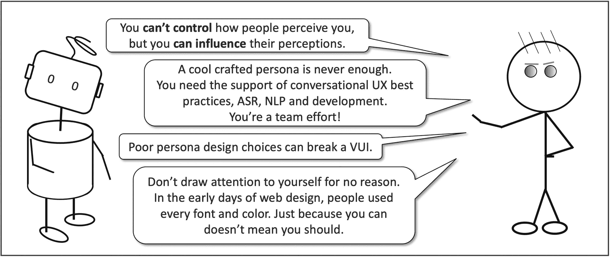
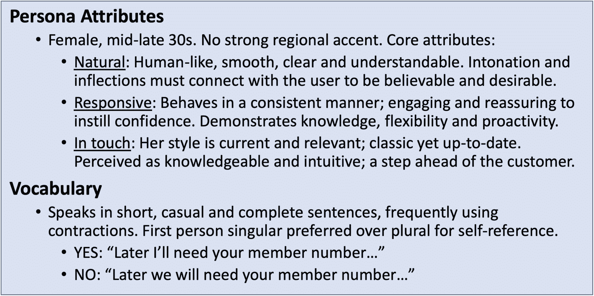
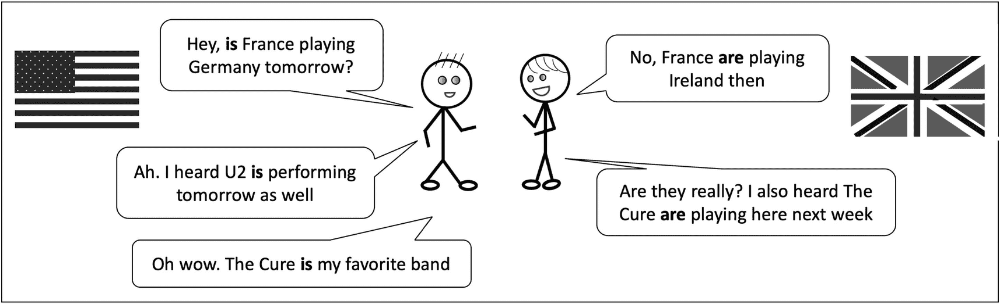
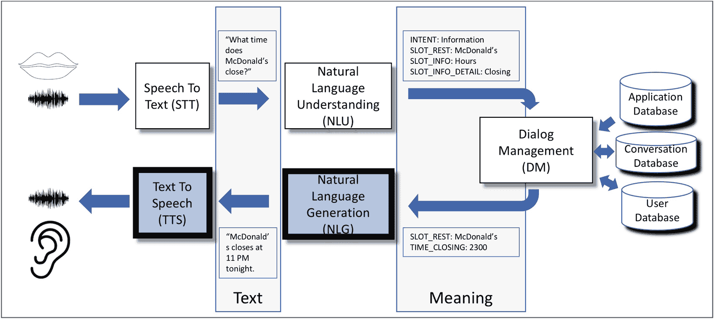
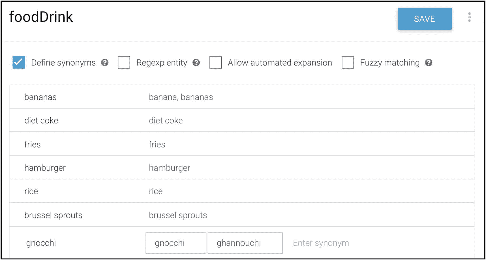
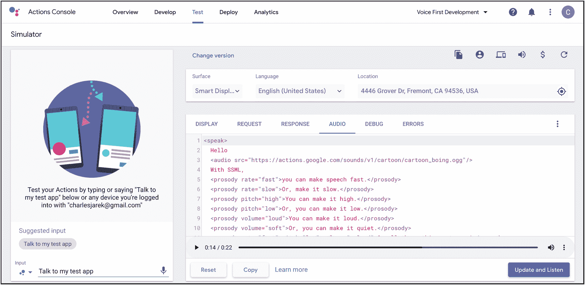

# 排版后的内容

在回顾金融语音 IVR 非生物特征登录方法时，我们发现前置设计和即时设计（JIT）的使用比例大致相当。身份识别通常使用账号、社会安全号码（SSN）、信用卡或银行卡号、会员 ID 或商户 ID。对于身份验证，最常见的是使用某种长度的数字 PIN。其他方法包括 SSN 后四位、出生日期、邮政编码、信用卡 CVV 或有效期，或者用户选择的某个单词或短语。当时有一家机构通过询问用户交易或账户详情数据库中的特定数字或信息，加入了活体检测。具体选择取决于所需的安全级别。IVR 会利用一个过程（`ANI`，即自动号码识别）来识别来电号码和线路类型——这些信息可用于查找已存储的账户关联。这与来电显示不同——呼叫拦截不会影响它——并且它可以用作身份识别中的多个因素之一。

### 实施安全门控访问

多层级识别、`N-best`列表和跳过列表常用于登录方法中。结合使用时，它们可以在不降低安全性或用户体验的情况下“修正”识别错误。设想以下登录对话：

- **VUI**：*请告诉我您的会员编号。*
- **用户**：*一三五三六一九。* → 高识别分数
- **VUI**：*请问您的 PIN 是什么？* ← 拉取会员登录信息
- **用户**：*二九三二。* → 高识别分数且与 ID 匹配
- **VUI**：*谢谢。您的测试结果已就绪……* ← 完全访问权限已授予

在这里，一切在第一次尝试时就非常顺利，识别完美，后端比对验证了两个数字是关联的。现在，如果会员编号的识别分数只是中等水平呢？由于会员编号印在卡上且并非“秘密”，因此可以将其读回确认——而 PIN 是您不希望读回的知识，但如果它与用户账户数据库中的信息不匹配，您可以再次询问：

- **VUI**：*请告诉我您的会员编号。*
- **用户**：*一三五三六一九。* → 中等识别分数
- **VUI**：*是 1 3 5 3 6 1 9 吗？正确吗？*
- **用户**：*是的，没错。* → 已确认
- **VUI**：*请问您的 PIN 是什么？* ← 拉取会员登录信息
- **用户**：*二九三二。* → 听到 2132；匹配失败
- **VUI**：*抱歉，请再说一遍那个 PIN。* ← 重试，不提示“不匹配”
- **用户**：*二九三二。* → 这次识别分数更高
- **VUI**：*谢谢。您的测试结果……* ← 完全访问权限已授予

有多种方法可以组合这些策略——尝试为具有一个或多个访问安全级别的场景编写您自己的示例对话。在编写时，请思考潜在的安全漏洞以及如何解决这些问题。根据登录 ID 或密码（或两者）具有高识别分数还是中等识别分数，对话会如何变化？何时可以明确确认，何时不可以？并记住您学过的其他方法，例如一步修正。这里还有一个例子，展示了身份验证失败后的门控访问：

- **VUI**：*抱歉，请再说一遍那个 PIN。* → 重试
- **用户**：*二九三二。* → 仍然不匹配；达到最大尝试次数
- **VUI**：*最后，请问您的电话号码是多少？* ← 附加令牌
- **用户**：*650 123 4567。* → 匹配；降低安全级别
- **VUI**：*谢谢。我可以告诉您关于……* ← 部分访问权限已授予

请注意那些将数字密码记成单词的用户。这种情况尤其常见于人们习惯在手机键盘上输入密码时（图 15-5）。如果您只处理按键输入，这不成问题，但在处理语音输入的 *2 7 2 9 9* 和 *crazy* 时，实现难度和成功率之间存在巨大差异！



图 15-5

显示数字与字母对应关系的手机键盘

有一些有趣的技术可用于在身份识别（ID）和身份验证过程中最大化准确性和可用性。其中一种技术是使用前面提到的双因素身份验证，要求提供第二项“您知道的信息”，例如邮政编码或为用户存档的其他信息。

双因素技术还可以与您在第十章中学到的语音识别 `N-best` 列表结合使用。字母数字字符串对语音识别来说极具挑战性：字母的“e-set”[b, d, e, p 等]在语音中难以区分——这也是使用拼写字母表的原因之一。将其与在书写中区分“1”（一）和“l”（小写 L）进行比较，您就会立刻明白视觉和听觉感知在难易程度上的差异。提高准确性的一种方法是，在身份识别令牌（如电话号码或账号）和第二个因素上都使用 `N-best` 列表，并持续遍历这两个 `N-best` 列表，直到在身份识别令牌和第二个因素的数据库中找到匹配的组合。使用这种技术，我们实现了超过 97% 的端到端身份识别成功率，而单独处理这两个元素时，各自的成功率会低得多。

**成功提示 15.4 成功源于为用户提供替代方案**

您已经看到，不同的同义词和对话中的不同路径能让更多人成功。这在任何类型的登录中都是如此。在可能的情况下，为用户提供不同的方法来完成他们的任务，并错开访问方法，以便访问隐私性或安全性较低的数据时只需较少的身份验证。更多的访问选项总能提高成功率。超出覆盖范围的语音输入提供了关于用户为何登录失败的无价数据——利用这些数据来决定添加哪些其他方法。


#### 关于实现访问控制的注意事项

有时，请求访问私人或安全信息的用户并非“信息所有者”，而是受信任的“代理人”，例如在医疗应用中，用户是患者的看护者或近亲。某些此类系统会提供两条不同的识别路径，提示语措辞不同，根据用户是患者本人还是看护者，分别使用“您”或“他/她”。这虽然增加了额外工作，但为了更好的整体体验，是值得的。

有时，用户可能不知道某项特定信息，或者不愿意使用它；美国的社保号（SSN）就属于这一类。实际上，SSN 更适合作为一种备用策略，当用户记不住账号时，为他们提供一条可选的替代路径。在某些国家，使用国民身份证号码可能被认为更合适或更不合适。其他国家可能使用护照、税号或驾照号码。语音生物识别技术可能对某些用户效果不佳。请设法提供安全级别相似的替代方法。从长远来看，这种额外的投入会通过让用户更满意、更成功而得到回报。并且，要为那些想要重新开始的用户提供*重新开始*的功能。你需要了解你的用户在使用哪些功能时存在困难，以及哪些功能对他们来说很容易。每个用户群体都不同。总的来说，预计人们会更难记住他们的账号和 PIN 码，而更容易记住像 SSN、出生日期和电话号码这样的个人信息。

在许多 IVR 系统中，在身份识别或授权过程中回答*我不知道*就像一条隐藏指令，会将用户引导至另一条对话路径。如果你的数据显示有相当一部分人难以记住某一种登录凭证，你可以明确提供一条出路：*请输入或说出您的账号，或者说“我不知道”。* 为了鼓励用户尝试，在重试之前不要提及该选项。此外，帮助提示应解释登录的相关信息以及如何转接给人工客服：*您可以在我们每月账单的第一页找到账号* 或 *您的计划编号是您医疗卡上的十位数字*。

你还需要决定允许尝试多少次，以及当达到最大尝试次数后 VUI 应如何响应。大多数 IVR 系统只允许尝试几次，之后便会转接给人工客服，或者暂时或永久锁定访问权限。如果访问被锁定，请务必提供关于如何重新获得访问权限的明确说明。可以想象，这通常是一个涉及多个不同角色人员的决策。请尽早开始相关讨论。

有时，允许一小部分已知用户（甚至是未识别的访客用户）进行有限访问是合适的。这正是你在家庭中大多数物联网（IoT）任务中所期望的，比如开关灯：毕竟，孩子和客人也应该能够控制灯光和音量！

#### 多模态小贴士

如果访问是多模态的，请跟踪登录过程中每个环节所使用的模态。如果有人说出一个账号，你可以假设可以将其读回以进行确认。但如果是在键盘上输入的，则不要做同样的假设。说到键盘，有些用户会将 PIN 码视为电话键盘上的单词，而不是数字。你将如何处理这种情况？如果你的 VUI 运行在支持生物识别功能的设备上，你可以利用这一点来避免询问登录名和密码。对于低安全需求，可以假设在智能手机上运行的应用程序足够安全，无需每次都登录。

### 隐私与安全问题

越来越多的客户与公司之间的互动发生在移动设备上。这些设备“始终”与我们相伴，它们是定制化的且（大部分是）私人的，它们访问云端数据并整合了多种模态，不过设备越小，打字就越困难。在网上查找关于日常金融交易的统计数据，你会发现所有人群中的数字支付比例都在逐年增长。基于这些原因，可以预见语音的即时增长将涉及移动设备。这意味着跨领域和任务的语音对话范围将更广，远超我们目前所见。这也意味着对隐私和安全的需求更大，尤其是针对语音数据。

#### 来自语音一线

在 22otters 公司，我们的一款产品让癌症幸存者通过录制心得和观察来分享经验，形成一个社区。这带来了许多挑战。其中一个隐私解决方案是提供一个选项，让用户分享由公司提供的语音重新录制的故事。

数据存储的隐私和安全不仅仅是语音解决方案才需要关注的问题。但语音带来了其他模态不相关的额外问题，恰恰因为它是一个音频信号，而口语是一种旨在被听到的交流工具。存在对话隐私问题：

*   如果你的 VUI 要求语音登录，那将是一个潜在的安全漏洞；允许用户在公共场合使用其他登录方法，包括多因素生物识别和输入密码或其他敏感信息。

*   如果你的 VUI 通过说出一些私密或可能令人尴尬的内容来问候用户，请使措辞更通用，并允许用户将交互设置为静音模式，此时回复显示在屏幕上，甚至可以通过其他方式访问，例如通过电子邮件或网页链接（参见图 15-6 的多模态解决方案）。

想象一下，如果你的 VUI 在回答一般性问题时“过度分享”了个人信息，比如第 14 章中的航班时长对话，可能会引发什么问题。你可能会争辩说：“但它知道你的声音！” 没错，但它也大声读出了我没有要求提供的个人信息，因为它自动填充了我的日历。如果那次旅行是对同住某人的一个惊喜，而此人恰好听到了呢？很容易想到一些用例，这既会让用户感到不快，也会给你的 VUI 带来负面公关（图 15-6）。



图 15-6

避免 VUI 对话中潜在的尴尬和安全问题

正如本章引言中提到的，许多最近的报告都关注于工作人员监听用户数据的问题，甚至包括语音助手误发的私人信息。其核心问题不在于——或不应在于——技术本身，而在于设计和实现中关于数据处理和安全保障的有效担忧。在第 16 章中，你将了解到为什么收集语音数据对于提升 VUI 性能是必要的，而这最终将使所有用户受益。

#### 来自语音一线

安和丈夫在厨房里讨论如何根据橱柜里的食材找到一份好食谱。没有提到任何搜索引擎。然而，餐厅里的一个语音助手突然插话：*我想您是想找您的手机。对吗？* 在回答*不是！*并听到后续的*好的，我不确定*之后，她完全忘记了酸面包，拿起手机去查刚才发生的事情的细节。VUI 捕捉到了它解读为*find the’s good*的内容。由于从未设置过任何找手机功能，也看不到任何相关的解读，并且一开始就没有对设备说话，她对设备后续的*好的，我不确定*的回应，实在是不足为外人道也。


关于聆听，信任还涉及另一个方面：回应并非针对语音用户界面的言语。唤醒词会误触发，就像你有时会误以为有人在跟你说话一样。家用语音助手能判断出某些是误触发并停止聆听——但并非总是如此，这会影响信任，以及人们在家中是否愿意使用语音。注意不要回应那些本应被忽略的内容。

交互式语音应答在用户信任方面有一个优势：用户通过拨打一个电话号码来发起对话。这个电话号码出现在公司的官方声明和名片上，因此用户天然信任该语音用户界面获得了公司的认可并且是安全的。如果通信是通过技能、操作或其他语音应用进行的，情况则未必如此。无论合理与否，我们甚至听到过经验丰富的语音从业者表示，如果没有相当可靠的登录机制，他们不会信任家用语音助手上的金融交易。

### 成功技巧 15.5 总有另一种方法

如果你的语音用户界面有屏幕，就利用它。让用户可以选择点击或打字阅读，而不是在需要时只能说话和聆听。即使是纯语音解决方案也有其他选择。交互式语音应答始终可以提供按键式身份验证选项。手机有音量控制和免提选项。有时只需要提前告知用户即将播放音频，并在用户确认前不要继续，或者提供通过电子邮件或应用发送某些内容的选项。

有一点很明确：人们喜欢便利。他们也希望学习如何从任何产品中获得更多价值，只要这对他们有益。大多数用户不介意他们的数据被用于个性化体验，或被匿名用于改进性能和获取新功能。一项研究^(¹⁰¹)发现，91%的参与者更喜欢提供个性化优惠或推荐的品牌，83%的参与者愿意分享他们的购买历史和类似行为数据，以换取个性化体验。真正让用户感到不安的是某些公司和组织处理他们数据的方式：未能确保数据安全、通过出售数据获利，以及将数据用于追加销售和广告。当然，你想通过产品盈利，但强行推销付费版本和出售用户数据并非赢得忠实客户之道。你提供了什么作为回报？一个可定制的体验、不分享个人数据的承诺，以及一个精心设计并实现、能持续且准确地解决问题的方案，这将为你赢得忠诚度、口碑推荐和回头客。

### 成功技巧 15.6 “蜂蜜比醋更能捉到苍蝇”

换句话说，友善比刻薄更能让你走得更远。一个过于强硬推行商业议程的语音用户界面就是刻薄的。如果交互式语音应答的呼叫者要求转接人工客服，请尽快转接。如果你的语音用户界面真诚地提供帮助并提供有用的东西，从长远来看它更有可能成功。首先给用户他们想要的东西，然后再进行追加销售。如果他们说了`no`，在第十一次听到同样的提议后，他们也不会突然说`yes`。

在所有界面和交互模式中，保护用户数据访问都是一场军备竞赛。对于语音而言，唯一可行的答案可能涉及知识因素和生物特征活体检测的多因素组合。尽管纯语音生物特征已经引发了担忧，^(¹⁰²)但如果用于双因素认证，它仍然非常强大。由于篇幅限制，我们不会详细介绍如何实现和调整语音生物特征。只需记住，识别某人的声音以提供个性化体验，与为了安全数据访问而确认其身份是两回事。

### 系统人格

你的用户是否认为你创造了一个近乎粗鲁但无所不知的严厉老师，或者是一个不听话但非常可爱的说谎笨蛋？希望都不是，但你在设计和实现中做出的几乎每一个选择都会影响用户如何感知和与你的语音用户界面的系统人格互动。这里我们关注的是语音系统所传达的人格，而不是用户体验和用户界面设计中用于代表某一类用户群体的人物角色。

回顾第 2 章，你了解到我们所有人都会在脑海中形成一个与我们交谈之人的形象。我们似乎无法避免这样做。并且因为语音用户界面像人类一样“说话”和“聆听”，我们将其拟人化：我们将人类的特质和行为赋予非人类事物。这意味着你的用户会根据他们感知到的人格来形成你的语音用户界面的形象，而这个形象会影响他们说什么以及怎么说。

创建一个成功的语音用户界面是建立在这个假设之上的：用户的行为是相当可预测的，并且当他们的期望得到满足时，对话就会轻松舒适。当对话符合预期时，对话的双方都知道该说什么，并期望在特定时间听到特定的回应。这意味着语音识别和自然语言处理的性能会更高。因此，如果你的语音用户界面人格符合用户的期望，结果将是更高的整体成功率和积极的体验。

系统人格的目的不是创造一个人类的漫画版本——嗯，除非这适合你的语音用户界面，但这很可能不是你的情况。系统人格是语音用户界面的整体身份或特征。它是通过其声音范围、词汇、发音、方言、表现力、语法、行为、乐于助人、主动性、智能、对用户的了解以及如何处理这些信息等所传达的风格和个性。坏消息是：无法保证你的用户会以你希望的方式感知你的人格，甚至无法保证他们会喜欢它。好消息是：你可以在很大程度上影响这种感知（图 15-7）。



图 15-7

来自真实语音用户界面用户的评论，被改写为人格设计指南

##### 来自语音前线

我们曾经创建过一个葡萄酒搭配应用。用户说出他们正在吃的食物；系统则推荐一款搭配的葡萄酒。那是有史以来最有趣的需求收集过程！作为设计过程的一部分，我们需要定义正确的系统人格：一个友好随和，但又知识渊博、专业且乐于助人的形象。结果发现安有一个经营酒庄的好朋友。以她的朋友为基础来定义人格，使得这个人格变得栩栩如生。


#### 定义与实现系统角色

为语音用户界面（VUI）定义合适的角色并非毫无争议，也伴随着艰难抉择。核心问题在于，人们根本不会都喜欢同一个角色。问问你身边的人对`Siri`、`Alexa`和`Google Assistant`的看法，你会从每个人那里得到不同的答案。我们俩都有自己最喜欢和最不喜欢的，但我们不会告诉你具体是哪些。就连选择名字也必须谨慎。名字需要简短易记，发音简单且没有太多变体以便于识别，同时又要足够独特，不易被误识别。如果名字暗示了性别、年龄或其他特征，那么你选择的语音就需要与之匹配。如果是`Alexa`技能或`Google`操作，你显然无需做这些选择。但想想苹果、亚马逊与谷歌在命名选择上的有趣差异：一个明确选择个人名字，另一个则用公司名。从实用角度看，这就是为什么你必须说`Hey, Google`或`OK, Google`，而不是只说一个名字，否则当房间里有人说“我去 Google 一下”时，麦克风很容易被触发；而谈论`Siri`或`Alexa`的人则不必说出名字。安把`Alexa`叫做“品客”，因为 Echo 的形状和品客薯片罐很像——她甚至把一个空品客罐套在了她的一个 Echo 设备上。但使用公司名也显得更不个人化，更少拟人化。这重要吗？我们也不会回答这个问题。我们只是希望你能思考这些选择带来的影响，并理解什么对你的用户是重要的。

明确定义角色有很多理由：

*   它为设计师和任何处理提示内容的人提供了焦点，有助于他们通过对话流程和措辞创造一致的体验。
*   它捕捉了 VUI 的认知模型和品牌形象，帮助产品所有者和体验设计师评估整体实现。
*   它提供了打造音频体验的信息，帮助配音演员、语音教练，或任何选择合成 TTS 语音和创建非语言音频的人，理解如何传达这种体验。
*   它提供了关于措辞的信息，帮助语音科学家处理识别和意图覆盖。

角色定义和风格指南通常包含描述性属性和示例话语，如图 15-8 的摘录所示。



**图 15-8** 风格指南中典型角色描述的摘录

用户在和谁说话？VUI 最终代表的是用户还是其他人，比如一家公司？想象一下想要某个推荐。想想你会期待什么，以及你对品味相似或不同的朋友、独立评论者、公司销售员的回答会有多少信任。用户可能希望他们的家庭 VUI 助手像一位无所不知的人类助手一样了解他们的偏好——只是没有人类的部分。但如果那个助手开始坚持采取更符合他人议程或盈利动机的行动，你就会很快失去用户的信任。有一些方法可以向用户提供某些东西，或帮助他们发现可能感兴趣的新事物。要明确说明这是基于用户偏好和过往行为；不要过于频繁或用力地推销。这是一个滑坡，所以要非常小心，并思考你最终代表的是谁。

养成创建并使用角色定义和风格指南的习惯。仔细定义你的系统角色：

*   忠实于用户对任务、领域和品牌的任何期望。
    *   如果你的 VUI 与某个品牌相关联，你需要融入该品牌。
*   如果用户自然地将你的 VUI 与匹配现实世界交互的隐喻或心智模型联系起来，比如点外卖或向医生描述病情，那么你的系统角色需要符合那个心智模型。否则，由于认知负荷增加，用户的使用成功率会降低。
*   VUI 代表谁？如果 VUI 是个人助理，用户期望更多的个性化定制。如果是公司代表，角色的个性化程度低一些也没问题，进行向上销售和交叉销售也是如此。代表商店或公用事业的 VUI，其说话和行为方式，与代表医生、监考老师、艺人或法律代表的 VUI 截然不同。
*   绝不能让角色的风格凌驾于功能性之上。
    *   避免使用可能让某些用户困惑的表达，如俚语、地域性比喻或专业术语。
*   用于医疗或金融领域的 VUI 角色应建立信任；避免使用儿童或卡通声音。

小心让你的 VUI 做出类似人类的评论。像给通勤交通信息添加色彩这样简单的事情也可能适得其反。如果你的 VUI 评论说路况*看起来不错*或*比平时通畅*，要确保这不是周六早上，并且要记住，如果存在任何拥堵，你的“不错”可能不是我的“不错”。天气也是如此：有人喜欢雨，有人喜欢晴。如果你的角色做出这类定性评论，它们是有助于整体角色形象，还是会惹恼用户？没有统一的答案，但角色的特征越明显，用户的分化就越严重。如果你希望用户喜欢你的角色，允许他们设置一些参数，比如语音，并基于已知的用户偏好进行构建。如果你想惹恼用户，那就让你的角色发表大量评论并且出错吧！在第 16 章中，你将学习关于测试角色这个棘手的话题。

**成功提示 15.7 “对话式”并不意味着“闲聊式”**

当语音系统被描述为“对话式”时，意味着它们被期望能够理解自然语言，同时不破坏对话的“规则”。VUI 的回应也被期望听起来自然。但请记住，它是机器，不是人。有些人喜欢一个表现得像有感知能力、对天气发表主观评论的角色；另一些人则只喜欢语音这种交互方式，只想要准确的回答。思考一下如何创建一个能吸引所有用户群体的角色。专业提示：你做不到。就像没有人能被所有人喜欢一样。角色越鲜明、品牌化越强，你的用户就越可能两极分化。有些人会喜欢，有些则不会。所以，要自然，目标是创造一个能普遍吸引大多数用户，同时又不激怒太多人的角色。


#### 角色设定如何影响对话

系统角色设定会影响对话的方方面面，并影响用户如何称呼和回应语音用户界面（VUI）。如果你正在创建一项技能或操作，你需要为其定义角色设定，但用户是通过呼叫 Alexa 或 Google 来访问它的。用户只有在首次打开该技能或操作时，才会体验到你的角色设定；如果他们使用一次性指令，则仍会与 Alexa 或 Google 交互。

人类非常擅长模仿行为——这正是示例成为强大工具的原因。这也意味着用户会模仿角色设定的风格、语速和词汇选择。请确保角色设定使用的所有单词和语法结构都符合语法规范。如果用户认为你的 VUI 听起来像女性声音，部分用户可能会使用“女士”等称呼；如果被认为是男性声音，部分用户则会说“先生”。这两种情况都不应影响你的自然语言处理，并且如果用户可以选择语音，你需要同时处理这两种情况。请记住：就像具有特定外在特征的人一样，你的角色设定不仅要理解自己使用的词汇，还要理解语言中所有与该主题相关的其他表达方式。

如果你的 VUI 使用其他语言进行对话，情况会变得更加复杂。在某些语言中，交谈对象的性别和年龄会影响你所说内容的语法形式。在许多语言中，如果不为所说内容应用正确的语法性别，你几乎无法进行任何交流。这意味着不同语言需要不同的策略，因为它们处理未知性别的方式不同。这就是为什么你不能简单地将提示语从一种语言翻译成另一种语言，有时甚至需要重新组织代码。我们讨论的是国际化（构建可以轻松针对不同语言和国家进行修改的内容）和本地化（进行针对特定语言和国家的修改），而不仅仅是翻译（将一种语言的句子转换为另一种语言，同时保留原意），以表明其中涉及的内容远不止于此。你的角色设定需要与任何语言和文化期望保持一致。例如，美式英语和英式英语不仅在发音和某些词汇选择上有所不同，在一些基本的句法行为上也存在差异：在谈论体育和音乐艺术家时，英国人倾向于使用复数形式，而美国人则使用单数形式（图 15-9）。你的 VUI 角色设定将如何在提示语措辞和理解方面处理这一问题？



图 15-9

VUI 系统角色设定必须反映其所融入的语言和风格的方方面面

### 成功提示 15.8 一致性至关重要，即使对于角色设定也是如此

关注角色设定的每一个细节，尤其是当你本人与角色设定的定义不完全匹配时。即使你能流利地使用某个国家的语言，但并未居住在该国，也请找一位当地居民来检查表达方式是否与时俱进。

选择合适且一致的角色设定能够建立信任。问问自己，如何建立用户对 VUI 回复的信任——不仅是在措辞上，还包括在回答可能存在多种选项时的执行准确性和系统“诚实度”。答案的来源是什么？你是否会告知用户答案的来源？如果告知，如何告知；如果不告知，原因是什么？你对源材料的控制程度如何？谁负责检查信息是否正确，谁可以进行更新？如果用户呼叫的是 Alexa、Google 或其他平台助手，而不是你自己的系统，那么当信息不正确、具有误导性或体验不佳时，责任在谁？用户会责怪谁？

还记得第 14 章中那个“汪汪叫”的吧台吗？这不仅是一个非常有趣的例子，也指出了架构决策的深层含义，这些决策会影响语音助手的当前和未来使用以及用户对其的信任。如果有更多的技能或操作自动响应用户，协助他们完成更复杂的任务，那么这些技能或操作必须是值得信赖的。作为用户，我需要知道我可以相信我所听到的内容。如果我想买一张机票，我是向特定航空公司的技能或操作请求，还是由一个聚合技能或操作来提供帮助？如果是后者，这个技能或操作是谁创建的，为什么它会被优先推荐？在用户眼中，助手角色设定首先代表用户的利益；而公司或产品的角色设定则不然。^(¹⁰³) 当两者融合时会发生什么？由于过度承诺的“AI”智能，VUI 在许多用户心中的信任基础已经岌岌可危。作为受过教育的从业者，只要我们关注信任问题，我们就能让语音成为每个人的成功故事。

### 系统语音音频

实际的语音音频输出——声音本身——需要与系统角色设定以及措辞相匹配。它们是相互交织的。这包括语音的传递和质量、感知的人口统计特征以及发音。想想那些被指示用你的名字称呼你以传达关怀和个性化的店员。当他们费力地念错你的名字时，效果如何？并不好。事实上，这种试图营造的个性化接触反而会适得其反，显得虚假。如果你的 VUI 用名字称呼用户，发音必须正确。为用户提供纠正发音的方法，例如，通过在应用程序中输入替代拼写，以及选择不被称呼名字。同样，不要在地名上偷工减料。如前所述，餐厅查找器处理对加利福尼亚州布里斯班的请求。这个地名的发音与澳大利亚城市布里斯班不同。凡尔赛宫在指代法国宫殿和宾夕法尼亚州行政区时发音也不同。虽然在开发中可能节省时间，但发音错误是另一种削弱信任的方式——甚至可能引起混淆和不清晰。多花一点功夫，你的 VUI 听起来会更聪明。你可能从家里的语音助手中听到过另一个例子：一张现场录制（*live*）的专辑标题，其发音类似于“to *live*”，而不是“*alive*”。再次强调，上下文起着作用：利用它来指导发音。

我们终于要来看你在第 1 章中看到的语音优先架构的第 4 步和第 5 步：自然语言生成（NLG）之后是 TTS 输出（图 15-10）。



图 15-10

系统语音音频输出是语音架构第 4 步和第 5 步的结果

你可以像之前跟踪姓氏一样，在用户上下文中跟踪口语发音。在食物日记中，你可能会有很多单词替代发音的例子。图 15-11 展示了意大利面食“gnocchi”的一种可能性。



图 15-11

实体的替代发音，此处为“gnocchi”

你可以想象在用户上下文中跟踪哪个版本被说出：

```
"userContext": {
"1576461424.7895339": {
"requestedGivenName": "Brent",
"requestedLastName": "Jones",
"pronunciations": {
"gnocchi":"ghannouchi"
}
}
```

当然，问题在于如何处理这些信息。要小心假设，例如，VUI 应该对特定用户“以某种方式”说话。^(¹⁰⁴)


#### TTS 合成还是真人配音，生成还是录制

输出内容是否必须始终是合成的文本转语音（简称 TTS）？其实不然。如今，获取高质量且多样化的 TTS 比以往任何时候都更容易，尽管 TTS 的质量参差不齐。你可以在每个生态系统内选择可用的语音，通常无需额外费用。然而，使用录制的语音提示也有其理由。有些语音系统会同时使用 TTS 和录制提示。你的选择取决于你的 VUI（语音用户界面）的具体情况。让我们来看看每种方法的使用场景及其优缺点。

总的来说，由专业配音演员录制的提示能让你更精确地控制表达方式，包括发音和句子适当部分的强调。即使是逗号处的短暂停顿，或是对菜单选项的“引号”强调，也需要比预设的静音时长更精细的处理才能听起来自然。如果你的 VUI 涉及需要传达特定情感的主题，录制方式会更准确、更快捷。借助工具和诸如 `SSML` 之类的标记语言，你也可以通过 TTS 实现大部分效果，但这通常需要比预期更多的微调，而且仍可能不尽如人意。谷歌、Alexa 等平台如今提供了一些简单的 TTS 发音编辑方法，但这仍然是一项相当繁琐的工作，并且不一定能达到你期望的发音效果。有时唯一的办法是修改提示语的措辞，这又可能引发其他问题，比如用户现在会用不同的词语来回应。TTS 的另一个潜在缺点是可能增加认知负荷，甚至造成混淆，例如，当 TTS 发出的疑问句没有疑问句应有的韵律时。

录制语音提示的缺点在于创建和管理它们所需的工作量。如果你的 VUI 涉及广泛的变化，比如账号、人名、地名、食物名或药物名，你实际上无法全部录制下来。每个类别都包含成千上万个名称，而大多数配音演员每小时最多只能录制大约 200 条语句。而且每个名称或数字在不同语境下都必须听起来自然，这意味着需要录制多个版本。

TTS 的巨大优势在于，无论你编写了什么提示文本，它都能立即生成音频输出。无需安排配音演员的录制时段，也无需音频工程师进行后期处理。无需处理庞大的提示片段库。但是，天下没有免费的午餐。你需要花更多时间来测试最终结果。而对于录制语音，大部分初始单元测试在录制和后期处理阶段就已经完成了。

有时，预先录制并存储 TTS 提示，而不是每次都从云端生成，是更合理的做法。如果你预计会出现处理或连接问题，或者某些提示对于用户体验来说特别重要，需要“确保正确”，那么这种做法就很有意义。

在同一个 VUI 中同时使用 TTS 和录制语音也有其理由：

-   如果 VUI 使用多种语音或语言，聘请多位配音演员的开销可能过大，因此使用频率较低的语言可以考虑使用 TTS。
-   在设计和开发阶段使用 TTS，是在拥有录制语音提示之前的一个便捷的占位方案。
-   最后，有些 VUI 使用由配音演员声音创建的 TTS，从而实现了录制和 TTS 的混合使用。这是两全其美的做法，可以让你将预录制范围限制在最常听到的提示，或者那些表达风格（如发音或情感基调）至关重要的提示上。

当你在第 8 章处理非语言音频（NVA）时，你使用了语音合成标记语言（`SSML`）来播放音频文件。完全实现的 `SSML` 还能做另一件事，但 Actions on Google/Dialogflow 目前还不支持，那就是自定义单词的发音。如果能够实现，你可以想象一个应用，通过微妙或不太微妙的方式模仿用户的发音，从而使应用看起来更自然、响应更灵敏。

#### 寻找并与配音演员合作

找到合适的配音演员需要付出努力。有多家公司可以帮助你找到理想的配音演员。这类搜索通常涉及聆听并评估多达 20 个声音的各种属性，以匹配角色定义。你评估的任何配音演员都必须符合风格指南中的品牌需求，但还有额外的要求：

-   具备自然理解提示语意图和语境的能力，并能将其转化为带有适当情感基调和强调的朗读。
-   能够接受指导，并且只需最少的重录次数。
-   声音质量清晰易听，且只需最少的后期处理。
-   在不同录制时段（即使相隔数月）中保持表达的一致性。
-   在需要时能够到位——如果你的品牌需要名人代言，那么档期可能是个挑战。
-   成本，按每条语句或固定时长计算。

> **一位经验丰富的音频工程师关于选择配音演员的见解**
>
> 如今，人们非常关注“对话感”，这导致用户体验设计师和媒体创作者不断寻求新鲜和不同的东西。问题在于，“新”和“不同”一直是创意领域（音频、视频、动画、视觉等）的焦点。虽然不断尝试改变和更新是合理的追求，但切勿忽视那些对出色音效至关重要的核心表演需求。在与配音演员合作时，你始终需要实现清晰度、一致性、可信度和共情力。为任何语音平台打造配音演员的“艺术”，在于将每个项目的业务和技术要求与制作人的直觉相结合。只有这样，你才能决定哪个声音是最佳选择。

> **成功提示 15.9 让每个人对声音都有发言权**
>
> 当你评估配音演员或 TTS 语音时，想办法让真实（或潜在）用户参与到决策过程中。产品所有者和最终用户通常没有相同的目标或使用场景。如果你不获取最终用户对声音和角色的反馈，你就是在冒险。


#### 单一还是多种语音

在某些情况下，多种 VUI 语音可以共存。让我们来看几个例子。有些用户会拥有多个覆盖相似领域、甚至通过同一设备发声的应用或助手。`Alexa`、`Google Assistant` 以及其他语音助手都有各自独特且可辨识的语音和角色。由于它们的起源和优先级不同，各自的优劣势也各不相同。有时会有人争论，如果多个助手通过同一设备说话，用户会感到困惑。

所有我们讨论过的资深语音设计师、开发者以及最终用户都一致认为这并非问题。原因如下：作为人类，我们不会因为与不同的人交谈而感到困惑。我们期望不同的人处理不同的请求，并知晓不同的信息。那些拥有多个助手的用户，通常对于何时与哪个助手交谈都有明确的偏好。真正复杂的是，不同平台上的助手可能无法访问相同的内容，也无法共享所有上下文的可见性。如果你让 `VUI1` 开始播放一部电影，你能让 `VUI2` 快进或告诉你导演是谁吗？如果一群人正在看电影，无论电影是谁打开的，每个人都共享相同的上下文。因此，这些限制最终是业务上的约束，而非用户的限制。如今的家用助手为用户提供了语音选择。在多成员家庭中，为每个人提供一个选择会很有用，这样 VUI 就能以用户选择的角色来回应每个用户。

在单个解决方案中使用多种语音的想法，至少从 21 世纪初的语音门户时代就已经存在了。你可以用一种语音播报最新新闻，另一种播报体育，再一种播报艺术与文化，以此类推。根据你的品牌需求，这可能值得研究，但要注意这会带来大量的额外工作。使用不同的语音非常适合微妙的提醒。在程序准备 VUI 中，你可以用一种语音来回答问题，用另一种语音来发出提醒，比如当需要进行某个关键准备步骤时。多种语音的其他用途包括：一种语音仅用于提示如何与 VUI 交互，以及在简短的音频操作演示中使用不同的语音。

你也可以使用 `SSML` 来改变语音质量。`Google` 和 `Alexa` 都为某些语言提供了多种语音；你甚至可以使用 `speech` 标签的 `voice` 属性动态切换语音。你可以做的是使用 `SSML` 来改变当前语音的语速、音量以及/或者音调。

在第 8 章中，你通过在 webhook 响应中发送自定义负载来使用 `SSML`。你可以使用相同的方法来增大音量以强调重点（列表 15-3）。

```
{
"fulfillmentText": "是时候进行你的程序准备了！",      "payload": {
"google": {
"expectUserResponse": false,
"richResponse": {
"items": [
{
"simpleResponse”: {
"textToSpeech”:
" \
是时候进行你的程序准备了！ \
"
}
}
]
}
}
}
}
列表 15-3
增大 TTS 语音音量以强调重点
```

你可以在 `Actions on Google` 控制台中尝试不同的 `SSML` 参数，听听它们的效果（图 15-12）。



图 15-12

`Actions on Google` 控制台中的音频模拟器，用于尝试对语音进行 `SSML` 修改

#### 提示管理

所有规模和复杂度的 VUI 都能从拥有提示标签命名规范中受益。如果你正在管理录制的提示，系统化的标签和标记尤其重要，但在设计和开发的各个阶段，无论是为了自己使用还是与他人沟通，它们都非常方便。如果你的 VUI 具有定制化功能或不同模式（例如本章前面讨论的专家模式与新手模式），请使用它们。如果你的 VUI 是多语言的，提示标签是必备的。正如你在第 14 章中所见，详细的对话规范通常是包含提示和条件的大型电子表格；在审查角色风格时，能够根据条件和上下文对提示措辞进行排序会非常有帮助。

不同平台对提示命名有不同的要求，这没问题。你选择的规范应在清晰与简洁之间取得平衡，并应编码意图、上下文和条件。结合对话轮次概念“发起”和“回应”，有助于在特定对话上下文中快速查找或引用所有提示。与他人合作时，这让你可以快速引用*所有发起提示*，或者说*查看 `PlayTitleDis_I`*，而不是说*查看当 VUI 首次需要用户澄清所请求的标题以播放正确内容时所说的提示*。

避免以导致后续提示内容更改复杂化的方式硬编码提示内容。使用标签作为链接，反而可以更容易地进行系统化的修改和复用。


#### 情感与风格

`Vector`，Anki 公司推出的拳头大小的机器人，能理解语音指令，但主要通过非语言音频、动作以及低分辨率显示屏上的两只“眼睛”进行交流。然而，它却能很好地传达情感和个性。当它说话时，`Vector`的声音是机器人式的，但这没关系，因为这与它的角色设定相符，而且清晰可懂，甚至比某些真人声音还要清晰！

`Vector`的忠实粉丝对其角色设定和传达的情感反应良好。你也会希望用户对你的 VUI（语音用户界面）所表达的情感做出积极回应，并且你也会希望恰当地回应用户的情感。但计算机识别和回应情感并不比人类更容易：

-   情感在语音中的编码和表达方式非常依赖于说话者本人。多种情感常常在同一句话中同时出现。识别一种情感与了解其背后的原因并不是一回事。要正确解读语音中的情感，你需要对特定的人非常熟悉。这意味着计算机需要大量经过验证的训练数据。
-   人们对同一句话的反应各不相同。他们对情感内容的解读不同，并且对于什么是恰当的反应也看法不一。即使你正确识别了一种情感，你该如何回应？你应该回应吗？如果你判断错了怎么办？

仅仅因为你认为自己识别出了一种情感，并不意味着你应该做出回应。当我们研究 IVR（交互式语音应答）系统时，偶尔会有人建议识别脏话并做出回应，要么立即转接给人工客服，要么评论说没必要使用这种语言。这两种选择都不推荐。如果你做对了，你就是在鼓励和教会用户通过说脏话来获得更快的转接。如果你做错了，那些被“训斥”的用户即使之前不生气，现在也肯定会生气。最好的做法是不予回应，就像一位无论发生什么都保持愉快和专业的真人倾听者一样。并且，不要冒险听起来很假：你的 VUI 是一台机器，它没有感情。如果你确信某种反应是恰当的，并且你犯错的可能性很小，那么情感当然是有效的：它是人类对话的一部分。

**来自语音一线**

在 22otters，我们进行了一系列研究，探讨用户如何在不同的语境下，以及在 TTS（文本转语音）与录音语音中，解读同一句话。我们发现，提示语中的具体措辞比语调或表达方式的变化更能可靠地传达情感——至少在某种程度上是这样。用户会根据语境赋予正确的情感基调，除非表达方式过于强烈以至于显得虚假。

**成功技巧 15.10 谨慎回应情感**

因为很容易出错，所以要小心回应用户的负面情绪或任何感知到的情绪。识别最坏的结果，并据此衡量你的回应。犯错比不回应要糟糕得多。专注于风险较低的“安全”场景，比如在任务结束时表示祝贺，并在可能的情况下使用多层级识别。

**来自语音一线**

一位 IVR 用户评论道：“我用不了那些。我是盲人。”这让所有人都感到困惑，直到我们意识到这个评论指的是按键式 IVR 系统。我们当时专注于不依赖任何视觉线索的语音系统。对于任何因故无法阅读或看屏幕的人来说，语音显然是一个极好的界面。但这位用户的评论提出了一个重要观点：没有单一的模态（包括语音）能始终适用于所有人，甚至不能始终适用于同一个人。

#### 面向特定用户群体的语音

每个语音应用在创建时都必须考虑到特定的目标人群。即使是“普通大众”也是一个特定的目标。领域专家、儿童、非母语使用者、账户持有人、色盲的乳糖不耐受奶农……无论用户是谁，除非你了解你的对话对象，并尽可能多地理解他们的背景和需求，否则你无法有效地进行设计。

针对任何特定用户群体的无障碍和设计都是值得用一整本书来探讨的话题。这里仅需记住几点：

-   允许用户控制语速和音量。利用语音生物识别技术，你可以在多人家庭中自动关联每个用户的个人设置。
-   儿童是你的目标用户吗？你需要满足隐私和安全方面的顾虑。提示语的措辞必须简化、适合年龄并具有鼓励性。识别儿童的声音通常比识别成人的声音要困难得多，因此识别模型和整体设计需要考虑性能上的差异。
-   儿童是潜在用户但不是主要目标用户吗？可能需要某种形式的家长控制。一些用户希望你屏蔽脏话；另一些用户则不希望。
-   用户是否处于身体和/或精神压力之下，包括疾病？放慢节奏。简化语言，提供更多后续信息，并允许更长的语音超时时间以及在查找信息时能够暂停。通常，面向患者的医疗内容是为具有七年级阅读水平的人编写的。你的 VUI 也应如此。
-   你是否在提供医疗或财务建议，或询问用户的健康状况？如果你的用户在美国，你必须了解所有适用的法律，包括 HIPAA（健康保险流通与责任法案）；如果他们在其他国家，则需要了解类似的法规。如果需要，可以咨询 HIPAA 顾问。你的服务器甚至可能需要物理上位于少数几个国家之一。如果你本人不是目标受众中的一员，那么从第一天起就让有代表性的用户参与进来以避免陷阱就显得格外重要。

**多模态视角** 多模态的优势之一在于它提供的灵活性，通过允许用户选择输入和输出模态来容纳更多用户。有些人会始终使用一种模态；对另一些人来说，这取决于具体情境（手忙、眼忙、安静或嘈杂的环境）。对一些人来说，这不是选择，而是永久性的原因；对另一些人来说，则是暂时的（失声、手打石膏了）。尽可能让用户选择是使用按键通话、触觉还是语音来触发 VUI 麦克风。将 VUI 的动作状态与其他设备和声音联系起来，比如收到消息时房间里的灯会闪烁。另外，不要仅凭年龄就假设用户具有特定的技术熟练度或交互偏好。诚然，视力和听力会随着年龄增长而下降，所以如果你的用户群体偏大龄，请考虑到这一点。但是，高对比度使阅读更容易，清晰的发音能降低所有年龄段用户的认知负荷（图 15-13）。这只是良好的设计。


图 15-13

一位视力不佳的 80 岁用户很欣赏能够与手术准备 VUI 应用进行对话

**成功技巧 15.11 无障碍是最佳实践**

VUI 必须为其所有预期用户良好运行。这意味着要考虑到所有情境和所有能力的人。不要将无障碍视为仅针对有特殊需求人群的事情。一个健壮的 VUI 始终对所有用户都是无障碍的。VUI 设计的最佳实践同时也是无障碍的最佳实践：低认知负荷、简短清晰的指令（可被打断或重复）、对话中的不同路径、个性化以加快交互速度，以及健壮的识别、NLP（自然语言处理）和错误处理。


### 接下来是什么？

最后两章的核心主题决定了语音系统成功的未来：**上下文**（用于创建复杂、准确且实用的 VUI）和**信任**（以便人们愿意使用这些系统）。请关注开放语音网络^(¹⁰⁵)的工作，这是一个非营利性行业协会，致力于通过共同制定标准来解决隐私、安全和公平访问问题，从而弥合潜在的信任鸿沟。

本章为本书第三部分画上句号。您已经学到了大量关于如何设计和开发企业级稳健性的知识。现在，您已掌握创建 VUI 体验的工具，无论用户的任务和请求复杂程度如何，这些体验都能让任何用户群体感到满意。在第四部分中，您将学习如何验证您的 VUI 是否确实如您所愿地工作。第四部分涵盖了任何语音优先系统所需的各种测试和调优类型，并讨论了如何在部署之前、期间和之后避免常见陷阱。

### 总结

-   对私有数据的访问需要根据任务和上下文进行适当的权限控制。
-   系统人格触及 VUI 的每个部分，从措辞和流程到识别和用户满意度。
-   您无法控制用户对特定系统人格或语音的反应，但您可以影响和引导他们的反应。
-   在 VUI 提示中使用 TTS 或录制语音各有利弊，涉及所需的工作量和精确控制。
-   集中精力赢得用户对您语音应用的信任。信任意味着：在上下文中保持预期的人格；展示关于用户的恰到好处的知识，以提供帮助但不显得强求或令人不安；通过提供准确的响应或说明无法响应的原因，表明您理解用户的请求。并且，在无人说话时不要响应。
-   提示标签在 VUI 开发的每个阶段都是一种有用的速记方式——只要命名约定清晰且得到团队所有成员的同意。
-   可访问性是最佳实践。

脚注 1 2 3 4 5 6 7

