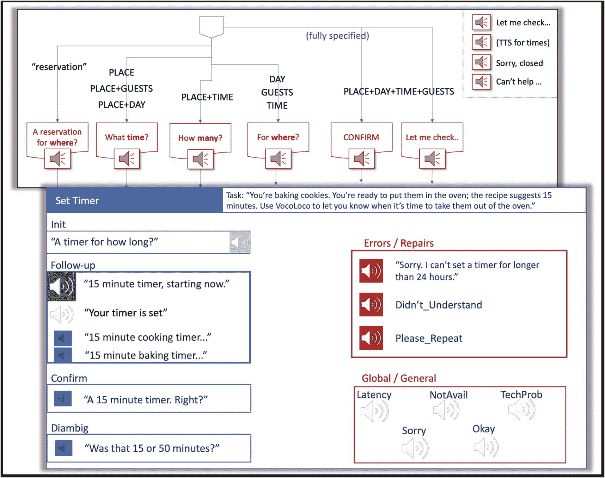
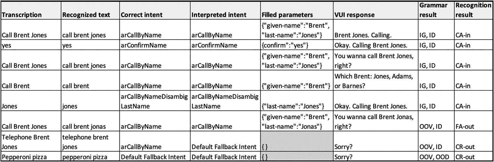
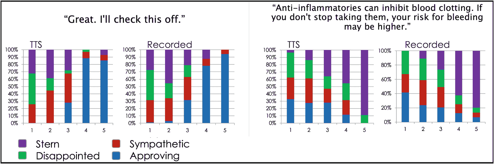
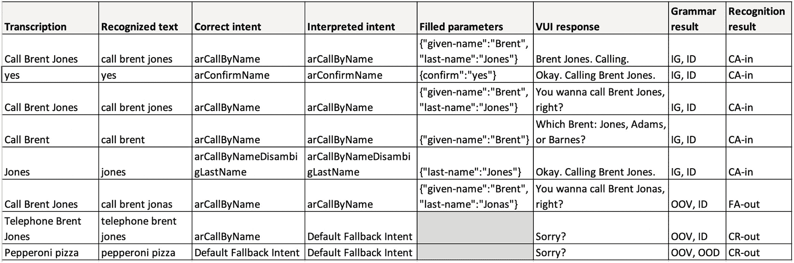

# 16. 测试与衡量语音系统性能

您已经构建了语音系统，并应用了所学的一切。现在，您已准备好迎接全世界用户蜂拥而至使用您的实现。如何将其推向世界，同时避免以某种糟糕的方式崩溃？您能否知道人们是否成功与您的 VUI 交互，或者是否喜欢与它对话？如果您遵循了所有“规则”，为什么还需要担心这些？

本章探讨如何测试语音系统，并从系统准确性和可用性两方面衡量其性能，以及如何识别有效的用户数据。您捕获的信息和指标将直接用于提升系统性能的能力（第 17 章）。

## 测试语音系统性能

所有软件都需要测试；语音系统也不例外。事实上，语音系统通常需要更多的测试，因为输入变化多端。正因如此，您在语音系统以及跨语音开发平台进行测试的方式，可能与您测试非语音界面时的习惯有所不同。

### 识别测试

识别测试（Recognition Test，简称 Reco Test）是一种有限且受控的健全性检查，用于验证常见的预期用户语句是否被正确理解。进行识别测试时，你不需要高度代表性的用户，只需一小群与预期真实用户合理相似的人员即可。如果你的语音用户界面（VUI）面向普通大众，测试人员应涵盖性别、年龄差异以及部分方言。如果你的 VUI 针对特定用户群体，例如非常年轻的用户或处于嘈杂环境中的用户，请确保你的测试人员能反映这些特征。

为什么这很重要？在第 2 章中，你了解到每个人的声音和声道都是不同的。所有识别器的性能也并非相同。识别测试并非同义词覆盖范围的测试，而是测试识别器在典型情况下是否按预期运行。因此，识别测试人员通常会按照 VUI 团队创建的脚本进行朗读。该脚本涵盖了一些具有代表性的高频对话和语句，这些内容可从示例对话中提取，并包含任何特殊指令，例如一串数字应作为单个数字还是自然数来朗读。

如果你能够访问底层的识别参数（例如在某些企业解决方案和交互式语音应答（IVR）系统中），那么识别测试应该是强制性的。但即使对于较小的家庭助手类 VUI，识别测试也能让你安心，确保用户在大多数常见情况下能够成功操作。

识别测试通常执行起来相当快速。提前准备好脚本并安排好测试人员，留出时间进行分析、结果报告和修改。确保所有必要的语音数据捕获机制事先已测试完毕。识别测试基本上是在任何大规模发布之前进行的最后一项测试。它不需要自动化，也不应该自动化。

识别测试是对识别引擎的测试吗？嗯，既是也不是。除非你在一个自行构建自动语音识别（ASR）引擎的组织中工作，否则你无法改变核心识别性能。所有识别器在核心层面的表现都不同。你所能做的，就是根据你的任务和资源需求，选择可用的最佳识别器。不过，你可以做的是，在你的数据上训练识别器，并查找语法覆盖范围的缺口。有时，你甚至可以修改影响识别的更深层参数设置。你将在第 17 章中了解更多关于影响性能的能力。在部署前的识别测试中，你只需寻找那些不需要大量用户数据即可发现的主要问题。

如果你的 VUI 是多语言的，或者使用的是你/你的团队不流利的语言，那么你需要母语为当前语言的人来进行测试。你不能仅仅基于机器翻译在文本转语音（TTS）中创建句子——你不仅需要真实的发音和语调，还需要了解特定国家、地区以及用户社会语言背景的真实用户。当然，这一点对于任何 VUI 设计也同样适用。

### 对话遍历：功能端到端测试

对话遍历测试的目的是验证 VUI 的功能是否与设计规范中的内容相匹配。可以将其视为一种用户验收测试。与识别测试类似，遍历测试是在代码稳定后通过语音命令进行的，但它与识别测试在以下几个方面有所不同：

*   目标是测试设计规范中每个上下文和条件下的每条路径。
*   测试人员需要是熟悉设计的人；如果系统很大，多个测试人员可以分工协作。

测试所有上下文和条件意味着：每条路径和槽位组合、每次重试次数、每个身份验证用例（如果属于系统的一部分）、任何执行的成功与失败，等等。它还应涵盖在不同时间、不同星期几以及不同地理位置对任何数据访问或传输行为的测试。关键在于，在可能影响结果的每个上下文中，遵循每一条可能的路径。详细的设计规范在此处就派上了用场：所有用例都已列出，包括每个用例要朗读的示例语句。

> **成功秘诀 16.1 获取真实的测试账户**
>
> 如果你要测试一个运行在他人服务器上的生产系统，最好尽早开始安排测试账户。对于可能涉及其他部门的大型企业客户，这可能需要一些时间。在许多系统中，用户根据不同的上下文会有不同的体验。用户特定的上下文包括：新账户与现有账户、首次登录、账户类型（储蓄账户与抵押贷款账户）、账户内容（储蓄金额、股票交易数量、免费与付费）、以及角色（患者与药剂师）。其他上下文包括地理访问限制以及与系统对话的原因（不同的人可能根据其账户类型在系统中走不同的路径，并拥有不同的体验）。安排多个能够覆盖真实用户可能遇到情况的账户，并确保这些账户能反映真实账户的行为，包括任何延迟或数据库访问障碍。如果是健康或医疗系统，很可能需要在后端设置测试健康数据。

尽管遍历测试并非同义词覆盖范围的测试，但所有这些组合的复杂性会导致测试花费相当长的时间，即使对于每个用例仅使用单一原型语句的小型系统也是如此。如果全部“手动”完成，一个大型企业级 VUI 的遍历测试可能需要数周时间。幸运的是，有一些方法可以加快速度：

*   在进行任何语音遍历测试之前，运行自动化或半自动化测试，以快速且有条理地识别处理过程中的潜在缺口，例如：
    *   端到端测试，用于识别对话中缺失的路径或代码中缺失的槽位组合。VUI 设计人员可以审查和分析标记出的结果，并向开发人员提供关于哪些需要更新、哪些可以忽略的反馈。
*   使用每个示例语句的文本进行遍历测试，以验证在每种上下文和条件下，是否返回了正确的意图、槽位是否正确填充、以及是否播放了预期的提示语。这可以将识别因素排除在外，并快速标记出语句到意图映射中的错误。识别不正确的响应可以简单到自动比较 VUI 规范中的提示语措辞与系统生成的措辞。如果你要比较提示语措辞，请注意随机化和动态提示语。

### 语音对话系统测试

使用 TTS 或预录制的示例话语进行遍历测试，以验证意图、槽位和提示。预录制的测试话语允许在每次更新后快速且受控地重新测试。它们还通过让测试人员专注于监听对话中不易自动化的方面（例如响应的表达方式和强调）来加速手动测试。在使用 TTS 或预录制话语进行测试之前，请验证每个话语都能被正确识别。

在某个阶段，您需要真实的人类测试人员进行对话遍历测试。您需要监听提示中可能导致混淆的错误强调、提示之间奇怪的交接、过长或过短的停顿、不同提示之间的音质或音量变化、被遗留的 TTS 测试提示等。

> **成功提示 16.2 谨慎选择您的测试人员**
>
> 很多软件测试被外包给第三方 QA 公司。这对很多测试来说没问题，但对于语音系统可能会成为问题，如果测试人员的口音与用户不匹配，或者在不符合 VUI 预期的环境中进行测试。只要 QA 团队经过培训，包括知道在报告任何识别问题之前进行重新测试，这仍然可以正常工作。识别测试也可以是让利益相关者参与进来的好方法，让他们在受控的情况下尽早接触已实现的系统。

### 唤醒词和语音检测测试

如果您的 VUI 依赖于一个经过特殊训练的唤醒词（例如 `Alexa` 或 `Hey, Google`）或其他机制来触发主动语音识别，您需要验证它在预期的使用场景中能正常工作。如果您的语音系统支持“打断”（barge-in），也需要进行测试。回顾第 6 章，打断是 IVR 中的一个关键特性，它允许用户通过直接说话来中断 VUI，而不是先说唤醒词或按按钮。这种类型的测试应该非常受控、彻底且有条理。很少有人自己完成这种级别的工作；更可能的是，您会依赖一个专门的公司或团队来开发和测试此功能。即使您自己不这样做，也要意识到这一点。测试不仅应涵盖在预期触发时识别的频率，还应涵盖被错误触发的频率。后者更难测试，但同样重要。

### 其他类型的系统集成测试

其他一些常见的测试类型对于语音系统的性能也很重要。我们在此简要讨论；当您学习调优（第 17 章）时，您将了解更多关于它们如何发挥作用的信息。在每种情况下，测试都需要从对话用户的角度涵盖不同的上下文：检查 VUI 是否以信息丰富且及时的方式响应，包括按设计使用措辞恰当的提示或替代路径。并且，需要明确的是，测试当然应该在您的开发过程中迭代进行——我们只是出于实际原因在本章中集中讨论它们：

*   **话语数据捕获**：话语、解释结果和标签需要在一天中的所有时间以及所有身份验证上下文中按预期记录。当然，您必须牢记我们在第 15 章中讨论的关于捕获和存储语音数据的隐私和安全问题。我们将在本章和下一章中回到这个重要话题。
*   **后端数据访问**：检查所有内部和外部数据库是否可访问。在测试期间移除这些数据库，以验证当它们不可用时是否返回了预期的适当错误响应。
*   **延迟和响应时间测试**：最小化延迟并在延迟发生时对其进行处理对于 VUI 至关重要。用户会对意外的沉默感到困惑。测试响应时间的延迟，以确定延迟是来自 ASR 或 NL 处理、数据库查询还是其他地方。超出预期的延迟需要通过设计好的变通方法来解决。这可以通过延迟掩蔽非语言音频（第 9 章）或额外的提示（例如 `Let me look that up for you`）来实现。
*   **负载、压力和浸泡测试**：检查系统在负载下的响应内容和及时性。包括适用的备份和恢复测试。

> **成功提示 16.3 测试不可选**

## 测试可用性和任务完成度

如果您被要求为某些语音工作提供分项报价，请确保以这样的方式撰写您的报价和《工作说明书》，使得适当的测试成为每个阶段或工作部分的一部分，并且不能被分离出来并可能被移除以使提案更便宜。我们特别看到过针对可用性测试的这种尝试。

在对话遍历测试期间，通常会注意到一些可能对已部署的语音系统构成问题的事情，即使它符合设计。有时这是因为现在连接到 VUI 的各种系统和数据库的行为与预期不完全一致。例如，可能存在比预期更多的延迟，导致提示中出现比预期更长的静默，或者某些媒体或信息内容与您预期的不同。再次强调，让设计师、开发人员和产品负责人参与进来，以确定这些发现的严重程度以及如何解决它们。

只要指标可供捕获，基本的系统性能就很容易测量和量化。但是，以准确且有意义的方式测量和量化用户成功要困难得多。可用性测试研究有点像一组有指导但无脚本的抽查式对话遍历和识别测试。这是一种没有明确“正确答案”的功能测试——即使您的 VUI 按照您的计划执行，它不仅在能力上必须是功能性的，而且对于目标用户也必须是功能性的。

### 语音可用性测试概念

在第 5 章中，您学习了用户研究方法，包括如何在您设计或构建任何东西之前，甚至在拥有真实用户之前，找出人们希望从 VUI 中获得什么。现在是时候看看您可以从在部署前后与您的 VUI 交谈的代表性用户和真实用户那里收集哪些数据了。您感兴趣的不仅仅是任何数据，而是那些能告诉您您的语音系统是否成功地为用户提供了他们想要的东西的数据。在本章中，您将学习一些基本概念，以理解为什么定量和定性测试都是必要的，以及您可以从不同的测试方法中学到什么。您将了解哪些是可以可靠测量的。

在一个金融服务系统中，我们测试了两种不同的菜单结构；一种由一个较长的列表组成，另一种将列表分成两组。两者都允许打断。普遍的假设是，两个较短的列表会大获全胜，而年长的用户会被单个长列表压垮。结果发现有些人喜欢一种，有些人喜欢两种——这纯粹是个人偏好，并不简单地与用户年龄或技术熟练程度挂钩。事实上，最年长的参与者，早已过了退休年龄，很高兴不必听完几个层级，并愉快地用她的请求打断了系统。教训：要小心基于对某类用户群体的刻板印象做出假设。

#### 研究方法论：任务场景与问卷调查

在部署后期和部署后阶段，有多种研究类型能提供宝贵的数据和见解。其中最常见且最有用的两种是涉及任务场景和问卷调查的研究。在任务场景测试中，主持人向参与者呈现若干场景，并观察参与者尝试完成每个任务时的交互过程。每项任务完成后，主持人会就体验提出后续问题。问卷调查通常包含一组采用李克特量表评分的陈述。李克特量表是一种五级或七级量表，旨在衡量人们对诸如*语音用户界面帮助我快速完成了任务*这类陈述的同意或不同意程度。量表以短语而非数值形式呈现，例如“非常同意”和“有些不同意”。问卷也可以包含排序选项来衡量偏好。绝对的李克特数值对于报告和演示来说是一个很好的总结，但在对典型的小规模（通常少于 12 人）参与者群体进行测试时，注意不要过分强调数值。相反，应更多关注自由形式的回答或群体差异。

任务场景性能测试侧重于系统可用性和任务完成成功率，同时也能揭示定性的用户满意度信息。问卷调查是定量的，主要关注用户满意度。你将在本章后面部分了解更多关于这两者的内容。任务场景研究包括“绿野仙踪”研究和功能系统研究；问卷调查也会被讨论。在测试可用性时，要分析结果，对设计和实现进行修改，并迭代定性研究，同时收集定量数据进行分析。

#### 研究环境：实验室内或远程

你有一个选择：将参与者带到实验室，或者让他们留在“原生环境”中。将用户带入实验室环境的利弊并不仅仅与语音相关。你可以在网上找到许多比较实验室可用性测试与远程测试优势的研究。^(106) 如果是远程测试，主持人（即进行研究的人）可以前往参与者的地点，或者留在另一个地点——这里我们主要关注后一种远程形式。在 Nuance 公司，我们大部分的可用性测试都是远程进行的。这对于像基于电话的 IVR（交互式语音应答）这样的语音优先或纯语音 VUI（语音用户界面）非常有效；只需建立一个电话桥接并录制对话即可。

熟悉设计和技术的远程主持人无需观察参与者，就能判断他们在 VUI 的哪些环节遇到了问题。这实际上是远程主持人的优势之一：参与者在描述他们的体验时往往会提供更多细节，因为他们觉得有必要准确解释发生了什么，因为主持人不在现场观察。有时他们甚至会更诚实！如果你正在测试多模态设备，你当然需要看到参与者的操作。在实验室中，你可以更轻松、更可靠地设置摄像头来捕捉用户的反应和交互。

我们发现，在这两种环境中，用户往往会在相同的核心识别和理解问题上卡壳；这类发现对于不同环境同样有效。但是，将用户带离其常规环境可能会移除导致对话流程和实现问题的上下文。如果用户需要查找某些信息或参考某些实物，你至少需要重新创建任务的这一部分。理想情况下，应在实验室和用户环境中各进行一些测试。表 16-1 总结了我们刚才讨论的实验室内和远程语音可用性测试之间的差异。

**表 16-1** 实验室内研究与远程研究的比较

| | 实验室内 | 远程 |
| --- | --- | --- |
| **环境** | 可控，但与参与者的自然环境有距离 | “原生”参与者环境，但交互受限 |
| **参与者基础** | 较难找到广泛群体 | 较易找到（无需差旅） |
| **成本** | 可能更高（需补偿差旅费） | 可能更低 |
| **研究所需时间** | 更长（更多准备工作） | 更短 |
| **参与者反馈** | 话少，批评少，更个人化 | 更具解释性，更诚实，更少个人化 |

VUI 对话越个人化，参与者与 VUI 交谈时感到舒适和安全就越重要。当用例依赖于目标用户环境中的某些事物时，收集能反映该环境的数据就至关重要。当环境涉及隐私、可能令人尴尬，甚至存在法律问题时，这可能会很有挑战性。我们收集过车内驾驶时发短信、结肠镜检查准备、金融交易、医疗尿液样本采集等场景的用户语音数据，这些 VUI 对话比要求听首歌或设置定时器要个人化得多。想想看，为了仍然能收集到有效数据，我们在这些 VUI 的实验室内测试与远程测试之间必须做出哪些选择……以下是一些答案：

对于车内测试，大部分是在实验室中完成的（你在第 1 章中看到了实验室设置的图片）。我们也曾作为阿尔法测试者参与过更安全任务（如导航）的实车测试。这些测试可以在实际道路上安全进行，因为用户无需冒险将视线离开路面。摄像头和车内观察员会捕捉交互过程，包括回应、犹豫和时机。对于结肠镜检查准备，我们招募了已经做过或计划做这项检查的朋友和家人。我们通过访谈了解该过程中哪些环节比较困难，并进行了实验室研究，要求参与者回忆自己的准备过程以及他们希望了解什么，然后让他们从应用程序中获取这些信息。对于已安排检查的参与者，我们使用详细的应用程序内日志记录来捕获所有与语音相关的数据；我们在应用程序中将问卷调查作为最后一项待办任务，并随后进行了电话访谈。至于尿液样本采集，不，我们当然不能记录人们在医院卫生间里说了什么或做了什么。相反，我们研究了那些卫生间的详细照片，然后在本地模拟了类似的布局，以确定麦克风和扬声器的位置，以及这将如何影响体验。

#### 研究管理：有主持或无主持

许多类型的研究既可以是有主持的，也可以是无主持的；要么由主持人实时管理研究，要么参与者自行安排时间回答问题并执行任务。结果通过行为跟踪或报告工具收集，甚至由参与者自行报告。在 Nuance 工作期间，大多数可用性研究都是有主持的，无论是远程（通过电话）还是在实验室。此后，我们更多地依赖无主持研究。

有主持研究的一个好处是，主持人可以跟进以澄清观察到的行为或参与者的评论。我们不止一次看到参与者感到困惑，并在一个十点量表的“错误”一端给出评分；无主持研究无法纠正这一点。另一方面，无主持研究“自行运行”，因此可以快速且低成本地接触到大量参与者。如果时间和预算允许，两种方式都做。表 16-2 总结了有主持研究与无主持研究的典型差异。

**表 16-2** 有主持研究与无主持研究的比较

| | 有主持 | 无主持 |
| --- | --- | --- |
| **成本** | 较高 | 较低 |
| **广泛的参与者基础** | 较难找到 | 较易找到 |
| **研究所需时间** | 较长 | 较短 |
| **参与者跟进** | 即时 | 无 |

#### 结果：定量还是定性

在其出色的著作中，^(107) Travis 和 Hodgson 解释了为何两种数据类型都不可或缺：“定量数据告诉我们人们在*做*什么。定性数据则告诉我们人们*为什么*这么做。”换言之，定量研究涉及计算：有多少用户说了`X`，或者成功完成任务的百分比是多少。定性研究则侧重于观察：为什么特定用户说了`X`而不是`Y`，或者不同的情境如何影响用户接下来会说什么。通常，调查是定量的，任务场景是定性的，但两种类型往往都包含一些对方的元素。关于这个话题，在本章稍后学习指标时会有更多讨论。

任何涉及查看用户行为日志的测试都应是定量的。根据日志的创建方式，它们也可以是定性的，正如你在调查讨论中会看到的那样。

# 用户研究方法

对于定量研究，任何结论和主张显然都需要具备统计显著性。当你设计定性研究时，会有人问你需要多少参与者。^(108) 我们发现，任务场景研究通常只需要 10-12 名参与者；最大的问题通常在进行到一半人数时就能被发现。这很好，因为这意味着你可以在一天或两天内找到主要问题。你的精力通常更适合用于进行几轮迭代式的小型研究，以测试不同的设计版本。

## 成功秘诀 16.4 切勿轻视定性研究

定量和定性研究都有效且重要——如果执行不当，两者都可能毫无意义。定量研究并不会仅仅因为其拥有更多人的结果就更加可信或重要。定性研究提供了对数字背后原因的洞察，因此，应投入与定量测试同等程度的精力进行定性测试。

`A/B` 测试是一种常见的用户体验测试方法，它为通常属于定性的任务提供定量数据。在 `A/B` 测试中，用户会被自动且随机地分配到某个体验的两个不同版本之一。对于语音系统，这通常意味着两种措辞不同的提示语、确认步骤的有无等等。进行测试是为了证明一个假设，例如“如果用户在初始请求后有明确的确认，那么更多用户能成功完成任务 A”。由于这些测试需要真实用户并且需要具备统计显著性，VUI `A/B` 测试的诀窍在于你需要能够访问生产系统。根据你的组织、领域和任务，获得进行 `A/B` 研究的许可可能非常困难，或者它只是其他模态（如网站测试）测试的一部分。如果可能，请务必使用它！

### 绿野仙踪研究

绿野仙踪（WOZ）测试可能是你从未听说过的最出色的 VUI 测试方法，因此我们专门用一整节来介绍它。这个名字来源于《绿野仙踪》故事中“帘幕后的男人”这一概念：看似是机器在运作，实际上是由一个模拟机器的人——即“巫师”——生成响应。^(109) 我们在第 5 章中介绍了 WOZ，将其作为早期数据收集和用户测试技术之一，特别适用于产品设计和开发过程的早期阶段，即在拥有功能完善的 VUI 之前。我们在本章中更详细地介绍它，因为你现在已经具备了成功运行 WOZ 所需的语音设计知识。此外，你可以在产品开发的任何阶段进行 WOZ 来测试新功能，并且 WOZ 中使用的技术与功能系统测试中使用的技术相似。在 WOZ 中，无论是在实验室还是远程进行，主持人都会要求参与者使用 VUI 执行一项任务；参与者与 VUI 交互，同时主持人进行观察并提出后续问题——就像任何其他可用性研究一样（图 16-1）。不同之处在于，VUI 系统并非功能性的——而是由一个人（通常是设计师）监听参与者的指令，并反馈符合任务的语音响应，仿佛它是一个功能性的 VUI。主持人不会告诉参与者系统是“假的”，除非参与者主动询问，但这种情况很少发生。如果他们真的问了，不要撒谎！

**图 16-1** 成功进行 WOZ 的关键是给参与者带来真实的体验

“巫师”使用图形用户界面来生成对参与者口头请求的语音响应。该界面需要组织得当，以便“巫师”能快速找到正确的响应——如果响应错误或耗时过长，体验对参与者来说就会显得不真实，从而降低结果的价值。一些企业级语音开发平台，如 Nuance 等，提供了运行 WOZ 所需的工具，或者可以直接从详细的设计文档中自动生成测试环境。如果你无法使用这些工具，也不必担心。你可以使用易于获取的编辑工具手动创建自己的环境。每次 WOZ 通常只测试 VUI 设计的一小部分，因此手工制作“巫师”的界面是完全可行的。图 16-2 展示了在 Microsoft PowerPoint 中创建的两个 WOZ 的起始界面：一个餐厅预订系统和一个定时器设置应用。该流程为“巫师”提供了便捷的参考，以便快速找到适合当前语境的响应；餐厅屏幕中的黑色标签，如“预订”，指的是参与者的初始请求。在此语境下，VUI 的响应和后续对话路径取决于参与者在第一次话语中提供了多少个槽位。“巫师”点击所选对话路径中的音频图标来播放预加载的提示语，并且在右角有一些“简易退出”提示语，当“巫师”需要额外时间选择响应，或者请求无法通过 GUI 设置中的内容处理时，可以播放这些提示语。为了真实感，音频应该看起来来自声称正在测试的设备——如果是 IVR，则通过电话；如果是测试家庭助手设备，则通过该设备，即使它只是通过一个隐藏的外部扬声器播放。

**图 16-2** 使用 PowerPoint 创建的两个简单绿野仙踪测试的初始屏幕

如果操作得当，由于参与者能体验到逼真的对话，WOZ 测试的结果会非常有效且富有洞察力。一次典型的 WOZ 测试包含四到六个与参与者相关的任务，主持人必须以清晰的方式呈现每个任务，但不能直接告诉参与者该说什么话。例如，在测试处方续药任务时，你希望参与者思考他们会如何完成这个任务，从而使用他们自己的语言。因此，作为主持人，你首先要设定场景，比如问：“你是否曾经让医生开过处方药，然后去药房取药？”接着，你进入任务描述。你可能会说：“假设今天早上你服用了处方药。你每天都在服用，刚刚发现瓶子里只剩几天的药量了。请在药用完之前，使用 VUI 获取更多药物。”你不应该直接给出指令“使用 VUI 续药”，因为你希望参与者自己想出表达方式——如果直接给出指令，他们很可能会机械地重复“续药”。如果你在实验室进行 WOZ 测试，你甚至可以用一个药瓶作为道具，让参与者在 VUI 询问时参考标签上的任何信息。

可以想象，扮演“巫师”的角色既充满挑战又压力巨大。这个人需要非常熟悉设计和语音技术，才能提供逼真的体验。这意味着要快速判断某个话语是否会被真实的语音系统处理，如果会，如何处理，然后通过点击正确的响应来执行——输入文字让 TTS 输出会花费太长时间。这也意味着，如果用户响应缓慢或在说话中途犹豫，需要模拟超时行为。练习！再练习！主持人和“巫师”需要良好的工作关系——有时主持人需要为“巫师”的 GUI 未考虑到的意外用户请求进行补救。必要时，主持人常用的解释是，有时会出现小故障，测试系统比真实系统慢。这并非完全不真实！

现在你可能在想：“既然可以使用带语音识别的功能系统，为什么还要费心用模拟系统呢？”问得好！你也会用功能系统进行相同类型的测试，但进行 WOZ 测试有几个原因：

- 没有哪个语音系统拥有完美的性能，尤其是在调优之前。功能系统有时会不可预测地失败。WOZ 让你能在调优之前测试用户对你预期设计的反应。

- 你无法强制功能系统产生特定的响应行为——除非你有特殊的受限版本，但那工作量很大。如果你想测试用户对特定错误处理方式的反应，你需要一个单独的系统版本或进行其他代码修改。WOZ 让你无需任何编码工作就能完全控制响应。

- 你想在花费时间和金钱实现某个功能之前测试其设计，甚至在几种方案之间做出选择。WOZ 是在产品开发过程中的任何阶段，在对话上下文中快速测试这些功能的方法。

- 某些后端数据、系统错误条件或第 14 章中提到的任何上下文都不可用。WOZ 让你能够模拟整个对话体验，观察用户的反应。

我们只是浅尝辄止地介绍了相关内容。你可以在网上和书籍中找到更多细节。以下是另外几点需要牢记的：

- 在测试开始时，请参与者同意录制他们的会话。

- 在最后一个任务场景结束后，进行总体满意度调查。询问他们喜欢和不喜欢的地方。

- WOZ 测试是定性的，因为它们通常只涉及一两天内、每次一小时的会话所能处理的参与者数量，大概十几个人。但你会收集到任务成功率和满意度评分等数值数据。你需要报告这些数字。这没问题，只要你记住并明确说明，由于参与者数量有限，这些数字在统计上并不显著。

- 在测试过程中，主持人说了算。欢迎观察者提出请求和意见，只要这些意见的考虑方式不影响整个会话，但主持人拥有最终决定权。请向所有人明确这一点。

在计划和执行涉及参与者的可用性研究时，很容易忘记某个步骤或没有尽早开始。如果发生这种情况，可悲的结果是研究价值降低，甚至完全取消测试。项目进度表需要为多个任务留出时间，有些任务可以并行进行，大多数任务依赖于其他任务的完成。关键步骤（已大幅简化）如下：

1. 确定要测试哪些系统功能。由设计师主导，但你需要让业务负责人参与进来以获得支持和批准。

2. 开始招募和安排参与者的流程。越早越好。别忘了在预算中计入招募费用和参与者酬劳。

3. 与第 2 步并行，根据设计的相关部分开始创建 WOZ。测试其端到端运行是否良好。让“巫师”利用可用的“参与者”（如同事）进行大量练习。

4. 运行测试。

5. 分析结果。创建商定好的报告。分享结果。更新设计。

### 开发“绿野仙踪”测试工具

要进行“绿野仙踪”（WOZ）测试，你需要一些软件让“巫师”完成其工作。从开发角度来看，主要关注点是构建对话功能，但并非使用系统的自动语音识别（ASR）和自然语言理解（NLU），而是由“巫师”充当系统并提供答案。从 Dialogflow 的角度来看，你可以设想这样一个系统包含几个组件：

- **一个“巫师”图形界面，通常基于网页**：该用户界面为每个预期的 Dialogflow 意图提供按钮或链接，并为出现计划外的请求时提供一个开放式选项。可以通过以下几种方式，根据你应用当前的 Dialogflow 意图自动生成该网页：

    - **将应用导出为 .zip 文件（如本书中的文件）并处理其内容——你在第 3 章中为你的 Dialogflow 应用做过类似操作**：该 .zip 文件包含 `agent.json` 和 `package.json`、实体目录（每个实体 `ENTITY` 对应一个 `ENTITY.json` 和一个 `ENTITY_entries_LANG.json` 文件）以及意图目录（每个意图 `INTENT` 对应一个 `INTENT.json` 和一个 `INTENT_usersays_LANG.json` 文件）。这些文件可以配合（例如）一个 Python 脚本来创建“巫师”网页界面。我们在此不提供此类脚本的具体示例；具体实现很大程度上取决于如何向“巫师”提供 WOZ 界面。

    - **通过使用各种 Dialogflow API**^(¹¹⁰) **来提取意图**：将“巫师”用户界面部署在 Google App Engine 上是合理的，因为网络钩子（webhook）也部署在那里。

- **一种拦截正常应用行为并使用“巫师”用户界面输入的方法**：一种策略是在网络钩子中为“WOZ 模式”添加一些代码。在此模式下，网络钩子会等待来自“巫师”用户界面的响应，并使用该响应来回复 Dialogflow，而不是直接响应用户的话语。这可能会变得棘手：你需要小心，不要超过 Dialogflow 在未收到网络钩子响应时等待并转而使用非网络钩子答案的时间限制。

`成功提示 16.5 边做边想？再想想`

让参与者在执行任务时大声思考，是一种常见的可用性测试方法，用于深入了解人们的思维过程。显然，如果你在研究语音指令，这很难做到，尤其是在测试一个“始终监听”的系统时，比如电话交互式语音应答（IVR）系统。

“绿野仙踪”是语音用户界面（VUI）设计的主力工具。找到最适合你环境的设置方案，并学会如何使用它来收集有价值的数据。再次强调，需要练习：一次成功的 WOZ 测试需要经验。

## 跟踪和衡量性能

在尝试改进你的语音用户界面（VUI）之前，你需要了解它当前的性能表现。这些衡量指标需要准确、信息丰富、一致且能快速生成。跟踪、记录和衡量性能不仅仅是为了做出改变——即使你无法做出改变，你也想知道当用户与你的 VUI 交谈时发生了什么。如果你为他人构建了一个语音系统，他们可能已经将你的报酬与性能挂钩。你可以看到选择正确的事项进行跟踪和衡量是多么重要。

不同语音平台提供的性能指标差异很大。只要不违反隐私或安全规定，能记录的就尽量记录。重要的是，不要将记录范围局限于被识别的内容。在某些方面，被误识别的内容以及用户提出但你尚未处理的内容中包含了更多信息。尽你所能去捕获这些信息。你还应该捕获用户说话和沉默的时间点、他们做出响应所需的时间（如果犹豫，这是认知负荷的迹象，你需要找出原因），或者他们是否插话回应。如果你定期采样，请捕获不同用户类型、一天中的不同时段、一周中的不同日期等的变化情况。在第 17 章中，你将理解记录一切可能信息的重要性，以便你能准确定位如何改进系统性能。

`成功提示 16.6 规划日志记录永远不嫌早`

尽管我们在本书较晚的章节才讨论日志记录，但我们想强调，你应该在任何项目的最开始就实施日志记录和性能指标，而不是等到开发基本完成后再进行改造。利益相关者、设计师和开发人员都需要参与这些讨论，理想情况下甚至在签署任何客户参与合同之前就应该开始。记录的内容需要既能帮助用户，也能使任何承诺的目标得以实现。

要了解你的 VUI 当前及长期的表现，你首先需要一个基线来进行比较。性能指标分为三类：识别性能、事务完成度和用户满意度。还有第四类你需要关注的：业务指标。让我们来看看。

### 识别性能指标

语音系统的性能报告总是涉及识别性能指标，包括语法覆盖率、准确率，有时还有延迟。这些指标有助于理解不同类型对话中的 VUI 错误，而意图和槽位的准确率则依赖于识别性能。你在第 12 章中已经了解过这些内容（为方便参考，在表 16-3 中重复列出）。性能指标应尽可能涵盖你框架中能够收集到的这些度量项。

**表 16-3** 识别性能覆盖范围与准确率概念

| 如果话语是…… | 该话语…… |
| :--- | :--- |
| 语法内（`IG`） | 被相关语法覆盖；与预期匹配。 |
| 覆盖范围外/词汇表外（`OOC`/`OOV`）^(¹¹¹) | 任何未被对话此部分覆盖的话语。 |
| 语法外（`OOG`） | `OOC` 加上噪音、片段、口吃、咳嗽或旁白。 |
| **如果结果是……** | **该话语……** |
| 正确接受（`CA`） | 被当前语法覆盖，并成功按预期匹配。 |
| 正确拒绝（`CR`） | 未被当前语法覆盖，因此按预期被拒绝。 |
| 语法内误接受（`FA-in`） | 被当前语法覆盖，但被错误识别并匹配为其他 `IG` 内容。 |
| 错误拒绝（`FR`） | 被当前语法覆盖，但未被识别或匹配到该语法。 |
| 语法外误接受（`FA-out`） | 未被当前语法覆盖，但被识别并匹配为其他 `IG` 内容。 |

还有一个你需要理解的重要概念：域内与域外。一个属于域内（`ID`）的短语，是指它本应属于某个语法，无论当前是否已被包含在内。该短语之所以“属于”，是因为在其所处的整体 VUI 主题和当前对话轮次的上下文中，它与该语法中的其他短语具有相同的含义。以下是一些示例，用以说明同一句话可能属于域内或域外：

*   `VUI` *你最喜欢的艺术家是谁？*（期望回答艺术家名字）
    *   `用户 1` *是的。* ← 域内（乐队名）
    *   `用户 2` *9 9 9。* ← 域内（乐队名）
*   *~~~ ~~~ ~~~*
*   `VUI` *那个订单号是 995，对吗？*（期望回答是/否）
    *   `用户 1` *是的。* ← 域内
    *   `用户 2` *9 9 9。* ← 域内（一步纠正）
*   *~~~ ~~~ ~~~*
*   `VUI` *今晚的预订，对吗？*（期望回答是/否）
    *   `用户 1` *是的。* ← 域内
    *   `用户 2` *9 9 9。* ← 域外
*   *~~~ ~~~ ~~~*
*   `VUI` *你最喜欢的节日是什么？*（期望回答节日名称）
    *   `用户 1` *是的。* ← 域外
    *   `用户 2` *9 9 9。* ← 域外

你可以看出领域上下文有多么重要。这也是为什么直接使用“现成”语法会很困难的原因之一。它们是一个很好的起点，但往往不够用，而且肯定需要测试。虽然语法内和语法外是清晰且二元的——一个短语要么被包含要么不被包含——但判断一个短语是否属于域内则变得模糊，因为它涉及主观判断，尤其是在接近意图之间的边界时。并且，假设领域是英语，以避免任何潜在的反驳，即这可能是某个非常固执的德国人试图说“不”（*nein nein nein*）。

再看一下这四个示例对话。你会意识到另一个重要的事情：槽位级别的性能。你需要跟踪通用意图的识别性能，例如针对所有响应订单号确认的话语。为了理解哪些具体响应失败了，你还需要捕获并报告单个槽位和值的性能。例如，你希望看到订单号确认槽位中“是”、“否”以及一步纠正中各个数字的值。如果你有能力，请捕获这些信息。这种详细程度对于调整你的系统至关重要（第 17 章）。

一个基本问题是如何获取用于此类分析的数据。你已经看到 Dialogflow 有一些内置机制，可以逐步查看应用程序的历史记录并改进性能，包括：

*   **历史记录**链接，显示对话历史
*   **训练**链接，标记问题并允许进行修正，例如添加训练短语

两者都提供了良好的数据，多年来我们也见过各种基于 GUI 的工具执行类似操作。这里的主要问题是规模。这些工具适用于分析少量对话，但如果你有一个已部署的应用程序，并希望浏览数千个对话以找出需要添加哪些短语来覆盖，或者试图理解某个特定意图中的行为，这些工具就有限了。图 16-3 展示了一个电子表格示例，其中包含能提供更好洞察的统计数据类型。在第 17 章中，你将学习如何查找和处理这类数据。对于一个真实的应用程序，你将拥有数千行这样的数据。

**图 16-3** 识别/解释统计示例

### 任务完成度指标

如果说识别指标提供了相对静态的性能画像，那么任务完成度指标则从不同于纯识别性能的视角审视整个对话。追踪用户在多轮对话中采取的路径是至关重要的信息。任何能表明用户是否成功、以及在何处或如何失败的信息也同样重要。

理想情况下，你希望捕获以下信息：语音音频、对所说内容的文本解释、意图和已填充的槽位、每个请求前后的情况、各步骤之间的时间间隔、任何重试操作、时间点、说话者身份（基于生物特征或认证状态）、任何关联设备的状态、`VUI` 的响应方式以及最终的执行结果。在你的代码中包含标签，以便自动收集数据。请记住，这些日志需要匿名化处理，移除个人身份信息（PII），并进行安全存储和访问。

日志标签应捕获用户在对话中的进展。你需要对每个步骤发生的情况进行编码，以便捕获这些信息用于后续分析；将成功与失败的判定留给后续分析，并且随着未来系统变化，这种判定甚至可能改变。与识别性能指标类似，接下来我们将展示如何配置你的应用以在高层级收集数据。然后在第 17 章中，你将了解更多细节。

对于任务完成度，你需要标记两个事件：
- 任务开始。
- 任务完成。

例如，用户通过说“引导我完成我的程序准备”来触发意图 `tcrProcedurePrep`，这标志着任务开始。如果 `VUI` 播放来自意图 `tcrProcedurePrepNext2` 的响应“太好了！你全部完成了！”，则标志着任务结束。

到目前为止，你在程序助手应用中还没有定义太多涉及复杂任务的场景；它们大多是“一次性”请求。但即使是那些有时看似简单的请求，比如“呼叫布伦特·琼斯”，在涉及消歧、确认、错误处理等情况时，也会变得复杂。

任务开始同时也是任务结束的百分比，就是你的任务完成率（`TCR`）。如果一个事务开始，然后在任务 1 完成之前另一个事务又开始了，或者日志在完成之前就结束了，那么你就假定该事务未完成，除非该任务内部包含另一个子任务。

在高层级上，有两种测量 `TCR` 数据的策略：
- 在应用程序中放置标签，然后直接从日志中测量 `TCR`。^(¹¹²)
- 不在应用程序中做任何操作，而是使用稍微复杂一点的分析脚本，从其他日志元素中推断任务的开始和结束。

在可能的情况下，我们通常倾向于第二种方法。原因之一是事物会发生变化。在实践中，我们经历过很多次这样的情况：我们花费大量时间（和金钱）在应用中定义任务，事后才意识到“糟糕！我们遗漏了一些东西！” 此时你有两个选择：(1) 丢弃大量非常有用的数据，修复标签，然后重新开始数据收集；或者 (2) 对已收集的数据进行事后分析，根据你已有的日志数据定义新的任务开始和结束。嗯，这实际上和第二种方法是一样的，所以你不如一开始就采用它！另一个避免使用硬编码标签的原因与测试有关：在数据收集开始之前，所有内容都应经过仔细测试，但众所周知，要处理好所有情况（包括消歧、确认、无匹配和识别错误等）是非常困难的。这是倾向于对原始日志进行事后分析的另一个原因。在第 17 章中，你将了解更多关于这两种方法的信息。

### 成功提示 16.7 保持脚本更新

如果你使用脚本进行自动化数据收集，请保持它们与任何语法更改、功能添加、意图的分拆或合并以及提示和流程的更新同步。

### 音频与 TTS 测试

所有音频提示音和提示语都需要测试。某些测试可以自动化，包括确保在应该播放时播放了内容，并且音量在预期范围内。然而，在某些时候，你需要亲自聆听。毕竟，你是在处理声音！

如果在开发过程中使用临时的 `TTS` 提示语，最好选择一个与最终语音听起来足够不同的声音，以帮助你发现任何被忽略的残留 `TTS`。如果提示语是由真人配音演员录制的，请确保不同录制会话之间的录音质量没有变化。检查是否有异常的咔嗒声或停顿。对于 `TTS`，要测试其可理解性。让一组有代表性的听众通过调查问卷来评估一组语句的可理解性。客观地测量 `TTS` 质量和可理解性是可能的。你甚至可以测量某种情感或紧迫感传达得如何，例如，通过让两组参与者分别聆听由 `TTS` 录制（第 1 组）和由富有表现力的自然语音录制（第 2 组）的相同系统响应。我们自己也成功使用过这种方法。图 16-4 展示了听众对两个措辞相同的 `VUI` 提示语的两个版本（高质量 `TTS` 和录制的人声）所传达情感的评估结果。`TTS` 版本和人声版本传达了非常相似的情感。^(¹¹³)

**图 16-4** 两个提示语，分别以 `TTS` 和人声呈现，对其传达的情感进行评估

### 成功提示 16.8 在上下文中聆听所有提示语，包括 TTS

尽管如今的 `TTS` 令人惊叹，但它并非完美无缺。务必测试其可理解性，并在上下文中仔细聆听大量生成的语句。听起来自然吗？是否存在令人困惑的语调？有时答案很简单，只需更改标点符号：如果你不喜欢“我找不到那个，但我找到了这个……” 听起来的效果，可以尝试将其稍作修改为“我找不到那个。但我找到了这个……”

### 用户满意度指标

用户满意度是用户直接反馈与对重试及成功满足用户需求的可推断分析相结合的结果。用户满意度与事务完成成功率密切相关——这并不意外，因为未能成功获得所需内容的用户自然不如成功者满意。如果你能获取 `OOG` 数据，就能轻松看出用户话语中的挫败程度。如果你的 `VUI` 使用了任何自动化满意度指标（例如用户点赞/点踩反馈），请将其纳入自动化报告。用户满意度研究通常单独处理，因为它们并非源自自动追踪的系统指标。分析报告可能类似于图 16-5 中的摘录。

**图 16-5** 从用户处获取即时反馈；确认反馈针对的是准确性而非内容

只要数据有效，数据越多通常越好。但需提醒一句：正如不应过度解读单个数据点，也不要因为基于大数据集就认定分析结果正确。即使是数值指标，也需要结合对人类与计算机语音处理的理解进行分析。

常见的用户满意度指标包括：
- 对话总时长
- 错误（数量与类型）及重试次数
- 整体任务完成情况与失败类型

#### 来自一线语音实践

在某 `IVR` 系统中，测试了两种不同的欢迎提示语措辞。一种以系统角色名问候来电者，另一种则额外包含一句简短短语，明确表明语音为自动代理。当明确说明自动化时，转接人工代理的请求增加了（约 5%），但完全自动化的通话也增加了。这意味着透明度和选择权带来了准确的预期和个性化的用户体验，从而提升了整体自助解决率、任务成功率和用户满意度。

可想而知，准确衡量用户偏好和满意度非常困难，包括测试系统角色偏好。当然，你应始终尝试这样做，但务必谨慎得出有效结论。这是一个引人入胜的话题——在线搜索“有效实验设计”等关键词——深入了解它将使你受益匪浅，不仅限于评估自己或他人的 `VUI` 相关主张，也适用于一般性批判性思维。多年来，我们进行了多项研究，试图衡量用户对语音和措辞的偏好。以下是我们学到的一些经验：
- 最大的陷阱是将定性观察转化为定量测量和主张。报告数字没问题，但除非你确信在受控研究中具有显著性，否则应专注于捕捉定性观察。
- 网上有许多关于用户对男声与女声 `VUI` 语音、或人类录音语音与 `TTS` 偏好的主张。尽管可以阅读这些内容，但需注意偏好取决于多种因素和参数。偏好通常基于其他因素或多种因素的组合，例如识别准确率或功能可用性。
- 当人们表示更喜欢 `VUI` 语音的某种性别时（参见第 15 章的角色讨论），可能仅仅意味着他们更喜欢那个特定的声音，或某个测试短语的朗读方式。
- 当人们表示不喜欢 `TTS` 时，可能意味着他们不喜欢那个特定的 `TTS`，或其在特定 `VUI` 中的使用方式。
- 无论是 `TTS` 还是人类语音，相同的措辞通常被认为传达了同等程度的关切或紧迫感。在孤立回应中，内容对解读的影响更大，但长期使用后可能存在偏好差异。
- 在某些情境下，更机械的声音也可以接受，甚至更受欢迎。需警惕“恐怖谷效应”——即人们对某些具有强烈人类特征但又不完全像人的事物产生的不安反应。
- 要准确衡量用户对语音或角色的满意度，需要在实际使用中随时间推移对真实用户进行测量，而不仅仅是在研究中播放孤立的话语。你需要让测试者与多个仅在语音上有所不同的 `VUI` 版本进行交互。
- 最终，语音偏好非常个性化。最佳解决方案是在运行良好且实施最佳设计实践（如清晰简洁的提示措辞）的语音系统中，为用户提供几种选择。

衡量语音系统用户满意度最常用且有效的方法涉及任务场景和调查问卷。让我们快速了解两者能带来哪些收获。

#### 功能性系统任务场景研究

使用功能性 `ASR` 和 `NL` 的任务场景研究，其测试方法与 `WOZ` 研究基本相同，区别在于识别和意图映射是功能性的，而非由人工控制。因此，体验是真实的；这些研究本质上是评估性的，可用于收集用户成功率和满意度指标数据。你可以获得任务完成数据、对话路径以及任务完成后后续调查中的满意度数据。重要的是，你能够直接观察用户交互，而非依赖用户的自我报告。最后，你还可以加入关于品牌和偏好的更广泛问题，例如“它是否符合您对 X 公司的印象？”以及“您会做哪些改变？”

##### 管理式调查与众包调查

正如你刚才所见，某些调查元素通常是主持式任务场景研究的一部分。大型语音调查通常采用远程方式，且往往是非主持式的。调查涉及参与者的自我报告，这意味着你得到的是人们体验的过滤版本，包括他们对哪些有效、哪些无效的看法。

只要你能意识到这一点，这也没行。调查不必具有显著的定量意义才有效用。它们也能提供有用的定性数据：通过`A/B测试`收集简单任务的绩效结果，或通过多选题或简答题收集关于偏好、使用情况和想法的信息。

你可以使用`亚马逊土耳其机器人`、`谷歌调查`、`Figure Eight`等类似的人工参与平台来开展调查。这些方式可能既便宜又快捷。每位参与者只需支付相对较少的报酬，就能针对某项任务或主题提供反馈、回答或行为数据。问题和任务可以精准定位，直接针对你感兴趣的特定主题。你可以指定所需的参与者人数及其人口统计特征。你可以从非常广泛的人群中获得大量潜在有价值的信息。

当然也存在缺点。你无法跟进提出澄清性问题。你越是远离询问参与者的具体体验，他们回答不准确或不投入的风险就越高。问题必须仔细措辞才能产生有效的答案，而且很难找到非常特定的参与者群体，例如老年用户或患有特定健康问题的人。

如果你的`VUI`面向普通大众，并且你提出了正确的问题，那么众包调查可以成为绩效数据的绝佳来源——创建调查需要技巧和经验。多年来，我们使用它们取得了良好的效果。关键在于尽可能保持清晰和具体。你可以在大多数调查平台上播放音频，但在直接连接到功能设备或应用程序方面会受到限制。

有一些测试公司提供这些更深入的服务。还有其他公司进行大规模调查访谈。假设问题清晰且准确反映了语音模态，这可以成为用户指标的一个非常有用的来源。你或任何有语音系统工作经验的人都应该审查所有调查问题。

用户参与度和数据有效性是众包面临的最大问题之一。由于报酬微薄，参与者会仓促完成每项任务。你可以通过用几种方式询问同一个问题来验证回答，从而应对这一点。例如，先问一个开放式问题，之后再问一个排序题和/或多选题。此外，给你的参与者高于最低标准的报酬，并从足够多的参与者那里收集数据，这样你就可以剔除任何有问题的结果。在一次大型众包调查中，我们不得不删除了超过 15%的回复。通过审查数据日志，我们确定其中一些是单个参与者的重复回复，而另一些则是无意义的回复。

### 应用内自动调查

另一种收集用户指标的方法是应用内自动调查。在你已部署的`VUI`中，你可以在对话的关键节点包含一个简短的调查或反馈问题。在`IVR`（交互式语音应答）系统中，它可以是在一个复杂任务结束时的一个简短满意度调查。在多模态移动应用中，你可以在信息回复后包含一个“点赞/点踩”的反馈问题。我们成功构建并使用了这两种方式来收集用户绩效数据。如果你能够整合应用内调查，一旦基础设施到位，它们既便宜又灵活，并且能让你直接获取用户满意度和成功数据。

应用内调查是获取相关且有效指标的绝佳来源，原因有几个。首先，反馈是在体验结束后立即请求的。人们会很快忘记音频细节。这是语音模态的本质——语音转瞬即逝。与事后进行的单独调查相比，这种反馈往往更准确、更详细、更相关。

应用内调查的另一个好处是它们是口头的。这能让参与者保持在同一种模态中，有助于他们思考口头对话对他们的效果如何。如果用户也用他们自己的话对开放式问题做出口头回答，那么还有一个额外的好处，即答案来自用户自己的语言。

参与者保证是真实用户，因为调查被放置在正在被询问的应用程序中。在众包调查中，通常无法保证参与者是所询问应用程序的实际用户，尽管他们可能具有代表性。

任何应用内调查问题都需要清晰准确，以便回答有效且有用。它们还需要简短，并且只能偶尔出现，以免惹恼用户。

### 成功秘诀 16.9 创建调查需要技巧；语音同样需要

创建有效的调查和分析结果是重要的技能。以否定结果的方式提问太容易了。如何创建调查超出了本书的范围。理解语音数据是另一项关键技能——通过阅读本书，你已经比许多收集和分析数据的人知道得更多了。如果你依赖他人的数据，请验证他们是否扎实掌握了调查技巧和语音主题。

### 业务指标

如果你正在构建或改进产品，你需要清楚了解`VUI`的业务目标，并且你需要在你开始规划时（`第 4 章`）就知道这些目标，以确保你的设计不仅针对这些目标，而且你还能衡量它们。在某些情况下，目标是提高客户满意度，无论是相对于公司/产品过去的表现，还是相对于某个既定标准。这通常通过调查来衡量。常见的业务目标包括通过将更简单和非故障排除任务从人工代表转移到语音应用来节省成本和增加自动化。在公司拥有配备专业座席的大型呼叫中心的情况下，减少错误转接是关键。在其他情况下，目标是减少等待时间/服务时间，或增加注册量、成功登录次数，或成功到达特定功能的最终状态。还有呼叫放弃率、重试次数、使用频率、交互量，甚至程序准备的成功率提高。无论是什么，确保你能获取必要的衡量数据。你会发现业务指标也经常是组合使用的，而不仅仅依赖于单一指标。如你所见，你需要可靠地记录用户在每个对话步骤以及累积的行为。

### 接下来是什么？

你学习了如何测试你的语音系统，使其尽可能健壮并准备好迎接黄金时段。你还学习了如何收集不同类型的系统性能和用户数据。^(¹¹⁴^) 这些是你改进语音系统性能所需的数据。这意味着你已经准备好迎接我们最后一章引人入胜的主题：调优。

### 总结

- 更多数据总是更好，只要它是有效的。不要只依赖一个测试或一种类型的测试。相反，执行不同类型的测试，看看你的结果是否一致。它们可能各自发现不同的问题，也能从不同且富有洞察力的角度发现相同的问题。
- 用户体验设计师、用户界面设计师、开发者、分析师和产品负责人都会从理解定性和定量数据中受益。
- 即使你无法对语音系统进行任何更改，也要衡量其性能；否则，你对其成功与否将一无所知。
- 你准确衡量和报告系统性能的能力，直接影响你优化系统的能力。

脚注 1 2 3 4 5 6 7 8 9