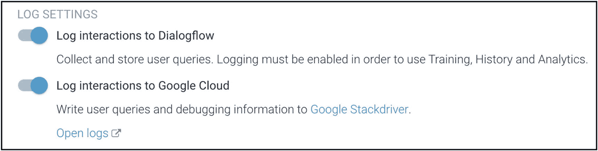
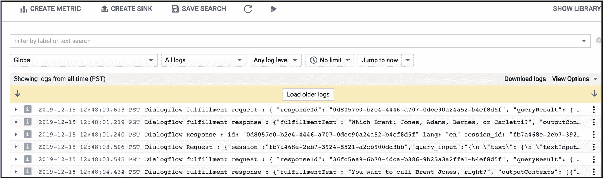
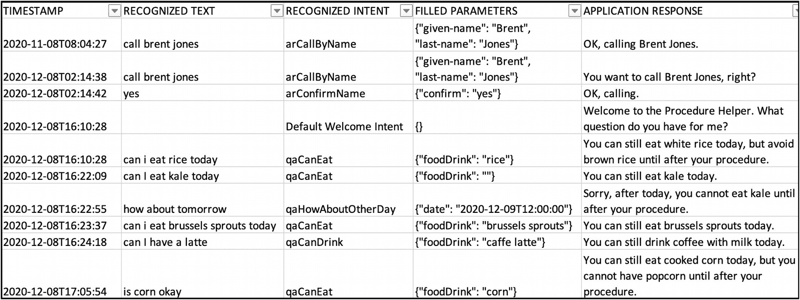
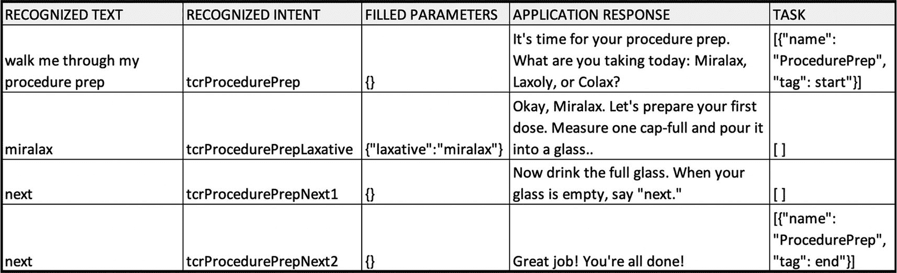

# 排版后的文本

*   查找任何无意义的语句，比如打字时可能出现的搞笑自动更正结果。大声读出结果，看看它听起来是否与符合语法的内容相似。例如，一个朋友的名字是`Nils`，但各种语音助手会把他的名字变成`Niks`。

*   寻找确认回复中高比例的`no`回复；大量的`I don’t know`、`go back`和`help`；以及在期望有语音输入的地方却没有输入。这些都是某些功能运行不佳的危险信号。

收集并分组所有相似的例子。你已经具备了识别许多常见问题并开始调优所需的条件。即使我们有额外的数据，我们仍然使用这些方法。你可能拥有的另一个调优数据来源是我们在第 16 章提到的“赞/踩”用户反馈数据——调查任何用户给出“踩”的内容，以便你能确定其原因。

## 覆盖范围调优

覆盖范围指的是一个短语是否在语法规则中。当覆盖范围良好时，大量预期的领域内语音输入都在语法规则内（`IG`）。这是性能最重要的方面之一：识别器可以非常擅长理解用户所说的话，但如果这些词语没有与正确的概念关联起来，用户将无法被理解。

覆盖范围调优（或语法调优）的目标是获得高 `IG` 率和低 `OOG` 率。你开始进行覆盖范围调优时，需要确定用户可能会说的核心词汇和短语、同义词以及载体短语（或填充短语，例如`I like to…`或`Could you…`），以及他们说出这些内容时的含义。这通过分析语音输入日志并运用你对人们在特定语境下可能说什么的知识来完成。然后，你通过将缺失的短语添加到基于规则的语法或映射到适当意图的训练集中来改善覆盖范围。添加词汇和短语是最基本、最常见的调优类型——如果你只做一种调优，那就是这个。

在“是/否”语法中调优覆盖范围比在食物名称语法中更容易，因为语音输入更可预测且变化更少。然而，即使是“是/否”语法也需要调优。你已经了解了一步修正法：如果你在“是/否”确认中遇到高 `OOG` 率，请查找内容修正。确保你根据 VUI 提示的措辞拥有适当的载体短语。例如：

*   **VUI**    *Do you know your prescription number?*

*   **User**    *Yes,* **I do**.

*   **~ ~ ~    ~ ~ ~**

*   **VUI**    **Did you get** *a prescription number?*

*   **User**    *Yes,* **I did**.

*   **~ ~ ~    ~ ~ ~**

*   **VUI**    **Is that** *the right prescription number?*

*   **User**    *Yes,* **it is**.

如果你的语音平台允许你访问 `OOG` 语音输入日志或音频文件，那太好了。你可以学到比仅仅添加哪些词汇更多的东西，包括用于意图调优和对话调优的数据。只要用户从你的 Google Action“内部”（在首次调用之后）与它对话，你确实可以在 Dialogflow 中访问一些可用于调优的 `OOG` 语音输入文本结果。但是，由于 Actions on Google（以及类似的 Amazon Alexa）的整体架构，你无法洞察用户在你的 Action“外部”（当调用和请求是同一语音输入的一部分时）所说的任何 `OOG` 语音输入。这是这些助手平台与完全封闭的自定义系统或构建在某些企业级平台上的系统之间的一个重要区别。这种区别影响了你进行覆盖范围调优时可以依据的 `OOG` 数据。

有些系统具有动态语法：根据上下文变化的语法，例如航班行程或电话联系人列表。要调优这些语法，你需要额外的日志记录级别，包括特定请求当前使用的语法，这可能与上一个或下一个请求使用的语法不同。对于某些类型的语法，覆盖范围过度生成也可能是一个需要在调优期间解决的问题。

### 来自语音前线

一位前同事最近告诉我们，他如何被指派更新一个用于识别各种应用中常见的政府字母数字序列的语法。他向我们报告说，这个语法在几个方面“严重不足”。它已经 15 年没有更新，因此与新的序列格式以及在此期间所做的其他更改不一致。它还只允许在字符串的某些位置使用`A for alpha`，而在其他位置则不允许。像这样维护不善的语法会导致用户的负面体验，因为本应是有效的语音输入却被不合适的语法拒绝。这是一个重要的提醒：在发布后很长一段时间内，可能仍然需要维护和调优资源。

## 歧义调优

当你为语法增加覆盖范围时，你可能没有意识到你已经将同一个条目映射到了多个含义。你的语法越大，这种情况就越容易发生，比如所有处方药或金融股票的名称。如果测试没有发现这个问题，结果就是用户陷入死胡同，因为他们只能依靠音频而不是视觉文本：

*   **User**    *Call Ann Jones.*

*   **~ ~ ~** VUI 找到两个拼写略有差异的条目 **~ ~ ~**

*   **VUI**    *Which one? Ann Jones or Anne Joanez?*

*   **User**    *… Ann Jones!*

*   **VUI**    *Which one? Ann Jones or Anne Joanez?*

*   **User**    **@#!!*

确保所有条目都有无歧义的短语，并且没有歧义的死胡同。对于处理大型共同基金语法的金融语音系统来说，这是一个必要且关键的步骤。当然，如果你能完全控制或访问数据（例如药品名称数据库），进行彻底的歧义调优会更直接。但即使你无法访问用户的联系人列表，你也可以为此进行调优。首先，你需要基于发音而非拼写来定义条目匹配规则。这就是我们在第 10 章末尾提到的`Soundex`算法派上用场的地方。此外，添加一个跳过列表。这可以防止 VUI 一遍又一遍地询问同一个名字。对于发音相同的名字（如本例所示），你还需要使用任何其他可用且对用户有帮助的信息（例如`in area code 650`或`in Menlo Park`）来添加一个消歧机制。

## 识别准确率调优

识别准确率调优与覆盖范围调优密切相关。它指的是系统在正确识别符合语法的短语的同时，拒绝不符合语法的短语的能力。请记住，识别器会寻找最接近的最佳匹配。这个匹配是一个`吸引子`。如果没有足够接近的`吸引子`，就可能无法匹配。覆盖范围越大，意味着吸引子空间越拥挤。

准确率调优的目标是尽可能准确地识别出尽可能多的短语，并将它们正确归类为符合语法或不符合语法。换句话说，你希望获得高比率的正确接受符合语法话语和正确拒绝不符合语法话语，同时降低错误接受不符合语法话语和错误拒绝符合语法话语的比率。此外，你还希望降低将符合语法话语错误匹配到其他符合语法内容的情况——这通常是最难处理也最重要的问题。你可以在表 17-2 中看到这些识别错误的一些示例，以及常见的解决方案。

**表 17-2** 识别错误示例

| 错误类型 | 用户所说 | 识别结果 |
| :--- | :--- | :--- |
| **FA-in** | *预订五位* | 识别为“预订**九**位” |
| **FA-out** | *我给我女儿打了电话……* | 识别为“给我**医生**打电话” |
| **FR-in** | *续配泼尼松* | 被拒绝 |

这些示例说明了为什么错误接受比错误拒绝更糟糕：让用户再试一次，总比错误地理解他们的请求要好。这些示例也说明了为什么你需要转录文本。只有当你拥有一个“正确答案”来比较识别结果时，才能进行错误计算，而详细的转录文本能指出问题所在，以便你进行解决。

你可能会看到一些报告，称人们的语音系统现在已改进到能处理 80% 的请求。这实际上很糟糕——想象一下，与一个每五个词就误解一个的人交谈。准确率必须尽可能高，因为归根结底，如果词语被误解，就不可能有成功的对话。

识别错误还会在多轮交互中累积，因为用户需要重试并走上意想不到的路径。大多数语音科学家会持续调优，直到符合语法正确接受率至少达到 90% 以上，且错误接受/错误拒绝率降至个位数。

**成功提示 17.2** 你不能用统计数据证明一切

高符合语法率从来都不是全部。如果有人告诉你，他们的语音系统在 1000 条话语上达到了 98% 的符合语法正确接受率，表现非常出色，你应该立即询问不符合语法率。如果一个语音用户界面只接受一小部分短语，那么在这些短语上的表现很可能会非常出色。但如果与此同时，有同样多的语句被拒绝，那么从用户的角度来看，整体表现很可能非常糟糕。

随着语法规则变得更大更复杂，错误风险也会增加，识别率自然会有所下降。如果你的语法规则只有两个词，那么你的所有错误率可能都非常低！在深入探讨准确率之前，让我们先看看四种你可能有权或无权访问的特定类型的准确率调优——如果你有权访问，它们将适用于表 17-2 中的示例。

### 声学混淆度调优

## 语法覆盖与吸引子

无法保证不符合语法的话语一定会被拒绝，或者符合语法的话语一定会被接受。语法覆盖范围应尽可能广泛，以帮助解决此问题，同时不给你带来麻烦。*你可能会问，更大的覆盖范围会带来什么麻烦呢？* 一个潜在的问题是，当语法规则包含多个发音相似的单词或短语时。这可能导致冲突，其中一个词项充当其他相似单词的`吸引子`，从而导致错误的映射（无论是错误接受-符合语法还是错误拒绝-不符合语法）。`吸引子`通常是一个比其他词更常见的词。例如，在一个通用语音系统中，*umbrella*（雨伞）比 *Enbrel*（恩利，一种药物名）更常见；因此，说出药物名称的人可能会被错误地识别为在说雨具。要特别注意，提示语中使用的示例短语不应容易混淆。如果容易混淆，请更改其中一个或多个短语，以尽量减少虚假吸引子。

### 词典调优

在语音领域，词典定义了用户对语法或语音系统中每个单词的所有预期发音方式。大多数平台允许你为新的或现有的单词添加发音。如果你注意到某个特定单词的错误接受-符合语法率或错误拒绝-符合语法率很高，那么为该单词添加或修改发音可能是解决方案。有时，解决一个错误接受-符合语法问题甚至需要更改另一个单词的发音。词典调优与声学混淆度密切相关。当你的语音用户界面需要理解品牌或产品名称时，这两者通常都很重要。当语音用户界面的领域影响单词的发音方式时，它们也很重要，就像你刚刚看到的 *Enbrel*-*umbrella* 示例一样。

### 置信度阈值

你在第 12 章和第 13 章中了解了多层识别。如果你的系统使用多层识别，并且你看到“是”或“否”的响应比例很高，这表明需要更改阈值。你的目标应该是将两者都降到最低：过多的“是”意味着不必要的确认；过多的“否”意味着返回了错误的结果，识别准确率需要进一步调查。

### 超时和概率参数

一些语音开发平台允许你访问较低级别的参数设置。你在第 12 章中了解到，在某些情况下，例如对于以四位一组方式读出的 16 位信用卡号，较长的超时时间是合适的。如果你看到似乎因用户分心而导致的不完整截断短语，那么超时时间过短很可能是罪魁祸首。通过应用作为识别假设权重的概率，你可以影响`吸引子`的强度以及最终结果。当存在特定领域的混淆性，并且你希望不常见的词比常见词更频繁地被识别时，这非常有用。同样，这也适用于 *Enbrel*-*umbrella* 示例。它也非常适合削弱通用命令和隐藏命令，同时仍使其可用。

在撰写本文时，Actions on Google 和 Dialogflow 不允许你控制许多这些低级别参数，但随着越来越多的开发者构建更复杂的语音用户界面，这些功能可能很快就会推出，而且 Google Cloud API 确实提供了一些。一些企业级和其他云自动语音识别平台允许为特定领域指定自定义短语或语言模型。这是改变概率的一种方式。例如，微软正在扩展其云自动语音识别引擎的功能，允许你使用 10 小时的语音数据创建自定义声学模型，并使用包含 100 万个单词的文本创建自定义语言模型。^(¹¹⁵)

### 深入解析：从示例短语构建准确性

让我们通过一个简单的例子来实践。回想一下第 11 章中介绍的`tcrMakeAppointment`意图，它涵盖了表示*我想预约*的请求。表 17-3 展示了该意图的一些短语如何根据语法覆盖范围和领域进行分类。正如你在前一章所学到的，语法内（IG）和语法外（OOG）是清晰的概念：一个短语要么包含在语法中，要么不包含。如果你处理的是基于规则的语法，那么语法内的内容很可能会被正确识别，但由于本章中你正在了解的其他各种因素，这并非总是如此。如果你的语法覆盖范围基于训练短语（就像 Dialogflow 的默认情况那样），那么哪些话语属于语法内就不那么明确了。任何作为训练短语包含的内容都极有可能被正确接受为语法内，但其他话语需要与你的训练短语有多相似才能被捕获呢？判断一个短语是否属于领域内（ID）——即对于任务来说合理但未被语法覆盖的话语——则更加模糊，因为这涉及主观判断，尤其是在处理相似意图之间的边界时。一个完美的识别/解释系统会对所有领域内短语给出 100%的正确接受（CA），并对所有领域外（OOD）短语（即其含义与意图中其他短语有显著差异，且在 VUI 上下文中具有重要意义的话语）给出 100%的正确拒绝（CR）和 0%的错误接受（FA）。让我们逐一分析表 17-3 中的六个示例。

**表 17-3** 按语法覆盖范围和领域包含情况对示例短语进行分类

| 短语 | 语法（内/外） | 领域（内/外） | 结果 |
| :--- | :--- | :--- | :--- |
| *Make an appointment.* | IG | ID | CA |
| *Make an appointment for three.* | IG | ID | CA |
| *Make an appointment for three PM.* | IG | ID | CA |
| *Can I make an appointment?* | OOG | ID | CA |
| *I’d like to make an appointment.* | OOG | ID | CA |
| *I need to cancel my appointment.* | OOG | OOD | FA |

前三个示例明显属于领域内（ID）。它们也属于语法内（IG）；你在第 11 章中添加了它们。这就是人类专家创建的正则表达式规则型语法和定义的解析规则，与基于机器学习、从训练短语中算法生成的“模糊逻辑”语法之间的区别所在。前者易于测试以确定哪些在语法内、哪些不在。后者则依赖于他人基于你的示例训练短语构建的算法和模型。对于基于机器学习的模糊逻辑（如 Dialogflow 中的），你希望它能够**泛化**，即理解那些你没有作为训练短语输入，但与已输入且对意图有意义的短语相似的话语。

现在来看接下来的两个短语：*Can I make an appointment?* 和 *I’d like to make an appointment.*。在大多数上下文中，这些是应包含在同一意图中的合理同义短语，因此它们也属于领域内，但目前它们属于语法外，因为你尚未将它们添加为训练短语（或者如果你使用正则表达式语法，则未包含在其中）。如果该意图是“关于工具功能集的直接问题”，那么 *Can I make an appointment?* 将属于领域内，而此示例中的所有其他短语将属于领域外。正如你所见，需要根据 VUI 所覆盖的具体需求和情况来仔细指定意图。上下文始终很重要。

尽管 Dialogflow 尚未针对这些短语进行训练，但它返回了正确的意图：领域内，正确接受。太棒了！再次强调，泛化意味着你无需输入每一个可能的短语——Dialogflow 会为你处理大部分工作。相比之下，基于规则的语法本身不会进行泛化。

现在让我们看最后一个示例：*I need to cancel my appointment*。这个短语显然不是预约意图中可接受的同义短语。但 Dialogflow 返回了意图`tcrMakeAppointment`，因此这是一个领域外、错误接受（FA）的情况。

发生了什么？由于 Dialogflow 的内部运作对你来说是一个黑盒，你无法完全确定，但可以猜测。在这种情况下，系统似乎强烈依赖于 *appointment* 这个词。如果你尝试其他包含 *appointment* 的变体，例如 *change appointment*、*move my appointment* 等，它仍然会返回意图`tcrMakeAppointment`。这些都是语法外且领域外的错误接受。在调优过程中，你需要查看所有语法外的话语，并决定如何处理它们。如果它们属于领域内，则将这些短语添加到你的训练集（或规则）中；如果它们属于领域外，则可以自我肯定一下，因为你处理得当。但你知道吗？在这种情况下，从用户的角度来看，它碰巧正确工作，多少有点运气成分——我们稍后将用更稳健的方法来修复它。

问题在于：正如你在本书中学到的，永远无法保证话语 X 会映射到期望的意图，即使该话语在基于规则的语法或训练集中明确写出。如果它不属于语法或训练集的一部分，则更无法保证。在这个例子中，一个错误接受（FA）按照你所期望的方式被泛化了。下一次，它可能会映射到另一个意图。你绝对不希望这种情况发生在与健康相关的 VUI 中。通过调优，你可以增加话语被正确处理的机会。泛化可能是一件好事，它能让非专业人士在构建对话式应用方面走得更远。但要注意其中的陷阱，并对用户实际所说的内容（例如取消或修改预约）进行广泛的测试。你不仅需要用领域内的示例进行测试，还需要用领域外的示例进行测试，以确保两者的行为都符合预期。

现在，让我们修复这个问题。如果某个意图吸引了很多领域外的话语，你需要创建另一个意图，并用这些话语对其进行训练。这是因为识别的工作原理：它基本上会尝试将听到的所有内容与某些东西进行匹配。因此，如果用户要求更改或取消预约，你需要有相应的意图来支持这些操作。这里要做的就是简单地添加一个新意图`tcrCancelAppointment`，将所有`cancel`相关的话语（以及你认为用户会说的其他话语）映射到这个意图，然后重新训练。添加这个意图并不意味着你需要在VUI中实现取消功能。相反，这个意图可以简单地回复类似“如果您需要取消或更改预约，请致电您的医生办公室”的内容。这样，你很可能会为`tcrCancelAppointment`获得一个领域内的正确接受，而不是为`tcrMakeAppointment`获得一个错误接受——这将带来更好的用户体验。

这是一个非常有用的方法，应该广泛使用。它能让你的VUI更智能、更广泛，而几乎不需要额外的工作。即使用户要求你未支持的功能，你也可以为这些请求添加一个意图，并用相关短语进行训练。现在，你可以用一句有用的提示来回应，比如“我无法做到这一点，但您可以尝试以下操作”，而不是仅仅说“抱歉”，或者更糟的是，冒着给出错误答案的风险。永远不要依赖拒绝（领域外正确拒绝）来正确处理问题；要为任何相关的短语创建新的意图。如果可用，置信度阈值对此也很有用。

## 显式知识方法如何处理“我需要取消预约”？

这是你在第11章中遇到的斯坦福解析器。它正确地拒绝了这条语句。请记住，其中一条规则是依赖树的根节点必须是`make`或其同义词。在这个例子中，根节点会是`cancel`。与Dialogflow相比，显式解析器方法更关注句子的主要动词（`make` vs. `cancel`），而对宾语（`appointment`）的关注较少。实际上，我们的解析规则要求动词必须是`make`，并且存在直接宾语，具体来说是`appointment`，在这种情况下，规则会正确执行。

你会反复看到这种权衡：易用性和简洁性 vs. 努力、性能和系统透明度。只有你自己才能决定你希望处于权衡尺度的哪一端；你只需要做出明智的决定，并理解其中的利弊。我们鼓励你在Dialogflow（或你使用的任何平台）中亲自尝试表16-1中的短语。尝试添加一些相似但映射到不同意图的短语。如果大量相似的短语映射到一种方式，而只有一个短语映射到另一种方式，会发生什么？在你的VUI上下文中，如果某个短语必须始终被正确识别，但该短语与其他具有不同含义的短语相似，那该怎么办？比较在变化载体短语与核心内容时的行为。真正了解在你的世界中影响准确性的因素——这是你语音系统成功的关键。

### 查找和使用识别准确率数据

在第16章中，你了解到当前Dialogflow内置工具在提供用于准确性调整所需数据方面有些局限。是时候向你展示如何绕过这一点并找到一些真实数据了。事实上，你确实有一些选择。

Google Cloud有一个运维套件，以前称为Stackdriver，你可以用它来获取大量应用程序数据。你在使用Dialogflow时一直在使用Google Cloud，当你开始在第7章中使用webhook时，你更多地使用了Google Cloud，特别是App Engine。运维套件是众多Google Cloud组件中的另一个；它提供了一个统一的框架，用于将应用程序数据记录到集中位置，以便后续处理。其他云服务，如AWS和Microsoft Azure，也提供类似功能——如果你在其他平台上工作，了解这一点很有帮助——但由于本书主要围绕Google生态系统，我们将重点介绍运维套件。要使用它，请点击Dialogflow客户端设置，方法是点击左侧面板中客户端名称旁边的齿轮图标。你会看到选项`Log interactions to Google Cloud`。点击它以启用日志记录。图17-1展示了这一点。



**图17-1** 客户端设置页面，用于开启或关闭Google Cloud运维套件（原Stackdriver）日志记录

启用日志记录并进行几次交互后，以下是查看日志的方法：



**图17-2** 运维套件日志示例

- 前往Google Cloud控制台（`console.cloud.google.com`）。确保你已选择用于Dialogflow工作和webhook的项目。
- 在左上角的菜单中，选择 **运维** ➤ **日志记录** ➤ **旧版日志查看器**。你可能还看不到任何日志；将时间限制下拉菜单更改为 **无限制** 后，你应该会看到类似图17-2的内容。
- 确认最左边的下拉菜单显示 **全局**，其右侧的菜单显示 **所有日志**。

接下来，点击任意一行；它会展开以显示详细的日志信息。我们强烈建议你稍微浏览一下这些日志，看看仅一次与Google Home/Dialogflow的交互就会产生大量数据。

图17-2按时间顺序显示了你可能看到的一条语句的四种日志：

- **Dialogflow请求：** 对Dialogflow的初始请求，包括被识别的文本。
- **Dialogflow执行请求：** 发送给webhook的请求（如果客户端和意图启用了webhook）。
- **Dialogflow执行响应：** 来自webhook的响应。如果webhook不可用，你仍然会得到这条记录，但它会指示发生了错误，例如HTTP 500错误（服务器不可用）。
- **Dialogflow响应：** 来自Dialogflow的最终响应，包括回传给用户的响应。

准备使用Python从运维套件中拉取日志。

- 安装`google-cloud-logging` Python SDK。具体安装方式取决于你使用的操作系统。^(¹¹⁶) 在我们的Python示例中，我们将`google-cloud-logging`添加到了`requirements.txt`文件中。要更新，你需要重新运行`pip install -r requirements.txt`。
- 在你的Google Cloud项目中创建一个服务账号。不要忘记添加 **项目所有者** 角色：
    - 例如，你可以点击Google Cloud控制台左上角的菜单，然后选择 **IAM与管理** ➤ **服务账号** ➤ **创建服务账号**。
- 创建一个`.json`密钥并将其存储在本地。此过程在同一Google网页上也有说明。
- 设置服务账号`.json`密钥的路径，该网页上也有说明。在我们的案例中，我们运行了`export GOOGLE_APPLICATION_CREDENTIALS=<上一步中的 json 密钥文件名>`。

现在，您已准备好拉取大量日志。本章的webhook代码中包含一个Python脚本`get_logs.py`。此脚本会逐步遍历存储在Google Cloud中的四种日志类型；当它发现调优所需的信息时，就会将其提取出来。在检测到新的交互（基于第一条日志的新的Dialogflow请求）后，它会将上一次交互的信息打印在一行上。在终端中，运行

```
python get_logs.py > logs.txt
```

下一步取决于您是否拥有电子表格软件（如Microsoft Excel、OpenOffice或Mac上的Numbers）。这是可选的，但正如我们稍后将讨论的，我们发现使用某种具有强大筛选功能的电子表格软件可以使调优和标注变得容易得多。我们将使用Excel进行演示——不同电子表格软件的具体操作会有所不同，但您显然可以使用其他软件：



**图17-3** 包含`log.txt`中内容、可供调优的Microsoft Excel电子表格

1. 在新的Excel工作簿中，点击工作簿顶部的“数据”菜单栏。
2. 您应该会看到一个名为“自文本/CSV”的选项。点击它。
3. 选择上一节中`log.txt`文件的位置。
4. 选择“分隔符”，并确保选择“制表符”作为分隔符。
5. 完成导入。电子表格应如图17-3所示。保存它！

这个电子表格看起来很像您在第16章中看到的那个，它指出了调优所需的数据类型。我们仍然添加了这一列，以强调当数据可用时您会需要它——并且在某些平台中您会拥有它。

这引出了一个重要观点：整个这一节都假设您正在使用 Dialogflow 和 Google Cloud。当然，还有其他选择，包括使用独立的 STT API，例如 Google、Microsoft 或 IBM 的 API。在这些情况下，您需要自己处理日志记录。您可能仍然可以使用运维套件来记录事务，但您需要修改`get_logs.py`脚本。

您可能会好奇为什么`log.txt`使用制表符分隔字段，而不是像许多设计用于导入 Excel 等应用程序的文本文件那样使用逗号分隔。很简单，如果您的实际数据字段中出现了逗号，您就不能使用`.csv`格式；它会搞乱一切。参数和应用程序响应中都可能包含逗号，因此您需要使用制表符。

#### 任务完成调优

任务完成分析提供了补充识别性能的信息。有多少用户能够到达对话的成功终点，填写所有必要的槽位并获得适当的响应？您很清楚什么是成功终点：预订结束时的确认提示、请求后灯亮起、设置计时器后倒计时开始等等。任务完成分析从更高层次或更全面的角度审视 VUI 行为。可以将识别分析视为静态快照，而任务完成和对话调优则更像视频：识别调优侧重于提高特定语法中话语的性能，但掩盖了对话并非孤立无上下文的话语这一事实；任务和对话调优则将性能置于整个对话的上下文中，或者至少是前后步骤所发生事件的上下文中。这意味着跟踪每个用户的行为非常重要。

任务完成调优涉及识别多轮对话在用户未获得所需内容时结束的位置。这种情况是否发生在对话的特定部分？为什么有些用户在到达终点前就停止了？可能是识别问题或某些设计问题，但也可能是外部因素：也许充值格式变了，也许数据库访问中断了，等等。或者，您对成功的定义与用户不同。

来自语音前线

在一个银行 VUI 中，大量用户没有完成他们发起的账单支付请求，这导致了一次大规模的调优工作，后来我们才意识到，用户选择该路径是为了查找账单到期日和金额——他们当时根本没有付款的意图，但在听到他们想要的信息后，仍然非常满意地结束了对话。

任务完成包括 fulfillment 准确性。仅根据是否达到您指定的“成功”状态或是否填满所有空槽位来判断任务完成是不够的。如果用户请求某位艺术家的歌曲，但听到的是不同的版本，对用户而言，这并非成功。如果他们想要晚上 7 点的预订，但没有空位，他们也没有成功。即使您无法提供他们想要的东西，也需要分析这种情况发生的频率以及如何最好地回应。更改提示语可能就足够了；提供替代方案是另一种方法。Fulfillment 调优可能很棘手，并且依赖于转录访问。

任务完成也关乎用户如何最终取得成功。一个能让 95% 的用户在 15 秒内、或通过三步且无需重试就成功达成目标的 VUI，显然优于另一个具有相同 95% 成功率但需要 30 秒、或六步且多次重试的 VUI。改进通常是识别和对话改进的结合。在多槽位多轮对话中，可能存在用户遇到困难的特定步骤。您对问题的分析越准确，就越有可能做出改进。

##### 任务完成分析代码

在第 16 章中，你了解到有两种方法可以进行任务完成分析：事后添加标签（这是我们推荐的方法），或者将其直接嵌入到应用程序中。让我们来看一段有助于添加任务标签的代码。以下是`get_logs.py`代码的一部分，展示了如何根据识别出的意图添加任务标签。这部分内容位于代码清单 17-1 中。找到 Dialogflow 履行日志条目 (A)。执行正则表达式搜索。这是一个多行条目，因此你需要使用`re.M`和`re.S`标志 (B)。从日志中设置请求的 JSON (C)。提取意图显示名称 (D)。流程准备开始 (E)。流程准备结束 (F)。打印`log.txt`行 (G)。

```python
def main():
    # Dialogflow fulfillment request (multi-line)   (A)
    pattern = re.compile(
        'Dialogflow fulfillment request : (.*)$', re.M | re.S)   # B
    match = pattern.match(entry.payload)
    if match:
        df_webhook_request = json.loads(match.group(1))   # C
        # Recognized intent
        try:
            recognized_intent = \
                df_webhook_request['queryResult']['intent']['displayName']  #D
            # Add any task tags here
            if recognized_intent == 'tcrProcedurePrep':   # E
                task = {}
                task['name'] = 'ProcedurePrep'
                task['tag'] = 'start'
                task_tags.append(task)
            if recognized_intent == 'tcrProcedurePrepNext2':   # F
                task = {}
                task['name'] = 'ProcedurePrep'
                task['tag'] = 'end'
                task_tags.append(task)
        except KeyError:
            pass
        # Filled parameters
        try:
            filled_parameters = \
                json.dumps(df_webhook_request['queryResult']['parameters'])
        except KeyError:
            pass
        # ...... Code cut for focus
        if havelog:
            print((f"{date_time}\t{session}\t\t{recognized_text}\t\t"  # G
                   f"{recognized_intent}\t{filled_parameters}\t"
                   f"{application_response}\t{json.dumps(task_tags)}"))
```

代码清单 17-1

向`get_logs.py`添加任务标签

当你运行修改后的`get_logs.py`并将`log.txt`导入 Excel 时，你应该会看到类似图 17-4 所示的内容（为更好地显示任务标签，部分列已被隐藏）。你可以看到如何统计任务开始和结束的次数；其比率即为任务完成百分比。



图 17-4

统计任务开始和结束的次数以计算任务完成百分比

#### 对话调优

对话调优是一个常用术语，指代更侧重于“动手”的分析工作，旨在改善整体对话。对话调优不易自动化；它常常能发现自动化定量日志中未显示的问题，或为已发现的问题明确正确的补救措施。这种分析特别关注在多轮对话中演变的问题。分析过程中的典型发现包括：导致用户困惑和超出语法（OOG）表述的提示措辞和传递问题。

顾名思义，补救措施侧重于分析和更改完整的对话流程及详细设计。对话调优通常会导致提示措辞的更改，以及提示的发音和传递方式的改变；对错误词语的强调很容易引起困惑，从而导致 OOG 表述。

对话调优的其他主要对象包括：由过长、过短或出现在意外位置的停顿引起的时机问题，以及任何在多轮对话中展开并影响对话流程或用户心智模型的问题。

对话调优依赖于获取用户实际所说的内容（转录文本）以及他们说话的方式（音频文件）。你马上就能明白，为什么当能够获取真实用户的 IG 和 OOG 表述的转录文本和录音时，对话调优的效果最好。那么，如果你无法获取这些数据该怎么办？如果你只有自动化性能日志和一些任务完成日志，你仍然可以了解哪些地方不起作用以及可能的原因。重点寻找性能热点。你知道每个提示的措辞，也能听到它——既然知道存在问题，你能找出问题所在吗？你也可以查看一些文本解释日志——你能想到一些发音相似、可能像吸引子一样起作用的词语吗？如果某些错误提示频繁播放，你能弄清楚哪里出了问题吗？用户确认的次数是否超出预期？他们在身份验证时是否失败？你是否有来自调查研究或可用性测试的数据，指向某些潜在问题？

如果日志暗示系统某部分性能不佳，那么进行深入调查是下一步的正确选择。这可能是由高 OOG 率或高 FA/FR 率、关于困惑或性能不佳的具体投诉，以及高交易失败率所触发的。

选择或捕获一小部分对话，通常不超过 100 个。在进行任何进一步的收听或分析之前，清除对话中的所有个人身份信息（PII）。如果音频文件尚未包含提示音频，你可能需要通过拼接提示和响应来重建对话。

从头到尾聆听完整的交互以了解上下文，并对其进行转录。在 IVR 领域，这被称为全通话分析。一些 IVR 平台允许你收听呼叫者在系统中的完整旅程，即使你无法录制用于离线分析。如果这些方法都不可行，则对可被录制的无经验用户进行受控的实验室研究。

聆听并阅读转录文本。你能得出哪些概括性结论？是否有些用户未被识别而其他用户被识别？你会了解到是否需要更改或添加置信度阈值，某些对话路径中的提示是否合理，用户是否犹豫或要求重复，用户是否在某些情境下多次重试，他们是否听到了意料之外的信息，是否存在过多的确认，等等。

此时，你需要应用你在本书第 3 部分学到的关于语音设计和技术的所有知识：寻找机会提高一致性，通过缩短冗长的提示来降低认知负荷，删除不必要的重复，通过隐式回读增加安心感，通过示例或解释性细节提供清晰度，寻找令人困惑或缺失的选项，等等。

在实施设计更新之前，你可以通过众包调查（第 16 章）来测试新提示词的可记忆性或理解度。检查提示词的语调：错误的语调位置会混淆部分用户，必须修正。

其他困惑迹象可以轻松在 OOG 日志中找到：犹豫、旁白、回溯、重复、模糊回应、明显的不耐烦等。OOG 数据是调优的黄金资源！表 17-4 展示了一些我们遇到的 OOG 数据示例以及每个示例所暗示的问题。

`表 17-4` OOG 话语日志中发现的问题示例

| OOG 用户话语 | 可能说明的问题 |
| --- | --- |
| *那个号码我已经给过你了。* | 首次尝试未被识别；用户可能在之前的对话轮次中已提供过该信息 -> 可增加多槽位处理。 |
| *等等等等（嘲讽语气）……* | 提示词过于冗长 -> 可进行精简。 |
| *不！我不要那个。* | 多次识别错误或理解错误。 |
| *稍等。它就在这附近……* | 用户未预料到会被要求提供所请求的信息，且手头没有该信息 -> 可增加暂停处理。 |
| *呃，那是什么？* | 提示词中出现不熟悉的术语；用户不知道如何回应 -> 可修改提示词或补充信息。 |
| *这些都不是。* | 提示的选项未涵盖用户想要的，或措辞未暗示预期选项 -> 可增加“以上都不是”作为隐藏选项，并重新审视菜单选项。 |
| *两个都要。* | 提示提供了两个非互斥的选项 -> 可增加相应处理。 |
| *她为什么开始说话了？* | VUI 意外触发且用户注意到了。 |
| *昨天查过了，数字不一样。* | VUI 意外触发但用户未注意到。 |

对于表中的每条 OOG 话语，你首先要跨用户和跨对话轮次确定该问题的普遍程度。然后查看细节：问题的上下文是什么？提示词中的某些选项听起来是否过于相似，导致识别混淆？某些词语是否导致用户困惑？是否存在覆盖缺失？先寻找最容易的可行解决方案——有时这就是正确答案。

但用户到底说了什么？我们已经讨论过，使用 Dialogflow 时你无法访问音频，因此你不知道用户实际说了什么。幸运的是，Google STT 非常出色；如果用户说了类似*那个号码我已经给过你了*或*这些都不是*的话，这很可能会出现在日志的 `RECOGNIZED TEXT` 列中，也可能作为 `Default Fallback Intent` 出现在 `RECOGNIZED INTENT` 列中。因此，虽然这并非全貌，但你可以利用提取的日志电子表格进行大量有用的对话调优。而且你已经学会了寻找问题间接迹象的方法。

#### 意图调优

我们将意图调优单独列为一个调优重点。它涉及最大化映射到最佳匹配意图的用户请求数量。如果有多个可能的意图可以匹配，调优通常旨在选择最具体且仍适用于所有上下文的那个；更通用的意图需要额外的对话轮次、消歧或菜单。

意图调优涉及准确性、覆盖范围、任务完成度和对话调优的混合改进。解析规则可以更改；最可能的结果是更新你的详细规范和提示词措辞。来自真实用户的真实数据对于有效的调优至关重要。

核心的快乐路径话语很容易处理；除非你拆分或合并意图，否则可能不需要更改这些。相反，应关注意图之间“边界”上的话语，即那些模糊的话语。如果用户再次提出类似问题、取消或回溯，你基本可以确定意图匹配有误。

注意避免引入歧义——如果难以区分意图，请在继续对话前添加分层确认以进行验证。寻找可以澄清意图映射的上下文。如果用户在纯音频设备上要求*播放第一部哈利·波特*，他们更可能指的是有声书而非电影，因此应添加上下文检查并将其映射为 `PlayAudiobook` 意图，而不是映射为 `PlayFilm` 意图然后返回设备无法处理视频内容的错误信息。

**成功提示 17.3** 调优不仅仅是发现和修复错误

如果某些功能不起作用，你当然需要解决问题。但调优也在于发现并解决那些可以整体改善体验的问题。寻找方法帮助用户更快、更准确地获得他们想要的东西。

### 如何确定调优工作的优先级

既然你的电子表格中已经有了大量数据，你将如何理解这些数据并逐步处理呢？

一种选择是逐行浏览电子表格，填写需要填写的列，并记录任何需要修复的问题。如果数据超过 100 行左右，我们不推荐这种策略。一旦你有几百或几千行数据——而你确实需要这么多数据——这种方法就不实用了。

相反，你应该进行优先级排序、筛选和重新排序。点击工作簿顶部的 `Data` 菜单栏，然后点击 `Filter`。每列的顶部会出现一个箭头；点击该箭头。你可以从值列表中选择；也可以输入值进行筛选；还可以筛选时间戳以仅获取某些日志。

从最常见的错误和意图开始，从那些你知道会阻碍其他意图的意图入手；然后逐步向下处理列表。以下是一些具体策略：

-   筛选 `RECOGNIZED INTENT` 为 `Default Fallback Intent` 的数据。这些是被拒绝的短语，很可能属于 OOG。

-   筛选尚未结束。接着处理频繁出现的 `RECOGNIZED TEXT`。如果你的应用程序有问题，很可能多个用户会遇到相同的问题。这时你可以找出问题所在，确定可能需要向意图中添加哪些短语等。

-   在标注 OOG/OOC 时，首先按最可能的 `RECOGNIZED TEXT` 进行筛选；这样，在输入第一条数据后，你就可以直接复制粘贴。

对于任何规模适中的应用程序，你都无法修复所有问题。这完全没问题——这是意料之中的。从修复发生频率最高且对用户成本最高的问题开始。并且不要停止——持续分析和修复。当用户或客户告诉你*几天前我说了类似这样的话……然后得到了一个奇怪的回应。为什么？你能修复吗？*时，电子表格也能派上用场。

关于流程还有一点补充。当你提取数据时，我们让你立即将其导入 Excel。这是因为我们就是这么做的。当你将本章中的调优策略应用于你的数据时，你会很快注意到电子表格如何通过筛选功能为你节省时间。你能使用其他解决方案吗？当然可以，特别是如果你能使用一些专门的调优工具。但即使有这些工具，我们有时仍会使用 Excel 来完成部分工作。

#### 将观测结果映射到正确的解决方案

分析数据以理解每个问题的原因和严重程度已经足够困难；找出解决问题的最佳方法并实施更改也并非易事。每个问题通常都有几种可能的原因，甚至还有更多可能的解决方案。

##### 来自一线声音

当心对定量结果的误解。一位同事收到了一份 A/B 测试数据，内容是关于用户在请求歌曲后收听时长的。在 `VUI-A` 中，用户不会被告知元数据（如歌曲标题）；在 `VUI-B` 中，用户则会被告知。定量数据显示，`VUI-A` 中的收听时长显著更长；不熟悉用户行为的人将其解读为：不听到介绍性元数据使用户更满意。

为了验证这一解读，这位同事进行了定性对话路径分析，查看了用户后续请求的意图以及系统响应。这些数据呈现了不同的图景：当用户对内容一无所知时，他们常常会询问自己正在听什么，这自然导致了更长的整体内容“参与”时间，尤其是当内容与用户预期不符时。更糟糕的是，一些后续问题未被理解，导致用户尝试重新措辞提问，从而使对话变得更长。基于对数据上下文的正确理解，正确的结论是 `VUI-B` 提供了更好的体验。介绍性元数据提供了隐式确认，使用户能迅速知道执行结果是否匹配其请求。

教训是：要理解完整图景，并在任何分析中使用所有可用数据：

*   **用户** *播放“Let It Be”* → `VUI` 误识别为另一首歌：“Let It Be Love.”

*   ~ ~ ~ 无元数据的响应 ~ ~ ~

*   **`VUI-A`** *好的。* → 播放“Let It Be Love” → 需要收听以判断准确性

*   ~ ~ ~ 带元数据的响应 ~ ~ ~

*   **`VUI-B`** *好的。* *这是“Let It Be Love”。* → 播放“Let It Be Love” → 无需收听

要理解原因，你需要了解语音设计和实现的注意事项，以及你的 `VUI` 的具体细节，包括任何资源限制。好消息是，调优建立在你在本书中学到的所有知识之上。这并非高深莫测的学问，但确实需要一些思考和练习。

在本节中，你将有机会练习应用所学知识。表 17-5 和 17-6 列出了一些你在性能分析中可能遇到的简单示例和观测结果。表 17-5 中的观测结果包括来自语音系统单个部分或整个系统的快照性能数据；表 17-6 中的数据则依赖于通过对话轮次跟踪单个用户，或考虑多个轮次。对于每个观测结果，我们列出了一些可能的原因和解决方案：问题很少只有一个原因。研究整个表格，或者遮住第二列和第三列，自行进行分析和解决方案。祝你好运！

### 表 17-6

基于多轮数据映射到可能原因和解决方案的调优

| 观测结果（第二组） | 分析与可能的原因 | 可能的解决方案 |
| --- | --- | --- |
| 用户连续发出多个请求，含义相同但措辞略有不同。 | 误识别或覆盖不足。`话语到意图`映射错误。 | 更新同义词覆盖范围。查看前后轮次的话语。更新/重新训练意图模型。 |
| 用户连续发出多个请求，内容措辞相同：*告诉我关于支架的信息*。→ *没有关于“stints”的信息*。→ *我需要关于支架的信息*。→ *抱歉，没有关于“stint”的信息*。 | 误识别或覆盖不足。存在强吸引子。 | 检查并添加同义词覆盖范围。添加词典发音。更改参数设置。添加`N-best`列表和跳过列表。 |
| 用户连续两次否认相同结果：*4 1 5。* → *4 1 9，对吗？* → *不，4 1 5。* → *4 1 9，对吗？* | 误识别或覆盖不足。存在强吸引子。 | 添加`N-best`列表和跳过列表。更改参数设置。 |
| 用户说了符合语法的话，但响应似乎回答了另一个问题：*调到频道 1 1 3*。→ *调到频道 1* *一个补货订单……取消*。→ *好的，正在订购补货*。 | 系统过早停止监听（用户犹豫）。`话语到意图`映射错误。 | 监听完整话语：用户是否被截断？为什么？增加`EOS`。更新/重新训练意图模型。 |
| 高比例的请求后跟着一个特定的下一个请求：三分之二的关于剩余补货次数的查询后跟着一个补货请求。如果还有一次或多次补货，84%的下一个轮次是补货请求。 | 有机会让交互对用户来说更快、更简单。 | 重新设计：在请求 1 之后将请求 2 作为显式选项添加，或者直接进入请求 2 同时说明如何退出。 |
| 高比例的*返回*请求。 | 提示中缺少选项。上一轮提示具有误导性或不清晰。话语映射到错误的意图。 | 查找提示中不清晰或缺失的选项；重新措辞。查看前后轮次的话语；更新/重新训练意图模型。 |
| 高比例的`OOG`（超出领域）但相关的响应。 | 用户正在回应上一轮提示。措辞对用户没有意义。 | 查找提示中不清晰或缺失的选项；重新措辞。检查上一轮的话语。如果发现问题，更新上一轮的意图模型。 |
| `OOG`评论性响应以及高比例的*是*确认后跟未完成任务：*你问巨人队的第一场主场比赛是什么时候？* → *是的！* → *我不知道那个。* → *那你为什么问我？* | 不必要的确认。响应结构与请求不匹配。意图标签错误。 | 重新设计。应用设计原则。对类似请求进行额外测试。 |

### 表 17-5

基于快照性能数据映射到可能原因和解决方案的调优

| 观察结果（第 1 组） | 分析与可能原因 | 可能的补救措施 |
| --- | --- | --- |
| 不完整回复比例高，且比预期短：*我的电话号码是 415*…（预期为十位数字）。 | 语音结束（`EOS`）超时时间过短。用户提供的信息通常按片段说出。 | 延长 `EOS` 超时时间。保持麦克风开启，直到检测到匹配字符串。允许通过按钮/屏幕输入并以#号结束。 |
| 确认环节中*是*的回答比例高。 | 置信度阈值设置过高。不必要的步骤使对话变长，可能惹恼用户。 | 更改置信度阈值。移除“成本”上不必要的确认。改为隐式确认。 |
| 确认环节中*否*的回答比例高。 | 置信度阈值设置过低。由于某种原因识别失败。 | 更改置信度阈值。添加 `N-best` 列表和跳过列表。寻找识别准确率和覆盖率的趋势。 |
| 日志中无识别/文本结果的语句比例高（系统在听但未找到任何词语）。 | 无语音超时可能由多种原因引起，包括硬件和参数设置、因提示措辞令人困惑或选项缺失导致的用户犹豫、用户正在查找所需信息。用户说话声音轻、含糊不清或难以理解。 | 测试麦克风灵敏度。如果问题局限于某些场景，调查提示语并进行修改。检查信噪比和用户语音音量。 |
| 预期为数字的字符串中，超出语法（`OOG`）比例高：*您的 PIN 码是什么？* –> *诺拉* | 有些人使用键盘对应关系将数字转换为单词（更容易记忆）。 | 扩展语法。在提示语中增加澄清说明。 |
| 品牌名称误识别比例高：*宜家* = [ay-KIY-ax] 或 [iy-KEH-ah] | 需要理解发音不寻常的名称，用户也需要知道如何发音。如果是外来词，需要处理原始版本和修改后的版本。 | 检查并添加词典发音，包括相近变体。双重检查 `TTS` 发音。 |
| 是/否确认环节中，领域内超出语法（同义词）比例高：*是的，夫人。* *基本正确。* *当然可以。* | 语法覆盖范围太窄。是/否语法远不止这两个词。回答通常根据句法语境和角色包含不同的填充词。 | 检查并添加同义词覆盖范围。添加一步纠错。扩展语法以配合提示措辞和角色。选择能反映上下文的“是/否”语法。 |
| 确认环节中领域外超出语法比例高。 | 心理模型错误；确认了意外或未知信息。提示措辞或传达方式令人困惑。 | 检查并更新语法。添加一步纠错。检查并修改提示传达方式。 |
| 针对 VUI 的旁白评论超出语法比例高。 | 用户对系统行为中的某些方面感到不满：识别、措辞、传达、意图映射、执行。 | 检查对话状态/轮次中的覆盖率和识别情况。如果未解决，则查看更大的上下文（表 17-3）。 |

### 报告与使用调优结果

一些平台提供内置报告功能；其他平台则没有。无论你的情况如何，请为你的基线设置报告，并在后续工作中使用相同的报告。你的报告应包括：一份突出关键性能发现的简要执行摘要；附带分析和改进建议的详细结果；以及与业务目标达成情况相关的任何数据，例如自动化和流失率。`Dialogflow`（在撰写本文时）提供了一些开箱即用的报告功能：

*   通过`历史记录`链接，你可以查看对话历史；在这些对话中，你可以看到哪些交互返回了意图，哪些没有（首次在第 7 章讨论）。

*   通过`分析`链接，你可以：

    *   查找意图的详细信息，包括该意图发起的会话数以及从该意图退出对话的次数。

    *   查看会话流程，例如用户在触发各种意图后的下一步操作，包括退出对话。

这是了解应用程序运行状况的一个极好起点。你可能会发现的其他功能，尤其是在企业级报告和分析工具中，包括：

*   关键指标随时间变化的细分，例如关键任务的完成情况，提供纵向应用性能的感知。

*   按用户类型筛选。VUI 通常对某些人群效果更好——你需要在专注于狭窄的核心人群和为所有人提供功能之间取得平衡。

调优报告中包含的典型量化指标包括：识别准确率、任务完成率、意图或路由准确率，以及（如果适用）身份验证成功率。务必包含对所做改进的重点讨论，以及与之前任何调优轮次的量化比较。`IVR` 调优报告通常还包括整体通话自动化率、通话时长和转接率。如果可用，还应包括新用户和现有用户留存率的数据。

我们在本章中介绍了不同的调优类型；我们强烈建议你永远不要孤立地进行调优。所有你能测量和观察到的东西，都应在所有收集数据的背景下，并基于对设计和开发工作的理解，进行分析、优先级排序和处理。一个好的方法是标记性能日志中出现的任何问题区域，并在定性可用性测试和针对性话语分析中寻找相关数据，反之亦然。当定量日志分析显示问题有多普遍时，对话语和对话轮次行为的定性深入分析会提供关于问题性质的信息，帮助你应用正确的解决方案。邀请你的整个团队为测试和调优做出贡献——结果会影响每个人：

*   收集来自所有团队代表的关切、信念和期望。

*   设定期望，并解释为什么以某种方式做事。

*   在适当且可能的情况下，设置录音设施和实时观察。

*   建立一个工作流程。

    *   安排数据收集、隐私措施和转录服务。

    *   来自不同来源的数据需要为所有调优工作提供信息。

*   确定分享发现的最佳方式：使其易于理解且信息丰富。

**成功秘诀 17.4 警惕披着定量外衣的定性分析**

大多数小型研究，包括可用性测试研究，通常会提供一些定量结果。部分原因是，说明某事发生的频率是有意义的。部分原因是人们喜欢量化一切。这似乎在某种程度上使结果更真实、更确定。而且大多数人喜欢确定性。然而，要注意不要将十几个受试者的结果转化为用于支持或反对某事的百分比。在这种情况下，最好淡化数字。例如，“十二人中有五人评论了确认提示的长度”，随后附上相关的逐字评论。

### 如何最大化部署成功

你现在知道，一旦部署完成，你的工作并未结束。我们假定你已经应用了所学的一切来实现卓越的设计，并且进行了彻底的测试。但总有改进的空间！第一步是为此做好计划。第二步是以适当的紧迫感和正确的解决方案来应对问题。让我们看看如何在这两方面取得成功。

### 把握调优时机

## 企业级语音系统的调优策略

由于可能出错的地方很多，且问题会相互影响，因此需要进行多轮调优。任务越重要，调优轮次就应越频繁和/或越彻底。企业级语音系统通常从小规模开始，经过测试版和试点发布，用户群体不断扩大。

随后，应在早期部署阶段尽快进行一到两轮深度调优，之后进行“快照式”调优，并每季度或更长时间安排一次定期调优。这通常取决于整体参与度、任务的难度或新颖性，以及后续阶段是否增加新功能：

-   分阶段发布始终是个好主意。在每轮数据收集（包括试点、内测和公测）之后，至少进行最低限度的分析和调优。

-   在系统首次对外部署时进行调优。这是调优最关键的时期。你拥有了真实用户数据，并且全世界的目光——以及耳朵！——都聚焦在你的VUI上。专注于快速更新，尤其是那些你部署前遗漏的、对用户满意度至关重要的内容。不要等待：如果识别调优比其他类型的调优更快——通常如此——那就先完成一轮识别调优并实施更改，而不是等待更全面的调优轮次。

-   在任何新事件（例如系统任何部分的功能变更或重新设计）发生后，衡量性能并规划可能的调优。有针对性的抽查式调优轮次效果很好，尤其是在你凭经验判断可能出问题的领域。

-   问题常常会在系统各部分之间渗透。不要将后续的调优轮次仅限于最近修改过的系统区域。也不要将调优局限于只关注你的成功标准——这些标准可能直接决定付款和未来合同，但其他发现可以告诉你如何在未来构建更成功的VUI。

-   在新增用户群体后，或在你已知的任何系统外部变更发生后进行调优。

-   如果A/B测试可行，那么尽早为此奠定基础永远不嫌早。

-   商定定期的调优间隔。确保所有需要参与调优工作的人员都知道何时安排了调优。这可以包括收集和处理数据、为隐私清洗数据、获取转录文本、进行分析和调优工作，以及在将更改投入生产前进行重新测试所需的时间。

-   监控行为上的质变，包括直接向你投诉或在在线论坛和产品评论中间接投诉的增加。对你所报告的问题进行有依据的分析，要知道普通用户会告诉你他们遇到问题的体验，但可能无法正确归因。这些投诉仍然有效；不要忽视它们，也不要通过引导用户查看一些通用的FAQ来敷衍他们。

-   创建自动化性能测试，以提供持续监控，并在任何性能指标发生突变时向你发出警报。重点关注高流量区域以及系统其他对话所依赖的部分，例如身份识别和认证。

-   你可能在家用语音助手上遇到过这种情况：突然之间，它们不那么理解你了。

你之前多次成功说出的指令现在不奏效了。这实际上可能发生在核心识别器或语言模型更新之后。新版本已经根据新的语音数据进行了调优，这意味着它最终会对更广泛的用户群体效果更好，但最初对于早期用户群体来说，其表现也会有所不同。较小的用户群体现在为了整体利益而受到较少优待。希望随着时间的推移，每个人都能受益，情况通常也是如此。

### 理解调优的复杂性以避免陷阱

调优需要训练和经验，才能在最佳条件下做好。许多因素使得做好调优更加困难。以下是一些因素：

-   有时，选定的成功指标无法访问或无法准确衡量，或者你无法更改需要改进性能的部分。

-   连接的外部系统发生了变化；直到你注意到性能变差，你才知道发生了变化。

如果你依赖任何系统外部数据库，请设置自动化的无监督测试，以便在发生变化时向你发出警报。如果你在大型组织中的系统上工作，请从第一天起就设法保持联系。一些涉及最少GUI工作的更改可能会深刻影响VUI性能。例如，一个新的季节性产品名称需要被正确发音、识别和履行，并且不能轻易与其他产品名称或命令混淆。账单报表上的微小布局更改可能会影响分步说明的对话流程，或导致用户困惑，表现为无语音超时或`help`请求。

-   你进行更新的频率或速度受到限制。

-   在某些企业产品环境中，即使是修改单个提示这样的简单更改也可能需要数周时间，因为它需要适应整体的测试阶段和计划更新。

-   发布后的使用率很低，因此数据缓慢地、逐渐地流入，而这恰恰是调优最紧迫的时候。

-   无论如何，尽快收集数据并进行调优，但要注意不要过度拟合不具有代表性的数据。

-   你无法在将调优更改投入生产之前进行任何离线调优来测试它们。

-   你无法访问系统中存在性能问题的部分或相关话语：

    -   除非你自己完成大部分流程或拥有企业工具访问权限，否则你的数据访问将受到限制。如果你无法访问“原始”话语数据（包括实际的音频文件），你就不知道实际发生了什么。用户到底说了什么？措辞是否在你的语法覆盖范围内？他们咳嗽了还是以意想不到的方式发音了？是否有噪音或其他人同时说话？如果你无法从大量真实用户那里获取这些信息，你或许至少可以从一小群用户那里收集数据。是否有一群已注册成为早期测试者的人，你可以从他们那里收集数据？调查一下在你的特定环境中可能实现什么。

-   你被要求提供一份“用户可以说的一切”的列表：

    -   这是产品负责人或需要撰写公关文案或使用说明的人提出的一个可以理解的请求，但这并非一个合理的请求。即使是最小的交互，其“覆盖范围”内的完整列表也会有数千甚至数百万条话语。此外，除非你处理的是基于规则的语法，否则你甚至无法提供这样的列表。而且，即使一个短语在语法范围内，也无法保证它每次被说出时都能按计划被识别和解释。相反，应提供该解释，以及一组原型话语和每个意图的预期结果。

### 来自语音一线的经验

有人对备受关注的异常情况（过度）反应：

- 在我们参与过的不少项目中都发生过这种情况。某位高级副总裁抱怨自己没有被识别出来。还有一个案例中，一位客户利益相关者抱怨说，他母亲在美发店吹干头发时打电话给语音系统，系统却没有识别出她！你需要避免针对少数异常观测值进行调整。请记住，语音系统本质上是在寻找统计上的最佳匹配。即使可以调整以偏向某个人或特定环境，那也会以牺牲全体用户为代价。相反，要从第一天起就对所有人进行教育，不要过度承诺，并将这些轶事案例作为进一步研究的素材。如果这是一个可以解决且能带来整体益处的模式，那么就将其纳入。

分析和调优任务由一个独立于产品/项目设计和开发团队的专业团队处理：

- 我们见过一些善意的、训练有素的分析师遗漏问题或提出次优解决方案，因为他们只是被临时请来一周，而不是一直作为团队的一部分。他们无法看到长期团队所熟悉的全局或细节。相比之下，我们最成功的调优项目都涉及设计和语音科学在整个过程中的协作，以及领域专家（SME）的参与。领域专家包括健康应用的医务人员和各个领域的资深呼叫中心座席。他们不仅了解技术术语和官方发音，更重要的是，他们知道“普通人”在发音或描述时会遇到哪些困难，因此能够捕捉到其他人可能会遗漏的指代。请务必用相关的调优发现来更新你的标注指南（第11章）。

用户语音数据安全：

- 加密磁盘和安全服务器是基本要求。常见的做法还包括从常规日志中擦除某些信息，或者分离日志，使得在调优期间无法将识别信息与身份验证令牌关联起来。尽管最近有安全方面的担忧，但保护收集到的语音数据安全是可行的；这种做法已经持续了几十年。尽你的一份力——从这些数据中学到的东西完全值得你付出额外的努力，并且最终每个人都会受益。

我们两人共同参与过超过100个语音项目和产品，范围从非常简单到处理每天数万通电话的复杂大型系统，服务于非常大的客户。

我们通常能够向客户解释，我们希望在全量投产之前，先进行一个或有时两个阶段的应用试点。有时我们会遇到阻力，但最终我们能够争取到分阶段上线。但也存在这样的情况，要么是因为客户的要求（“你们以前没做过吗？难道你们不知道确切会发生什么吗？”），要么是因为绝对不可动摇的时间限制，整个系统必须在第一天就从0%直接上线到100%，并且数周内无法进行任何更新。如果你的目标是出色的用户体验、客户收益以及你自己的理智，我们不推荐这样做。总会有新情况出现；我们可以肯定地说，从未出现过评估后完全不需要任何应用更新的情况。在这种情况下，我们通常的做法是建立一个能够进行快速评估/更新的机制，这样即使我们已经是100%上线，也能快速完成变更，有时甚至在几天内。客户也必须为此做好准备。

还有另一个教训：是的，我们以前做过，不，我们仍然无法确切知道会发生什么——即使有扎实的需求和具备过往语音项目经验的客户。每一次语音实现都是不同的——用户不同，期望也不同。这是一件值得牢记的好事。

### 下一步是什么？

读完本章后，关于性能问题的成因以及如何修复它们，你比大多数构建VUI的人了解得要多得多。真的。即使你无法修复所有问题，这些知识也能帮助你找到变通方法，并在他人提出解决方案的讨论中做出贡献。

这是我们这本书的最后一章！我们塞进了大量信息——感谢你一直陪伴我们！下一步就是走出去，构建出色的VUI，那些你自己都愿意与之交谈的VUI。

最后，我们将用一些来自语音行业资深人士、语音技术使用者或VUI开发支持人员的智慧箴言作为结尾。以下是他们对“你能给那些希望成功构建语音交互的人什么建议？”这个问题的几个回答：

- “我听到了开发团队的担忧。用户体验团队怎么说？如果他们基于理由说‘这样做’，那么除非在技术层面我们无法在产品开发范围内实现，否则我们就会照做。”

- “语音已经成为当下最热门的东西。这意味着张三李四阿猫阿狗都冒出来提供他们的意见和服务。在相信任何人的话之前，先弄清楚他们自己具体做过哪些语音方面的工作。如果他们承诺能让你的一切都变得简单，那说明他们自己根本没做过。”

# 专家建议

- “少承诺，多交付。最小可行产品（MVP）和 80/20 法则（帕累托原则）可能并不像你习惯的那样适用。你不能告诉人们不要提出那些基于你的 VUI 功能来说是合理的要求。限制上线范围的方法是设置一张大网，在源头捕获大多数请求。说‘抱歉，我暂时还无法帮你解决这个问题’；然后逐步完善细节。”

- “口语是特殊的；你不能把它当作任何其他数据集来对待。要在语音方面取得成功，你需要倾听、理解并沟通。”

- “如果你期望别人使用语音，那它就不是你可以随便玩玩的东西。决定你是想（并且能够）成为语音领域的创新者还是追随者。成功完成所有自己的语音设计和开发是一项严肃的承诺——你需要把一切都做对。做一个追随者并无害处，特别是当你的专长在另一个领域，比如硬件或领域内容时。专注于你擅长的领域，并遵循专家的建议。”

- “如果我说的话系统听不懂，我就不会用它。我真希望能告诉所有语音开发者，在上线之前要测试、测试、再测试。”

- “语音和自然语言理解太酷了。当它起作用时，就像魔法一样。当人们体验到这一点时，他们就会更想使用它，并用它来做更复杂的事情。让我们帮助他们实现这一点！☺ 我们都会从中受益。”

# 总结

- 语音整体成功的最佳途径是不要过度承诺。专注于调优，以构建性能出色的稳健系统；如果用户成功，他们就更愿意继续使用 VUI 并尝试新事物。

- 定量和定性的调优与分析结果在协作进行时能提供最深刻的洞察。捕捉问题和改进想法。分析用户行为和用户评论。它们并不总是一致，但都能提供见解。

- 了解你能调优什么，不能调优什么。不同平台可用的功能不同，并且不断变化。

- 建立你可以衡量的、并且对你语音系统所定义的成功有意义的指标基线。如果你有成功指标，请确保它们可以被衡量。

- 离线测试你的调优更改。

- 如果不审视所有类别的指标并考虑对话的完整图景，通常很难找到确切原因并应用适当的解决方案。

# 脚注

# 索引

## A

- 重音

- 准确率

  - 概率

  - 鲁棒性

  - 示例

  - 语法

  - 隐藏选项/以上皆非

  - 即时药物名称

  - 单步修正

  - 提供帮助

  - 识别空间

  - 识别/拒绝

  - 语音准确率

  - 拼写

  - 教程

  - 超时/延迟

- 声学混淆度调优

- 声学模型

- 动作请求对话

  - 构建

  - 设计说明

  - 模式

- `Google` 上的操作

- 敏捷流程

- `Amazon Alexa`

- 歧义性及其消解

- 歧义性调优

- 应用数据库

- 应用程序编程接口 (`API`)

- 应用标签

- 语音系统架构

- `ARPAbet` 美式英语

## B

- 反馈通道

- 后端数据访问

- 百度

- 语法引导启动

- 内置实体

- 内置全局意图

  - 假设

  - 复杂性

  - 上下文依赖

  - 边界情况

  - 框架依赖

- 内置报告

- 业务伙伴附录 (`BAA`)

- 业务需求

  - 访问/可用性

  - 品牌/术语

  - 设备

  - 法律/业务约束

  - 流程准备应用

  - 目的/目标

  - 识别引擎

  - 服务/自动化

## C

- 载体短语

- 聊天机器人

- 分类器

- 协同发音

- 计算机、语音识别与理解

  - 合理预期

  - 假设

  - 并行计算

  - 短语步骤

  - 策略

  - 文本到意图映射

  - 语音优先系统

- 拼接式提示录音 (`CPR`)

- 置信度分数

- 确认方法：槽位 *vs.* 意图

- 确认方法

- 一致性

  - 事件

  - 行业标准

  - 交互式语音应答 (`IVR`)

  - 语音用户界面 (`VUI`) 设计

  - `VUI` 标准

- 上下文数据

  - 访问

  - 定义

  - 外部账户/服务

  - 模型持久化

  - 追踪

  - 属性与维度

  - 交互响应

  - 敏感代码

  - 敏感体验

  - 无状态模型

  - 类型

  - 用户行为

  - `VUI` 对话

  - `VUI`

- 上下文感知/上下文相关对话

  - 回指

  - 上下文感知

  - 对话流程

  - 话语标记

- 上下文相关行为

- 对话数据库

- 正确拒绝 (`CR`)

- 覆盖率（语法）

- 覆盖率调优

- 众包调查

## D

- 调试 `Webhook`

- 深度学习 (`DL`)

- `DeepMind`

- 依存句法分析

- 部署与评估阶段

- 委员会设计

- 设计阶段

- 对话完成

- 对话特性

- `Dialogflow`

  - 添加事件

  - 移除短语

  - 基于规则的语法

- 对话管理器/对话管理 (`DM`)

- 对话遍历测试

- 对话调优，超出语法范围 (`OOG`) 数据

- 词典（用于自动语音识别 `ASR`）

- 词典调优

- 导向式对话

- 消歧

  - `A/B` 集合，实现

  - 动态列表，实现

  - 基于逻辑的假设

  - 菜单，实现

  - 开放集合，实现

  - 静态列表，实现

  - 是/否问题，实现

- 取消确认代码说明

- 话语标记

- 动态语法

## E

- 情感

- 端点检测

- 升级提示

- 显式确认

  - `App Engine` 代码

  - 确认实体

  - `Dialogflow` 逻辑说明

## F

- 错误接受 (`FA`)

- 少样本学习

- 后续对话与关联请求

  - 代码

  - 固定 `N` 秒延迟

  - 对话

  - 基于地理位置的行为

  - 通知

  - 设备数量/类型

  - 主动行为

  - 邻近度/相关性

  - 系统条件

  - 时间/延迟

  - 主题/领域/世界知识

  - 用户身份/偏好/账户类型

  - 用户话语措辞

- 完全指定请求

  - 多槽位，实现

  - 单槽位，实现

- 功能性

  - 核心功能

  - 发现讨论

  - 药物变更设计选择

  - 消歧

  - 意图/槽位原型句子

  - 粒度

  - 命名

  - 任务完成的潜在复杂性

  - 流程准备应用

  - 语音应用餐厅查找器

## G

- 通用语音优先系统

- 目标导向对话

- `GOOG411`

- `Google Duplex`

- `Google` 语音开发生态系统

- `GPT-3`

- 语法

  - 引导启动

  - 覆盖率

  - 领域知识

  - 端点检测器

  - 实现

  - 局限性

  - 多重语法

  - 多重假设

  - 发音

  - 标点符号

  - 识别空间与覆盖率

  - 词典

  - 动态

  - 同形异义词

  - 同音异义词

  - 示例说明

  - 窄域

  - 过度生成

  - 发音

  - 餐厅查找器

  - 静态

  - 用户响应

  - 词汇级歧义

  - 基于规则

  - 统计语言模型 (`SLM`)

  - 语音/书写

  - 拼写

  - 语音转文本 (`STT`)

  - 子语法

  - 同义词

  - 训练短语

  - 类型

  - 不常见发音

  - 语音语法

- 格莱斯合作原则

## H

- 《哈佛商业评论》(`HBR`)

- 隐马尔可夫模型 (`HMM`)

- 同音异义词

- 唤醒词

- 人机语音对话

  - 认知负荷

  - 对话

  - 图形用户界面 (`GUI`)/`VUI` 优势与劣势

  - 技术与模态

  - 三足凳

  - 特性

  - 视觉/语音界面

- 语音转文本的人类表现

## I

- 识别/认证

  - 方法

  - 步骤

- 科大讯飞

- 实现阶段

- 隐式确认

  - 代码

  - `JSON`/Python

  - 多模态说明

  - 非语言音频 (`NVA`)

- 车载测试

- 领域内 (`ID`)

- 个性化

  - 交叉销售

  - 定制化

  - 个性化

  - 主动行为

  - 被动行为

  - 追加销售

- 智能语音助手 (`IVA`)

- 意图

  - 复杂性

  - `ConfirmNo`

  - 对话系统

  - 确定

  - `Dialogflow` 变更

  - 解析树

  - 基于规则的方法

  - 规则

  - 统计方法

  - 对话动作

  - 对话系统流水线

  - 实现

  - 宽/窄匹配

  - 自然对话

  - 自然语言处理 (`NLP`)

  - 可选绕过

  - 概念验证/原型

  - 鲁棒对话

  - 语义 *vs.* 应用标签

  - 标签

  - `spaCy` 调用

  - 依存句法分析

  - 加载

  - 基于规则的匹配器规则

  - 用途

  - 标注

  - 标注指南

  - 语音开发社区

- 意图调优

- 交互式语音应答 (`IVR`)

- 迭代调优阶段

## J

- `JSON`

- 即时 (`JIT`)

## K

- `Kindle`

## L

- 语言模型

- 延迟时间测试

- 词典映射

## M

- 机器学习 (`ML`)

  - 优势

M

- Dialogflow NLU
- 最大错误次数
- Amazon Mechanical Turk
- 最小可行产品 (MVP)
- 混合主动交互
- 模块化与多轮对话
  - 数据库实现
  - 自包含模块
  - 用户体验/用户界面 (UX/UI) 设计
- 摩尔定律
- 多模态消歧
- 多模态交互
- 多遍处理
- 多层行为/置信度分数
  - 基于置信度的设计
  - 实现确认的设计
- 多槽位请求
- 多层识别

### N

- 国家药品编码 (NDC)
- 自然语言生成 (NLG)
- 自然语言处理 (NLP)
  - 回指消解
  - 共指消解
  - 定义
  - 实体抽取
  - 词性标注 (POS)
  - 代词指代/回指
  - 基于规则
  - 基于统计
  - 语音转文本 (STT)/自然语言理解 (NLU)
  - 句法分析
- 自然语言理解 (NLU)
  - 黑盒
  - 聊天机器人
  - 对话系统引擎
  - 推理
  - 意图
  - 词汇
  - 本体
  - 响应
  - 基于规则的方法
  - 语义歧义
  - 情感分析
  - 槽位
  - 统计方法
- 导航命令
  - 内容播放
  - 交接策略
  - 地标
  - 列表导航
  - 多模态 VUI
  - 非语言音频 (NVA) 代码
  - 文化依赖
  - 听觉图标
  - 地标
  - 右声道音频
  - 声音象征
  - VUI 西方文化识别
- N-Best 列表
- N-Best 与跳过列表
  - 设计
  - 实现
  - 多重假设
  - 识别任务
- 否定确认
- 神经网络
- `ngrok`
- 非任务型系统
- 非语言音频 (NVA)
- 非语言确认
- 新手 vs. 专家模式
- Nuance
- Nuance Application Studio (NAS)

### O

- 单步修正
- 本体
  - 回退策略
  - 上下文/用户期望
  - 数据库
  - 药物名称
  - 食物名称
  - Google 知识图谱
  - 知识库
  - 脱脂/结块——甚至组合
  - 标注用户选项
  - 语音需求
  - VUI，响应对话
- OpenAI
  - 少样本学习
  - GPT-3 模型
  - 语音应用
- 超出覆盖范围 (OOC)
- 领域外 (OOD)

### P

- 句法分析
  - 冠词/介词
  - 词袋模型
  - 粗粒度结构
  - 对话语音
  - 定义
  - 词形还原
  - 自然语言
  - NLP 解析器
  - 目的
  - 经典 Stanford Parser
  - 句子解析组件
  - 下载
  - 解析输出
  - 解析树
  - `semgrex`
  - VUI
- 词性标注 (POS)
- 个人健康信息 (PHI)
- 个性化
- 个人身份信息 (PII)
- 音素（语言学）
- 短语到意图映射
- 规划阶段
- 隐私与安全
- 概率
- 产品负责人
- 产品/项目经理
- 发音
- 证明用户身份
- 按键通话 (PTT)

### Q

- 量化指标
- 问答 (Q-A) 系统
  - 构建
  - 上下文不敏感设计说明
  - Dialogflow
  - 可复用上下文敏感

### R

- Dialogflow 提示中的随机化
  - `random.choice()` 函数
  - 用例变体
  - Webhook
- 快速重提示
- 安抚
  - 确定性
  - 选择方法
  - 核心组件
  - 期望系统
  - 发音技巧
  - 语音助手
- 识别准确率调优
  - 声学混淆度
  - 构建准确率
  - 时间顺序
  - 词典
  - 日志记录
  - 电子表格软件
  - 阈值
  - 超时/概率参数
- 识别引擎
  - 基于云的 API
  - 领域/渠道特定
  - 基于服务器的解决方案
  - 设备端
- 识别空间
- 识别测试集成
  - 唤醒词
- 录制语音提示
- 恢复
  - 回退策略
  - 上下文提示
  - 错误处理或错误
  - 升级提示
  - 最大错误次数
  - 平台与设备相关
  - 快速重提示
  - 识别/意图/实现错误
  - 策略
  - 渐弱提示
  - 转接
  - VUI
- 正则表达式
- 请求完成
  - 实现说明
- 响应时间测试
- 餐厅查找器
  - Dialogflow 调用，响应
  - 保存/导出/导入设置测试
  - VUI 用户
  - VUI
- 留存率
- 基于规则的方法

### S

- SAMPA
- 脚本作者
- 语义解释
- 语义标签
- 情感分析
- 跳过列表
- 槽位填充对话
- 槽位
- 浸泡测试
- 社会安全号码 (SSN)
- `spaCy`
- 语音转文本流水线
  - 声学模型
  - 分类器
  - 上下文模型
  - 特征提取
  - 语言模型
  - 词典单元模型
- 语音转文本 (STT)
  - 目标
  - 局限性
  - 多轮对话
  - 识别句子
  - ARPAbet 清单
  - 分解
  - 构建
  - 分类器
  - 词典
  - 优势
  - 话语
- 语音到理解过程
- 拼写
- 拼写字母表
- 口语自然语言
  - AI 机器人
  - 音频流
  - 清晰度
  - 交流
  - 定义
  - 对话参与者
  - 假设
  - 交互规则
  - 说话者-听者配对
  - 变体
- Stanford Parser
- 静态语法
- 静态列表，实现
- 统计方法
- 统计语言模型 (SLM)
- 系统角色
  - 定义
  - 对话实现
  - 本地化
  - 风格指南
  - 翻译
  - VUI 系统
- 系统需求
  - 自定义技能/操作
  - 数据访问
  - 数据存储
  - 外部数据源
  - 交互
  - 解释
  - 营销攻势
  - 多语言
  - 句法分析
  - 流程准备应用
  - 识别
  - 识别引擎
  - 用例
  - 用户/计算机
  - 语音数据
  - VUI 最佳实践
- 系统语音
  - 音频输出架构
  - 一个/多个语音
  - 后处理
  - 会话
  - 提示标签
  - 语音合成标记语言 (SSML)
  - 人才
  - 测试
  - 文本转语音 (TTS)
  - VUI

### T

- Tacotron
- 标注指南
- 任务型系统
- 任务完成
  - 音频听觉图标
  - 对话模式事件
  - 槽位任务完成率 (TCR) 数据调优
- 任务完成百分比 (TCR)
- 任务完成请求
  - 平衡清晰度
  - 构建对话模式
  - 指南
- 测试阶段
- 文本结果
- 文本转语音 (TTS)
- 超时
- 追踪、日志记录/性能测量
  - 应用内调查
  - 业务指标
  - 识别性能指标
  - 任务场景
  - 用户满意度
- 遍历测试
- 调优
  - 歧义性
  - 复杂性
  - 覆盖率
  - 基于日志 vs. 基于转录的方法
  - 原因
  - 识别轮次
  - 单位数字语法类型
- 调优语音系统
- 图灵测试
- 话轮转换
- 教程
- 双因素认证

### U

- 单元模型
- 通用/全局
  - Alexa/Google 始终可用
  - 编码
  - 添加重复
  - 预期重复
  - 最佳实践
  - 创建意图
  - 结束对话
  - 重复请求
  - 命令上下文鲁棒性
  - 核心处理代码
  - 词典
  - 帮助提示
  - `if/elif/else` 语句
  - 实现意图
  - 名称
  - 最近意图
  - `output_text` 字段
  - 近因性
  - 跨模态重复协调
  - 定义
  - 帮助对话
  - 多步骤事务
  - 提供重做机会
  - 提供退出主菜单
  - 转接请求
  - 提供更多信息
  - 目的
  - 重复
  - 停止/取消用法
  - Webhook Dialogflow 替换方法
  - 响应
- 可用性测试 (UT)
  - 李克特量表
  - 实验室内 vs. 远程语音测试
  - 有主持 vs. 无主持
  - 定量 vs. 定性
  - 任务场景/调查
  - 巫师之佐 (WOZ) 组件
  - 开发功能系统
  - 图形用户界面 (GUI)
  - PowerPoint
  - 文本转语音 (TTS) 输出
  - VUI
- 用户数据
  - 应用数据收集

# 术语表索引

## U

- 对话参与者观察
- 专家评审
- 启发式评估
- 主要用户
- 次要用户
- 焦点小组
- 解释
- 访谈
- 在线研究/众包选项
- 博客/文章
- 客户评论
- 识别解释 vs. 转录
- 主题专家小组
- 调查
- 用户数据库
- 用户参与度
- 用户体验研究 (UXR)
- 用户需求
    - 访问
    - 背景研究
    - 品牌/术语映射
    - 人口统计/特征
    - 领域知识
    - 参与模式
    - 心智模型
    - 多语言应用
    - 销售报价
    - 利益相关者
    - 心态
- 用户故事
- 话语数据捕获

## V

- 验证认证声明
- 验证身份声明
- 语音助手开发环境
    - 对话参与者
    - 对话
    - 地理范围
    - 信息模态
    - 实践分析与思考
    - 搜索参数
    - 声音
    - 基于文本的聊天机器人
    - 用户信息
    - VUI 设计师
- 语音应用
    - `Google`/助手餐厅查找器
    - 语音平台
- 语音生物识别
- 语音优先开发
    - 评估 MVP 计划
    - VUI
- 语音优先
- 语音界面
    - 构建功能需求
    - 非功能需求
- 纯语音
- 语音人才
- 语音技术
    - AI 架构组件
    - 对话式口语对话系统
    - `Google` 助手
    - 多模态界面
    - 自然语言生成 (NLG)
    - 自然语言理解 (NLU)
    - 语音转文本 (STT)
    - 文本转语音 (TTS)
    - 语音应用
    - 语音优先
    - 语音优先
    - 纯语音
- 语音用户界面 (VUI)
    - 响应
    - 用户语音
- VUI 设计
    - 对话模式原型
    - 详细设计规范
    - 对话流程
    - 发现目标意图
    - 平台发现
    - 告知设计文档方法
    - 对话流程
    - 实验室用户测试
    - 开放平台特定工具
    - 专有/封闭平台特定工具
    - 自包含设计工具
    - 电子表格方法
    - 标准文档工具流程
    - 交互式语音应答 (IVR) 逻辑/描述符号
    - 原型设计/测试
    - 示例对话
    - 多模态交互
    - 文本版本
    - 规范语音用户体验/原型设计方法
    - 功能原型
    - 走廊游击研究
    - 低保真线框图
    - 定性测试
    - 巫师之佐 (WOZ)

## W, X, Y, Z

- 唤醒词
- 瀑布流程
- WaveNet
- `Webhook`
    - 代码调试
    - 事件回退意图
    - 实现
    - 语法
    - 内联编辑器
    - `JSON`
    - 多遍方法
    - 重复短语
    - 请求响应自定义负载
    - 实现
    - 触发
- 巫师之佐 (WOZ) 测试
- 词嵌入