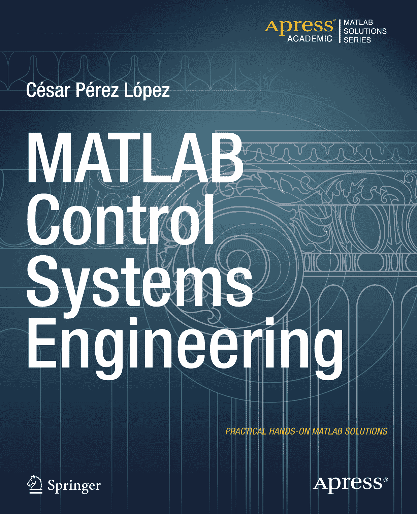

# 作者：César Pérez López，《MATLAB 控制系统工程》

ISBN 978-1-4842-0290-6  
电子版 ISBN 978-1-4842-0289-0  
DOI 10.1007/978-1-4842-0289-0

© Apress 2014

《MATLAB 控制系统工程》

## 出版信息

出版社：Heinz Weinheimer  
首席编辑：Dominic Shakeshaft  
编委会：Steve Anglin, Mark Beckner, Ewan Buckingham, Gary Cornell, Louise Corrigan, Jim DeWolf, Jonathan Gennick, Jonathan Hassell, Robert Hutchinson, Michelle Lowman, James Markham, Matthew Moodie, Jeff Olson, Jeffrey Pepper, Douglas Pundick, Ben Renow-Clarke, Dominic Shakeshaft, Gwenan Spearing, Matt Wade, Steve Weiss  
协调编辑：Melissa Maldonado  
文字编辑：Barnaby Sheppard  
排版：SPi Global  
索引编制：SPi Global  
插画：SPi Global  
封面设计：Anna Ishchenko

本书通过 Springer Science+Business Media New York 向全球图书贸易发行，地址：233 Spring Street, 6th Floor, New York, NY 10013。电话：1-800-SPRINGER，传真：(201) 348-4505，电子邮箱：`orders-ny@springer-sbm.com`，或访问 [www.springeronline.com](http://www.springeronline.com/)。Apress Media, LLC 是一家加利福尼亚有限责任公司，其唯一成员（所有者）为 Springer Science + Business Media Finance Inc (SSBM Finance Inc)。SSBM Finance Inc 是一家特拉华州公司。如需了解翻译相关事宜，请发送电子邮件至 `rights@apress.com`，或访问 [www.apress.com](http://www.apress.com/)。Apress 和 friends of ED 的书籍可批量购买，用于学术、企业或推广用途。大多数图书也提供电子版和许可证。更多信息，请参考我们的特别批量销售与电子书许可网页：[www.apress.com/bulk-sales](http://www.apress.com/bulk-sales)。本书作者提及的任何源代码或其他补充材料，读者可在 [www.apress.com](http://www.apress.com/) 获取。关于如何查找本书源代码的详细信息，请访问 [www.apress.com/source-code/](http://www.apress.com/source-code/)。

## 版权与法律声明

本作品受版权保护。出版商保留所有权利，无论涉及材料的全部或部分，特别是翻译、重印、重用插图、朗诵、广播、以缩微胶片或任何其他物理方式复制，以及信息存储与检索的传输、电子改编、计算机软件，或目前已知或以后开发的任何类似或不同方法。与评论或学术分析相关的简短摘录，或专门为在计算机系统上输入和执行而提供、仅供购买者使用的材料，不受此法律保留的限制。复制本出版物或其部分内容，仅允许在出版商所在国家现行版权法的规定下进行，且必须始终获得 Springer 的许可。许可使用可通过版权清算中心的 RightsLink 获取。违规行为将根据相应的版权法予以起诉。

本书中可能出现商标名称、标志和图像。我们没有在每个商标名称、标志或图像出现时都使用商标符号，而是仅在编辑风格下使用这些名称、标志和图像，以维护商标所有者的利益，并无意侵犯商标权。

本出版物中使用商品名称、商标、服务标志及类似术语，即使未明确标识，也不应被视为对其是否具有专有权的意见表达。

尽管本书中的建议和信息在出版时被认为是真实准确的，但作者、编辑和出版商均不对可能出现的任何错误或遗漏承担法律责任。出版商对本书内容不作任何明示或暗示的保证。本书中使用通用描述性名称、注册商标名称、商标、服务标志等，即便没有特别声明，也不意味着这些名称不受相关保护性法律和法规的约束，因此可供大众自由使用。尽管本书中的建议和信息在出版时被认为是真实准确的，但作者、编辑和出版商均不对可能出现的任何错误或遗漏承担法律责任。出版商对本书内容不作任何明示或暗示的保证。

本书采用无酸纸印刷。

Springer 是 Springer Science+Business Media 的一部分（[www.springer.com](http://www.springer.com)）