# 1. MATLAB 简介与 MATLAB 工作环境

## 引言

MATLAB 是一个用于科学计算和高级编程的平台，它采用交互式环境，让您能够比使用 `C`、`C++` 和 `FORTRAN` 等传统语言更高效地执行复杂的计算任务。它是目前科学和工程领域最流行的平台之一。

`MATLAB` 是一个交互式的高级技术计算环境，专为算法开发、数据可视化、数据分析和数值分析而设计。MATLAB 适用于解决涉及技术计算的问题，它使用经过优化的算法，并以易于使用的命令形式呈现。

MATLAB 可用于广泛的应用领域，包括微积分、代数、统计学、计量经济学、质量控制、时间序列、信号与图像处理、通信、控制系统设计、测试与测量系统、金融建模、计算生物学等。其补充工具集（称为工具箱，即用于特定目的的 `MATLAB` 函数集合，需单独获取）扩展了 MATLAB 环境，让您能够解决不同应用领域的特殊问题。

此外，MATLAB 还包含许多函数，可让您记录和共享工作成果。您可以将 MATLAB 代码与其他语言和应用程序集成，并分发使用 MATLAB 开发的算法和应用程序。

以下列出了 MATLAB 最重要的特性：
*   它是一种用于技术计算的高级语言
*   它提供了一个用于管理代码、文件和数据的环境
*   它具备用于探索、设计和迭代求解的交互式工具
*   它支持用于线性代数、统计学、傅里叶分析、滤波、优化和数值积分的数学函数
*   它能生成高质量的二维和三维图形，以辅助数据可视化
*   它包含用于创建自定义图形用户界面的工具
*   它可以与外部语言集成，例如 `C/C++`、`FORTRAN`、`Java`、`COM` 以及 `Microsoft Excel`

MATLAB 开发环境允许您以交互模式开发算法、分析数据、显示数据文件和管理项目（参见图 1-1）。

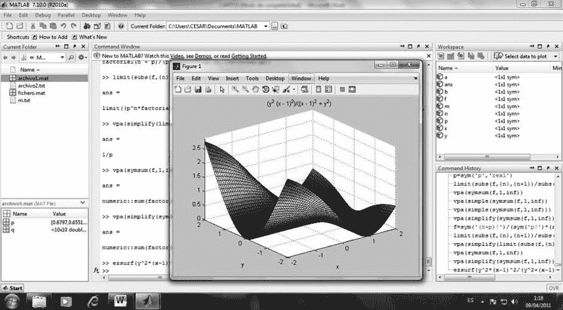

图 1-1.

图 1-1

### 开发算法和应用程序

MATLAB 提供高级编程语言和开发工具，使您能够快速开发和剖析算法及应用程序。

MATLAB 语言包含矢量和矩阵运算，这是解决科学和工程问题的基础。这简化了开发和执行过程。

使用 MATLAB 语言，编程和开发算法的速度比使用传统语言更快，因为不再需要执行低层级的管理任务，例如声明变量、指定数据类型和分配内存。在许多情况下，MATLAB 消除了对 `for` 循环的需求。因此，一行 MATLAB 代码通常可以替换几行 `C` 或 `C++` 代码。

同时，MATLAB 提供了传统编程语言的所有特性，包括算术运算符、控制流、数据结构、数据类型、面向对象编程（`OOP`）和调试。

图 1-2 展示了一个通信调制算法，该算法生成 1024 个随机比特，执行调制，添加复高斯噪声，并以图形方式显示结果，所有这些仅需九行 MATLAB 代码。

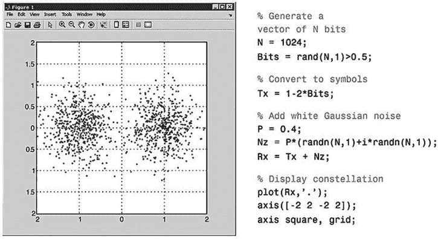

图 1-2.

图 1-2

MATLAB 允许您一次执行一个命令或一组命令，无需编译或链接，并且可以重复执行以达到最优解。

为了快速执行复杂的矢量和矩阵计算，MATLAB 使用了针对处理器优化的库。对于一般的标量计算，MATLAB 使用 `JIT`（即时编译）技术生成机器码指令。得益于这项在大多数平台上都可用的技术，其执行速度比传统编程语言快得多。

MATLAB 包含有助于高效实现算法的开发工具。其中一些工具如下所列：
*   `MATLAB` 编辑器 – 用于编辑函数和进行标准调试，例如设置断点和运行逐步仿真
*   `M-Lint` 代码检查器 - 分析代码并建议更改以提高性能和可维护性（参见图 1-3）

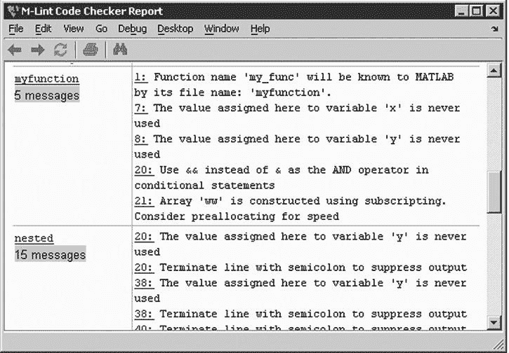

图 1-3.

图 1-3

*   `MATLAB Profiler` - 记录执行每行代码所花费的时间
*   目录报告 - 扫描目录中的所有文件，并生成关于代码效率、文件间差异、文件依赖关系和代码覆盖率的报告

您还可以使用交互式工具 `GUIDE`（图形用户界面开发环境）来设计和编辑用户界面。此工具允许您包含选择列表、下拉菜单、按钮、单选按钮和滑块，以及 `MATLAB` 图表和 `ActiveX` 控件。您也可以通过编程方式使用 `MATLAB` 函数来创建图形用户界面。

图 1-4 展示了一个已完成的小波分析工具（下方），该工具是使用用户界面 `GUIDE`（上方）创建的。

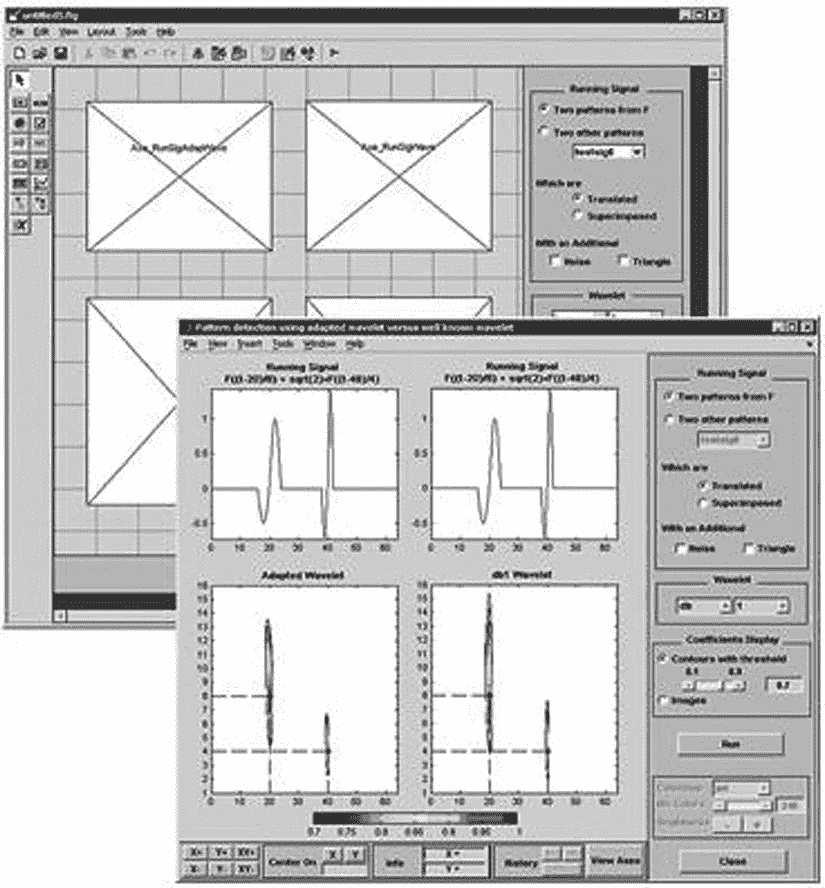

图 1-4.

图 1-4

### 数据访问与分析

MATLAB 支持数据分析的整个过程，从从外部设备和数据库获取数据，到预处理、可视化和数值分析，直至生成可用于演示的结果。

MATLAB 提供交互式工具和命令行操作来进行数据分析，包括：数据分段、缩放和平均、插值、阈值处理和平滑、相关性分析、傅里叶分析和滤波、一维峰值和零点查找、基本统计和曲线拟合、矩阵分析等。

图 1-5 中的示意图显示了一条拟合曲线，该曲线拟合了复活节岛与澳大利亚达尔文之间的平均大气压力差。

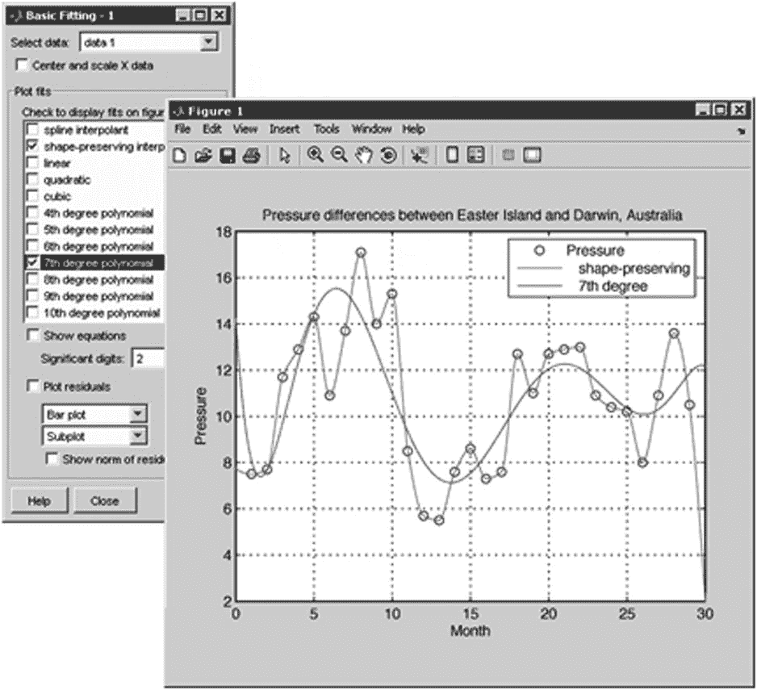

图 1-5.

图 1-5

MATLAB 平台允许高效访问数据文件、其他应用程序、数据库和外部设备。您可以读取大多数已知格式存储的数据，例如 `Microsoft Excel`、`ASCII` 文本文件或二进制图像、声音和视频文件，以及 `HDF` 和 `HDF5` 文件等科学档案。用于低级 `I/O` 函数的二进制文件允许您处理任何格式的数据文件。其他功能允许您查看 `Web` 页面和 `XML` 数据。

您可以调用其他应用程序和语言，例如 `C`、`C++`、`COM`、`DLL`、`Java`、`FORTRAN` 和 `Microsoft Excel` 对象，并访问 `FTP` 站点和 `Web` 服务。使用数据库工具箱，您甚至可以访问 `ODBC/JDBC` 数据库。

### 数据可视化

`MATLAB` 提供了可视化科学和工程数据所需的所有图形函数。这包括用于创建二维和三维图表的工具、三维体可视化工具、交互式创建图表的功能，以及使用最流行的图形格式导出的能力。可以自定义图表，添加多个坐标轴、更改线条和标记的颜色、添加注释、`LaTeX` 公式和图例，以及绘制路径。

可以创建多种矢量数据的二维图形表示形式，包括：
- 线图、面积图、条形图和扇形图
- 方向和速度图
- 直方图
- 多边形和曲面
- 散点气泡图
- 动画

图 1-6 展示了某台发动机数次排放测试结果的线性图，并附有一条拟合数据曲线。

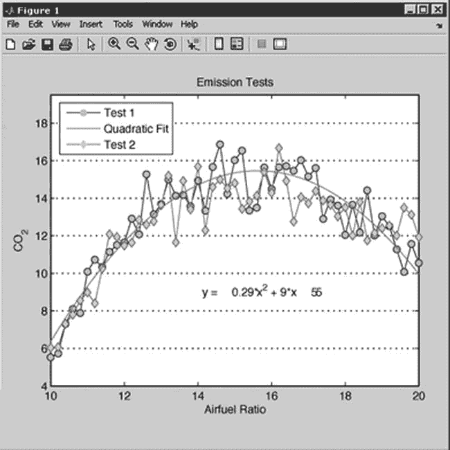

图 1-6。

`MATLAB` 还提供了用于显示二维数组、三维标量数据和三维矢量数据的函数。可以使用这些函数来可视化和理解大量复杂的多维数据。也可以定义图表的特性，例如相机的方向、透视、光照、光源和透明度。三维绘图功能包括：
- 曲面图、等高线图和网格图
- 空间曲线
- 锥体图、相位图、流线图和等值面图

图 1-7 展示了一个等值面的三维图，揭示了富勒烯碳-60 分子的测地结构。

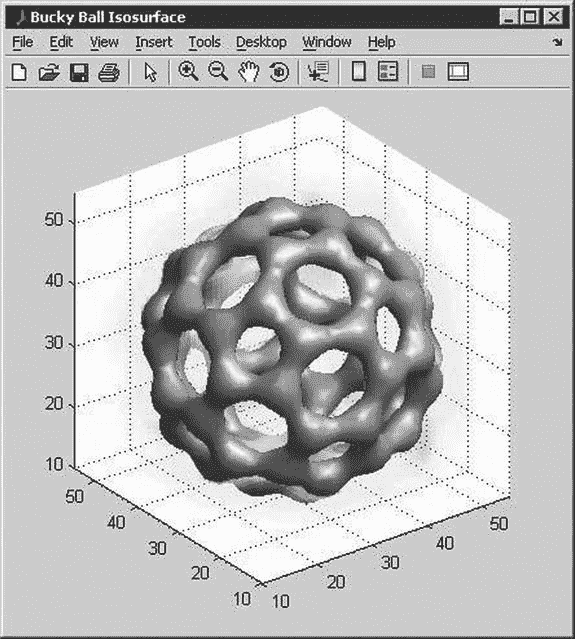

图 1-7。

`MATLAB` 包含用于图形编辑和设计的交互式工具。在 `MATLAB` 图表中，可以执行以下任何任务：
- 将新的数据集拖放到图形中
- 更改图形中任何对象的属性
- 更改缩放、旋转、视图（例如全景）、相机角度和光照
- 添加数据标签和注释
- 绘制形状
- 生成可重用于不同数据的 `M-file`

图 1-8 展示了一系列图形，这些图形是通过将数据集拖放到图表窗口、创建新的子图、更改颜色和字体等属性以及添加注释而交互式创建的。

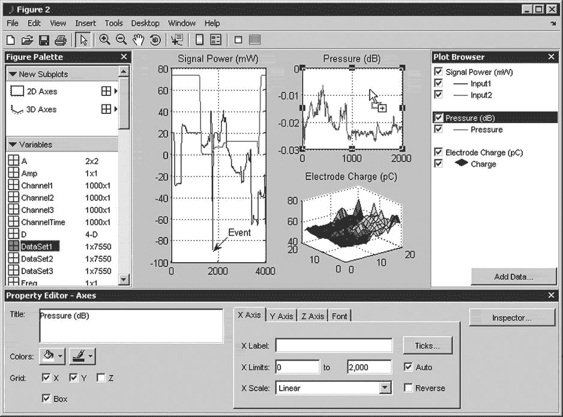

图 1-8。

`MATLAB` 兼容所有知名的数据文件和图形格式，例如 `GIF`、`JPEG`、`BMP`、`EPS`、`TIFF`、`PNG`、`HDF`、`AVI` 和 `PCX`。因此，可以将 `MATLAB` 图表导出到其他应用程序，例如 `Microsoft Word` 和 `Microsoft PowerPoint`，或桌面出版软件。导出前，可以创建并应用包含所有设计细节、字体、线宽等满足出版规范的样式模板。

### 数值计算

# MATLAB 概述

`MATLAB` 包含数学、统计和工程函数，支持这些领域中的大部分运算。这些函数由数学专家开发，是 `MATLAB` 语言的基础。举几个例子，`MATLAB` 在以下领域实现数学函数和数据分析：

- 矩阵运算和线性代数
- 多项式和插值
- 傅里叶分析和滤波器
- 统计与数据分析
- 优化与数值积分
- 常微分方程 (`ODEs`)
- 偏微分方程 (`PDEs`)
- 稀疏矩阵运算

## 结果发布和应用程序分发

此外，`MATLAB` 包含许多函数，可让您记录和共享工作。您可以将 `MATLAB` 代码与其他语言和应用程序集成，并将您的算法和 `MATLAB` 应用程序作为独立程序或软件模块进行分发。

`MATLAB` 允许您以图表形式或完整报告的形式导出结果。您可以将图表导出为所有流行的图形格式，然后将其导入到其他软件包中，例如 `Microsoft Word` 或 `Microsoft PowerPoint`。使用 `MATLAB Editor`，您可以自动以 `HTML` 格式、`Word`、`LaTeX` 等发布您的 `MATLAB` 代码。例如，图 1-9 显示了一个使用 `MATLAB Editor` 以 `HTML`（右侧）发布的 `M-file`（左侧）。发送到 `Command Window` 或图表的结果被捕获并包含在文档中，而注释则成为 `HTML` 中的标题和文本。

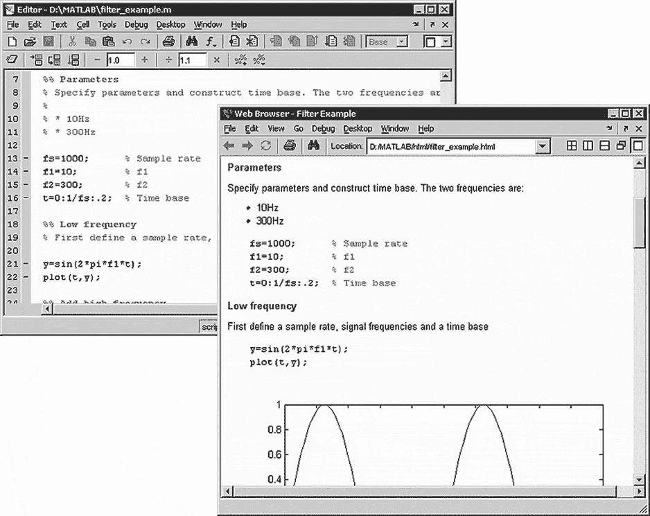

图 1-9。

可以使用 `MATLAB Report Generator`（单独提供）创建更复杂的报告，例如模拟执行和各种参数测试。

`MATLAB` 提供了一些函数，使您能够将 `MATLAB` 应用程序与 `C` 和 `C++` 代码、`FORTRAN` 代码、`COM` 对象以及 `Java` 代码集成。您可以调用 `DLL`s、`Java` 类和 `ActiveX` 控件。使用 `MATLAB` 引擎库，您还可以从 `C`、`C++` 或 `FORTRAN` 代码中调用 `MATLAB`。

您可以在 `MATLAB` 中创建算法并将其分发给其他 `MATLAB` 用户。使用 `MATLAB Compiler`（单独提供），可以将算法作为独立应用程序或包含在项目中的软件模块，分发给没有 `MATLAB` 的用户。其他附加产品能够将算法转换为可从 `COM` 或 `Microsoft Excel` 调用的软件模块。

## MATLAB 工作环境

图 1-10 展示了 MATLAB 环境的主工作区。 这是您输入 MATLAB 程序的界面。

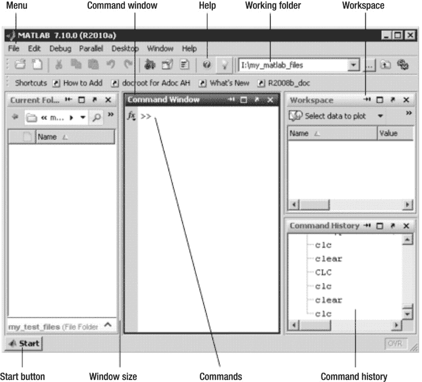

图 1-10。

下表总结了 MATLAB 环境的组成部分。

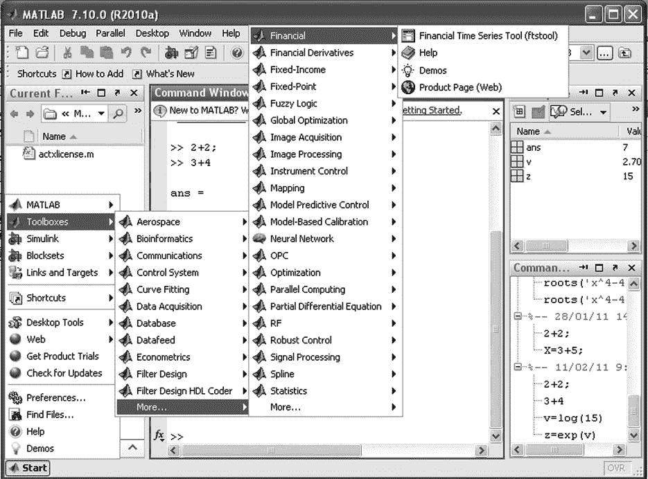

图 1-12。

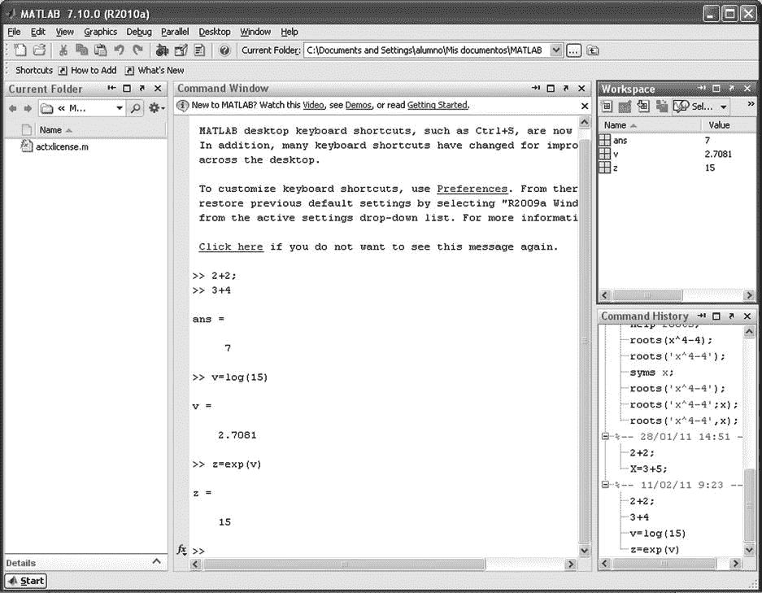

图 1-11。

| 工具 | 描述 |
| --- | --- |
| 命令历史记录 | 允许您查看命令窗口中本次会话期间输入的命令，并可以复制和运行这些命令（见图 1-11 的右下方部分） |
| 命令窗口 | 在此处输入 MATLAB 命令（见图 1-11 的中央部分） |
| 工作区 | 允许您查看工作区的内容（变量等）（见图 1-11 的右上方部分） |
| 帮助 | 提供关于 MATLAB 的帮助和演示 |
| 启动按钮 | 使您能够运行工具，并提供对 MATLAB 文档的访问（图 1-12） |

MATLAB 命令是在命令窗口中，用户输入提示符 `»` 的右侧输入的，命令的响应将出现在紧接的下方行中。退出响应后，用户输入提示符会重新显示，允许您输入更多条目（图 1-13）。

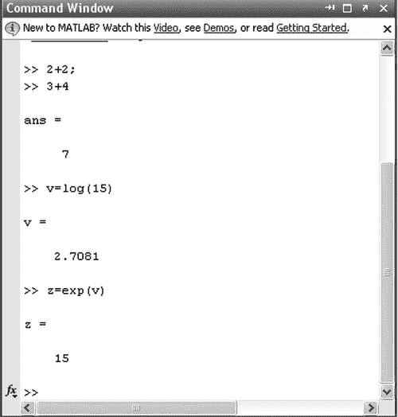

图 1-13。

当在命令窗口中向 MATLAB 输入内容且结果未赋值给变量时，返回的响应将以表达式 `ans =` 开头，如图 1-13 上方所示。如果结果被赋值给一个变量，那么我们可以将该变量用作后续输入的参数。图 1-13 中的变量 `v` 就是这种情况，它随后被用作指数运算的输入。

要运行 MATLAB 命令，只需输入命令并按回车键。如果在输入末尾加上分号，程序会执行计算并将其保存在内存（工作区）中，但不会在屏幕上显示结果（参见图 1-13 中的第一个条目）。输入提示符 `»` 出现，表示您可以输入新命令。

与 C 编程语言一样，MATLAB 区分大小写；例如，`Sin(x)` 与 `sin(x)` 是不同的。所有内置函数的名称都以小写字符开头。命令、变量或函数的名称中不应包含空格。在其他情况下，空格会被忽略，并且可以用来使输入更具可读性。可以通过用逗号分隔多个条目来在同一命令行中输入它们，并在最后一个条目末尾按回车键（见图 1-14）。如果在行中某个条目的末尾使用了分号，则其对应的输出将不会显示。

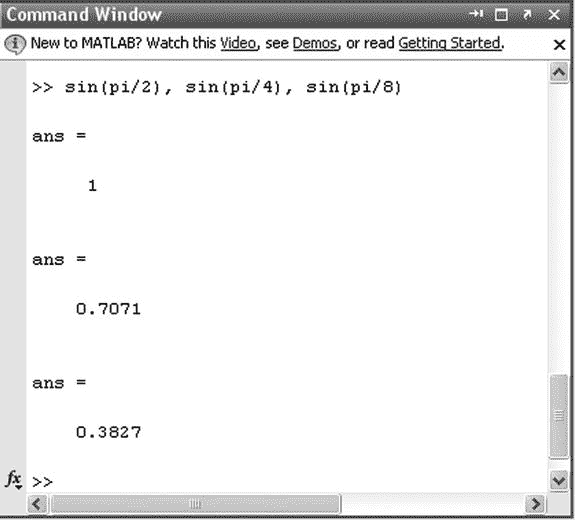

图 1-14。

描述性注释可以通过以 `%` 符号开头输入到命令输入行中。当您运行输入时，MATLAB 会忽略注释并处理其余代码（见图 1-15）。

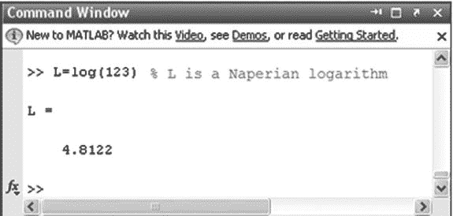

图 1-15。

为了简化由 MATLAB 解释器（通过命令窗口提示符）评估的脚本的输入过程，您可以使用箭头键。例如，如果您按一次向上箭头键，将恢复您提交的最后一条条目。如果您按两次向上键，将恢复您提交的倒数第二条条目，依此类推。

如果您在输入区域中键入一串字符，然后按向上箭头键，将恢复您提交的、以指定字符串开头的最后一条条目。

在 MATLAB 会话期间输入的命令会临时存储在缓冲区（工作区）中，直到您结束会话，届时它们可以保存到文件中或永久丢失。

以下是可在 MATLAB 输入区域（命令行）中使用的键及其功能的总结：

| 向上箭头 (Ctrl-P) | 检索上一个条目。 |
| --- | --- |
| 向下箭头 (Ctrl-N) | 检索下一个条目。 |
| 向左箭头 (Ctrl-B) | 将光标向左移动一个字符。 |
| 向右箭头 (Ctrl-F) | 将光标向右移动一个字符。 |
| CTRL-向左箭头 | 将光标向左移动一个单词。 |
| CTRL-向右箭头 | 将光标向右移动一个单词。 |
| 起始键 (Ctrl-A) | 将光标移动到行首。 |
| 结束键 (Ctrl-E) | 将光标移动到当前行末尾。 |
| 退出键 | 清除命令行。 |
| 删除键 (Ctrl-D) | 删除光标指示的字符。 |
| 退格键 | 删除光标左侧的字符。 |
| CTRL-K | 删除（剪切）当前行。 |

命令 `clc` 可以清除命令窗口，但不会删除工作区的内容（内容仍保留在内存中）。

```matlab
clc
```

## MATLAB 中的帮助

您可以通过工具栏中的帮助按钮  或菜单栏中的“帮助”选项找到 MATLAB 的帮助。此外，也可以通过 MATLAB 命令获得支持。命令 `help` 提供所有 MATLAB 命令的一般帮助（见图 1-16）。通过单击其中任何一个命令，您可以获得更具体的帮助。例如，如果您单击 `graph2d`，您将获得有关二维图形的支持（见图 1-17）。

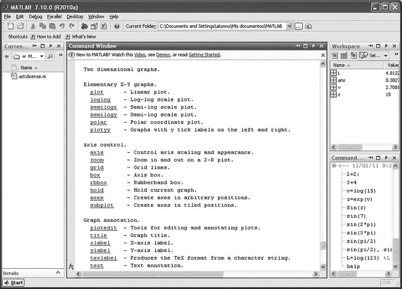

图 1-17。

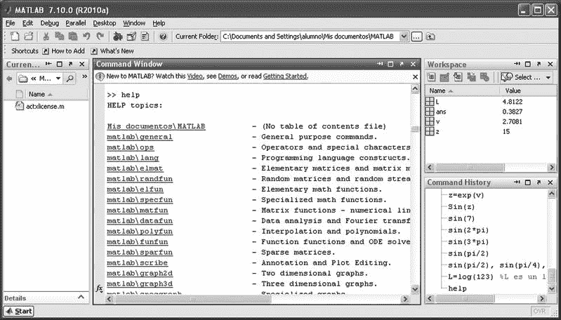

图 1-16。

您可以通过使用命令 `help command` 或 `help topic` 来请求关于特定命令 `command`（图 1-18）或任何主题 `topic`（图 1-19）的帮助。

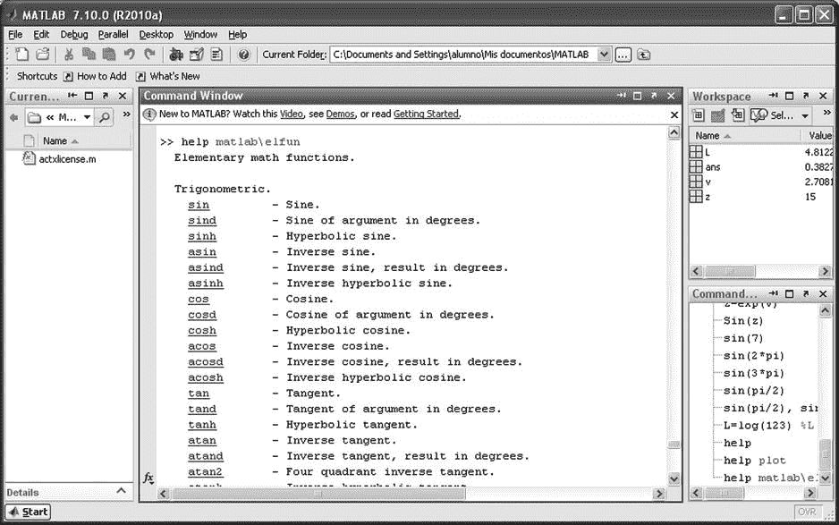

图 1-19。

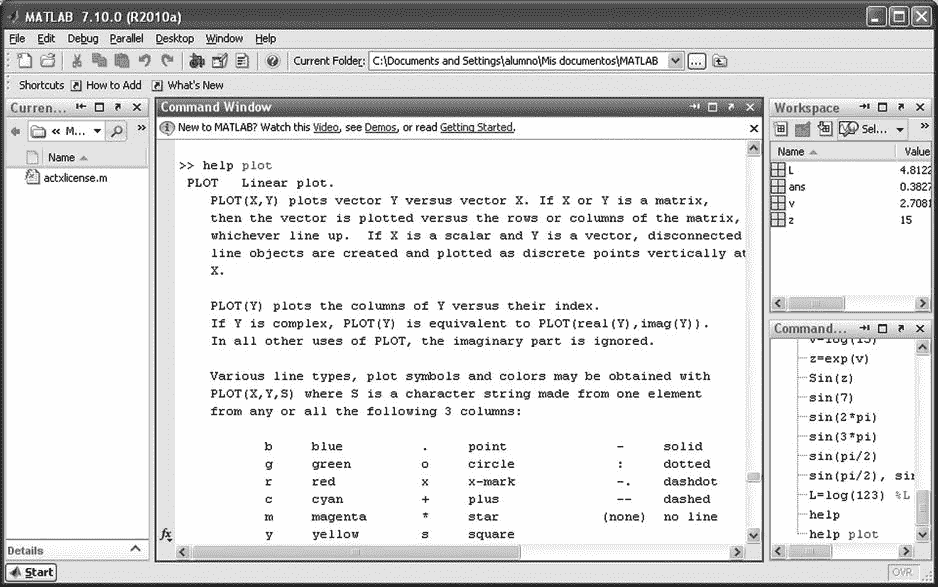

图 1-18。

命令 `lookfor string` 允许您查找所有引用或包含字符串 `string` 的 MATLAB 函数或命令。当没有对指定字符串的直接支持时，或者要查看与给定字符串相关的所有命令的帮助时，此命令非常有用。例如，如果我们想查找所有包含序列 `inv` 的命令的帮助，我们可以使用命令 `lookfor inv`（图 1-20）。
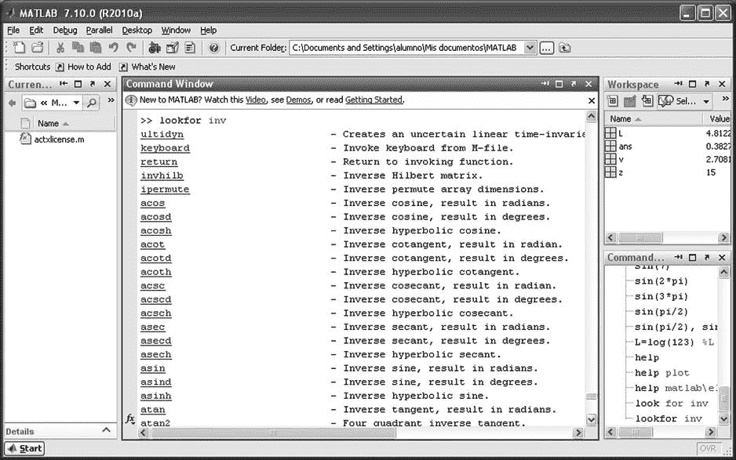
图 1-20.

