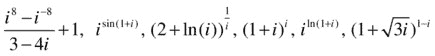
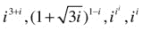
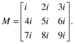
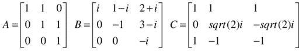

# Numbers

在 MATLAB 中，函数的参数可以采用多种不同形式，包括不同类型的数字和数值表达式，例如整数、有理数、实数以及复数。

MATLAB 中的算术运算是根据标准数学惯例定义的。MATLAB 是一个交互式程序，允许您执行各种简单的数学运算。MATLAB 假定使用通常的求和、求差、乘积、除法和幂运算，并遵循它们之间通常的优先级：

| `x + y` | 求和 |
| `x - y` | 求差 |
| `x * y` 或 `x y` | 乘积 |
| `x / y` | 除法 |
| `x ^ y` | 幂 |

要相加两个数字，只需输入第一个数字、一个加号（`+`）和第二个数字。可在符号前后添加空格，以使输入更易于阅读。

```
>> 2 + 3

ans =

5
```

我们可以直接进行幂运算。

```
>> 100 ^ 50

ans =

1.0000e+100
```

与计算器不同，在操作整数时，即使结果的位数超过屏幕通常能容纳的宽度，MATLAB 也会显示完整结果。例如，当使用`vpa`函数（此处使用默认精度 32 位有效数字）时，MATLAB 返回`99 ^ 50`的以下值。

```
>> vpa '99 ^ 50'

ans =

.60500606713753665044791996801256e100
```

要在同一条指令中组合多个运算，必须考虑它们之间通常的优先级标准，这些标准决定了表达式的求值顺序。例如，考虑：

```
>> 2 * 3 ^ 2 + (5-2) * 3

ans =

27
```

考虑到运算符的优先级，首先要计算的表达式是幂`3²`。通常的求值顺序可以通过将表达式分组在括号中来改变。

除了这些算术运算符，MATLAB 还配备了一套基本函数，您也可以定义自己的函数。MATLAB 函数和运算符可以应用于符号常量或数字。

MATLAB 的一个基本应用是像使用传统计算器一样执行算术运算，但有一个重要区别：计算的精度。运算可以按照用户所需的任意精度执行。这种无限制的计算精度是 MATLAB 区别于其他数值计算程序的一个特性，在其他程序中，精度由软件固有的字长决定，并且无法修改。

可以使用特殊的近似技术来降低 MATLAB 运算输出的精度，这些技术仅在达到特定指定精度时才精确。MATLAB 表示结果时具有高精度，但即使内部始终进行精确计算以防止舍入误差的传播，也可以启用不同的近似表示格式，这有时有助于解释结果。允许数值逼近的命令如下：

| `format long` | 以 16 位有效十进制数字提供结果。 |
| `format short` | 以 4 位小数提供结果。这是 MATLAB 的默认格式。 |
| `format long e` | 以 16 位十进制数字提供结果，并加上所需的 10 的幂。 |
| `format short e` | 以 4 位十进制数字提供结果，并加上所需的 10 的幂。 |
| `format long g` | 以最佳长格式提供结果。 |
| `format short g` | 以最佳短格式提供结果。 |
| `bank format` | 以 2 位小数提供结果。 |
| `format rat` | 以有理数近似值的形式返回结果。 |
| `format +` | 返回符号（`+`，`-`），并忽略复数的虚部。 |
| `format hex` | 以十六进制格式返回结果。 |
| `vpa 'operations' n` | 将指定运算的结果返回到 `n` 位有效数字。 |
| `numeric('expr')` | 提供由当前活动格式数值近似的表达式的值。 |
| `digits(n)` | 将结果返回到 `n` 位有效数字。 |

使用`format`以`format`命令后指定的方式给出`174/13`的数值近似值：

```
>> 174/13

ans =

13.3846

>> format long; 174/13

ans =

13.38461538461539

>> format long e; 174/13

ans =

1.338461538461539e+001

>> format short e; 174/13

ans =

1.3385e+001

>> format long g; 174/13

ans =

13.3846153846154

>> format short g; 174/13

ans =

13.385

>> format bank; 174/13

ans =

13.38

>> format hex; 174/13

ans =

402ac4ec4ec4ec4f
```

现在我们将看到如何计算`sqrt(17)`到我们想要的任何精度：

```
>> vpa ' 174/13 ' 10

ans =

13.38461538

>> vpa ' 174/13 ' 15

ans =

13.3846153846154

>> digits (20); vpa ' 174/13 '

ans =

13.384615384615384615
```

## 整数

在 MATLAB 中，所有涉及整数的常见运算都是精确的，无论输出的大小如何。如果我们希望运算结果以特定位数的有效数字显示在屏幕上，我们使用符号计算命令`vpa`（可变精度算术），其语法我们已经了解。

例如，以下计算`6⁴⁰⁰`到 450 位有效数字：

```
>>  '6 vpa ^ 400' 450

ans =

182179771682187282513946871240893712673389715281747606674596975493339599720905327003028267800766283867331479599455916367452421574456059646801054954062150177042349998869907885947439947961712484067309738073652485056311556920850878594283008099992731076250733948404739350551934565743979678824151197232629947748581376.
```

运算结果是精确的，始终在结果末尾显示一个小数点。在这种情况下，答案无论如何都没有 450 位数字，因此解是精确的。如果您需要更少的有效数字，可以指定该数字，结果将相应地进行四舍五入。例如，仅计算上述幂到 50 位有效数字，我们有：

```
>>  '6 vpa ^ 400' 50

ans =

.18217977168218728251394687124089371267338971528175e312
```

## 整数与整除性函数

MATLAB 中有几个函数使用整数参数，其中大部分与整除性有关。使用整数参数的最典型函数如下：

| `rem(n, m)` | 返回 `n` 除以 `m` 的余数（当 `n` 和 `m` 为实数时也有效）。 |
| `sign(n)` | `n` 的符号（即，如果 `n > 0` 则为 1，如果 `n < 0` 则为 -1）。 |
| `max(n1, n2)` | `n1` 和 `n2` 中的最大值。 |
| `min(n1, n2)` | `n1` 和 `n2` 中的最小值。 |
| `gcd(n1, n2)` | `n1` 和 `n2` 的最大公约数。 |
| `lcm(n1, n2)` | `n1` 和 `n2` 的最小公倍数。 |
| `factorial(n)` | `n` 的阶乘（即 `n(n-1)(n-2)...1`）。 |
| `factor(n)` | 返回 `n` 的质因数分解。 |

以下是一些示例。

17 除以 3 的余数：

```
>> rem (17,3)

ans =

2
```

4.1 除以 1.2 的余数：

```
>> rem (4.1,1.2)

ans =

0.5000
```

-4.1 除以 1.2 的余数：

```
>> rem (-4.1,1.2)

ans =

-0.5000
```

1000、500 和 625 的最大公约数：

```
>> gcd (1000, gcd (500,625))

ans =

125.00
```

1000、500 和 625 的最小公倍数：

```
>> lcm (1000, lcm (500,625))

ans =

5000.00
```

### 其他进制

MATLAB 允许你使用任意进制处理数字，前提是安装了扩展的符号数学工具箱。它还允许你用不同进制表示各种数字。这是通过以下函数实现的：

| `dec2base(十进制数, n_base)` | 将指定的十进制数转换为新进制 `n_base`。 |
| `base2dec(数字, b)` | 将给定进制 `b` 的数字转换为十进制数。 |
| `dec2bin(十进制数)` | 将指定的十进制数转换为 2 进制（二进制）。 |
| `dec2hex(十进制数)` | 将指定的十进制数转换为 16 进制（十六进制）。 |

| `bin2dec(二进制数)` | 将指定的二进制数转换为十进制。 |
| `hex2dec(十六进制数)` | 将指定的 16 进制数转换为十进制。 |

下面是一些示例。

将二进制数 100101 转换为十进制表示。

```
>> base2dec('100101',2)
ans =
37.00
```

将十六进制数 FFFFAA00 转换为十进制表示。

```
>> base2dec('FFFFAA0', 16)
ans =
268434080.00
```

将十六进制运算 FFFAA2+FF-1 的结果用十进制表示。

```
>> base2dec('FFFAA2',16) + base2dec('FF',16)-1
ans =
16776096.00
```

### 实数

众所周知，实数集是有理数集和无理数集的不交并。有理数是形如 `p/q` 的数，其中 `p` 和 `q` 是整数。换句话说，有理数是可表示为两个整数之商的数。MATLAB 处理有理数的方式与大多数计算器不同。如果我们让计算器计算 `1/2 + 1/3 + 1/4` 的和，大多数会返回类似 `1.0833` 的结果，这仅仅是结果的一个近似值。

有理数是整数之比，MATLAB 可以以精确模式处理它们，因此涉及有理数的算术表达式的结果总是以两个整数之比的形式精确给出。要启用此功能，请使用命令 `format rat` 激活有理数格式。如果读者希望，MATLAB 也可以通过激活任何其他类型的格式（例如 `format short` 或 `format long`）来返回十进制形式的结果。MATLAB 在精确模式下计算上述和的方式如下：

```
>> format rat
>> 1/2 + 1/3 + 1/4
ans =
13/12
```

与计算器不同，MATLAB 通过将有理数保持为整数比的形式，确保其与有理数的运算是精确的。这样，分数计算就不会受到舍入误差的影响，正如误差理论所证明的那样，这些误差可能变得非常严重。注意，一旦启用有理数格式，当 MATLAB 相加两个有理数时，结果会以整数比的形式符号化返回，并且对有理数的运算将继续保持精确，直到调用另一种格式为止。

如果启用了有理数格式，一个浮点数（即带有小数点的数字）将被解释为精确值。因此，浮点表达式将被解释为精确的有理表达式，而有理表达式中的任何无理数都将由适当的有利近似值来表示。

```
>> format rat
>> 10/23 + 2.45/44
ans =
1183 / 2412
```

实数的另一个基本子集是无理数集，由于其特殊性质，无理数在数值计算中一直带来困难。无法在数值模式（使用十进制计数系统中的十位数字）下精确表示无理数是大多数问题的根源。MATLAB 以用户可以按需设置的精度来表示结果。根据定义，无理数不能精确表示为两个整数之比。如果命令 MATLAB 计算 17 的平方根，默认情况下它会返回数字 5.1962。

```
>> sqrt(27)
ans =
5.1962
```

MATLAB 包含以下常见的无理常数和概念：

| `pi` | 圆周率 π = 3.1415926... |
| `exp(1)` | 自然常数 e = 2.7182818... |
| `Inf` | 无穷大（例如，遇到 `1/0` 时返回）。 |
| `NaN` | 不确定性（例如，遇到 `0/0` 时返回）。 |
| `realmin` | 返回 IEEE 双精度下最小的可能标准化浮点数。 |
| `realmax` | 返回 IEEE 双精度下最大的有限浮点数。 |

以下示例说明了 MATLAB 如何输出这些数字和概念。

```
>> long format
>> pi
ans =
3.14159265358979

>> exp(1)
ans =
2.71828182845905

>> 1/0
Warning: Divide by zero.
ans =
Inf

>> 0/0
Warning: Divide by zero.
ans =
NaN

>> realmin
ans =
2.225073858507201e-308

>> realmax
ans =
1.797693134862316e+308
```

### 实参数函数

有理数集和无理数集的不交并就是实数集。反过来，有理数集以整数集为其子集。所有适用于实数参数的函数也同样适用于整数和有理数。MATLAB 提供了全套预定义函数，其中大部分将在本书后续章节中讨论。在 MATLAB 提供的实参数函数组中，以下是最重要的：

**三角函数**

| 函数 | 反函数 |
| --- | --- |
| `sin(x)` | `asin(x)` |
| `cos(x)` | `acos(x)` |
| `tan(x)` | `atan(x)` 和 `atan2(y,x)` |
| `csc(x)` | `acsc(x)` |
| `sec(x)` | `asec(x)` |
| `cot(x)` | `acot(x)` |

**双曲函数**

| 函数 | 反函数 |
| --- | --- |
| `sinh(x)` | `asinh(x)` |
| `cosh(x)` | `acosh(x)` |
| `tanh(x)` | `atanh(x)` |
| `csch(x)` | `acsch(x)` |
| `sech(x)` | `asech(x)` |
| `coth(x)` | `acoth(x)` |

**指数和对数函数**

| 函数 | 含义 |
| --- | --- |
| `exp(x)` | 以 e 为底的指数函数（`e^x`）。 |
| `log(x)` | x 的自然对数（以 e 为底）。 |
| `log10(x)` | x 的以 10 为底的对数。 |
| `log2(x)` | x 的以 2 为底的对数。 |
| `pow2(x)` | 2 的 x 次幂。 |
| `sqrt(x)` | x 的平方根。 |

**数值变量特定函数**

| 函数 | 含义 |
| --- | --- |
| `abs(x)` | x 的绝对值。 |
| `floor(x)` | 小于或等于 x 的最大整数。 |
| `ceil(x)` | 大于或等于 x 的最小整数。 |
| `round(x)` | 最接近 x 的整数。 |
| `fix(x)` | 去掉 x 的小数部分。 |
| `rem(a,b)` | 返回 a 除以 b 的余数。 |
| `sign(x)` | 返回 x 的符号（如果 x > 0，则返回 1；如果 x = 0，则返回 0；如果 x < 0，则返回 -1）。 |

以下是一些示例：

```
>> sin(pi/2)
ans =
1

>> asin(1)
ans =
1.57079632679490

>> log(exp(1)³)
ans =
3.00000000000000
```

函数 `round` 在以下两个示例中演示：

```
>> round(2.574)
ans =
3

>> round(2.4)
ans =
2
```

函数 `ceil` 在以下两个示例中演示：

```
>> ceil(4.2)
ans =
5

>> ceil(4.8)
ans =
5
```

函数 `floor` 在以下两个示例中演示：

```
>> floor(4.2)
ans =
4

>> floor(4.8)
ans =
4
```

`fix` 函数只是去掉实数的分数部分：

```
>> fix(5.789)
ans =
5
```

## 复数

MATLAB 中已经很好地实现了复数的运算。MATLAB 遵循惯例，使用 `i` 或 `j` 来表示复分析中的关键值——虚数 √-1。所有常用的算术运算符都可以应用于复数，此外还有一些特定的函数接受复数参数。复数的实部和虚部都可以是实数或符号常量，除非另有指示或必要，否则将始终以精确模式执行运算，否则会返回结果的近似值。由于虚数单位用符号 `i` 或 `j` 表示，复数以 `a+bi` 或 `a+bj` 的形式表示。注意，在虚数单位前不需要使用乘号（星号）：

```
>>  (1-5i)*(1-i)/(-1+2i)
ans =
-1.6000 + 2.8000i

>> format rat
>>  (1-5i) *(1-i) /(-1+2i)
ans =
-8/5 + 14/5i
```

### 含复数参数的函数

复数变量的处理在数学分析及其众多工程应用中非常重要。MATLAB 不仅实现了复数的常用算术运算，还实现了各种复数函数。下面列出了最重要的函数。

#### 三角函数

| 函数 | 反函数 |
| --- | --- |
| `sin(z)` | `asin(z)` |
| `cos(z)` | `acos(z)` |
| `tan(z)` | `atan(z)` 和 `atan2(imag(z),real(z))` |
| `csc(z)` | `acsc(z)` |
| `sec(z)` | `asec(z)` |
| `cot(z)` | `acot(z)` |

#### 双曲函数

## 复数函数

### 基本复数函数

| 函数 | 反函数 |
| --- | --- |
| `sinh(z)` | `asinh(z)` |
| `cosh(z)` | `acosh(z)` |
| `tanh(z)` | `atanh(z)` |
| `csch(z)` | `acsch(z)` |
| `sech(z)` | `asech(z)` |
| `coth(z)` | `acoth(z)` |

### 指数和对数函数

| 函数 | 含义 |
| --- | --- |
| `exp(z)` | 以 e 为底的指数函数 (`e^z`) |
| `log(z)` | `z` 以 e 为底的对数 |
| `log10(z)` | `z` 以 10 为底的对数 |
| `log2(z)` | `z` 以 2 为底的对数 |
| `pow2(z)` | 2 的 `z` 次幂 |
| `sqrt(z)` | `z` 的平方根 |

### 用于实部和虚部的特定函数

| 函数 | 含义 |
| --- | --- |
| `floor(z)` | 对 `real(z)` 和 `imag(z)` 应用向下取整函数 |
| `ceil(z)` | 对 `real(z)` 和 `imag(z)` 应用向上取整函数 |
| `round(z)` | 对 `real(z)` 和 `imag(z)` 应用四舍五入函数 |
| `fix(z)` | 对 `real(z)` 和 `imag(z)` 应用向零取整函数 |

### 复数的特定函数

| 函数 | 含义 |
| --- | --- |
| `abs(z)` | `z` 的复模 |
| `angle(z)` | `z` 的辐角 |
| `conj(z)` | `z` 的共轭复数 |
| `real(z)` | `z` 的实部 |
| `imag(z)` | `z` 的虚部 |

以下是复数运算的一些示例。

```
>> round(1.5-3.4i)

ans =

2       -    3i
>> real(i^i)

ans =

0.2079
>>  (2+2i)²/(-3-3*sqrt(3)*i)⁹⁰

ans =

0502e-085 - 1 + 7. 4042e-070i
>> sin (1 + i)

ans =

1.2985 + 0. 6350i
```

### 支持复数向量参数的基本函数

MATLAB 可以轻松处理向量和矩阵运算。事实上，其名称 **MA**trix **LAB**oratory（矩阵实验室）已经暗示了它在处理向量和矩阵方面的强大能力。MATLAB 允许您使用复变量函数，此外，该变量甚至可以是向量或矩阵。下表列出了具有复数向量参数的函数。

| 函数 | 含义 |
| --- | --- |
| `max(V)` | `V` 的最大分量。（对于复数向量，`max` 的计算方法是：找出具有最大复模（幅值）的复数，通过 `max(abs(V))` 计算。然后，如有必要，通过 `max(angle(x))` 计算最大的相位角。） |
| `min(V)` | `V` 的最小分量。（对于复数向量，`min` 的计算方法是：找出具有最小复模（幅值）的复数，通过 `min(abs(A))` 计算。然后，如有必要，通过 `min(angle(x))` 计算最小的相位角。） |
| `mean(V)` | `V` 各分量的平均值 |
| `median(V)` | `V` 各分量的中位数 |
| `std(V)` | `V` 各分量的标准差 |
| `sort(V)` | 按升序对 `V` 的分量进行排序。对于复数项，排序依据是绝对值和辐角。 |
| `sum(V)` | 返回 `V` 各分量的和 |
| `prod(V)` | 返回 `V` 各分量的乘积，例如，`n! = prod(1:n)` |
| `cumsum(V)` | 给出 `V` 各分量的累积和 |
| `cumprod(V)` | 给出 `V` 各分量的累积乘积 |
| `diff(V)` | 给出 `V` 的一阶差分向量（`V[t] - V[t-1]`） |
| `gradient(V)` | 给出 `V` 的梯度 |
| `del2(V)` | 给出 `V` 的拉普拉斯算子（5 点离散） |
| `fft(V)` | 给出 `V` 的离散傅里叶变换 |
| `fft2(V)` | 给出 `V` 的二维离散傅里叶变换 |
| `ifft(V)` | 给出 `V` 的逆离散傅里叶变换 |
| `ifft2(V)` | 给出 `V` 的逆二维离散傅里叶变换 |

这些函数也支持将复矩阵作为参数，在这种情况下，结果是一个列向量组成的向量，其分量是将函数应用于矩阵的每一列所得到的结果。

以下是一些示例：

```
>> V = 2:7, W = [5 + 3i 2-i 4i]

V =

2     3     4     5     6     7

W =

2.0000 - 1.0000i        0 + 4.0000i   5.0000 + 3.0000i
>> diff(V), diff(W)

ans =

1     1     1     1     1

ans =

-2.0000 + 5.0000i   5.0000 - 1.0000i
>> cumprod(V), cumsum(V)

ans =

2     6     24     120     720     5040

ans =

2     5     9    14    20    27
>> cumsum(W), mean(W), std(W), sort(W), sum(W)

ans =

2.0000 - 1.0000i   2.0000 + 3.0000i   7.0000 + 6.0000i

ans =

2.3333 + 2.0000i

ans =

3.6515

ans =

2.0000 - 1.0000i 0 + 4.0000i   5.0000 + 3.0000i

ans =

7.0000 + 6.0000i
>> mean(V), std(V), sort(V), sum(V)

ans =

4.5000

ans =

1.8708

ans =

2     3     4     5     6     7

ans =

27
>> fft(W), ifft(W), fft2(W)

ans =

7.0000 + 6.0000i   0.3660 - 0.1699i  -1.3660 - 8.8301i

ans =

2.3333 + 2.0000i  -0.4553 - 2.9434i   0.1220 - 0.0566i

ans =

7.0000 + 6. 0000i 0.3660 - 0. 1699i - 1.3660 - 8. 8301i
```

### 支持复数矩阵参数的初等函数

| 三角函数 | 含义 |
| --- | --- |
| `sin(z)` | 正弦函数 |
| `sinh(z)` | 双曲正弦函数 |
| `asin(z)` | 反正弦函数 |
| `asinh(z)` | 反双曲正弦函数 |
| `cos(z)` | 余弦函数 |
| `cosh(z)` | 双曲余弦函数 |
| `acos(z)` | 反余弦函数 |
| `acosh(z)` | 反双曲余弦函数 |
| `tan(z)` | 正切函数 |
| `tanh(z)` | 双曲正切函数 |
| `atan(z)` | 反正切函数 |
| `atan2(z)` | 第四象限反正切函数 |
| `atanh(z)` | 反双曲正切函数 |
| `sec(z)` | 正割函数 |
| `sech(z)` | 双曲正割函数 |
| `asec(z)` | 反正割函数 |
| `asech(z)` | 反双曲正割函数 |
| `csc(z)` | 余割函数 |
| `csch(z)` | 双曲余割函数 |
| `acsc(z)` | 反余割函数 |
| `acsch(z)` | 反双曲余割函数 |
| `cot(z)` | 余切函数 |
| `coth(z)` | 双曲余切函数 |
| `acot(z)` | 反余切函数 |
| `acoth(z)` | 反双曲余切函数 |
| 指数函数 | 含义 |
| `exp(z)` | 以 e 为底的指数函数 |
| `log(z)` | 自然对数函数（以 e 为底） |
| `log10(z)` | 以 10 为底的对数函数 |
| `sqrt(z)` | 平方根函数 |
| 复数函数 | 含义 |
| `abs(z)` | 模或绝对值 |
| `angle(z)` | 辐角 |
| `conj(z)` | 复共轭 |
| `imag(z)` | 虚部 |
| `real(z)` | 实部 |
| 数值函数 | 含义 |
| `fix(z)` | 去除小数部分 |
| `floor(z)` | 向负无穷大舍入到最近的整数 |
| `ceil(z)` | 向正无穷大舍入到最近的整数 |
| `round(z)` | 执行常见的四舍五入 |

### 基础数学函数

| 函数 | 描述 |
| :--- | :--- |
| `rem(z1, z2)` | 返回 `z1` 除以 `z2` 后的余数 |
| `sign(z)` | `z` 的符号函数 |

### 矩阵函数

| 函数 | 描述 |
| :--- | :--- |
| `expm(Z)` | 默认矩阵指数函数 |
| `expm1(Z)` | M 文件中的矩阵指数函数 |
| `expm2(Z)` | 通过泰勒级数计算的矩阵指数函数 |
| `expm3(Z)` | 通过特征值计算的矩阵指数函数 |
| `logm(Z)` | 矩阵对数函数 |
| `sqrtm(Z)` | 矩阵平方根函数 |
| `funm(Z,'function')` | 将函数应用于数组 `Z` |

以下是一些示例：

```
>> A = [7 8 9; 1 2 3; 4 5 6], B = [1+2i 3+i;4+i,i]
```

```
A =
     7     8     9
     1     2     3
     4     5     6
```

```
B =
   1.0000 + 2.0000i   3.0000 + 1.0000i
   4.0000 + 1.0000i        0 + 1.0000i
```

```
>> sin(A), sin(B), exp(A), exp(B), log(B), sqrt(B)
ans =
    0.6570    0.9894    0.4121
    0.8415    0.9093    0.1411
   -0.7568   -0.9589   -0.2794
ans =
   3.1658 + 1.9596i   0.2178 - 1.1634i
  -1.1678 - 0.7682i        0 + 1.1752i
ans =
   1.0e+003 *
    1.0966    2.9810    8.1031
    0.0027    0.0074    0.0201
    0.0546    0.1484    0.4034
ans =
  -1.1312 + 2.4717i  10.8523 +16.9014i
  29.4995 +45.9428i   0.5403 + 0.8415i
ans =
   0.8047 + 1.1071i   1.1513 + 0.3218i
   1.4166 + 0.2450i        0 + 1.5708i
ans =
   1.2720 + 0.7862i   1.7553 + 0.2848i
   2.0153 + 0.2481i   0.7071 + 0.7071i
```

上面使用的指数函数、平方根和对数函数是逐元素应用于数组的，与下面使用的矩阵指数和对数函数无关。

```
>> expm(B), logm(A), abs(B), imag(B)
ans =
  -27.9191 +14.8698i -20.0011 +12.0638i
  -24.7950 + 17.6831i-17.5059 + 14.0445i
ans =
   11.9650 12.8038 - 19.9093
  -21.7328-22.1157 44.6052
   11.8921 12.1200 - 21.2040
ans =
    2.2361    3.1623
    4.1231    1.0000
ans =
     2     1
     1     1
```

```
>> fix(sin(B)), ceil(log(A)), sign(B), rem(A,3*ones(3))
ans =
   3.0000 + 1.0000i        0 - 1.0000i
  -1.0000                 0 + 1.0000i
ans =
     2     3     3
     0     1     2
     2     2     2
ans =
   0.4472 + 0.8944i   0.9487 + 0.3162i
   0.9701 + 0.2425i        0 + 1.0000i
ans =
     1     2     0
     1     2     0
     1     2     0
```

### 随机数

MATLAB 可以轻松生成（伪）随机数。函数 `rand` 生成均匀分布的随机数，函数 `randn` 生成正态分布的随机数。下表展示了 MATLAB 随机数生成器最有趣的功能。

| 函数 | 描述 |
| :--- | :--- |
| `rand` | 返回一个来自 `[0,1]` 区间的均匀分布随机小数。 |
| `rand(n)` | 返回一个大小为 `n×n` 的数组，其元素是来自 `[0,1]` 区间的均匀分布随机小数。 |
| `rand(m, n)` | 返回一个维度为 `m×n` 的数组，其元素是来自 `[0,1]` 区间的均匀分布随机小数。 |
| `rand(size(a))` | 返回一个与矩阵 `A` 大小相同的数组，其元素是来自 `[0,1]` 区间的均匀分布随机小数。 |
| `rand('seed')` | 返回均匀随机数生成器种子的当前值。 |
| `rand('seed',n)` | 将均匀随机数生成器种子的当前值赋给 `n`。 |
| `randn` | 返回一个正态分布的随机小数（均值为 0，方差为 1）。 |
| `randn(n)` | 返回一个维度为 `n×n` 的数组，其元素是正态分布的随机小数（均值为 0，方差为 1）。 |
| `randn(m, n)` | 返回一个维度为 `m×n` 的数组，其元素是正态分布的随机小数（均值为 0，方差为 1）。 |
| `randn(size(a))` | 返回一个与矩阵 `A` 大小相同的数组，其元素是正态分布的随机小数（均值为 0，方差为 1）。 |
| `randn('seed')` | 返回正态随机数生成器种子的当前值。 |
| `randn('seed',n)` | 将均匀随机数生成器种子的当前值赋给 `n`。 |

以下是一些示例：

```
>>  [rand, rand (1), randn, randn (1)]
ans =
    0.9501    0.2311   -0.4326   -1.6656
```

```
>>  [rand(2), randn(2)]
ans =
    0.6068    0.8913             0.1253   -1.1465
    0.4860    0.7621             0.2877    1.1909
```

```
>>  [rand(2,3), randn(2,3)]
ans =
    0.3529 0.0099 0.2028   -0.1364 1.0668-0.0956
    0.8132 0.1389 0.1987 0.1139 0.0593 - 0.8323
```

### 运算符

MATLAB 提供了算术、逻辑、关系、条件和结构运算符。

#### 算术运算符

MATLAB 中有两种算术运算符：由线性代数规则支配的矩阵算术运算符，以及按元素执行的向量算术运算符。涉及的运算符如下表所示。

| 运算符 | 作用 |
| :--- | :--- |
| `+` | 标量、向量或矩阵的加法 |
| `-` | 标量、向量或矩阵的减法 |
| `*` | 标量或数组的乘法 |
| `.*` | 标量或向量的乘法 |
| `\` | `A\B = inv(A) * B`，其中 `A` 和 `B` 是矩阵 |
| `.\` | `A.\B = [B(i,j) / A(i,j)]`，其中 `A` 和 `B` 是向量（`dim(A) = dim(B)`） |
| `/` | 除法，或 `B/A = B * inv(A)`，其中 `A` 和 `B` 是矩阵 |
| `./` | `A./B = [A(i,j) / B(i,j)]`，其中 `A` 和 `B` 是向量（`dim(A) = dim(B)`） |
| `^` | 标量或矩阵的幂运算（`M^p`） |
| `.^` | 向量的幂运算（`A.^B = [A(i,j)^(B(i,j))]`，对于向量 `A` 和 `B`） |

标量和向量之间的简单数学运算根据定义的操作将标量应用于向量的所有元素，而向量之间的简单运算符是逐元素执行的。以下是这些运算符的规范：

| 表达式 | 描述 |
| :--- | :--- |
| `a = {a1, a2,..., an}`, `b = {b1, b2,..., bn}`, `c = 标量` |  |
| `a + c = [a1+c, a2+c,..., an+c]` | 标量与向量的加法 |
| `a * c = [a1*c, a2*c ,..., an*c]` | 标量与向量的乘法 |
| `a + b = [a1+b1, a2+b2, ..., an+bn]` | 两个向量的加法 |
| `a.*b = [a1*b1, a2*b2, ..., an*bn]` | 两个向量的乘法 |
| `a./b = [a1/b1, a2/b2, ..., an/bn]` | 两个向量的右除 |

# MATLAB 运算符

## 向量运算符

| 表达式 | 描述 |
| --- | --- |
| `a.\b = [a1\b1, a2\b2, ..., an\bn]` | 两个向量的左除 |
| `a.^c = [a1^c, a2^c ,..., an^c]` | 向量的标量次幂 |
| `c.^a = [c^a1, c^a2, ..., c^an]` | 标量的向量次幂 |
| `a.^b = [a1^b1, a2^b2, ..., an^bn]` | 向量的向量次幂 |

必须牢记，向量必须具有相同的长度，并且在乘法、除法和幂运算中，第一个操作数后面必须跟一个点（`.`）。以下示例涉及上述所有运算符。

```
>> X = [5,4,3]; Y = [1,2,7]; a = X + Y, b = X-Y, c = x * Y, d = 2\. * X,...
e = 2/X, f = 2\. \Y, g = x / Y, h =. \X, i = x ^ 2, j = 2\. ^ X, k = X. ^ Y

a =
     6     6    10
b =
     4     2    -4
c =
     5     8    21
d =
    10     8     6
e =
    0.4000    0.5000    0.6667
f =
    0.5000    1.0000    3.5000
g =
    5.0000    2.0000    0.4286
h =
    5.0000    2.0000    0.4286
i =
    25    16     9
j =
    32 16 8
k =
    5 16 2187
```

以上操作都是有效的，因为在所有情况下，变量操作数都具有相同的维度，因此操作可以成功逐元素执行。对于加法和减法，向量和矩阵之间没有区别，因为这两种情况下的操作是相同的。

## 矩阵运算符

矩阵变量最重要的运算符指定如下：

| 表达式 | 描述 |
| --- | --- |
| `A + B`， `A - B`， `A * B` | 矩阵的加法、减法和乘法。 |
| `A\B` | 如果 `A` 是方阵，则 `A\B = inv(A) * B`。如果 `A` 不是方阵，则 `A\B` 是系统 `AX = B` 在最小二乘意义上的解。 |
| `B/A` | 等同于 `(A' \ B')'`。 |
| `A^n` | 等同于 `A * A * A *... *A` n 次（n 为整数）。 |
| `p^A` | 仅当 `p` 是标量时才执行幂运算。 |

以下是一些示例：

```
>> X = [5,4,3]; Y = [1,2,7]; l = X'* Y, m = X * Y ', n = 2 * X, o = X / Y, p = Y\X

l =
     5 10 35
     4 8 28
     3 6 21
m =
    34
n =
    10 8 6
o =
    0.6296
p =
     0         0         0
     0         0         0
     0.7143    0.5714    0.4286
```

上述所有矩阵运算都有明确的定义，因为操作数的维度在每种情况下都是兼容的。我们绝不能忘记，向量是矩阵的一种特殊情况，但要以其矩阵形式（而不是逐元素）进行操作，必须遵守矩阵运算的维度规则。例如，向量运算 `X.' * Y` 和 `X.*Y'` 没有意义，因为它们涉及不同维度的向量。类似地，矩阵运算 `X * Y`、`2/X`、`2\Y`、`X²`、`2^X` 和 `X^Y` 也没有意义，同样是因为数组中的维度冲突。

以下是矩阵运算符的更多示例。

```
>> M = [1,2,3;1,0,2;7,8,9]

M =
     1 2 3
     1 0 2
     7 8 9

>> B = inv(M), C = M ^ 2, D = M ^(1/2), E = 2 ^ M

B =
   -0.8889    0.3333    0.2222
    0.2778   -0.6667    0.0556
    0.4444    0.3333   -0.1111
C =
    24    26    34
    15    18    21
    78    86   118
D =
    0.5219 + 0.8432i   0.5793 - 0.0664i   0.7756 - 0.2344i
    0.3270 + 0.0207i   0.3630 + 1.0650i   0.4859 - 0.2012i
    1.7848 - 0.5828i   1.9811 - 0.7508i   2.6524 + 0.3080i
E =
    1.0e+003 *
    0.8626    0.9568    1.2811
    0.5401    0.5999    0.8027
    2.9482    3.2725    4.3816
```

## 关系运算符

MATLAB 还提供了关系运算符。关系运算符对两个矩阵执行逐元素比较，并返回一个大小相同的数组，如果对应关系为真，则其元素为零；如果对应关系为假，则其元素为一。关系运算符也可以将标量与向量或矩阵进行比较，在这种情况下，标量将与数组的所有元素进行比较。以下是这些运算符的表格。

| 符号 | 描述 |
| --- | --- |
| `<` | 小于（对于复数，这仅适用于实部） |
| `<=` | 小于或等于（仅适用于复数的实部） |
| `>` | 大于（仅适用于复数的实部） |
| `>=` | 大于或等于（仅适用于复数的实部） |
| `x == y` | 等于（也适用于复数） |
| `x ~= y` | 不等于（也适用于复数） |

## 逻辑运算符

MATLAB 提供了表示逻辑运算符的符号。下表中显示的逻辑运算符提供了一种组合或否定关系表达式的方法。

| 符号 | 描述 |
| --- | --- |
| `~A` | 逻辑非（NOT）或 `A` 的补集。 |
| `A & B` | 逻辑与（AND）或 `A` 与 `B` 的交集。 |
| `A \| B` | 逻辑或（OR）或 `A` 与 `B` 的并集。 |
| `XOR(A, B)` | 异或（XOR）或 `A` 与 `B` 的对称差（如果 `A` 或 `B` 为 1，但不同时为 1，则取值为 1）。 |

以下是一些示例：

```
>> A = 2:7; P = (A > 3) & (A < 6)
P =
     0     0     1     1     0     0
```

当 `A` 的对应元素大于 3 且小于 6 时返回 1，否则返回 0。

```
>> X = 3 * ones(3,3); X >= [7 8 9; 4 5 6 ; 1 2 3]
ans =
     0 0 0
     0 0 0
     1 1 1
```

解数组中对应于 `X` 中大于或等于矩阵 `[7 8 9; 4 5 6 ; 1 2 3]` 对应项的元素被赋值为 1。其余元素被赋值为 0。

## 逻辑函数

MATLAB 实现了输出值可为 `true` (1) 或 `false` (0) 的逻辑函数。下表列出了最重要的逻辑函数。

| 函数 | 描述 |
| --- | --- |
| `exist(A)` | 检查变量或函数是否存在（如果 `A` 不存在则返回 0，如果存在则根据类型返回 1 到 5 之间的数字）。 |
| `any(V)` | 如果向量 `V` 的所有元素均为零则返回 0，如果 `V` 的某些元素非零则返回 1。 |
| `any(A)` | 对矩阵 `A` 中所有元素均为零的每一列返回 0，对存在非零元素的每一列返回 1。 |
| `all(V)` | 如果向量 `V` 的所有元素均非零则返回 1，如果 `V` 的某些元素为零则返回 0。 |
| `all(A)` | 对矩阵 `A` 中所有元素均非零的每一列返回 1，对至少有一个零元素的每一列返回 0。 |
| `find(V)` | 返回向量 `V` 中非零元素所在的位置（或索引）。 |
| `isnan(V)` | 对 `V` 中为不定值的元素返回 1，对不是不定值的元素返回 0。 |
| `isinf(V)` | 对 `V` 中为无穷大的元素返回 1，对不是无穷大的元素返回 0。 |
| `isfinite(V)` | 对 `V` 中为有限值的元素返回 1，对不是有限值的元素返回 0。 |
| `isempty(A)` | 如果 `A` 是空数组则返回 1，否则返回 0（空数组是指其某一维度为 0 的数组）。 |
| `issparse(A)` | 如果 `A` 是稀疏矩阵则返回 1，否则返回 0。 |
| `isreal(V)` | 如果 `V` 的所有元素均为实数则返回 1，否则返回 0。 |
| `isprime(V)` | 对 `V` 中所有为质数的元素返回 1，对 `V` 中所有不是质数的元素返回 0。 |
| `islogical(V)` | 如果 `V` 是逻辑向量则返回 1，否则返回 0。 |
| `isnumeric(V)` | 如果 `V` 是数值向量则返回 1，否则返回 0。 |
| `ishold` | 如果当前图形的属性保留给下一个图形，且仅添加新元素，则返回 1，否则返回 0。 |

## 逻辑函数

| `isieee` | 如果计算机能够执行 IEEE 标准运算，则返回 1。 |

| `isstr(S)` | 如果 `S` 是字符串则返回 1，否则返回 0。 |

| `ischart(S)` | 如果 `S` 是字符串则返回 1，否则返回 0。 |

| `isglobal(A)` | 如果 `A` 是全局变量则返回 1，否则返回 0。 |

| `isletter(S)` | 如果 `S` 是字母表中的字母则返回 1，否则返回 0。 |

| `isequal(A, B)` | 如果矩阵或向量 `A` 和 `B` 相等则返回 1，否则返回 0。 |

| `ismember(V, W)` | 对 `V` 中存在于 `W` 的每个元素返回 1，对 `V` 中不存在于 `W` 的每个元素返回 0。 |

下面是使用上述逻辑函数的一些示例。

```
>> V = [1,2,3,4,5,6,7,8,9], isprime(V), isnumeric(V), all(V), any(V)
V =
1     2     3     4     5     6     7     8     9
ans =
0     1     1     0     1     0     1     0     0
ans =
1
ans =
1
ans =
1
>> B = [Inf, -Inf, pi, NaN], isinf(B), isfinite(B), isnan(B), isreal(B)
B =
Inf - Inf 3.1416 NaN
ans =
1 1 0 0
ans =
0 0 1 0
ans =
0 0 0 1
ans =
1
>> ismember ([1,2,3], [8,12,1,3]), A = [2,0,1];B = [4,0,2]; isequal (2A * B)
ans =
1 0 1
ans =
1
```

## 练习 2-1

求从 30 个元素中无重复地选择 12 个元素的方法数、`2¹³⁴` 除以 3 的余数、`18900` 的质因数分解、`200` 的阶乘以及最小的数 `N`，该数除以 16、24、30 和 32 均余 5。

```
>> factorial (30) / (factorial (12) * factorial(30-12))
ans =
8.6493e + 007
```

命令 `vpa` 用于显示精确结果。

```
>> vpa 'factorial (30) / (factorial (12) * factorial(30-12))' 15
ans =
86493225.
>> rem(2¹³⁴,3)
ans =
0
>> factor (18900)
ans =
2     2     3     3     3     5     5     7
>> factorial (100)
ans =
9. 3326e + 157
```

命令 `vpa` 用于显示精确结果。

```
>> vpa ' factorial (100)' 160
ans =
93326215443944152681699238856266700490715968264381621468592963895217599993229915608941463976156518286253697920827223758251185210916864000000000000000000000000.
```

`N-5` 是 16、24、30 和 32 的最小公倍数。

```
>> lcm (lcm (16.24), lcm (30,32))
ans =
480
```

因此 `N = 480 + 5 = 485`。

## 练习 2-2

在以 5 为基数的数制中，求运算 `a25aaff6`[16] + `6789aba`[12] + `35671`[8] + `1100221`[3] - 1250 的结果。在以 13 为基数的数制中，求运算 (`666551`[7])*(`aa199800a`[11]) +(`fffaaa125`[16]) / (`33331`[4] + 6) 的结果。第一个运算在十进制下的结果计算如下：

```
>> base2dec('a25aaf6',16) + base2dec('6789aba',12) +...
base2dec('35671',8) + base2dec('1100221',3)-1250
ans =
190096544
```

然后将此结果转换为五进制：

```
>> dec2base (190096544,5)
ans =
342131042134
```

因此，第一个运算在五进制下的最终结果是 `342131042134`。

第二个运算在十进制下的结果计算如下：

```
>> base2dec('666551',7) * base2dec('aa199800a',11) +...
79 * base2dec('fffaaa125',16) / (base2dec ('33331', 4) + 6)
ans =
2. 7537e + 014
```

现在将得到的结果转换为十三进制。

```
>> dec2base (275373340490852,13)
ans =
BA867963C1496
```

## 练习 2-3

在以 13 为基数的数制中，求以下运算的结果：

(`666551`[7]) * (`aa199800a`[11]) + (`fffaaa125`[16]) / (`33331`[4] + 6).

首先，在十进制下执行该运算：

一种更直接的完成上述所有操作的方法是：

```
>> base2dec('666551',7) * base2dec('aa199800a',11) + ...
79 * base2dec('fffaaa125',16) / (base2dec ('33331', 4) + 6)
ans =
2. 753733404908515e + 014
```

现在将得到的结果转换为十三进制。

```
>> dec2base (275373340490852,13)
ans =
BA867963C1496
```

## 练习 2-4

给定复数 `X = 2 + 2i` 和 `Y=-3-3i`，计算 `Y³`、`X²/Y⁹⁰`、`Y^(1/2)`、`Y^(3/2)` 和 `ln(X)`。

```
>> X=2+2*i; Y=-3-3*sqrt(3)*i;
>> Y³
ans =
216
>> X ^ 2 / Y ^ 90
ans =
050180953422426e-085 - 1 + 7. 404188256695968e-070i
>> sqrt (Y)
ans =
1.22474487139159 - 2.12132034355964i
>> sqrt(Y³)
ans =
14.69693845669907
>> log (X)
ans =
1.03972077083992 + 0.78539816339745i
```

## 练习 2-5

计算以下复数运算的值：



```
>>  (i⁸-i^(-8))/(3-4*i) + 1
ans =
1
>> i^(sin(1+i))
ans =
-0.16665202215166 + 0.32904139450307i
>>  (2+log(i))^(1/i)
ans =
1.15809185259777 - 1.56388053989023i
>>  (1+i)^i
ans =
0.42882900629437 + 0.15487175246425i
>> i^(log(1+i))
ans =
0.24911518828716 + 0.15081974484717i
>>  (1+sqrt(3)*i)^(1-i)
ans =
5.34581479196611 + 1. 97594883452873i
```

## 练习 2-6

计算以下各表达式的实部、虚部、模和辐角：



```
>> Z1 = i ^ 3 * i; Z2 = (1 + sqrt (3) * i) ^(1-i); Z3 =(i^i) ^ i;Z4 = i ^ i;
>> format short
>> real ([Z1 Z2 Z3 Z4])
ans =
1.0000 5.3458 0.0000 0.2079
>> imag ([Z1 Z2 Z3 Z4])
ans =
0 1.9759 - 1.0000 0
>> abs ([Z1 Z2 Z3 Z4])
ans =
1.0000 5.6993 1.0000 0.2079
>> angle ([Z1 Z2 Z3 Z4])
ans =
0 0.3541 - 1.5708 0
```

生成一个 4 阶方阵，其元素是 `[0,1]` 上的均匀分布随机数。生成另一个 4 阶方阵，其元素是 `[0,1]` 上的标准正态分布随机数。找出当前的生成种子，将其值改为 `1/2`，并重新生成这两个随机数数组。

```
>> rand (4)
ans =
0.9501 0.8913 0.8214 0.9218
0.2311 0.7621 0.4447 0.7382
0.6068 0.4565 0.6154 0.1763
0.4860 0.0185 0.7919 0.4057
>> randn (4)
ans =
-0.4326-1.1465 0.3273 - 0.5883
-1.6656 1.1909 0.1746 2.1832
0.1253 1.1892-0.1867-0.1364
0.2877-0.0376 0.7258 0.1139
>> rand ('seed')
ans =
931316785
>> randn ('seed')
ans =
931316785
>> randn ('seed', 1/2)
>> rand ('seed', 1/2)
>> rand (4)
ans =
0.2190 0.9347 0.0346 0.0077
0.0470 0.3835 0.0535 0.3834
0.6789 0.5194 0.5297 0.0668
0.6793 0.8310 0.6711 0.4175
>> randn (4)
ans =
1.1650-0.6965 0.2641 1.2460
0.6268 1.6961 0.8717 -0.6390
0.0751 0.0591-1.4462 0.5774
0.3516 1.7971-0.7012-0.3600
```

## 练习 2-8

给定向量变量 `a = [π, 2π, 3π, 4π, 5π]` 和 `b = [e, 2e, 3e, 4e, 5e]`，计算 `c = sin(a) + b`、`d = cos(a)`、`e = ln(b)`、`f = c * d`、`g = c/d`、`h = d²`、`i = d² - e²` 和 `j = 3d³ - 2e²`。

```
>> a = [pi, 2 * pi, 3 * pi, 4 * pi, 5 * pi],
b = [exp (1), 2 * exp (1), 3 * exp (1), 4 * exp (1),5*exp(1)],
c=sin(a)+b,d=cos(a),e = log(b),f = c.*d,g = c./d,]
h=d.², i = d.²-e.², j = 3*d.³-2*e.²
a =
3.1416    6.2832    9.4248   12.5664   15.7080
b =
2.7183 5.4366 8.1548 10.8731 13.5914
c =
2.7183 5.4366 8.1548 10.8731 13.5914
d =
-1     1    -1     1    -1
e =
1.0000 1.6931 2.0986 2.3863 2.6094
f =
-2.7183 5.4366 - 8.1548 10.8731 - 13.5914
g =
-2.7183 5.4366 - 8.1548 10.8731 - 13.5914
h =
1     1     1     1     1
i =
0 - 1.8667 - 3.4042 - 4.6944 - 5.8092
j =
-5.0000 - 2.7335 - 11.8083 - 8.3888 - 16.6183
```

## 练习 2-9

给定一个 3 阶均匀随机方阵 `M`，求其逆矩阵、转置矩阵和对角线。将其转换为下三角矩阵（将上三角元素替换为 0）并逆时针旋转 90 度。求第一行元素之和以及对角线元素之和。提取对角线元素位于 `[1,1]` 和 `[2,2]` 的子数组，并移除对角线元素位于 `[1,1]` 和 `[3,3]` 的子数组。

```
>> M = rand(3)
M =
0.6868    0.8462    0.6539
0.5890    0.5269    0.4160
0.9304    0.0920    0.7012
>> A = inv(M)
A =
-4.1588    6.6947   -0.0934
0.3255    1.5930   -1.2487
5.4758   -9.0924    1.7138
>> B = M'
B =
0.6868    0.5890    0.9304
0.8462    0.5269    0.0920
0.6539    0.4160    0.7012
>> V = diag(M)
V =
0.6868
0.5269
0.7012
>> TI = tril(M)
TI =
0.6868         0         0
0.5890    0.5269         0
0.9304    0.0920    0.7012
>> TS = triu(M)
TS =
0.6868    0.8462    0.6539
0         0.5269    0.4160
0              0    0.7012
>> TR = rot90(M)
TR =
0.6539    0.4160    0.7012
0.8462    0.5269    0.0920
0.6868    0.5890    0.9304
>> s = M(1,1)+M(1,2)+M(1,3)
s =
2.1869
>> sd = M(1,1)+M(2,2)+M(3,3)
sd =
1.9149
>> SM = M(1:2,1:2)
SM =
0.6868 0.8462
0.5890 0.5269
>> SM1 = M([1 3], [1 3])
SM1 =
0.6868 0.6539
0.9304 0.7012
```

## 练习 2-10

给定以下 3 阶复方阵 `M`，求其平方、平方根以及以 `2` 和 `-2` 为底的指数：



```
>> M = [i 2*i 3*i; 4*i 5*i 6*i; 7*i 8*i 9*i]
M =
0 + 1.0000i        0 + 2.0000i        0 + 3.0000i
0 + 4.0000i        0 + 5.0000i        0 + 6.0000i
0 + 7.0000i        0 + 8.0000i        0 + 9.0000i
>> C = M²
C =
-30   -36   -42
-66   -81   -96
-102  -126  -150
>> D = M^(1/2)
D =
0.8570 - 0.2210i   0.5370 + 0.2445i   0.2169 + 0.7101i
0.7797 + 0.6607i   0.9011 + 0.8688i   1.0224 + 1.0769i
0.7024 + 1.5424i   1.2651 + 1.4930i   1.8279 + 1.4437i
>> 2^M
ans =
0.7020 - 0.6146i  -0.1693 - 0.2723i  -0.0407 + 0.0699i
-0.2320 - 0.3055i   0.7366 - 0.3220i  -0.2947 - 0.3386i
-0.1661 + 0.0036i  -0.3574 - 0.3717i   0.4513 - 0.7471i
>> (-2)^M
ans =
17.3946 -16.8443i   4.3404 - 4.5696i  -7.7139 + 7.7050i
1.5685 - 1.8595i   1.1826 - 0.5045i  -1.2033 + 0.8506i
-13.2575 +13.1252i  -3.9751 + 3.5607i   6.3073 - 6.0038i
```

## 练习 2-11

给定前一个练习中的复矩阵 `M`，求其逐元素对数和逐元素以 `e` 为底的指数。同时计算矩阵运算 `e^M` 和 `ln(M)` 的结果。

## 矩阵 M 的定义与计算

```
>> M = [i 2*i 3*i; 4*i 5*i 6*i; 7*i 8*i 9*i]
>> log(M)
ans =
0 + 1.5708i   0.6931 + 1.5708i   1.0986 + 1.5708i
1.3863 + 1.5708i   1.6094 + 1.5708i   1.7918 + 1.5708i
1.9459 + 1.5708i   2.0794 + 1.5708i   2.1972 + 1.5708i
>> exp(M)
ans =
0.5403 + 0.8415i  -0.4161 + 0.9093i -0.9900 + 0.1411i
-0.6536 - 0.7568i  0.2837 - 0.9589i  0.9602 - 0.2794i
0.7539 + 0.6570i  -0.1455 + 0.9894i -0.9111 + 0.4121i
>> logm(M)
ans =
-5.4033 - 0.8472i  11.9931 - 0.3109i  -5.3770 + 0.8846i
12.3029 + 0.0537i -22.3087 + 0.8953i  12.6127 + 0.4183i
-4.7574 + 1.6138i  12.9225 + 0.7828i  -4.1641 + 0.6112i
>> expm(M)
ans =
0.3802 - 0.6928i  -0.3738 - 0.2306i  -0.1278 + 0.2316i
-0.5312 - 0.1724i   0.3901 - 0.1434i  -0.6886 - 0.1143i
-0.4426 + 0.3479i  -0.8460 - 0.0561i  -0.2493 - 0.4602i
```

## 练习 2-12

给定复向量 `V = [1 + i, i, 1-i]`，求其元素的均值、中位数、标准差、方差、总和、乘积、最大值和最小值，以及其梯度、离散傅里叶变换和逆离散傅里叶变换。

```
>> [mean(V),median(V),std(V),var(V),sum(V),prod(V),max(V),min(V)]'
ans =
0.6667 - 0.3333i
1.0000 + 1.0000i
1.2910
1.6667
2.0000 - 1.0000i
0 - 2.0000i
1.0000 + 1.0000i
0 - 1.0000i
>> gradient(V)
ans =
1.0000 - 2.0000i 0.5000 0 + 2.0000i
>> fft(V)
ans =
2.0000 + 1.0000i -2.7321 + 1.0000i 0.7321 + 1.0000i
>> ifft(V)
ans =
0.6667 + 0. 3333i 0.2440 + 0. 3333i - 0.9107 + 0. 3333i
```

## 练习 2-13

给定数组



计算 `AB - BA`、`A² + B² + C²`、`ABC`、`sqrt(A) + sqrt(B) + sqrt(C)`、`e^A (e^B + e^C)`、它们的转置矩阵和逆矩阵。同时验证任意矩阵 `A`、`B`、`C` 与其逆矩阵的乘积是否得到单位矩阵。

```
>> A = [1 1 0;0 1 1;0 0 1]; B = [i 1-i 2+i;0 -1 3-i;0 0 -i]; C = [1 1 1; 0 sqrt(2)*i -sqrt(2)*i;1 -1 -1];
>> M1 = A*B-B*A
M1 =
0            -1.0000 - 1.0000i   2.0000
0                  0             1.0000 - 1.0000i
0                  0                  0
>> M2 = A²+B²+C²
M2 =
2.0000        2.0000 + 3.4142i   3.0000 - 5.4142i
0 - 1.4142i  -0.0000 + 1.4142i   0.0000 - 0.5858i
0             2.0000 - 1.4142i   2.0000 + 1.4142i
>> M3 = A*B*C
M3 =
5.0000 + 1.0000i  -3.5858 + 1.0000i  -6.4142 + 1.0000i
3.0000 - 2.0000i  -3.0000 + 0.5858i  -3.0000 + 3.4142i
0 - 1.0000i        0 + 1.0000i        0 + 1.0000i
>> M4 = sqrtm(A)+sqrtm(B)-sqrtm(C)
M4 =
0.6356 + 0.8361i  -0.3250 - 0.8204i   3.0734 + 1.2896i
0.1582 - 0.1521i   0.0896 + 0.5702i   3.3029 - 1.8025i
-0.3740 - 0.2654i   0.7472 + 0.3370i   1.2255 + 0.1048i
>> M5 = expm(A)*(expm(B)+expm(C))
M5 =
14.1906 - 0.0822i   5.4400 + 4.2724i  17.9169 - 9.5842i
4.5854 - 1.4972i   0.6830 + 2.1575i   8.5597 - 7.6573i
3.5528 + 0.3560i   0.1008 - 0.7488i   3.2433 - 1.8406i
>> inv(A)
ans =
1 1  1
0 1 -1
0 0  1
>> inv(B)
ans =
0 - 1.0000i  -1.0000 - 1.0000i  -4.0000 + 3.0000i
0            -1.0000             1.0000 + 3.0000i
0                  0                  0 + 1.0000i
>> inv(C)
ans =
0.5000   0                0.5000
0.2500   0   -0.3536i   -0.2500
0.2500   0   +0.3536i   -0.2500
>>  [A*inv(A) B*inv(B) C*inv(C)]
ans =
1     0     0     1     0     0     1     0     0
0     1     0     0     1     0     0     1     0
0     0     1     0     0     1     0     0     1
>> A'
ans =
1 0 0
1 1 0
0 1 1
>> B'
ans =
0 - 1.0000i        0                       0
1.0000 + 1.0000i  -1.0000                  0
2.0000 - 1.0000i   3.0000 + 1.0000i        0 + 1.0000i
>> C'
ans =
1.0000   0              1.0000
1.0000   0  -1.4142i  -1.0000
1.0000   0  +1.4142i  -1.0000
```