# 3. 控制系统

## 控制系统简介

`MATLAB` 提供了一个集成环境，您可以在其中设计控制系统。图 3-1 中的图示展示了工程问题如何引导模型的开发与实验数据的分析，进而促成控制系统的设计与仿真。对这些系统的后续分析又会带来设计的进一步修改，这种开发循环最终促成高效系统的快速原型制作与实现。

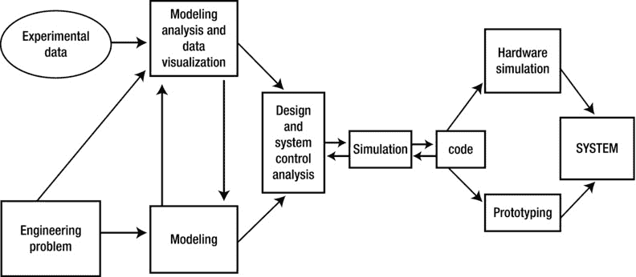

图 3-1.

`MATLAB` 为技术模型生成、数据分析和算法开发提供了一个高级平台。`MATLAB` 将全面的工程与数学功能同强大的可视化和动画特性相结合，所有这些都集成在一个高级交互式编程语言中。`MATLAB` 工具箱扩展了 `MATLAB` 环境，融合了广泛用于控制系统设计的经典与现代技术，提供了由国际公认专家开发的前沿控制算法。

`MATLAB` 包含超过 600 个数学、统计和工程函数，提供了分析数据、开发算法和优化系统性能所需的数值计算能力。使用 `MATLAB`，您可以快速迭代设计，并比较不同控制策略的性能。此外，`MATLAB` 是一种高级编程语言，能让您以远少于 `C`、`C++` 或 `FORTRAN` 的时间开发算法。`MATLAB` 是开放且可扩展的，您可以查看源代码、修改算法并整合现有的 `C`、`C++` 和 `FORTRAN` 程序。

交互式的 `Control System Toolbox` 工具简化了控制系统的设计与调整。例如，您可以拖拽极点和零点，并立即看到系统如何响应（图 3-2）。此外，`MATLAB` 提供了强大的交互式二维和三维图形功能，用于展示数据、方程和结果（图 3-3）。您可以在 `MATLAB` 中使用广泛的可视化辅助工具，或者利用 `MATLAB` 工具箱提供的特定控制功能。

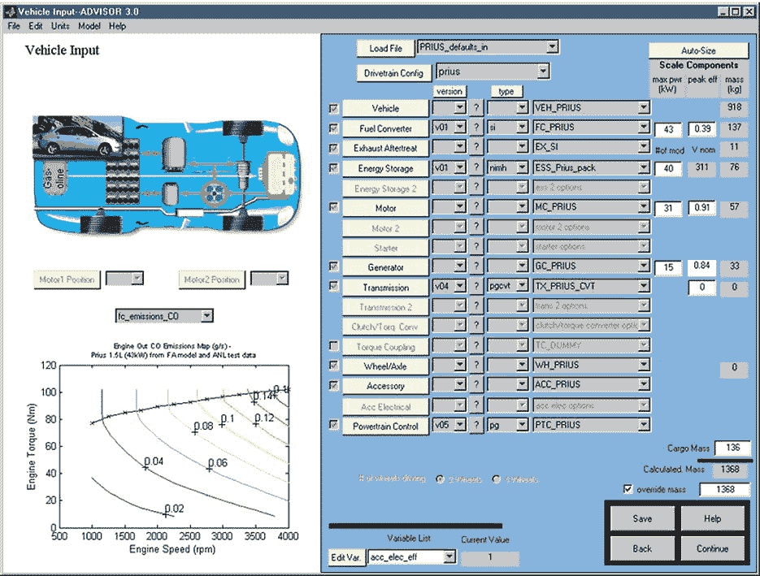

图 3-3.

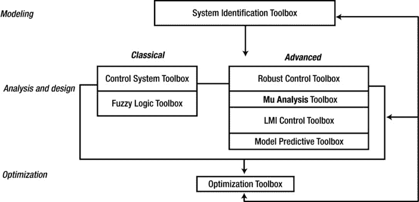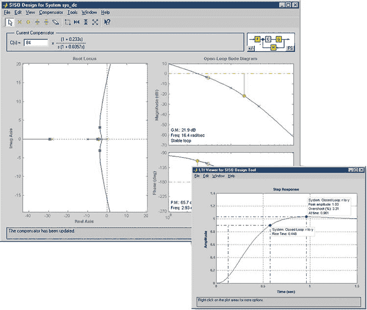

图 3-2.

`MATLAB` 工具箱包含了用 `MATLAB` 语言特定功能编写的应用程序。`MATLAB` 与控制相关的工具箱几乎涵盖了控制设计的所有基本技术，从 `LQG` 和根轨迹到 `H` 与逻辑模糊方法。例如，可以使用 `Fuzzy Logic Toolbox` 的内置算法添加一个模糊逻辑控制系统设计（图 3-4）。

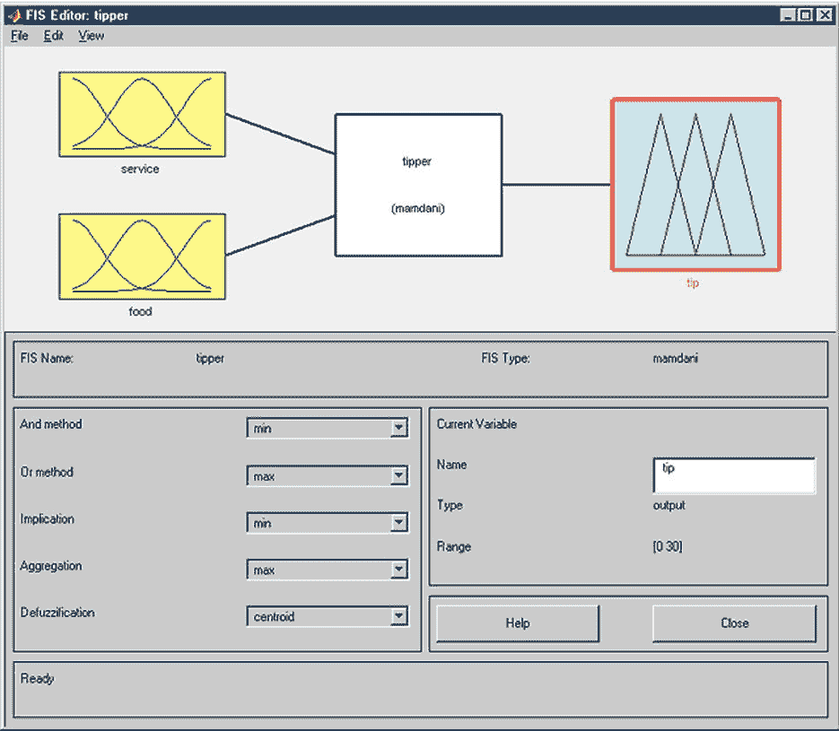

图 3-4.

对于控制系统而言，最重要的 `MATLAB` 工具箱可分为三大类：建模类（`System Identification Toolbox`）、经典设计与分析产品（`Control System Toolbox` 和 `Fuzzy Logic Toolbox`）、设计与高级分析产品（`Robust Control Toolbox`、`Mu-Analysis Toolbox`、`LMI Control Toolbox` 和 `Model Predictive Toolbox`）以及优化产品（`Optimization Toolbox`）。下图说明了这种分类。

## 控制系统设计与分析：Control System Toolbox

`Control System Toolbox` 是一个算法集合，主要以 `M-files` 形式编写，实现了控制系统设计、分析和建模的常用技术。其广泛的服务包括经典和现代的控制设计方法，例如根轨迹、极点配置和 `LQG` 调节器设计。特定的图形用户界面简化了控制工程的典型任务。该工具箱建立在 `MATLAB` 的基础之上，以便为工程工具提供专用的控制系统。

使用 `Control System Toolbox`，您可以创建线性时不变系统（`LTI`）的模型，其格式可以是传递函数、零极点增益或状态空间。您可以操作离散时间和连续时间系统，并在各种表示形式之间进行转换。您可以计算并绘制时间响应、频率响应和根轨迹。其他函数允许您执行极点配置、最优控制和估计。`Control System Toolbox` 是开放且可扩展的，允许您创建自定义的 `M-files` 以满足特定应用需求。

以下是 `Control System Toolbox` 的主要特性：

- `LTI Viewer`：一个用于分析和比较 `LTI` 系统的交互式 `GUI`。
- `SISO Design Tool`：一个用于分析和调整单输入/单输出（`SISO`）反馈控制系统的交互式 `GUI`。
- `GUI Suite`：设置首选项和属性，以完全控制时域和频域图的显示。
- `LTI` 对象：结构化专用数据，以传递函数、状态空间、零极点增益和频率响应格式简洁地表示模型数据。
- `MIMO`：支持多输入/多输出（`MIMO`）系统、采样数据系统、连续时间系统和具有时间延迟的系统。
- 用于连接 `LTI` 模型的函数和运算符：创建复杂的框图（串联、并联和反馈连接）。
- 支持将离散系统转换为连续系统（以及反向转换）的各种方法。
- 函数用于以图形方式表示时域和频域系统的解，并通过单个命令比较各种系统。
- 用于经典和现代控制设计技术的工具，包括根轨迹分析、环路整形、极点配置和 `LQR`/`LQG` 控制。

### 模型构建

`Control System Toolbox` 支持四种线性模型的表示：状态空间模型（`SS`）、传递函数（`TF`）、零极点增益模型（`ZPK`）和频率数据模型（`FRD`）。每种模型类型都提供了 `LTI` 对象。除了模型数据外，`LTI` 对象还可以存储离散时间系统的采样时间、延迟、输入和输出的名称、模型注释以及许多其他细节。使用 `LTI` 对象，您可以将模型作为独立实体进行操作，并使用矩阵类型的运算将它们组合起来。图 3-5 展示了一个简单 `LQG` 控制器设计的示例说明。底部的代码片段展示了控制器的设计方式以及闭环系统的创建方式。频率响应图显示了开环系统（红色）和闭环系统（蓝色）之间的比较。

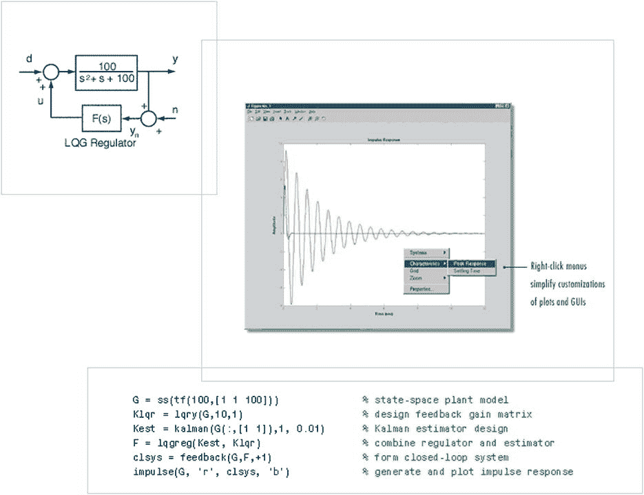

图 3-5.

`Control System Toolbox` 包含一些命令，用于分析和计算模型特性，例如 `I/O` 维度、极点、零点和 `DC` 增益。这些命令同时适用于连续时间和离散时间模型。

### 分析与设计

某些任务适合图形化操作，而另一些任务则受益于命令行的灵活性。`Control System Toolbox` 旨在兼顾这两种方法，提供一套完整的函数，用于通过命令行或 `GUI` 进行模型的设计与分析。


### 使用 LTI 查看器对模型进行图形化分析

控制系统工具箱的 LTI 查看器是一个图形用户界面，可以简化线性时不变系统的分析（通过在命令窗口中输入`>>ltiview`来加载）。LTI 查看器用于同时查看和比较多个线性模型的响应图。它可以生成时域和频域响应图，并检查关键响应参数，例如上升时间、最大超调量和稳定裕度。通过鼠标驱动的交互，您可以为多输入多输出系统选择输入和输出通道。LTI 查看器可以同时显示多达六种不同类型的图，包括阶跃响应、脉冲响应、波特图（幅值和相位或仅幅值）、奈奎斯特图、尼科尔斯图、西格玛图和零极点图。右键点击将弹出一个选项菜单，允许您访问多种控制和 LTI 查看器选项，包括：

*   **绘图类型**：更改绘图类型。
*   **系统**：在 LTI 查看器中选中或取消选中已加载的任何模型。
*   **特性**：显示参数和关键响应特性。
*   **缩放**：放大和缩小图的某些部分。
*   **网格**：为绘图添加网格。
*   **属性**：打开属性编辑器，您可以在其中自定义绘图的属性。

除了右键菜单之外，所有响应图都包含数据标记。这些标记允许您扫描绘图数据，识别关键数据，并确定给定绘图的系统字体。使用 LTI 查看器，您可以方便地在一个窗口中，利用阶跃响应图、零极点图和所有频域响应图（波特图、奈奎斯特图、尼科尔斯图和奇异值图）来图形化表示一个或多个系统的解（见图 3-6）。LTI 查看器允许您在绘图中显示重要的响应特性，例如使用数据标记显示稳定裕度。

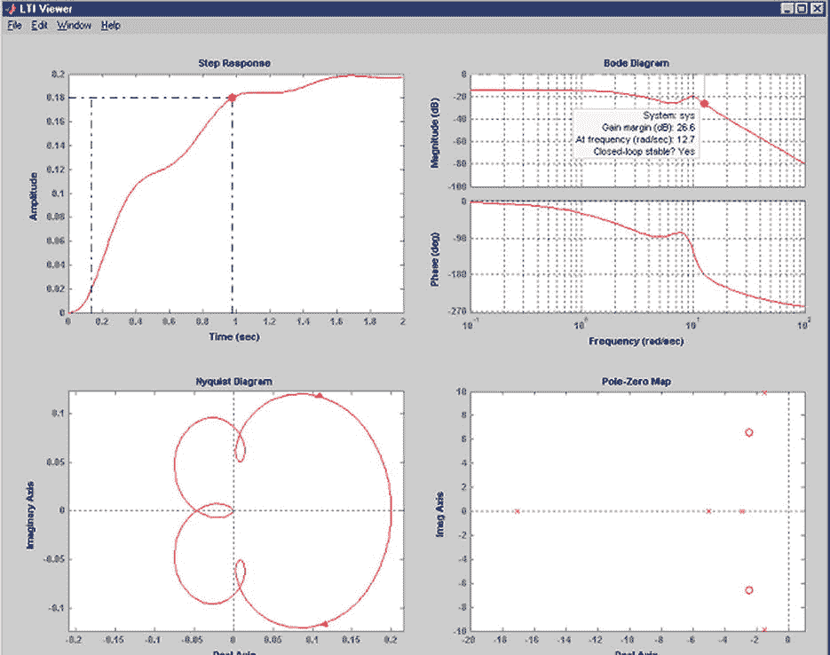

图 3-6.

### 使用命令行分析模型

对于需要图形用户界面驱动环境的广泛应用，LTI 查看器非常适用。对于需要编程、自定义绘图或与 LTI 模型无关的数据的情况，控制系统工具箱提供了命令行函数，用于执行控制系统工程中的基本频域绘图和时域分析。这些函数适用于任何类型的线性模型（连续或离散、单输入单输出或多输入多输出）或模型数组。

### 使用 SISO 设计工具进行补偿器设计

控制系统工具箱的 SISO 设计工具是一个图形用户界面，允许您分析和调整单输入单输出控制反馈系统（通过在命令窗口中输入`>>sisotool`来加载）。使用 SISO 设计工具，您可以结合根轨迹和环路整形技术，以图形方式调整动态特性和补偿器增益。例如，您可以使用根轨迹视图来稳定反馈环路并强制满足最小裕度，并使用波特图来调整带宽、增益和相位裕度，或添加陷波滤波器以抑制干扰。SISO 设计图形用户界面可用于连续时间和离散时间被控对象。图 3-7 展示了离散时间被控对象的根轨迹图和波特图。

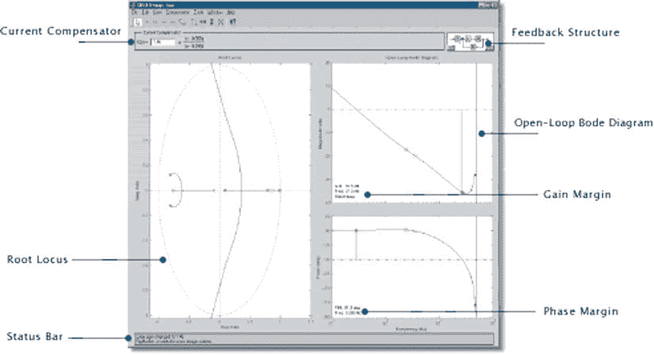

图 3-7.

SISO 设计工具旨在与 LTI 查看器紧密配合使用，允许您快速迭代设计，并立即在 LTI 查看器中看到结果。当对补偿器进行更改时，与 SISO 设计工具关联的 LTI 查看器会自动更新所选解的绘图。SISO 设计工具将控制系统工具箱的大部分功能集成在一个单一的图形用户界面中，动态链接时域图、频域图和零极点图，提供互补主题和设计目标的视图，支持在设计视图中进行图形化更改，并帮助管理设计的复杂性和迭代过程。右键菜单和下拉菜单让您只需点击鼠标即可灵活地设计控制器。特别是，可以查看波特图和根轨迹图，放置零点和极点，添加延迟/超前网络和陷波滤波器，用鼠标图形化调整补偿器参数，检查闭环响应（使用 LTI 查看器），调整增益和相位裕度，并在离散和连续时间之间转换模型。

### 使用命令行进行补偿器设计

除了 SISO 设计工具之外，控制系统工具箱还提供了许多可用于更广泛控制应用的命令，包括用于经典 SISO 设计的函数（数据缓冲、根轨迹、增益和相位裕度）以及用于现代多输入多输出设计的函数（极点配置、LQR/LQG 方法和卡尔曼滤波）。线性二次型高斯控制是一种现代的用于设计最优动态调节器的状态空间技术，它允许权衡调节收益和控制成本，同时考虑过程扰动和测量噪声。

## 控制系统工具箱命令

控制系统工具箱的命令可根据其用途分类如下：

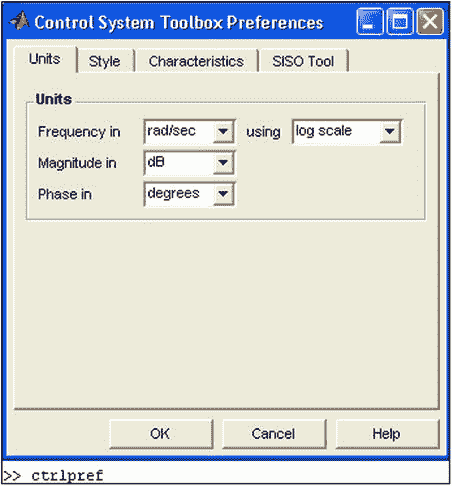

图 3-8.


| 常规 |
| `Ctrlpref`：打开一个图形用户界面，允许您更改控制系统工具箱的偏好设置（参见图 3-8）。 |
| 线性模型的创建 |
| `tf`：创建传递函数模型 `zpk`：创建零极点增益模型 `ss`：创建状态空间模型 `dss`：创建描述符状态空间模型 `frd`：创建频率响应数据模型 `set`：定位并修改 LTI 模型的属性 |
| 数据提取 |
| `tfdata`：访问传递函数数据（特别是提取传递函数的分子和分母） `zpkdata`：访问零极点增益数据 `ssdata`：访问状态空间模型数据 `get`：访问 LTI 模型的属性 |
| 转换 |
| `ss`：转换为状态空间模型 `zpk`：转换为零极点增益模型 `tf`：转换为传递函数模型 `frd`：转换为频率响应数据模型 `c2d`：将模型从连续时间转换为离散时间 `d2c`：将模型从离散时间转换为连续时间 `d2d`：对离散时间模型进行重新采样 |
| 系统互联 |
| `append`：通过附加输入和输出来组合模型 `parallel`：两个模型的并联连接 `series`：两个模型的串联连接 `feedback`：两个系统的反馈连接 `lft`：两个模型的广义反馈互联 `connect`：动态系统的框图互联 |
| 动态模型 |
| `iopzmap`：绘制模型输入/输出对的零极点图 `bandwidth`：返回系统的频率响应带宽 `pole`：计算动态系统的极点 `zero`：返回 SISO 动态系统的零点和增益 `pzmap`：返回动态系统的零极点图 `damp`：返回系统极点的固有频率和阻尼比 `dcgain`：返回 LTI 系统的低频（直流）增益 `norm`：返回线性模型的范数 `covar`：返回由白噪声驱动的系统的协方差 |
| 时域分析 |
| `ltiview`：用于 LTI 系统响应分析的 LTI 查看器 `step`：生成动态系统的阶跃响应图 `impulse`：生成动态系统的脉冲响应图 `initial`：生成状态空间模型的初始条件响应图 `lsim`：模拟动态系统对任意输入的时间响应 |
| 频域分析 |
| `ltiview`：用于 LTI 系统响应分析的 LTI 查看器 `bode`：生成频率响应的伯德图，包括幅值和相位 `sigma`：生成动态系统的奇异值图 `nyquist`：生成频率响应的奈奎斯特图 `nichols`：生成频率响应的尼科尔斯图 `margin`：返回增益裕度、相位裕度和穿越频率 `allmargin`：返回增益裕度、相位裕度、延迟裕度和穿越频率 `freqresp`：返回网格上的频率响应 |
| 经典设计 |
| `sisotool`：交互式设计和调整 SISO 反馈回路（技术根轨迹和回路整形） `rlocus`：动态系统的根轨迹图 |
| 极点配置 |
| `place`：MIMO 极点配置设计 `estim`：根据估计器增益形成状态估计器 `reg`：根据状态反馈和估计器增益形成调节器 |
| LQR/LQG 设计 |
| `lqr`：线性二次型调节器 (LQR) 设计 `dlqr`：离散时间状态空间系统的线性二次型 (LQ) 状态反馈调节器 `lqry`：带输出加权的线性二次型 (LQ) 状态反馈调节器 `lqrd`：连续被控对象的离散线性二次型 (LQ) 调节器 `Kalman`：卡尔曼估计器 `kalmd`：连续被控对象的离散卡尔曼估计器 |
| 状态空间模型 |
| `rss`：生成随机连续测试模型 `drss`：生成随机离散测试模型 `ss2ss`：状态空间模型的状态坐标变换 `ctrb`：可控性矩阵 `obsv`：可观测性矩阵 `gram`：可控性和可观测性格拉姆矩阵 `minreal`：最小实现或零极点对消 `ssbal`：使用对角相似变换平衡状态空间模型 `balreal`：基于格拉姆矩阵的状态空间实现输入/输出平衡 `modred`：模型降阶 |
| 带时间延迟的模型 |
| `totaldelay`：LTI 模型的总组合输入/输出延迟 `delay2z`：将离散时间 TF、SS 或 ZPK 模型的延迟替换为 z=0 处的极点，或替换 FRD 模型的延迟 [注意：在较新版本的 MATLAB 中，`delay2z` 已被 `absorbDelay` 取代。] `pade`：带时间延迟模型的帕德近似 |
| 矩阵方程求解器 |
| `lyap`：求解连续时间李雅普诺夫方程 `dlyap`：求解离散时间李雅普诺夫方程 `care`：求解连续时间代数黎卡提方程 `dare`：求解离散时间代数黎卡提方程 |

以下各节将介绍上述命令的语法，并按前述类别适当分组。

### LTI 模型命令


| 命令 | 描述 |
| --- | --- |
| `sys = drss(n, m, p)` `sys = drss(n, p)` `sys = drss(n)` `sys = drss(n,m,p,s1,...sn)` | 生成一个阶数为 `n`、具有 `m` 个输入和 `p` 个输出的随机离散时间状态空间模型。等效于 `m = 1` 时的 `drss(n,m,p)`。等效于 `n = m = 1` 时的 `drss(n,m,p)`。生成一个状态空间模型数组。 |
| `dss (A,B,C,D,E)` | 创建连续时间描述符状态空间模型： 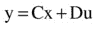 |
| `dss (A,B,C,D,E, Ts)` | 创建离散时间描述符状态空间模型（采样时间为 `Ts` 秒）：  |
| `dss (A,B,C,D,E, ltisys)` | 创建描述符状态空间模型，其通用 LTI 属性继承自模型 `ltisys`。 |
| `dss (A,B,C,D,E, p1, p2, v1, v2,...)` | 创建连续时间描述符状态空间模型，其通用 LTI 属性由属性/值对 (`pi, vi`) 指定。 |
| `dss (A,B,C,D,E, Ts, p2, p1, v1, v2,...)` | 创建离散时间描述符状态空间模型（采样时间为 `Ts` 秒），其通用 LTI 属性由属性/值对 (`pi, vi`) 指定。 |
| `sys = filt(num,den)` | 创建 DSP 格式的离散传递函数，分子为 `num`，分母为 `den`。 |
| `sys = filt(num,den,Ts)` | 创建 DSP 格式的离散传递函数，分子为 `num`，分母为 `den`，采样时间为 `Ts` 秒。 |
| `sys = filt (M)` | 指定一个静态滤波器，其增益矩阵为 `M`。 |
| `sys = filt(num,den, p1,v1,p2,v2,...)` | 创建 DSP 格式的离散传递函数，分子为 `num`，分母为 `den`，其通用 LTI 属性由属性/值对 (`pi, vi`) 指定。 |
| `sys = filt(num,den,Ts, p1,v1,p2,v2,...)` | 创建 DSP 格式的离散传递函数，分子为 `num`，分母为 `den`，采样时间为 `Ts` 秒，其通用 LTI 属性由属性/值对 (`pi, vi`) 指定。 |
| `sys = frd(r,f)` `sys = frd(r,f,Ts)` `sys = frd` `sys = frd(r,f,ltisys)` `sysfrd = frd(sys,f)` `sysfrd = frd(sys,f,u)` | 根据存储在 `r` 中的频率响应数据创建一个频率响应数据 (FRD) 模型，其中 `f` 表示频率响应数据的底层频率。创建一个频率响应数据模型，采样时间为标量 `Ts` 秒。创建一个空的频率响应数据模型。创建一个频率响应数据模型对象，其通用 LTI 属性继承自模型 `ltisys`。将 TF、SS 或 ZPK 模型转换为 FRD 模型，频率采样点由 `f` 指定。将 TF、SS 或 ZPK 模型转换为 FRD 模型，频率采样点由 `f` 指定，单位由字符串 `u`（例如 `rad/s` 或 `Hz`）指定。 |
| `[r,f] = frdata(sys)` `[r,f,Ts] = frdata(sys)` `[r,f] = frdata(sys,'v')` | 返回 FRD 模型 `sys` 的响应数据和频率采样点。返回 FRD 模型 `sys` 的响应数据、频率采样点和采样时间。直接以列向量的形式返回 FRD 模型 `sys` 的响应数据和频率采样点。 |
| `get(sys)` `get(sys, 'P')` | 显示 FRD 模型 `sys` 的所有属性和值。显示 FRD 模型 `sys` 的属性 `P` 的当前值。 |
| `sys = rss (n,m,p)` `sys = rss (n,p)` `sys = rss(n)` `sys = rss(n,m,p,s1,...sn)` | 生成一个阶数为 `n`、具有 `m` 个输入和 `p` 个输出的随机连续测试模型。等效于 `m = 1` 时的 `rss(n,m,p)`。等效于 `n = m = 1` 时的 `rss(n,m,p)`。生成一个 `s1×...×sn` 的 n 阶状态空间模型数组，每个模型具有 `m` 个输入和 `p` 个输出。 |
| `set(sys,' P ',V)` `set(sys,'P1',V1,'P2',V2,...)` `set(sys,'P')` `set(sys)` | 为 LTI 模型 `sys` 的指定属性赋予值 `V`。为 LTI 模型 `sys` 的属性 `P1,...,PN` 分别分配值 `V1,...,VN`。返回属性 `P` 的允许值。显示 `sys` 的所有属性及其值。 |
| `ss (A,B,C,D,E).` | 创建连续时间状态空间模型：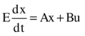  |
| `ss (A,B,C,D,E, Ts)` | 创建离散时间状态空间模型（采样时间为 `Ts` 秒）：  |
| `ss (D)` | 等效于 `ss([],[],[],D)`。 |
| `ss (A,B,C,D,E, ltisys)` | 创建一个状态空间模型，其通用 LTI 属性继承自模型 `ltisys`。 |
| `ss (A,B,C,D,E, p1, p2, v1, v2,...)` | 创建一个状态空间模型，其属性由属性/值对 (`pi, vi`) 指定。 |
| `ss (a, b, c, d, e, Ts, p2, p1, v1, v2,...)` | 创建一个离散状态空间模型，其属性由属性/值对 (`pi, vi`) 指定，采样时间为 `Ts` 秒。 |
| `sys_ss = ss(sys)` `sys_ss = ss(sys,'minimal')` | 将（TF 或 ZPK）模型 `sys` 转换为状态空间模型。生成一个没有不可控或不可观测状态的状态空间实现。 |
| `[A,B,C,D] = ssdata(sys)` `[A,B,C,D,Ts] = ssdata(sys)` | 从状态空间模型 `sys` 中提取模型数据 `[A, B, C, D]`。从状态空间模型 `sys` 中提取模型数据 `[A, B, C, D]` 以及采样时间 `Ts`。 |
| `[A,B,C,D] = dssdata(sys)` `[A,B,C,D,Ts] = dssdata(sys)` | 从描述符状态空间模型 `sys` 中提取模型数据 `[A, B, C, D]`。从描述符状态空间模型 `sys` 中提取模型数据 `[A, B, C, D]` 以及采样时间 `Ts`。 |
| `sys = tf(num,den)` | 创建具有指定分子和分母的连续时间传递函数。 |
| `sys = tf(num,den,Ts)` | 创建具有指定分子和分母以及采样时间 `Ts` 秒的离散时间传递函数。 |
| `sys = tf (M)` | 创建静态增益 `M`（矩阵或标量）。 |
| `sys = tf(num,den,ltisys)` | 创建具有指定分子和分母以及继承自 LTI 模型 `ltisys` 的通用属性的传递函数。 |
| `sys = tf(num,den, p1,v1,p2,v2,...)` | 创建连续时间传递函数，具有指定分子和分母，其属性由属性/值对 (`pi, vi`) 指定。 |
| `sys = tf(num,den,Ts, p1,v1,p2,v2,...)` | 创建离散时间传递函数，具有指定分子和分母，采样时间为 `Ts` 秒，其属性由属性/值对 (`pi, vi`) 指定。 |
| `s = tf('s')` `z = tf('z',Ts)` | 使用拉普拉斯变量 `s` 的有理函数指定一个 TF 模型。使用离散时间变量 `z` 的有理函数指定一个采样时间为 `Ts` 的 TF 模型。 |
| `tfsys = tf(sys)` `tfsys = tf(sys,'inv')` | 将（TF 或 ZPK）模型 `sys` 转换为传递函数。使用反演公式将（TF 或 ZPK）模型 `sys` 转换为传递函数。 |
| `[num,den] = tfdata(sys)` `[num,den] = tfdata(sys,'v')` `[num,den,Ts] = tfdata(sys)` | 返回类型为 TF、SS 或 ZPK 的 `sys` 传递函数模型的分子和分母。以行向量的形式返回分子和分母。除上述内容外，还返回采样时间 `Ts`。 |
| `TD = totaldelay (sys)` | 给出 LTI 模型 `sys` 的输入/输出总滞后时间。 |
| `sys = zpk (z, p, k)` `sys = zpk (z, p, k, Ts)` `sys = zpk(M)` `sys = zpk(z,p,k,ltisys)` | 创建连续时间零极点增益模型，具有零点 `z`、极点 `p` 和增益 `k`。创建离散时间零极点增益模型，具有零点 `z`、极点 `p`、增益 `k` 和采样时间 `Ts` 秒。指定一个静态增益 `M`。创建连续时间零极点增益模型，具有零点 `z`、极点 `p` 和增益 `k`，其通用属性继承自 LTI 模型 `ltisys`。 |
| `sys = zpk(z,p,k,p1,v1,p2,v2,...)` | 创建连续时间零极点增益模型，具有零点 `z`、极点 `p` 和增益 `k`，其属性由属性/值对 (`pi, vi`) 指定。 |
| `sys = zpk(z,p,k,Ts,p1,v1,p2,v2,..)` | 创建离散时间零极点增益模型，具有零点 `z`、极点 `p`、增益 `k` 和采样时间 `Ts`，其属性由属性/值对 (`pi, vi`) 指定。 |
| `sys = zpk('s')` `sys = zpk('z',Ts)` | 使用拉普拉斯变量 `s` 的有理函数指定一个连续时间零极点增益模型。使用离散时间变量 `z` 的有理函数指定一个离散时间零极点增益模型。 |
| `zsys = zpk(sys)` `zsys = zpk(sys,'inv')` | 将 LTI 模型 `sys` 转换为零极点增益模型。使用反演公式将 LTI 模型 `sys` 转换为零极点增益模型。 |
| `[z,p,k] = zpkdata(sys)` `[z,p,k] = zpkdata(sys,'v')` `[z,p,k,Ts,Td] = zpkdata(sys)` | 返回模型 `sys` 的零点 `z`、极点 `p` 和增益 `k`。以列向量的形式返回模型 `sys` 的零点 `z`、极点 `p` 和增益 `k`。除上述内容外，还返回采样时间 `Ts` 和输入滞后时间 `Td`。 |


第一个示例中，我们生成一个具有三个状态、两个输入和两个输出的随机离散 LTI 系统。

```
>> sys = drss(3,2,2)

a = 
     x1           x2           x3
 x1    -0.048856      0.40398      0.23064
 x2     0.068186      0.35404     -0.40811
 x3     -0.46016    -0.089457    -0.036824

b = 
         u1           u2
 x1     -0.43256      0.28768
 x2            0      -1.1465
 x3      0.12533       1.1909

c = 
         x1           x2           x3
 y1       1.1892      0.32729     -0.18671
 y2    -0.037633      0.17464      0.72579

d = 
         u1           u2
 y1            0      -0.1364
 y2       2.1832            0

采样时间：未指定
离散时间模型。

>>
```

在以下示例中，我们创建一个模型

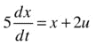

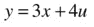

时间间隔为 0.1 秒，并标记为“电压”输入。

```
>> sys = dss(1,2,3,4,5,0.1,'inputname','voltage')

a = 
       x1
 x1      1

b = 
         voltage
 x1            2

c = 
       x1
 y1      3

d = 
         voltage
 y1            4

e = 
       x1
 x1      5

采样时间：0.1
离散时间模型。
```

下面的示例创建了以下双输入数字滤波器：

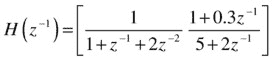

指定时间显示和通道项“channel1”和“channel2”：

```
>> num = {1 , [1 0.3]}
den = {[1 1 2] ,[5 2]}
H = filt(num,den,'inputname',{'channel1' 'channel2'})

num =
    [1.00]    [double 1 x 2]

den =
    [double 1 x 3]    [double 1 x 2]

从输入"channel1"到输出的传递函数：
        1
-----------------
1 + z^-1 + 2 z^-2

从输入"channel2"到输出的传递函数：
1 + 0.3 z ^ - 1
--------------
5 + 2 z ^ - 1

采样时间：未指定
```

接下来我们创建一个 SISO FRD 模型。

```
>> freq = logspace(1,2);
resp = .05*(freq).*exp(i*2*freq);
sys = frd(resp,freq)

从输入 1 到：
频率(rad/s)        输出 1
----------------   ------------------
10.000000       0.204041+0.456473i
10.481131      -0.270295+0.448972i
10.985411      -0.549157+0.011164i
11.513954      -0.293037-0.495537i
12.067926       0.327595-0.506724i
12.648552       0.623904+0.103480i
13.257114       0.124737+0.651013i
13.894955      -0.614812+0.323543i
14.563485      -0.479139-0.548328i
15.264180       0.481814-0.591898i
15.998587       0.668563+0.439215i
16.768329      -0.438184+0.714799i
17.575106      -0.728874-0.490870i
18.420700       0.602513-0.696623i
19.306977       0.588781+0.765007i
.
.
.
86.851137      -2.649156-3.440897i
91.029818       4.498503-0.692487i
95.409548      -3.261293+3.481583i
100.000000      2.435938-4.366486i

连续时间频率响应数据模型。
```

现在定义一个 FRD 模型并返回其数据。

```
>> freq = logspace(1,2,2);
resp = .05*(freq).*exp(i*2*freq);
sys = frd(resp,freq);
[resp,freq] = frdata(sys,'v')

resp =
    0.20
    2.44

freq =
   10.00
  100.00
```

下面的示例创建一个 2 输出/1 输入的传递函数：

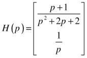

```
>> num = {[1 1] ; 1}
den = {[1 2 2] ; [1 0]}
H = tf(num,den)

num =
    [double 1 x 2]
    [1.00]

den =
    [double 1 x 3]
    [1x2 double]

从输入到输出的传递函数...
     s + 1
#1:  -------------
    s ^ 2 + 2 s + 2

     1
#2:  -
     s
```

以下示例计算以下状态空间模型的传递函数：

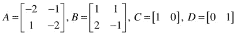

```
>> sys = ss([-2 -1;1 -2],[1 1;2 -1],[1 0],[0 1])
tf(sys)

a = 
       x1         x2
 x1      -2         -1
 x2       1         -2

b = 
       u1         u2
 x1      1          1
 x2      2         -1

c = 
       x1         x2
 y1      1          0

d = 
       u1         u2
 y1      0          1

连续时间模型。

从输入 1 到输出的传递函数：
    s - 2.963e-016
   --------------
      s² + 4 s + 5

从输入 2 到输出的传递函数：
   s ^ 2 + 5 s + 8
   -------------
    s ^ 2 + 4 s + 5
```

以下示例指定两个离散时间传递函数：

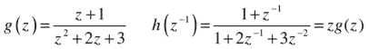

```
>> g = tf([1 1],[1 2 3],0.1)

传递函数：
   z + 1
-------------
z² + 2 z + 3

采样时间：0.1

>> h = tf([1 1],[1 2 3],0.1,'variable','z^-1')

传递函数：
  1 + z^-1
-------------------
1 + 2 z^-1 + 3 z^-2

采样时间：0.1
```

现在我们指定与传递函数相关的零极点增益模型：

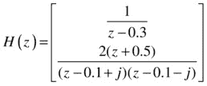

```
>> z = {[] ; -0.5}
p = {0.3 ; [0.1+i 0.1-i]}
k = [1 ; 2]
H = zpk(z,p,k,-1)

z =
       []
   [-0.5000]

p =
   [    0.3000]
   [1x2 double]

k =
    1
    2

从输入到输出的零极点增益...
         1
#1:  -------
     (z-0.3)

     2 (z+0.5)
#2:  -------------------
     (z² - 0.2z + 1.01)

采样时间：未指定
```

在以下示例中，传递函数`tf([-10 20 0],[1 7 20 28 19 5])` 被转换为零极点增益格式。

```
>> h = tf([-10 20 0],[1 7 20 28 19 5])

传递函数：
   -10 s² + 20 s
----------------------------------------
s⁵ + 7 s⁴ + 20 s³ + 28 s² + 19s + 5

>> zpk(h)

零极点增益：
   -10 s (s-2)
----------------------
(s) ^ 3 (s ^ 2 + 4s + 5)
```

### 模型特性命令

| 命令 | 描述 |
| --- | --- |
| `str = class(object)` | 显示描述模型对象类型（`‘tf’`、`‘zpk’`、`‘ss’`或`‘frd’`）的字符串。 |
| `hasdelay(sys)` | 如果 LTI 模型`sys`存在输入、输出、输入/输出或内部延迟则返回 1，否则返回 0。 |
| `k= isa(obj,‘class’)` | 如果对象属于给定类别则返回 1。 |
| `boo = isct(sys)` `boo = isdt(sys)` | 如果 LTI 模型`sys`是连续的则返回 1。如果 LTI 模型`sys`是离散的则返回 1。 |
| `boo = isempty(sys)` | 如果 LTI 模型`sys`没有输入或输出则返回 1。 |
| `boo = isproper(sys)` | 如果 LTI 模型`sys`是正则的则返回 1。 |
| `boo = issiso(sys)` | 如果 LTI 模型`sys`是 SISO 的则返回 1。 |
| `n = ndims(sys)` | 返回 LTI 模型或模型数组`sys`的维度数。 |
| `size(sys)` `d = size(sys)` `Ny = size(sys,1)` `Nu = size(sys,2)` `Sk = size(sys,2+k)` `Ns = size(sys,‘order’)` `Nf = size(sys,‘frequency’)` | 显示`sys`的输入/输出数量。将`sys`的输入/输出数量赋值给`d`。返回`sys`的输出数量。返回`sys`的输入数量。当`sys`是 LTI 数组时，返回数组第 k 维的长度。返回（TF、SS 或 ZPK）模型`sys`的阶数。返回 FRD 模型`sys`的频率。 |

### 模型转换命令


| 命令 | 描述 |
| --- | --- |
| `sysd = c2d(sys,Ts)` `sysd = c2d(sys,Ts,method)` `[sysd, G] = c2d(sys,Ts,method)` | 使用输入上的零阶保持器和`Ts`秒的采样时间，将连续模型`sys`转换为离散模型`sysd`。使用指定的离散化方法，通过输入上的零阶保持器和`Ts`秒的采样时间，将连续模型`sys`转换为离散模型`sysd`。该方法可以是零阶保持器（`zoh`）、三角近似（`foh`）、脉冲不变离散化（`impulse`）、双线性（Tustin）（`tustin`）或零极点匹配（`matched`）。除上述功能外，还返回一个矩阵`G`，该矩阵将状态空间模型`sys`的连续初始条件`x0`和`u0`映射到离散时间初始状态向量`x[0]`。可能的离散化方法如上所述。 |
| `sys = chgFreqUnit(sys,units)` | 将`sys`中频率点的单位更改为由`units`给出的新单位。 |
| `sysc = d2c(sysd)` `sysc = d2c(sysd,method)` | 使用输入上的零阶保持器，将离散模型`sysd`转换为连续模型`sysc`。使用由`method`给出的转换方法，将离散模型`sysd`转换为连续模型`sysc`。可能的转换方法是`zoh`、`foh`、`tustin`和`matched`（见上文）。 |
| `sys1 = d2d(sys,Ts)` | 重新采样离散时间模型`sys`，以生成具有新采样时间`Ts`的等效离散时间模型`sys1`。 |
| `sys = delay2z(sys)` | 用`z=0`处的极点替换离散时间 TF、SS 或 ZPK 模型的延迟，或用相移替换 FRD 模型的延迟。[注意：较新版本的 MATLAB 已用`absorbDelay`替换了`delay2z`。 |
| `sys = frd(r,f)` `sys = frd(r,f,Ts)` `sys = frd` `sys = frd(r,f,ltisys)` `sysfrd = frd(sys,f)` `sysfrd = frd(sys,f,units)` | 从存储在数组`r`中的频率响应数据创建一个 FRD 模型`sys`。向量`f`表示频率响应数据的底层频率。创建一个采样时间为`Ts`秒的离散时间 FRD 模型。创建一个空的 FRD 模型。创建一个继承 LTI 模型`ltisys`通用属性的 FRD 模型。将 TF、SS 或 ZPK 模型转换为频率为`f`的 FRD 模型。将 TF、SS 或 ZPK 模型转换为频率为`f`的 FRD 模型，并指定单位（`'rad/s'`或`'Hz'`）。 |
| `[num, den] = pade(T,N)` `pade(T,N)` `sysx = pade(sys,N)` `sysx = pade(sys,Nu,Ny,NINT)` | 以传递函数形式返回连续时间 I/O 延迟`exp(–sT)`的 N 阶 Padé逼近。行向量`num`和`den`包含按`s`降幂排列的分子和分母系数。两者都是 N 阶多项式。绘制 N 阶 Padé逼近的阶跃和相位响应，并将其与具有 I/O 延迟`T`的模型的精确响应进行比较。生成连续延迟系统`sys`的无延迟逼近`sysx`。所有延迟都被其 N 阶 Padé逼近替换。为每个输入、输出以及 I/O 或内部延迟指定独立的逼近阶次。这里`NU`、`NY`和`NINT`是整数数组：`NU`是输入通道的逼近阶次向量；`NY`是输出通道的逼近阶次向量；`NINT`是 I/O 延迟（TF 或 ZPK 模型）或内部延迟（状态空间模型）的逼近阶次。 |
| `sys = reshape(sys,s1,s2,...,sk)` `sys = reshape(sys,[s1s2... sk])` | 将 LTI 模型`sys`重塑为 LTI 模型数组。 |
| `[r, p, k] = residue(b,a)` `[b,a] = residue(r,p,k)` | 找到两个多项式`b(s)`和`a(s)`之比的部分分式展开的留数、极点和直接项，其中`b`和`a`分别是列出分子和分母系数的向量。将部分分式展开转换回系数在`b`和`a`中的多项式。 |
| `sys = ss(A,B,C,D,E).` | 创建连续时间状态空间模型：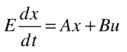  |
| `sys = ss(A,B,C,D,E,Ts)` | 创建离散时间状态空间模型（采样时间为`Ts`秒）：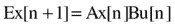 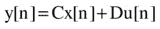 |
| `sys = ss(A,B,C,D,E,ltisys)` | 创建一个连续时间状态空间模型，其通用属性继承自 LTI 模型`ltisys`。 |
| `sys = ss(A,B,C,D,E,p1,p2,v1,v2,...)` | 创建一个连续时间状态空间模型，其属性由属性/值对（`pi`，`vi`）指定。 |
| `sys= ss (A,B,C,D,E,Ts,p1,v1,p2,v2,...)` | 创建一个采样时间为`Ts`的离散时间状态空间模型，其属性由属性/值对（`pi`，`vi`）指定。 |
| `sys_ss = ss(sys)` `sys_ss = ss(sys,'minimal')` | 将（TF 或 ZPK）模型`sys`转换为状态空间模型。生成一个没有不可控或不可观状态的状态空间实现。 |
| `sys = tf(num,den)` | 创建一个具有指定分子和分母的连续时间传递函数。 |
| `sys = tf(num,den,Ts)` | 创建一个具有指定分子和分母和采样时间`Ts`秒的离散时间传递函数。 |
| `sys = tf(M)` | 创建一个静态增益`M`（矩阵或标量）。 |
| `sys = tf(num,den,ltisys)` | 创建一个具有指定分子和分母的传递函数，其通用属性继承自 LTI 模型`ltisys`。 |
| `sys = tf(num,den,p1,v1,p2,v2,...)` | 创建一个连续时间传递函数，具有指定的分子和分母，以及由属性/值对（`pi`，`vi`）指定的属性。 |
| `sys = tf(num,den,Ts,p1,v1,p2,v2,...)` | 创建一个离散时间传递函数，具有指定的分子和分母、采样时间`Ts`秒，以及由属性/值对（`pi`，`vi`）指定的属性。 |
| `s = tf('s')` `z = tf('z',Ts)` | 使用拉普拉斯变量`s`中的有理函数指定一个 TF 模型。使用离散时间变量`z`中的有理函数指定一个采样时间为`Ts`的 TF 模型。 |
| `tfsys = tf(sys)` `tfsys = tf(sys,'inv')` | 将（TF 或 ZPK）模型`sys`转换为传递函数。使用求逆公式将（TF 或 ZPK）模型`sys`转换为传递函数。 |
| `sys = zpk(z,p,k)` `sys = zpk(z,p,k,Ts)` `sys = zpk(M)` `sys = zpk(z,p,k,ltisys)` | 创建一个具有零点`z`、极点`p`和增益`k`的连续时间零极点增益模型。创建一个具有零点`z`、极点`p`、增益`k`和采样时间`Ts`秒的离散时间零极点增益模型。指定一个静态增益`M`。创建一个连续时间零极点增益模型，具有零点`z`、极点`p`和增益`k`，其通用属性继承自 LTI 模型`ltisys`。 |
| `sys = zpk(z,p,k,p1,v1,p2,v2,...)` | 创建一个连续时间零极点增益模型，具有零点`z`、极点`p`和增益`k`，以及由属性/值对（`pi`，`vi`）指定的属性。 |
| `sys = zpk(z,p,k,Ts,p1,v1,p2,v2,..)` | 创建一个离散时间零极点增益模型，具有零点`z`、极点`p`、增益`k`和采样时间`Ts`，以及由属性/值对（`pi`，`vi`）指定的属性。 |
| `sys = zpk('s')` `sys = zpk('z',Ts)` | 使用拉普拉斯变量`s`中的有理函数指定一个连续时间零极点增益模型。使用离散时间变量`z`中的有理函数指定一个离散时间零极点增益模型。 |
| `zsys = zpk(sys)` `zsys = zpk(sys,'inv')` | 将 LTI 模型`sys`转换为零极点增益模型。使用求逆公式将 LTI 模型`sys`转换为零极点增益模型。 |


作为第一个示例，我们考虑系统：

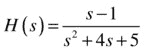

其输入延迟为 `Td = 0.35` 秒。该系统采用三角近似法进行离散化，采样时间 `Ts = 0.1` 秒。

```
>> H = tf([1 -1],[1 4 5],'inputdelay',0.35)
```

```
传递函数：

s - 1

exp(-0.35*s) * -------------

s² + 4s + 5
```

```
>> Hd = c2d(H,0.1,'foh')
```

```
传递函数：

0.0115 z³ + 0.0456 z² - 0.0562z - 0.009104

z^(-3) * ---------------------------------------------

z³ - 1.629 z² + 0.6703z

采样时间：0.1
```

如果我们想比较阶跃响应及其离散化结果（见图 3-9），可以使用以下命令：

```
>> step(H,'-',Hd,'--')
```

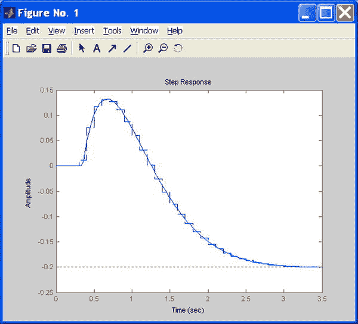

图 3-9。

下一个示例计算了 I/O 延迟为 0.1 秒的三阶 Padé 近似，并将其时间与频率响应与其近似结果进行比较（图 3-10）。

```
>> pade(0.1,3)
```

```
三阶 Pade 近似的阶跃响应
```

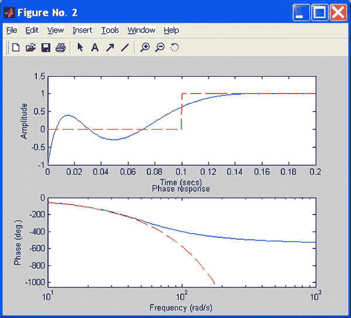

图 3-10。

### 降阶模型相关命令

| 命令 | 描述 |
| --- | --- |
| `[sysb,g] = balreal(sys)` `[sysb,g,T,Ti] = balreal(sys)` | 为 LTI 模型 `sys` 的稳定部分计算平衡实现 `sysb`。`balreal` 可处理连续和离散系统。此外，还返回包含平衡格拉姆矩阵对角线的向量 `g`、用于将 `sys` 转换为 `sysb` 的状态相似变换 `x_[b] = Tx`，以及逆变换 `Ti = T ^(−1)`。 |
| `sysr = minreal(sys)` `sysr = minreal(sys,tol)` `[sysr,u] = minreal(sys,tol)` | 消除状态空间模型中不可控或不可观测的状态，或取消传递函数或零极点增益模型中的零极点对。指定用于状态消除或零极点对消的容差。默认值为 `tol = sqrt(eps)`，增大此容差会强制进行更多对消。此外，还找到一个正交矩阵 `U`，使得 `(U*A*U',U*B,C*U')` 成为 `(A,B,C)` 的卡尔曼分解。 |
| `rsys = modred(sys,elim)` `rsys = modred(sys,elim,'method')` | 通过消除向量 `elim` 中的状态，降低连续或离散状态空间模型 `sys` 的阶次。完整状态向量 `X` 被划分为 `X = [X1;X2]`，其中 `X1` 是降阶后的状态向量，`X2` 被丢弃。此外，还指定状态消除方法，可以是 `MatchDC`（强制匹配直流增益）或 `Truncate`（删除 `X2`）。 |
| `MSYS = sminreal(sys)` | 消除状态空间模型 `sys` 中不影响输入/输出响应的状态。 |

在接下来的示例中，我们考虑由 `sys = zpk([- 10 - 20.01], [- 5 - 9.9 -20.1], 1)` 定义的零极点增益模型，并估计一个平衡实现，呈现平衡格拉姆矩阵的对角线。

```
>> sys = zpk([-10 -20.01],[-5 -9.9 -20.1],1)
```

```
零/极点/增益：

   (s+10) (s+20.01)

----------------------

(s+5) (s+9.9) (s+20.1)
```

```
>> [sysb,g] = balreal(sys)
```

```
a =

            x1       x2       x3

   x1    -4.97   0.2399   0.2262

   x2  -0.2399   -4.276   -9.467

   x3   0.2262    9.467   -25.75

b =

             u1

   x1        -1

   x2  -0.02412

   x3   0.02276

c =

            x1       x2       x3

   y1       -1  0.02412  0.02276

d =

       u1

   y1   0

连续时间模型。

g =

   0.1006

   0.0001

   0.0000
```

结果显示，最后两个状态与输入和输出的耦合较弱，因此使用以下语法将其移除会很方便：

```
>> sysr = modred(sysb,[2 3],'del')
```

```
a =

          x1

   x1  -4.97

b =

       u1

   x1  -1

c =

       x1

   y1  -1

d =

       u1

   y1   0

连续时间模型。
```

现在我们可以通过以下语法比较原始模型和降阶模型的响应结果（图 3-11）：

```
>> bode(sys,'-',sysr,'x')
```

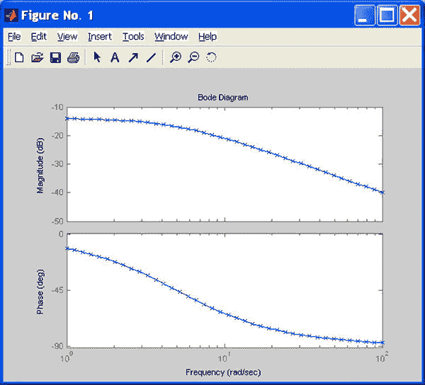

图 3-11。

### 状态空间相关命令

| 命令 | 描述 |
| --- | --- |
| `csys = canon(sys, 'type' )` `[csys,T] = canon(sys, 'type' )` | 将线性模型 `sys` 转换为规范状态空间模型 `csys`。参数 `'type'` 可以是 `'modal'` 或 `'companion.'`。此外，还返回将状态空间模型 `sys` 的状态与 `csys` 的状态相关联的状态坐标变换 `T`。 |
| `Co = ctrb(A,B)` `Co = ctrb(sys)` | 返回状态空间系统的可控性矩阵。 |
| `[Abar,Bbar,Cbar,T,k] = ctrbf(A,B,C)` `[Abar,Bbar,Cbar,T,k] = ctrbf(A,B,C,tol)` | 将 `A`、`B` 和 `C` 表示的状态空间系统分解为可控阶梯形式 `Abar`、`Bbar` 和 `Cbar`。`T` 是相似变换矩阵，`k` 是长度为 `n` 的向量，其中 `n` 是由 `A` 表示的系统阶次。`k` 中非零值的数量表示计算 `T` 所需的迭代次数。 |
| `Wc = gram(sys,'c')` `Wo = gram(sys,'o')` | 计算状态空间模型 `sys` 的可控性和可观测性格拉姆矩阵。 |
| `Ob = obsv(A,B)` `Ob = obsv(sys)` | 计算状态空间模型的可观测性矩阵。 |
| `[Abar,Bbar,Cbar,T,k] = obsvf(A,B,C)` `[Abar,Bbar,Cbar,T,k] = obsvf(A,B,C,tol)` | 将具有矩阵 `A`、`B` 和 `C` 的状态空间系统分解为可观测阶梯形式 `Abar`、`Bbar` 和 `Cbar`。`T` 是相似变换矩阵，`k` 是长度为 `n` 的向量，其中 `n` 是由 `A` 表示的系统阶次。`k` 中非零值的数量表示计算 `T` 所需的迭代次数。 |
| `sysT = ss2ss(sys,T)` | 给定 `sys` 和状态坐标变换 `T`，返回变换后的状态空间模型 `sysT`。 |
| `[sysb,T] = ssbal(sys)` `[sysb,T] = ssbal(sys,condT)` | 使用对角相似变换平衡状态空间模型。 |

作为第一个示例，我们考虑以下连续状态空间模型：

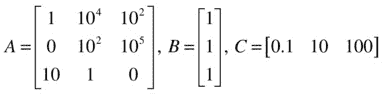

我们按如下方式计算平衡模型：

```
>> a = [1 1e4 1e2; 0 1e2 1e5; 10 1 0];
b = [1; 1; 1];
c = [0.1 10 1e2];
sys = ss (a, b, c, 0)
```

```
a =

           x1      x2      x3

   x1       1  1e+004     100

   x2       0     100  1e+005

   x3      10       1       0

b =

       u1

   x1   1

   x2   1

   x3   1

c =

        x1   x2   x3

   y1  0.1   10  100

d =

       u1

   y1   0

连续时间模型。
```

在以下示例中，我们计算阶梯系统 `A = [1, 1; 4, − 2]`，`B= [1, − 1, 1, − 1]`，`C= [0, 1; 1, 0]` 的可观测性矩阵。

```
>> A = [1, 1; 4, - 2]; B = [1, - 1, 1, - 1]; C = [1,0; 0.1];
>> [Abar, Bbar, Cbar, T, k] = obsvf(A,B,C)
```

```
Abar =

    1     1

    4    -2

Bbar =

    1    -1

    1    -1

Cbar =

    1     0

    0     1

T =

    1     0

    0     1

k =

    2     0
```

下面我们计算上一示例中系统的可控性矩阵。

```
>> A = [1, 1; 4, - 2]; B = [1, - 1, 1, - 1]; C = [1,0; 0.1];
>> [Abar, Bbar, Cbar, T, k] = ctrbf(A,B,C)
```

```
Abar =

   -3.0000    0.0000

   3.0000    2.0000

Bbar =

         0         0

   -1.4142    1.4142

Cbar =

   -0.7071   -0.7071

   0.7071   -0.7071

T =

   -0.7071    0.7071

   -0.7071   -0.7071

k =

     1    0
```


### 动态模型命令

| 命令 | 描述 |
| --- | --- |
| `[Wn,Z] = damp(sys)` `[Wn,Z,P] = damp(sys)` | 显示线性模型 `sys` 极点的阻尼比、自然频率和时间常数表格。同时也可获取 `sys` 的极点向量 `P`。 |
| `k = dcgain(sys)` | 计算模型 `sys` 的低频（DC）增益。 |
| `[P,Q] = covar(sys,W)` | 计算由高斯白噪声输入 `W` 驱动的 LTI 模型 `sys` 输出的稳态协方差。`P` 是稳态输出响应协方差，`Q` 是稳态状态协方差。 |
| `s = dsort(p)` `[s,ndx] = dsort(p)` | 将向量 `p` 中包含的离散时间极点按幅值降序排序。 |
| `s = esort(p)` `[s,ndx] = esort(p)` | 将向量 `p` 中包含的连续时间极点按实部排序。 |
| `norm(sys)` `norm(sys,2)` `norm(sys,inf)` `norm(sys,inf,tol)` `[ninf,fpeak] = norm(sys)` | 计算模型 `sys` 的 H² 范数。计算模型 `sys` 的 H² 范数。计算模型 `sys` 的 H[∞] 范数。以容差 `tol` 计算模型 `sys` 的 H[∞] 范数。除计算 H[∞] 范数外，还计算增益达到峰值时的频率 `fpeak`。 |
| `p = pole(sys)` `d = eig(A)` `d = eig(A,B)` `[V,D] = eig(A)` `[V,D] = eig(A,'nobalance')` `[V,D] = eig(A,B)` `[V,D] = eig(A,B,flag)` | 计算 LTI 模型 `sys` 的极点。返回 `A` 的特征值向量。返回对 `(A,B)` 的广义特征值。返回矩阵 `A` 的特征值和特征向量。在不进行预平衡步骤的情况下返回 `A` 的特征值和特征向量。返回 `(A,B)` 的特征值和广义特征向量。分解方法（`'chol'` 或 `'qz'`）由 `flag` 指定。 |
| `pzmap(sys)` `pzmap(sys1,sys2,...,sysN)` `[p,z] = pzmap(sys)` | 为连续时间或离散时间动态系统 `sys`，或同时为多个 LTI 系统 `sys1`、`sys2`、...、`sysn` 绘制零极点图。`[p, z]` 返回极点和零点，不生成图形。 |
| `rlocus(sys)` `rlocus(sys,k)` `rlocus(sys1,sys2,...)` `[r,k] = rlocus(sys)` `r = rlocus(sys,k)` | 计算并绘制开环单输入单输出模型 `sys` 的根轨迹。使用用户指定的增益向量 `k` 绘制根轨迹。在单个图形中计算并绘制多个系统的根轨迹。返回所选增益向量 `k` 及这些增益对应的复根位置 `r`。返回系统 `sys` 在用户指定增益向量 `k` 下的根位置 `r`。 |
| `r = roots(c)` | 以列向量形式返回多项式 `c` 的根。 |
| `sgrid` `zgrid` | 为零极点图和根轨迹图生成恒定阻尼比（从 0 到 1，步长为 0.1）和自然频率（从 0 到 10 rad/sec，步长为 1 rad/sec）的网格，并在当前坐标轴上绘制网格。类似地，生成从 0 到 π、步长为 π/10 的网格，并在当前坐标轴上绘制网格。 |
| `z = zero(sys)` `[z,gain] = zero(sys)` | 计算 LTI 模型 `sys` 的零点。返回 LTI 系统 `sys` 的零点和增益。 |

作为第一个示例，我们计算连续传递函数模型的特征值、自然频率和阻尼因子：

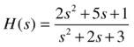

```
>> H = tf([2 5 1],[1 2 3])
传递函数:
2 s² + 5 s + 1
---------------
s² + 2 s + 3
```

```
>> damp(H)
特征值            阻尼比     频率 (rad/s)
00e - 1 + 000 + 1. 41e + 000i 5. 77e-001 1. 73e + 000
00e - 1 + 000 - 1. 41e + 000i 5. 77e-001 1. 73e + 000
```

在以下示例中，我们计算多输入多输出传递函数模型的 DC 增益：

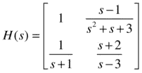

```
>> H = [1 tf([1 -1],[1 1 3]) ; tf(1,[1 1]) tf([1 2],[1 -3])]
>> dcgain(H)
从输入 1 到输出的传递函数...
#1:  1
1
#2:  -----
    s + 1
从输入 2 到输出的传递函数...
    s
#1:  -----------
    s² + s + 3
    s + 2
#2:  -----
     3s
ans =
    1.0000   -0.3333
    1.0000   -0.6667
```

接下来我们考虑离散时间传递函数

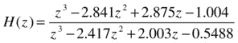

采样时间为 0.1 秒，并计算其 2-范数和无穷范数（含最优值）。

```
>> H = tf([1 -2.841 2.875 -1.004],[1 -2.417 2.003 -0.5488],0.1)
>> norm(H)
传递函数:
z³ - 2.841 z² + 2.875 z - 1.004
----------------------------------
z³ - 2.417 z² + 2.003 z - 0.5488
采样时间: 0.1
ans =
    1.2438
>> [ninf,fpeak] = norm(H,inf)
surrounded =
    2.5488
fpeak =
    3.0844
```

随后，我们通过生成 `H(z)` 的伯德图来验证上述数值（见图 3-12）。

```
>> bode (H)
```

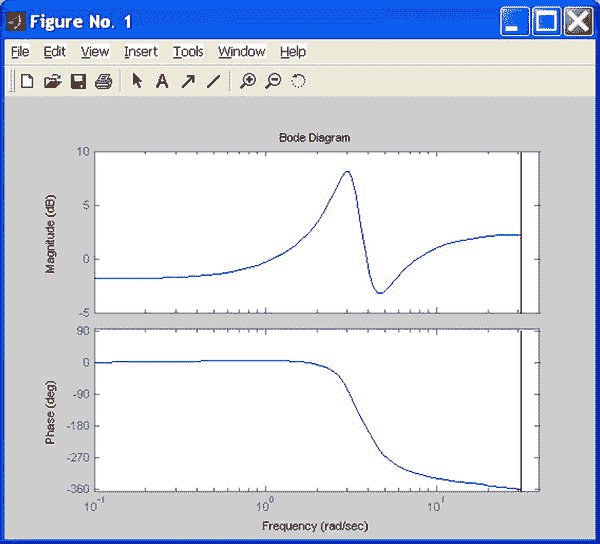

图 3-12.

图 3-12

接下来，我们计算并绘制以下系统的根轨迹（见图 3-13）：

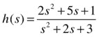

```
>> h = tf([2 5 1],[1 2 3]);
>> rlocus (h)
```

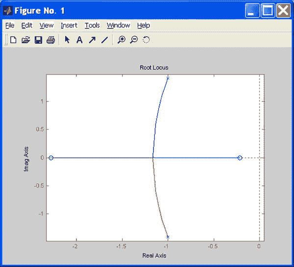

图 3-13.

图 3-13

在下面的示例中，我们在以下系统的根轨迹上绘制 z 平面网格（见图 3-14）：

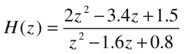

```
>> H = tf([2 -3.4 1.5],[1 -1.6 0.8],-1)
传递函数:
2 z² - 3.4 z + 1.5
-------------------
z² - 1.6 z + 0.8
采样时间: 未指定
>> rlocus(H)
>> zgrid
>> axis('square')
```

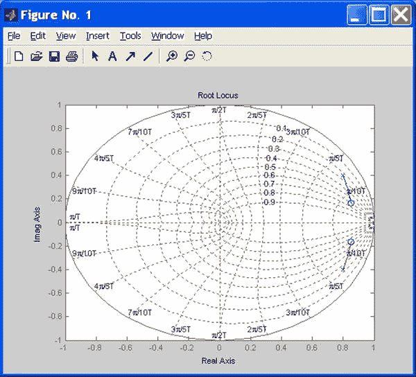

图 3-14.

图 3-14


### 用于模型互联的命令

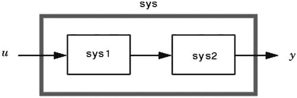

图 3-20.

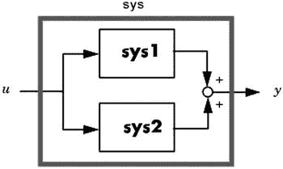

图 3-19.

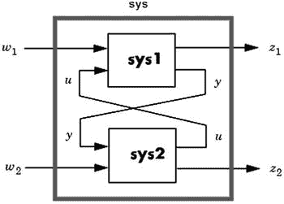

图 3-18.

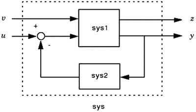

图 3-17.

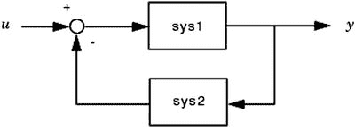

图 3-16.

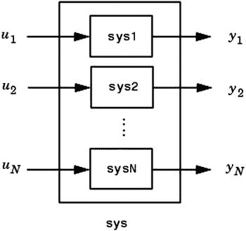

图 3-15.

| 命令 | 描述 |
| --- | --- |
| `sys = append(sys1,sys2,...,sysN)` | 以对角配置块的方式组合模型。通过追加各个模型的输入输出来将它们分组（图 3-15）。 |
| `asys = augstate(sys)` | 将状态向量追加到输出向量。 |
| `sysc = connect(sys,Q,inputs,outputs)` | 根据选定的互联方案（由连接矩阵`Q`给出）连接块中的子系统。 |
| `sys = feedback(sys1,sys2)` `sys = feedback(sys1,sys2,sign)` `sys = feedback(sys1,sys2,feedin,feedout,sign)` | 返回模型`sys`，用于模型`sys1`和`sys2`的负反馈互联（见图 3-16）。可包含`sign`和闭环（见图 3-17）。 |
| `sys = lft(sys1,sys2)` `sys = lft(sys1,sys2,nu,ny)` | 构成两个模型的线性分式变换（LFT）（见图 3-18）。 |
| `[A,B,C,D] = ord2(wn,z)` `[num,den] = ord2(wn,z)` | 生成连续二阶系统（`wn`为自然频率，`z`为阻尼因子）。 |
| `sys = parallel(sys1,sys2)` `sys = parallel(sys1,sys2,inp1,inp2,out1,out2)` | 并联连接两个系统（见图 3-19）。 |
| `sys = series(sys1,sys2)` `sys = series(sys1,sys2,outputs1,inputs2)` | 串联连接两个系统（见图 3-20）。 |
| `sys = stack(arraydim,sys1,sys2,...)` | 通过沿数组维度`arraydim`堆叠模型`sys1，sys2，...`，生成一个动态系统模型的数组。 |

作为第一个示例，我们将组合系统`tf(1, [1 0])`和`ss(1,2,3,4)`。需要记住的是，对于传递函数分别为 H1、H2、...、Hn 的系统，合成后的系统传递函数为：

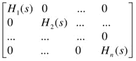

对于由 (A[1]， B[1], C[1], D[1]) 和 (A[2]， B[2], C[2], D[2]) 定义的两个系统 `sys1` 和 `sys2`，它们的组合 `append(sys1, sys2)` 生成如下系统：

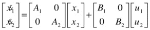

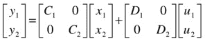

对于我们的示例：

```
>> sys1 = tf(1,[1 0])
sys2 = ss(1,2,3,4)
sys = append(sys1,10,sys2)

传递函数：
1
-
s

a =
x1
x1   1

b =
    u1
x1   2

c =
    x1
y1   3

d =
    u1
y1   4

连续时间模型。

a =
    x1  x2
x1   0   0
x2   0   1

b =
    u1  u2  u3
x1   1   0   0
x2   0   0   2

c =
    x1  x2
y1   1   0
y2   0   0
y3   0   3

d =
    u1  u2  u3
y1   0   0   0
y2   0  10   0
y3   0   0   4

连续时间模型。
```

下面的示例，如图 3-21 所示，使用负反馈将被控对象 `G(s)` 连接到下面定义的驱动器 `H(s)`：

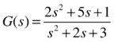

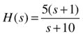

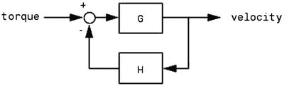

图 3-21.

```
>> G = tf([2 5 1],[1 2 3],'inputname','torque',...
         'outputname','velocity');
H = zpk(-2,-10,5)
Cloop = feedback(G,H)

零极点/增益：
5 (s+2)
-------
(s+10)

从输入 "torque" 到输出 "velocity" 的零极点/增益：
0.18182 (s+10) (s+2.281) (s+0.2192)
-----------------------------------
(s+3.419) (s² + 1.763s + 1.064)
```

下面的示例构建了一个阻尼因子为 0.4、自然频率为 2.4 rad/sec 的二阶传递函数。

```
>> [num,den] = ord2(2.4,0.4)

num =
     1

den =
    1.0000    1.9200    5.7600

>> sys = tf(num,den)

传递函数：
       1
-------------------
s² + 1.92 s + 5.76
```


### 响应时间命令

| 命令 | 描述 |
| --- | --- |
| `[u, t] = gensig(type, tau)`<br>`[u, t] = gensig(type, tau, Tf, Ts)` | 生成一个标量信号 `u`，其类型为 `type`，周期为 `tau`（以秒为单位）。`type` 可以是 `sine`、`square` 或 `pulse`。同时指定信号的持续时间 `Tf` 以及时间样本 `t` 之间的间隔 `Ts`。 |
| `impulse(sys)`<br>`impulse(sys, t)`<br>`impulse(sys1, sys2, ..., sysN)`<br>`impulse(sys1, sys2, ..., sysN, t)`<br>`impulse(sys1, 'PlotStyle1', ..., sysN, 'PlotStyleN')`<br>`[y, t, x] = impulse(sys)` | 计算并绘制模型 `sys` 的脉冲响应。使用用户提供的时间向量 `t` 进行仿真。计算并绘制多个模型的脉冲响应。使用用户提供的时间向量 `t` 进行仿真，计算并绘制多个模型的脉冲响应。此外还可以设置图形样式。返回模型 `sys` 脉冲响应的时间 `t` 的长度、输出数量和输入数量。 |
| `initial(sys, x0)`<br>`initial(sys, x0, t)`<br>`initial(sys1, sys2, ..., sysN, x0)`<br>`initial(sys1, sys2, ..., sysN, x0, t)`<br>`initial(sys1, 'PlotStyle1', ..., sysN, 'PlotStyleN', x0)`<br>`[y, t, x] = initial(sys, x0)` | 计算并绘制状态空间模型 `sys` 或多个模型在初始条件 `x0` 下的无外力响应。可以提供用户指定的时间向量 `t` 以及特定的图形样式。还可以获取模型 `sys` 无外力响应的时间 `t` 的长度、输出数量和输入数量。 |
| `lsim(sys, u, t)`<br>`lsim(sys, u, t, x0)`<br>`lsim(sys, u, t, x0, 'zoh')`<br>`lsim(sys, u, t, x0, 'foh')`<br>`lsim(sys1, sys2, ..., sysN, u, t)`<br>`lsim(sys1, sys2, ..., sysN, u, t, x0)`<br>`lsim(sys1, 'PlotStyle1', ..., sysN, 'PlotStyleN', u, t)`<br>`[y, t, x] = lsim(sys, u, t, x0)` | 计算并绘制状态空间模型 `sys` 或多个模型在初始条件 `x0` 下的时间响应。可以提供用户指定的时间样本 `t` 以及特定的图形样式。选项 `zoh` 和 `foh` 指定了输入值在样本之间的插值方式（分别为零阶保持或线性插值）。还可以获得输出响应 `y`、用于仿真的时间向量 `t` 以及状态轨迹 `x`。 |
| `step(sys)`<br>`step(sys, t)`<br>`step(sys1, sys2, ..., sysN)`<br>`step(sys1, sys2, ..., sysN, t)`<br>`step(sys1, 'PlotStyle1', ..., sysN, 'PlotStyleN')`<br>`[y, t, x] = step(sys)` | 计算并绘制 LTI 模型 `sys` 或多个模型的阶跃响应。可以提供用户指定的时间样本 `t` 以及特定的图形样式。还可以获得输出响应 `y`、用于仿真的时间向量 `t` 以及状态轨迹 `x`。 |
| `ltiview`<br>`ltiview(sys1, sys2, ..., sysn)`<br>`ltiview('plottype', sys1, sys2, ..., sysn)`<br>`ltiview('plottype', sys, extras)`<br>`ltiview('clear', viewers)`<br>`ltiview('current', sys1, sys2, ..., sysn, viewers)` | 打开 LTI 查看器，用于对一个或多个系统进行 LTI 系统响应分析，并提供由 `plottype`（`'step'`、`'impulse'`、`'initial'`、`'lsim'`、`'pzmap'`、`'bode'`、`'nyquist'`、`'nichols'` 和 `'sigma'`）定义的不同图形选项。 |

第一个示例是生成并绘制一个周期为 5 秒、持续时间为 30 秒、采样间隔为 0.1 秒的方波信号（参见图 3-22）。

```
>> [u,t] = gensig('square',5,30,0.1);
>> plot(t,u)
axis([0 30-1 2])
```

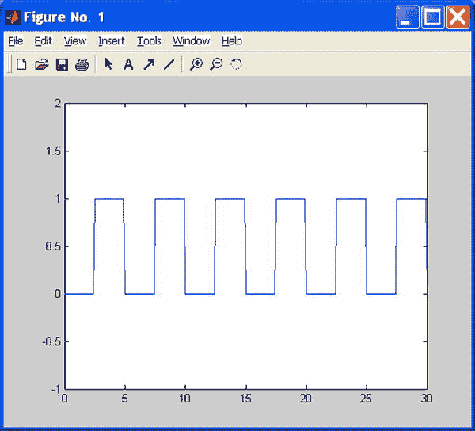

图 3-22.

在下面的示例中，我们为以下状态空间模型生成响应图（参见图 3-23）：

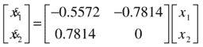


初始条件为

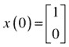

```
>> a = [-0.5572   -0.7814;0.7814  0];
c = [1.9691  6.4493];
x0 = [1 ; 0]
sys = ss(a,[],c,[]);
initial (sys, x 0)
x 0 =
1
0
```

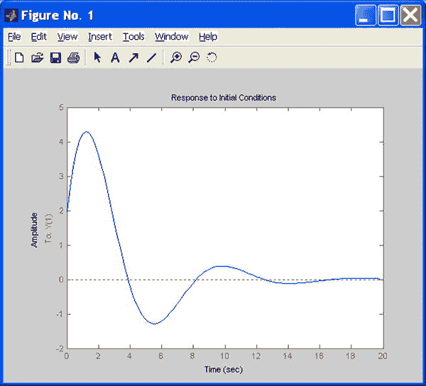

图 3-23.

下面我们为一个二阶状态空间模型生成阶跃响应图（参见图 3-24）：


使用以下语法：

```
>> a = [-0.5572   -0.7814;0.7814  0];
b = [1 -1;0 2];
c = [1.9691  6.4493];
sys = ss(a,b,c,0);
step(sys)
```


图 3-24.


### 频率响应命令

| 命令 | 描述 |
| --- | --- |
| `S = allmargin(sys)` | 计算单输入单输出开环模型`sys`的增益裕度、相位裕度、延迟裕度以及相应的穿越频率。 |
| `bode(sys)`, `bode(sys,w)`, `bode(sys1,sys2,...,sysN)`, `bode(sys1,sys2,...,sysN,w)`, `bode(sys1,‘PlotStyle1’,..., sysN,‘PlotStyleN’)`, `[mag,phase,w] = bode(sys)` | 绘制模型`sys`或多个系统的频率响应伯德图。可通过`w`指定频率范围，并可设置多种图形选项。也可以获取`bode(sys)`的幅值、相位和频率值。 |
| `bodemag(sys)`, `bodemag(sys,{wmin,wmax})`, `bodemag(sys,w)`, `bodemag(sys1,sys2,...,sysN,w)`, `bodemag(sys1,‘PlotStyle1’,..., sysN,‘PlotStyleN’)` | 绘制模型`sys`或多个模型的频率响应伯德幅值图（不含相位图）。用户可指定频率范围和多种图形选项。 |
| `frsp = evalfr(sys,f)` | 在复数频率`f`处计算系统`sys`的传递函数。 |
| `H = freqresp(sys,w)` | 返回`sys`在由向量`w`指定的实频率网格上的频率响应。 |
| `isys = interp(sys,freqs)` | 在频率`freqs`处对 FRD 模型`sys`中包含的频率响应数据进行插值。 |
| `y = linspace(a,b)`, `y = linspace(a,b,n)` | 创建一个在`a`和`b`之间等间距分布的向量，包含 100 个或`n`个元素。 |
| `y = logspace(a,b)`, `y = logspace(a,b,n)`, `y = logspace(a,pi,n)` | 创建一个在对数尺度下均匀分布的向量，范围在`10^a`到`10^b`之间（在`10^a`和`10^b`之间取 50 个点，或`n`个点；或在`10^a`和`π`之间取`n`个点）。 |
| `[Gm,Pm,Wgm,Wpm] = margin(sys)`, `[Gm,Pm,Wgm,Wpm] = margin(mag,phase,w)`, `margin(sys)` | 计算单输入单输出开环模型的最小增益裕度`Gm`、相位裕度`Pm`以及相应的频率`Wgm`和`Wpm`。可指定幅值、相位和频率向量，并可生成伯德图。 |
| `ngrid` | 在系统的尼克尔斯频率响应上叠加尼克尔斯图网格线。 |
| `nichols(sys)`, `nichols(sys,w)`, `nichols(sys1,sys2,...,sysN)`, `nichols(sys1,sys2,...,sysN,w)`, `nichols(sys1,‘PlotStyle1’,..., sysN,‘PlotStyleN’)`, `[mag,phase,w] = nichols(sys)`, `[mag,phase] = nichols(sys,w)` | 创建模型的频率响应尼克尔斯图。参数含义与伯德图相同。 |
| `nyquist(sys)`, `nyquist(sys,w)`, `nyquist(sys1,sys2,...,sysN)`, `nyquist(sys1,sys2,...,sysN,w)`, `nyquist(sys1,‘PlotStyle1’,..., sysN,‘PlotStyleN’)`, `[re,im,w] = nyquist(sys)`, `[re,im] = nyquist(sys,w)` | 创建模型的频率响应奈奎斯特图。参数含义与伯德图相同。 |
| `sigma(sys)`, `sigma(sys,w)`, `sigma(sys,w,type)`, `sigma(sys1,sys2,...,sysN)`, `sigma(sys1,sys2,...,sysN,w)`, `sigma(sys1,sys2,...,sysN,w,type)`, `sigma(sys1,‘PlotStyle1’,..., sysN,‘PlotStyleN’)`, `[sv,w] = sigma(sys)`, `sv = sigma(sys,w)` | 计算模型频率响应的奇异值。 |

作为第一个示例，我们为以下连续单输入单输出系统生成伯德图（见图 3-25）：


```
>> g = tf([1 0.1 7.5],[1 0.12 9 0 0]);
bode (g)
```


图 3-25.

接下来，我们在 `z = 1 + i` 处评估以下离散时间传递函数：


```
>> H = tf([1 -1],[1 1 1],-1)
z = 1+j
evalfr(H,z)

传递函数:
z - 1
-----------
z² + z + 1

采样时间：未指定

z =
   1.0000 + 1.0000i

ans =
   0.2308 + 0.1538i
```

接下来，我们为以下系统生成带网格的尼克尔斯图（见图 3-26）：


```
>> H = tf([-4 48 -18 250 600],[1 30 282 525 60])

传递函数:
-4 s⁴ + 48 s³ - 18 s² + 250s + 600
--------------------------------------
s⁴ + 30 s³ + 282 s² + 525s + 60

>> nichols(H)
>> ngrid
```


图 3-26.

### 极点配置命令

| 命令 | 描述 |
| --- | --- |
| `k = acker(A,b,p)` | 给定单输入系统  和期望的闭环极点位置向量 `p`，使用阿克曼方法确定 `k`，使得 `A-bk` 的特征值与 `p` 的元素匹配（顺序可能不同）。 |
| `K = place(A,B,p)` | 给定单输入或多输入系统  和期望的闭环极点位置向量 `p`，确定 `k`，使得 `A-bk` 的特征值与 `p` 的元素匹配（顺序可能不同）。 |
| `est = estim(sys,L)`, `est = estim(sys,L,sensors,known)` | 根据被控对象的状态空间模型`sys`和估计器增益`L`，生成状态/输出估计器`est`。可指定测量输出（`sensors`）和已知输入（`known`）。 |
| `rsys = reg(sys,K,L)`, `rsys = reg(sys,K,L,sensors,known,controls)` | 根据被控对象的状态空间模型`sys`、状态反馈增益矩阵`K`和估计器增益矩阵`L`，构成一个动态调节器或补偿器`rsys`。可指定测量输出（`sensors`）和已知输入（`known`）。 |

### LQG 设计命令

| 命令 | 描述 |
| --- | --- |
| `[K, S, e] = lqr(A,B,Q,R)`, `[K, S, e] = lqr(A,B,Q,R,N)` | 计算连续模型的 LQ 最优增益。 |
| `[K, S, e] = dlqr(a,b,Q,R)`, `[K, S, e] = dlqr(a,b,Q,R,N)` | 计算离散模型的 LQ 最优增益。 |
| `[K,S,e] = lqry(sys,Q,R)`, `[K,S,e] = lqry(sys,Q,R,N)` | 计算具有输出加权的 LQ 最优增益。 |
| `[Kd,S,e] = lqrd(A,B,Q,R,Ts)`, `[Kd,S,e] = lqrd(A,B,Q,R,N,Ts)` | 计算连续模型的离散 LQ 增益。 |
| `[kest,L,P] = kalman(sys,Qn,Rn,Nn)`, `[kest,L,P,M,Z] = kalman(sys,Qn,Rn,Nn)` | 计算连续和离散模型的卡尔曼估计器。 |
| `[kest,L,P,M,Z] = kalmd(sys,Qn,Rn,Ts)` | 计算连续模型的离散卡尔曼估计器。 |
| `rlqg = lqgreg(kest,k)`, `rlqg = lqgreg(kest,k,controls)` | 通过连接使用 `kalman` 设计的卡尔曼估计器以及使用 `lqr`、`dlqr` 或 `lqry` 设计的最优状态反馈增益，构成线性二次高斯（LQG）调节器。 |


### 求解方程的命令

| 命令 | 描述 |
| --- | --- |
| `[X,L,G,rr] = care(A,B,Q)` `[X,L,G,rr] = care(A,B,Q,R,S,E)` `[X,L,G,report] = care(A,B,Q,...,'report')` `[X1,X2,L,report] = care(A,B,Q,...,'implicit')` | 求解连续时间代数黎卡提方程。 |
| `[X,L,G,rr] = dare(A,B,Q,R)` `[X,L,G,rr] = dare(A,B,Q,R,S,E)` `[X,L,G,report] = dare(A,B,Q,...,'report')` `[X1,X2,L,report] = dare(A,B,Q,...,'implicit')` | 求解离散时间代数黎卡提方程。 |
| `X = lyap(A,Q)` `X = lyap(A,B,C)` | 求解连续时间李雅普诺夫方程。 |
| `X = dlyap(A,Q)` | 求解离散时间李雅普诺夫方程。 |

例如，我们求解黎卡提方程：


其中：


```
>> a = [-3 2;1 1]; b = [0 ; 1]; c = [1 -1]; r = 3;
[x,l,g] = care(a,b,c'*c,r)
x =
0.5895 1.8216
1.8216 8.8188
l =
-3.5026
-1.4370
g =
0.6072 2.9396
```

## 练习 3-1

创建连续状态空间模型，并为下面定义的传递函数 `H(s)` 计算状态空间实现。同时，找出 `H(s)` 的最小实现。


```
>> H = [tf([1 1],[1 3 3 2]) ; tf([1 0 3],[1 1 1])];
>> sys = ss(H)

a =
             x1           x2           x3           x4           x5
x1           -3         -1.5           -1            0            0
x2            2            0            0            0            0
x3            0            1            0            0            0
x4            0            0            0           -1         -0.5
x5            0            0            0            2            0

b =
             U1
x1            1
x2            0
x3            0
x4            1
x5            0

c =
             x1           x2           x3           x4           x5
y1            0          0.5          0.5            0            0
y2            0            0            0           -1            1

d =
             U1
y1            0
y2            1

Continuous-time model.
>> size(sys)
State-space model with 2 outputs, 1 input, and 5 states.
```

我们得到了一个具有 2 个输出、1 个输入和 5 个状态的状态空间模型。通过使用以下语法可以找到 `H(s)` 的最小实现：

```
>> sys = ss(H,'min')

a =
                        x1           x2           x3
           x1      -1.4183      -1.5188      0.21961
           x2     -0.14192      -1.7933     -0.70974
           x3     -0.44853       1.7658      0.21165

b =
                        u1
           x1      0.19787
           x2       1.4001
           x3      0.02171

c =
                        x1           x2           x3
           y1     -0.15944     0.018224      0.27783
           y2      0.35997     -0.77729      0.78688

d =
                        u1
           y1            0
           y2            1

Continuous-time model.
>> size(sys)
State-space model with 2 outputs, 1 input, and 3 states.
```

最小实现由一个具有 2 个输出、1 个输入和 3 个状态的状态空间模型给出。这个结果与将 `H(s)` 分解为一个一阶系统和一个二阶系统的组合是一致的：


## 练习 3-2

找出下面定义的 MIMO 系统 `H(z)` 的离散传递函数，其中采样时间为 0.2 秒。


```
>> nums = {1 [1 0];[-1 2] 3}
Ts = 0.2
H = tf(nums,[1 0.3],Ts)

nums =
    [      1.00]    [1x2 double]
    [1x2 double]    [      3.00]

Ts =
          0.20

Transfer function from input 1 to output...
         1
#1:  -------
      z + 0.3
      -z + 2
#2:  -------
      z + 0.3

Transfer function from input 2 to output...
         z
#1:  -------
      z + 0.3
         3
#2:  -------
      z + 0.3

Sampling time: 0.2
```

## 练习 3-3

给定零极点增益模型


采样时间为 0.01 秒，执行重采样至 0.05 秒。然后撤销重采样，验证是否得到原始模型。

```
>> H = zpk(0.7,0.5,1,0.1)
H2 = d2d(H,0.05)

Zero/pole/gain:
(z-0.7)
-------
(z-0.5)
Sampling time: 0.1

Zero/pole/gain:
(z-0.8243)
----------
(z-0.7071)
Sampling time: 0.05
```

我们通过以下方式反向重采样：

```
>> d2d(H2,0.1)

Zero/pole/gain:
(z-0.7)
-------
(z-0.5)
Sampling time: 0.1
```

这样就得到了原始模型。

## 练习 3-4

考虑由下面定义的传递函数 `h(s)` 给出的连续四阶模型。通过移除与对角平衡格拉姆向量 `g` 的小值相对应的状态来降阶。比较原始模型和降阶模型。


我们首先定义模型并按如下方式计算平衡状态空间实现：

```
>> h = tf([1 11 36 26],[1 14.6 74.96 153.7 99.65])
[hb,g] = balreal(h)
g'

Transfer function:
          s³ + 11 s² + 36s + 26
--------------------------------------------
s⁴ + 14.6 s³ + 74.96 s² + 153.7s + 99.65

a =
             x1        x2        x3        x4
   x1    -3.601   -0.8212   -0.6163   0.05831
   x2    0.8212    -0.593    -1.027   0.09033
   x3   -0.6163     1.027    -5.914     1.127
   x4  -0.05831   0.09033    -1.127    -4.492

b =
              u1
   x1     -1.002
   x2     0.1064
   x3   -0.08612
   x4  -0.008112

c =
             x1        x2        x3        x4
   y1    -1.002   -0.1064  -0.08612  0.008112

d =
       u1
   y1   0

Continuous-time model.

g =
   0.1394
   0.0095
   0.0006
   0.0000

ans =
   0.1394    0.0095    0.0006    0.0000
```

现在我们使用两种不同的方法移除对应于 `g` 的最后三个值的三个状态。

```
>> hmdc = modred(hb,2:4,'mdc')
hdel = modred(hb,2:4,'del')

a =
           x1
   x1  -4.655

b =
           u1
   x1  -1.139

c =
           x1
   y1  -1.139

d =
             u1
   y1  -0.01786

Continuous-time model.

a =
           x1
   x1  -3.601

b =
           u1
   x1  -1.002

c =
           x1
   y1  -1.002

d =
       u1
   y1   0

Continuous-time model.
```

接下来，我们比较它们与原始模型的响应（见图 3-27）。

```
>> bode(h,'-',hmdc,'x',hdel,'*')
```


**图 3-27。**

我们看到，在这两种情况下，降阶模型都优于原始模型。现在比较阶跃响应（见图 3-28）

```
>> step(h,'-',hmdc,'-.',hdel,'--')
```


**图 3-28。**

## 练习 3-5

计算由以下 `H(z)` 和 `T [s]` 定义的离散 SISO 系统对强度为 `W = 5` 的高斯白噪声的响应协方差。


```
>> sys = tf([2 1],[1 0.2 0.5],0.1)

Transfer function:
      2 z + 1
-----------------
z² + 0.2 z + 0.5

Sampling time: 0.1
>>p = covar(sys,5)
p =
30.3167
```

## 练习 3-6

绘制由以下定义的连续时间传递函数系统的极点和零点


```
>> H = tf([2 5 1],[1 2 3])

Transfer function:
2 s² + 5s + 1
--------------
s ^ 2 + 2s + 3

>> pzmap (H)
>> sgrid
```

图 3-29 显示了结果。


**图 3-29。**

## 练习 3-7

考虑图 3-30 中的框图，其中状态空间模型 `sys2` 的矩阵由下式给出：


**图 3-30。**

首先连接未连接的模块，其次，找出由矩阵 `Q = [3.1, -4; 4, 3, 0]` 给出的全局互连的状态空间模型，其中输入 = `[1,2]`，输出 = `[2,3]`。

使用以下语法连接模块：

```
>> A = [ -9.0201,  17.7791; -1.6943  3.2138 ];
B = [ -.5112,  .5362;  -.002  -1.8470];
C = [ -3.2897,  2.4544;  -13.5009  18.0745];
D = [-.5476,  -.1410;  -.6459  .2958 ];

>> sys1 = tf(10,[1 5],'inputname','uc')
sys2 = ss(A,B,C,D,'inputname',{'u1' 'u2'},...
'outputname',{'y1' 'y2'})
sys3 = zpk(-1,-2,2)

Transfer function from input "uc" to output:
  10
-----
s + 5

a =
           x1      x2
   x1   -9.02   17.78
   x2  -1.694   3.214

b =
            u1       u2
   x1  -0.5112   0.5362
   x2   -0.002   -1.847

c =
          x1     x2
   y1  -3.29  2.454
   y2  -13.5  18.07

d =
            u1       u2
   y1  -0.5476   -0.141
   y2  -0.6459   0.2958

Continuous-time model.

Zero/pole/gain:
2 (s+1)
-------
(s+2)
```

未连接模块的并集创建如下：

```
sys = append(sys1,sys2,sys3)

a =
           x1      x2      x3      x4
   x1      -5       0       0       0
   x2       0   -9.02   17.78       0
   x3       0  -1.694   3.214       0
   x4       0       0       0      -2

b =
            uc       u1       u2        ?
   x1        4        0        0        0
   x2        0  -0.5112   0.5362        0
   x3        0   -0.002   -1.847        0
   x4        0        0        0    1.414

c =
           x1      x2      x3      x4
   ?      2.5       0       0       0
   y1       0   -3.29   2.454       0
   y2       0   -13.5   18.07       0
   ?        0       0       0  -1.414

d =
            uc       u1       u2        ?
   ?         0        0        0        0
   y1        0  -0.5476   -0.141        0
   y2        0  -0.6459   0.2958        0
   ?         0        0        0        2

Continuous-time model.
```

然后，我们得到全局互连的状态空间模型。

```
>> Q = [3, 1, -4; 4, 3, 0];
>> inputs = [1 2];
>> outputs = [2 3];
>> sysc = connect(sys,Q,inputs,outputs)

a =
            x1       x2       x3       x4
   x1       -5        0        0        0
   x2   0.8422  0.07664    5.601   0.4764
   x3   -2.901   -33.03    45.16   -1.641
   x4   0.6571      -12    16.06   -1.628

b =
            uc       u1
   x1        4        0
   x2        0   -0.076
   x3        0   -1.501
   x4        0  -0.5739

c =
            x1       x2       x3       x4
   y1  -0.2215   -5.682    5.657  -0.1253
   y2   0.4646   -8.483    11.36   0.2628

d =
            uc       u1
   y1        0   -0.662
   y2        0  -0.4058

Continuous-time model.
```

## 练习 3-8

绘制下面定义的二阶状态空间模型的单位脉冲响应，并将结果存储在一个包含输出响应和仿真时间的数组中。


模型定义如下：

通过使用以下语法获得所请求的图（见图 3-31）：

```
>> a = [-0.5572 -0.7814;0.7814  0];
b = [1 -1;0 2];
c = [1.9691  6.4493];
sys = ss(a,b,c,0);
impulse (sys)
```

输出响应和仿真时间使用以下语法获得：

```
>> [y t] = impulse (sys)
y(:,:,1) =
1.9691
2.6831
3.2617
3.7059
4.0197
4.2096
      .
      .
y(:,:,2) =
10.9295
9.4915
7.9888
6.4622
4.9487
      .
      .
```


**图 3-31。**

## 练习 3-9

绘制并仿真下面定义的传递函数 `H(s)` 的系统对周期为 4 秒的方波信号的响应，分别每 0.1 秒和每 10 秒采样一次。


我们首先使用 `gensig` 生成方波信号，然后使用 `lsim` 执行仿真（见图 3-32），如下所示：

```
>> [u,t] = gensig('square',4,10,0.1);
>> H = [tf([2 5 1],[1 2 3]) ; tf([1 -1],[1 1 5])]
lsim(H,u,t)

Transfer function from input to output...
    2 s ^ 2 + 5 s + 1
#1:  ---------------
     s ^ 2 + 2 s + 3
          s 1
#2:  -----------
    s ^ 2 + s + 5
```


**图 3-32。**


