# 4. 鲁棒预测控制

## 预测控制策略：模型预测控制工具箱

模型预测控制工具箱是一套完整的工具，可用于实现模型预测控制策略。模型预测控制策略常用于化学工程及其他工业领域。

该工具箱最重要的特性包括：

- 建模、辨识与验证。
- 支持 MISO（多输入单输出）、MIMO（多输入多输出）、阶跃响应和状态空间模型。
- 系统分析。
- 在状态空间、传递函数和阶跃响应模型之间进行转换。

模型预测控制通过近似线性动态被控对象模型，来预测未来的变化以及操作变量的影响。在线优化问题被表述为一个二次规划问题，并使用最新的测量值反复求解。

模型预测控制工具箱包含超过 50 个专门的 MATLAB 函数，帮助您使用模型预测控制方法设计、分析和模拟动态系统。该工具箱支持有限阶跃（或脉冲）响应、离散和连续时间传递函数以及状态空间格式。该工具箱可处理非方系统，并支持多种状态估计技术。模拟工具可在有约束或无约束的情况下测试系统响应。对于模型辨识，该工具箱提供了一个接口，可方便地使用通过系统辨识工具箱开发的模型。

### 辨识命令

| `[mx, ax, stdx] = autosc (x) sx = scal(x,mx) sx = scal(x,mx,stdx) rx = rescal(x,mx) rx = rescal(x,mx,stdx)` | 根据输入矩阵或向量 `x` 的列均值（`mx`）和标准差（`stdx`）自动对其进行缩放，并输出 `mx` 和 `stdx` 作为选项。通过使用 `scal`，输入也可以按照指定的均值和/或标准差进行缩放。`rescal` 将缩放后的数据转换回原始数据。 |
| `plant = imp2step(delt,nout,theta1, theta2,…, theta25)` | 以 MPC 阶跃格式构建一个 MIMO（多输入多输出）模型。每个 `thetai` 是一个对应于输出 `i` 的脉冲响应系数的 `n×m` 矩阵。`n` 是系数的数量，`m` 是输入的数量。`delt` 是用于获取脉冲响应系数的采样间隔。`nout` 是输出稳定性指示符。 |
| `[theta, yres] = mlr (xreg, yreg, ninput) [theta, yres] = mlr (xreg yreg, ninput, plotopt, wtheta, wdeltheta)` | 通过多变量最小二乘回归或岭回归，确定多输入单输出系统的脉冲响应系数。`xreg` 和 `yreg` 是由 `wrtreg` 等例程生成的输入矩阵和输出向量。`ninput` 是输入的数量。使用最小二乘法确定脉冲响应系数矩阵 `theta`。`theta` 的列对应于来自每个输入的脉冲响应系数。可选输出 `yres` 是残差向量，即实际输出与预测输出之间的差值。可选输入包括 `plotopt`、`wtheta` 和 `wdeltheta`。如果 `plotopt` 等于 0（默认值），则不生成图形；如果 `plotopt=1`，则生成实际输出和预测输出的图形；如果 `plotopt=2`，则生成两个图形——实际输出与预测输出图，以及残差图。可以通过标量权重 `wtheta` 和 `wdeltheta` 分别指定对 `theta` 平方和 `theta` 变化的惩罚（默认值为 0）。 |
| `[theta, yres, w, cw, ssqdif] = plsr(xreg,yreg,ninput,lv) [theta, yres, w, cw, ssqdif] = plsr(xreg,yreg,ninput,lv, plotopt)` | 通过偏最小二乘法（PLS）确定多输入单输出系统的脉冲响应系数。 |
| `yres = validmod (xreg, yreg, theta) yres = validmod (xreg yreg, theta, plotopt)` | 验证新数据集上的脉冲响应模型。 |
| `[xreg, yreg] = wrtreg (x, y, n)` | 为多输入单输出系统写入输入和输出数据矩阵，以便在回归例程 `mlr` 和 `pls` 中用于确定脉冲响应系数。 |

### 信息矩阵绘制命令

| `mpcinfo(mat)` | 返回关于矩阵 `mat` 的类型和大小的信息。 |
| `plotall(y,u) plotall(y,u,t)` | 绘制模拟过程中的输出和操作变量。输入变量 `y` 和 `u` 分别是输出和操作变量的矩阵。（`t` = 周期）。 |
| `plotfrsp(vmat) plotfrsp(vmat,out,in)` | 将由 `mod2frsp` 生成的频率响应绘制为伯德图。`vmat` 是包含数据的数组。 |
| `ploteach(y) ploteach(y, u) ploteach([ ], u) ploteach(y, [], t) ploteach([], u, t) ploteach(y, u, t)` | 在单独的图形上绘制模拟过程中的输出和操作变量。输入变量 `y` 和 `u` 分别是输出和操作变量的矩阵。（`t` = 周期）。 |
| `plotstep(plant) plotstep(plant,opt)` | 绘制多个阶跃响应。`plant` 是一个由 `mod2step`、`ss2step` 或 `tfd2step` 创建的 MPC 阶跃格式的阶跃响应矩阵。`opt` 是一个可选的标量或行向量，允许您选择要绘制的输出。 |

### 模型转换命令

| `c2dmp` | 将状态空间模型从连续时间转换为离散时间。（相当于控制系统工具箱中的 `c2d`） |
| `[numd,dend] = cp2dp(num,den,delt) [numd,dend] = cp2dp(num,den,delt,delay)` | 将标准 MATLAB 多项式形式的单输入单输出连续时间传递函数（包括可选的时间延迟）转换为采样数据传递函数。（`delt` 是采样周期，`delay` 是时间延迟。） |
| `d2cmp` | 将状态空间模型从离散时间转换为连续时间。（相当于控制系统工具箱中的 `d2c`。） |
| `newmod = mod2mod (oldmod, delt2)` | 更改 MPC mod 格式模型的采样周期。`oldmod` 是现有的 MPC mod 格式模型。`delt2` 是模型的新采样周期。 |
| `[phi,gam,c,d] = mod2ss(mod) [phi,gam,c,d,minfo] = mod2ss(mod)` | 从存储在 MPC mod 格式的模型中提取标准离散时间状态空间矩阵和其他信息。 |
| `plant = mod2step(mod,tfinal) [plant,dplant] = mod2step(mod,tfinal,delt2,nout)` | 使用 mod 格式的模型，以 MPC 阶跃格式计算 SISO 或 MIMO 系统的阶跃响应。 |
| `g = poly2tfd(num,den) g = poly2tfd(num,den,delt,delay)` | 将标准 MATLAB poly 格式的传递函数（连续或离散）转换为 MPC tf 格式。 |
| `pmod = ss2mod(phi,gam,c,d) pmod = ss2mod(phi,gam,c,d,minfo)` | 将离散时间状态空间系统模型转换为 MPC mod 格式。 |
| `plant = ss2step(phi,gam,c,d,tfinal) plant = ss2step(phi,gam,c,d,tfinal,delt1,delt2,nout)` | 使用状态空间格式的模型，以 MPC 阶跃格式计算 SISO 或 MIMO 系统的阶跃响应。 |
| `ss2tf2` | 将状态空间模型转换为传递函数。（相当于控制系统工具箱中的 `ss2tf`。） |
| `tf2ssm` | 将传递函数转换为状态空间模型。（相当于控制系统工具箱中的 `tf2ss`。） |
| `model = tfd2mod(delt2,ny,g1,g2,g3,…,g25)` | 将 MPC tf 格式的传递函数（连续或离散）转换为 MPC mod 格式，必要时转换为离散时间。 |
| `plant = tfd2step(tfinal,delt2,nout,g1) plant = tfd2step(tfinal,delt2,nout,g1,…,g25)` | 计算 MPC tf 格式模型的 MIMO 阶跃响应。得到的阶跃响应为 MPC 阶跃格式。 |
| `umod = th2mod(th) [umod,emod] = th2mod(th1,th2,…,thN)` | 将 theta 格式（如系统辨识工具箱中所用）的 SISO 或 MISO 模型转换为 MPC mod 格式。也可以组合此类模型以形成 MIMO 系统。 |


### 模型构建命令 - MPC mod 格式

| `model = addmd (pmod, dmod)` | 向采用 MPC mod 格式的装置模型添加一个或多个可测扰动。 |
| `pmod = addmod (mod1, mod2)` | 组合两个采用 MPC mod 格式的模型，使得其中一个模型的输出与另一个模型的操作输入相结合。 |
| `model = addumd (pmod, dmod)` | 向采用 MPC mod 格式的装置模型添加一个或多个不可测扰动。 |
| `pmod = appmod (mod1, mod2)` | 附加两个模型以形成一个组合模型，该组合模型保留原始模型的输入和输出。 |
| `pmod = paramod (mod1, mod2)` | 通过连接两个模型的输出来并联放置它们。 |
| `pmod = sermod (mod1, mod2)` | 通过将一个模型的输出连接到另一个模型的输出来串联放置两个模型。 |

### 控制设计与仿真命令 - MPC step 格式

| `yp = cmpc(plant,model,ywt,uwt,M,P,tend,r) [yp,u,ym] = cmpc(plant,model,ywt,uwt,M,P,tend,...)` | 使用采用 MPC step 格式的模型，模拟对操作变量和/或输出具有硬约束的闭环系统。通过二次规划求解 MPC 优化问题。 |
| `[clmod] = mpccl(plant,model,Kmpc) [clmod,cmod] = mpccl(plant,model,Kmpc,tfilter,… dplant, dmodel)` | 组合采用 MPC step 格式的装置模型和控制器模型，生成一个采用 MPC mod 格式的闭环系统模型。 |
| `KMPC = mpccon (model) KMPC = mpccon (model, ywt uwt, M, P)` | 使用采用 MPC step 格式的模型计算 MPC 控制器增益。 |
| `yp = mpcsim(plant,model,Kmpc,tend,r) [yp,u,ym] = mpcsim(plant,model,Kmpc,tend,r,usat,… tfilter, dplant, dmodel, dstep)` | 使用采用 MPC step 格式的模型，模拟对操作变量具有饱和约束的闭环系统。 |
| `nlcmpc` | 模型预测控制器，用于使用采用 MPC step 格式的线性模型，对表示为 Simulink S-函数的非线性装置，模拟对操作变量和/或控制变量具有硬约束的闭环系统。 |
| `nlmpcsim` | 模型预测控制器，用于使用采用 MPC step 格式的线性模型，对表示为 Simulink S-函数的非线性装置，模拟对操作变量具有饱和约束的闭环系统。 |

### 控制设计与仿真命令 - MPC mod 格式

| `yp = scmpc(pmod,imod,ywt,uwt,M,P,tend,r) [yp,u,ym] = scmpc(pmod,imod,ywt,uwt,M,P,tend, … r,ulim,ylim,Kest,z,d,w,wu)` | 使用采用 MPC mod 格式的模型，模拟对操作变量和/或输出具有硬约束的闭环系统。通过二次规划求解 MPC 优化问题。 |
| `[clmod,cmod] = smpccl(pmod,imod,Ks) [clmod,cmod] = smpccl(pmod,imod,Ks,Kest)` | 组合采用 MPC mod 格式的装置模型和控制器模型，生成一个采用 MPC 格式的闭环系统模型。 |
| `Ks = smpccon(imod) Ks = smpccon(imod,ywt,uwt,M,P)` | 使用采用 MPC mod 格式的模型计算 MPC 控制器增益。 |
| `[Kest] = smpcest(imod,Q,R)` | 设置一个状态估计器增益矩阵，用于使用采用 MPC mod 格式的模型进行 MPC 控制器设计和仿真流程。 |
| `yp = smpcsim(pmod,imod,Ks,tend,r) [yp,u,ym] = smpcsim(pmod,imod,Ks,tend,r,usat,… Kest, z, d, w, wu)` | 使用采用 MPC mod 格式的模型，模拟对操作变量具有饱和约束的闭环系统。 |

### 脚本分析命令

| `frsp = mod2frsp(mod,freq) [frsp,eyefrsp] = mod2frsp(mod,freq,out,in,balflg)` | 计算采用 MPC mod 格式的系统的复数频率响应。 |
| `g = smpcgain(mod) poles = smpcpole(mod)` | 计算采用 MPC mod 格式的系统的稳态增益矩阵或极点。 |
| `[sigma, omega] = svdfrsp (vmat)` | 计算变矩阵的奇异值，例如由 `mod2frsp` 生成的频率响应。 |

## 鲁棒控制系统：鲁棒控制工具箱

鲁棒控制工具箱为鲁棒多变量控制系统的设计与分析提供了工具。它涵盖可以对误差进行建模的系统，以及具有不确定元素或其参数在产品生命周期内可能发生变化的动力学系统。该工具箱中包含的强大算法允许您执行复杂计算，可以处理参数的大量变化。

该工具箱最重要的特性包括：

*   基于 LQG 的 H² 和 H∞ 控制（综合）。
*   多变量频率响应。
*   状态空间模型的构建。
*   基于模型转换的奇异值。
*   高阶模型的降阶。
*   谱分解与内外分解。

### 可选数据结构系统命令

| `[b1,b2,…,bn] = branch(tr,PATH1,PATH2,…,PATHN)` | 选择性恢复打包在 `mksys` 或树变量中的矩阵。返回的分支由路径 `PATH1`、`PATH2`、…、`PATHN` 确定。 |
| `TR = graft(TR1,B) TR = graft(TR1,B,NM)` | 将根分支 `B` 添加到先前由 `tree` 或 `mksys` 创建的树变量 `TR1` 上。如果 `TR1` 有 N 个分支，则新分支的数字索引为 N+1；其他根分支的数字索引不变。 |
| `[i,TY,N] = issystem(S)` | 根据变量 `S` 是否为函数 `mksys` 创建的系统，为 `i` 返回 1（真）或 0（假）。同时返回系统类型 `TY` 和与类型为 `TY` 的系统关联的变量名称数量 `N`，但若 `S` 不是系统，则 `TY = [];` 且 `N = 0`。 |
| `[i] = istree(T) [i,b] = istree(T,path)` | 检查变量 `T` 是否为树结构。当存在第二个输入参数 `path` 时，`istree` 函数检查由 `path` 指定的分支是否存在。 |
| `S = mksys(a,b,c,d) S = mksys(v1,v2,v3,vn, TY)` | 将描述类型为 `TY` 的系统的多个矩阵打包到 MATLAB 变量 `S` 中，变量名由字符串 `TY` 的值确定的“标准”名称。 |
| `T = tree(nm,b1,b2,bn)` | 创建一个包含多个变量及其名称的树数据结构 `T`。 |
| `[VARS,N] = vrsys(NAM)` | 返回一个字符串 `VARS` 和一个整数 `N`，其中 `VARS` 包含与字符串名称 `NAM` 描述的系统相关联的 N 个矩阵名称的列表（用逗号分隔）。 |

### 建模命令

| `[a,b1,b2,c1,c2,d11,d12,d21,d22] = … augss(ag,bg,aw1,bw1,aw2,bw2,aw3,bw3) [a,b1,b2,c1,c2,d11,d12,d21,d22] = … augss(ag,bg,aw1,bw1,aw2,bw2,aw3,bw3,w3poly) [a,b1,b2,c1,c2,d11,d12,d21,d22] = … augtf(ag,bg,cg,dg,w1,w2,w3) [tss] = augss(ssg,ssw1,ssw2,ssw3,w3poly) [tss] = augtf(ssg,w1,w2,w3) [tss] = augss(ssg,ssw1,ssw2,ssw3)` | 用于加权混合灵敏度 H² 和 H∞ 设计的状态空间或传递函数装置增广。 |
| `[acl,bcl,ccl,dcl] = interc(a,b,c,d,m,n,f) [sscl] = interc(ss,m,n,f)` | 系统多变量通用互联。 |


### 模型转换命令

| `[ab,bb,cb,db] = bilin(a,b,c,d,ver,type,aug)` `[ssb] = bilin(ss,ver,type,aug)` | 计算频率变量替换 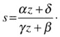 对系统的影响。变量 `ver` 为 `1`（正向变换：`s` 到 `z`）或 `-1`（反向变换：`z` 到 `s`）（S 或 z）。变量 `type` 表示双线性变换的类型，可以为 `'BwdRec'`（后向矩形）、`'FwdRec'`（前向矩形）、`'S_Tust'`（移位 Tustin）、`'S_ftjw'`（移位 jω 轴，双线性极点移位，连续时间到连续时间）或 `'G_Bilin'`（通用双线性，连续时间到连续时间）。`aug = [α,β,γ,δ]`。 |
| `[aa, bb, cc, dd] = des2ss(a,b,c,d,E,k)` `[ss1] = des2ss (ss, E, k)` | 将描述符系统转换为 SVD 状态空间形式。 |
| `[a,b1,b2,c1,c2,d11,d12,d21,d22] = lftf(A,B1,B2,a,b1,b2,)` `[aa,bb,cc,dd] = lftf(a,b1,b2,c1,c2,d11,d12,d21,d22,aw,bw,cw,dw)` `[aa,bb,cc,dd] = lftf(aw,bw,cw,dw,a,b1,b2,c1,c2,d11,d12,d21,d22)` `tss = lftf(tss1,tss2)` `ss = lftf(tss1,ss2)` `ss = lftf(ss1,tss2)` | 双端口或单端口状态空间线性分式变换。 |
| `[ag,bg1,dg22,at,bt1,dt21,dt22] = sectf(af,bf1,df22,secf,secg)` `[ag,bg,cg,dg,at,bt1,dt21,dt22] = sectf(af,bf,cf,df,secf,secg)` `[tssg,tsst] = sectf(tssf,secf,secg)` `[ssg,tsst] = sectf(ssf,secf,secg)` | 状态空间扇形双线性变换。 |
| `[a1,b1,c1,d1,a2,b2,c2,d2,m] = stabproj(a,b,c,d)` `[a1,b1,c1,d1,a2,b2,c2,d2] = slowfast(a,b,c,d,cut)` `[ss1,ss2,m] = stabproj(ss)` `[ss1,ss2] = slowfast(ss,cut)` | 稳定与反稳定投影。慢速与快速模态分解。 |
| `[a,b,c,d] = tfm2ss(num,den,r,c)` `[ss] = tfm2ss(tf,r,c)` | 将传递函数矩阵（MIMO）转换为状态空间形式。 |

### 实用命令

| `[p1,p2,lamp,perr,wellposed,p] = aresolv(a,q,r)` `[p1,p2,lamp,perr,wellposed,p] = aresolv(a,q,r,Type)` `[p1,p2,lamp,perr,wellposed,p] = daresolv(a,b,q,r)` `[p1,p2,lamp,perr,wellposed,p] = daresolv(a,b,q,r,Type)` | 求解连续广义黎卡提方程 `A^T P + PA - PRP + Q = 0`，其中 `P = p = p1/p2`。求解离散广义黎卡提方程 `A^T PA - P - A^T PB(R + B^T PB)^(-1) B^T PA + Q = 0`，其中 `P = p + p2/p1` 是使 `A - RP` 的特征值位于单位圆内的解。 |
| `[tot] = riccond(a,b,qrn,p1,p2)` `[tot] = driccond(a,b,q,r,p1,p2)` | 提供连续黎卡提方程的条件数。提供离散黎卡提方程的条件数。 |
| `[v,t,m] = blkrsch(a,Type,cut)` `[v,t,m,swap] = cschur(a,Type)` | 分块有序实舒尔形式。通过复数 Givens 旋转得到的有序复数舒尔形式。 |

### Bode 多变量图形命令

| `[cg, ph, w] = cgloci (a, b, c, d(,Ts))` `[cg, ph, w] = cgloci (a, b, c, d(,Ts), 'inv')` `[cg, ph, w] = cgloci (a, b, c, d(,Ts), w)` `[cg, ph, w] = cgloci (a, b, c, d(,Ts), w, 'inv')` `[cg, ph, w] = cgloci (ss)` | 连续特征增益轨迹频率响应。 |
| `[cg, ph, w] = dcgloci (a, b, c, d(,Ts))` `[cg, ph, w] = dcgloci (a, b, c, d(,Ts), 'inv')` `[cg, ph, w] = dcgloci (a, b, c, d(,Ts), w)` `[cg, ph, w] = dcgloci (a, b, c, d(,Ts), w, 'inv')` `[cg, ph, w] = dcgloci (ss)` | 离散特征增益轨迹频率响应。 |
| `[sv,w] = dsigma(a,b,c,d(,Ts))` `[sv,w] = dsigma(a,b,c,d(,Ts),'inv')` `[sv,w] = dsigma(a,b,c,d(,Ts),w)` `[sv,w] = dsigma(a,b,c,d(,Ts),w,'inv')` `[sv, w] = dsigma (ss...)` | 计算奇异值 Bode 图的离散版本。 |
| `[sv,w] = sigma(a,b,c,d(,Ts))` `[sv,w] = sigma(a,b,c,d(,Ts),'inv')` `[sv,w] = sigma(a,b,c,d(,Ts),w)` `[sv,w] = sigma(a,b,c,d(,Ts),w,'inv')` `[sv, w] = sigma (ss...)` | 计算奇异值 Bode 图。 |
| `[mu,ascaled,logm,x] = muopt(a)` `[mu,ascaled,logm,x] = muopt(a,k)` | 使用乘数方法计算结构奇异值的上界。 |
| `[mu,ascaled,logd] = osborne(a)` `[mu,ascaled,logd] = osborne(a,k)` | 通过 Osborne 方法计算结构奇异值的上界。 |
| `[mu] = perron (a)` `[mu] = perron (a, k)` `[mu,ascaled,logd] = psv(a)` `[mu,ascaled,logd] = psv(a,k)` | 通过 Perron 特征向量方法计算结构奇异值的上界。 |
| `[mu,logd] = ssv(a,b,c,d,w)` `[mu,logd] = ssv(a,b,c,d,w,k)` `[mu,logd] = ssv(a,b,c,d,w,k,opt)` `[mu,logd] = ssv(ss,)` | 计算结构奇异值（多变量稳定裕度）Bode 图。 |

## 练习 4-1

给定如下定义的双输入单输出模型 `y(s)`，其输入和输出数据位于 `mlrdat` 文件中，使用 `autoesc` 函数确定输入数据的标准差，并仅按该标准差缩放输入。将输入和输出数据整理成可以计算脉冲响应系数（35 个系数）的形式，并使用 `mlr` 计算这些系数。最后，基于输入的标准差缩放 `theta`，将模型转换为 MPC 阶跃格式，并绘制阶跃响应系数。

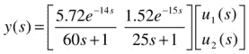

以下 MATLAB 语法用于生成图 4-1 所示的图形：

```
>> load mlrdat;
>> [ax, mx, stdx] = autosc (x);
>> mx = [0,0];
sx = scal(x,mx,stdx);
>> n = 35;
[xreg, yreg] = wrtreg (sx, y, n);
>> ninput = 2;
plotopt = 2;
[theta, yres] = mlr (xreg, yreg, ninput, plotopt);
```

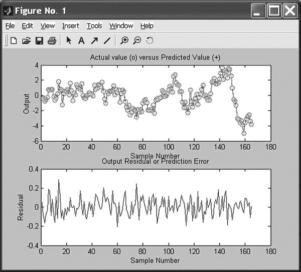

图 4-1.

`theta` 的缩放、模型转换和阶跃响应系数的绘制（见图 4-2），采样时间为 7 分钟以寻找脉冲，使用以下语法：

```
>> theta = scal(theta,mx,stdx);
>> nout = 1;
delt = 7;
model = imp2step(delt,nout,theta);
>> plotstep (model)
```

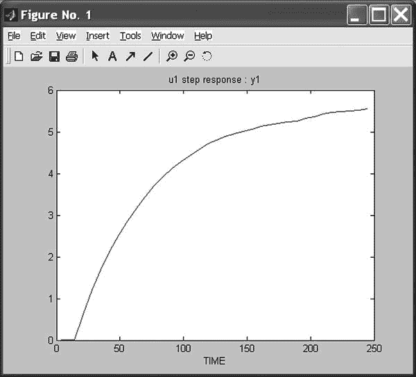

图 4-2.

## 练习 4-2

将下面定义的连续时间传递函数模型 `G(s)` 转换为相应的 MPC 传递函数模型。假设延迟为 2.5，执行相同任务，并找到等效的离散传递函数。

无延迟的模型 `G(s)` 定义为：

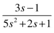

按如下方式将其转换为传递函数格式：

```
>> g = poly2tfd(0.5*[3 -1],[5 2 1])
g =
    0    1.5000   -0.5000
    5.0000    2.0000    1.0000
    0         0         0
```

如果延迟为 2.5，模型表示为：

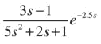

按如下方式转换到传递函数格式：

```
>> g = poly2tfd(0.5*[3 -1],[5 2 1],0,2.5)
g =
    0    1.5000   -0.5000
```


`5.0000    2.0000    1.0000`

`0    2.5000         0`

要使用 `0.75` 个单位的采样周期求出等效的离散传递函数，请使用以下语法：

```
>> delt=0.75;
>> [numd,dend]=cp2dp(0.5*[3 -1],[5 2 1],delt,rem(2.5,delt))
```

```
numd =
    0.1232    0.0000   -0.1106   -0.0607
```

```
DEnd =
    1.0000   -1.6445    0.7408    0.0000
```

## 练习 4-3

给定以下系统，构建单独的变量来创建采样时间为 `T = 3` 的响应模型 `u` 和 `w`，并将它们组合起来形成完整系统的模型。

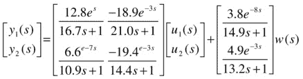

```
>> g11=poly2tfd(12.8,[16.7 1],0,1);
>> g21=poly2tfd(6.6,[10.9 1],0,7);
>> g12=poly2tfd(-18.9,[21.0 1],0,3);
>> g22=poly2tfd(-19.4,[14.4 1],0,3);
>> delt=3; ny=2;
>> umod=tfd2mod(delt,ny,g11,g21,g12,g22);
>> gw1=poly2tfd(3.8,[14.9 1],0,8);
>> gw2=poly2tfd(4.9,[13.2 1],0,3);
>> wmod=tfd2mod(delt,ny,gw1,gw2);
>> pmod=addumd(umod,wmod)
```

```
pmod =
  Columns 1 through 14
    3.0000   13.0000    2.0000         0    1.0000    2.0000         0         0         0         0         0         0         0         0
       NaN    1.5950   -0.6345         0         0         0         0         0         0         0         0         0         0         0
         0    1.0000         0         0         0         0         0         0         0         0         0         0         0         0
         0         0    1.0000         0         0         0         0         0         0         0         0         0         0         0
         0         0         0    1.0000         0         0         0         0         0         0         0         0         0         0
         0         0         0         0    1.0000         0         0         0         0         0         0         0         0         0
         0         0         0         0         0         0    1.6788   -0.7038         0         0         0         0         0         0
         0         0         0         0         0         0    1.0000         0         0         0         0         0         0         0
         0         0         0         0         0         0         0    1.0000         0         0         0         0         0         0
         0         0         0         0         0         0         0         0         0    1.6143   -0.6514         0         0         0
         0         0         0         0         0         0         0         0         0    1.0000         0         0         0         0
         0         0         0         0         0         0         0         0         0         0    1.0000         0         0         0
         0         0         0         0         0         0         0         0         0         0         0    1.0000         0         0
         0         0         0         0         0         0         0         0         0         0         0         0    1.0000         0
         0    1.4447   -0.4371   -0.5012         0         0         0   -2.5160    2.0428         0         0    0.2467    0.2498   -0.3556
         0         0         0    1.1064   -0.4429   -0.4024         0   -3.6484    3.1627         0    0.9962   -0.8145         0         0

  Columns 15 through 17
         0         0         0
    1.0000         0         0
         0         0         0
         0         0         0
         0         0         0
         0         0         0
         0    1.0000         0
         0         0         0
         0         0         0
         0         0    1.0000
         0         0         0
         0         0         0
         0         0         0
         0         0         0
         0         0         0
         0         0         0
```

## 练习 4-4

对于以下系统，构建单独的变量以形成传递函数模型，并计算和绘制其 MIMO 阶跃响应。以下语法用于创建图 4-3 所示的图形：

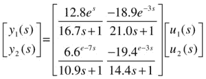

```
>> g11=poly2tfd(12.8,[16.7 1],0,1);
>> g21=poly2tfd(6.6,[10.9 1],0,7);
>> g12=poly2tfd(-18.9,[21.0 1],0,3);
>> g22=poly2tfd(-19.4,[14.4 1],0,3);
>> delt=3; ny=2; tfinal=90;
>> plant=tfd2step(tfinal,delt,ny,g11,g21,g12,g22,gw1,gw2);
>> plotstep(plant)
```

```
Percent error in the last step response coefficient
of output yi for input uj is :
0.48%  1.6%    0.41%
0.049% 0.24%   0.14%
```

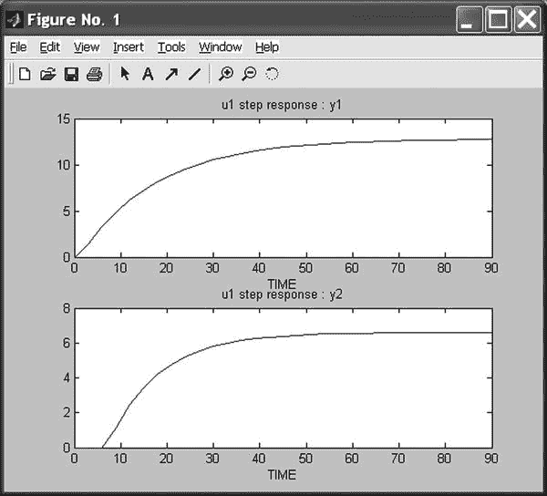

**图 4-3.**

## 练习 4-5

对于上一个问题中描述的线性系统，测量将汇率上限设置为 `0.1`，以及 `u2` 和 `u1` 的下限设置为 `-0.15` 的效果。然后将两个输出的下限均设为零。

我们使用以下语法构建模型：

```
>> g11=poly2tfd(12.8,[16.7 1],0,1);
>> g21=poly2tfd(6.6,[10.9 1],0,7);
>> g12=poly2tfd(-18.9,[21.0 1],0,3);
>> g22=poly2tfd(-19.4,[14.4 1],0,3);
>> delt=3; ny=2; tfinal=90;
>> model=tfd2step(tfinal,delt,ny,g11,g21,g12,g22);
>> plant=model;
>> P=6;  M=2;  ywt=[ ]; uwt=[1 1];
>> tend=30;  r=[0 1];
```

```
Percent error in the last step response coefficient
of output yi for input uj is :
0.48%  1.6%
0.049% 0.24%
```

限制的效果可以通过以下语法查看（见图 4-4）：

```
>> ulim=[-inf -0.15 inf inf 0.1 100];
>> ylim=[ ];
>> [y,u]=cmpc(plant,model,ywt,uwt,M,P,tend,r,ulim,ylim);
>> plotall(y,u,delt),pause
```

```
Time remaining 30/30
Time remaining 0/30
Simulation time is 0.03 seconds.
```

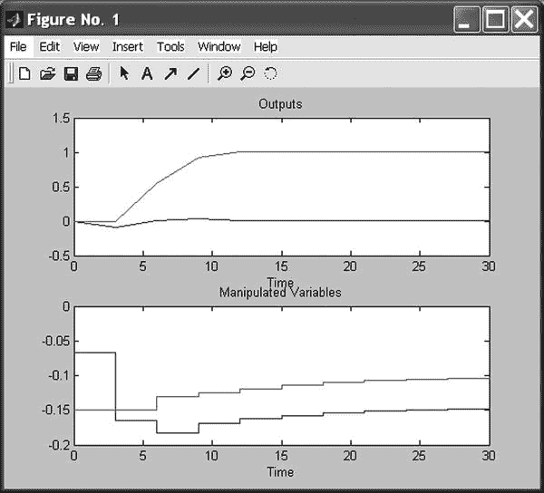

**图 4-4.**

通过使用以下语法，将两个输出的下限设为零（见图 4-5）：

```
>> ulim=[-inf -0.15 inf inf 0.1 100];
>> ylim=[0 0 inf inf];
>> [y,u]=cmpc(plant,model,ywt,uwt,M,P,tend,r,ulim,ylim);
>> plotall(y,u,delt),pause
```

```
Time remaining 30/30
Time remaining 0/30
Simulation time is 0.03 seconds.
```

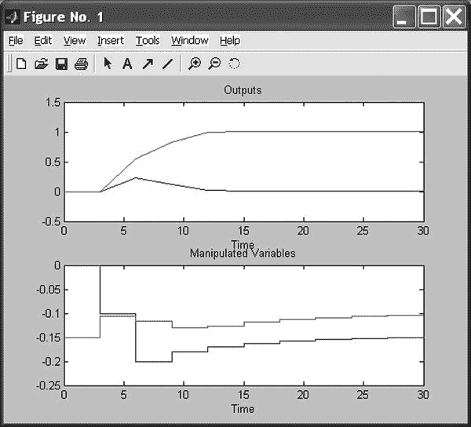

**图 4-5.**

## 练习 4-6

对于前面练习中描述的线性系统，设计一个用于设置模型参数的控制器，计算系统的闭环并检查极点稳定性。然后创建灵敏度和补灵敏度的频率响应图，并计算和绘制灵敏度的奇异值。

```
>> g11=poly2tfd(12.8,[16.7 1],0,1);
>> g21=poly2tfd(6.6,[10.9 1],0,7);
>> g12=poly2tfd(-18.9,[21.0 1],0,3);
>> g22=poly2tfd(-19.4,[14.4 1],0,3);
>> delt=3; ny=2;
>> imod=tfd2mod(delt,ny,g11,g21,g12,g22);
>> pmod=imod;
>> P=6;
>> M=2;
>> ywt=[ ];
>> uwt=[ ];
>> Ks=smpccon(imod,ywt,uwt,M,P);
>> clmod=smpccl(pmod,imod,Ks);
>> maxpole=max(abs(smpcpole(clmod)))
```

```
maxpole =
    0.8869
```

灵敏度（图 4-6）和补灵敏度（图 4-7）的频率响应图生成如下：

```
>> freq = [-3,0,30];
>> in = [1:ny]; % 对于补灵敏度，输入为 r
>> out = [1:ny]; % 对于补灵敏度，输出为 yp
>> [frsp,eyefrsp] = mod2frsp(clmod,freq,out,in);
>> plotfrsp(eyefrsp); % 灵敏度
>> pause;
```

```
over estimated time to perform the frequency response: 0.61 sec
```

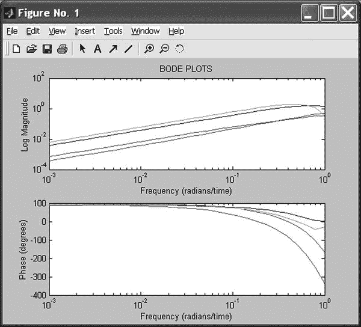

**图 4-6.**


**图 4-7.**

补灵敏度图的语法如下：

```
>> plotfrsp(frsp); % 补灵敏度
>> pause;
```

要计算和绘制灵敏度的奇异值（见图 4-8），我们使用以下语法：

```
>> [sigma, omega] = svdfrsp (eyefrsp);
>> CLG;
>> semilogx(omega,sigma);
>> title('Singular Values vs. Frequency');
>> xlabel('Frequency (radians/time)');
>> ylabel('Singular Values');
```

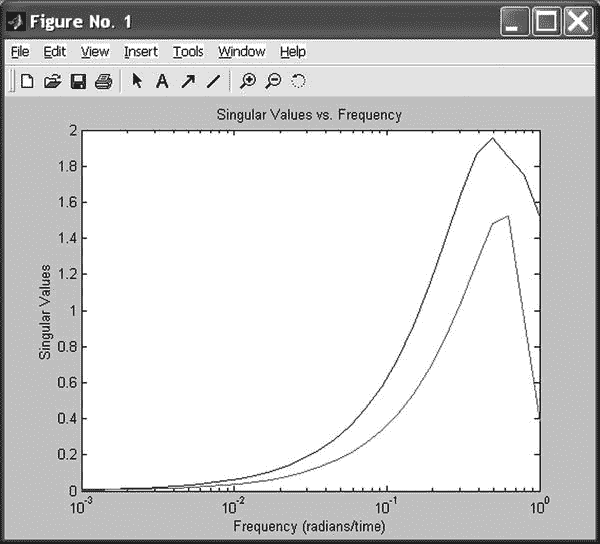

**图 4-8.**
