# 1. MATLAB 介绍及 MATLAB 工作环境

## 引言

MATLAB 是一个用于科学计算和高级编程的平台，它采用交互式环境，使您能够比使用 `C`、`C++` 和 `FORTRAN` 等传统语言更高效地执行复杂的计算任务。它是目前科学和工程领域最流行的平台之一。

MATLAB 是一个用于算法开发、数据可视化、数据分析和数值分析的交互式高级技术计算环境。MATLAB 适用于解决涉及技术计算的问题，它使用集成在易于使用的命令中的优化算法。

MATLAB 可用于广泛的应用领域，包括微积分、代数、统计学、计量经济学、质量控制、时间序列、信号与图像处理、通信、控制系统设计、测试与测量系统、金融建模、计算生物学等。称为工具箱（可单独获取的、用于特定目的 MATLAB 函数集合）的补充工具集扩展了 MATLAB 环境，使您能够解决不同应用领域的特殊问题。

此外，MATLAB 包含许多允许您记录和共享工作成果的函数。可以将 MATLAB 代码与其他语言和应用程序集成，并分发使用 MATLAB 开发的算法和应用程序。

以下是 MATLAB 最重要的特性：

-   它是一种用于技术计算的高级语言
-   它提供了一个用于管理代码、文件和数据的开发环境
-   它具有用于探索、设计和迭代求解的交互式工具
-   它支持用于线性代数、统计学、傅里叶分析、滤波、优化和数值积分的数学函数
-   它可以生成高质量的二维和三维图形以辅助数据可视化
-   它包括创建自定义图形用户界面的工具
-   它可以与外部语言集成，例如 `C/C++`、`FORTRAN`、`Java`、`COM` 和 Microsoft Excel

MATLAB 开发环境允许您以交互模式开发算法、分析数据、显示数据文件和管理项目（见图 1-1）。

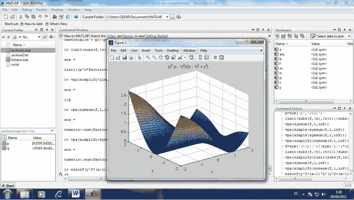

图 1-1。

## 开发算法和应用程序

MATLAB 提供了一种高级编程语言和开发工具，使您能够快速开发和分析算法和应用程序。

MATLAB 语言包含解决科学和工程问题所必需的向量和矩阵运算。这简化了开发和执行过程。

使用 MATLAB 语言，编程和开发算法的速度比使用传统语言更快，因为不再需要执行低级管理任务，例如声明变量、指定数据类型和分配内存。在许多情况下，MATLAB 消除了对 `for` 循环的需求。因此，一行 MATLAB 代码通常可以替换几行 `C` 或 `C++` 代码。

同时，MATLAB 提供了传统编程语言的所有特性，包括算术运算符、控制流、数据结构、数据类型、面向对象编程 (OOP) 和调试。

图 1-2 展示了一个通信调制算法，它生成 1024 个随机比特、执行调制、添加复高斯噪声并以图形方式表示结果，所有这些仅用九行 MATLAB 代码即可完成。

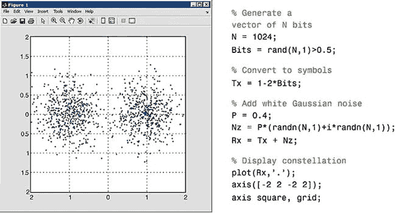

图 1-2。

MATLAB 使您能够一次执行一个命令或一组命令，无需编译或链接，并重复执行以获得最优解。

为了快速执行复杂的向量和矩阵计算，MATLAB 使用针对处理器优化的库。对于一般的标量计算，MATLAB 使用 JIT（即时编译）技术生成机器码指令。得益于这项在大多数平台上都可用的技术，其执行速度比传统编程语言快得多。

MATLAB 包含有助于高效实现算法的开发工具。下面列出了其中一些工具：

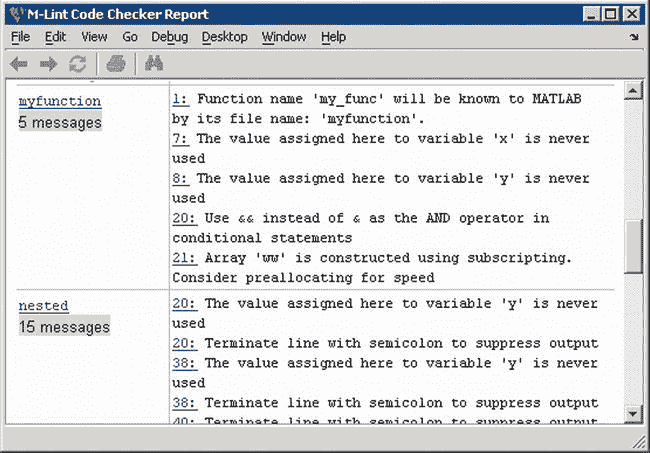

图 1-3。

-   `MATLAB 编辑器`——用于编辑函数和标准调试，例如设置断点和逐步运行仿真
-   `M-Lint 代码检查器`——分析代码并建议更改以提升性能和可维护性（见图 1-3）
-   `MATLAB 分析器`——记录执行每一行代码所花费的时间
-   `目录报告`——扫描目录中的所有文件，并生成关于代码效率、文件间差异、文件依赖关系和代码覆盖率的报告

您还可以使用交互式工具 `GUIDE`（图形用户界面开发环境）来设计和编辑用户界面。该工具允许您包含选择列表、下拉菜单、按钮、单选按钮和滑块，以及 MATLAB 图表和 `ActiveX` 控件。您还可以通过使用 MATLAB 函数编程来创建图形用户界面。

图 1-4 展示了一个使用用户界面 `GUIDE`（上方）创建的完整小波分析工具（下方）。

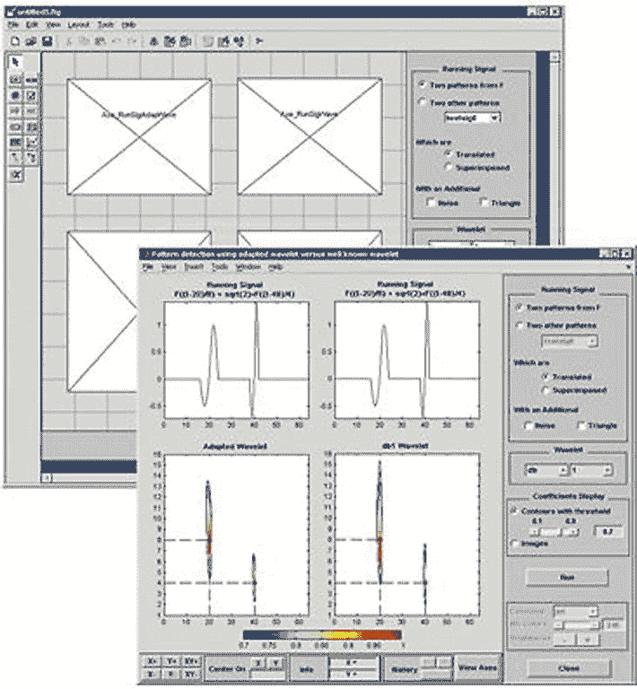

图 1-4。

## 数据访问与分析

MATLAB 支持数据分析的整个过程，从从外部设备和数据库采集数据、预处理、可视化和数值分析，直至生成具有演示质量的结果。

MATLAB 为数据分析提供了交互式工具和命令行操作，包括：数据分段、缩放与平均、插值、阈值处理与平滑、相关性、傅里叶分析与滤波、一维峰值和零点搜索、基本统计与曲线拟合、矩阵分析等。

图 1-5 中的图表显示了一条拟合于复活节岛和澳大利亚达尔文之间平均气压差的曲线。

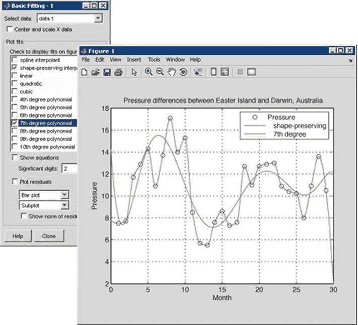

图 1-5。

MATLAB 平台允许高效访问数据文件、其他应用程序、数据库和外部设备。您可以读取以大多数已知格式存储的数据，例如 Microsoft Excel、ASCII 文本文件或二进制图像、声音和视频文件，以及诸如 `HDF` 和 `HDF5` 文件之类的科学档案。用于低级 I/O 函数的二进制文件允许您处理任何格式的数据文件。附加功能允许您查看网页和 XML 数据。

可以调用其他应用程序和语言，例如 `C`、`C++`、`COM`、`DLL`、`Java`、`FORTRAN` 和 Microsoft Excel 对象，并访问 FTP 站点和 Web 服务。使用数据库工具箱，您甚至可以访问 `ODBC/JDBC` 数据库。

### 数据可视化

`MATLAB` 提供了可视化科学与工程数据所需的所有图形功能。这包括用于二维和三维图形的工具、三维体可视化工具、交互式创建图形的工具，以及使用最流行图形格式进行导出的能力。用户可以自定义图形，例如添加多个坐标轴、更改线条和标记的颜色、添加注释、`LaTeX` 方程和图例，以及绘制路径。

可以创建各种向量数据的二维图形表示，包括：

*   折线图、面积图、条形图和扇形图
*   方向图和速度图
*   直方图
*   多边形和曲面图
*   散点气泡图
*   动画

图 1-6 显示了某发动机多次排放测试结果的线性图，并带有一条拟合数据的曲线。

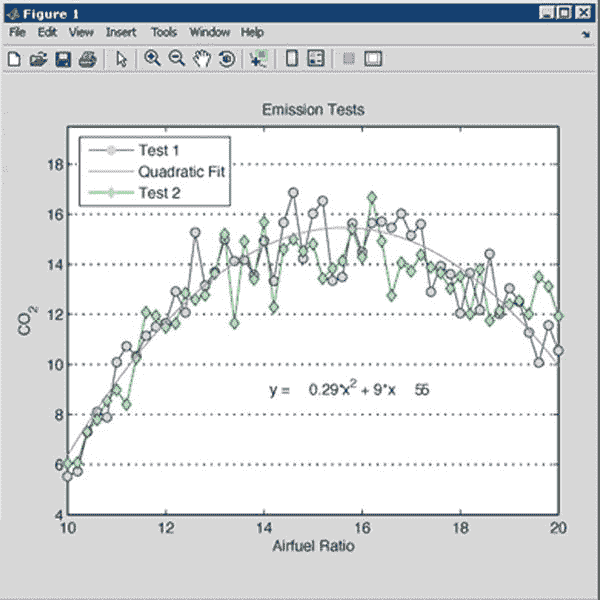

图 1-6.

`MATLAB` 还提供了用于显示二维数组、三维标量数据和三维向量数据的函数。可以使用这些函数来可视化和理解大量复杂的多维数据。还可以定义图形的特性，例如相机方向、透视、光照、光源和透明度。三维图形功能包括：

*   曲面图、等高线图和网格图
*   空间曲线
*   锥体图、相位图、流线图和等值面图

图 1-7 显示了一个等值面的三维图形，揭示了富勒烯碳-60 分子的测地线结构。

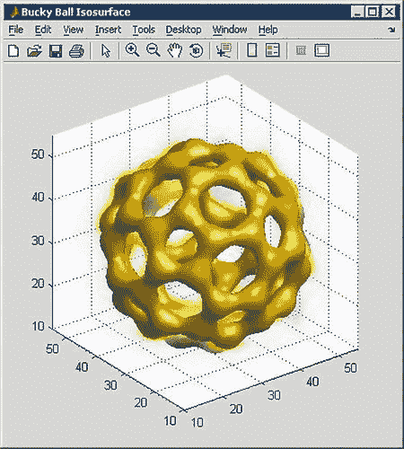

图 1-7.

`MATLAB` 包含用于图形编辑和设计的交互式工具。在 `MATLAB` 图形中，您可以执行以下任意任务：

*   将新的数据集拖放到图形中
*   更改图形中任何对象的属性
*   更改缩放、旋转、视图（即全景）、相机角度和光照
*   添加数据标签和注释
*   绘制形状
*   生成可复用于不同数据的 `M-file`

图 1-8 展示了一系列图形，这些图形是通过将数据集拖放到图形窗口、创建新的子图、更改颜色和字体等属性以及添加注释，以交互方式创建的。

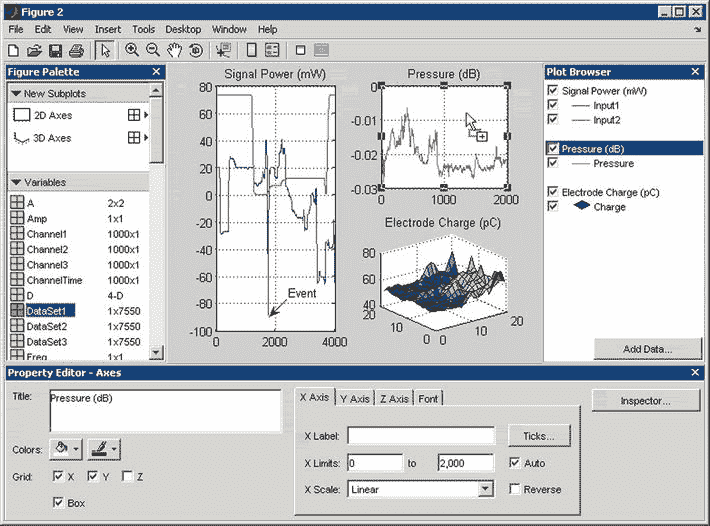

图 1-8.

`MATLAB` 兼容所有知名的数据文件和图形格式，例如 `GIF`、`JPEG`、`BMP`、`EPS`、`TIFF`、`PNG`、`HDF`、`AVI` 和 `PCX`。因此，可以将 `MATLAB` 图形导出到其他应用程序，例如 `Microsoft Word` 和 `Microsoft Powerpoint`，或桌面出版软件。在导出之前，您可以创建并应用包含所有设计细节、字体、线宽等的样式模板，以满足出版规范要求。

### 数值计算

`MATLAB` 包含数学、统计和工程函数，支持这些领域中的大多数操作。这些函数由数学专家开发，是 `MATLAB` 语言的基础。举例来说，`MATLAB` 在以下领域实现了数学函数和数据分析：

*   矩阵运算与线性代数。
*   多项式与插值。
*   傅里叶分析与滤波。
*   统计与数据分析。
*   优化与数值积分。
*   常微分方程 (`ODE`)。
*   偏微分方程 (`PDE`)。
*   稀疏矩阵操作。

## 结果发布与应用程序分发

此外，`MATLAB` 包含许多允许您记录和共享工作的函数。您可以将 `MATLAB` 代码与其他语言和应用程序集成，并将您的算法和 `MATLAB` 应用程序作为独立的程序或软件模块进行分发。

`MATLAB` 允许您以图形或完整报告的形式导出结果。您可以将图形导出为所有流行的图形格式，然后将其导入到其他软件包中，例如 `Microsoft Word` 或 `Microsoft PowerPoint`。使用 `MATLAB Editor`，您可以自动将 `MATLAB` 代码发布为 `HTML` 格式、`Word`、`LaTeX` 等。例如，图 1-9 显示了一个 `M-file`（左侧）使用 `MATLAB Editor` 发布成了 `HTML`（右侧）。发送到 `Command Window` 或图形中的结果会被捕获并包含在文档中，注释则成为 `HTML` 中的标题和文本。

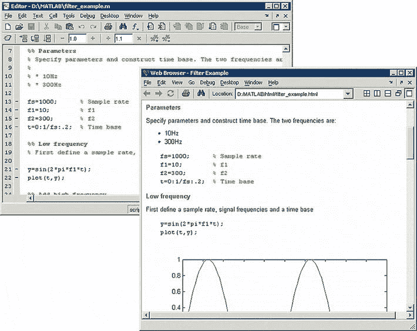
图 1-9.

可以使用 `MATLAB Report Generator`（另售）创建更复杂的报告，例如模拟执行和各种参数测试。

`MATLAB` 提供了使您能够将 `MATLAB` 应用程序与 `C` 和 `C++` 代码、`FORTRAN` 代码、`COM` 对象以及 `Java` 代码集成的函数。您可以调用 `DLLs`、`Java` 类和 `ActiveX` 控件。使用 `MATLAB engine` 库，您还可以从 `C`、`C++` 或 `FORTRAN` 代码中调用 `MATLAB`。

您可以在 `MATLAB` 中创建算法，并将其分发给其他 `MATLAB` 用户。使用 `MATLAB Compiler`（另售），算法可以分发给没有 `MATLAB` 的用户，既可以作为独立应用程序，也可以作为包含在项目中的软件模块。其他附加产品能够将算法转换为可从 `COM` 或 `Microsoft Excel` 调用的软件模块。

## MATLAB 工作环境

图 1-10 展示了 `MATLAB` 环境的主要工作区。这是您输入 `MATLAB` 程序的界面。

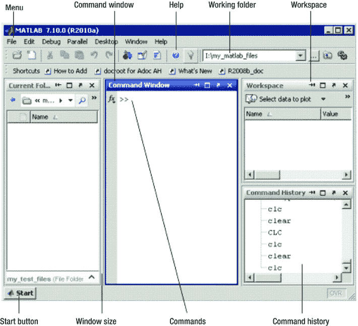
图 1-10.

下表总结了 `MATLAB` 环境的各个组件。

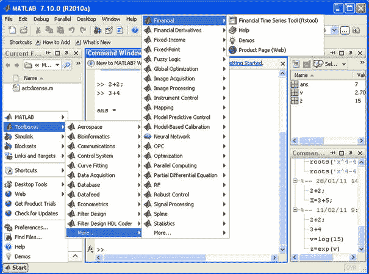
图 1-12.

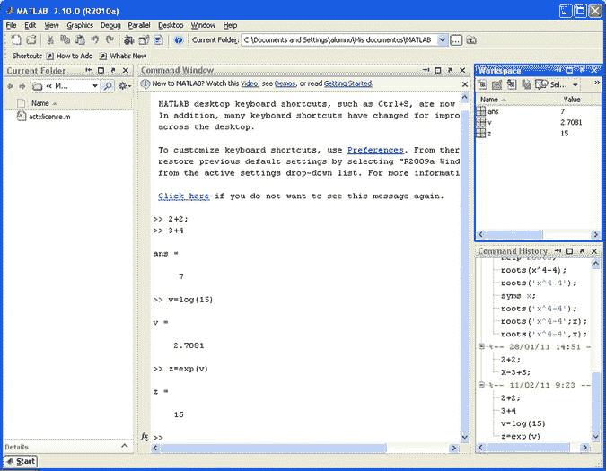
图 1-11.

| 工具 | 描述 |
| :--- | :--- |
| `Command History`（命令历史） | 允许您查看当前会话在命令窗口中输入的命令，并可以复制和运行这些命令（见图 1-11 的右下方部分） |
| `Command Window`（命令窗口） | 您在此处输入 `MATLAB` 命令（见图 1-11 的中央部分） |
| `Workspace`（工作区） | 允许您查看工作区的内容（变量等）（见图 1-11 的右上方部分） |
| `Help`（帮助） | 提供 `MATLAB` 的帮助和演示 |
| `Start button`（启动按钮） | 使您能够运行工具并访问 `MATLAB` 文档（图 1-12） |

`MATLAB` 命令是在命令窗口中用户输入提示符 `»` 的右侧编写的，命令的响应会立即显示在下面的几行中。退出响应后，用户输入提示符会重新显示，允许您输入更多内容（图 1-13）。

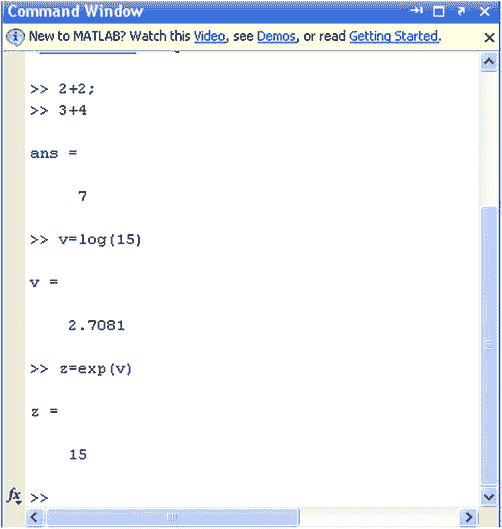
图 1-13.

当在命令窗口中向 `MATLAB` 输入命令，且结果未赋给变量时，返回的响应将以表达式 `ans =` 开头，如图 1-13 顶部附近所示。如果将结果赋给一个变量，那么我们就可以在后续输入中将该变量用作参数。图 1-13 中的变量 `v` 就是这种情况，它随后被用作指数运算的输入。

要运行 `MATLAB` 命令，只需键入命令并按 `Enter` 键。如果在输入末尾加上分号，程序会执行计算并将其保存在内存（工作区）中，但不会在屏幕上显示结果（参见图 1-13 中的第一个条目）。输入提示符 `»` 出现，表示您可以输入新命令。

与 `C` 编程语言一样，`MATLAB` 区分大小写；例如，`Sin(x)` 和 `sin(x)` 是不同的。所有内置函数的名称都以小写字母开头。命令、变量或函数的名称中不应有空格。在其他情况下，空格将被忽略，并且可以使用空格使输入更具可读性。可以通过用逗号分隔多个条目来在同一命令行中输入它们，并在最后一个条目末尾按 `Enter` 键（见图 1-14）。如果在一行中的某个条目末尾使用分号，则其对应的输出将不会显示。

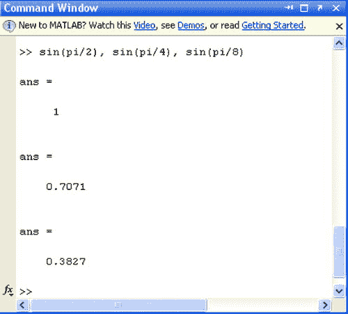
图 1-14.

可以在命令输入行中以 `%` 符号开头输入描述性注释。当您运行输入时，`MATLAB` 会忽略注释并处理其余代码（见图 1-15）。

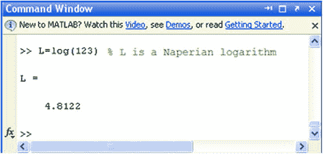
图 1-15.

为了简化通过 `MATLAB` 解释器（通过命令窗口提示符）输入脚本的过程，您可以使用箭头键。例如，如果您按一次向上箭头键，您将恢复上次提交的条目。如果您按两次向上键，您将恢复倒数第二次提交的条目，依此类推。

如果您在输入区域键入一串字符，然后按向上箭头键，您将恢复以指定字符串开头的最后提交的条目。

在 `MATLAB` 会话期间输入的命令会临时存储在缓冲区（工作区）中，直到会话结束，届时它们可以永久存储在文件中或永久丢失。

以下是在 `MATLAB` 输入区域（命令行）中可使用的键及其功能的摘要：

| 键 | 功能 |
| :--- | :--- |
| 向上箭头 (`Ctrl-P`) | 检索上一个条目。 |
| 向下箭头 (`Ctrl-N`) | 检索下一个条目。 |
| 向左箭头 (`Ctrl-B`) | 将光标向左移动一个字符。 |
| 向右箭头 (`Ctrl-F`) | 将光标向右移动一个字符。 |
| `CTRL-向左箭头` | 将光标向左移动一个单词。 |
| `CTRL-向右箭头` | 将光标向右移动一个单词。 |
| `Home (Ctrl-A)` | 将光标移动到行首。 |
| `End (Ctrl-E)` | 将光标移动到当前行的行尾。 |
| `Escape` | 清除命令行。 |
| `Delete (Ctrl-D)` | 删除光标指示的字符。 |
| `Backspace` | 删除光标左侧的字符。 |
| `CTRL-K` | 删除（清除）当前行。 |

命令 `clc` 会清除命令窗口，但不会删除工作区的内容（内容仍保留在内存中）。

## MATLAB 帮助

您可以通过工具栏中的帮助按钮  或菜单栏中的 `Help` 选项来查找 `MATLAB` 帮助。此外，也可以通过 `MATLAB` 命令获得支持。命令 `help` 提供所有 `MATLAB` 命令的通用帮助（见图 1-16）。单击其中任何一个，您可以获得更具体的帮助。例如，如果您单击命令 `graph2d`，您将获得有关二维图形的支持（见图 1-17）。

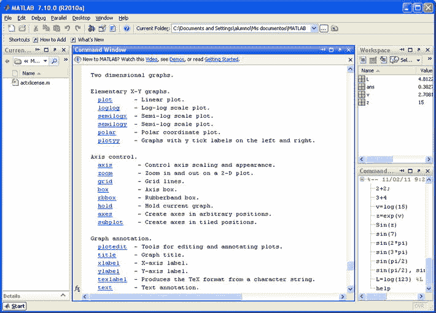
图 1-17.

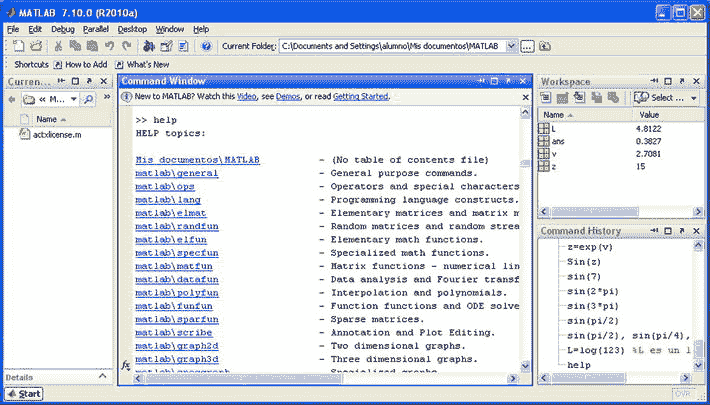
图 1-16.

您可以使用命令 `help command` 或 `help topic` 来请求关于特定命令 `command`（图 1-18）或任何主题 `topic`（图 1-19）的帮助。

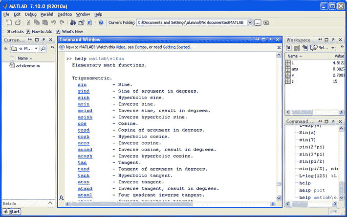
图 1-19.

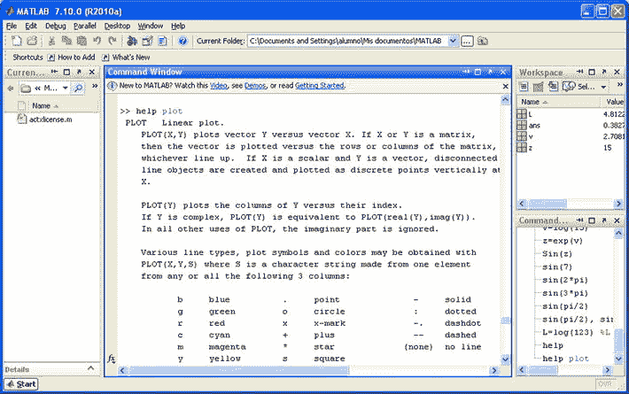

图 1-18.

命令 `lookfor string` 允许您查找所有引用或包含字符串 `string` 的 MATLAB 函数或命令。当没有针对指定字符串的直接支持时，或者要查看与给定字符串相关的所有命令的帮助时，此命令非常有用。例如，如果我们想查找所有包含序列 `inv` 的命令的帮助，我们可以使用命令 `lookfor inv`（图 1-20）。

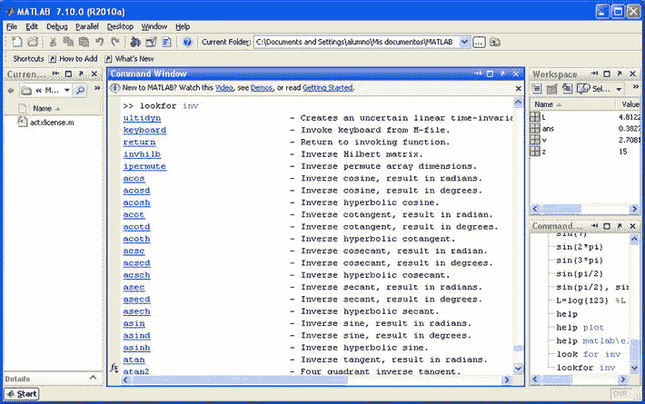

图 1-20.

## 使用 MATLAB 进行数值计算

你可以将 MATLAB 用作一个强大的数值计算器。虽然大多数计算器只能处理预设精度的数字，但 MATLAB 可以执行任意所需精度的精确计算。此外，与计算器不同，我们不仅可以对单个数字进行运算，还可以对数组之类的对象进行操作。

该软件处理了经典数值分析中的大多数主题。它支持矩阵计算、统计、插值、最小二乘拟合、数值积分、函数最小化、线性规划、微分方程的数值解和代数解，以及随着本书内容的深入我们将遇到的一长串其他数值分析方法。

以下是使用 MATLAB 进行数值计算的一些示例。（众所周知，要获得结果，需要在提示符"`»`"后输入所需命令后按 Enter 键。）

我们简单地计算 `4 + 3` 得到结果 `7`。要做到这一点，只需输入 `4 + 3`，然后按 Enter 键。

```
» 4 + 3
ans =
7
```

我们求 `3` 的 `100` 次幂的值，无需预先设置精度。为此，我们只需输入 `3 ^ 100`。

```
» 3 ^ 100
ans =
5.1538e + 047
```

我们可以使用命令 `format long e` 来获得 15 位（浮点数）的结果。

```
» format long e
» 3¹⁰⁰
ans =
5.153775207320115e+047
```

我们也可以处理复数。通过输入表达式 `(2 + 3i) ^ 10`，求 `(2 + 3i)` 的 `10` 次幂的结果。

```
» (2 + 3i) ^ 10
ans =
-1 415249999999998e + 005 - 1. 456680000000000e + 005i
```

上一个结果也可以使用 `format short` 命令以短格式显示。

```
» format short
» (2 + 3i)¹⁰
ans =
-1.4152e+005- 1.4567e+005i
```

我们可以计算贝塞尔函数 `J[0]` 在 11.5 处的值。为此，我们输入 `besselj(0,11.5)`。

```
>> besselj(0,11.5)
ans =
   -0.0677
```

## 使用 MATLAB 进行符号计算

MATLAB 完美地处理符号数学计算，能够轻松地操作和运算公式及代数表达式。你可以展开、分解和简化多项式、有理式和三角表达式，求多项式方程和方程组的代数解，符号化地计算导数和积分，求微分方程的解，处理幂运算，以及研究极限和代数级数的许多其他特性。

为了执行这些任务，MATLAB 首先要求所有变量（或代数表达式）写在单引号之间。当 MATLAB 接收到一个用引号括起来的变量或表达式时，它会被解释为符号变量。

以下是使用 MATLAB 进行符号计算的一些示例。

我们可以展开以下代数表达式：`((x+1)(x+2)-(x+2)²)³`。通过输入：`expand('(x+1)(x+2)-(x+2)²)³')` 完成。结果将是另一个代数表达式：

```
» syms x; expand(((x + 1) *(x + 2)-(x + 2) ^ 2) ^ 3)
ans =
-x ^ 3-6 * x ^ 2-12 * x-8
```

我们可以通过输入 `factor('((x + 1) *(x + 2)-(x + 2) ^ 2) ^ 3')` 来分解上述示例的计算结果：

```
» syms x; factor(((x + 1)*(x + 2)-(x + 2)²)³)
ans =
-(x+2)³
```

我们可以通过输入 `int('x ^ 2 * sin(x) ^ 2', 'x')` 来求函数 `(x ^ 2) sin(x) ^ 2` 的不定积分：

```
» int('x²*sin(x)²', 'x')
ans =
x ^ 2 *(-1/2 * cos(x) * sin(x) + 1/2 * x)-1/2 * x * cos(x) ^ 2 + 1/4 * cos(x) * sin(x) + 1/4 * 1/x-3 * x ^ 3
```

我们可以简化上一个结果：

```
>> syms x; simplify(int(x²*sin(x)², x))
ans =
sin(2*x)/8 -(x*cos(2*x))/4 -(x²*sin(2*x))/4 + x³/6
```

我们可以使用更优雅的数学符号来表示上一个结果：

```
>> syms x; pretty(simplify(int(x²*sin(x)², x)))
ans =
                          2             3
  sin(2 x)   x cos(2 x)   x  sin(2 x)   x
  -------- - ---------- - ----------- + --
    8           4             4        6
```

我们可以解方程 `3ax-7 x ^ 2 + x ^ 3 = 0`（其中 `a` 是一个参数）：

```
» solve('3*a*x-7*x² + x³ = 0', 'x')
ans =
[                      0]
[7/2 + 1/2 *(49-12*a) ^(1/2)]
[7/2-1/2 *(49-12*a) ^(1/2)]
```

另一方面，MATLAB 可以使用 Maple 程序库来进行符号数学运算，从而扩展其作用领域。通过这种方式，MATLAB 可用于处理诸如微分形式、欧几里得几何、射影几何、统计等主题。

同时，Maple 也可以受益于 MATLAB 强大的数值计算能力，例如可以与 Maple 库（组合数学、优化、数论等）结合使用。

## MATLAB 图形

MATLAB 可以生成二维和三维图形，以及等高线和密度图。你可以以图形方式表示数据列表，控制颜色、阴影和其他图形特征。还支持动画图形。MATLAB 生成的图形可以移植到其他程序。

下面给出一些 MATLAB 图形的示例。

我们可以绘制函数 `xsin(1/x)` 在 `x` 介于 `-π/4` 和 `π/4` 之间的图形，在区间内取 300 个等距点。见图 1-21。

```
» x = linspace(-pi/4,pi/4,300);
» y=x.*sin(1./x);
» plot(x,y)
```

我们可以为上面的图形添加标题、标注坐标轴，并添加网格。见图 1-22。

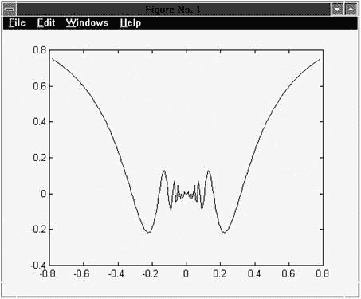

图 1-21.

```
» x = linspace(-pi/4,pi/4,300);
» y=x.*sin(1./x);
» plot(x,y);
» grid;
» xlabel('自变量 X');
» ylabel('因变量 Y');
» title('函数 y=xsin(1/x)')
```

我们可以生成由函数 `z = sin(sqrt(x²+y²)) /sqrt(x²+y²)` 定义的曲面图，其中 `x` 和 `y` 在区间 `(-7.5, 7.5)` 内变化，取间隔为 `0.5` 的等距点。见图 1-23。

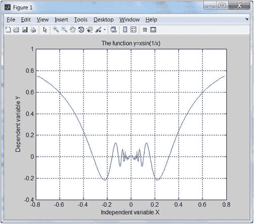

图 1-22.

```
» x =-7.5:. 5:7.5;
» y = x;
» [X, Y] = meshgrid(x,y);
» Z=sin(sqrt(X.²+Y.²))./sqrt(X.²+Y.²);
» surf(X, Y, Z)
```

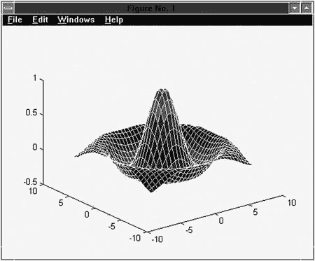

图 1-23.

这些三维图形能让你清晰地了解空间中的图形，对于直观地识别不同物体之间的交点，以及生成各种空间曲线、曲面和旋转体非常有帮助。

我们可以生成参数坐标为 `x = sin(t)`, `y = cos(t)`, `z = t` 的螺旋线对应的三维图形。见图 1-24。

```
» t=0:pi/50:10*pi;
» plot3(sin(t),cos(t),t)
```

# MATLAB 绘图与命令帮助

我们可以绘制由其极坐标 `r = cos(2t) * sin(2t)` 给出的平面曲线，其中 `t` 在 `0` 到 `π` 范围内变化，取间隔为 `0.01` 的等距点。见图 1-24。

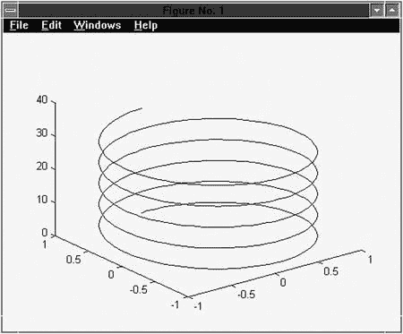

```
» t = 0:. 1:2 * pi;
» r = sin(2*t). * cos(2*t);
» polar(t,r)
```

我们可以使用命令 `ezplot` 绘制符号函数的图形。见图 1-25。

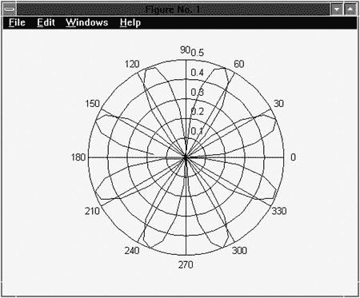

```
» y ='x ^ 3 /(x²-1)';
» ezplot(y,[-5,5])
```

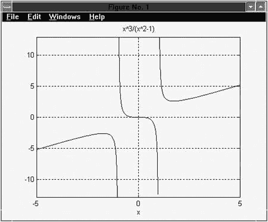

图 1-26.

我们将在关于图形的章节中更详细地介绍这些概念。

## 一般符号约定

与任何程序一样，学习 MATLAB 的最佳方法就是使用它。通过实际示例练习，你会熟悉 MATLAB 特有的语法和符号约定。我们给出的每个示例都包含用户输入提示符 `»` 以及 MATLAB 在下一行的响应。见图 1-27。

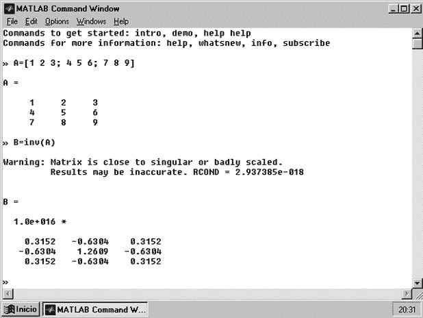

在其他情况下，根据输入给 MATLAB 的条目（用户输入）类型，响应会使用表达式 `ans =` 返回。见图 1-28。

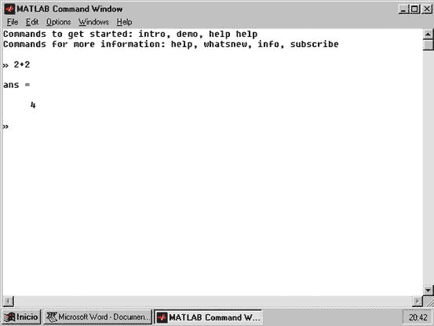

注意区分大写字母和小写字母、圆括号与方括号、空格和标点符号（尤其是逗号和分号）的使用至关重要。

## 命令帮助

在上一章中，我们已经了解了如何通过 MATLAB 的下拉菜单获取帮助。除此之外，还可以通过实现为 MATLAB 对象的命令（指令或函数）获得支持。

你可以使用 `help` 命令立即访问各种信息。

```
» help

HELP topics:

matlab\general       -  通用命令。
matlab\ops           -  运算符和特殊字符。
matlab\lang          -  编程语言结构。
matlab\elmat         -  基本矩阵和矩阵操作。
matlab\elfun         -  初等数学函数。
matlab\specfun       -  特殊数学函数。
matlab\matfun        -  矩阵函数 - 数值线性代数。
matlab\datafun       -  数据分析和傅里叶变换。
matlab\polyfun       -  插值和多项式。
matlab\funfun        -  函数函数和 ODE 求解器。
matlab\sparfun       -  稀疏矩阵。
matlab\graph2d       -  二维图形。
matlab\graph3d       -  三维图形。
matlab\specgraph     -  专用图形。
matlab\graphics      -  句柄图形。
matlab\uitools       -  图形用户界面工具。
matlab\strfun        -  字符串。
matlab\iofun         -  文件输入/输出。
matlab\timefun       -  时间和日期。
matlab\datatypes     -  数据类型和结构。
matlab\winfun        -  Windows 操作系统接口文件（DDE/ActiveX）
matlab\demos         -  示例和演示。
toolbox\symbolic     -  符号数学工具箱。
toolbox\tour         -  MATLAB 导览
toolbox\local        -  偏好设置。

如需获取关于某个目录/主题的更多帮助，请键入 "help topic"。
```

正如我们所见，`help` 命令会显示程序目录及其内容的列表。任何关于指定主题 `topic` 的帮助，都可以使用 `help topic` 命令进行显示。例如：

```
» help inv

INV   矩阵求逆。
    INV(X) 是方阵 X 的逆矩阵。
    如果 X 病态或接近奇异，则会打印警告消息。

    另请参阅 SLASH, PINV, COND, CONDEST, NNLS, LSCOV。

    重载方法
    help sym/inv.m
```

```
» help matlab\elfun

初等数学函数。

三角函数。
    sin         - 正弦。
    sinh        - 双曲正弦。
    asin        - 反正弦。
    asinh       - 反双曲正弦。
    cos         - 余弦。
    cosh        - 双曲余弦。
    acos        - 反余弦。
    acosh       - 反双曲余弦。
    tan         - 正切。
    tanh        - 双曲正切。
    atan        - 反正切。
    atan2       - 四象限反正切。
    atanh       - 反双曲正切。
    sec         - 正割。
    sech        - 双曲正割。
    asec        - 反正割。
    asech       - 反双曲正割。
    csc         - 余割。
    csch        - 双曲余割。
    acsc        - 反余割。
    acsch       - 反双曲余割。
    cot         - 余切。
    coth        - 双曲余切。
    acot        - 反余切。
    acoth       - 反双曲余切。

指数函数。
    exp         - 指数。
    log         - 自然对数。
    log10       - 常用（以 10 为底）对数。
    log2        - 以 2 为底的对数和浮点数分解。
    pow2        - 以 2 为底的幂和浮点数缩放。
    sqrt        - 平方根。
    nextpow2    - 下一个 2 的更高次幂。

复数函数。
    abs         - 绝对值。
    angle       - 相位角。
    conj        - 复共轭。
    imag        - 复数的虚部。
    real        - 复数的实部。
    unwrap      - 展开相位角。
    isreal      - 若为实数数组则返回真。
    cplxpair    - 将数字排序为复共轭对。

舍入和余数函数。
    fix         - 向零方向舍入。
    floor       - 向负无穷方向舍入。
    ceil        - 向正无穷方向舍入。
    round       - 舍入到最近的整数。
    mod         - 模运算（除法后的有符号余数）。
    rem         - 除法后的余数。
    sign        - 符号函数。
```

有一个用于查找包含特定字符序列的命令（`lookfor string`），它允许你找出所有包含或引用给定字符串 `string` 的函数或命令。当对指定字符串没有直接帮助，或者你想查看与给定序列相关的所有命令的帮助时，此命令非常有用。例如，如果我们查找所有包含序列 `complex` 的命令的帮助，可以使用 `lookfor complex` 命令查看 MATLAB 提供了哪些命令。

```
» lookfor complex

ctranspose.m: %'   复共轭转置。
CONJ   复共轭。
CPLXPAIR 将数字排序为复共轭对。
IMAG   复数的虚部。
REAL   复数的实部。
CDF2RDF 复对角形式转换为实块对角形式。
RSF2CSF 实块对角形式转换为复对角形式。
B5ODE  刚性问题，具有复数特征值的线性问题（EHL 的 B5）。
CPLXDEMO 复变函数的映射。
CPLXGRID 极坐标复网格。
CPLXMAP 绘制复变函数的图形。
GRAFCPLX 演示 MATLAB 中的复函数图。
ctranspose.m: %TRANSPOSE 符号矩阵的复共轭转置。
SMOKE  具有“烟环”伪谱的复矩阵。
```

## MATLAB 与编程

通过根据程序的语法规则，正确组合 MATLAB 中定义的所有对象，你可以构建有用的数学研究编程代码。程序通常由一系列指令组成，在这些指令中计算值、为值分配名称，并在后续计算中重用这些值。

与 C 或 FORTRAN 等编程语言一样，在 MATLAB 中你可以编写包含循环、控制流和条件判断的程序。MATLAB 可以编写过程式程序，即它可以定义一系列要执行的标准步骤。与 C 或 Pascal 一样，可以使用`Do`、`For`或`While`循环进行重复计算。MATLAB 语言还包括条件结构，例如`If—Then—Else`。MATLAB 还支持不同的逻辑运算符，例如`AND`、`OR`、`NOT`和`XOR`。

MATLAB 支持过程式编程（包含迭代过程、递归函数、循环等）、函数式编程和面向对象编程。以下是两个简单的程序示例。第一个生成`n`阶 Hilbert 矩阵，第二个计算所有小于 1000 的斐波那契数。

```matlab
% 生成 n 阶 Hilbert 矩阵
t = '1/(i+j-1)';
for i = 1:n
    for j = 1:n
        a(i,j) = eval(t);
    end
end

% 计算斐波那契数
f = [1 1]; i = 1;
while f(i) + f(i-1) < 1000
    f(i+2) = f(i) + f(i+1);
    i = i+1
end
```

### 退出到 MS-DOS 环境的命令

你有三种方法可以从 MATLAB 命令窗口退出到 MS-DOS 操作系统环境，以便运行临时任务。在命令窗口中输入命令 `! dos_command`，可以在 MATLAB 环境中执行指定的 DOS 命令。例如：

```
! dir
The volume of drive D has no label
The volume serial number £ is 145 c-12F2
Directory of D:\MATLAB52\bin

.              <DIR>        13/03/98   0:16 .
..             <DIR>        13/03/98   0:16 ..
BCCOPTS  BAT         1.872  19/01/98  14:14 bccopts.bat
CLBS110  DLL       219.136  21/08/97  22:24 clbs110.dll
CMEX     BAT         2.274  13/03/98   0:28 cmex.bat
COMPTOOL BAT        34.992  19/01/98  14:14 comptool.bat
DF50OPTS BAT         1.973  19/01/98  14:14 df50opts.bat
FENG     DLL        25.088  18/12/97  16:34 feng.dll
FMAT     DLL        16.896  18/12/97  16:34 fmat.dll
FMEX     BAT         2.274  13/03/98   0:28 fmex.bat
LICENSE  DAT           470  13/03/98   0:27 license.dat
W32SSI   DLL        66.560  02/05/97   8:34 w32ssi.dll
10 file(s)         11.348.865 bytes
directory(s) 159.383.552 bytes free
```

命令 `! dos_command &` 用于在后台模式下执行指定的 DOS 命令。该命令通过在 MATLAB 命令窗口上打开一个 DOS 环境窗口来执行，如图 1-29 所示。要返回到 MATLAB 环境，只需在命令窗口中的任意位置点击鼠标右键（DOS 环境窗口将自动关闭）。你可以随时返回到 DOS 窗口运行任何操作系统命令，只需点击屏幕底部标有 MS-DOS 符号的图标。

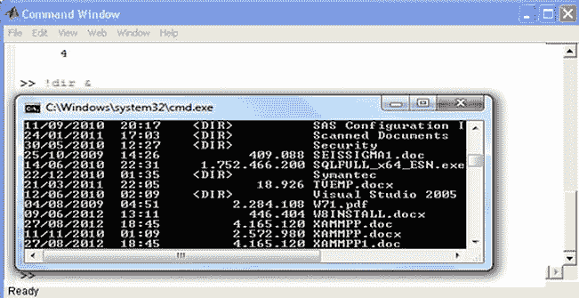
*图 1-29.*

命令 `>>dos_command` 用于在 MATLAB 屏幕中执行 DOS 命令。使用上述三个命令，不仅可以执行 DOS 命令，还可以执行各种可执行文件或批处理任务（图 1-30）。

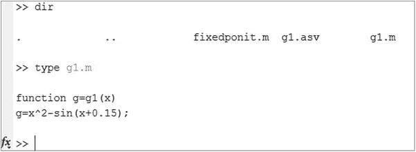
*图 1-30.*

命令 `>>dos dos_command` 也用于在 MATLAB 命令窗口中以自动模式执行指定的 DOS 命令（图 1-31）。

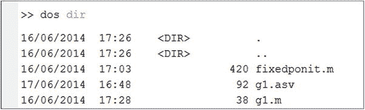
*图 1-31.*

要退出 MATLAB，只需在命令窗口中输入 `quit`，然后按 `Enter` 键。


