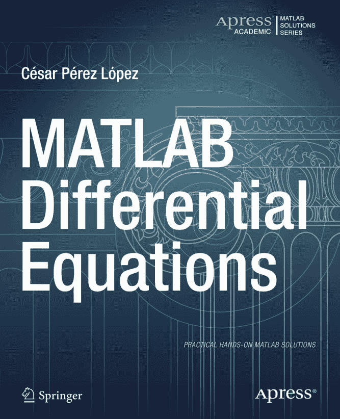

塞萨尔·佩雷斯·洛佩斯 MATLAB 微分方程

ISBN 978-1-4842-0311-8  
e-ISBN 978-1-4842-0310-1  
DOI 10.1007/978-1-4842-0310-1  
© Apress 2014

MATLAB 微分方程  
版权所有 © 2014 塞萨尔·佩雷斯·洛佩斯

本作品受版权保护。出版商保留所有权利，无论是涉及材料的全部或部分，特别是翻译权、重印权、插图再利用权、朗诵权、广播权、缩微胶片复制权或以任何其他物理形式的复制权，以及信息存储与检索、电子改编、计算机软件或目前已知或未来开发的任何类似或不同方法的传输权。法律保留条款的例外情况包括：与评论或学术分析相关的简短摘录，或专门为在计算机系统上输入和执行而提供、仅供购买者专用之材料。本出版物或其部分的复制仅在出版商所在地现行版权法规定下允许，且使用许可必须始终从 Springer 获取。使用许可可通过版权清算中心的 RightsLink 获得。违规行为将根据相应版权法予以起诉。

ISBN-13（平装版）：978-1-4842-0311-8  
ISBN-13（电子版）：978-1-4842-0310-1

本书中可能出现商标名称、徽标和图像。我们并非在每次出现商标名称、徽标或图像时都使用商标符号，而是仅在编辑风格中使用这些名称、徽标和图像，以利于商标所有者，且无意侵犯商标。本出版物中使用的商号、商标、服务标志及类似术语，即使未明确标识，也不应被视作对其是否受所有权保护发表意见。

尽管本书中的建议和信息在出版时被认为是真实准确的，但作者、编辑和出版商均不对可能存在的任何错误或遗漏承担法律责任。出版商对本书所含内容不作任何明示或暗示的担保。

出版商：海因茨·魏因海默  
首席编辑：多米尼克·谢克沙夫特  
编辑委员会：史蒂夫·安格林、马克·贝克纳、尤安·白金汉、加里·康奈尔、路易丝·科里根、吉姆·德沃尔夫、乔纳森·格尼克、乔纳森·哈塞尔、罗伯特·哈钦森、米歇尔·洛曼、詹姆斯·马卡姆、马修·穆迪、杰夫·奥尔森、杰弗里·佩珀、道格拉斯·庞迪克、本·雷诺-克拉克、多米尼克·谢克沙夫特、格温南·斯皮林、马特·韦德、史蒂夫·韦斯  
协调编辑：梅丽莎·马尔多纳多  
文字编辑：巴纳比·谢泼德  
排版：SPi Global  
索引编制：SPi Global  
插图绘制：SPi Global  
封面设计：安娜·伊什琴科

本书通过 Springer Science+Business Media New York 在全球图书贸易中发行，地址：233 Spring Street, 6th Floor, New York, NY 10013。电话：1-800-SPRINGER，传真：(201) 348-4505，电子邮件：`orders-ny@springer-sbm.com`，或访问 `www.springeronline.com`。Apress Media, LLC 是一家加利福尼亚州有限责任公司，其唯一成员（所有者）是 Springer Science + Business Media Finance Inc (SSBM Finance Inc)。SSBM Finance Inc 是一家特拉华州公司。

关于翻译信息，请发送电子邮件至 `rights@apress.com`，或访问 `www.apress.com`。Apress 及 friends of ED 书籍可批量购买用于学术、企业或促销用途。大多数图书也提供电子版及许可证。更多信息，请参考我们的特殊批量销售——电子书授权网页 `www.apress.com/bulk-sales`。

本书作者引用或提及的任何源代码或其他补充材料，读者可在 `www.apress.com` 获取。关于如何找到本书源代码的详细信息，请访问 `www.apress.com/source-code/`。

使用无酸纸印刷。

## 关于作者

塞萨尔·佩雷斯·洛佩斯是马德里大学统计与运筹学系教授。塞萨尔同时也是马德里国家统计研究所（INE）的数学家和经济学家，该机构隶属于西班牙政府高级系统与信息技术部。塞萨尔目前还在马德里财政研究所工作。

## 即将出版

* 《数值分析的 MATLAB 编程》，978-1-4842-0296-8
* 《MATLAB 控制系统工程》，978-1-4842-0290-6
* 《MATLAB 线性代数》，978-1-4842-0323-1
* 《MATLAB 微分与积分》，978-1-4842-0305-7
* 《MATLAB 矩阵代数》，978-1-4842-0308-8

好的，作为一名高级文档工程师和翻译员，我将严格遵循您提供的注意事项和示例，将给定的英文文本翻译成中文。

