# 2. 一阶微分方程。恰当方程、分离变量法、齐次方程和线性方程


## 一阶微分方程

尽管 MATLAB 仅实现了与此主题相关数量相对较少的命令，但它处理微分方程的效率仍然非常高。我们将看到如何使用这些命令来代数求解每种类型的微分方程。此外，还实现了用于方程和方程组近似解的数值方法。

用于求解微分方程的基本命令是 `dsolve`。该命令用于寻找常微分方程和常微分方程组的符号解。方程通过符号表达式指定，其中字母 `D` 用于表示微分，而 `D2`、`D3` 等则用于表示二阶、三阶等微分。前面带有 `D`（或 `D2` 等）的字母是因变量（通常是 `y`），任何前面不带 `D`（或 `D2` 等）的字母被视为自变量的候选。如果未指定自变量，则默认取 `x` 作为自变量。如果 `x` 被指定为因变量，则自变量为 `t`。也就是说，`x` 默认是自变量，除非它被声明为因变量，在这种情况下，自变量被理解为 `t`。

你可以使用附加方程来指定初始条件，其形式为 `y(a) = b` 或 `Dy(a) = b` 等。如果未指定初始条件，微分方程的解将包含积分常数 `C1`、`C2` 等。求解微分方程最重要的 MATLAB 命令如下：

`dsolve('equation', 'v')`：解给定的微分方程，其中 `v` 是自变量（如果未指定 `'v'`，则默认自变量为 `x`）。此命令仅返回显式解。

`dsolve('equation', 'initial_condition', …, 'v')`：在给定的初始条件下解给定的微分方程。

`dsolve('equation', 'cond1', 'cond2', …, 'condn', 'v')`：在给定的初始条件下解给定的微分方程。

`dsolve('equation', 'cond1, cond2, …, condn', 'v')`：在给定的初始条件下解给定的微分方程。

`dsolve('eq1', 'eq2', …, 'eqn', 'cond1', 'cond2', …, 'condn', 'v')`：在给定的初始条件下解给定的微分方程组。

`dsolve('eq1, eq2, …, eqn', 'cond1, cond2, …, condn', 'v')`：在给定的初始条件下解给定的微分方程组。

`maple('dsolve(equation, func(var))')`：解给定的微分方程，其中 `var` 是自变量，`func` 是因变量（返回隐式解）。

`maple('dsolve({equation, cond1, cond2, … condn}, func(var))')`：在给定的初始条件下解给定的微分方程。

`maple('dsolve({eq1, eq2, …, eqn}, {func1(var), func2(var), … funcn(var)})')`：解给定的微分方程组（返回隐式解）。

`maple('dsolve(equation, func(var), ''explicit'')')`：解给定的微分方程，如果可能，以显式形式提供解。

示例如下。

首先，我们求解一阶一次的微分方程，包括有初值和无初值的情况。

```matlab
» pretty(dsolve('Dy = a*y'))
C2 exp(a t)

» pretty(dsolve('Df = f + sin(t)'))
sin(t)   cos(t)
C6 exp(t) - ------ - ------
2        2
```

前两个方程也可以按以下方式求解：

```matlab
» pretty(sym(maple('dsolve(diff(y(x), x) = a * y, y(x))')))
y(x) = exp(a x) _C1

» pretty(maple('dsolve(diff(f(t),t)=f+sin(t),f(t))'))
f(t) = - 1/2 cos(t) - 1/2 sin(t) + exp(t) _C1

» pretty(dsolve('Dy = a*y', 'y(0) = b'))
exp(a x) b

» pretty(dsolve('Df = f + sin(t)', 'f(pi/2) = 0'))
/   pi \
exp| - -- | exp(t)
\   2  /          sin(t)   cos(t)
------------------ - ------ - ------
2              2        2
```

## 常微分方程求解

现在我们解一个一阶二次方程。

```matlab
» y = dsolve('(Dy) ^ 2 + y ^ 2 = 1', ' y(0) = 0', 's')
```

```
y =
cosh((pi*i)/2 + s*i)
cosh((pi*i)/2 - s*i)
```

我们也可以用以下方式求解：

```matlab
» pretty(maple('dsolve({diff(y(s),s)² + y(s)² = 1, y(0) = 0}, y(s))'))
```

```
y(s) = sin(s), y(s) = - sin(s)
```

现在我们来解一个二阶一阶方程。

```matlab
» pretty(dsolve('D2y = - a ^ 2 * y ', 'y(0) = 1, Dy(pi/a) = 0'))
```

```
exp(-a t i)   exp(a t i)
----------- + ----------
2            2
```

接下来我们求解几个方程组，分别带有和不带初始值。

```matlab
>> dsolve('Dx = y', 'Dy = -x')
```

```
ans =
y: [1x1 sym]
x: [1x1 sym]
```

```matlab
>> y
```

```
y =
cosh((pi*i)/2 + s*i)
cosh((pi*i)/2 - s*i)
```

```matlab
>> x
```

```
x =
x
```

```matlab
>> y=dsolve('Df = 3*f+4*g', 'Dg = -4*f+3*g')
```

```
y =
g: [1x1 sym]
f: [1x1 sym]
```

```matlab
>> y.g
```

```
ans =
C27*cos(4*t)*exp(3*t) - C28*sin(4*t)*exp(3*t)
```

```matlab
>> y.f
```

```
ans =
C28*cos(4*t)*exp(3*t) + C27*sin(4*t)*exp(3*t)
```

```matlab
>> y=dsolve('Df = 3*f+4*g, Dg = -4*f+3*g', 'f(0)=0, g(0)=1')
```

```
y =
g: [1x1 sym]
f: [1x1 sym]
```

```matlab
>> y.g
```

```
ans =
cos(4*t)*exp(3*t)
```

```matlab
>> y.f
```

```
ans =
sin(4*t)*exp(3*t)
```

最后一个方程组也可以用以下方式求解：

```matlab
» pretty(maple('dsolve({diff(f(x),x)= 3*f(x)+4*g(x), diff(g(x),x)=-4*f(x)+3*g(x), f(0)=0,g(0)=1}, {f(x),g(x)})'))
```

```
{f(x) = exp(3 x) sin(4 x), g(x) = exp(3 x) cos(4 x)}
```

### 分离变量法

如果一个微分方程可以写成以下形式，则称其具有可分离变量：

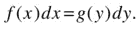

这种类型的方程可以通过代入以下形式立即求解：

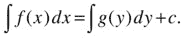

如果 MATLAB 不能直接用 `dsolve` 函数求解微分方程，我们可以尝试将其表示为上述形式，并根据给定积分进行代数求解，鉴于该程序在符号计算方面的多功能性，这不会带来特别的困难。

**练习 2-1**

求解微分方程：

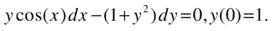

首先尝试直接求解。该方程可以写成以下形式：

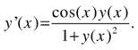

```matlab
» dsolve('Dy = y * cos(x) /(1+y²)')
```

```
ans =
                0
exp(C33 + t*cos(x))*exp(-wrightOmega(2*C33 + 2*t*cos(x))/2)
```

因此，该微分方程似乎不能用 `dsolve` 求解。但在本例中，变量是可分离的，因此我们可以按如下方式求解该方程：

```matlab
» pretty(solve('int(cos(x), x) = int((1+y²) / y, y)'))
```

```
  +-                          -+
  |         /           2 \    |
  |         |          y  |    |
  |     asin| log(y) + -- |    |
  |         \          2  /    |
  |                            |
  |           /           2 \  |
  |           |          y  |  |
  |  pi - asin| log(y) + -- |  |
  |           \          2  /  |
  +-                          -+
```

经过简单的重排，我们看到通解由下式给出：

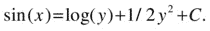

现在我们通过初始条件，令`x = 0`且`y = 1`，求常数`C`的值。

`» C = simple('solve(subs(x = 0, y = 1, sin(x) = log(y) + 1/2 * y ^ 2 + C), C)')`

```
C =
-1/2
```

因此最终解为：

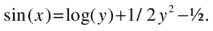

同样地，你可以求解任何其他具有可分离变量的微分方程。

上述微分方程也可以直接通过以下方式求解：

`» pretty(maple('dsolve(diff(y(x), x) = y(x) * cos(x) /(1 + y(x) ^ 2), y(x))'))`

```
                                         2
                      log(y(x)) + 1/2 y(x) - sin(x) = _C1
```

### 齐次微分方程

考虑一个一般形式的一阶一次微分方程：

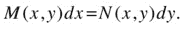

如果函数`M`和`N`满足以下条件，则称该方程为`n`次齐次方程：

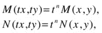

对于这种类型的方程，我们可以通过变量替换`x = vy`，将原始微分方程（变量为`x`和`y`）转化为另一个（可分离的）方程（变量为`v`和`y`）。新的方程通过分离变量法求解，然后通过反转变量替换求得原始方程的解。

**练习 2-2**

求解微分方程：

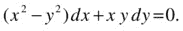

首先检查方程是否为齐次方程：

`» maple('m:=(x,y) - > x ^ 2 - y ^ 2');`

`» maple('n:=(x,y) - > x * y ');`

`» factor('m(t*x,t*y)')`

```
ans =
t ^ 2 *(x-y) *(x + y)
```

`» factor('n(t*x,t*y)')`

```
ans =
t ^ 2 * x * y
```

因此该方程是 2 次齐次方程。为了求解，我们应用变量替换`x = vy`。

在执行变量替换之前，建议使用命令`maple('with(difforms)')`加载`difforms`库，这将允许你处理微分形式。加载此库后，还建议使用命令`maple('defform(v=0,x=0,y=0)')`，该命令允许声明在微分过程中不是常数或参数的所有变量。

`» maple('with(difforms)');`

`» maple('defform(v=0,x=0,y=0)');`

现在我们可以进行变量替换`x = vy`，并将项分组为`d(v)`和`d(y)`。

`» simplify('subs(x = v * y m(x,y) * d(x) + n(x,y) * d(y))')`

```
ans =
v ^ 2 * y ^ 3 * d(v) + v ^ 3 * y ^ 2 * d(y) - y ^ 3 * d(v)
```

`» pretty(maple('collect(v ^ 2 * y ^ 3 * d(v) + v ^ 3 * y ^ 2 * d(y) - y ^ 3 * d(v) {d(v), d(y)})'))`

```
2  2    2                       2
(v  y  - y )(y d(v) + v d(y)) + y  v d(y)
```

如果我们将前一个表达式除以`v³y³`，并将项分组为`d(v)`和`d(y)`，我们就得到了一个分离变量的方程。

`» pretty(maple('collect(((v²*y³-y³) * d(v) + v ^ 3 * y ^ 2 * d(y)) /(v³*y³), {d(v), d(y)})'))`

```
2  3    3
(v  y  - y ) d(v)    d(y)
----------------- + ----
3  3           y
v  y
```

前面的表达式可以简化。

`» pretty(maple('convert(collect(((v²*y³-y³) * d(v) + v ^ 3 * y ^ 2 * d(y)) /(v³*y³), {d(v), d(y)}), parfrac, y)'))`

```
2
(v  - 1) d(v)    d(y)
------------- + ----
3          y
v
```

现在，我们求解方程：

`» pretty(simple('int((v²-1)/v ^ 3, v) + int(1/y,y)'))`

```
1
log(v) + ---- + log(y)
2
2 v
```

最后反转变量替换：

`» pretty(simple('subs(v = x / y log(v) + 1/2/v ^ 2 + log(y))'))`

```
2
y
log(x) + 1/2 ----
2
x
```

因此，原始微分方程的通解为：

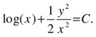

现在我们可以用图形表示该微分方程的解。为此，我们绘制带有参数`C`的解的图形，这等价于由上述通解左侧定义的函数的等高线图（参见图 18-1）：

`» [x,y]=meshgrid(0.1:0.05:1/2,-1:0.05:1);`

`» z=y.²./(2*x.²)+log(x);`

`» contour(z,65)`

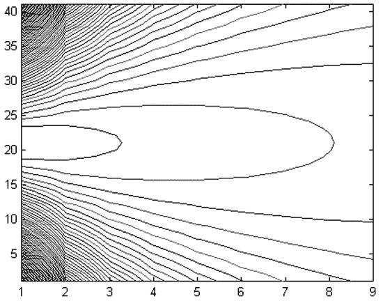

图 2-1

## 恰当微分方程

若满足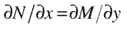，则称微分方程

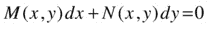

为恰当微分方程。若方程为恰当的，则存在函数`F`，其全微分`dF`与上述方程的左端相等，即：

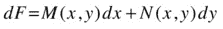

因此解族由`F(x,y) = C`给出。

下面的练习遵循此类方程代数解法的常规步骤。

**练习 2-3**

求解微分方程：

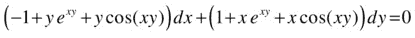

首先，尝试用`dsolve`求解方程：

```
» maple('m:=(x,y) - > - 1 + y * exp(x*y) + y * cos(x*y)')
```

```
» maple('n:=(x,y) - > 1 + x * exp(x*y) + x * cos(x*y)')
```

```
» dsolve('m(x,y) + n(x,y) * Dy = 0')
??? Error using ==> dsolve
Explicit solution could not be found.
```

因此函数`dsolve`无法给出所提出方程的解。我们将尝试使用经典代数方法来求解该方程。


## 恰当微分方程

首先，检验所提出的微分方程是否为恰当的。

```
» pretty(simple(diff('m(x,y)','y')))
exp(y x) + x y exp(y x) + cos(y x) - x sin(y x) y
```

```
» pretty(simple(diff('n(x,y)','x')))
exp(y x) + x y exp(y x) + cos(y x) - x sin(y x) y
```

由于方程是恰当的，我们可以通过以下方式找到解：

```
» solution1 = simplify('int(m(x,y), x) + g(y)')
solution1 =
-x+exp(y*x) + sin(y*x) + g(y)
```

接下来，我们通过以下条件求函数`g(y)`：

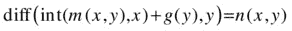

```
» pretty(simplify('int(m(x,y), x) + g(y)'))
                   -x + exp(y x) + sin(y x) + g(y)
```

```
» pretty(simplify('diff(-x+exp(y*x) + sin(y*x) + g(y), y)'))
                                               d
                  x exp(y x) x + x cos(y x) + -- g(y)
                                              dy
```

```
» simplify('solve(x * exp(y*x) + x * cos(y*x) + diff(g(y), y) = n(x,y), diff(g(y), y))')
ans =
1
```

因此`g'(y) = 1`，所以最终解为（省略常数项）：

```
» pretty(simplify('subs(g(y) = int(1,y),-x+exp(y*x) + sin(y*x) + g(y))'))
-x + exp(y x) + sin(y x) + y
```

为了以图形形式表示解族，我们绘制上述表达式的等高线图（图 18-2）：

```
» [x,y]=meshgrid(-2*pi/3:.2:2*pi/3);
» z =-x+exp(y.*x) + sin(y.*x) + y;
» contour(z,100)
```

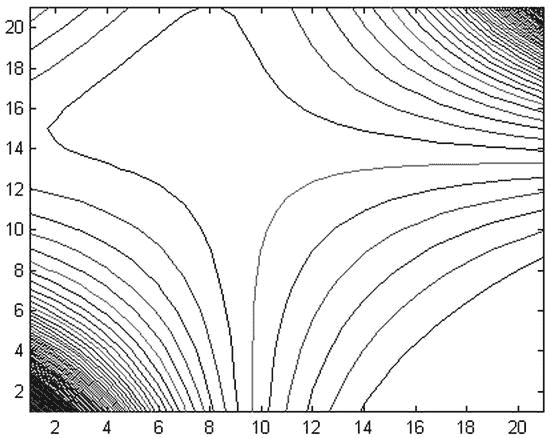

图 2-2。

下一节我们将看到，任何可约的微分方程如何通过积分因子转化为恰当方程。

## 线性微分方程

一阶线性微分方程是如下形式的方程：

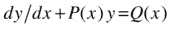

其中`P(x)`和`Q(x)`是给定的关于`x`的函数。

此类微分方程可通过在方程两边乘以积分因子转化为恰当方程：

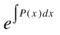

其通解由以下表达式给出：

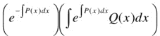

MATLAB 实现了这些线性微分方程的解，并且只要积分因子中的积分可求，就会给出结果。

### 练习 2-4

求解微分方程：

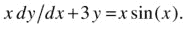

```
» pretty(simple(dsolve('x * Dy + 3 * y = x * sin(x)')))
                    /   3 t \
             C36 exp| - --- |
  x sin(x)          \    x  /
  -------- - ----------------
     3              3
```


