# 高阶微分方程。拉普拉斯变换与特殊类型的方程

## 常高阶方程

`n` 阶常线性微分方程具有以下一般形式：

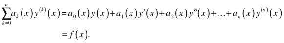

如果函数 `f(x)` 恒为零，则方程称为齐次方程。否则称为非齐次方程。如果函数 `ai`（i = 1, …, n）是常数，则称该方程为常系数方程。

在此背景下，一个非常重要的概念是线性无关函数集。若函数集 `{f1, f2, …, fn}` 在它们的共同定义域内任意 `x` 处的朗斯基行列式不为零，则称该函数集是线性无关的。给定函数集在共同定义域内某点 `x` 处的朗斯基行列式定义如下：

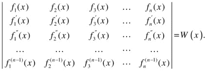

MATLAB 命令 `maple('Wronskian')` 可用于计算函数集的朗斯基矩阵。其语法为：

*   `maple('Wronskian(V,x)')`：计算以 `x` 为自变量的函数向量 `V` 对应的朗斯基矩阵。

`n` 阶齐次线性方程

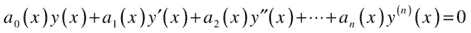

的一组线性无关的平凡解构成的集合 `S = {f1, …, fn}`，称为该方程的一个基本解组。

若函数 `ai`（i = 1, …, n）在开区间 `I` 内连续，则齐次方程在 `I` 上存在一个基本解组 `S = {fi}`。

此外，齐次方程的通解将由以下函数给出：

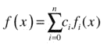

其中 `{c[i]}` 是一组任意常数。

方程：


称为常系数齐次微分方程的特征方程。该特征方程的解决定了相应微分方程的通解。

**练习 3-1**

证明以下函数集

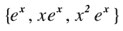

是线性无关的。

```
» indfunctions = maple('vector([exp(x), x * exp(x), x ^ 2 * exp(x)])')
indfunctions =
[exp(x), x * exp(x), x ^ 2 * exp(x)]
```

```
» W=maple('Wronskian(indfunctions,x)')
W =
[exp(x),          x*exp(x),                     x²*exp(x)]
[exp(x),   exp(x)+x*exp(x),          2*x*exp(x)+x²*exp(x)]
[exp(x), 2*exp(x)+x*exp(x), 2*exp(x)+4*x*exp(x)+x²*exp(x)]
```

```
» pretty(determ(W))
       3
2 exp(x)
```

得到朗斯基行列式的值，显然它始终不为零。因此，该函数集是线性无关的。


## 线性高阶方程。常系数齐次方程

n 阶齐次线性微分方程

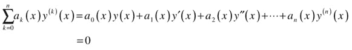

如果函数 `ai` (i = 1, …, n) 均为常数（即它们不依赖于变量 x），则称其具有常系数。

方程：

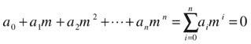

被称为上述微分方程的**特征方程**。该特征方程的解（`m[1]`, `m[2]`, …, `m[n]`）决定了相应微分方程的通解。

如果 `m[i]` (i = 1, …, n) 互不相同，则常系数齐次方程的通解为：

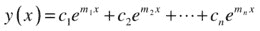

其中 `c[1]`, `c[2]`, …, `c[n]` 是任意常数。

如果某个 `m[i]` 是特征方程的 k 重根，则它决定了解中的以下 k 项：

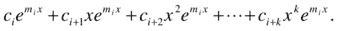

如果特征方程有一个复根 `m[j] = a+bi`，那么它的复共轭 `m[j+1] = a-bi` 也是一个根。这两个根决定了齐次方程通解中的一对项：

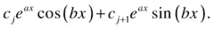

MATLAB 直接应用此方法，使用命令 `dsolve` 或 `maple('dsolve')` 来获得常系数齐次线性方程的解。

**练习 3-2**

求解以下方程：

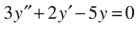

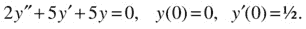

```
» pretty(dsolve('3*D2y+2*Dy-5*y=0'))
                      /   5 t \
  C38 exp(t) + C39 exp| - --- |
                      \    3  /
```

```
» pretty(dsolve('2 * D2y + 5 * Dy + 5 * y = 0', ' y(0) = 0 Dy(0) = 1/2 '))
                          /   1/2   \
     1/2    /   5 t \    | 15    t |
 2 15    exp| - --- | sin| ------- |
             \    4  /    \    4    /
  -----------------------------------
                  15
```

**练习 3-3**

求解微分方程

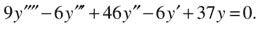

```
» pretty(simple(dsolve('9*D4y-6*D3y+46*D2y-6*Dy+37*y=0')))
                                          / t \                   / t \
C46 cos(t) + C47 sin(t) + C44 cos(2 t) exp| - | + C45 sin(2 t) exp| - |
                                          \ 3 /                   \ 3 /
```

观察解，可以明显看出特征方程有两对复共轭解。

```
» solve('9*x⁴-6*x³+46*x²-6*x+37=0')
ans =
         i
        -i
1/3 + 2*i
1/3 - 2*i
```

## 常系数非齐次方程。参数变易法

考虑常系数非齐次线性方程：

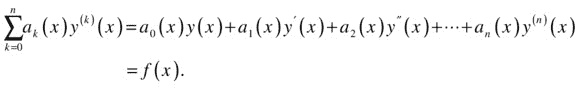

假设 {`y1`, `y2`, ..., `yn`} 是相应齐次方程的一个线性无关解集：

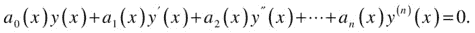

非齐次方程的一个特解由下式给出：

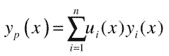

其中函数 `ui` 通过如下方式获得：

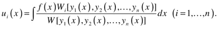

这里 `W[i]y[1, y2, …, yn]` 是将朗斯基矩阵 `Wy[1, y2, …, yn]` 的第 i 列替换为向量 (0, 0,…, 0, 1) 的转置后得到的矩阵的行列式。

然后，非齐次方程的解由齐次方程的通解和非齐次方程的特解组合而成。如果齐次方程特征方程的根 `m[i]` 全部不同，则非齐次方程的通解为：

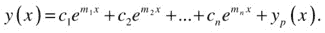

如果某些根是重根，我们参考之前讨论过的齐次方程解的一般形式。

**练习 3-4**

求解下列微分方程：

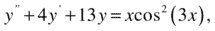

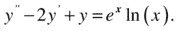

我们将遵循参数变易法的代数方法来求解第一个方程。我们首先考虑齐次方程的特征方程，以获得一组线性无关的解。

```
» solve('m²+4*m+13=0')
ans =
[- 2 + 3 * i]
[- 2 - 3 * i]
```

```
» maple('f: = x - > x * cos(3*x) ^ 2');
» maple('y1: = x - > exp(-2*x) * cos(3*x)');
» maple('y2: = x - > exp(-2*x) * sin(3*x)');
» maple('W: = x - > Wronskian([y1(x), y2(x)], x)');
» pretty(simplify(maple('det(W(x))')))
3 exp(-4 x)
```

我们看到朗斯基行列式非零，表明这些函数是线性无关的。现在计算函数 `Wi`，i = 1, 2。

```
» maple('W1: x-= > array([[0, y2(x)], [1, diff((y2)(x), x)]])');
» pretty(simplify(maple('det(W1(x))')))
-exp(-2 x) sin(3 x)
```

```
» maple('W2: x-= > array([[y1(x), 0], [diff((y1)(x), x), 1]])');
» pretty(simplify(maple('det(W2(x))')))
exp(-2 x) cos(3 x)
```

现在计算非齐次方程的特解。

```
» maple('u1:=x->factor(simplify(int(f(x)*det(W1(x))/det(W(x)),x)))');
» maple('u1(x)')
ans =
1/14652300*exp(2*x)*(129285*cos(9*x)*x-6084*cos(9*x)-28730*sin(9*x)*x-13013*sin(9*x)+281775*cos(3*x)*x-86700*cos(3*x)-187850*sin(3*x)*x-36125*sin(3*x))
```

```
» maple('u2:=x->factor(simplify(int(f(x)*det(W2(x))/det(W(x)),x)))');
» maple('u2(x)')
ans =
1/14652300 * exp(2*x) *(563550 * cos(3*x) * x+108375 * cos(3*x) + 845325 * sin(3*x) * x-260100 * sin(3*x) + 28730 * cos(9*x) * x+13013 * cos(9*x) + 129285 * sin(9*x) * x-6084 * sin(9*x))
```

```
» maple('yp: = x - > factor(simplify(y1(x) *(x) u1 + y2(x) * u2(x)))');
» maple('yp(x)')
ans =
-23/1105 * x * cos(3*x) ^ 2 + 13436/1221025 * cos(3*x) ^ 2 + 24/1105 * cos(3*x) * sin(3*x) * x + 3852/1221025 * cos(3*x) * sin(3*x) + 54/1105 * x-21168/1221025
```

然后我们可以写出非齐次方程的通解：

```
» maple(' y: = x - > simplify(c1 * y1(x) + c2 * y2(x) + yp(x))');
» maple('combine(and(x), trig)')
ans =
C1 * exp(-2*x) * cos(3*x) + c2 * exp(-2*x) * sin(3*x)-23/2210 * x * cos(6*x) + 1/26 * x + 6718/1221025 * cos(6*x)-2/169 + 12/1105 * x * sin(6*x) + 1926/1221025 * sin(6*x)
```

现在我们以图形方式展示一组解，针对特定的 `c1` 和 `c2` 值（见图 3-1）。

```
» fplot(simplify('subs(c1=-5,c2=-4,y(x))'),[-1,1])
» hold on
```


```matlab
» fplot(simplify('subs(c1=-5,c2=4,y(x))'),[-1,1])
» fplot(simplify('subs(c1=-5,c2=2,y(x))'),[-1,1])
» fplot(simplify('subs(c1=-5,c2=-2,y(x))'),[-1,1])
» fplot(simplify('subs(c1=-5,c2=-1,y(x))'),[-1,1])
» fplot(simplify('subs(c1=-5,c2=1,y(x))'),[-1,1])
» fplot(simplify('subs(c1=5,c2=1,y(x))'),[-1,1])
» fplot(simplify('subs(c1=5,c2=-1,y(x))'),[-1,1])
» fplot(simplify('subs(c1=5,c2=-2,y(x))'),[-1,1])
» fplot(simplify('subs(c1=5,c2=2,y(x))'),[-1,1])
» fplot(simplify('subs(c1=5,c2=4,y(x))'),[-1,1])
» fplot(simplify('subs(c1=5,c2=-4,y(x))'),[-1,1])
» fplot(simplify('subs(c1=0,c2=-4,y(x))'),[-1,1])
» fplot(simplify('subs(c1=0,c2=4,y(x))'),[-1,1])
» fplot(simplify('subs(c1=0,c2=2,y(x))'),[-1,1])
» fplot(simplify('subs(c1=0,c2=-2,y(x))'),[-1,1])
» fplot(simplify('subs(c1=0,c2=-1,y(x))'),[-1,1])
» fplot(simplify('subs(c1=0,c2=1,y(x))'),[-1,1])
```

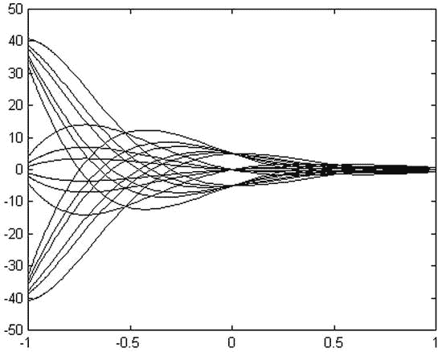

图 3-1.

对于第二个微分方程，我们直接应用 `dsolve` 求解，得到：

```matlab
» pretty(simple(dsolve('D2y-2 * Dy + y = exp(x) * log(x)')))
```

```text
exp(x) log(x) + C49 exp(t) + C50 t exp(t)
```

## 变系数非齐次方程：柯西-欧拉方程

形如

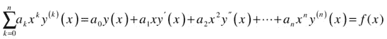

的变系数非齐次线性方程称为柯西-欧拉方程。

MATLAB 可以直接使用 `dsolve` 或 `maple('dsolve')` 命令求解此类方程。

### 练习 3-5

求解下列微分方程：

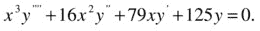

```matlab
» pretty(simple(dsolve('x³*D3y+16*x²*D2y+79*x*Dy+125*y=0')))
```

```text
                  C1 + C2 sin(3 log(x)) x + C3 cos(3 log(x)) x
                  --------------------------------------------
                                       5
                                       x
```

## 拉普拉斯变换

假设 `f(t)` 是定义在区间 `(0, ∞)` 上的函数。`f(t)` 的拉普拉斯变换是由下式定义的函数 `F(s)`：

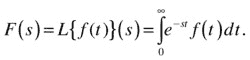

我们称 `f(t)` 是 `F(s)` 的拉普拉斯逆变换，因此有

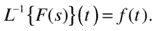

MATLAB 提供了 `maple('laplace')` 和 `maple('invlaplace')` 命令，用于计算表达式关于某个变量的拉普拉斯变换和逆拉普拉斯变换。其语法如下：

*   `maple('laplace(expression, t, s)')`：计算给定表达式关于 `t` 的拉普拉斯变换。变换后的变量是 `s`。
*   `maple('invlaplace(expression, s, t)')`：计算给定表达式关于 `s` 的拉普拉斯逆变换。逆变换的变量是 `t`。

以下是一些示例。

```matlab
» pretty(maple('laplace(t^(3/2)-exp(t)+sinh(a*t), t, s)'));
```

```text
1/2
pi        1        a
3/4 ----- - ----- + -------
5/2   s - 1    2    2
s              s  - a
```

```matlab
» pretty(maple('invlaplace(s²/(s²+a²)^(3/2), s, t)'))
```

```text
- t BesselJ(1, a t) a + BesselJ(0, a t)
```

拉普拉斯变换及其逆变换用于求解某些微分方程。方法是计算方程每一项的拉普拉斯变换，得到一个关于新变量的方程，然后求解。最后，对求得的解应用拉普拉斯逆变换，即可得到原始方程的解。

MATLAB 在 `maple('dsolve')` 命令中提供了 `'laplace'` 选项，这迫使程序使用拉普拉斯变换方法求解微分方程。语法如下：

```matlab
maple('dsolve(equation, func(var), ''laplace'')')
```

### 练习 3-6

使用拉普拉斯变换方法求解微分方程

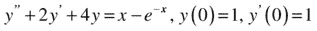

首先，我们计算微分方程两边的拉普拉斯变换，并应用初始条件。

```matlab
» maple('L:=s->laplace(diff(y(x),x$2)+2*diff(y(x),x)+4*y(x),x,s)');
» pretty(simplify('subs(y(0)=1,(D(y))(0)=1,L(s))'))
```

```text
laplace(y(x), x, s) s - s - 3 + 2 laplace(y(x), x, s) s
+ 4 laplace(y(x), x, s)
```

```matlab
» maple('L1:=s->laplace(x-exp(-x),x,s)');
» pretty(simplify('L1(s)'))
```

```text
1       1
---- - -----
2    s + 1
s
```

然后，我们求解拉普拉斯变换后的微分方程：

```matlab
» pretty(simplify(maple('solve(L(s)=L1(s),laplace(y(x),x,s))')))
```

```text
4                            3                           2
s  y(0) + (3 y(0) + D(y)(0)) s  + (2 y(0) + D(y)(0) - 1) s  + s + 1
-------------------------------------------------------------------
2   3      2
s  (s  + 3 s  + 6 s + 4)
```

现在，我们将给定的初始条件代入解中。

```matlab
» maple('TL:=s->solve(L(s)=L1(s),laplace(y(x),x,s))');
» pretty(simplify('subs(y(0)=1,(D(y))(0)=1,TL(s))'))
```

```text
4      3      2
s  + 4 s  + 2 s  + s + 1
--------------------------
2           2
s  (s + 1) (s  + 2 s + 4)
```

这样就得到了拉普拉斯变换后方程的解。为了计算原始方程的解，我们对上一步得到的解进行拉普拉斯逆变换。

```matlab
» maple('TL0:=s->simplify('subs(y(0)=1,(D(y))(0)=1,TL(s))')');
» solucion=simple(maple('invlaplace(TL0(s),s,x)'));
» pretty(solution)
```

```text
1/2     1/2             1/2
1          sin(3    x) 3       35  cos(3    x)
1/4 x - 1/8 - -------- + 5/8 ---------------- + ---- -----------
3 exp(x)            exp(x)         24     exp(x)
```

这样就得到了原始微分方程的解。

我们也可以直接通过以下方式求解：

```matlab
» pretty(simple(sym(maple('dsolve({diff(y(x),x$2)+2*diff(y(x),x)+4*y(x) = x-exp(-x), y(0)=1,D(y)(0)=1},y(x),laplace)'))))
```

```text
1/2     1/2             1/2
1          sin(3    x) 3       35  cos(3    x)
y(x) = 1/4 x - 1/8 - -------- + 5/8 ---------------- + ---- -----------
3 exp(x)            exp(x)         24     exp(x)
```

## 正交多项式

如果两个函数 `f(x)` 和 `g(x)` 在区间 `[a, b]` 上的内积为 0，即如果

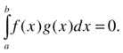

则称它们在区间 `[a, b]` 上正交。正交函数族的一个例子（即族中任意两个不同的函数都是正交的）由以下函数给出：

`fn = sin(nx)` 和 `gn = cos(nx)`，`n = 1, 2, 3, ...`，在区间 `[−π, π]` 上。

MATLAB 提供了广泛的正交多项式列表，这些多项式对于求解某些高阶非线性微分方程非常有用。允许我们使用这些多项式的函数如下：

*   `T(n, x)`：第一类切比雪夫多项式。
*   `U(n, x)`：第二类切比雪夫多项式。
*   `P(n, x)`：勒让德多项式。
*   `H(n, x)`：厄米特多项式。
*   `L(n, x)`：拉盖尔多项式。
*   `L(n, a, x)`：广义拉盖尔多项式。
*   `P(n, a, b, x)`：雅可比多项式。
*   `G(n, m, x)`：盖根鲍尔多项式。

现在让我们看看它们与微分方程的关系。正是这种关系使我们能够找到某些高阶非线性方程的解。要使用这些函数，我们首先需要运行 `maple('with(orthopoly)')`。

### 第一类和第二类切比雪夫多项式

第一类切比雪夫多项式定义为满足以下微分方程的解 `Tn`：

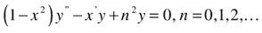

它们的正交性由加权的内积给出：

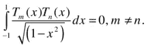

第二类切比雪夫多项式 `Un` 是雅可比多项式（见下文）在 `a = b = 1/2` 时的特殊情况。它们满足正交关系：

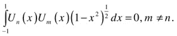


### 勒让德多项式

勒让德多项式 `Pn` 是勒让德微分方程的解：

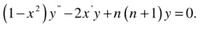

其正交性由以下关系给出：

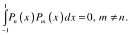

### 关联勒让德多项式

微分方程的解

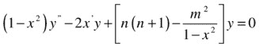

被称为关联勒让德多项式。

其正交性由以下关系给出：

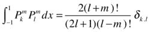

其中 `δ[k.l]` 是克罗内克 δ 函数。

### 埃尔米特多项式

埃尔米特微分方程的解 `Hn`

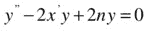

被称为埃尔米特多项式。

其正交性由加权内积给出：

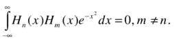

### 广义拉盖尔多项式

广义拉盖尔微分方程的解 `Ln`

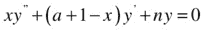

被称为广义拉盖尔多项式。

其正交性由加权内积给出：

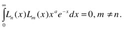

### 拉盖尔多项式

拉盖尔微分方程的解

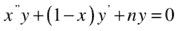

被称为拉盖尔多项式。这是广义拉盖尔多项式中 `a = 0` 的特例。

### 雅可比多项式

雅可比微分方程的解

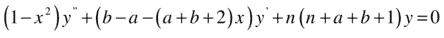

被称为雅可比多项式。

其正交性由加权内积给出：

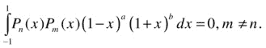

### 盖根鲍尔多项式

盖根鲍尔多项式 `G(n, a, x)` 定义如下：

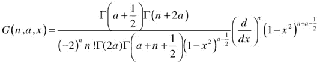

盖根鲍尔微分方程的解

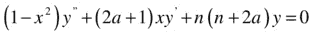

被称为盖根鲍尔多项式。

其正交性由加权内积给出：

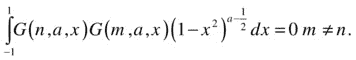

### 练习 3-7

求以下微分方程的解：

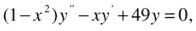

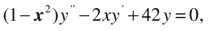

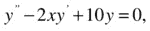

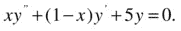

```
» pretty(simple(maple('T(7,x)')))
   7        5       3
64 x  - 112 x  + 56 x  - 7 x
```

```
» pretty(simple(maple('P(6,x)')))
231  6   315  4   105  2
--- x  - --- x  + --- x  - 5/16
16       16       16
```

```
» pretty(simple(maple('H(5,x)')))
   5        3
32 x  - 160 x  + 120 x
```

```
» pretty(simple(maple('L(5,x)')))
2     3       4        5
1-5 x + 5 x - 5/3 x + 5/24 x - 1/120 x
```

## 贝塞尔函数与艾里函数

以下二阶微分方程的线性无关解称为艾里函数：

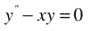 (艾里方程)

以下二阶微分方程的线性无关解称为贝塞尔函数：

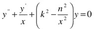 (贝塞尔方程)

以下微分方程的线性无关解称为修正贝塞尔函数：

 (修正贝塞尔方程)

MATLAB 实现了以下相关函数：

*   `Ai(z)` 和 `Bi(z)` 是艾里微分方程的线性无关解。
*   `BesselJ(n,z)` 和 `BesselY(n,z)` 是贝塞尔微分方程的线性无关解。
*   `BesselI(n,z)` 和 `BesselK(n,z)` 是修正贝塞尔微分方程的线性无关解。

### 练习 3-8

求微分方程的解


该方程为 `n = 1/2` 的贝塞尔微分方程。我们得到两个线性无关的解如下：

```
» pretty(simple(maple('BesselJ(1/2,x)')))
        1/2
      2    sin(x)
       ----------
        1/2  1/2
       pi    x
```

```
» pretty(simple(maple('BesselY(1/2,x)')))
    1/2
   2      cos(x)
- -----------
     1/2  1/2
     x   pi
```

