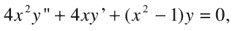
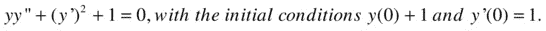
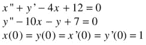
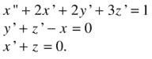
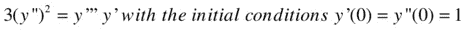
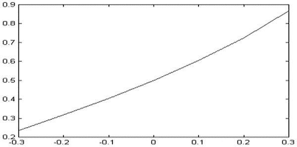

# 4. 微分方程的近似解法

## 高阶方程与近似方法

当已知的微分方程及微分方程组的代数求解方法无法给出解时，我们通常求助于近似方法。近似方法既涉及符号计算也涉及数值计算。符号方法能给出近似的代数解，其最具代表性的技术是泰勒级数法。数值方法则以有限个解点的集合形式给出解，可以通过各种代数方法（插值、回归等）对这些点进行曲线拟合。该曲线将是微分方程的一个近似解。最常见的数值方法之一是龙格-库塔法。

近似方法最常用于求解阶数和次数大于一的方程及微分方程组，这些方程的解无法通过其他方法获得。

## 泰勒级数法

该方法为一般微分方程提供近似的多项式解，其基础是函数的泰勒级数展开。MATLAB 为 `maple('dsolve')` 命令提供了 `'series'` 选项，允许你通过此方法求解方程。其语法如下：

```
maple('dsolve(equation, func(var), 'series'))
```

此外，还有 `maple('powsolve')` 命令，它给出线性微分方程的幂级数解，其语法如下：

```
maple('powseries powsolve ')
```

使用 `maple('convert(polynom)')` 命令，你可以将复杂解转换为关于变量的幂多项式。

### 练习 4-1

使用泰勒级数法求解以下两个方程：





```
» pretty(simple(maple('dsolve(4 * x ^ 2 * diff(y(x), x$ 2) + 4 * x * diff(y(x), x) +(x ^ 2-1) * y(x) = 0 y(x), series)')))
```

```
2           4      6                    6
y(x) = (_C1 x(1 - 1/24 x  + 1/1920 x  + O(x )) + _C2 log(x)(O(x ))
2          4     6     /  1/2
+ _C2(1 - 1/8 x  + 1/384 x + O(x )))  /  x
```

```
» pretty(simplify(maple('convert(_C1 * x ^(1/2) *(1-1 / 24 * x ^ 2 + 1/1920 * x ^ 4 + O(x⁶)) + _C2 *(1/x ^(1/2) * log(x) *(O(x⁶)) + 1/x ^(1/2) *(1-1 / 8 * x ^ 2 + 1/384 * x ^ 4 + O(x⁶))), polynom)')))
```

```
3           5                 6
1/1920(1920 _C1 x - 80 x _C1 + _C1 x + 1920 _C1 x o(x))
6                       2        4
+ 1920 _C2 log(x) o(x) + 1920 _C2 - 240 _C2 x + 5_C2 x
6      1/2
(+1920 _C2 o(x)) / x
```

```
» pretty(maple('dsolve({y(x) * diff(y(x), x$ 2) + diff(y(x), x) ^ 2 + 1 = 0, y(0) = 1, D(y)(0) = 1}, y(x), series)'))
```

```
2    3        4        5      6
y(x) = 1 + x - x  + x  - 3/2 x  + 5/2 x  + O(x )
```

### 练习 4-2

使用泰勒级数法求解以下两个方程组：



和



```
» pretty(simple(maple('dsolve({diff(x(t), t$ 2) + diff(y(t), t) - 4 * x + 12 = 0, diff(y(t), t$ 2) - 10 * diff(x(t), t) y(t) + 7 = 0, x(0) = 1, y(0) = 1, D(0) = 1, D(x)(y)(0) = 1}, {x(t), y(t)}, series)')))
```

```
2                      3        4  387         5      6
{y(t) = 1 + t + 2 t  +(- 43/2 + 20/3 x) t  - 3/2 t  +(--- - 3 x) t  + O(t ),
40
2        3                   4          5     6
x(t) = 1 + t +(- 13/2 + 2 x) t  - 2/3 t  +(43/8 - 5/3 x) t  + 3/10 t  + O(t)}
```

```
» pretty(simple(maple('dsolve({diff(x(t),t$2)+2*diff(x(t),t)+2*diff(y(t),t)+ 3*diff(z(t),t)+x(t)=1,diff(y(t),t)+diff(z(t),t)-x(t)=0,diff(x(t),t)+z(t)=0}, {x(t),y(t),z(t)}, series)')))
```

```
2
{x(t) = x(0) + D(x)(0) t +(- D(x)(0) - 1/2 x(0) + 1/2) t
3                                     4
+(1/2 D(x)(0) + 1/3 x(0) - 1/3) t  +(- 1/6 D(x)(0) - 1/8 x(0) + 1/8) t
5      6
+(1/24 D(x)(0) + 1/30 x(0) - 1/30) t  + O(t ),
2                                     3
z(t) = z(0) + x(0) t + 1/2 D(x)(0) t  +(- 1/3 D(x)(0) - 1/6 x(0) + 1/6) t
4
+(1/8 D(x)(0) + 1/12 x(0) - 1/12) t
5      6
+(- 1/30 D(x)(0) - 1/40 x(0) + 1/40) t  + O(t ),
2                                     3
y(t) = y(0) + x(0) t + 1/2 D(x)(0) t  +(- 1/3 D(x)(0) - 1/6 x(0) + 1/6) t
4
+(1/8 D(x)(0) + 1/12 x(0) - 1/12) t
5      6
+(- 1/30 D(x)(0) - 1/40 x(0) + 1/40) t  + O(t )    }
}
```

## 龙格-库塔法

龙格-库塔法生成一组数据点，你可以通过这些点拟合一条曲线，从而逼近微分方程的解。Maple 为 `maple('solve')` 命令提供了 `numeric` 选项，用于计算微分方程的近似数值解。其语法为：

```
maple('dsolve(equation, func(var), 'numeric'))
```

### 练习 4-3

使用龙格-库塔法求解以下方程：



```
» maple('f: = dsolve({3 * diff(y(x), x$ 2) ^ 2 = diff(y(x), x$ 3) * diff(y(x), x), y(0) = 1/2, D(y)(0) = 1,(D@@2)(y)(0) = 1}, y(x), numeric)')
```

```
ans =

f := proc(x) `dsolve/numeric/result2`(x,3879004,[3]) end
```

现在，为了绘制解的图形，我们计算上面生成的解函数 `f` 的若干点（参见图 4-1）。

```
» [maple('f(-0.3)'),maple('f(-0.2)'),maple('f(-0.1)'),maple('f(0)'),  maple('f(0.1)'), maple('f(0.2)'),maple('f(0.3)')]
```


```
ans =

{x = -.3,y(x) = .2350889359260396}{y(x) = .3167840433732281, x = -.2} {y(x) = .4045548849869109, x = -.1}{y(x) = .5000000000000000, x = 0} {x = .1, y(x) = .6055728090006967}{y(x) = .7254033307597474, x = .2} {y(x) = .8675444679682489, x = .3000000000000000}
```

```
» y = [.2350889359260396,.3167840433732281,.4045548849869109,.5,.6055728090006967,.7254033307597474,.8675444679682489];
```

```
» plot((-0.3:.1:0.3), y)
```



图 4-1.

我们找到一个二次多项式，它是解点集的最佳拟合。该抛物线方程将是微分方程的一个近似解。

```
» pretty(vpa(poly2sym(polyfit((-0.3:.1:0.3),y,2))))
```

```
2
.5747427827483573 x + 1.041293962469090 x +.4991457846921903
```

这给出了方程解`y(x)`的一个二次多项式近似。
