# 微分方程组与有限差分方程

## 常系数线性齐次方程组

MATLAB 可以直接求解此类方程组，只需使用语法熟悉的`dsolve`或`maple('dsolve')`命令即可。

一个写为`X'(t) = AX(t)`的微分方程组，其通解形式如下：

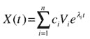

其中，假设系统矩阵对应于特征向量`{V[k]}`的特征值`{λ[k]}`（`K = 1, 2, ... n`）各不相同。

如果特征值`λ[k]`是复数`a[k] + b[k]i`，则它生成整体解的如下分量：

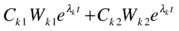

其中：

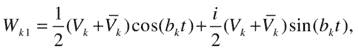

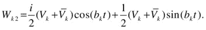

这里``是对应于特征值`λ[k]`的特征向量，而``是其共轭向量。

如果存在重数`m > 1`的特征值`λ[i]`，则它将生成通解中如下形式的一部分：

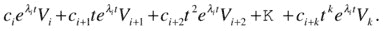

### 练习 5-1

求解以下方程组：

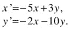

```
» pretty(dsolve('Dx=-5*x+3*y,Dy=-2*x-10*y','t'))
```

```
y(t) = C1 exp(- 7 t) + C2 exp(- 8 t),

x(t) = - 3/2 C1 exp(- 7 t) - C2 exp(- 8 t)
```

你也可以使用以下语法：

```
» pretty(maple('dsolve({diff(x(t), t) =-5 * x(t) + 3 * y(t), diff(y(t), t) =-2 * x(t) - 10 * y(t)}, {x(t), y(t)})'))
```

```
{y(t) = _C1 exp(- 7 t) + _C2 exp(- 8 t),

x(t) = - 3/2 _C1 exp(- 7 t) - _C2 exp(- 8 t)}
```

## 常系数线性非齐次方程组

现在我们来考察形如`X’ = AX + F(t)`的常系数非齐次微分方程组。

齐次方程组`X’ = AX`的通解形式为`X = f(t)C`。该非齐次方程组的一个特解为：

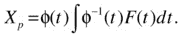

非齐次方程组的通解为`X = f(t)C + Xp`，利用上述表达式可写为：

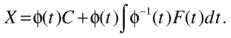

该方法是常微分方程参数变易法在方程组情形下的推广。

MATLAB 可以直接使用`dsolve`或`maple('dsolve')`命令求解此类方程组，前提是解中涉及的积分可求值。

### 练习 5-2

求解以下方程组：

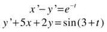

初始条件为`x(0) = x0`和`y(0) = y0`。

```
» pretty(simple(dsolve('Dx-Dy = exp(-t), Dy+5 * x + 2 * y =sin(3 + t) ', ' x(0) = xo, y(0) = yo ', 't ')))
y(t) = 7/50 sin(3) cos(t) + 7/50 cos(3) sin(t) + 5/6 exp(-t)
+ 1/50 sin(3) sin(t) - 1/50 cos(3) cos(t) - 5/7 + 5/7 yo - 5/7 xo
+(-7/50 sin(3) + 2/7 yo + 1/50 cos(3) - 5/42 + 5/7 xo) exp(-7t)
```

## 有限差分方程

MATLAB 函数`maple('rsolve')`可用于求解有限差分方程以及一般的递推方程。其语法为：

`maple('rsolve({equation, initial_conditions}, function)')`

### 练习 5-3

求解以下递推方程：

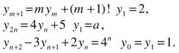

```
» pretty(maple('rsolve({y(m + 1) = m * y(m) +(m + 1)!, y(1) = 2}, y)'))
2
1/2 GAMMA(m)(m + m + 2).
```

```
» pretty(maple('rsolve({y(2*n) = 4 *y(n) + 5, y(1) = a}, y)'))
log(n)
------ + 1
2    2               log(2)
a n  + n (- 20/3(1/4)             + 5/3)
```

```
» pretty(maple('rsolve({y(n + 2) - 3 * y(n + 1) + 2 *y(n) = 4 ^ n, y(0) = 1 y(1) = 1}, y)'))
n        n
4/3 - 1/2 2 + 1/6 4
```

### 练习 5-4

求由以下递推律定义的实数序列的通项公式：

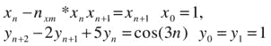

```
» pretty(maple('rsolve({x(n) - n *x(n)  * x(n + 1) = x(n + 1), x(0) = 1}, x)'))
2
----------
2
n - n + 2
```

# Maple 命令与输出示例

以下是使用 Maple 求解一个差分方程的示例，包括完整的符号解和数值简化结果。

```maple
» maple('rsolve({x(n + 2) - 2 * x(n + 1) + 5 * x(n) = cos(3*n), x(0) = 1, x(1) = 1}, x)')
ans =
+10*cos(n-3)³*cos(1)²+10*cos(n-3)³*cos(3)²-72*cos(n-3)³*cos(3)-72*cos(n-3)³*cos(1)-49*cos(n-4)³* 1/2*(1-2*i)^n+1/2*(1+2*i)^n+(-39*cos(n-2)³+22*cos(n-5)³-19*cos(n-4)³+32*cos(n-3)³-25*cos(n-2)³*cos(1)-25*cos(n-2)³*cos(3)+100*cos(n-2)³*cos(1)²+100*cos(n-2)³*cos(3)²cos(1) + 120 * cos(n-4) ^ 3 * cos(3) ^ 2 + 120 * cos(n-4) ^ 3 * cos(1) ^ 2-49 * cos(n-4) ^ 3 * cos(3)-60*cos(n-5)³*cos(3)-60*cos(n-5)³*cos(1)+169*cos(n-2)³*cos(1)*cos(3)-120*cos(n-2)³ * cos(3) * cos(1) ^ 2-120 * cos(n-2) ^ 3 * cos(3) ^ 2 * cos(1) - 290 * cos(n-3) ^ 3 * cos(3) ^ 2 * cos(1) + 200 * cos(n-3) ^ 3 * cos(3) ^ 2 * cos(1) ^ 2 + 208 * cos(n-3) ³ * cos(1) * cos(3) - 290 * cos(n-3) ^ 3 * cos(3) * cos(1)²-100*cos(n-4)³*cos(3)*cos(1)²+265*cos(n-4)³*cos(1)*cos(3)-100*cos(n-4)³ * cos(3) ^ 2 * cos(1) + 50 * cos(n-5) ^ 3 * cos(1) * cos(3) + 100 * cos(n-2) ^ 3 * cos(3) ^ 2 * cos(1) ^ 2) /(25 * cos(3) ^ 2 + 36 * cos(1) * cos(3) - 30 * cos(3) - 30 * cos(3) ^ 2 * cos(1) + 25 * cos(1) ^ 2-30 * cos())1)-30 * cos(3) * cos(1) ^ 2 + 25 + 25 * cos(3) ^ 2 * cos(1) ^ 2) + 1/4 *(- 30 * i *(1+2*i) ^ n-35 *(1-2*i) ^ n * cos(3) ^ 2-+27*(1-2*i)^n*cos(1)-25*(1-2*i)^n*cos(1)²-35*(1+2*i)^n*cos(3)²-37*i*(1-2*i)^n*cos(3)-25*(1+2*i)^n*cos(1)²+21*(1-2*i)^n*cos(3)²*cos(1)+23*(1-2*i)^n*cos(3)*cos(1)^)2-20*(1-2*i)^n*cos(3)²*cos(1)²+25*i*(1-2*i)^n*cos(3)²+15*i*(1-2*i)^n*cos(1)²-20*(1+2*i)^n * cos(3) ^ 2 * cos(1) ^ 2-15 * i *(1+2*i) ^ n * cos(1) ^ 2 + 37 * i *(1+2*i) ^ n * cos(3) + 39 * i *(1+2*i) ^ n * cos(1) - 39 * i *(1-2*i) ^ n * cos(1) + 21 *(1+2*i) ^ n * cos(3) ^ 2 * cos(1) + 41 *(1+2*)(i) ^ n * cos(3) + 27 *(1+2*i) ^ n * cos(1) + 48 * i *(1-2*i) ^ n * cos(1) * cos(3) + 10 * i *(1-2*i) ^ n * cos(3) ^ 2 * cos(1) ^ 2-25 * i *(1+2*i) ^ n * cos(3) ^ 2 + 19 * i *(1+2*i) ^ n * cos(3) * cos(1) ^ 2-48 * i *(1+2*i) ^ n * cos(1) * cos(3) + 33 * i *(1+2*i) ^ n * cos(3) ^ 2 * cos(1) - 24 *(1+2*i) ^ n * cos(1) * cos(3) + 23 *)(1+2*i)^n*cos(3)*cos(1)²-40*(1-2*i)^n-40*(1+2*i)^n+41*(1-2*i)^n*cos(3)-10*i*(1+2*i)^n*cos(3)²*cos(1)²-33*i*(1-2*i)^n*cos(3)²*cos(1)+30*i*(1-2*i)^n-24*(1-2*i)^n*cos(1)*cos(3)-19*i*(1-2*i)^n*cos(3) * cos(1) ^ 2) /(5 * cos(1) ^ 2-6 * cos(1) + 5) /(5-6 * cos(3) + 5 * cos(3) ^ 2) - 3 /2*(-2*cos(n-2)*cos(1)-2*cos(n-2)+10*cos(n-2)*cos(1)²-5*cos(n-3)*cos(1)+cos(n-3))/(5*cos(1)²-6*cos(1)+5)-3/8*(i*(1-2*i)^n*cos)1)²-2*(1-2*i)^n*cos(1)²-4*i*(1-2*i)^n*cos(1)+3*i*(1-2*i)^n-4*(1-2*i)^n+2*(1-2*i)^n*cos(1)-2*(1+2*i)^n*cos(1)²-i*(1+2*i)^n*cos(1)²+4*i*(1+2*i)^n*cos(1)-4*(1+2*i)^n-3*i*(1+2*i)^n+2*(1+2*i)^n*cos(1))/(5*cos(1)²-6*cos(1)+5)
```

现在我们尝试简化上述复杂结果。

```maple
» pretty(simple(maple('evalf(rsolve({x(n+2)-2*x(n+1)+5*x(n)=cos(3*n), x(0)=1,x(1)=1},x))')))
.4373424525 exp((.8047189562 - 1.107148718 I) n)
+ .4373424525 exp((.8047189562 + 1.107148718 I) n)
3                          3
- .9160727930 cos(n - 3.)  + .4362567143 cos(n - 5.)
3                          3
+ .1725076052 cos(n - 2.)  - .1986350636 cos(n - 4.)
- .06265675740 I exp((.8047189562 + 1.107148718 I) n)
+ .06265675750 I exp((.8047189562 - 1.107148718 I) n)
+ .7931668115 cos(n - 3.) + .07520876265 cos(n - 2.)
```

## 偏微分方程

MATLAB 实现了若干可用于处理偏微分方程的命令，这些命令均需预先使用 `maple` 命令。包括：

`pdesolve(pdeqn, fnc(var1, .., varn))`：求解函数 `fnc(var1, .., varn)` 的偏微分方程 `pdeqn`。

`pdesolve(exprpd, fnc(var1, .., varn))`：求解偏微分方程 `exprpd=0`。

`DEtools[PDEchangecoords](pdeqn, [varind1, .., varindn], option)`：将自变量为 `varind1, .., varindn` 的偏微分方程 `pdeqn` 转换为由 `option` 定义的新坐标系。可用的二维坐标系包括 `bipolar`、`cardoid`、`cassinian`、`elliptic`、`hyperbolic`、`invcassinian`、`invelliptic`、`logarithmic`、`logcosh`、`maxwell`、`parabolic`、`polar`、`rose` 和 `tangent`。三维坐标系包括（但不限于）`bispherical`、`cardoidal`、`conical`、`cylindrical`、`ellipsoidal`、`paraboloidal`、`sixsphere`、`spherical` 和 `toroidal`。

`DEtools[PDEchangecoords](pdeqn, [va1, .., van], option, [vn1, .., vnn])`：将偏微分方程 `pdeqn` 转换为指定新坐标系下的方程，指定新的自变量。

`DEtools[PDEchangecoords]({pdeqn1, .., pdeqnm}, [varind1, .., varindn], option)`：将给定的偏微分方程组转换为指定新坐标系下的方程组。

## 示例：

```
» pretty(sym(maple('pdesolve( diff(f(x,y),x,x)+5*diff(f(x,y),x,y)=3, f(x,y) )')))
                              2
               f(x, y) = 3/2 x  + _F1(y) + _F2(y - 5 x)
```

```
» pretty(sym(maple('pdesolve( 3*diff(g(x,y),x)+7*diff(g(x,y),x,y)=x*y, g(x,y) ) ')))
                   2           2
     g(x, y) = 1/6 x  y - 7/18 x  + _F1(y) + exp(- 3/7 y) _F2(x)
```

```
» pretty(sym(maple('pdesolve( diff(h(x,y),x,x)-diff(h(x,y),y,y)=0, h(x,y)) ')))
                  h(x, y) = _F1(y + x) + _F2(y - x)
```

```
» pretty(sym(maple('pdesolve(y*diff(U(x,y),x)+x*diff(U(x,y),y)=0, U(x,y) ) ')))
                                      2    2
                       U(x, y) = _F1(-x  + y ).
```