# 使用 MATLAB 进行数值计算。微分方程应用


## MATLAB 与编程

MATLAB 可作为一种高级编程语言使用，包含数据结构、函数、流程控制指令、输入/输出管理，甚至面向对象编程。

MATLAB 程序通常编写在称为 M 文件的文件中。M 文件无非就是一段 MATLAB 代码（脚本），用于执行一系列命令或函数，这些命令或函数可以接受参数并产生输出。M 文件可使用文本编辑器创建。

### 文本编辑器

通过单击 MATLAB 桌面上的新建 M 文件按钮 ，或在 MATLAB 桌面（图 6-1）或命令窗口（图 6-2）中选择“文件 ➤ 新建 ➤ M 文件”，即可激活编辑器/调试器。编辑器/调试器会打开一个文件，用于创建 M 文件，即一个空白文件，我们将在其中编写 MATLAB 编程代码（图 6-3）。您可以通过 MATLAB 桌面上的“文件 ➤ 打开”（图 6-1）打开现有的 M 文件，或者，也可以在命令窗口中使用 `Open` 命令（图 6-2）。您还可以通过右键单击当前目录窗口，然后从弹出的菜单中选择“新建 ➤ M 文件”（图 6-4）来打开编辑器/调试器。使用“打开”菜单选项，您可以打开一个现有的 M 文件。您可以同时打开多个 M 文件，每个文件将显示在单独的窗口中。


图 6-4.


图 6-3.

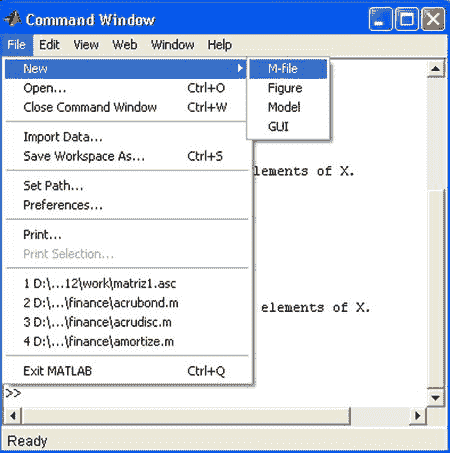

图 6-2.

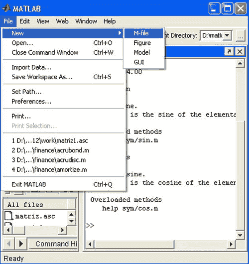

图 6-1.

图 6-5 展示了编辑器/调试器中各个图标的功能。

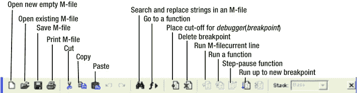

图 6-5.

### 脚本

脚本是最简单的 M 文件。脚本没有输入或输出参数。它仅包含 MATLAB 顺序执行的指令，这些指令也可以按顺序在命令窗口中提交。脚本对工作区中的现有数据或脚本创建的新数据进行操作。脚本使用的任何变量都将保留在工作区中，并可在脚本结束后用于后续计算。

以下是一个脚本示例，该脚本生成极坐标形式的几条曲线，代表花瓣。将脚本语法输入编辑器（图 6-6）后，通过单击按钮  或从“调试”菜单中选择“保存并运行”选项（或按 F5），即可将其存储在工作库中并同时执行。要切换到下一个图表，请按 ENTER 键。

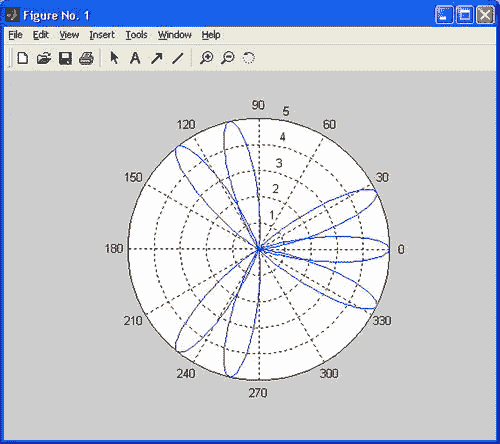

图 6-10.

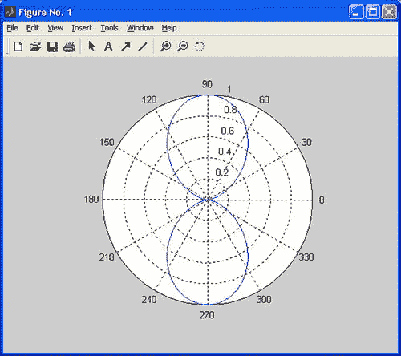

图 6-9.

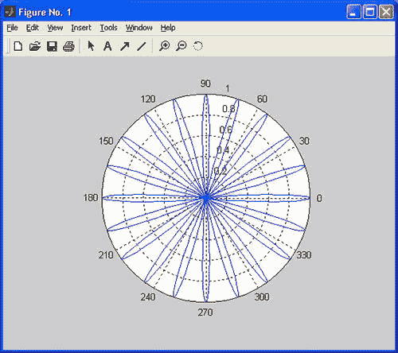

图 6-8.

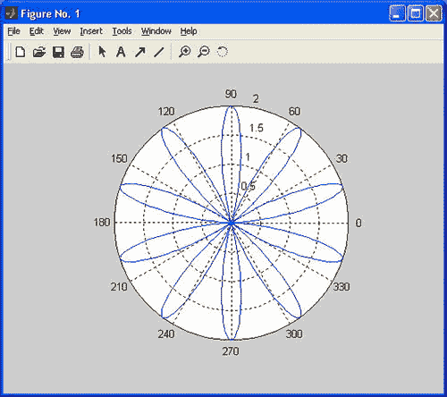

图 6-7.

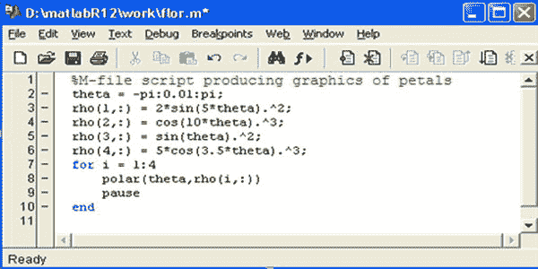

图 6-6.

## 函数与 M 文件。Function、Eval 和 Feval

我们已经知道 MATLAB 拥有大量函数，可用于程序的日常工作中。但是，此外，该程序还提供了自定义函数的可能性。定义函数最常见的方式是将其定义写入一个称为 M 文件的文本文件，该文件是永久性的，因此可以在需要时随时使用该函数。

MATLAB 通常以命令模式（或交互模式）使用，此时在命令窗口中写入一行命令并立即处理。但 MATLAB 也允许以批处理模式执行命令集，此时可以提交事先写入文件的一系列命令。此文件（M 文件）必须使用任何 ASCII 编辑器，或通过选择顶部菜单栏“文件”菜单中的“新建 M 文件”来保存到磁盘上的 MATLAB 子目录中，扩展名为 `.m`。这会打开一个文本编辑器，允许您写入命令行并以指定名称保存文件。选择顶部菜单栏“文件”菜单中的“打开 M 文件”可编辑任何预先存在的 M 文件。

要运行 M 文件，只需在交互模式下在命令窗口中键入其名称（不带扩展名）并按 Enter 键。MATLAB 会逐行顺序解释 M 文件中的所有命令和语句并执行它们。通常，MATLAB 正在执行的文字命令不会显示在屏幕上，除非 `echo on` 命令处于活动状态，此时只会显示解释命令的连续执行结果。通常，在自动化大规模繁琐过程时，批处理模式很有用，这些过程如果手动完成，则容易出现错误。您可以通过使用符号 `%` 开始注释的每一行，向 M 文件中输入解释性文本和注释。`help` 命令可用于显示特定 M 文件中的注释。

`function` 命令允许在 MATLAB 中定义函数，使其成为 M 文件最有用的应用之一。此命令的语法如下：

```
function 输出参数 = 函数名 (输入参数)
函数体
```

函数定义完成后，将存储在 M 文件中以备后用。在函数语法中（使用 `%`）输入一些解释性文本也很有用，稍后可以使用 `help` 命令访问这些文本。

当有多个输出参数时，将它们放在方括号内并用逗号分隔。如果有多个输入参数，则用逗号分隔。函数体是定义它的语法，并且应包括为输出参数赋值的命令或指令。函数体的每个命令或指令通常出现在一行中，该行以逗号结尾，或者在定义变量时以分号结尾（以避免在执行函数时重复输出）。该函数存储在名为 `函数名.m` 的 M 文件中。

让我们定义函数 `fun1(x) = x ^ 3 - 2 x + cos(x)`，创建相应的 M 文件 `fun1.m`。要在 MATLAB 中定义此函数，请选择顶部菜单栏“文件”菜单中的“新建 M 文件”（或单击 MATLAB 工具栏中的按钮 ）。这将打开 MATLAB 编辑器/调试器文本编辑器，允许我们插入定义该函数的命令行，如图 6-11 所示。

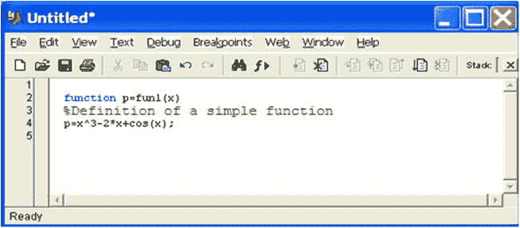

图 6-11.


要永久保存这段 MATLAB 代码，请从 MATLAB 编辑器/调试器顶部的 `File`（文件）菜单中选择 `Save`（保存）选项。 这将打开图 6-12 的 `Save`（保存）对话框，我们可以使用该对话框以所需名称保存函数，并将其保存在文件名栏中指示为路径的子目录中。 或者，您可以点击按钮  或从 `Debug`（调试）菜单中选择 `Save`（保存）并运行。 保存函数时，文件名应与函数名相同，并保存在 MATLAB 的默认工作子目录 `C:\MATLAB6p1\work` 中。

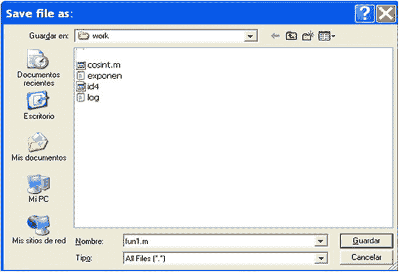

图 6-12.

函数一旦在 M 文件中定义并保存，就可以在 `Command Window`（命令窗口）中使用。 例如，要计算函数在 `3π/2` 处的值，我们在 `Command Window`（命令窗口）中输入：

```
>> fun1(3*pi/2)
ans =
95.2214
```

如需获取上一个函数的帮助（假设定义该函数的 M 文件中已添加注释），可以使用 `help` 命令，如下所示：

```
>> help fun1(x)
A simple function definition
```

函数还可以通过 `feval` 命令在给定参数（输入参数）下进行求值，其语法如下：

`feval('F', arg1, arg2,..., argn)`

这将在指定参数 `arg1`、`arg2`、...、`argn` 下对函数 `F`（M 文件 `F.m`）进行求值。

作为示例，我们创建一个名为 `equation2.m` 的 M 文件，其中包含函数 `equation2`，其参数是二次方程 `ax² + bx + c = 0` 的三个系数，输出是两个解（图 6-13）。

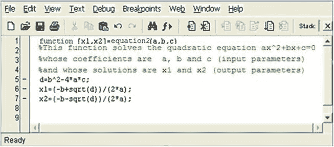

图 6-13.

现在，如果我们想使用 `feval` 解方程 `x² + 2x + 3 = 0`，我们在 `Command Window`（命令窗口）中输入以下内容：

```
>> [x1, x2] = feval('equation2',1,2,3)
x1 =
-1.0000 + 1.4142i
x2 =
-1.0000 - 1.4142i
```

该二次方程也可以按如下方式求解：

```
>> [x1, x2] = equation2(1,2,3)
x1 =
-1.0000 + 1.4142i
x2 =
-1.0000 - 1.4142i
```

如果我们想请求关于函数 `equation2` 的帮助，可以执行以下操作：

```
>> help equation2
This function solves the quadratic equation ax² + bx + c = 0
whose coefficients are a, b and c (input parameters)
and whose solutions are x1 and x2 (output parameters)
```

当函数的参数（输入参数）是字符串时，可以通过 `eval` 命令进行求值，其语法如下：

`eval(expression)`

当 `expression` 是一个字符串时，该命令会执行它。

作为示例，我们对一个定义 4 阶幻方的字符串进行求值。

```
>> n=4;
>> eval(['M' num2str(n) ' = magic(n)'])
M4 =
16  2  3 13
 5 11 10  8
 9  7  6 12
 4 14 15  1
```

### 局部变量和全局变量

通常，每个定义为 M 文件的函数都包含局部变量，即仅在该 M 文件内有效的变量，与其他 M 文件及基本工作空间无关。 然而，可以在 M 文件内部定义变量，使其同时在其他 M 文件及基本工作空间中有效。 为此，需要使用 `GLOBAL` 命令来定义全局变量，其语法如下：

`GLOBAL x y z...`

这将变量 `x`、`y` 和 `z` 定义为全局变量。

任何在函数内部定义为全局变量的变量都可单独供其他函数使用，并可在基本工作空间命令行中使用。 如果一个全局变量不存在，则它首次被使用时，将被初始化为一个空数组。 如果已经存在一个与正在定义的全局变量同名的变量，MATLAB 将发送一条警告信息，并将该变量的值更改为与全局变量匹配。 最好在每个需要访问该全局变量的函数中，以及在命令行中，都将其声明为全局变量，以便从基本工作空间中访问它。 `GLOBAL` 命令位于函数的开头（在任何对该变量的引用出现之前）。

作为示例，假设我们想要研究交互系数 `α` 和 `β` 在 Lotka–Volterra 捕食者-猎物模型中的影响：

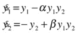

为此，我们在 M 文件 `lotka.m` 中创建函数 `lotka`，如图 6-14 所示。

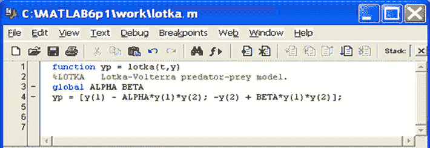

图 6-14.

之后，我们可能在命令行中输入以下内容：

```
>> global ALPHA BETA
ALPHA = 0.01
BETA = 0.02
```

然后，这些全局值就可以在 M 文件 `lotka.m` 中用于 `α` 和 `β`（无需再指定它们）。 例如，我们可以使用以下语法生成图形（图 6-15）：

```
>> [t, y] = ode23('lotka', 0.10, [1; 1]); plot(t,y)
```

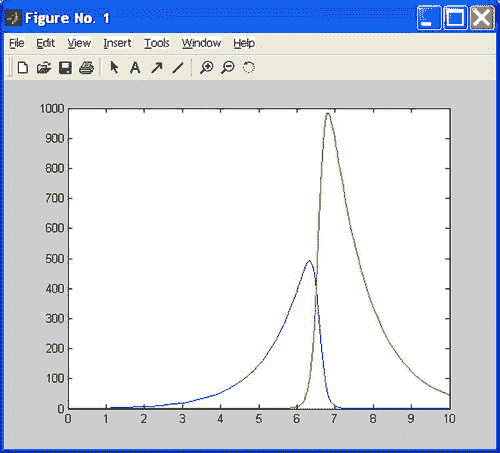

图 6-15.

### 数据类型

MATLAB 有 14 种不同的数据类型，总结在下面的图 6-16 中。

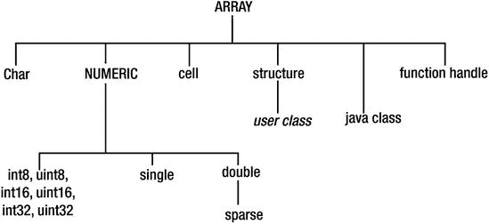

图 6-16.

以下是不同的数据类型：

| 数据类型 | 示例 | 描述 |
| --- | --- | --- |
| `single` | `3*10³⁸` | 单精度数值。 其存储需求小于双精度，但精度较低。 这种数据类型不应用于数学运算。 |
| `double` | `3*10³⁰⁰ 5+6i` | 双精度数值。 这是 MATLAB 中最常用的数据类型。 |
| `sparse` | `speye(5)` | 双精度稀疏矩阵。 |
| `int8`、`uint8`、`int16`、`uint16`、`int32`、`uint32` | `uint8(magic(3))` | 8 位、16 位和 32 位的整数和无符号整数。 这使得可以在高效管理内存的情况下使用整数值。 这种数据类型不应用于数学运算。 |
| `char` | `'Hello'` | 字符（每个字符长度为 16 位）。 |
| `cell` | `{17 'hello' eye(2)}` | 元胞数组（包含大小相似的数据）。 |
| `structure` | `a.day = 12; a.color = 'Red'; a.mat = magic(3);` | 结构体（包含大小相似的元胞）。 |
| `user class` | `inline('sin(x)')` | MATLAB 类（使用函数构建） |
| `java class` | `Java.awt.Frame` | Java 类（在 API 中定义或使用 Java 自定义）。 |
| `function handle` | `@humps` | 管理 MATLAB 中的函数。 它可以位于参数列表的最后，并使用 `feval` 进行求值。 |

## 流程控制：FOR 循环、WHILE 循环和 IF ELSEIF 条件语句

递归函数、条件运算和分段函数的应用在数学中非常普遍。 循环的处理对于定义这些类型的函数是必需的。 自然，这些函数的定义将通过 M 文件来完成。


#### FOR 循环

MATLAB 有其自己版本的`DO`语句（大多数编程语言的语法中都定义了此语句）。此语句允许你重复运行一条命令或一组命令。例如：

```
» for i=1:3, x(i)=0, end
x =
0
x =
0     0
x =
0 0 0
```

`FOR`循环的一般形式如下：

```
for variable = expression
    commands
end
```

循环总是以子句`for`开始，以子句`end`结束，并在其内部包含一组由逗号分隔的命令。如果任何命令定义了一个变量，则该命令必须以分号结尾，以避免在输出中重复。通常，循环在 M 文件的语法中使用。下面是一个示例（图 6-17）：

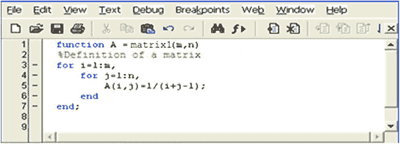

图 6-17.

在这个循环中，我们定义了一个阶为`(m, n)`的希尔伯特矩阵。如果将其保存为 M 文件`matrix1.m`，我们稍后可以通过运行该 M 文件并为变量`m`和`n`（矩阵维度）指定值来构建任何希尔伯特矩阵，如下所示：

```
>> M = matrix1 (4,5)
M =
    1.0000    0.5000    0.3333    0.2500    0.2000
    0.5000    0.3333    0.2500    0.2000    0.1667
    0.3333    0.2500    0.2000    0.1667    0.1429
    0.2500    0.2000    0.1667    0.1429    0.1250
```

#### WHILE 循环

MATLAB 有其自己版本的`WHILE`结构（在大多数编程语言的语法中定义）。此语句允许你在满足指定的逻辑条件时，重复运行一条命令或一组命令。此循环的一般语法如下：

```
while condition
    commands
end
```

循环总是以子句`while`开始，后跟一个条件，并以子句`end`结束。其内部包含一组由逗号分隔的命令，当条件满足时，这些命令会不断循环。如果任何命令定义了一个变量，则该命令必须以分号结尾，以避免在输出中重复。作为一个示例，我们编写一个 M 文件（图 6-18）并保存为`while1.m`，该文件计算其阶乘不超过`10¹⁰⁰`的最大数。

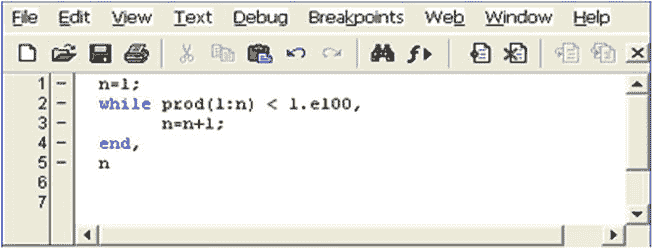

图 6-18.

我们现在运行该 M 文件。

```
>> while1
n =
    70
```

### IF ELSEIF ELSE END 循环

与大多数结构化编程语言一样，MATLAB 也包含`IF-ELSEIF-ELSE-END`结构。使用此结构，可以在满足某些条件时运行脚本。循环语法如下：

```
if condition
    commands
end
```

在这种情况下，如果条件为真，则执行命令。但此循环的语法可能更通用。

```
if condition
    commands1
else
    commands2
end
```

在这种情况下，如果条件为真，则执行`commands1`；如果条件为假，则执行`commands2`。

`IF`语句和`FOR`语句可以嵌套。当使用`ELSEIF`语句嵌套多个`IF`语句时，一般语法如下：

```
if condition1
    commands1
elseif condition2
    commands2
elseif condition3
    commands3
.
.
else
end
```

在这种情况下，如果`condition1`为真，则执行`commands1`；如果`condition1`为假且`condition2`为真，则执行`commands2`；如果`condition1`和`condition2`均为假且`condition3`为真，则执行`commands3`，依此类推。

上述嵌套语法等效于以下非嵌套语法，但执行速度更快：

```
if condition1
    commands1
else
    if condition2
        commands2
    else
        if condition3
            commands3
        else
            .
            .
        end
    end
end
```

例如，考虑 M 文件`else1.m`（见图 6-19）。

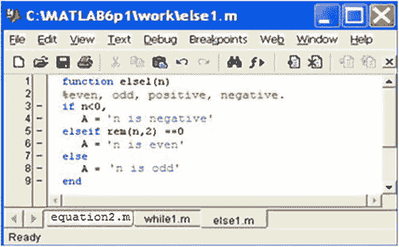

图 6-19.

运行该文件时，它会根据参数`n`是否为负、非负奇数或非负偶数，分别返回`negative`、`odd`或`even`：

```
>>else1 (8), else1 (5), else1 (- 10)
A =
n is even
A =
n is odd
A =
n is negative
```

#### Switch 和 Case

`switch`语句根据变量或表达式的值执行某些语句。其基本语法如下：

```
switch expression (scalar or string)
    case value1
        statements % runs if expression is value1
    case value2
        statements % runs if expression is value2
    .
    .
    .
    otherwise
        statements % runs if neither case is satisfied
end
```

下面是一个函数的示例，该函数根据输入是等于`-1`、`0`、`1`还是其他值，分别返回`'minus one'`、`'zero'`、`'one'`或`'another value'`（图 6-20）。

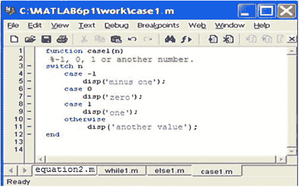

图 6-20.

运行上述示例，我们得到：

```
>> case1 (25)
another value
>> case1 (- 1)
minus one
```

#### Continue

`continue`语句将控制权传递给它所在的`for`循环或`while`循环的下一次迭代，忽略循环体中剩余的指令。下面是一个 M 文件`continue.m`（图 6-21），它统计文件`magic.m`中的代码行数，忽略空行和注释。

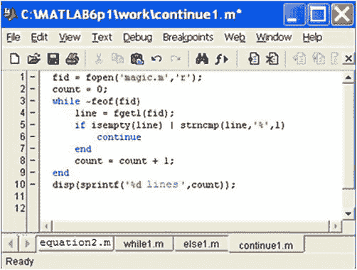

图 6-21.

运行该 M 文件，我们得到：

```
>> continue1
25 lines
```

#### Break

`break`语句终止`for`循环或`while`循环的执行，并跳转到循环外的第一条指令。下面是一个 M 文件`break1.m`（图 6-22），它读取文件`fft.m`中的代码行，一旦遇到第一个空行就退出循环。

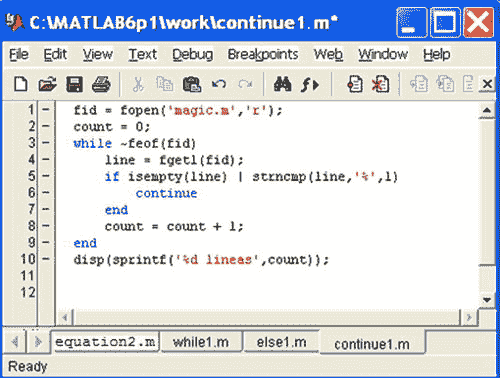

图 6-22.

运行该 M 文件，我们得到：

```
>> break1
%FFT Discrete Fourier transform.
%   FFT(X) is the discrete Fourier transform (DFT) of vector X.  For
%   matrices, the FFT operation is applied to each column. For N-D
%   arrays, the FFT operation operates on the first non-singleton
%   dimension.
%
%   FFT(X,N) is the N-point FFT, padded with zeros if X has less
%   than N points and truncated if it has more.
%
%   FFT(X,[],DIM) or FFT(X,N,DIM) applies the FFT operation across the
%   dimension DIM.
%
%   For length N input vector x, the DFT is a length N vector X,
%   with elements
%                    N
%      X(k) =       sum  x(n)*exp(-j*2*pi*(k-1)*(n-1)/N), 1 <= k <= N.
%                   n=1
%   The inverse DFT (computed by IFFT) is given by
%                    N
%      x(n) = (1/N) sum  X(k)*exp( j*2*pi*(k-1)*(n-1)/N), 1 <= n <= N.
%                   k=1
%
%   See also IFFT, FFT2, IFFT2, FFTSHIFT.
```

#### Try ... Catch

`try`和`catch`之间的指令会一直执行，直到发生错误。指令`lasterr`用于显示错误的原因。此命令的一般语法如下：

```
try,
    instruction
    ...,
    instruction
catch,
    instruction
    ...,
    instruction
end
```


#### 返回

`return` 语句会终止当前脚本并将控制权返回给调用函数或键盘。以下是一个计算非空矩阵行列式的示例（图 6-23）。如果数组为空，则返回值 1。

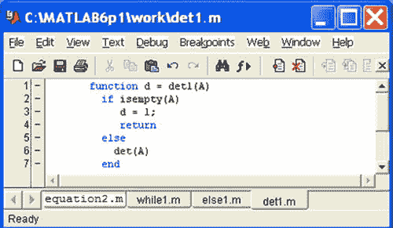

图 6-23.

运行该函数处理非空数组，我们得到：

```
>> A = [-1,-1,1; 1,0,1; 1,1,1]
A =
-1 -1 -1
1  0  1
1 -1 -1
>> det1 (A)
ans =
2
```

现在我们将该函数应用于空数组：

```
>> B =[]
B =
     []
>> det1 (B)
ans =
     1
```

### 子函数

M 文件定义的函数可以包含多个函数的代码。M 文件中的主函数称为主函数，它正是调用该 M 文件的函数，但可以添加从属于主函数的子函数，这些子函数仅对主函数或同一 M 文件中的其他子函数可见。每个子函数都以自身的函数定义开头。示例如图 6-24 所示。

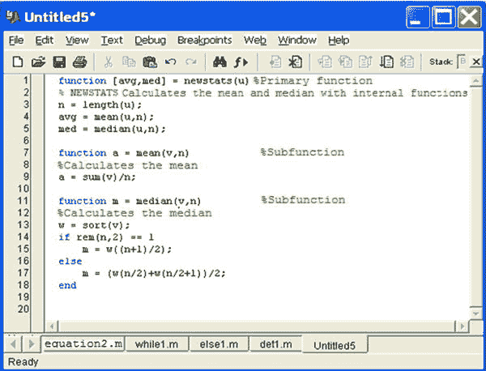

图 6-24.

子函数 `mean` 和 `median` 计算输入列表的算术平均值和中位数。主函数 `newstats` 确定列表的长度 `n`，并以列表作为第一个参数、`n` 作为第二个参数来调用子函数。执行主函数时，只需提供一个值列表作为输入，系统便会计算其算术平均值和中位数。子函数会自动执行，如下所示。

```
>> [mean, median] = newstats ([10,20,3,4,5,6])
mean =
     8
median =
    5.5000
```

## 使用数值分析求解常微分方程

求解常微分方程的精确解并非易事。有几种不同的方法可以获得常微分方程的近似解。这些数值方法包括（但不限于）欧拉法、休恩法、泰勒级数法、龙格-库塔法（在 MATLAB 基本模块中实现）、亚当斯-巴什福斯-莫尔顿法、米尔恩法和汉明法。

### 欧拉法

假设我们想要求解区间 `[a, b]` 上的微分方程 `y' = f(t, y)`，`y(a) = y[0]`。我们使用点 `t[k] = a + kh`，`k = 0,1,..., M`，`h = (b-a)/M` 所给出的划分，将区间 `[a, b]` 划分为 `M` 个相同大小的子区间。然后欧拉法通过计算 `y[k+1] = y[k] + hf(t[k], y[k])`，`k = 0,1, ..., M-1` 来迭代求解微分方程。

欧拉法是使用图 6-25 所示的 M 文件实现的。

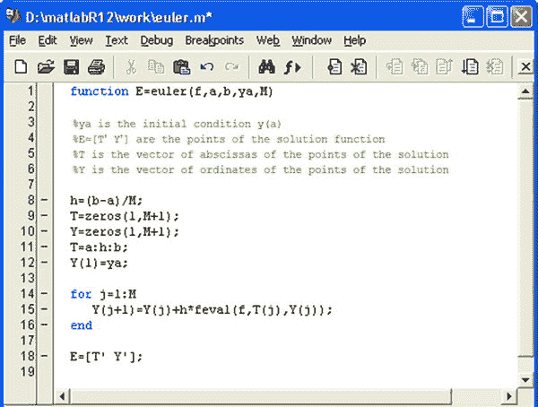

图 6-25.

### 休恩法

假设我们想要求解区间 `[a, b]` 上的微分方程 `y' = f(t, y)`，`y(a) = y[0]`。我们使用点 `t[k] = a + kh`，`k = 0,1,..., M`，`h = (b-a)/M` 所给出的划分，将区间 `[a, b]` 划分为 `M` 个相同大小的子区间。然后休恩法通过计算 `y[k+1] = y[k] + h(f(t[k], y[k]) + f(t[k+1], y[k] + f(t[k], y[k])))/2`，`k = 0,1,..., M-1` 来迭代求解微分方程。

休恩法是使用图 6-26 所示的 M 文件实现的。

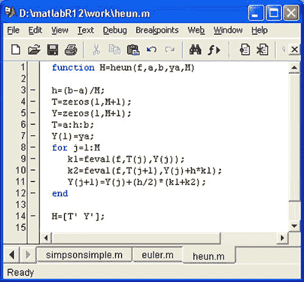

图 6-26.


## 泰勒级数法

假设我们要在区间 `[a, b]` 上求解微分方程 `y' = f(t, y)`，`y(a) = y[0]`。我们使用点 `t[k] = a + kh`，`k = 0, 1, ..., M`，`h = (b - a) / M` 划分的区间 `[a, b]`，将其分成 `M` 个等长子区间。泰勒级数法（这里我们考虑四阶方法）通过计算 `y'`、`y"`、`y"'` 和 `y""` 在每个划分点处给出 `y` 的四阶泰勒级数，从而找到微分方程的解。

泰勒级数法是使用图 6-27 所示的 M 文件实现的。

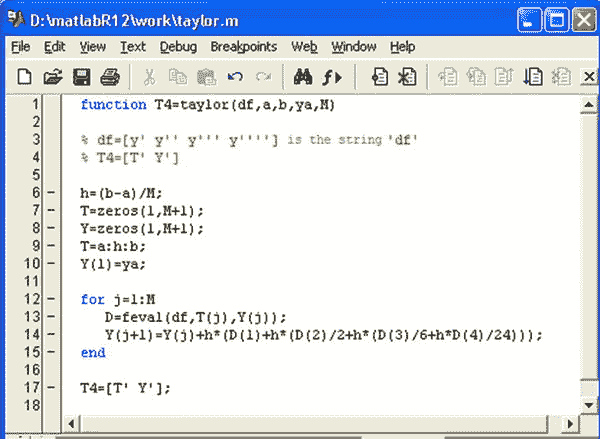

图 6-27。

例如，我们使用欧拉法、亨氏法和泰勒级数法在区间 `[0, 3]` 上求解微分方程 `y'(t) = (t - y)/2`，其中 `y(0) = 1`。

我们首先通过图 6-28 所示的 M 文件定义函数 `f(t, y)`。

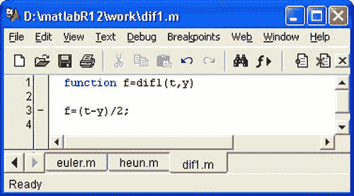

图 6-28。

使用欧拉法以 100 步计算该方程的解如下：

```
>> E = euler('dif1',0,3,1,100)
E =
0 1.00000000000000
0.03000000000000 0.98500000000000
0.06000000000000 0.97067500000000
0.09000000000000 0.95701487500000
0.12000000000000 0.94400965187500
0.15000000000000 0.93164950709688
0.18000000000000 0.91992476449042
.
.
.
2.85000000000000 1.56377799005910
2.88000000000000 1.58307132020821
2.91000000000000 1.60252525040509
2.94000000000000 1.62213737164901
2.97000000000000 1.64190531107428
3.00000000000000 1.66182673140816
```

此解可绘制成图（见图 6-29）如下：

```
>> plot (E (:,2))
```

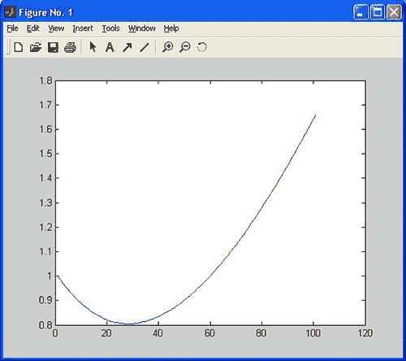

图 6-29。

使用亨氏法以 100 步计算该方程的解如下：

```
>> H = heun('dif1',0,3,1,100)
H =
0 1.00000000000000
0.03000000000000 0.98533750000000
0.06000000000000 0.97133991296875
0.09000000000000 0.95799734001443
0.12000000000000 0.94530002961496
.
.
.
2.88000000000000 1.59082209379464
2.91000000000000 1.61023972987327
2.94000000000000 1.62981491089478
2.97000000000000 1.64954529140884
3.00000000000000 1.66942856088299
```

使用泰勒级数法求解需要预先使用图 6-30 所示的 M 文件定义函数 `df = [y' y'' y''' y'''']`。

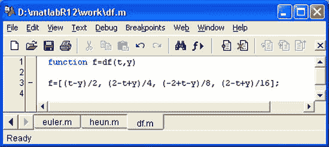

图 6-30。

通过以下命令使用泰勒级数法求解微分方程：

```
>> T = taylor('df',0,3,1,100)
T =
0 1.00000000000000
0.03000000000000 0.98533581882813
0.06000000000000 0.97133660068283
0.09000000000000 0.95799244555443
0.12000000000000 0.94529360082516
.
.
.
2.88000000000000 1.59078327648360
2.91000000000000 1.61020109213866
2.94000000000000 1.62977645599332
2.97000000000000 1.64950702246046
3.00000000000000 1.66939048087422
```

### 练习 6-1

在区间 `[0, 0.8]` 上求以下微分方程的近似解：

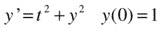

我们首先通过图 6-31 所示的 M 文件定义函数 `f(t, y)`。

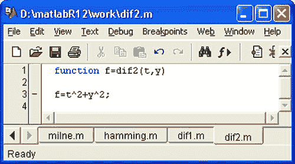

图 6-31。

然后我们使用以下语法通过欧拉法以 20 步求解微分方程：

```
>> E = euler('dif2',0,0.8,1,20)
E =
0 1.00000000000000
0.04000000000000 1.04000000000000
0.08000000000000 1.08332800000000
0.12000000000000 1.13052798222336
0.16000000000000 1.18222772296696
0.20000000000000 1.23915821852503
0.24000000000000 1.30217874214655
0.28000000000000 1.37230952120649
0.32000000000000 1.45077485808625
0.36000000000000 1.53906076564045
0.40000000000000 1.63899308725380
0.44000000000000 1.75284502085643
0.48000000000000 1.88348764754208
0.52000000000000 2.03460467627982
0.56000000000000 2.21100532382941
0.60000000000000 2.41909110550949
0.64000000000000 2.66757117657970
0.68000000000000 2.96859261586445
0.72000000000000 3.33959030062305
0.76000000000000 3.80644083566367
0.80000000000000 4.40910450907999
```

该解可绘制成图（图 6-32）如下：

```
>> plot(E(:,2))
```

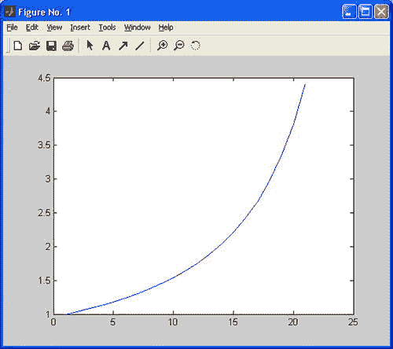

图 6-32。

