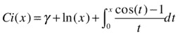
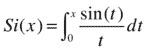
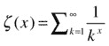
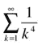
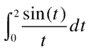

# 符号函数：替换与函数运算

MATLAB 的符号数学模块允许你直接使用 `f = '函数表达式'`（或 `f = 函数表达式`）语法定义符号函数，前提是变量已事先通过 `syms` 声明为符号变量。

一旦符号函数被显式定义，就可以使用如下所示命令为函数中的变量替换值，即计算函数在给定点的值：

| `subs(f, a)` | 计算函数 `f` 在点 `a` 处的值。 |
| :--- | :--- |
| `subs(f, a, b)` | 在函数 `f` 中将 `a` 替换为 `b`。 |
| `subs(f, 变量, 值)` | 在函数 `f` 中将变量 `变量` 替换为值 `值`。 |
| `subs(f, {x, y, ...}, {a, b, ...})` | 在函数 `f` 中将变量 `{x, y, ...}` 分别替换为值 `{a, b, ...}`。 |

第一个例子中，我们定义函数 `f(x) = x³` 并计算 `f(2)` 和 `f(b+2)`。

```
>> f='x³'

f =

x³

>> A=subs(f,2)

A =

8

>> syms b

>> B=subs(f,b+2)

B =

(b+2) ^ 3
```

在下面的例子中，我们考虑二元函数 `f(a, b) = a+b`，首先将 `a` 替换为 `4`，然后将 `a` 和 `b` 分别替换为 `3` 和 `5`（即求 `f(3,5)`）。

```
>> syms a b

>> subs(a+b,a,4)

ans =

4+b

>> subs(a+b,{a,b},{3,5})

ans =

8
```

以下是另外三个替换示例。

```
>> subs (cos (a) + (b), {a, b}, {sym ('alpha'), 2})

ans =

cos (alpha) + sin (2)

>> subs('exp(a*t)','a',-magic(2))

ans =

[exp (t), exp(-3*t)]
[exp(-4*t), exp(-2*t)]

>> syms x y

>> subs(x*y,{x,y},{[0 1;-1 0],[1-1;-2 1]})

ans =

0-1
2 0
```

除了替换功能，MATLAB 还提供了一些执行函数运算的命令，如函数的加、减、乘、除运算，以及复合与求逆。下表总结了这些命令的语法：

| `symadd(f, g)` | 求函数 `f` 和 `g` 的和（`f + g`） |
| :--- | :--- |
| `symop(f, '+', g, '+', h, '+',.....)` | 返回和 `f+g+h+...`。注意，`symop` 在更新版本的 MATLAB 中已废弃。 |
| `symsub(f, g)` | 返回 `f` 和 `g` 的差（`f-g`） |
| `symop(f, '-', g, '-', h, '-',.....)` | 返回差 `f-g-h-...` |
| `symmul(f, g)` | 返回 `f` 和 `g` 的积（`f * g`） |
| `symop(f, '*', g, '*', h, '*',.....)` | 返回积 `f * g * h *...` |
| `symdiv(f, g)` | 返回 `f` 和 `g` 的商（`f/g`） |
| `symop(f, '/', g, '/', h, '/',.....)` | 返回连商 `((f/g)/h)/...` |
| `sympow(f, k)` | 将 `f` 提升为 `k` 次幂（`k` 为标量） |
| `symop(f, '^', g)` | 将一个函数提升为另一个函数的幂（`f^g`） |
| `compose(f, g)` | 复合 `f` 和 `g`（`f ∞ g (x) = f(g(x))`） |
| `compose(f, g, u)` | 复合 `f` 和 `g`，将表达式 `u` 作为 `f` 和 `g` 的定义域 |
| `g = finverse(f)` | 返回函数 `f` 的反函数 |
| `g = finverse(f, v)` | 返回函数 `f` 的反函数，使用符号变量 `v` 作为自变量 |

在下面的例子中，给定函数 `f(x)=x²`，`g(x)=x³+1` 和 `h(x) = sin(x)+cos(x)`，我们计算 `(f+g)(x)`，`(f-g+h)(x)`，`(f/g)(x)`，`f(g(x))`，`f(h(π/3))` 和 `f(g(h(sin(x))))`。

```
>> syms x

>> f = x ^ 2; g = x ^ 3 + 1; h = sin (x) + cos (x);

>> sum = symadd(f,g)

sum =

x²+x³+1

>> combination = symadd(symsub(f,g),h)

combination =

x ^ 2-x ^ 3-1 + sin (x) + cos (x)

>> combination = symop(f,'-',g,'+',h)

combination =

x ^ 2-x ^ 3-1 + sin (x) + cos (x)

>> quotient = symdiv (f, g)

quotient =

x ^ 2-/(x³+1)

>> composite = subs (compose (g, f), x-1)

composite =

(x-1) ^ 6 + 1

>> composite1 = subs (compose (f, h), pi/3)

composite1 =

1.8660

>> composite1 = subs (compose (f, h), ' pi/3')

composite1 =

(sin ((pi/3)) + cos ((pi/3))) ^ 2

>> composite2 = subs (compose (f , compose (g, h)), 'sin (x)')

composite2 =

((sin (sin (x)) + cos (sin (x))) ^ 3 + 1) ^ 2
```

在下面的例子中，我们求函数 `f(x) = sin(x²)` 的反函数，并验证结果正确。

```
>> syms x

>> f = sin(x²)

f =

sin(x²)

>> g = finverse(f)

g =

asin(x)^(1/2)

>> compose(f,g)

ans =

x
```

MATLAB 还提供了一组预定义的符号特殊函数，其语法如下表所示：

| `cosint(x)` | 余弦积分， ，其中 γ 是欧拉-马歇罗尼常数 0.5772156649... |
| :--- | :--- |
| `sinint(x)` | 正弦积分， 。 |
| `hypergeom(n,d,z)` | 广义超几何函数。 |
| `lambertw(x)` | 朗伯函数 λ(x)，由方程 λ(x) * e^(λ(x)) = x 定义。 |
| `zeta(x)` | 黎曼 zeta 函数 ζ(x)，定义为 。 |
| `zeta(n,x)` | `zeta(x)` 的第 n 阶导数。 |

第一个例子中，我们求级数  的和，该值等于 ζ(4)。

```
>> zeta (4)

ans =

1.0823
```

接下来我们求积分 。我们使用正弦积分函数。

```
>> sinint (2)

ans =

1.6054
```


