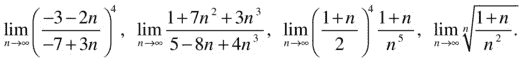
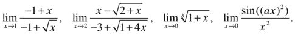
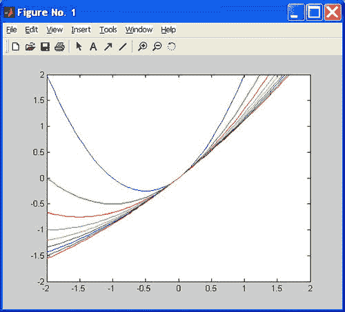
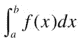
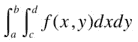
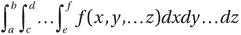
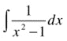
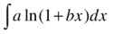
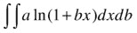
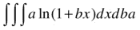

# 数学分析：函数、极限、连续性与级数

MATLAB 的符号数学模块让您能够轻松处理数学分析问题。它可以计算极限、求导数、求和级数、寻找函数的泰勒级数、计算积分以及处理方程。

在求解极限时，可使用相同函数来计算数列极限、函数极限、函数序列极限，当然也能用于分析函数的连续性以及数值级数和幂级数的收敛性。单变量和多变量分析的方法是类似的。以下是可用的函数。

| 函数描述 | 说明 |
| :--- | :--- |
| `limit(sequence, inf)` | 计算由通项表示的数列在 `n` 趋于无穷大时的极限。 |
| `limit(function, x, a)` | 计算由解析表达式表示的关于变量 `x` 的函数，当变量 `x` 趋于值 `a` 时的极限。 |
| `limit(function, a)` | 计算由解析表达式表示的关于变量 `x` 的函数，当变量 `x` 趋于值 `a` 时的极限。 |
| `limit(function, x, a, 'right')` | 计算由解析表达式表示的关于变量 `x` 的函数，当变量 `x` 从右侧趋于值 `a` 时的极限。 |
| `limit(function, x, a, 'left')` | 计算由解析表达式表示的关于变量 `x` 的函数，当变量 `x` 从左侧趋于值 `a` 时的极限。 |
| `symsum(S, v, a, b)` | 求通项为 `S`、变量 `v` 从 `a` 到 `b` 的级数之和。 |
| `symsum(S, v)` | 求通项为 `S`、变量 `v` 的值从 `0` 到 `v-1` 的级数之和。 |
| `r = symsum(S)` | 返回关于符号变量 `k`（由 `findsym` 确定）的通项为 `S` 的级数之和，其中 `k` 的值从 `0` 到 `k-1`。 |
| `symsum(S, a, b)` | 求关于符号变量 `k`（由 `findsym` 确定）的通项为 `S` 的级数之和，其中 `k` 的值从 `a` 到 `b`。 |

作为第一个例子，我们计算以下数列极限：



我们得到：

```matlab
>> syms n
>> limit(((2*n-3)/(3*n-7))^4, inf)
ans =
16/81
>> limit((3*n³+7*n²+1)/(4*n³-8*n+5), n, inf)
ans =
3/4
>> limit(((n+1)/2) * ((n⁴+1)/n^5), inf)
ans =
1/2
>> limit(((n+1)/n^2)^(1/n), inf)
ans =
1
```

接下来我们计算以下函数极限：



我们得到：

```matlab
>> syms x a
>> limit((x-1)/(x^(1/2)-1), x, 1)
ans =
2
>> limit((x-(x+2)^(1/2))/((4*x+1)^(1/2)-3), 2)
ans =
9/8
>> limit((1+x)^(1/x))
ans =
exp(1)
>> limit(sin(a*x)^2/x^2, x, 0)
ans =
a^2
```

在下面的例子中，我们计算定义在 `R` 上的函数序列 `gn = (x^2+n*x)/n` 的极限。

```matlab
>> limit((x^2+n*x)/n, n, inf)
ans =
x
```

我们看到极限函数的图形是通过第一和第三象限的对角线。我们可以如下演示这一点（参见图 8-1）：

```matlab
>> fplot('[(x^2+x),(x^2+2*x)/2,(x^2+3*x)/3,(x^2+4*x)/4,(x^2+5*x)/5,(x^2+6*x)/6,(x^2+7*x)/7,(x^2+8*x)/8,(x^2+9*x)/9]',[-2,2,-2,2])
```



图 8-1.

以下例子验证了函数 `f(x) = sin(x) / x` 在 `R-{0}` 上的连续性。下面的命令检查了极限关系是否成立。

```matlab
>> syms x a
>> limit(sin(x)/x, x, a)
ans =
sin(a)/a
```

接下来我们证明函数在点 `x = 0` 不连续，通过说明其左右极限不匹配（一个为 `0`，另一个为无穷大）。

```matlab
>> syms x
>> limit(exp(1/x), x, 0, 'right')
ans =
inf
>> limit(exp(1/x), x, 0, 'left')
ans =
0
```

在以下例子中，我们通过应用比值检验法来确定级数是否收敛，如果收敛，则计算其和。

```matlab
>> syms n
>> f = n/2^n
f =
n/(2^n)
>> limit(subs(f, n, n+1)/f, n, inf)
ans =
1/2
```

我们看到相邻项比值的极限小于 `1`，这意味着该级数收敛。我们使用以下方法计算其和：

```matlab
>> symsum(f, n, 1, inf)
ans =
2
```

## 导数、积分与微分方程

下文将介绍在数学分析中，处理导数、积分和微分方程时常用的 MATLAB 函数。我们首先从与微分相关的函数开始。

| 函数描述 | 说明 |
| :--- | :--- |
| `diff('f', 'x')` | 返回 `f` 对 `x` 的导数。 |
| `syms x, diff(f, x)` | 返回 `f` 对 `x` 的导数。 |
| `diff('f', 'x', n)` | 返回 `f` 对 `x` 的 `n` 阶导数。 |
| `syms x, diff(f, x, n)` | 返回 `f` 对 `x` 的 `n` 阶导数。 |
| `r = taylor(f, n, v)` | 返回函数 `f` 在变量 `v` 下的 `n-1` 阶麦克劳林级数。 |
| `r = taylor(f)` | 返回函数 `f` 在默认变量下的 `5` 阶麦克劳林级数。 |
| `r = taylor(f, n, v, a)` | 返回函数 `f` 在变量 `v` 下、点 `a` 邻域内的 `n-1` 阶泰勒级数。 |
| `R = jacobian(w, v)` | 返回 `w` 对 `v` 的雅可比矩阵。 |

以下是积分相关的函数：

| 函数描述 | 说明 |
| :--- | :--- |
| `syms x, int(f(x), x)` 或 `int('f(x)', 'x')` | 计算不定积分。 |
| `int(int('f(x, y)', 'x'), 'y')` | 计算二重积分。 |
| `syms x y, int(int(f(x, y), x), y)` | 计算二重积分。 |
| `int(int(int(...int('f(x, y..., z)', 'x'), 'y')...), 'z')` | 计算多重积分。 |
| `syms x y z, int(int(int(...int(f(x, y...z), x), y)...), z)` | 计算多重积分。 |
| `syms x a b, int(f(x), x, a, b)` | 计算定积分。 |

| `int('f(x)', 'x', 'a', 'b')` | 计算定积分  |
| `int(int('f(x,y)', 'x', 'a', 'b'), 'y', 'c', 'd')` | 计算积分  |
| `syms x y a b c d, (int(int(f(x,y), x, a, b), y, c, d))` | 计算积分  |
| `int(int(int(...int('f(x, y,...,z)', 'x', 'a', 'b'), 'y', 'c', 'd'),...), 'z', 'e', 'f')` | 计算积分  |
| `syms x y z a b c d e f, int(int(int(...int(f(x, y,...,z), x, a, b), y, c, d)...), z, e, f)` | 计算积分  |

下表总结了与微分方程相关的函数：

| `dsolve('e', 'v')` | 求解微分方程 `e`，其中 `v` 是自变量（如果不指定 `'v'`，则自变量默认为 `x`）。仅返回显式解。 |
| `dsolve('e', 'c', 'v')` | 求解微分方程 `e`，并满足 `c` 指定的初始条件，其中 `v` 是自变量。 |
| `dsolve('e', 'c1', 'c2', ..., 'cn', 'v')` | 求解微分方程 `e`，并满足 `c1`,...,`cn` 指定的初始条件，其中 `v` 是自变量。 |
| `dsolve('e', 'c1,c2,...,cn', 'v')` | 求解微分方程 `e`，并满足指定的初始条件 `c1`,...,`cn`，其中 `v` 是自变量。 |
| `dsolve('e1', 'e2', ..., 'en', 'c1', 'c2', ..., 'cn', 'v')` | 求解微分方程组 `e1`,...,`en`，并满足指定的初始条件 `c1`,...,`cn`，其中 `v` 是自变量。 |
| `dsolve('e1, e2,..., en', 'c1, c2,..., cn', 'v')` | 求解微分方程组 `e1`,...,`en`，并满足指定的初始条件 `c1`,...,`cn`，其中 `v` 是自变量。 |

作为第一个示例，我们将计算函数 `ln(sin(2x))` 的导数。

```matlab
>> pretty(diff('log(sin(2*x))','x'))
```

```
2 cos (2 x)
---------
sin (2 x)
```

这个导数可以简化：

```matlab
>> pretty(simple(diff('log(sin(2*x))','x')))
```

```
2
--------
tan(2 x)
```

在下面的例子中，我们计算函数 `f(x) = 1 /x` 的一阶、二阶、三阶和四阶导数。

```matlab
>> f='1/x';
[diff(f),diff(f,2),diff(f,3),diff(f,4),diff(f,5)]
```

```
ans =
[-1/x ^ 2, 2/x ^ 3, - 6/x ^ 4, 24/x ^ 5, - 120/x ^ 6]
```

然后，给定函数 `f(x, y) = sin(xy) + cos(xy²)`，我们计算以下偏导数：`∂f/∂x`, `∂f/∂y`, `∂²f/∂x²`, `∂²f/∂y²`, `∂²f/∂x∂y`, `∂²f/∂y∂x` 和 `∂⁴f/∂²x∂²y`。

```matlab
>> syms x y
>> f = sin(x*y) + cos(x*y²)
```

```
f =
sin(x*y) + cos(x*y²)
```

```matlab
>> diff(f,x)
```

```
ans =
cos(x*y) *-sin(x*y²) * y ^ 2
```

```matlab
>> diff(f,y)
```

```
ans =
cos(x*y) * x-2 * sin(x*y²) * x * y
```

```matlab
>> diff(diff(f,x),x)
```

```
ans =
-sin(x*y) * y ^ 2-cos(x*y²) * y ^ 4
```

```matlab
>> diff (diff(f,y), y)
```

```
ans =
-sin(x*y) * x ^ 2-4 * cos(x*y²) * x ^ 2 * y ^ 2-2 * sin(x*y²) * x
```

```matlab
>> diff(diff(f,x),y)
```

```
ans =
-sin(x*y) * x * y + cos(x*y)-2 * cos(x*y²) * x * y ^ 3-2 * sin(x*y²) * y
```

```matlab
>> diff(diff(f,y),x)
```

```
ans =
-sin(x*y) * x * y + cos(x*y)-2 * cos(x*y²) * x * y ^ 3-2 * sin(x*y²) * y
```

```matlab
>> diff(diff(diff(diff(f,x),x),y,y))
```

```
ans =
sin(x*y) * y ^ 3 * x-3 * cos(x*y) * y ^ 2 + 2 * cos(x*y²) * y ^ 7 * x + 6 * sin(x*y²) * y ^ 5
```

接下来，我们求函数 `1/(2-x)` 在点 `x=1` 邻域内直到 10 阶的泰勒级数：

```matlab
>> syms x
>> f=1/(2-x)
```

```
f =
1/(2-x)
```

```matlab
>> pretty(taylor(f,11,x,1))
```

```
2          3          4          5          6          7
x + (x - 1)  + (x - 1)  + (x - 1)  + (x - 1)  + (x - 1)  + (x - 1)
8          9          10
+ (x - 1)  + (x - 1)  + (x - 1)
```

下面的例子计算积分 。

```matlab
>> int('1/(x²-1)','x')
```

```
ans =
-atanh (x)
```

下面的例子估计带有任意参数 `a` 和 `b` 的积分 。

```matlab
>> syms x a b, pretty(simple(int(a*log(1+b*x),x)))
```

```
a (log(1 + b x) - 1) (1 + b x)
------------------------------
              b
```

下面的例子计算二重积分 ，其中 `a` 是一个任意参数。

```matlab
>> syms x a b, pretty(simple(int(int(a*log(1+b*x),x),b)))
```

```
a (-dilog(1 + b x) + log(1 + b x) + log(1 + b x) x b - 1 - 2 b x - log(b))
```

下面的例子计算三重积分 。

```matlab
>> syms x a b, pretty(simple(int(int(int(a*log(1+b*x),x),b),a)))
```

```
2
1/2a(-dilog(1 + b x) + log(1 + b x) + log(1 + b x) x b - 1 - 2 b x - log(b))
```

我们计算 。

```matlab
>> syms x a b, pretty (simple (int (a * log(1+b*x), x, 0, 1)))
```

```
ab + log(1+b)+ b log (1+b) – b
------------------------------
              b
```

下面的例子计算 ，其中 `a` 是一个任意参数。

```matlab
>> syms x a b, pretty(simple(int(int(a*log(1+b*x),x,0,1),b,2,3)))
```

```
a (8 log (2) - 2 - dilog (4) - 3 log (3) + dilog (3))
```

在下面的例子中，我们求解一阶一次微分方程 `y'(t) = ay(t)`，其中 `a` 是一个任意参数。

```matlab
>> pretty(dsolve('Dy = a*y'))
```

```
C1 exp (a t)
```

因此，我们得知解族为 `y(t) = c[1] e^{at}`。

现在我们求解上述带有初始条件 `y(0) = b` 的微分方程。

```matlab
>> pretty(dsolve('Dy = a*y', 'y(0) = b'))
```

```
b exp (a t)
```

接下来，我们求解一阶二次微分方程 `y'²(s) + y²(s) = 1`，其初始条件为 `y(0) = 0`。

```matlab
>> y = dsolve ('(Dy) ^ 2 + y ^ 2 = 1', 'y(0) = 0', 's')
```

```
y =
[-sin (s)]
[ sin (s)]
```

现在，我们求解二阶一次微分方程 `y"(t) = a²y'(t)`，其初始条件为 `y(0) = 1` 和 `y'(π/a) = 0`。

```matlab
>> pretty (dsolve ('D2y = - a ^ 2 * y ', 'y(0) = 1, Dy (pi/a) = 0'))
```

```
cos (a t)
```

因此，解是函数 `y(t) = cos(at)`。

在下面的例子中，我们求解方程组：`x'(t) = y(t)`, `y'(t) = -x(t)`。

```matlab
>> [x, y] = dsolve('Dx = y', 'Dy =-x')
```

```
x =
cos (t) * C1 + sin (t) * C2
y =
-sin (t) * C1 + cos (t) * C2
```

接下来，我们计算上述微分方程组在初始条件 `x(0) = 0` 和 `y(0) = 1` 下的解。

```matlab
>> [x, y] = dsolve ('Dx = y, Dy = - x', 'x (0) = 0, y (0) = 1')
```

```
x =
sin (t)
y =
cos (t)
```