# 线性代数：化简与求解方程

MATLAB 专门处理了用于简单、有理数和复数代数表达式的计算。符号数学工具箱中的函数能高效实现代数表达式的化简、因式分解、合并与展开等运算，并包含三角表达式和复变量表达式。这些函数的语法如下。

| `r = collect(S)` `r = collect(S, v)` | 根据变量 `v`（若未指定 `v`，则按 `x`）合并多项式数组 `S` 中的每个多项式。 |
| `r = expand(S)` | 展开 `S` 中包含的每个多项式、三角、指数或对数函数。 |
| `factor(x)` | 对 `x`（符号或数值）进行因式分解。 |
| `r = horner(p)` | 将多项式 `p` 转换为 Horner 形式（即嵌套形式）。 |
| `[n, d] = numden(A)` | 将符号或数值矩阵 `A` 的每个元素转换为简化后的有理形式。 |
| `r = simple(s)` `[r,how] = simple(s)` | 简化符号表达式 `s`，寻求最短的可能输出。第二种形式仅输出最终结果及描述特定简化过程的字符串。 |
| `r = simplify(S)` | 简化符号矩阵 `S` 的每个元素。 |
| `[y, sigma] = subexpr(x, sigma)` `[y, sigma] = subexpr(x, 'sigma')` | 将符号表达式 `x` 用公共子表达式重写，并用符号变量 `sigma` 替代该子表达式。 |

第一个示例，我们将表达式 `y(sin(x) + 1) + sin(x)` 按 `sin(x)` 进行合并。

```
>> syms x and
>> pretty (collect (y * (sin (x) + 1) + sin (x), sin (x)))
(y + 1) sin (x) + y
```

接下来，我们先按 `x` 合并，再按 `ln(x)` 合并函数 `f(x) = aln(x)-xln(x)-x`。

```
>> syms a x
>> f=a*log(x)-log(x)*x-x
f =
a*log(x)-log(x)*x-x
>> pretty(collect(f,x))
(- log (x) - 1) x + log (x)
>> pretty(collect(f,log(x)))
(a - x) log (x) - x
```

下面的示例中，我们展开各种代数表达式。

```
>> syms a b x y t
>> expand([sin(2*t), cos(2*t)])
ans =
[2 * sin (t) * cos (t), 2 * cos (t) ^ 2-1]
>> expand(exp((a+b)²))
ans =
exp(a²) * exp(a*b) ^ 2 * exp(b²)
>> expand (cos (x + y))
ans =
cos (x) * cos (y) - sin (x) * sin(y)
>> expand((x-2)*(x-4))
ans =
x²-6*x+8
```

接下来我们对各种表达式进行因式分解。

```
>> factor(x³-y³)
ans =
(x - y) *(x²+x*y+y²)
>> factor([a²-b², a³+b³])
ans =
[(a-b)*(a+b), (a+b)*(a²-a*b+b²)]
>> factor(sym('12345678901234567890'))
ans =
(2) * (3) ^ 2 * (5) * (101) * (3803) * (3607) * (27961) * (3541)
```

下面我们化简各种表达式。

```
>> syms x y z a b c
>> simplify(exp(c*log(sqrt(a+b))))
ans =
(a + b) ^(1/2*c)
>> simplify (sin (x) ^ 2 + cos (x) ^ 2)
ans =
1
>> S = [(x²+5*x+6)/(x+2),sqrt(16)];
R = simplify(S)
R =
[ x+3,   4]
```

以下函数可用于求解符号方程和方程组：

| `solve('equation', 'x')` | 针对变量 `x` 求解方程。 |
| `syms x; solve(equation,x)` | 针对变量 `x` 求解方程。 |
| `solve('e1,e2,...,en', 'x1,x2,...,xn')` | 针对变量 `x1,...,xn` 求解方程组 `e1,...,en`。 |
| `syms x1 x2... xn; solve(e1,e2,...,en, x1,x2,...,xn)` | 针对变量 `x1,...,xn` 求解方程组 `e1,...,en`。 |

第一个示例，我们针对变量 `x` 求解方程 `3ax - 7x² + x³ = 0`，其中 `a` 是参数。

```
>> solve('3*a*x-7*x²+x³=0','x')
ans =
[                       0]
[7/2 + 1/2 *(49-12*a) ^(1/2)]
[7/2-1/2 *(49-12*a) ^(1/2)]
```

接下来，我们将上述方程中的 `a` 视为变量，`x` 视为参数进行求解。

```
>> pretty(solve('3*a*x-7*x²+x³=0','a'))
-1/3 x (- 7 + x)
```

在下面的示例中，我们计算 `-1` 和 `1` 的四次方根。

```
>> S=solve('x⁴+1=0')
S =
[  1/2*2^(1/2)+1/2*i*2^(1/2)]
[ -1/2*2^(1/2)-1/2*i*2^(1/2)]
[  1/2*2^(1/2)-1/2*i*2^(1/2)]
[ -1/2*2^(1/2)+1/2*i*2^(1/2)]
>> numeric(S)
ans =
0.70710678118655 + 0.70710678118655i
-0.70710678118655 - 0.70710678118655i
0.70710678118655 - 0.70710678118655i
```


`-0.70710678118655 + 0.70710678118655i`

```
>> S1=solve('x⁴-1=0')
```

```
S1 =
[  1]
[ -1]
[  i]
[ -i]
```

接下来我们计算复数`2 + 2i`的五次方根。

```
>> numeric(solve('x⁵-(2+2*i)=0'))
```

```
ans =
1.21598698264961 + 0.19259341768888i
0.19259341768888 + 1.21598698264961i
-1.09695770450838 + 0.55892786746601i
-0.87055056329612 - 0.87055056329612i
0.55892786746601 - 1.09695770450838i
```

在下面的示例中，我们求解变量`x`的方程`sin(x)cos(x)=a`：

```
>> simple (solve ('sin (x) * cos (x) = a', 'x'))
```

```
ans =
pi/2 - asin(2*a)/2
asin(2*a)/2
```

```
>> pretty(ans)
+-                -+
|  pi   asin(2 a)  |
|  -- - ---------  |
|  2        2      |
|                  |
|     asin(2 a)    |
|     ---------    |
|         2        |
+-                -+
```

如果我们针对特殊情况`a=0`求解上述方程，会得到：

```
>> solve ('sin (x) * cos (x) = 0', 'x')
```

```
ans =
[       0]
[1/2 * pi]
[-1/2 * pi]
```

在下面的示例中，我们求解方程组`u + v + w = a`，`3u + v = b`，`u - 2v - w = 0`，其中`u`，`v`和`w`是变量，`a`，`b`和`c`是参数。

```
>> syms u v w a b c
>> [u, v, w] = solve('u+v+w=a,3*u+v=b,u-2*v-w=c',u,v,w)
```

```
u =
1/5 * b + 1/5 * a + 1/5 * c

v =
2/5 * b - 3/5 * a - 3/5 * c

w =
-3/5 * b + 7/5 * a + 2/5 * c
```

**练习 8-1**

考虑下面的符号矩阵`A`：

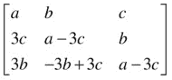

计算`A'`，`A^(-1)`，`det(A)`，`trace(A)`，`rank(A)`。

我们首先如下定义问题的符号矩阵：

```
>> A=sym('[a,b,c; 3*c,a-3*c,b; 3*b,-3*b+3*c,a-3*c]')
```

```
A =
[   a,       b,    c]
[ 3*c,   a-3*c,    b]
[ 3*b,-3*b+3*c,a-3*c]
```

或者，可以通过如下事先将所有变量声明为符号变量来定义相同的符号矩阵：

```
>> syms a b c
>> A=sym([a,b,c; 3*c,a-3*c,b; 3*b,-3*b+3*c,a-3*c])
```

```
A =
[        a,        b,        c]
[      3*c,    a-3*c,        b]
[      3*b, -3*b+3*c,    a-3*c]
```

```
>> transpose (A)
```

```
ans =
[a, 3 * c, 3 * b]
[b, a-3*c, -3*b+3*c]
[c,     b,    a-3*c]
```

```
>> pretty(inv(A))
```

```
          2            2      2                      2         2           2
[ a  - 6 a c + 9 c  + 3 b  - 3 b c        a b - 3 c       - b  + a c - 3 c ]
[ -------------------------------    ------------    ------------- ]
[               %1                        %1                 %1     ]
[                                                                   ]
[           2           2       2                               2   ]
[        - b  + a c - 3 c        a  - 3 a c - 3 b c          a b - 3 c    ]
[      - 3 ---------------    ------------------     - ----------   ]
[                %1                  %1                     %1      ]
[                                                                   ]
[                   2                     2       2                 ]
[          a b - 3 c         a b - a c + b       a  - 3 a c - 3 b c ]
[      - 3 ----------      3 ---------------     ------------------ ]
[               %1                   %1                    %1       ]

      3        2      2          2                3      3        2
%1 := a  - 6 c a  + 9 c  a + 3 a b  - 9 a b c + 9 c  + 3 b  + 9 b c
```

```
>> pretty(det(A))
```

```
 3        2      2          2                3      3        2
a  - 6 c a  + 9 c  a + 3 a b  - 9 a b c + 9 c  + 3 b  + 9 b c
```

```
>> pretty(trace (A))
```

```
3 a - 6 c
```

```
>> rank(A)
```

```
ans =
3
```

```
>> A²
```

```
ans =
[ a²+6*b*c,         a*b+b*(a-3*c)+c*(-3*b+3*c), a*c+b²+c*(a-3*c)]
[3*a*c+3*c*(a-3*c)+3*b², 3*b*c+(a-3*c)²+b*(-3*b+3*c), 3*c²+2*b*(a-3*c)]
[3*a*b+3*c*(-3*b+3*c)+3*b*(a-3*c), 3*b²+2*(-3*b+3*c)*(a-3*c), 3*b*c+(a-3*c)²+b*(-3*b+3*c)]
```

**练习 8-2**

求双曲线`x² - y² = 1`和`a²x² - b²y² = 16`与抛物线`z² = 2x`的交点。我们如下求解由三个方程组成的方程组：

```
>> [x, y, z] = solve('a²*x²-b²*y²=16','x²-y²=1','z²=2*x', 'x,y,z')
```

```
x =
[  1/2*(((b²-16)/(a²-b²))^(1/4)+i*((b²-16)/(a²-b²))^(1/4))²]
```


`[  1/2*(((b²-16)/(a²-b²))^(1/4)+i*((b²-16)/(a²-b²))^(1/4))²]`

`[ 1/2*(-((b²-16)/(a²-b²))^(1/4)+i*((b²-16)/(a²-b²))^(1/4))²]`

`[ 1/2*(-((b²-16)/(a²-b²))^(1/4)+i*((b²-16)/(a²-b²))^(1/4))²]`

`[  1/2*(((b²-16)/(a²-b²))^(1/4)-i*((b²-16)/(a²-b²))^(1/4))²]`

`[  1/2*(((b²-16)/(a²-b²))^(1/4)-i*((b²-16)/(a²-b²))^(1/4))²]`

`[ 1/2*(-((b²-16)/(a²-b²))^(1/4)-i*((b²-16)/(a²-b²))^(1/4))²]`

`[ 1/2*(-((b²-16)/(a²-b²))^(1/4)-i*((b²-16)/(a²-b²))^(1/4))²]`

`y =`

`[  1/(a²-b²)*(-(a²-b²)*(a²-16))^(1/2)]`

`[ -1/(a²-b²)*(-(a²-b²)*(a²-16))^(1/2)]`

`[  1/(a²-b²)*(-(a²-b²)*(a²-16))^(1/2)]`

`[ -1/(a²-b²)*(-(a²-b²)*(a²-16))^(1/2)]`

`[  1/(a²-b²)*(-(a²-b²)*(a²-16))^(1/2)]`

`[ -1/(a²-b²)*(-(a²-b²)*(a²-16))^(1/2)]`

`[  1/(a²-b²)*(-(a²-b²)*(a²-16))^(1/2)]`

`[ -1/(a²-b²)*(-(a²-b²)*(a²-16))^(1/2)]`

`z =`

`[  ((b²-16)/(a²-b²))^(1/4)+i*((b²-16)/(a²-b²))^(1/4)]`

`[  ((b²-16)/(a²-b²))^(1/4)+i*((b²-16)/(a²-b²))^(1/4)]`

`[ -((b²-16)/(a²-b²))^(1/4)+i*((b²-16)/(a²-b²))^(1/4)]`

`[ -((b²-16)/(a²-b²))^(1/4)+i*((b²-16)/(a²-b²))^(1/4)]`

`[  ((b²-16)/(a²-b²))^(1/4)-i*((b²-16)/(a²-b²))^(1/4)]`

`[  ((b²-16)/(a²-b²))^(1/4)-i*((b²-16)/(a²-b²))^(1/4)]`

`[ -((b²-16)/(a²-b²))^(1/4)-i*((b²-16)/(a²-b²))^(1/4)]`

`[ -((b²-16)/(a²-b²))^(1/4)-i*((b²-16)/(a²-b²))^(1/4)]`

### 练习 8-3

计算下列积分：

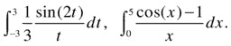

对于第一个积分，被积函数是一个偶函数，所以它在-3 和 3 之间的积分将是它在 0 和 3 之间积分的两倍。然后我们进行变量替换 `2t = v`，得到积分：

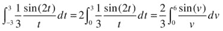

其在 MATLAB 中的解如下：

```
>> (2/3) * (sinint (6))

ans =

    0.9498
```

为了计算第二个积分，我们需谨记以下内容：

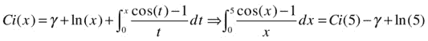

这可以在 MATLAB 中计算如下：

```
>> cosint(5) - 0.577215664-log(5)

ans =

   -2.3767
```

### 练习 8-4

给定函数 `h` 定义为 `h(x,y) = (cos(x ^ 2 - y ^ 2), sin(x ^ 2 - y ^ 2))`，计算 `h(1,2)`、`h(-π,π)` 和 `h(cos(a ^ 2), cos(1-a ^ 2))`。

我们按如下方式创建一个包含两个函数的向量：

```
>> syms x y a.
>> h = [cos(x²-y²), sin(x²-y²)]

h =

[cos(x²-y²), sin(x²-y²)]
```

现在计算所需的值：

```
>> subs(h,{x,y},{1,2})

ans =

   -0.9900   -0.1411
```

```
>> subs(h,{x,y},{-pi,pi})

ans =

   1   0
```

```
>> subs (h, {x, y}, {cos(a²), cos(1-a²)})

ans =

[cos (cos(a²) ^ 2-cos(-1+a²) ^ 2), sin (cos(a²) ^ 2-cos(-1+a²) ^ 2)]
```

### 练习 8-5

给定函数 `f` 定义为：

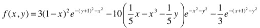

求 `f (0,0)` 的值并绘制 `f` 的图形。

在这种情况下，由于需要将函数图形化表示，我们将其定义在如图 8-2 所示的 M 文件中。

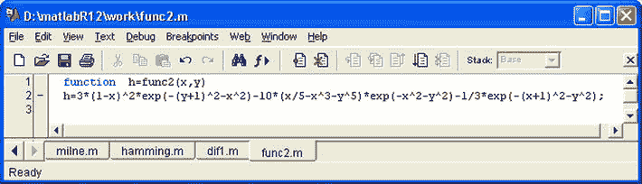

图 8-2.

现在计算 `f` 在 `(0,0)` 处的值：

```
>> func2 (0,0)

ans =

    0.9810
```

为了创建函数图形（在原点附近），我们使用命令 `meshgrid` 定义曲面特征，并使用命令 `surf` 绘制曲面：

```
>> [x, y] = meshgrid(-0.5:.05:0.5,-0.5:.05:0.5);
>> z = func2(x,y);
>> surf (x, y, z)
```

这将生成如图 8-3 所示的图形：

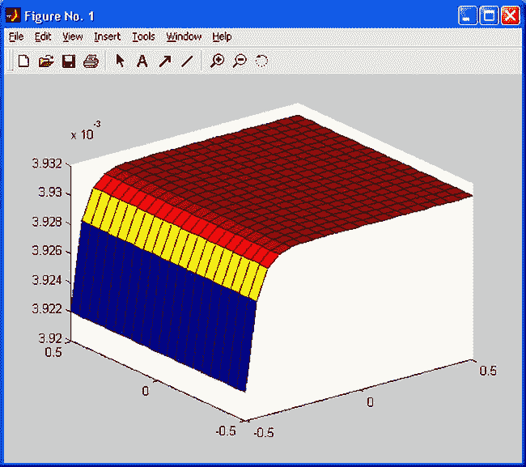

图 8-3.

### 练习 8-6

给定函数 `f (x) = sin (cos (x^(1/2)))` 和 `g (x) = sqrt (tan(x ^ 2))`，计算 `f` 和 `g` 的复合函数以及 `g` 和 `f` 的复合函数。同时计算 `f` 和 `g` 的反函数。

```
>> syms x, f = sin (cos (x ^(1/2)));
>> g=sqrt(tan(x²));
>> simple(compose(f,g))

ans =

sin (cos (tan(x²) ^(1/4)))
```

```
>> simple (compose(g,f))

ans =

tan (sin (cos (x ^(1/2))) ^ 2) ^(1/2)
```

```
>> F = finverse (f)

F =

acos (asin (x)) ^ 2
```

```
>> G = finverse (g)

G =

atan(x²) ^(1/2)
```

### 练习 8-7


定义函数 `f(x)` 为：

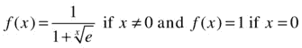

并研究其在实直线上的连续性。

除了在 `x = 0` 这一点外，连续性都是显而易见的。为了分析该函数在 `x = 0` 处的行为，我们计算当 `x→0` 时的单侧极限：

```
>> syms x
limit(1/(1+exp(1/x)),x,0,'right')
ans =
0
>> limit(1/(1+exp(1/x)),x,0,'left')
ans =
1
```

函数在 `x→0` 时的极限不存在，因为左右极限不相等。但是，由于左右极限都是有限的，`x = 0` 处的间断点是有限跳跃（也称为第一类间断点）。我们通过图 8-4 所示的图形来说明这一结果。

```
>> fplot('1/(1+exp(1/x))',[-5,5])
```

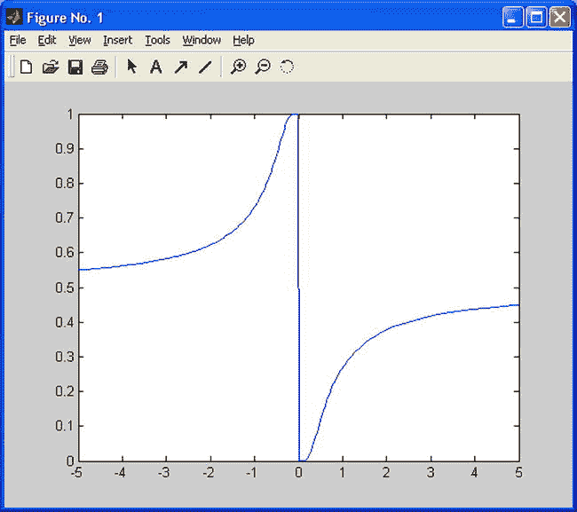

图 8-4. 练习 8-8

研究由下述表达式定义的函数 `f: R²→R` 的连续性：

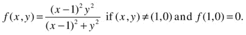

由于该函数在其他地方显然是连续的，我们只需要检查函数在 `(1,0)` 点处的连续性。我们需要证明：

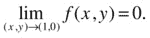

```
» syms x y m a r
» limit (limit (y ^ 2 *(x-1) ^ 2 / (y ^ 2 +(x-1) ^ 2), x, 0), y, 0)
ans =
0
» limit (limit (y ^ 2 *(x-1) ^ 2 / (y ^ 2 + (x-1) ^ 2), y, 0), x, 0)
ans =
0
» limit((m*x)²*(x-1)²/((m*x)²+(x-1)²),x,0)
ans=
0
» limit ((m*x) *(x-1) ^ 2/((m*x) +(x-1) ^ 2), x, 0)
ans =
```

由此我们看到累次极限和方向极限（沿直线 `y = mx`）一致，这表明极限存在且其值为零。为了证实这些结果，我们计算极坐标下的极限：

```
» limit (limit ((r ^ 2 * sin (a) ^ 2) * (r * cos (a) - 1) ^ 2 / ((r ^ 2 * sin (a) ^ 2)
+ (r * cos (a) - 1) ^ 2), r, 1), a, 0)
ans =
0
```

我们得出结论：该函数在点 `(1,0)` 处的极限为零，这保证了函数的连续性。在图 8-5 中，我们绘制了由 `f` 定义的曲面，并特别说明了函数在点 `(1,0)` 邻域内的连续性及其趋近于 0 的趋势。

```
» [x, y] = meshgrid(0:0.05:2,-2:0.05:2);
z=y.².*(x-1).²./(y.²+(x-1).²);
mesh(x,y,z), view ([- 23, 30])
```

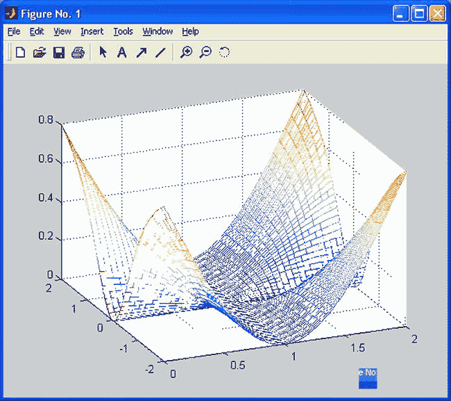

图 8-5. 练习 8-9

求下列每个级数的和：

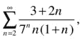

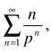

其中 `p` 是一个参数。

在求和之前，我们首先需要确定该级数是否确实收敛。我们对第一个级数应用比值判别法：

```
>> syms n
>> f=(3+2*n)/((1-n)*n*7^n);
>> pretty(f)
3 + 2 n
------------
        n
(1 - n) n 7
>> limit(subs(f,n,n+1)/f,n,inf)
ans =
1/7
```

由于极限小于 1，该级数收敛。我们将计算其和。MATLAB 返回的结果通常会很复杂，并且依赖于某些特殊函数。我们得到以下结果：

```
>> S1 = symsum(f,n,2,inf)
S1 =
-6 * log(6/7)-22/21 + 13/343 * hypergeom([2, 2],[3],1/7)
```

现在对第二个级数应用比值判别法。

```
>> syms n p
>> g=n/p^n;
>> pretty(g)
n
----
  n
p
>> limit(subs(g,n,n+1)/g,n,inf)
ans =
1/p
```

因此，如果 `p > 1`，级数收敛；如果 `p < 1`，级数发散；如果 `p = 1`，我们得到通项为 `n` 的级数，该级数发散。当 `p` 大于 1 时，我们可以求出该级数的和：

```
>> S2=symsum(g,n,2,inf)
S2 =
2/p²*(1/2/(-1+p)³*p⁴*(-1/p+1)-1/2*p)
>> pretty(simple(S2))
-1 + 2 p
-----------
     2
p (- 1 + p)
```

练习 8-10

求函数 `sinh(x)` 的 13 阶麦克劳林级数。另外，求函数 `1/(1+x)` 在点 `x = 1` 邻域内的 6 阶泰勒级数。

```
>> pretty(taylor(sinh(x),13))
       3          5           7             9               11
x + 1/6 x  + 1/120 x  + 1/5040 x  + 1/362880 x  + 1/39916800 x
```


`>> pretty(taylor(1/(1+x),6,1))`

```
2              3              4              5
3/4 - 1/4 x + 1/8 (x - 1)  - 1/16 (x - 1)  + 1/32 (x - 1)  - 1/64 (x - 1)
```

#### 练习 8-11

研究函数

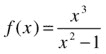

计算其渐近线、最大值、最小值、拐点、增长与递减区间以及凹凸区间。

```
>> f='x ^ 3 /(x²-1)'
```

```
f =
x ^ 3 /(x²-1)
```

```
>> syms x, limit (x ^ 3 /(x²-1), x, inf)
```

```
ans =
NaN
```

因此，不存在水平渐近线。为判断是否存在垂直渐近线，我们寻找使 y 趋于无穷大的 x 值：

```
>> solve('x²-1')
```

```
ans =
[1]
[-1]
```

垂直渐近线为直线 `x = 1` 和 `x = -1`。现在判断是否存在斜渐近线：

```
>> limit(x³/(x²-1)/x,x,inf)
```

```
ans =
1
```

```
>> limit(x³/(x²-1)-x,x,inf)
```

```
ans =
0
```

直线 `y = x` 是一条斜渐近线。接下来分析函数的最大值、最小值、拐点以及凹凸区间和单调区间：

```
>> solve (diff (f))
```

```
ans =
[       0]
[       0]
[3 ^(1/2)]
[^(1/2) - 3]
```

一阶导数在 `x = 0`、 和  处为零。这些点是极大值与极小值的候选点。为验证它们是极大值还是极小值，我们计算这些点处的二阶导数值：

```
>> [numeric(subs(diff(f,2),0)),numeric(subs(diff(f,2),sqrt(3))),
numeric(subs(diff(f,2),-sqrt(3)))]
```

```
ans =
0 2.5981 - 2.5981
```

因此，在横坐标为 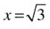 的点处存在极大值，在横坐标为  的点处存在极小值。在 `x = 0` 处无法判断：

```
>> [numeric (subs (f, sqrt (3))), numeric (subs (f, - sqrt (3)))]
```

```
ans =
2.5981 - 2.5981
```

因此，极大值点为 `(-√3, -2.5981)`，极小值点为 `(√3, 2.5981)`。

现在分析拐点：

```
>> solve(diff(f,2))
```

```
ans =
[         0]
[ i*3^(1/2)]
[-i * 3 ^(1/2)]
```

唯一可能的拐点出现在 `x = 0` 处，且由于 `f(0) = 0`，该候选拐点为 `(0,0)`：

```
>> subs (diff(f,3), 0)
```

```
ans =
-6
```

由于 `x = 0` 处的三阶导数不为零，可知原点确实是一个拐点：

```
>> pretty(simple(diff(f)))
```

```
2   2
x  (x  - 3)
------------
2     2
(x  - 1)
```

当 `y' > 0`，即区间 `(-∞, -√3)` 和 `(√3, ∞)` 上，曲线递增。

当 `y' < 0`，即在定义区间 `(-√3, -1)`、`(-1, 0)`、`(0, 1)` 和 `(1, √3)` 上，曲线递减。

```
>> pretty(simple(diff(f,2)))
```

```
2
2 x (x  + 3)
------------
2     3
(x  - 1)
```

当 `y" > 0`，即区间 `(-1, 0)` 和 `(1, ∞)` 上，曲线为凹。

当 `y" < 0`，即区间 `(0, 1)` 和 `(-∞, -1)` 上，曲线为凸。

在一阶导数为零的三个点上，曲线具有水平切线。水平切线方程分别为 `y = 0`、`y = 2.5981` 和 `y = -2.5981`。

在使一阶导数无穷大的点上，曲线具有垂直切线。这些点为 `x = 1` 和 `x = -1`。因此，垂直切线与两条垂直渐近线重合。

绘制曲线及其渐近线（见图 8-6）：

```
>> fplot('[x³/(x²-1),x]',[-5,5,-5,5])
```

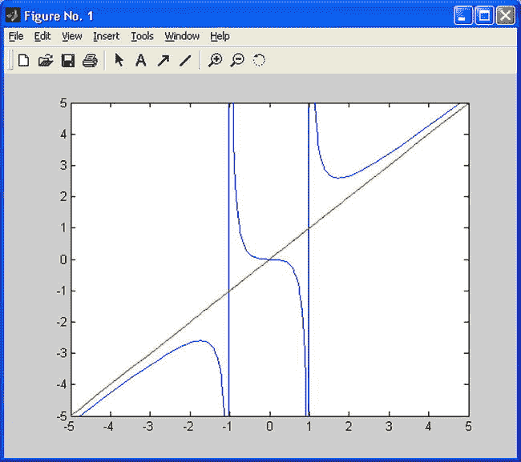

**图 8-6.**

我们还可以在同一张图中展示曲线、渐近线以及水平和垂直切线（图 8-7）：

```
>> fplot('[x³/(x²-1),x,2.5981,-2.5981]',[-5,5,-5,5])
```

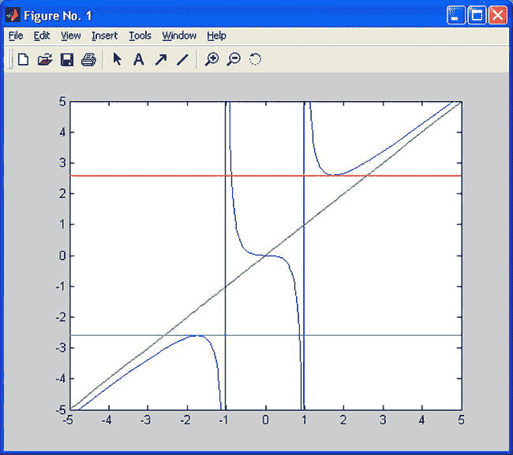

**图 8-7.**

#### 练习 8-12

给定向量函数 `(u(x,y), v(x,y))`，其中：

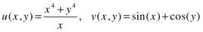


确定在何种条件下我们可以找到逆向量函数`(x(u,v), y(u,v))`，其中`x = x(u, v)`且`y = y(u,v)`，并求该逆变换的导数和雅可比矩阵。在点`(π/4, -π/4)`处计算该逆函数的值。

为找到函数可逆的条件，我们引用反函数定理。这些函数是可微的且具有连续导数，可能除了`x = 0`处。现在我们考虑变换`∂(u(x, y), v(x,y)) / ∂(x, y)`的雅可比矩阵：

```
>> syms x y
>> J=simple((jacobian([(x⁴+y⁴)/x,sin(x)+cos(y)],[x,y])))
J =
[ 3*x²-1/x²*y⁴,         4*y³/x]
[          cos(x),         -sin(y)]
>> pretty(det(J))
4           4      3
3 sin(y) x  - sin(y) y  + 4 y  cos(x) x
- ---------------------------------------
                   2
                  x
```

因此，在此表达式不为零的点上，我们可以用`u`和`v`解出`x`和`y`。此外，我们还必须有`x ≠ 0`。

我们计算逆函数的导数。其值是上面求得的原函数雅可比矩阵的逆矩阵，其雅可比矩阵的行列式是原函数雅可比矩阵行列式的倒数：

```
>> I=simple(inv(J));
>> pretty(simple(det(I)))
2
x
- ---------------------------------------
4           4      3
3 sin(y) x  - sin(y) y  + 4 y  cos(x) x
```

现在我们求此逆函数在点`(π/4, -π/4)`处的值：

```
>> numeric(subs(subs(determ(I),pi/4,'x'),-pi/4,'y'))
ans =
0.38210611216717
>> numeric(subs(subs(symdiv(1,determ(J)),pi/4,'x'),-pi/4,'y'))
ans =
0.38210611216717
```

这些结果证实了逆函数的雅可比矩阵的行列式是原函数雅可比矩阵行列式的倒数。

**练习 8-13**

给定函数`f(x, y) = e^(x-y)`以及变换`u = u(x,y) = x + y`，`v = v(x,y) = x`，求`f(u, v)`。

我们计算逆变换及其雅可比矩阵，以应用变量替换定理：

```
>> syms x y u v
>> [x,y]=solve('u=x+y,v=x','x','y')
x =
v
y =
u-v
>> jacobian([v,u-v],[u,v])
ans =
[  0,  1]
[  1, -1]
>> f=exp(x-y);
>> pretty(simple(subs(f,{x,y},{v,u-v})* abs(det(jacobian(
[v,u-v],[u,v])))))
exp(2 v - u)
```

所求函数为`f(u, v) = e^(2v - u)`。

**练习 8-14**

求下列积分：

```
>> syms x
>> pretty(simple(int(x^(-3)*(x²+3*x-1)^(-1/2),x)))
2           1/2         2           1/2
(x  + 3 x - 1)          (x  + 3 x - 1)
1/2 ----------------- + 9/4 -----------------
2                       x
x
-2 + 3 x
+ 31/8 atan(1/2 -----------------)
2           1/2
(x  + 3 x - 1)

>> pretty(simple(int(x^(-1)*(9-4*x²)^(1/2), x)))
2 1/2                 3
(9 - 4 x )    - 3 atanh(-------------)
2 1/2
(9 - 4 x )

>> pretty(simple(int(x⁸*(3+5*x³)^(1/4),x)))
3        6         9          3 1/4
4/73125 (288 - 120 x  + 125 x  + 1875 x ) (3 + 5 x )
```

**练习 8-15**

考虑以下极坐标曲线：`r = 3 - 3cos(a)`。计算对应于完整旋转一周`(0 ≤ a ≤ 2π)`的弧长。

```
>> r='3-3*cos(a)';
>> diff(r,'a')
ans =
3 * sin (a)
>> R = simple (int ('((3-3 * cos (a)) ^ 2 + (3 * sin (a)) ^ 2) ^(1/2) ',' a ', ' 0','2 * pi'))
R =
24
```

**练习 8-16**

计算下列积分的值：

该积分表示指定界限之间正态曲线下的面积。

```
>> numeric(int('exp(-x²/2)/(2*pi)^(1/2)','x',-1.96,1.96))
ans =
0.95000420970356
```

**练习 8-17**

求曲面`ax² + y² = z`和`z = a² - y²`的交线，并计算交线所围成的体积。同时，求曲面`z = x²`和`z = 4 - y²`的交线所围成的体积。

第一个体积通过以下积分计算：

```
>> pretty(simple(int(int(int('1','z','a*x²+y²',
'a²-y²'),'y',0,'sqrt((a²-a*x²)/2)'),'x',0,'sqrt(a)')))
/
|                 2       2        2 1/2
1/24 |    lim       3 a  x (2 a  - 2 a x )
|       1/2
\x -> (a   )-
1/2  1/2                              \
7/2  1/2         2    a    x              2        2 3/2|
+ 3 a    2    atan(------------------) + x (2 a  - 2 a x )   |
2        2 1/2                        |
(2 a  - 2 a x )                           /
```

为了计算第二个体积，我们首先绘制所求交线的图形，以确定积分限，使用以下语法：

```
>> [x, y] = meshgrid(-2:.1:2);
z = x ^ 2;
mesh(x,y,z)
hold on;
z = 4 - y. ^ 2;
mesh (x, y, z)
```

**图 8-8**

现在我们可以通过计算以下积分来求出所求体积：

```
>> pretty(simple(int(int(int('1','z','x²','4-y²'),
'y',0,'sqrt(4-x²)'),'x',0,2)))
2 pi
```

**练习 8-18**

求解以下方程：

```
>> pretty(simple(dsolve('Dy=(x*y)/(y²-x²)')))
+-                                                               -+
|                                 0                               |
|                                                                 |
|                                 1                                |
| -------------------------------------------------------------   |
|                    /            /    /   1   \   2(C3 + t x) \ \ |
|                    | wrightOmega| log| - -- | - ----------- | | |
|                    |            |    |    2 |       2       | | |
|    / C3 + t x \    |            \    \   x  /      x        / | |
| exp| -------- | exp| ----------------------------------------   |
|    |     2    |    \                     2                   /  |
|    \    x     /                                                 |
+-                                                               -+
```

**练习 8-19**

求解下列方程：
- `9y'''' - 6y"' + 46y" - 6y' + 37y = 0`
- `3y" + 2y' - 5y = 0`
- `2y" + 5y' + 5y = 0`
其中`y(0) = 0`且`y'(0) = 1/2`。

```
>> pretty(simple(dsolve('9*D4y-6*D3y+46*D2y-6*Dy+37*y=0')))
C1 sin(t) + C2 cos(t) + C3 exp(1/3 t) sin(2 t) + C4 exp(1/3 t) cos(2 t)
>> pretty(dsolve('3*D2y+2*Dy-5*y=0'))
C1 exp(t) + C2 exp(- 5/3 t)
>> pretty(dsolve('2*D2y+5*Dy+5*y=0','y(0)=0,Dy(0)=1/2'))
1/2                        1/2
2/15 15    exp(- 5/4 t) sin(1/4 15    t)
```

**练习 8-20**

在初始条件`x(0) = 1`和`y(0) = 2`下，求解以下方程组：
- `x' - y = e^(-t)`
- `y' + 5x + 2y = sin(3t)`

```
>> [x,y]=dsolve('Dx-Dy=exp(-t),Dy+5*x+2*y=sin(3+t)','x(0)=1,y(0)=2','t')
x =
(-7/50*sin(3)+1/50*cos(3)+7/6)*exp(-7*t)+7/50*sin(3+t)-1/50*cos(3+t)-1/6*exp(-t)
y =
(-7/50*sin(3)+1/50*cos(3)+7/6)*exp(-7*t)+5/6*exp(-t)+7/50*sin(3+t)-1/50*cos(3+t)
```
