# 7. 具有初值和边值的常微分方程与偏微分方程

## 微分方程的数值解

MATLAB 在其基本模块中提供了用于数值求解常微分方程 (ODE)、微分代数方程 (DAE) 和边值问题的命令。它还可以求解具有边值的微分方程组以及抛物型和椭圆型偏微分方程。

## 带初始值的常微分方程

常微分方程包含因变量 `y` 关于自变量 `t` 的一个或多个导数。带初始值的一阶常微分方程可表示为：

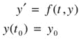

上述问题可以推广到 `y` 为向量的情形，即 `y = (y[1], y[2], …, y[n])`。

下表中列出了 MATLAB 基本模块中与带初始值的常微分方程和微分代数方程相关的命令：

| 命令 | 求解问题类型、数值方法及语法 |
| --- | --- |
| `ode45` | 基于龙格-库塔法的常微分方程 |
| `ode23` | 基于龙格-库塔法的常微分方程 |
| `ode113` | 基于亚当斯法的常微分方程 |
| `ode15s` | 使用 NDF（BDF）的微分代数方程和常微分方程 |
| `ode23s` | 基于罗森布罗克法的常微分方程 |
| `ode23t` | 基于梯形法则的常微分和微分代数方程 |
| `ode23tb` | 使用 TR-BDF2 的常微分方程 |

上述七个命令的通用语法如下：

```
[T, y] = solver(odefun,tspan,y0)
[T, y] = solver(odefun,tspan,y0,options)
[T, y] = solver(odefun,tspan,y0,options,p1,p2...)
[T, y, TE, YE, IE] = solver(odefun,tspan,y0,options)
```

其中，`solver` 可以是 `ode45`、`ode23`、`ode113`、`ode15s`、`ode23s`、`ode23t` 或 `ode23tb` 中的任意一个命令。

参数 `odefun` 计算微分方程或方程组的右端项，方程形式为 `y’ = f(t, y)` 或 `M(t, y)y’ = f(t, y)`，其中 `M(t, y)` 称为质量矩阵。命令 `ode23s` 只能求解具有恒定质量矩阵的方程。命令 `ode15s` 和 `ode23t` 可求解代数微分方程以及具有奇异质量矩阵的常微分方程组。参数 `tspan` 是一个向量，指定积分范围 `[t[0], tf]`（`tspan = [t[0], t[1], …, t[f]]`，其元素必须为递增或递减序列，用于获取特定 `t` 值对应的解）。参数 `y[0]` 指定初始条件向量。参数 `p1`、`p2`、... 是传递给 `odefun` 的可选参数。参数 `options` 通过命令 `options odeset` 指定额外的积分选项，该命令可在程序手册中找到。向量 `T` 和 `y` 分别给出解的自变量和因变量的数值结果。

作为第一个示例，我们求解以下常微分方程组在区间 `[0,12]` 上的解：

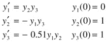

为此，我们在一个 M 文件中定义一个名为 `system1` 的函数，该函数将存储方程组的表达式。该函数首先定义一个包含三行的列向量，随后为这些行分别赋值，这些赋值构成了三个方程的语法（图 7-1）。

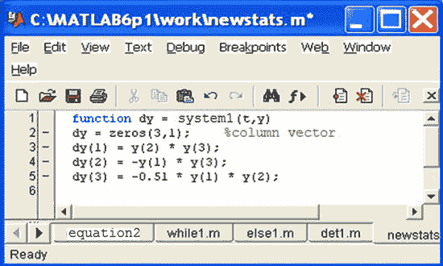

图 7-1。

接着，我们在命令窗口中输入以下内容来求解方程组：

```
>> [T, Y] = ode45(@system1,[0 12],[0 1 1])
T =
    0
    0.0001
    0.0001
    0.0002
    0.0002
    0.0005
    .
    .
    11.6136
    11.7424
    11.8712
    12.0000
Y =
     0         1.0000    1.0000
     0.0001    1.0000    1.0000
     0.0001    1.0000    1.0000
     0.0002    1.0000    1.0000
     0.0002    1.0000    1.0000
     0.0005    1.0000    1.0000
     0.0007    1.0000    1.0000
     0.0010    1.0000    1.0000
     0.0012    1.0000    1.0000
     0.0025    1.0000    1.0000
     0.0037    1.0000    1.0000
     0.0050    1.0000    1.0000
     0.0062    1.0000    1.0000
     0.0125    0.9999    1.0000
     0.0188    0.9998    0.9999
     0.0251    0.9997    0.9998
     0.0313    0.9995    0.9997
     0.0627    0.9980    0.9990
     .
     .
     0.8594   -0.5105    0.7894
     0.7257   -0.6876    0.8552
     0.5228   -0.8524    0.9281
     0.2695   -0.9631    0.9815
    -0.0118   -0.9990    0.9992
    -0.2936   -0.9540    0.9763
    -0.4098   -0.9102    0.9548
    -0.5169   -0.8539    0.9279
    -0.6135   -0.7874    0.8974
    -0.6987   -0.7128    0.8650
```

为了更好地解释结果，可以使用以下命令将上述数值解绘制成图形（图 7-2）：

```
>> plot (T, Y(:,1), '-', T, Y(:,2),'-', T, Y(:,3),'. ')
```

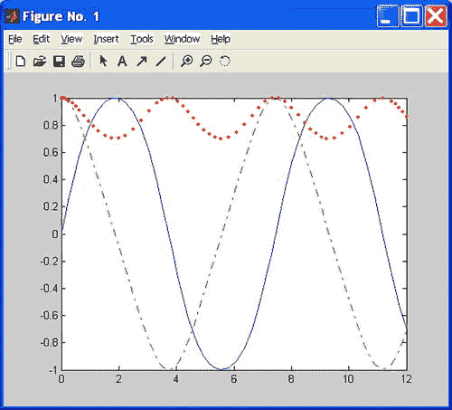

图 7-2。

## 带边界条件的常微分方程

MATLAB 还允许您求解带有边界条件的常微分方程。边界条件规定了在定义区间端点处，解函数值之间必须满足的关系。这类问题的最简单形式是方程组：

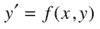

其中 `x` 是自变量，`y` 是因变量，`y'` 是 `y` 对 `x` 的导数（即 `y' = dy/dx`）。此外，区间 `[a, b]` 上的解必须满足以下边界条件：

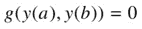

更一般地，这种类型的微分方程可以表示如下：

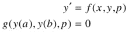

其中向量 `p` 由参数构成，这些参数必须通过边界条件与解同时确定。

求解这些问题的命令是 `bvp4c`，其语法如下：

```
Sol = bvp4c (odefun, bcfun, solinit)
Sol = bvp4c (odefun, bcfun, solinit, options)
Sol = bvp4c (odefun, bcfun, solinit, options, p1, p2...)
```

在上述语法中，`odefun` 是一个计算 `f(x, y)` 的函数。它可以采用以下形式之一：

```
dydx = odefun(x, y)
dydx = odefun(x, y, p1, p2, ...)
dydx = odefun(x, y, parameters)
dydx = odefun(x, y, parameters, p1, p2, ...)
```

`bvp4c` 中的参数 `bcfun` 是一个计算边界条件残差的函数。其形式如下：

```
Res = bcfun(ya, yb)
Res = bcfun(ya, yb, p1, p2, ...)
```

# MATLAB 微分方程求解示例

## 边值问题 (BVP) 求解示例

函数 `bcfun` 的基本调用语法如下：

```
Res = bcfun(ya, yb, parameters)
```

```
Res = bcfun(ya, yb, parameters, p1, p2, ...)
```

参数 `solinit` 是一个包含解的初始猜测的结构体。它具有以下字段：`x`（给出初始网格的有序节点，以便边界条件施加于 `a = solinit.x(1)` 和 `b = solinit.x(end)`）；以及 `y`（解的初始猜测，以向量形式给出，使得第 `i` 个条目是解的第 `i` 个分量在所有由 `x` 给出的网格点上的常数猜测）。结构体 `solinit` 使用命令 `bvpinit` 创建。其语法为 `solinit = bvpinit(x, y)`。

作为示例，我们求解以下二阶微分方程：

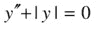

其解必须满足边界条件：

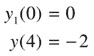

这等价于以下问题（其中 `y[1] = y` 且 `y[2] = y'`）：

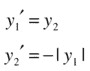

我们在区间 `[0,4]` 上考虑五个等距点的网格，我们对解的初始猜测是 `y[1] = 1` 和 `y[2] = 0`。这些假设包含在以下语法中：

```
>> solinit = bvpinit (linspace (0,4,5), [1 0]);
```

图 7-3 和图 7-4 描绘的 M 文件展示了如何输入方程及其边界条件。

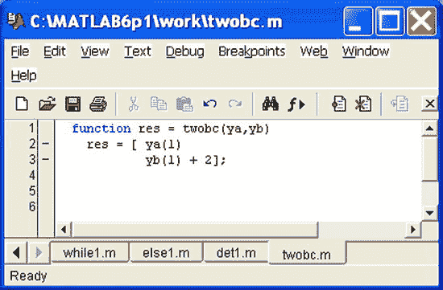

图 7-4.

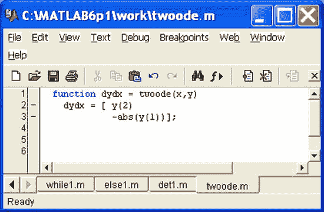

图 7-3.

使用以下语法求解方程：

```
>> Sun = bvp4c (@twoode, @twobc, solinit);
```

可以使用命令 `bvpval` 绘制解的图形（图 7-5），如下所示：

```
>> y = bvpval (Sun, linspace (0,4));
>> plot (x, y(1,:));
```

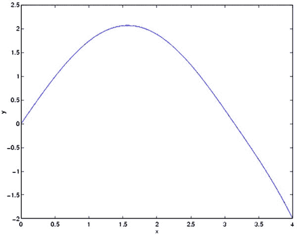

图 7-5.

## 偏微分方程

MATLAB 的基本模块具有求解带初边值条件的偏微分方程和偏微分方程组的功能。用于计算解的基本函数是 `pdepe`，用于评估这些解的基本函数是 `pdeval`。

函数 `pdepe` 的语法如下：

```
Sol = pdepe(m, pdefun, icfun, bcfun, xmesh, tspan)
Sol = pdepe(m, pdefun, icfun, bcfun, xmesh, tspan, options)
Sun = pdepe(m, pdefun, icfun, bcfun, xmesh, tspan, options, p1, p2...)
```

参数 `m` 根据问题的对称性（分别对应块状、圆柱状或球状）取值为 `0`、`1` 或 `2`。参数 `pdefun` 定义微分方程的组成，`icfun` 定义初始条件，`bcfun` 定义边界条件，`xmesh` 和 `tspan` 是指定数值解所需点 `[x[0], x[1], ..., x[n]]` 和 `[t[0], t[1], ..., t[f]]` 的向量（`n`, `f ≥ 3`），`options` 指定底层求解器的某些计算选项（`RelTol`、`AbsTol`、`NormControl`、`InitialStep` 和 `MaxStep` 分别用于指定相对容差、绝对容差、范数容差、初始步长和最大步长），而 `p1`、`p2`、... 是传递给函数 `pdefun`、`icfun` 和 `bcfun` 的参数。

`pdepe` 求解如下形式的偏微分方程：

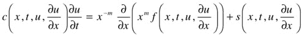

其中 `a ≤ x ≤ b` 且 `t[0] ≤ t ≤ t[f]`。此外，对于 `t = t[0]` 以及所有 `x`，解分量满足初始条件：

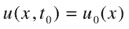

并且对于所有 `t` 以及每个 `x = a` 或 `x = b`，解分量满足如下形式的边界条件：

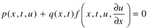

此外，我们有 `a = xmesh(1)`、`b = xmesh(end)`、`tspan(1) = t[0]` 和 `tspan(end) = t[f]`。而且 `pdefun` 计算偏微分方程中的项 `c`、`f` 和 `s`，因此：

```
[c, f, s] = pdefun(x, t, u, dudx)
```

类似地，`icfun` 评估初始条件：

```
u = icfun(x)
```

最后，`bcfun` 评估边界条件中的项 `p` 和 `q`：

```
[pl, ql, pr, qr] = bcfun(xl, ul, xr, ur, t)
```

作为第一个示例，我们求解以下偏微分方程（`x ∈ [0,1]` 且 `t ≥ 0`）：

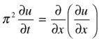

满足初始条件：

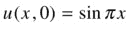

以及边界条件：

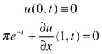

我们首先在 M 文件中定义函数，如图 7-6 到 7-8 所示。

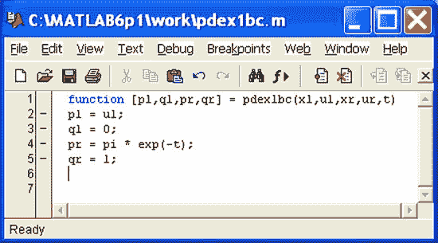

图 7-8.

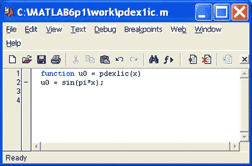

图 7-7.

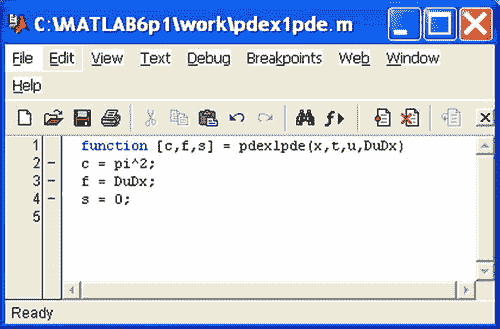

图 7-6.

一旦定义了支持函数，我们就定义求解方程的函数（参见图 7-9 中的 M 文件）。

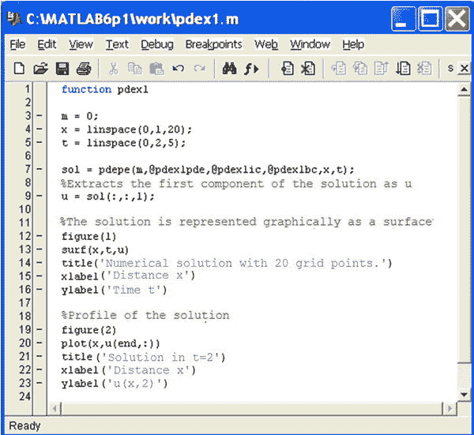

图 7-9.

要查看解（图 7-10 和 7-11），我们在 MATLAB 命令窗口中输入以下内容：

```
>> pdex1
```

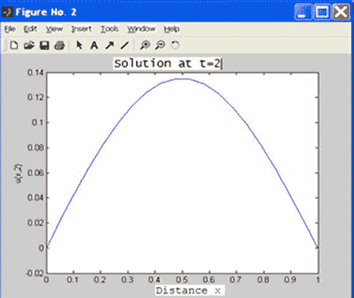

图 7-11.

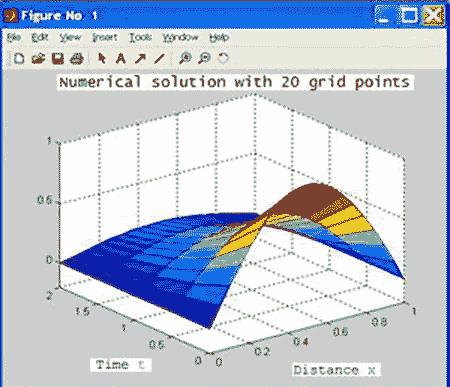

图 7-10.

作为第二个示例，我们求解以下偏微分方程组（`x ∈ [0,1]` 且 `t ≥ 0`）：

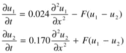

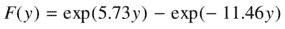

满足初始条件：

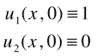

以及边界条件：

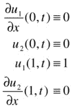

为了便于使用函数 `pdepe`，该方程组可以写成：

# MATLAB 中的微分方程求解示例

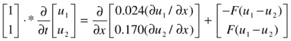

左边界条件可以写为：

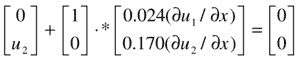

右边界条件可以写为：

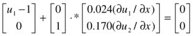

我们首先在 M 文件中定义函数，如图 7-12 到 7-14 所示。

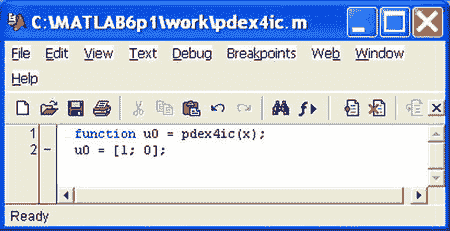图 7-14.

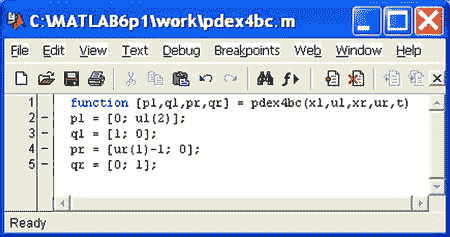图 7-13.

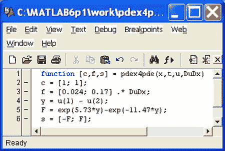图 7-12.

一旦定义了支持函数，求解方程组的函数由图 7-15 所示的 M 文件给出。

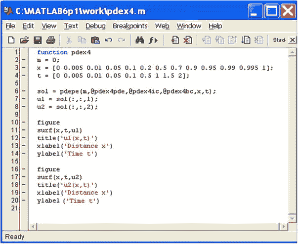图 7-15.

要查看解（图 7-16 和 7-17），我们在 MATLAB 命令窗口中输入以下内容：

```
>> pdex4
```

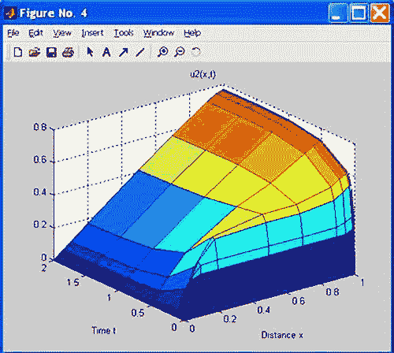图 7-17.

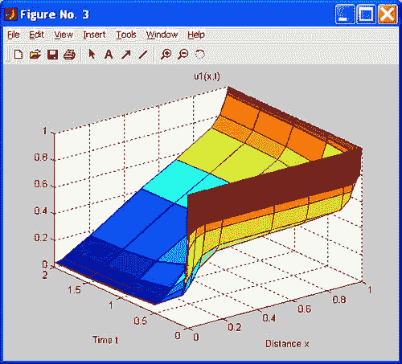图 7-16.

### 练习 7-1

求解以下范德波尔方程组：

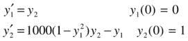

我们首先在一个 M 文件中定义一个名为 `vdp100` 的函数，其中将存储该系统的方程。该函数首先定义一个带有两个空行的列向量，随后为其分配组成方程的各个分量（图 7-18）。

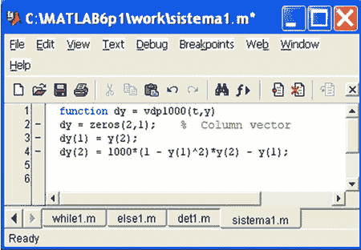图 7-18.

然后我们求解该系统，并通过在命令窗口中输入以下内容，绘制由第一列给出的解 `y[1] = y1`（图 7-19）：

```
>> [T, Y] = ode15s(@vdp1000,[0 3000],[2 0]);
>> plot(T, Y(:,1),'-')
```

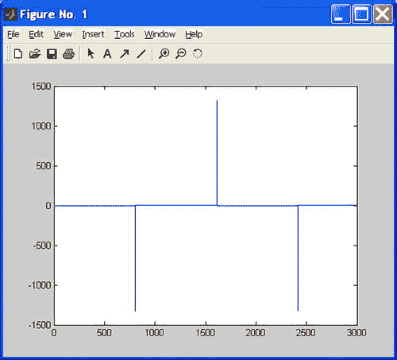图 7-20.

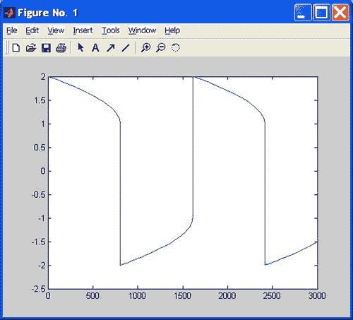图 7-19.

类似地，我们通过以下语法绘制解 `y[2] = y2`（图 7-20）：

```
>> plot(T, Y(:,2),'-')
```

### 练习 7-2

给定以下微分方程

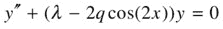

满足边界条件 `y(0) = 1`，`y'(0) = 0`，`y'(π) = 0`，求当 `q = 5` 和 `λ = 15` 时的解，该解基于在区间 `[0, π]` 内 10 个等分点上的初始解，并在区间 `[0, π]` 内 100 个等分点上绘制解的第一个分量。

给定的方程等价于以下一阶微分方程组：

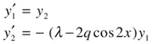

并带有以下边界条件：

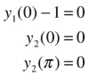

方程组在图 7-21 所示的 M 文件中引入，边界条件在图 7-22 所示的 M 文件中给出，图 7-23 中的 M 文件设置初始解。

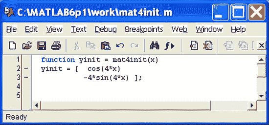图 7-23.

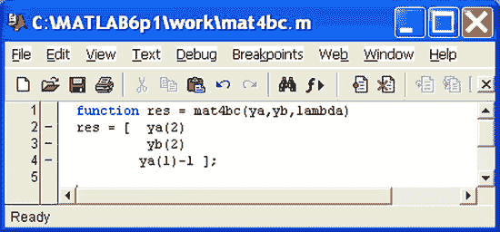图 7-22.

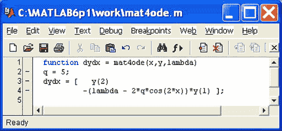图 7-21.

对于 `λ = 15` 和 `[0, π]` 内 10 个等分点，使用以下 MATLAB 语法计算初始解：

```
>> lambda = 15;
solinit = bvpinit(linspace(0,pi,10), @mat4init, lambda);
```

使用以下语法计算系统的数值解：

```
>> sol = bvp4c(@mat4ode,@mat4bc,solinit);
```

要在区间 `[0, π]` 内 100 个等分点上绘制第一个分量，我们使用以下语法：

```
>> xint = linspace(0,pi);
Sxint = bvpval(ground, xint);
plot(xint, Sxint(1,:)))
axis([0 pi -1 1.1])
xlabel('x')
ylabel('solution y')
```

结果如图 7-24 所示。

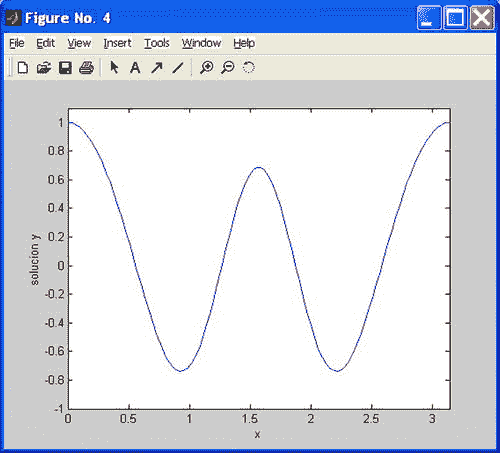图 7-24.

### 练习 7-3

求解以下微分方程

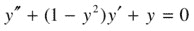

在区间 `[0,20]` 内，取初始解 `y = 2`，`y' = 0`。求解更一般的方程


上述一般方程等价于以下一阶线性方程组：


该方程组针对 `µ = 1` 在图 7-25 所示的 M 文件中定义。

图 7-25.

取初始解 `y[1] = 2` 和 `y[2] = 0` 在区间 `[0, 20]` 内，我们可以使用以下 MATLAB 语法求解该系统：

```
>> [t, y] = ode45(@vdp1,[0 20],[2; 0])
t =
         0
    0.0000
    0.0001
    0.0001
    0.0001
    0.0002
    0.0004
    0.0005
    0.0006
    0.0012
      .
      .
   19.9559
   19.9780
   20.0000

y =
    2.0000         0
    2.0000   -0.0001
    2.0000   -0.0001
    2.0000   -0.0002
    2.0000   -0.0002
    2.0000   -0.0005
      .
      .
    1.8729    1.0366
    1.9358    0.7357
    1.9787    0.4746
    2.0046    0.2562
    2.0096    0.1969
    2.0133    0.1413
    2.0158    0.0892
    2.0172    0.0404
```

我们可以使用以下语法绘制解（参见图 7-26）：

### 求解一般系统

要使用参数 `µ` 求解一般系统，我们在图 7-27 所示的 M 文件中定义系统。


图 7-27.

现在，我们可以使用以下语法，在区间 `[0,1500]` 内绘制对应 `µ = 1000` 的第一个解 `y[1] = 2` 和 `y[2] = 0`（参见图 7-28）：

```matlab
>> [t, y] = ode15s(@vdp2,[0 1500],[2; 0],[],1000);
>> xlabel('time t')
>> ylabel('solution y_1')
```


图 7-28.

要绘制参数取另一值（例如 `µ = 100`）时在区间 `[0,1500]` 内的第一个解 `y[1] = 2` 和 `y[2] = 0`，我们使用以下语法（参见图 7-29）：

```matlab
>> [t, y] = ode15s(@vdp2,[0 1500],[2; 0],[],100);
>> plot(t, y(:,1),'-');
```


图 7-29.
