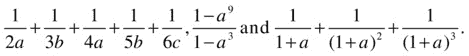
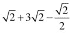
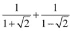
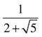
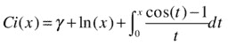
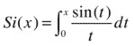
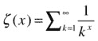
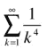
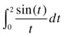

# 8. 符号微分与积分

## 使用 MATLAB 进行符号计算：符号变量

MATLAB 的符号数学工具箱模块允许你轻松地对公式和表达式进行符号化地操作和处理。你可以展开、因式分解和简化多项式、有理式和三角函数式；求解多项式方程和方程组的代数解；符号化地计算导数和积分；求解微分方程的符号解；处理幂、极限以及代数级数的许多其他方面。为此，MATLAB 首先要求所有变量（或代数表达式）使用命令 `syms`（或 `sym`）声明为符号变量。例如，如果我们想将 `6*a*b + 3*a² + 2*a*b` 视为一个符号表达式并简化它，我们首先需要将变量 `a` 和 `b` 声明为符号变量，如下所示：

```
>> syms a b
>> simplify(6*a*b + 3*a² + 2*a*b)
ans =
8 * a * b + 3 * a ^ 2
```

或者，我们可以使用以下表达式：

```
>> simplify(sym('6*a*b + 3*a² + 2*a*b'))
ans =
8 * a * b + 3 * a ²
```

MATLAB 的符号数学工具箱提供了几个可用于定义和操作符号变量的命令。下面将对这些命令进行描述：

| 命令 | 描述 |
| --- | --- |
| `syms x y z… t` | 创建符号变量 `x`, `y`, `z`,…, `t`。 |
| `syms x y z… t real` | 创建符号变量 `x`, `y`, `z`,…, `t` 并假定它们是实数。 |
| `syms x y z… t unreal` | 创建符号变量 `x`, `y`, `z`,…, `t` 并假定它们不是实数。 |
| `syms` | 列出工作区中的符号变量。 |
| `x = sym('x')` | 变量 `x` 成为符号变量（等同于 `syms x`）。 |
| `x = sym('x', real)` | 变量 `x` 成为实数符号变量。 |
| `x = sym('x',unreal)` | 变量 `x` 成为非实数符号变量。 |
| `s = sym(A)` | 从 `A` 创建一个符号对象，其中 `A` 可以是字符串、标量、数组、数值表达式等。 |
| `s = sym(A, 'option')` | 将数组、标量或数值表达式 `A` 根据指定选项转换为符号对象。选项可以是 `'f'`（浮点）、`'r'`（有理数）、`'e'`（错误格式）或 `'d'`（十进制）。 |
| `double(x)` | 将变量或表达式 `x` 转换为双精度数值。 |
| `sym2poly(poly)` | 返回一个向量，其分量是符号多项式 `poly` 的系数。 |
| `poly2sym(vector)` | 返回一个符号多项式，其系数是向量 `vector` 的分量。 |
| `poly2sym(vector, 'v')` | 返回一个变量为 `v` 的符号多项式，其系数是向量 `vector` 的分量。 |
| `char(X)` | 将非负整数数组 `X`（解释为 ASCII 值）转换为字符串。 |
| `latex(S)` | 将符号表达式 `S` 转换为 Latex 代码。 |
| `ccode(S)` | 将符号表达式 `S` 转换为 C 代码。 |
| `fortran(s)` | 将符号表达式 `S` 转换为 Fortran 代码。 |
| `pretty(expr)` | 将符号表达式转换为排印数学格式。 |
| `digits(d)` | 返回具有 `d` 位有效十进制数字精度的符号变量。 |
| `digits` | 返回当前符号变量的精度。 |
| `vpa(expr)` | 返回表达式在由 `digits` 指定的有效数字位数下的数值结果。 |
| `vpa(expr, n)` | 返回表达式在 `n` 位有效十进制数字下的数值结果。 |
| `vpa('expr', n)` | 表达式在 `n` 位有效十进制数字下的数值结果。 |
| `findsym(S)` | 返回符号表达式或符号矩阵 `S` 中的所有符号变量。 |
| `isvarname(S)` | 如果 `S` 是有效的符号变量名，则返回 `TRUE`。 |
| `vectorize(S)` | 在字符串 `S` 中任何符号 `^`、`*` 或 `/` 之前插入一个点。 |

作为第一个示例，我们考虑 `H = 3a² − 2a + 7`，`F = 6a³ − 5a + 2` 和 `G = 5a² + 4a − 3`，并计算：`H + F + G`，`H − F + G` 和 `H − F − G`。

```
>> syms a
>> H = 3*a² - 2*a + 7; F = 6*a³ - 5*a + 2; G = 5*a² + 4*a - 3;
>> pretty(H+F+G)
2                3
8 a  - 3 a + 6 + 6 a
>> pretty(H-F+G)
2                3
8 a  + 7 a + 2 - 6 a
>> pretty(H-F-G)
2              3
-2 a  - a + 8 - 6 a
```

在下面的示例中，我们执行以下符号有理运算：



我们将首先将变量 `a`、`b` 和 `c` 定义为符号变量，然后执行指定的运算。

```
>> syms a b c
>> pretty(1/(2*a)+1/(3*b)+1/(4*a)+1/(5*b)+1/(6*c))
3/4 1/a + 8/15 1/b + 1/6 1/c
>> pretty((1-a)⁹/(1-a)³)
6
(1 - a)
>> pretty(1/(1+a)+1/(1+a)²+1/(1+a)³)
1        1          1
----- + -------- + --------
1 + a           2          3
       (1 + a)    (1 + a)
>> pretty(simplify(1 /(1+a) + 1 /(1+a) ^ 2 + 1 /(1+a) ^ 3))
2
3 + 3 a + a
------------
3
(1 + a)
```

接下来，我们符号化计算  和 。

```
>> pretty(sym(sqrt(2)+3*sqrt(2)-sqrt(2)/2))
1/2
7/2 2
>> pretty(sym(1 / (1 + sqrt (2)) + 1 / (1-sqrt (2))))
-2
```

在下面的示例中，我们符号化计算  并将结果转换为数值形式。

```
>> r=sym(1/(2+sqrt(5)))
r =
8505245244017276*2^(-55)
>> numeric(r)
ans =
0.24
```

然后我们求解方程 `x⁴ + 1 = 0` 并以排印数学格式呈现结果。

```
>> solve('x⁴+1=0')
ans =
[  1/2*2^(1/2)+1/2*i*2^(1/2)]
[ -1/2*2^(1/2)-1/2*i*2^(1/2)]
[  1/2*2^(1/2)-1/2*i*2^(1/2)]
[ -1/2*2^(1/2)+1/2*i*2^(1/2)]
>> pretty(solve('x⁴+1=0'))
[      1/2          1/2 ]
[1/2/2 + 1/2 i 2]
[                       ]
[       1/2          1/2]
[-1/2 2 - 1/2 i 2]
[                       ]
[      1/2          1/2 ]
[1/2 2 - 1/2 i 2]
[                       ]
[       1/2          1/2]
[-1/2 2 + 1/2 i 2]
```

接下来，我们将向量转换为多项式，反之亦然。

```
>> pretty(poly2sym([1 0 9 6 2]))
4      2
x  + 9 x  + 6 x + 2
>> sym2poly(x⁴+9*x²+6*x+2)
ans =
1.00 0 9.00 6.00 2.00
```

下面是一个 2 阶 Hilbert 矩阵，其元素已计算到五位有效十进制数字。

# 符号计算示例

## 矩阵创建与运算

以下示例展示了如何创建符号矩阵并计算其行列式。

```
>> syms x
A = [cos(a*x), sin(a*x);-sin(a*x), cos(a*x)]
A =
[cos(a*x), sin(a*x)]
[-sin(a*x), cos(a*x)]
>> det(A)
ans =
cos(a*x) ^ 2 + sin(a*x) ^ 2
```

接下来，我们使用 `sym` 函数的另一种形式定义之前的符号矩阵，并计算其逆矩阵。

```
>> A = sym([cos(a*x), sin(a*x);-sin(a*x), cos(a*x)])
A =
[cos(a*x), sin(a*x)]
[-sin(a*x), cos(a*x)]
>> pretty(inv(A))
[cos(a x)      sin(a x)]
[--------    - --------]
[   %1            %1   ]
[                      ]
[sin(a x)     cos (a x)]
[--------     -------- ]
[   %1           %1    ]
2           2
%1: = cos(a x) + sin(a x)
```

## 符号计算与数值精度

在以下示例中，我们符号化计算 `1/2 + 1/3`，将数值精度设置为 25 位数字，并计算同一表达式的数值。最后，我们检查当前的数值精度水平。

```
>> sym(1/2+1/3)
ans =
5/6
>> digits(25)
vpa('1/2+1/3')
ans =
.8333333333333333333333333
>> digits
digits = 25
```

## ASCII 字符获取

在以下示例中，获得了数字代码为 93、126 和 115 的 ASCII 字符。

```
>> char(93,126,115)
ans =
]
∼
s
```

## 代码生成

以下示例将 `ln(1 + x)` 的级数展开转换为 LaTeX 代码、C 代码和 FORTRAN 代码。

```
>> syms x
>> f = taylor(log(1+x));
>> latex(f)
ans =
x-1/2\,{x}^{2}+1/3\,{x}^{3}-1/4\,{x}^{4}+1/5\,{x}^{5}
>> ccode(f)
ans =
A = x-x*x/2.0+x*x*x/3.0-x*x*x*x/4.0+x*x*x*x*x/5.0;
>> fortran(f)
ans =
A = x-x**2/2+x**3/3-x**4/4+x**5/5
```

# 符号函数：替换与函数运算

## 符号函数的定义与变量替换

MATLAB 的符号数学模块允许你直接使用 `f = '函数表达式'`（或 `f = 函数表达式`）语法定义符号函数，前提是变量已事先通过 `syms` 声明为符号变量。

一旦符号函数被显式定义，就可以使用如下所示命令为函数中的变量替换值，即计算函数在给定点的值：

| 命令 | 描述 |
| :--- | :--- |
| `subs(f, a)` | 计算函数 `f` 在点 `a` 处的值。 |
| `subs(f, a, b)` | 在函数 `f` 中将 `a` 替换为 `b`。 |
| `subs(f, 变量, 值)` | 在函数 `f` 中将变量 `变量` 替换为值 `值`。 |
| `subs(f, {x, y, ...}, {a, b, ...})` | 在函数 `f` 中将变量 `{x, y, ...}` 分别替换为值 `{a, b, ...}`。 |

## 替换操作示例

第一个例子中，我们定义函数 `f(x) = x³` 并计算 `f(2)` 和 `f(b+2)`。

```
>> f='x³'

f =

x³

>> A=subs(f,2)

A =

8

>> syms b

>> B=subs(f,b+2)

B =

(b+2) ^ 3
```

在下面的例子中，我们考虑二元函数 `f(a, b) = a+b`，首先将 `a` 替换为 `4`，然后将 `a` 和 `b` 分别替换为 `3` 和 `5`（即求 `f(3,5)`）。

```
>> syms a b

>> subs(a+b,a,4)

ans =

4+b

>> subs(a+b,{a,b},{3,5})

ans =

8
```

以下是另外三个替换示例。

```
>> subs (cos (a) + (b), {a, b}, {sym ('alpha'), 2})

ans =

cos (alpha) + sin (2)

>> subs('exp(a*t)','a',-magic(2))

ans =

[exp (t), exp(-3*t)]
[exp(-4*t), exp(-2*t)]

>> syms x y

>> subs(x*y,{x,y},{[0 1;-1 0],[1-1;-2 1]})

ans =

0-1
2 0
```

## 函数运算命令

除了替换功能，MATLAB 还提供了一些执行函数运算的命令，如函数的加、减、乘、除运算，以及复合与求逆。下表总结了这些命令的语法：

| 命令 | 描述 |
| :--- | :--- |
| `symadd(f, g)` | 求函数 `f` 和 `g` 的和（`f + g`）。 |
| `symop(f, '+', g, '+', h, '+',.....)` | 返回和 `f+g+h+...`。注意，`symop` 在更新版本的 MATLAB 中已废弃。 |
| `symsub(f, g)` | 返回 `f` 和 `g` 的差（`f-g`）。 |
| `symop(f, '-', g, '-', h, '-',.....)` | 返回差 `f-g-h-...`。 |
| `symmul(f, g)` | 返回 `f` 和 `g` 的积（`f * g`）。 |
| `symop(f, '*', g, '*', h, '*',.....)` | 返回积 `f * g * h *...`。 |
| `symdiv(f, g)` | 返回 `f` 和 `g` 的商（`f/g`）。 |
| `symop(f, '/', g, '/', h, '/',.....)` | 返回连商 `((f/g)/h)/...`。 |
| `sympow(f, k)` | 将 `f` 提升为 `k` 次幂（`k` 为标量）。 |
| `symop(f, '^', g)` | 将一个函数提升为另一个函数的幂（`f^g`）。 |
| `compose(f, g)` | 复合 `f` 和 `g`（`f ∞ g (x) = f(g(x))`）。 |
| `compose(f, g, u)` | 复合 `f` 和 `g`，将表达式 `u` 作为 `f` 和 `g` 的定义域。 |
| `g = finverse(f)` | 返回函数 `f` 的反函数。 |
| `g = finverse(f, v)` | 返回函数 `f` 的反函数，使用符号变量 `v` 作为自变量。 |

## 函数运算示例

在下面的例子中，给定函数 `f(x)=x²`，`g(x)=x³+1` 和 `h(x) = sin(x)+cos(x)`，我们计算 `(f+g)(x)`，`(f-g+h)(x)`，`(f/g)(x)`，`f(g(x))`，`f(h(π/3))` 和 `f(g(h(sin(x))))`。

```
>> syms x

>> f = x ^ 2; g = x ^ 3 + 1; h = sin (x) + cos (x);

>> sum = symadd(f,g)

sum =

x²+x³+1

>> combination = symadd(symsub(f,g),h)

combination =

x ^ 2-x ^ 3-1 + sin (x) + cos (x)

>> combination = symop(f,'-',g,'+',h)

combination =

x ^ 2-x ^ 3-1 + sin (x) + cos (x)

>> quotient = symdiv (f, g)

quotient =

x ^ 2-/(x³+1)

>> composite = subs (compose (g, f), x-1)

composite =

(x-1) ^ 6 + 1

>> composite1 = subs (compose (f, h), pi/3)

composite1 =

1.8660

>> composite1 = subs (compose (f, h), ' pi/3')

composite1 =

(sin ((pi/3)) + cos ((pi/3))) ^ 2

>> composite2 = subs (compose (f , compose (g, h)), 'sin (x)')

composite2 =

((sin (sin (x)) + cos (sin (x))) ^ 3 + 1) ^ 2
```

在下面的例子中，我们求函数 `f(x) = sin(x²)` 的反函数，并验证结果正确。

```
>> syms x

>> f = sin(x²)

f =

sin(x²)

>> g = finverse(f)

g =

asin(x)^(1/2)

>> compose(f,g)

ans =

x
```

## 符号特殊函数

MATLAB 还提供了一组预定义的符号特殊函数，其语法如下表所示：

| 函数 | 描述 |
| :--- | :--- |
| `cosint(x)` | 余弦积分，，其中 γ 是欧拉-马歇罗尼常数 0.5772156649... |
| `sinint(x)` | 正弦积分，。 |
| `hypergeom(n,d,z)` | 广义超几何函数。 |
| `lambertw(x)` | 朗伯函数 λ(x)，由方程 λ(x) * e^(λ(x)) = x 定义。 |
| `zeta(x)` | 黎曼 zeta 函数 ζ(x)，定义为 。 |
| `zeta(n,x)` | `zeta(x)` 的第 n 阶导数。 |

第一个例子中，我们求级数  的和，该值等于 ζ(4)。

```
>> zeta (4)

ans =

1.0823
```

接下来我们求积分 。我们使用正弦积分函数。

```
>> sinint (2)

ans =

1.6054
```
