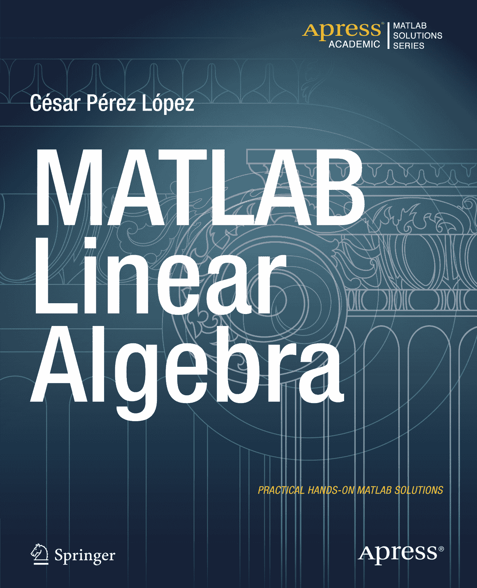

# MATLAB 线性代数

  
César Pérez López

ISBN 978-1-4842-0323-1  
e-ISBN 978-1-4842-0322-4  
DOI 10.1007/978-1-4842-0322-4  
© Apress 2014

**出版人：** Heinz Weinheimer  
**首席编辑：** Dominic Shakeshaft  
**编辑委员会：** Steve Anglin, Mark Beckner, Ewan Buckingham, Gary Cornell, Louise Corrigan, Jim DeWolf, Jonathan Gennick, Robert Hutchinson, Michelle Lowman, James Markham, Matthew Moodie, Jeff Olson, Jeffrey Pepper, Douglas Pundick, Ben Renow-Clarke, Dominic Shakeshaft, Gwenan Spearing, Matt Wade, Steve Weiss  
**协调编辑：** Jill Balzano  
**文字编辑：** Barnaby Sheppard  
**排版：** SPi Global  
**索引编制：** SPi Global  
**美术设计：** SPi Global  
**封面设计：** Anna Ishchenko

本书通过 Springer Science+Business Media New York 在全球图书贸易中发行，地址：233 Spring Street, 6th Floor, New York, NY 10013。电话：1-800-SPRINGER，传真：(201) 348-4505，电子邮件：`orders-ny@springer-sbm.com`，或访问 [www.springeronline.com](http://www.springeronline.com/)。Apress Media, LLC 是一家加利福尼亚有限责任公司，其唯一成员（所有者）是 Springer Science + Business Media Finance Inc（SSBM Finance Inc）。SSBM Finance Inc 是一家特拉华州公司。如需翻译相关信息，请发送电子邮件至 `rights@apress.com`，或访问 [www.apress.com](http://www.apress.com/)。Apress 和 friends of ED 的书籍可批量购买，用于学术、企业或促销用途。大多数图书也提供电子书版本和许可证。如需更多信息，请参考我们的批量销售-电子书许可网页：[www.apress.com/bulk-sales](http://www.apress.com/bulk-sales)。文中作者引用的任何源代码或其他补充材料，读者可在 [www.apress.com](http://www.apress.com/) 获取。有关如何找到本书源代码的详细信息，请访问 [www.apress.com/source-code/](http://www.apress.com/source-code/)。

本作品受版权保护。出版人保留所有权利，无论涉及材料的全部或部分，特别是翻译、重印、使用插图、朗诵、广播、以微缩胶片或任何其他物理方式复制，以及传输或信息存储与检索、电子改编、计算机软件，或现有或将来开发的相似或不同方法的权利。与评论或学术分析相关的简短摘录，或专门为在计算机系统上输入和执行而提供、仅供购买者使用的材料，不受此法律限制。对本出版物或其部分内容的复制，只有在出版人所在地现行版权法的规定下才被允许，且使用许可必须始终从 Springer 获取。使用许可可通过 Copyright Clearance Center 的 RightsLink 获取。违反行为将根据相应的版权法受到起诉。

本书中可能出现商标名称、徽标和图像。我们没有在每次出现商标名称、徽标或图像时都使用商标符号，而是仅以编辑方式使用这些名称、徽标和图像，以维护商标所有者的利益，并无意侵犯商标。本书中使用的商品名称、商标、服务标志及类似术语，即使未被标识为商标，也不应被视为关于其是否受专有权利保护的观点的表达。

尽管本书中的建议和信息在出版时被认为是真实和准确的，但作者、编辑和出版人对可能出现的任何错误或遗漏不承担法律责任。出版人对本书所含内容不作任何明示或暗示的担保。

## 关于作者

César Perez Lopez 是马德里大学统计与运筹学系教授。César Perez Lopez 同时也是马德里国家统计研究所（INE）的数学家和经济学家，该机构隶属于西班牙政府高级系统与信息技术部。César 目前还在马德里财政研究所工作。

## 即将出版

* 《用于数值分析的 MATLAB 编程》，978-1-4842-0296-8
* 《MATLAB 微分方程》，978-1-4842-0311-8
* 《MATLAB 控制系统工程》，978-1-4842-0290-6
* 《MATLAB 微分与积分》，978-1-4842-0305-7
* 《MATLAB 矩阵代数》，978-1-4842-0308-8

