# 第 1 章：MATLAB 简介与工作环境


## MATLAB 工作环境

下表总结了 MATLAB 工作环境的主要组件。

| 工具 | 描述 |
| --- | --- |
| 命令历史记录 | 显示在命令窗口中输入的函数历史记录，并允许您复制和执行它们（见图 1-2 的右下部分）。 |
| 命令窗口 | 这是您执行 MATLAB 命令的窗口（见图 1-2 的中央部分）。 |
| 工作区 | 显示工作区的当前内容，并允许您对其进行修改（见图 1-2 的右上部分）。 |
| 帮助 | 允许您搜索和阅读整个 MATLAB 产品家族的文档。 |
| 启动按钮 | 运行工具，并允许您访问当前安装在计算机上的所有 MathWorks 产品的文档（图 1-3）。 |

图 1-1 显示了您输入 MATLAB 程序的屏幕。这是 MATLAB 的主要工作环境。

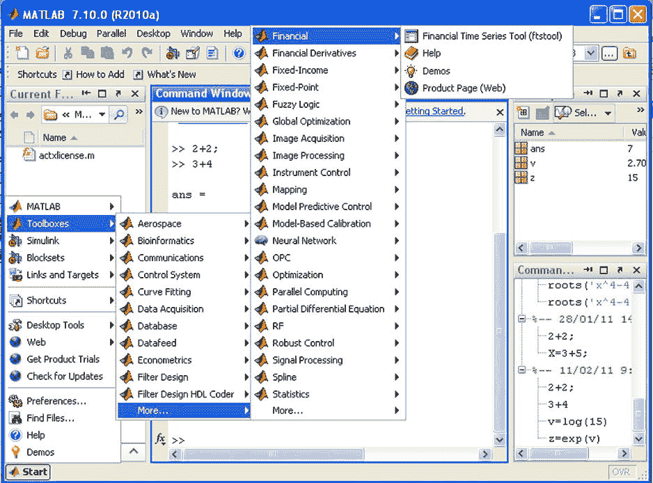

图 1-3.

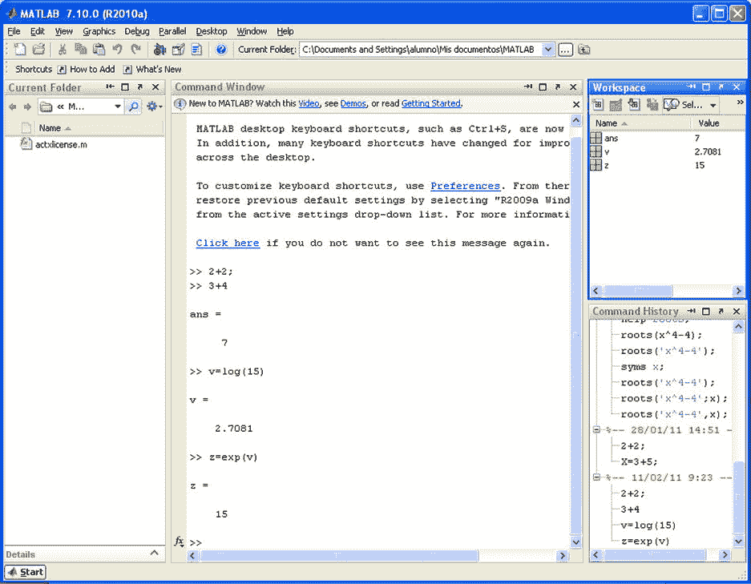

图 1-2.

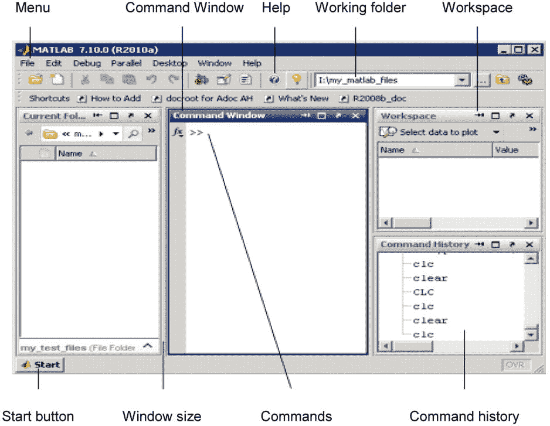

图 1-1.

任何 MATLAB 命令都在命令窗口中用户输入提示符 `>>` 的右侧输入，按下 Enter 后，响应将立即显示在下面的行中。命令执行后，用户输入提示符会再次出现，允许您输入更多命令（图 1-4）。

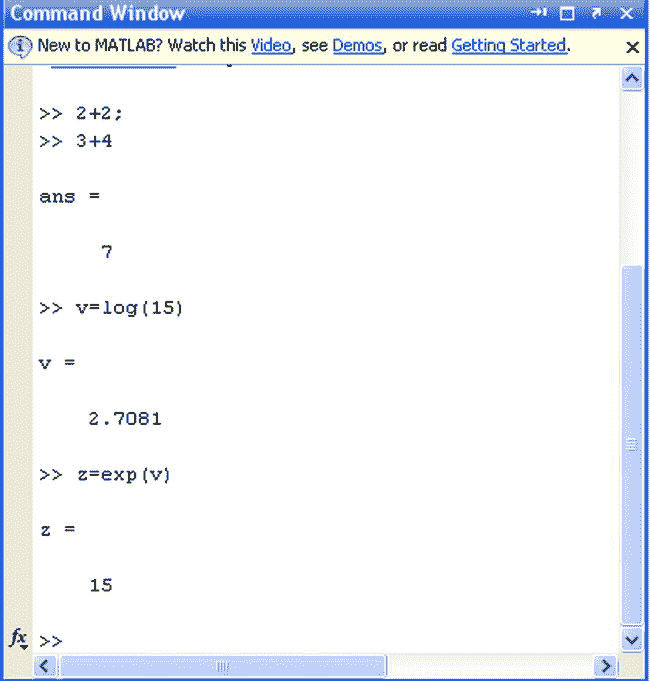

图 1-4.

如果命令的结果未分配给变量，MATLAB 将使用表达式 `ans =` 返回响应，如图 1-4 开头所示。如果结果分配给了一个变量，那么我们可以将该变量用作后续命令的参数。图 1-4 中的变量 `v` 就是这种情况，它随后被用作指数运算的输入。

要执行 MATLAB 命令，只需在写好命令后按 Enter 键。如果在输入末尾加上分号，程序将执行该命令并将结果保存在内存（工作区）中，但不会在屏幕上显示结果（见图 1-13 中的第一个输入）。然后输入提示符 `>>` 会再次出现，表示您可以输入新命令。

与 C 编程语言一样，MATLAB 区分大小写；例如，`Sin(x)` 与 `sin(x)` 不同。所有内置函数的名称都以小写字符开头。命令、变量或函数的名称中不应有空格。在其他情况下，空格会被忽略，并且可以用来使输入更易读。可以通过用逗号分隔多个条目，并在最后一个条目末尾按 Enter 键来在同一命令行中输入多个条目（见图 1-4）。如果您在行中某个条目的末尾使用分号，则其对应的输出将不会显示。

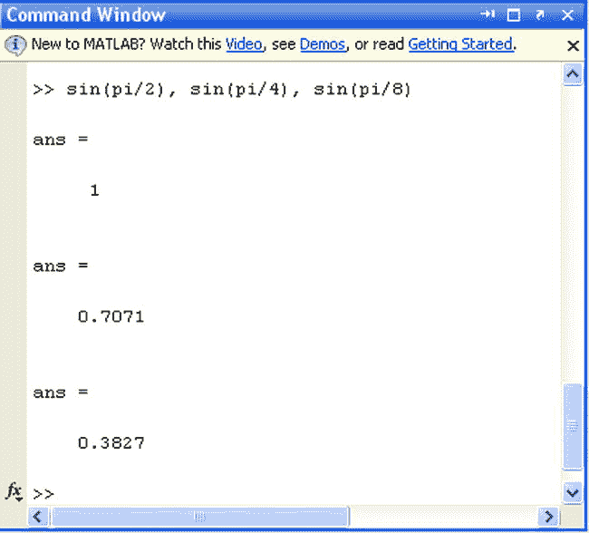

图 1-5.

描述性注释可以通过以 `%` 符号开头输入到命令输入行中。当您运行输入时，MATLAB 会忽略注释并处理其余代码（见图 1-6）。

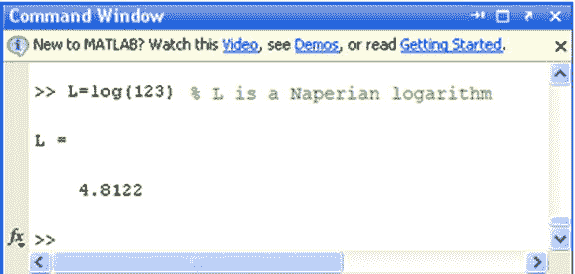

图 1-6.

为了简化提交给 MATLAB 解释器（通过命令窗口提示符）评估的脚本的输入过程，您可以使用箭头键。例如，如果您按一次上箭头键，您将恢复上次提交的条目。如果您按两次上箭头键，您将恢复倒数第二次提交的条目，依此类推。

如果您在输入区域键入一串字符，然后按上箭头键，您将恢复上次提交的以指定字符串开头的条目。

在 MATLAB 会话期间输入的命令会临时存储在缓冲区（工作区）中，直到会话结束，届时它们可以永久存储在文件中或永久丢失。

以下是在 MATLAB 输入区域（命令行）中可以使用的按键及其功能摘要：

| 上箭头 (Ctrl-P) | 检索上一个条目。 |
| 下箭头 (Ctrl-N) | 检索下一个条目。 |
| 左箭头 (Ctrl-B) | 将光标向左移动一个字符。 |
| 右箭头 (Ctrl-F) | 将光标向右移动一个字符。 |
| CTRL-左箭头 | 将光标向左移动一个单词。 |
| CTRL-右箭头 | 将光标向右移动一个单词。 |
| Home (Ctrl-A) | 将光标移动到行首。 |
| End (Ctrl-E) | 将光标移动到当前行尾。 |
| Escape | 清除命令行。 |
| Delete (Ctrl-D) | 删除光标指示的字符。 |
| Backspace | 删除光标左侧的字符。 |
| CTRL-K | 删除（剪切）当前行。 |

命令 `clc` 清除命令窗口，但不会删除工作区的内容（内容仍保留在内存中）。

### MATLAB 中的帮助

您可以通过工具栏中的帮助按钮或菜单栏中的“帮助”选项来查找 MATLAB 的帮助。此外，也可以通过 MATLAB 命令获取支持。命令 `help` 提供所有 MATLAB 命令的通用帮助（见图 1-7）。通过单击其中任何一个，您可以获得更具体的帮助。例如，如果您单击 `graph2d`，您将获得关于二维图形的支持（见图 1-8）。

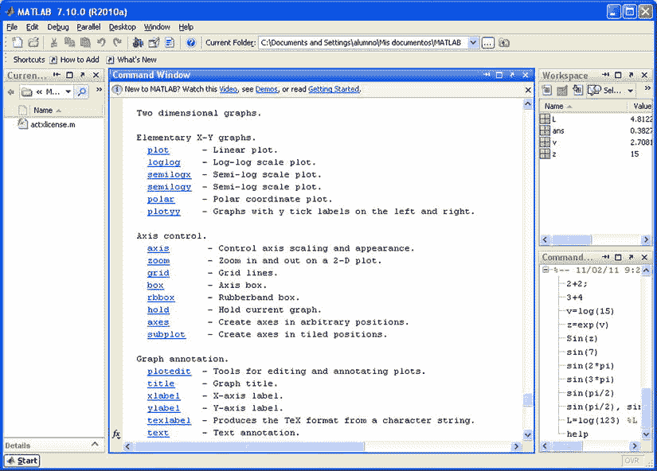

图 1-8.

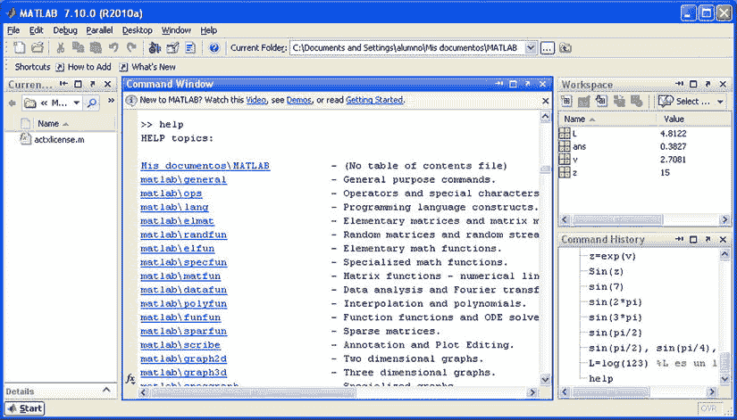

图 1-7.

您可以通过使用命令 `help command` 或 `help topic` 来请求关于特定命令 `command`（图 1-9）或任何主题 `topic`（图 1-10）的帮助。

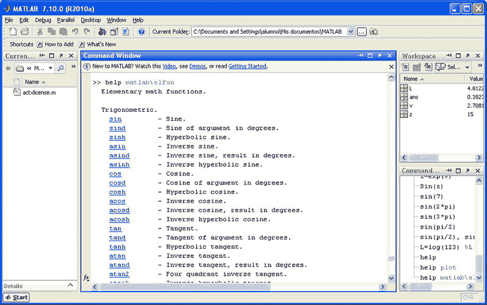

图 1-10.

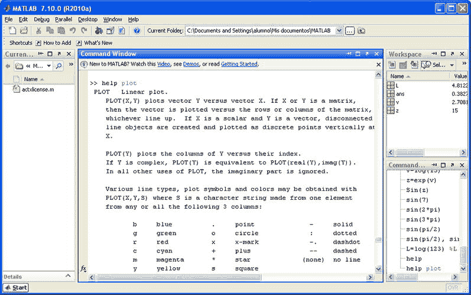

图 1-9.

命令 `lookfor string` 允许您查找所有引用或包含字符串 `string` 的 MATLAB 函数或命令。当没有指定字符串的直接支持，或者想查看与给定字符串相关的所有命令的帮助时，此命令非常有用。例如，如果我们想查找包含序列 `inv` 的所有命令的帮助，我们可以使用命令 `lookfor inv`（图 1-11）。

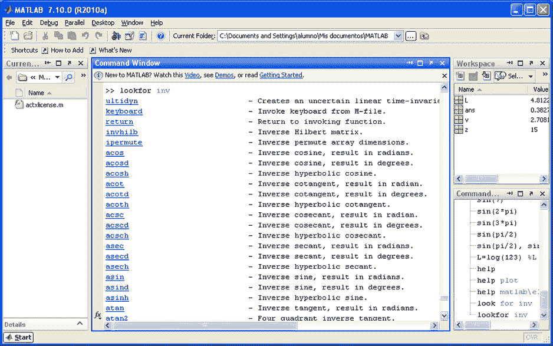

图 1-11.


## 使用 MATLAB 进行数值计算

您可以将 MATLAB 用作强大的数值计算机。虽然大多数计算器只能处理预设精度的数字，但 MATLAB 可以执行任何所需精度的精确计算。此外，与计算器不同，我们不仅可以用单个数字执行运算，还可以用数组等对象执行运算。

该软件处理经典数值分析的大多数主题。它支持矩阵计算、统计学、插值、最小二乘拟合、数值积分、函数最小化、线性规划、微分方程的数值解和代数解，以及随着本书内容的深入我们将遇到的一系列其他方法。

以下是一些使用 MATLAB 进行数值计算的示例。（我们知道，要在提示符 `>>` 后输入所需命令后，必须按 Enter 键才能获得结果。）

我们简单地计算 `4 + 3` 得到结果 `7`。为此，只需输入 `4 + 3`，然后按 Enter。

```
>> 4 + 3
ans =
7
```

我们计算 `3` 的 `100` 次幂的值，无需事先设置精度。为此，我们只需输入 `3 ^ 100`。

```
>> 3 ^ 100
ans =
5.1538e+047
```

我们可以使用命令 `format long e` 来获得 15 位（浮点）精度的结果。

```
>> format long e
>> 3¹⁰⁰
ans =
5.153775207320115e+047
```

我们也可以处理复数。我们通过输入表达式 `(2 + 3i) ^ 10`，来计算 `(2 + 3i)` 的 `10` 次幂的运算结果。

```
>> (2 + 3i) ^ 10
ans =
-1.415249999999998e+005 - 1.456680000000000e+005i
```

前面的结果也可以使用 `format short` 命令以短格式显示。

```
>> format short
>> (2 + 3i)¹⁰
ans =
-1.4152e+005- 1.4567e+005i
```

我们可以计算贝塞尔函数 `J[0]` 在 `11.5` 处的值。为此，我们输入 `besselj(0,11.5)`。

```
>> besselj(0,11.5)
ans =
-0.0677
```

## 使用 MATLAB 进行符号计算

MATLAB 完美地处理符号数学计算，能够轻松地操作和计算公式与代数表达式。您可以展开、分解和简化多项式、有理式和三角表达式，找到多项式方程和方程组的代数解，对导数和积分进行符号求值，找到微分方程的解，处理幂运算，并研究极限以及代数级数的许多其他特性。

要执行这些任务，MATLAB 首先要求所有变量（或代数表达式）都写在单引号之间。当 MATLAB 接收到引号内的变量或表达式时，它会被解释为符号。

以下是一些使用 MATLAB 进行符号计算的示例。

我们可以展开以下代数表达式：`((x + 1)(x + 2) - (x + 2)²)³`。这通过输入：`expand('((x + 1)(x + 2) - (x + 2)²)³')` 来完成。结果将是另一个代数表达式：

```
>> syms x; expand(((x + 1) *(x + 2)-(x + 2) ^ 2) ^ 3)
ans =
-x ^ 3-6 * x ^ 2-12 * x-8
```

我们可以通过输入：`factor('((x + 1) * (x + 2) - (x + 2)²)³')` 来分解上面示例计算结果。

```
>> syms x; factor(((x + 1)*(x + 2)-(x + 2)²)³)
ans =
-(x + 2)³
```

我们可以通过输入：`int('x² *sin(x)^ 2', 'x')` 来求函数 `(x²) sin(x)²` 的不定积分。

```
>> int('x²*sin(x)²', 'x')
ans =
x ^ 2 *(-1/2 * cos(x) * sin(x) + 1/2 * x)-1/2 * x * cos(x) ^ 2 + 1/4 * cos(x) * sin(x) + 1/4 * 1/x-3 * x ^ 3
```

我们可以简化之前的结果：

```
>> syms x; simplify(int(x²*sin(x)², x))
ans =
sin(2*x)/8 -(x*cos(2*x))/4 -(x²*sin(2*x))/4 + x³/6
```

我们可以使用更优雅的数学符号表示之前的结果：

```
>> syms x; pretty(simplify(int(x²*sin(x)², x)))
ans =

  sin(2 x)   x cos(2 x)   x  sin(2 x)   x
  -------- - ---------- - ----------- + --
     8           4             4        6
```

我们可以求解方程 `3ax - 7 x² + x³ = 0`（其中 `a` 是参数）：

```
>> solve('3*a*x-7*x² + x³ = 0', 'x')
ans =
[                          0]
[7/2 + 1/2 *(49-12*a) ^(1/2)]
[7/2-1/2 *(49-12*a) ^(1/2)]
```

另一方面，MATLAB 可以使用 Maple 程序库来处理符号数学，从而扩展其作用域。通过这种方式，MATLAB 可用于处理诸如微分形式、欧几里得几何、射影几何、统计学等主题。

同时，Maple 也可以利用 MATLAB 的数值计算能力，例如，可以与 Maple 库（组合学、优化、数论等）结合使用。

## 使用 MATLAB 绘图

MATLAB 可以生成二维和三维图形，以及等高线和密度图。您可以图形化地表示数据列表，控制颜色、阴影和其他图形特性。同时也支持动画图形。MATLAB 生成的图形可以移植到其他程序。

下面给出了一些 MATLAB 绘图的示例。

我们可以表示函数 `xsin(1/x)`，其中 `x` 的范围在 `-π/4` 和 `π/4` 之间，在该区间内取 300 个等分点。见图 1-12。

```
>> x = linspace(-pi/4,pi/4,300);
>> y = x.*sin(1./x);
>> plot(x,y)
```

我们可以为上面的图形添加标题和轴标签，也可以添加网格。见图 1-13。

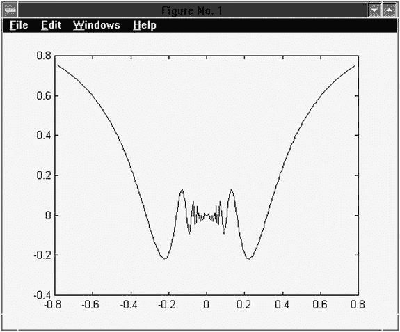

图 1-12.

```
>> x = linspace(-pi/4,pi/4,300);
>> y = x.*sin(1./x);
>> plot(x,y);
>> grid;
>> xlabel('自变量 X');
>> ylabel('因变量 Y');
>> title('函数 y=xsin(1/x)')
```

图 1-13.

我们可以生成由函数 `z = sin(sqrt(x² + y²)) / sqrt(x² + y²)` 定义的曲面图，其中 `x` 和 `y` 在区间 `(-7.5, 7.5)` 内变化，取间隔为 0.5 的等分点。见图 1-14。

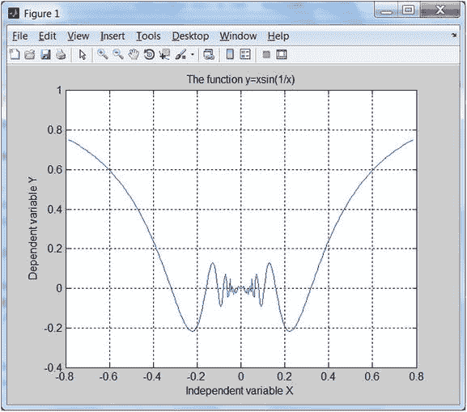

图 1-13.

```
>> x = -7.5:.5:7.5;
>> y = x;
>> [X, Y] = meshgrid(x,y);
>> Z = sin(sqrt(X.²+Y.²))./sqrt(X.²+Y.²);
>> surf(X, Y, Z)
```

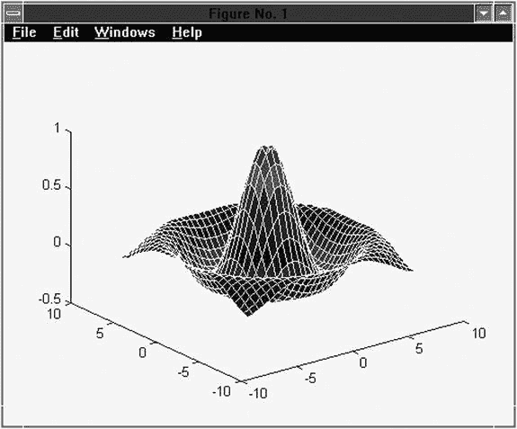

图 1-14.

这些 3D 图形使您能够清晰地了解空间中的图形，并且在视觉上识别不同体之间的相交，以及生成各种空间曲线、曲面和旋转体方面非常有帮助。

我们可以生成参数坐标为：`x = sin(t)`，`y = cos(t)`，`z = t` 的螺旋线对应的三维图形。见图 1-15。

```
>> t = 0:pi/50:10*pi;
>> plot3(sin(t),cos(t),t)
```

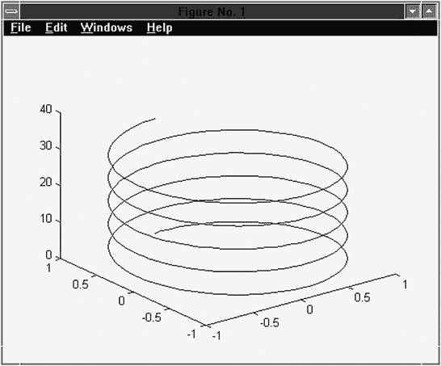

图 1-15.

我们可以表示由其极坐标 `r = cos(2t) * sin(2t)` 给出的平面曲线，其中 `t` 在 `0` 到 `π` 之间变化，取间隔为 0.01 的等分点。见图 1-16。

```
>> t = 0:.1:2 * pi;
>> r = sin(2*t).* cos(2*t);
>> polar(t,r)
```

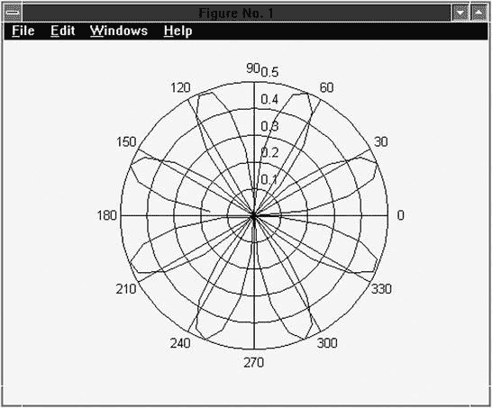

图 1-16.

我们可以使用命令 `ezplot` 绘制符号函数的图形。见图 1-17。

```
>> y = 'x³/(x²-1)';
>> ezplot(y,[-5,5])
```

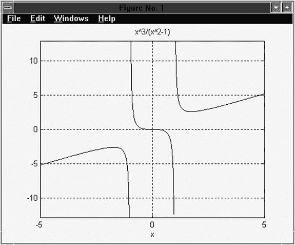

图 1-17.

我们将在关于绘图的章节中更详细地讨论这些概念。


## 通用符号说明

与其他程序一样，学习 MATLAB 的最佳方式就是使用它。通过实例练习，你就能熟悉 MATLAB 特有的语法和符号。我们给出的每个示例都包含带有用户输入提示符 `>>` 的标题行，以及下一行中 MATLAB 的响应。请参见图 1-18。

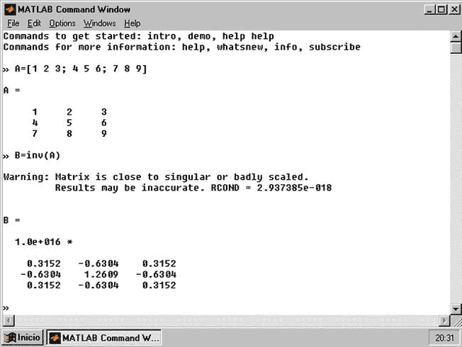

图 1-18.

在其他情况下，根据向 MATLAB 输入的条目（用户输入）类型，响应会通过表达式 `ans =` 返回。请参见图 1-19。

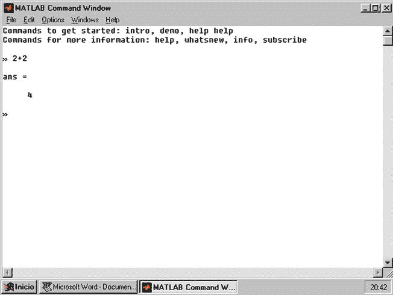

图 1-19.

注意区分大写字母与小写字母、圆括号与方括号、空格与标点符号（特别是逗号和分号）的使用至关重要。

### 命令帮助

我们已经了解如何通过 MATLAB 的下拉菜单获取帮助。此外，还可以通过命令（指令或函数）获取支持，这些命令以 MATLAB 对象的形式实现。你可以使用 `help` 命令立即访问各种信息。

```
>> help

HELP topics:

matlab\general       -  通用命令。
matlab\ops           -  运算符和特殊字符。
matlab\lang          -  编程语言结构。
matlab\elmat         -  基本矩阵与矩阵操作。
matlab\elfun         -  基本数学函数。
matlab\specfun       -  专用数学函数。
matlab\matfun        -  矩阵函数 - 数值线性代数。
matlab\datafun       -  数据分析与傅里叶变换。
matlab\polyfun       -  插值与多项式。
matlab\funfun        -  函数函数与常微分方程求解器。
matlab\sparfun       -  稀疏矩阵。
matlab\graph2d       -  二维图形。
matlab\graph3d       -  三维图形。
matlab\specgraph     -  专用图形。
matlab\graphics      -  句柄图形。
matlab\uitools       -  图形用户界面工具。
matlab\strfun        -  字符串。
matlab\iofun         -  文件输入/输出。
matlab\timefun       -  时间与日期。
matlab\datatypes     -  数据类型与结构。
matlab\winfun        -  Windows 操作系统接口文件 (DDE/ActiveX)
matlab\demos         -  示例与演示。
toolbox\symbolic     -  符号数学工具箱。
toolbox\tour         -  MATLAB 导览。
toolbox\local        -  偏好设置。

如需获取关于某目录/主题的帮助，请键入 "help topic"。
```

如我们所见，`help` 命令会显示程序目录列表及其内容。可以通过使用命令 `help topic` 来显示关于任何特定主题的帮助。例如：

```
>> help inv

INV   矩阵求逆。
INV(X) 是方阵 X 的逆矩阵。
如果 X 病态或接近奇异，则会打印警告信息。
另请参阅 SLASH, PINV, COND, CONDEST, NNLS, LSCOV。
重载方法
help sym/inv.m
```

```
>> help matlab\elfun

基本数学函数。
三角函数。
sin         - 正弦。
sinh        - 双曲正弦。
asin        - 反正弦。
asinh       - 反双曲正弦。
cos         - 余弦。
cosh        - 双曲余弦。
acos        - 反余弦。
acosh       - 反双曲余弦。
tan         - 正切。
tanh        - 双曲正切。
atan        - 反正切。
atan2       - 四象限反正切。
atanh       - 反双曲正切。
sec         - 正割。
sech        - 双曲正割。
asec        - 反正割。
asech       - 反双曲正割。
csc         - 余割。
csch        - 双曲余割。
acsc        - 反余割。
acsch       - 反双曲余割。
cot         - 余切。
coth        - 双曲余切。
acot        - 反余切。
acoth       - 反双曲余切。

指数函数。
exp         - 指数。
log         - 自然对数。
log10       - 常用（以 10 为底）对数。
log2        - 以 2 为底的对数并分解浮点数。
pow2        - 以 2 为底的幂并缩放浮点数。
sqrt        - 平方根。
nextpow2    - 下一个更高的 2 的幂。

复数函数。
abs         - 绝对值。
angle       - 相角。
conj        - 复共轭。
imag        - 复数虚部。
real        - 复数实部。
unwrap      - 解开相角。
isreal      - 检测是否为实数数组。
cplxpair    - 将数排序为复共轭对。

舍入与求余函数。
fix         - 向零方向取整。
floor       - 向负无穷方向取整。
ceil        - 向正无穷方向取整。
round       - 向最近整数舍入。
mod         - 模数（除法后有符号余数）。
rem         - 除法后余数。
sign        - 符号函数。
```

有一个用于查询特定字符序列的命令（`lookfor string`），它允许你查找所有包含或引用了给定字符串的函数或命令。当没有针对指定字符串的直接帮助，或者你想查看与给定序列相关的所有命令的帮助时，此命令非常有用。例如，如果我们想查找所有包含序列 complex 的命令的帮助，可以使用 `lookfor complex` 命令来查看 MATLAB 提供了哪些命令。

```
>> lookfor complex

ctranspose.m: %'   复共轭转置。
CONJ   复共轭。
CPLXPAIR 将数排序为复共轭对。
IMAG   复数虚部。
REAL   复数实部。
CDF2RDF 复对角形式转换为实块对角形式。
RSF2CSF 实块对角形式转换为复对角形式。
B5ODE   刚性问题，具有复特征值的线性问题（EHL 的 B5）。
CPLXDEMO 复变量函数映射。
CPLXGRID 极坐标复网格。
CPLXMAP 绘制复变量函数。
GRAFCPLX 演示 MATLAB 中的复函数绘图。
ctranspose.m: %TRANSPOSE 符号矩阵复共轭转置。
SMOKE   具有“烟圈”伪谱的复矩阵。
```

## MATLAB 与编程

通过根据编程语法规则正确组合 MATLAB 中定义的所有对象，你可以构建有用的数学编程代码。程序通常由一系列指令组成，在这些指令中，值被计算、被赋予名称并用于后续计算。

与 C 或 FORTRAN 等编程语言一样，在 MATLAB 中，你可以编写包含循环、控制流和条件语句的程序。MATLAB 可以编写过程式程序，即它可以定义一系列要运行的标准步骤。与 C 或 Pascal 类似，可以使用 `Do`、`For` 或 `While` 循环进行重复计算。MATLAB 语言还包含条件结构，例如 `If--Then--Else`。MATLAB 还支持不同的逻辑运算符，例如 `AND`、`OR`、`NOT` 和 `XOR`。

MATLAB 支持过程式编程（包含迭代过程、递归函数、循环等）、函数式编程和面向对象编程。以下是两个简单的程序示例。第一个生成 n 阶 Hilbert 矩阵，第二个计算所有小于 1000 的斐波那契数。

```
% 生成 n 阶 Hilbert 矩阵
t = '1/(i+j-1)';
for i = 1:n
    for j = 1:n
        a(i,j) = eval(t);
    end
end

% 计算斐波那契数
f = [1 1]; i = 1;
while f(i) + f(i-1) < 1000
    f(i+2) = f(i) + f(i+1);
    i = i+1
end
```


### 退出与切换到 MS-DOS 环境的命令

有三种方法可以从 MATLAB 命令窗口退出并切换到 MS-DOS 操作系统环境，以便运行临时任务。在命令窗口中输入命令 `! dos_command` 可以在 MATLAB 环境中运行指定的 DOS 命令。例如：

```
! dir
驱动器 D 中的卷没有标签
卷序列号 £ 是 145 c-12F2
D:\MATLAB52\bin 的目录

.                  <DIR>    13/03/98   0:16 .
..                 <DIR>    13/03/98   0:16 ..
BCCOPTS  BAT        1.872  19/01/98  14:14 bccopts.bat
CLBS110  DLL      219.136  21/08/97  22:24 clbs110.dll
CMEX     BAT        2.274  13/03/98   0:28 cmex.bat
COMPTOOL BAT       34.992  19/01/98  14:14 comptool.bat
DF50OPTS BAT        1.973  19/01/98  14:14 df50opts.bat
FENG     DLL       25.088  18/12/97  16:34 feng.dll
FMAT     DLL       16.896  18/12/97  16:34 fmat.dll
FMEX     BAT        2.274  13/03/98   0:28 fmex.bat
LICENSE  DAT          470  13/03/98   0:27 license.dat
W32SSI   DLL       66.560  02/05/97   8:34 w32ssi.dll
        10 个文件         11,348,865 字节
        2 个目录 159,383,552 字节可用空间
```

命令 `! dos_command &` 用于在后台模式下执行指定的 DOS 命令。该命令通过打开一个位于 MATLAB 命令窗口之上的 DOS 环境窗口来执行，如图 1-20 所示。要返回 MATLAB 环境，只需在命令窗口中的任意位置点击右键（DOS 环境窗口将自动关闭）。您可以随时通过点击屏幕底部标有 MS-DOS 符号的图标返回到 DOS 窗口以运行任何操作系统命令。

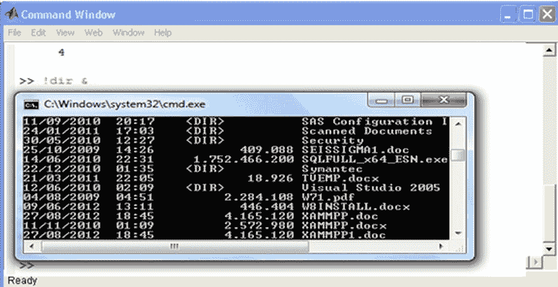

图 1-20。

命令 `>>dos_command` 用于在 MATLAB 屏幕中执行 DOS 命令。使用上述三个命令，不仅可以执行 DOS 命令，还可以执行各种可执行文件或批处理任务。

命令 `>>dos dos_command` 也可用于在 MATLAB 命令窗口中以自动模式执行指定的 DOS 命令。

要退出 MATLAB，只需在命令窗口中输入 `quit`，然后按回车键。

