# 3. 显式、参数和极坐标下的曲线。曲面

## 引言

MATLAB 是一款实现高性能图形功能的科学软件。它允许您创建探索性数据的二维和三维图形，在显式、隐式和极坐标下绘制曲线，在显式、隐式或参数坐标下绘制曲面，绘制网格图和等高线图，表示各种几何对象，以及创建其他专业图形。

您可以自由调整图形参数，选择诸如边框和定位、线条特性、标记、坐标轴范围、网格类型、注释、标签和图例等功能。您可以导出多种不同格式的图形。本章将介绍所有这些功能。

## 探索性图形

MATLAB 包含了一些命令，允许您创建基本的探索性图形，例如直方图、条形图、图形、箭头图等。下表总结了这些命令。对于所有这些命令，都需要首先定义变量的变化范围。

| 命令 | 描述 |
| :--- | :--- |
| `bar(Y)` | 创建相对于频率向量 `Y` 的条形图。如果 `Y` 是一个矩阵，则为 `Y` 的每一行创建多个条形图。`>> x = [1 2 5 8 4 3 4 1 2 3 2];` `>> bar (x)` 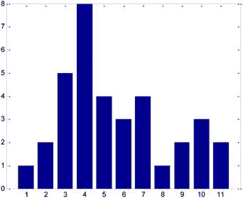 |
| `bar(x,Y)` | 创建相对于频率向量 `Y` 的条形图，其中 `x` 是一个向量，用于定义条形在 x 轴上的位置。`>> x = -2.9:0.2:2.9;` `>> bar (x, exp(-x.*x))` 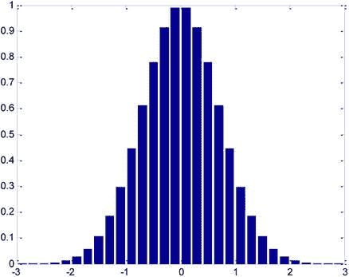 |
| `bar(…,width)` | 创建条形图，其中条形具有指定的宽度。默认宽度为 0.8。宽度为 1 会使条形相互接触。 |
| `bar(…, 'style ')` | 创建具有给定条形样式的条形图。可能的样式有 `'group'`（默认的垂直条形样式）和 `'stack'`（堆叠的水平条形）。如果矩阵是 m× n，则条形被分组为 m 组，每组 n 个条形。`>> A = [1 6 12 5 7; 3 2 6 5 3];` `>> bar (A, 'stack')` `>> bar (A, 'group')` 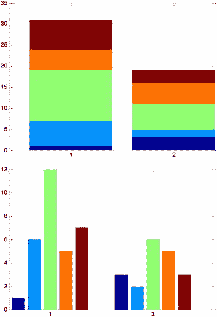 |
| `bar(…, color)` | 创建条形图，其中所有条形都是指定的颜色（r = 红色，g = 绿色，b = 蓝色，c = 青色，m = 品红色，y = 黄色，k = 黑色，w = 白色）。 |
| `barh(…)` | 创建水平条形图。`>> barh (A, 'group')` 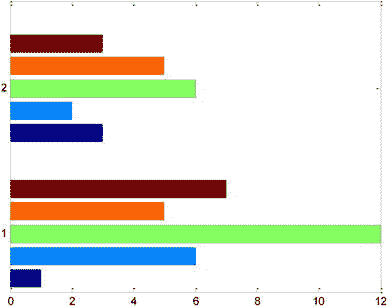 |
| `hist(Y)` | 创建相对于频率向量 `Y` 的直方图，使用 10 个等距的矩形。如果 `Y` 是一个矩阵，则为每一列创建一个直方图。`>> Y = randn(100);` `>> hist(Y)` 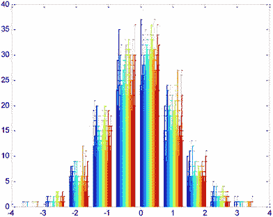 |
| `hist(Y,x)` | 创建相对于频率向量 `Y` 的直方图，其中箱数由向量 `x` 中的元素个数给出，数据根据向量 `x` 进行排序（如果 `x` 的条目是均匀间隔的，则将它们用作箱的中心，否则，将连续值的中点用作箱的边界）。 |
| `hist(Y,k)` | 创建相对于频率向量 `Y` 的直方图，使用由标量 `k` 指定的箱数。`>> hist(Y, 8)` 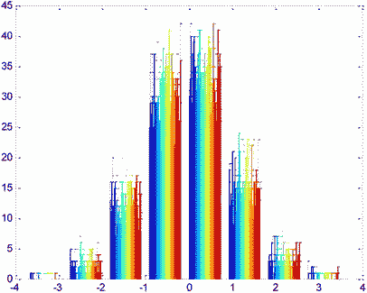 |
| `[n,x] = hist(…)` | 返回向量 `n` 和 `x`，分别包含分配给直方图每个箱的频率以及每个箱中心的位置。 |
| `pie(X)` | 创建相对于频率向量 `X` 的饼图。`>> X = [3 5 12 4 7 10];` `>> pie(X)` 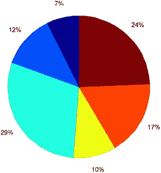 |
| `pie(X,Y)` | 创建相对于频率向量 `X` 的饼图，对于 `Yi` 不为零的扇区，将其分离出来。`>> pie(X,[0 0 1 0 1 1])` 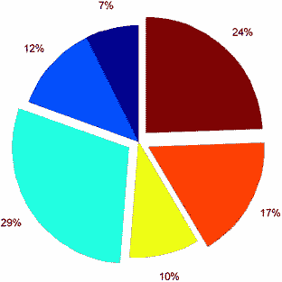 |
| `errorbar(x,y,e)` | 绘制函数 `y` 相对于 `x` 的图形，并显示由向量 `e` 指定的误差范围。为了指示置信区间，会绘制一条长度为 `2e[i]` 的垂直线穿过每个点 `(x[i], y[i])`，其中心为 `(x[i], y[i])`。`>> x = - 4:.2:4;` `y = (1/sqrt(2*pi))*exp(-(x.²)/2);` `e = rand (size (x)) / 10;` `errorbar(x,y,e)` 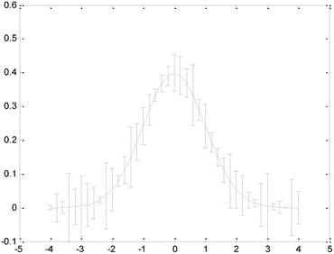 |
| `stem(Y)` | 将数据序列 `Y` 绘制为从 x 轴基线延伸到由小圆圈指示的点的茎状图。`>> y = randn (50.1); stem (y)` 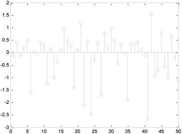 |
| `stem(X,Y)` | 将数据序列 `Y` 绘制为茎状图，其中 x 轴值由 `X` 确定。 |
| `stairs(Y)` | 绘制数据序列 `Y` 的阶梯图。 |
| `stairs(X,Y)` | 绘制数据 `Y` 的阶梯图，其中 x 值由向量 `X` 确定。`>> x=-3:0.1:3; stairs(x,exp(-x.²))` 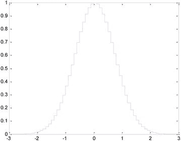 |
| `rose (Y)` | 创建一个角度直方图，显示数据 `Y` 在 20 个角度箱中的分布。角度以弧度为单位。半径反映了落入相应箱中的元素数量。`>> y = randn (1000,1) * pi; rose (y)` 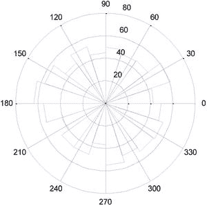 |
| `rose(Y,n)` | 绘制数据 `Y` 的角度直方图，包含 `n` 个等间距的箱。`n` 的默认值为 20。 |
| `rose(Y,X)` | 绘制数据 `Y` 的角度直方图，其中 `X` 指定箱的数量和位置（中心角）。 |
| `compass(Z)` | 绘制数据 `Z` 的罗盘图。对于复数向量 `Z` 中的每个条目，绘制一个箭头，其基点在原点，头部在由该条目确定的点处。`>> z=eig(randn(20,20)); compass(z)` 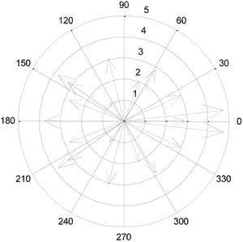 |
| `compass(X,Y)` | 等价于 `compass(X+i*Y)`。 |
| `compass(Z, S)` 或 `compass(X, Y, S)` | 绘制罗盘图，箭头样式由 `S` 指定。 |
| `feather(Z)` 或 `feather(X,Y)` 或 `feather(Z,S)` 或 `feather(X,Y,S)` | 生成类似于罗盘图的图形，不同之处在于箭头现在从 x 轴上等间距的点出发，而不是从原点出发。`>> z=eig(randn(20,20)); feather(z)` 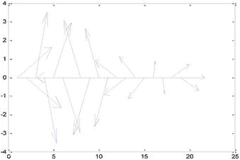 |

## 显式、隐式、参数和极坐标下的曲线

下表列出了在二维显式、极坐标和隐式坐标下绘制曲线的最重要的 MATLAB 命令。

# MATLAB 绘图函数

| 函数 | 说明 |
|------|------|
| `plot(X,Y)` | 绘制点集 (`X`, `Y`)，其中 `X` 和 `Y` 是行向量。要绘制函数 `y = f(x)` 的图形，必须指定点集 (`X`, `f(X)`)，其中 `X` 是变量 `x` 的变化范围。`X` 和 `Y` 可以是相同大小的数组，此时将在同一坐标轴上绘制相应的点 (`X[i]`, `Y[i]`)。对于 `X` 和 `Y` 的复数值，将忽略其虚部。对于 `x = x(t)` 和 `y = y(t)`（给定参数 `t`），绘制指定的平面参数曲线图形。 `>> x=0:0.1:6*pi; y=x.*sin(x); plot(x,y)` 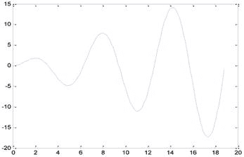 |
| `plot(Y)` | 根据其索引创建向量 `Y` 的线图。这对于绘制时间序列非常有用。如果 `Y` 是一个矩阵，`plot(Y)` 会为 `Y` 的每一列创建图形，并将它们全部显示在同一坐标轴上。如果向量的分量是复数，`plot(Y)` 等价于 `plot(real(Y),imag(Y))`。 `>> Y=[1,3,9,27,81,243,729]; plot(Y)` 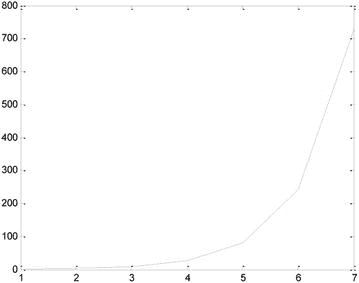 |
| `plot(X, Y, S)` | 按照 `plot(X,Y)` 的描述绘制 `Y` 相对于 `X` 的图形，并使用 `S` 中定义的设置。通常，`S` 由两个用单引号括起来的字符组成，第一个字符设置线图的颜色，第二个字符指定标记或线条类型。颜色和字符的可能值分别如下：`y`（黄色）、`m`（品红色）、`c`（青色）、`r`（红色）、`g`（绿色）、`b`（蓝色）、`w`（白色）、`k`（黑色）、`.`（点）、`o`（圆圈）、`x`（叉号）、`s`（方形）、`d`（菱形）、`^`（上三角）、`v`（下三角）、`>`（右三角）、`<`（左三角）、`p`（五角星）、`h`（六角星）、`+`（加号）、`*`（星号）、`-`（实线）、`--`（虚线）、`:`（点线）、`-.`（点划线）。 `>> plot([1,2,3,4,5,6,7,8,9],[1, 1/2, 1/3,1/4,1/5,1/6, 1/7,1/8,1/9],'r *')` 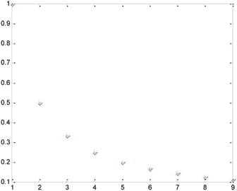 |
| `plot(X1,Y1,S1,X2,Y2,S2,…)` | 组合多个三元组 (`Xi`, `Yi`, `Si`) 对应的图形。这是在同一个图形上表示多个函数的一种有用方法。 |
| `fplot('f', [xmin, x max])` | 在指定的 `x` 变化范围内绘制显函数 `y = f(x)` 的图形。 `>> fplot('x*sin(1/x)', [0,pi/16])` 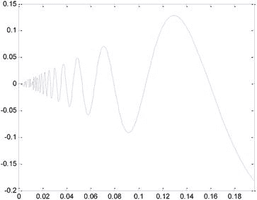 |
| `fplot('f',[xmin, x max, ymin, ymax], S)` | 在指定的 `x` 和 `y` 变化区间内绘制显函数 `y = f(x)` 的图形，并使用 `S` 给出的颜色和字符选项。 `>> fplot('x²/(x + 1)', [-12,12,-8, 8])` 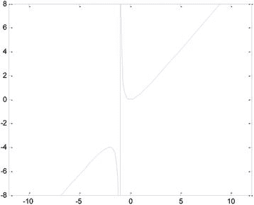 |
| `fplot('f',[xmin, x max],…,t)` | 以相对误差容限 `t` 绘制函数 `f` 的图形。 |
| `fplot('f',[xmin, x max],…,n)` | 使用至少 `n + 1` 个点绘制函数 `f` 的图形，其中最大步长为 `(xmax-xmin)/n`。 |
| `fplot('[f1,f2,…,fn]',[xmin, x max, ymin, ymax], S)` | 在指定 `x` 和 `y` 的变化范围内，在同一坐标轴上绘制函数 `f1`, `f2`,…, `fn` 的图形，并使用 `S` 给定的颜色和标记。 `>> fplot('[sin(x), sin(2*x), sin(3*x)]', [0,2*pi])` 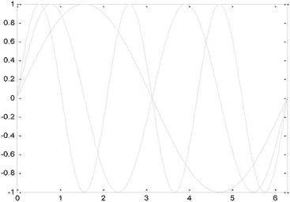 `>> fplot('[sin(x), sin(2*x), sin(3*x)]', [0, 2*pi], 'k*')` 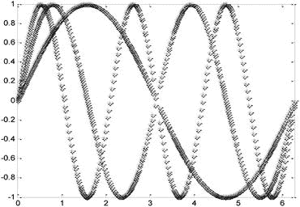 |
| `ezplot('f', [xmin, x max])` | 在给定的 `x` 变化范围内绘制显函数 `y = f(x)` 或隐函数 `f(x,y) = k` 的图形。变量的变化范围可以省略。 `>> ezplot('y*x² + x*y² = 10',[-10,10])` 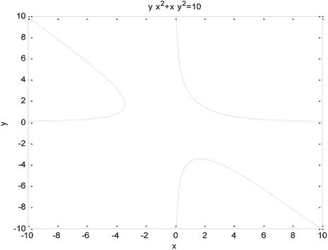 `>> ezplot('x²-/(x²-1)')` 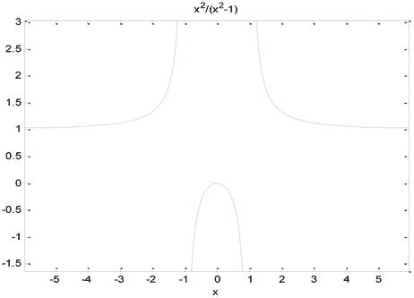 |
| `ezplot('f', [xmin, x max, ymin, ymax])` | 在给定的 `x` 和 `y` 变化区间内（可省略）绘制显函数 `y = f(x)` 或隐函数 `f(x,y) = k` 的图形。 `>> ezplot('x² + y³ = 1/2',[-10,10,-8,8])` 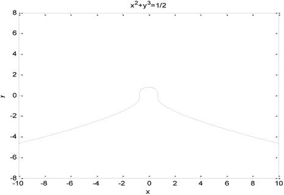 `>> ezplot('x² - y⁴ = 1')` 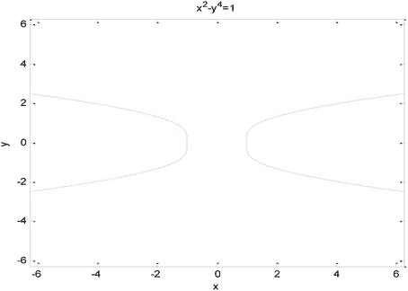 |
| `ezplot(x,y)` | 在 `0 ≤ t < 2π` 范围内绘制平面参数曲线 `x = x(t)` 和 `y = y(t)`。 `>> ezplot('4*cos(t) - cos(4*t)', '4*sin(t) - sin(4*t)')` 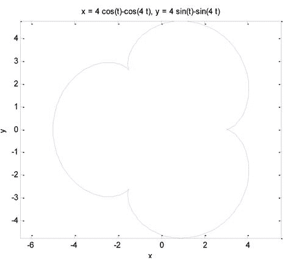 |
| `ezplot('f', [xmin x max])` | 在 `xmin < t < xmax` 范围内绘制平面参数曲线 `x = x(t)` 和 `y = y(t)`。 `>> ezplot('t*sin(t)', 't*cos(t)',[-4*pi,4*pi])` 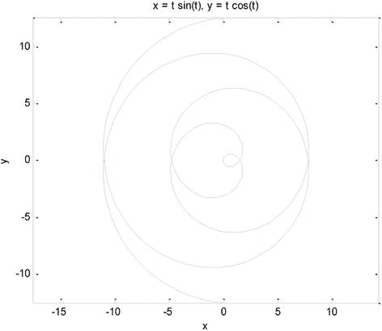 |
| `ezplot('f')` | 绘制曲线 `f`，其中坐标范围在默认域 `[-2π, 2π]` 内。 `>> ezplot('y⁴ - x⁴ - 24*y² + 25*x² = 0')` 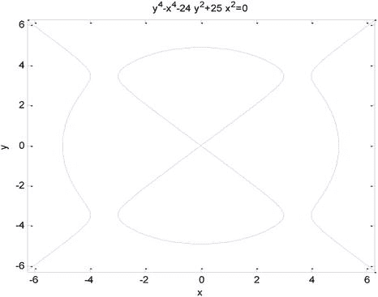 |
| `loglog(X,Y)` | 生成类似于 `plot(X,Y)` 的图形，但两个坐标轴都采用对数刻度。 `>> x=0:0.1:pi; y=x.*sin(x); loglog(x,y)` 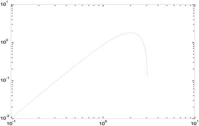 |
| `semilogx(X,Y)` | 生成类似于 `plot(X,Y)` 的图形，但 `x` 轴采用对数刻度，`y` 轴采用普通刻度。 `>> x=0:0.1:pi; y=x.*sin(x); semilogx(x,y)` 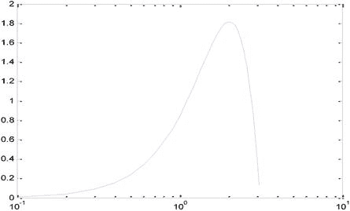 |
| `semilogy(X,Y)` | 生成类似于 `plot(X,Y)` 的图形，但 `y` 轴采用对数刻度，`x` 轴采用普通刻度。 `>> x=0:0.1:pi; y=x.*sin(x); semilogy(x,y)` 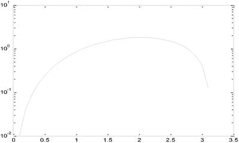 |

### 二维曲线

| `polar(α, r)` | 绘制极坐标中给出的曲线 `r = r(α)`。`>> t=0:0.1:2*pi; r=sin(t).*cos(t); polar(t,r)` 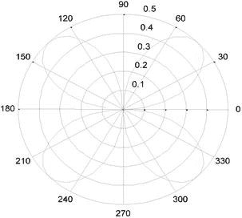 |
|---|---|
| `polar(α, r, S)` | 绘制极坐标中给出的曲线 `r = r(α)`，并使用 `S` 指定的线条样式。`>> t=0:0.05:2*pi; r=sin(t).*cos(t); polar(t,r,'*r')` 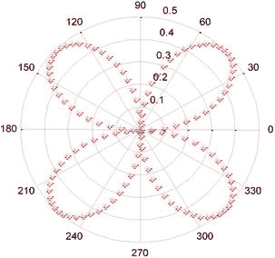 |
| `ezpolar(r)` `ezpolar(r, [a, b])` | 在极坐标中绘制曲线 `r = r(α)`，其中 `α` 的变化范围由 `[a, b]` 指定，如果未指定，则使用默认范围 `[0, 2π]`。`>> ezpolar('1 + cos(t)')` 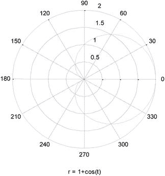 |
| `fill(X, Y, C)` | 绘制填充多边形，其顶点由指定向量 `X` 和 `Y` 的分量 `(X[i], Y[i])` 给出。与 `X` 和 `Y` 大小相同的向量 `C` 指定分配给相应点的颜色。`C[i]` 的值可以是：`'r'`、`'g'`、`'b'`、`'c'`、`'m'`、`'y'`、`'w'`、`'k'`，其含义已知。如果 `C` 是单个字符，则多边形的所有顶点将分配该指定颜色。如果 `X` 和 `Y` 是相同大小的矩阵，则将创建多个多边形，每个多边形对应于矩阵的列。在这种情况下，`C` 可以是指定每个多边形颜色的行向量，也可以是指定多边形顶点颜色的矩阵。`>> t = (1/16:1/8:1)'*2*pi; x = sin(t); y = cos(t); fill(x, y, 'r')` 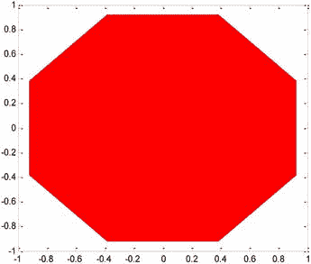 |
| `fill(X1,Y1,C1,…)` | 绘制填充多边形，其顶点坐标和颜色由 `(Xi, Yi, Ci)` 给出。 |

### 三维曲线

MATLAB 包含用于绘制三维空间曲线的命令。下表列出了最重要的命令。

| `plot3(X, Y, Z)` | 通过直线连接由 `(X, Y, Z)` 确定的点序列来绘制三维线图，其中 `X`、`Y` 和 `Z` 为行向量。`X`、`Y` 和 `Z` 也可以是参数坐标或相同大小的矩阵，此时将为每一组三元行在同一坐标轴上绘制图形。若 `X`、`Y` 和 `Z` 为复数值，则忽略其虚部。`>> X = [0 1 1 2; 1 1 2 2; 0 0 1 1];` `Y = [1 1 1 1; 1 0 1 0; 0 0 0 0];` `Z = [1 1 1 1; 1 0 1 0; 0 0 0 0];` `>> plot3 (X, Y, Z)` 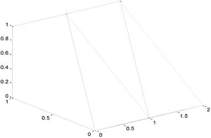 `>> t = 0:pi/100:20 * pi; plot3 (2 * sin(2*t), 2 * cos(2*t), 4 * t)` 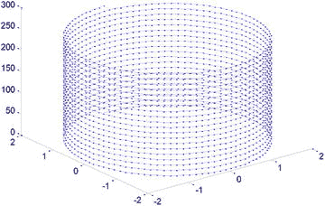 |
|---|---|
| `plot3(X, Y, Z, S)` | 按照 `S` 中定义的设置生成线图 `plot(X,Y,Z)`。`S` 通常由单引号内的两个字符组成，第一个字符设置线图的颜色，第二个字符确定线条或标记属性。可能的设置已在上述 `plot` 命令中描述过。 |
| `plot3(X1,Y1,Z1,S1, X2,Y2,Z2,S2,X3, Y3, Z3, S3,…)` | 在同一坐标轴上组合四元组 `(Xi, Yi, Zi, Si)` 的三维线图。这是在同一图形上表示多个函数的有用方式。 |
| `fill3(X,Y,Z,C)` | 绘制以列向量 `X`、`Y`、`Z` 的分量三元组 `(Xi, Yi, Zi)` 为顶点的填充多边形。`C` 是与 `X`、`Y`、`Z` 大小相同的向量，用于指定每个顶点 `(Xi, Yi, Zi)` 的颜色 `Ci`。`Ci` 的值可以是 `'r'`、`'g'`、`'b'`、`'c'`、`'m'`、`'y'`、`'w'`、`'k'`，其含义我们已经了解。如果 `C` 是单个字符，则所有顶点都将使用此颜色。如果 `X`、`Y`、`Z` 是相同大小的矩阵，则将绘制与每个三元组列向量 `(X.j, Y.j, Z.j)` 对应的多个多边形。此时，`C` 可以是行向量，其元素 `Cj` 决定与 `(X.j, Y.j, Z.j)` 对应的每个多边形的唯一颜色。`C` 也可以是维度与 `X`、`Y`、`Z` 相同的矩阵，此时其元素决定多边形集合中每个顶点 `(Xijk, Yijk, Zijk)` 的颜色。`>> X = [0 1 1 2; 1 1 2 2; 0 0 1 1];` `Y = [1 1 1 1; 1 0 1 0; 0 0 0 0];` `Z = [1 1 1 1; 1 0 1 0; 0 0 0 0];` `C = [0.5000 1.0000 1.0000 0.5000;` `1.0000 0.5000 0.5000 0.1667;` `0.3330 0.3330 0.5000 0.5000];` `fill3(X,Y,Z,C)` 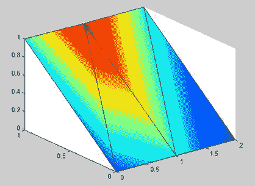 |
| `fill3(X1,Y1,Z1,C1, X2, Y2, Z2, C2,…)` | 绘制顶点和颜色由 `(Xi, Yi, Zi, Ci)` 给出的填充多边形。 |
| `ezplot3(x(t), y(t), z(t))` `ezplot3(x(t),y(t),z(t), [tmin,tmax])` | 绘制由给定三个参数分量定义的空间曲线。在参数指定的变化范围内绘制由给定三个参数分量定义的空间曲线。`>> ezplot3 ('sin (t)', 'cos (t)', ', [0, 6 * pi])` 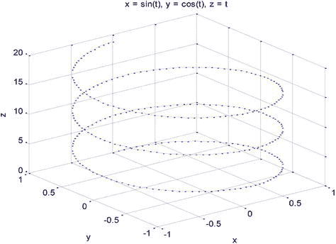 |

## 显式曲面与参数曲面。等高线图

MATLAB 包含用于表示由 `z = f(x,y)` 形式方程定义的曲面的命令。第一步是使用命令 `meshgrid`，该命令定义了将计算函数值的点数组 `(X, Y)`。然后使用命令 `surf` 来创建曲面。

命令 `mesh` 也用于生成由函数 `z = f(x,y)` 定义的网格图，使得曲面上的点由函数 `f(x,y)` 对于平面 `(x, y)` 上对应点所确定的 `z` 值网络来表示。网格图的外观类似于渔网，曲面点构成网络的节点。

还可以使用命令 `contour` 表示曲面的等高线。这些曲线的特征是：平面上使得 `f(x,y)` 值为某个固定常数的点集 `(x,y)`。

下表列出了可用于以显式和参数形式生成曲面网格图和等高线图的 MATLAB 命令。

| `[X, Y] = meshgrid(x, y)` | 通过将单调递增的网格向量 `x` 和 `y` 变换为指定整个网格的两个矩阵 `X` 和 `Y`，创建一个矩形网格。此类网格可用于命令 `surf` 和 `mesh` 来生成曲面图形。 |
|---|---|
| `surf(X, Y, Z, C)` | 使用 `C` 中指定的颜色表示显式曲面 `z = f(x, y)` 或参数曲面 `x = x(t, u), y = y(t, u), z = z(t, u)`。`C` 参数可以省略。`>> [X, Y] = meshgrid(-2:.2:2, -2:.2:2);` `Z = X .* exp(-X.² - Y.²); surf(X, Y, Z)`<br>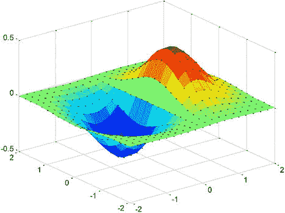 |
| `surfc(X, Y, Z, C)` | 表示显式曲面 `z = f(x, y)` 或参数曲面 `x = x(t, u), y = y(t, u), z = z(t, u)`，并同时绘制曲面的等高线图。等高线投影到 `xy` 平面上。`>> [X, Y] = meshgrid(-2:.2:2, -2:.2:2);` `Z = X .* exp(-X.² - Y.²); surfc(X, Y, Z)`<br>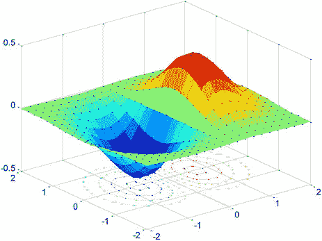 |

### 三维曲面与等高线绘图

| 函数 | 说明 |
| :--- | :--- |
| `surfl(X, Y, Z)` | 表示显式曲面 `z = f(x, y)` 或参数曲面 `x = x(t, u), y = y(t, u), z = z(t, u)`，并带有基于颜色映射的光照效果。<br>```matlab<br>>> r = (0:0.1:2*pi)';<br>t = (-pi:0.1:2*pi);<br>X = cos(r) * sin(t);<br>Y = sin(r) * sin(t);<br>Z = ones(size(r, 1))' * t;<br>surfl(X, Y, Z)<br>```<br>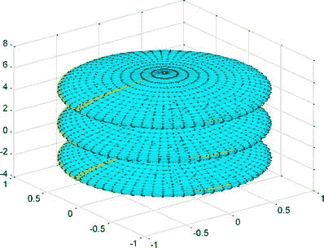 |
| `mesh(X, Y, Z, C)` | 表示显式曲面 `z = f(x, y)` 或参数曲面 `x = x(t, u), y = y(t, u), z = z(t, u)`，绘制构成网格的线条，并使用 `C`（可选）指定的颜色。<br>```matlab<br>>> [X, Y] = meshgrid(-2:.2:2, -2:.2:2);<br>Z = X .* exp(-X.² - Y.²); mesh(X, Y, Z)<br>```<br>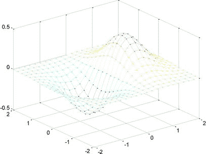 |
| `meshz(X, Y, Z, C)` | 表示显式曲面 `z = f(x, y)` 或参数曲面 `x = x(t, u), y = y(t, u), z = z(t, u)`，并在网格周围添加一个“幕帘”。 |
| `meshc(X, Y, Z, C)` | 表示显式曲面 `z = f(x, y)` 或参数曲面 `x = x(t, u), y = y(t, u), z = z(t, u)`，并同时绘制曲面的等高线图。等高线投影到 `xy` 平面上。<br>```matlab<br>>> [X, Y] = meshgrid(-2:.2:2, -2:.2:2);<br>Z = X .* exp(-X.² - Y.²); meshc(X, Y, Z)<br>```<br>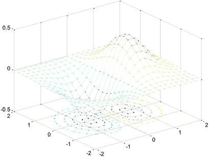 |
| `contour(Z)` | 绘制矩阵 `Z` 的等高线图，其中 `Z` 被解释为 `xy` 平面上曲面的高度。等高线的数量自动选择。<br>```matlab<br>>> [X, Y] = meshgrid(-2:.2:2, -2:.2:2);<br>Z = X .* exp(-X.² - Y.²);<br>>> contour(Z)<br>```<br>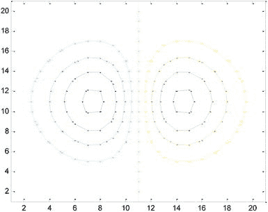 |
| `contour(Z, n)` | 使用 `n` 条等高线绘制矩阵 `Z` 的等高线图。<br>```matlab<br>>> [X, Y] = meshgrid(-2:.2:2, -2:.2:2);<br>Z = X .* exp(-X.² - Y.²);<br>>> contour(Z, n)<br>```<br>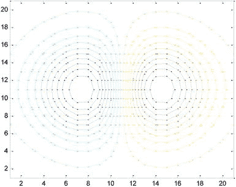 |
| `contour(x, y, Z, n)` | 使用 `n` 条等高线绘制矩阵 `Z` 的等高线图，并使用向量 `x` 和 `y` 指定的 `x` 轴和 `y` 轴值。<br>```matlab<br>>> r = (0:0.1:2*pi); t = (-pi:0.1:2*pi);<br>X = cos(r) * cos(t); Y = sin(r) * sin(t); Z = ones(size(r, 1))' * t;<br>>> contour(X, Y, Z)<br>```<br>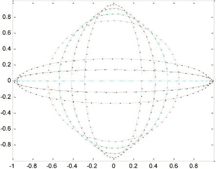 |
| `contour3(Z)`, `contour3(Z, n)` 和 `contour3(x, y, Z, n)` | 绘制三维等高线图。<br>```matlab<br>>> r = (0:0.1:2*pi); t = (-pi:0.1:2*pi);<br>X = cos(r) * cos(t); Y = sin(r) * sin(t); Z = ones(size(r, 1))' * t;<br>>> contour3(X, Y, Z)<br>```<br>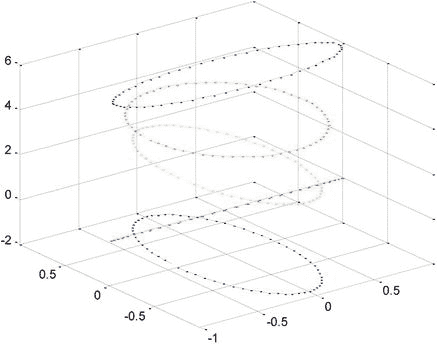 |
| `contourf(...)` | 绘制等高线图并填充等值线之间的区域。<br>```matlab<br>>> r = (0:0.1:2*pi); t = (-pi:0.1:2*pi);<br>X = cos(r) * cos(t); Y = sin(r) * sin(t); Z = ones(size(r, 1))' * t;<br>>> contourf(X, Y, Z)<br>```<br>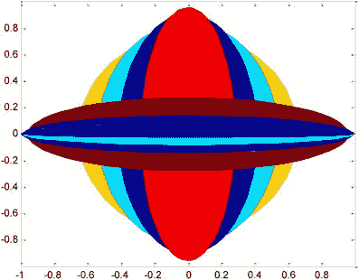 |
| `pcolor(X, Y, Z)` | 绘制由矩阵 `(X, Y, Z)` 决定的“伪彩色”等高线图，使用基于密度的颜色表示。这通常被称为密度图。<br>```matlab<br>>> [X, Y] = meshgrid(-2:.2:2, -2:.2:2);<br>Z = X .* exp(-X.² - Y.²); meshc(X, Y, Z)<br>>> pcolor(X, Y, Z)<br>```<br>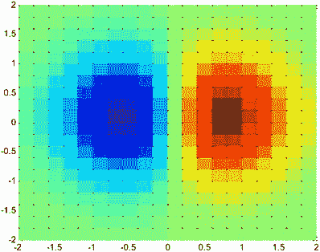 |
| `trimesh(Tri, X, Y, Z, C)` | 创建一个三角网格图。矩阵 `Tri` 的每一行定义了一个简单的三角形面，`C` 与 `surf` 中的类似用于定义颜色。`C` 参数是可选的。 |
| `trisurf(Tri, X, Y, Z, C)` | 创建一个三角曲面图。矩阵 `Tri` 的每一行定义了一个简单的三角形面，`C` 与 `surf` 中的类似用于定义颜色。`C` 参数是可选的。 |

### 三维几何形状

圆柱体、球体、条形图、切片图、茎秆图、瀑布图及其他三维几何对象的表示均可在 MATLAB 中实现。下表总结了可用于此目的的命令。

| 函数 | 说明 |
| :--- | :--- |
| `bar3(Y)` | 根据频率向量 `Y` 创建一个三维条形图。如果 `Y` 是一个矩阵，则在同一个坐标轴上生成多个条形图，每个条形图对应 `Y` 的一行。<br>```matlab<br>>> bar3(rand(4, 4))<br>```<br> |
| `bar3(x, Y)` | 根据频率向量 `Y` 创建一个三维条形图，其中 `x` 是一个定义条形 `x` 轴位置的向量。 |
| `bar3(..., width)` | 创建一个具有指定条形宽度的三维条形图。默认宽度为 `0.8`，宽度为 `1` 时条形会彼此接触。 |
| `bar3(..., 'style')` | 创建一个具有指定条形样式的三维条形图。可能的样式有 `'detached'`（默认）、`'grouped'`（分组垂直条形）和 `'stacked'`（堆叠条形，对应 `Y` 中的每一行）。 |
| `bar3(..., color)` | 创建一个所有条形均为指定颜色的三维条形图（`r` = 红色，`g` = 绿色，`b` = 蓝色，`c` = 青色，`m` = 品红色，`y` = 黄色，`k` = 黑色，`w` = 白色）。 |
| `comet3(z)`, `comet3(x,y,z)` | 创建向量 `z` 或参数空间曲线 `(x(t), y(t), z(t))` 的三维彗星图动画。<br>```matlab<br>>> t = -pi:pi/500:pi; comet3(sin(5*t), cos(3*t), t)<br>```<br> |

## 基本三维绘图命令

| 函数 | 描述 |
|------|------|
| `[X, Y, Z] = cylinder`、`[X, Y, Z] = cylinder(r(t))`、`[X, Y, Z] = cylinder(r(t), n)`、`cylinder(...)` | 返回一个位于原点、半径为 `1`、长度为 `1`（沿 z 轴对齐）且圆周上有 `20` 个等间距点的圆柱体坐标。返回由曲线 `r` 生成的圆柱体坐标。返回由曲线 `r` 生成的圆柱体坐标，圆周上有 `n` 个点（默认 `n = 20`）。可以使用命令 `surf` 或 `cylinder(...)` 绘制以上创建的圆柱体。 |
| | ```matlab |
| | >> t = 0:pi/10:2*pi; |
| | [X, Y, Z] = cylinder(2+cos(t)); |
| | surf(X, Y, Z) |
| | ``` |
| |  |
| `sphere` | 绘制中心在原点的单位球体，使用 `20×20` 个面。 |
| `sphere(n)` | 使用 `n×n` 个面绘制单位球体。 |
| | ```matlab |
| | >> sphere(100) |
| | ``` |
| |  |
| `[X, Y, Z] = sphere(n)` | 在三个 `(n+1)×(n+1)` 的数组中给出球体的坐标。 |
| `slice(V, sx, sy, sz)`、`slice(X, Y, Z, V, sx, sy, sz)`、`slice(V, XI, YI, ZI)`、`slice(X, Y, Z, V, XI, YI, ZI)`、`slice(..., 'method')` | 在体积 `V` 中，沿 x、y、z 方向在向量 `sx`、`sy` 和 `sz` 指定的点处绘制切片。`V` 是一个 `m×n×p` 的体积数组，包含默认位置 `X = 1:n`、`Y = 1:m`、`Z = 1:p` 处的数据值。向量 `sx`、`sy` 和 `sz` 中的每个元素定义了 x、y 或 z 轴方向上的一个切片平面。在 `X`、`Y` 和 `Z` 为单调正交间隔的三维数组（为 `V` 指定坐标）时，绘制体积 `V` 的切片。每个点的颜色通过对体积 `V` 进行三维插值确定。绘制由矩阵 `XI`、`YI` 和 `ZI` 定义的曲面切片在体积 `V` 中的数据，并在曲面点处对体积进行评估。`XI`、`YI` 和 `ZI` 必须尺寸相同。沿数组 `XI`、`YI`、`ZI` 定义的曲面，对体积 `V` 进行切片绘制。指定插值方法。选项有 `'linear'`、`'cubic'` 或 `'nearest'`。 |
| | ```matlab |
| | >> [x, y, z] = meshgrid(-2:.2:2, -2:.25:2, -2:.16:2); |
| | v = x .* exp(-x.² - y.² - z.²); |
| | slice(x, y, z, v, [-1.2, .8, 2], 2, [-2, 0]) |
| | ``` |
| |  |
| `stem3(Z)`、`stem3(X, Y, Z)`、`stem3(..., 'fill')`、`stem3(..., S)` | 将 `Z` 绘制为一系列垂直茎，其底部位于 xy 平面上。底部位置自动生成。将序列 `Z` 绘制为垂直茎，底部位置由 `X` 和 `Y` 指定。用颜色填充茎尖的圆圈。创建一个三维茎叶图，并指定线型、标记和颜色 `S`。 |
| | ```matlab |
| | >> X = linspace(0, 1, 10); |
| | Y = X / 2; |
| | Z = sin(X) + cos(Y); |
| | stem3(X, Y, Z, 'fill') |
| | ``` |
| |  |

## 专业化图形

MATLAB 提供了用于创建各种图形和图表（填充区域图、彗星图、等高线图、网格图、曲面图、散点图、帕累托图、阶梯图）的命令。您还可以修改坐标轴规格，并且有一个易于使用的函数绘图器。下表展示了这些命令的语法。

| 函数 | 描述 |
|------|------|
| `area(Y)`、`area(X, Y)`、`area(…,ymin)` | 创建一个面积图，显示向量 `Y` 的元素作为一条或多条曲线，并填充曲线下方的区域。与 `plot(X,Y)` 相同，只是填充了 `0` 和 `Y` 之间的区域。指定面积填充的基准值（默认值为 `0`）。 |
| | ```matlab |
| | >> Y = [1, 5, 3; 3, 2, 7; 1, 5, 3; 2, 6, 1]; area(Y) |
| | ``` |
| |  |
| `box on`、`box off` | 显示/不显示当前坐标轴的边界。 |
| `comet(y)`、`comet(x, y)` | 创建一个关于向量 `y` 的动画彗星图。绘制向量 `y` 相对于向量 `x` 的彗星图。 |
| | ```matlab |
| | >> t = - pi:pi/200:pi;comet(t,tan(sin(t))-sin(tan(t))) |
| | ``` |
| |  |
| `ezcontour(f)`、`ezcontour(f, domain)`、`ezcontour(…,n)` | 在域 `[-2π, 2π] × [-2π, 2π]` 上创建 `f(x,y)` 的等高线图。在给定的域上创建 `f(x,y)` 的等高线图。在 `n × n` 网格上创建 `f(x,y)` 的等高线图。 |
| | ```matlab |
| | >> ezcontour ('sqrt(x² + y²)') |
| | ``` |
| |  |
| `ezcontourf(f)`、`ezcontourf(f, domain)`、`ezcontourf(…,n)` | 在域 `[-2π, 2π] × [-2π, 2π]` 上创建 `f(x,y)` 的填充等高线图。在给定的域上创建 `f(x,y)` 的填充等高线图。在 `n × n` 网格上创建 `f(x,y)` 的填充等高线图。 |
| | ```matlab |
| | >> ezcontourf ('sqrt(x² + y²)') |
| | ``` |
| |  |
| `ezmesh(f)`、`ezmesh(f,domain)`、`ezmesh(…,n)`、`ezmesh(x, y, z)`、`ezmesh(x, y, z, domain)`、`ezmesh(…, ‘circ’)` | 在域 `[-2π, 2π] × [-2π, 2π]` 上创建 `f(x,y)` 的网格图。在给定的域上创建 `f(x,y)` 的网格图。使用 `n × n` 网格创建 `f(x,y)` 的网格图。创建参数曲面 `x = x(t,u)`, `y = y(t,u)`, `z = z(t,u)`, `t,u ∈ [-2π, 2π]` 的网格图。创建参数曲面 `x = x(t,u)`, `y = y(t,u)`, `z = z(t,u)`, `t,u ∈ domain` 的网格图。在域的中心圆盘上创建网格图。 |
| | ```matlab |
| | >> ezmesh ('sqrt(x² + y²)') |
| | ``` |
| |  |
| `ezmeshc(f)`、`ezmeshc(f, domain)`、`ezmeshc(…,n)`、`ezmeshc(x, y, z)`、`ezmeshc(x, y, z, domain)`、`ezmeshc(…, ‘circ’)` | 创建网格图和等高线图的组合。 |
| | ```matlab |
| | >> ezmeshc ('sqrt(x² + y²)') |
| | ``` |
| |  |

# 二维和三维图形选项

MATLAB 包含许多不同的命令，用于图形处理，包括标题、图例和坐标轴标签、向图形添加文本，以及调整颜色和着色。最重要的命令总结在下表中。

| 函数调用 | 描述 |
|---|---|
| `ezsurf(f)`<br>`ezsurf(f, domain)`<br>`ezsurf(…,n)`<br>`ezsurf(x, y, z)`<br>`ezsurf(x, y, z, domain)`<br>`ezsurf(…, ‘circ’)` | 创建一个彩色曲面图。<br>`>> ezsurf('sqrt(x² + y²)')`<br> |
| `ezsurfc(f)`<br>`ezsurfc(f, domain)`<br>`ezsurfc(…,n)`<br>`ezsurfc(x, y, z)`<br>`ezsurfc(x, y, z, domain)`<br>`ezsurfc(…, ‘circ’)` | 创建曲面图和等高线图的组合。<br>`>> ezsurfc('sqrt(x² + y²)')`<br> |
| `ezplot3(x, y, z)`<br>`ezplot3(x, y, z, domain)`<br>`ezplot3(…, ‘animate’)` | 绘制 3D 参数曲线`x = x(t)`、`y = y(t)`、`z = z(t)`，`t ∈ [-2π, 2π]`。绘制 3D 参数曲线`x = x(t)`、`y = y(t)`、`z = z(t)`，`t ∈ domain`。创建参数曲线的 3D 动画。<br>`>> ezplot3('cos(t)','t.*sin(t)','sqrt(t)')`<br> |
| `ezpolar(f)`<br>`ezpolar(f, [a, b])` | 绘制极坐标曲线`r = f(c)`，其中`c ∈ [0, 2π]`。绘制极坐标曲线`r = f(c)`，其中`c ∈ [a, b]`。<br>`>> ezpolar('sin(2*t).*cos(3*t)', [0 pi])`<br> |
| `pareto(Y)`<br>`pareto(X, Y)` | 根据频率向量`Y`创建帕累托图。根据频率向量`Y`（其元素由向量`X`给出）创建帕累托图。<br>`>> lines_of_code = [200 120 555 608 1024 101 57 687];`<br>`>> coders = {'Fred', 'Ginger', 'Norman', 'Max', 'Julie', 'Wally', 'Heidi', 'Pat'};`<br>`>> pareto(lines_of_code, coders)`<br>`>> title('lines of code by programmer')`<br> |
| `pie.3(X)`<br>`pie.3(X, explode)` | 为频率`X`创建 3D 饼图。创建分离式 3D 饼图。<br>`>> pie3([2 4 3 5], [0 1 1 0], {'North', 'South', 'East', 'West'})`<br> |
| `plotmatrix(X, Y)` | 创建`X`的列与`Y`的列的散点图。<br>`>> x = randn(50, 3); y = x * [-1 2 1; 2 0 1; 1 -2 -3;]'; plotmatrix(y)`<br> |
| `stairs(Y)`<br>`stairs(X, Y)`<br>`stairs(…, linespec)` | 绘制`Y`元素的阶梯图。在由`X`指定的位置绘制`Y`元素的阶梯图。此外，指定线条样式、标记符号和颜色。<br>`>> x = linspace(-2*pi, 2*pi, 40); stairs(x, sin(x))`<br> |
| `scatter(X, Y, S, C)`<br>`scatter(X, Y)`<br>`scatter(X, Y, S)`<br>`scatter(…, marker)`<br>`scatter(…, ‘filled’)` | 创建散点图，在由`X`和`Y`指定的位置显示圆圈。`S`指定圆圈大小，`C`指定颜色。圆圈可以填充，并可以指定不同的标记。 |
| `scatter3(X, Y, Z, S, C)`<br>`scatter3(X, Y, Z)`<br>`scatter3(X, Y, Z, S)`<br>`scatter3(…, marker)`<br>`scatter3(…, ‘filled’)` | 创建由向量`X`、`Y`、`Z`确定的 3D 散点图。可以指定颜色和标记。<br>`>> x = (0:0.1:4);`<br>`>> scatter(x, cos(x))`<br><br>`>> x = (0:0.1:2*pi);`<br>`>> scatter3(x, cos(x), sin(x))`<br> |

| 命令 | 描述 |
|---|---|
| `title('text')` | 在当前坐标轴的顶部添加标题。 |
| `xlabel('text')` | 添加 x 轴标签。 |
| `ylabel('text')` | 添加 y 轴标签。 |
| `zlabel('text')` | 添加 z 轴标签。 |
| `clabel(C, h)` | 使用`'+'`标记等高线图的等高线，旋转标签使其位于等高线内侧。 |
| `clabel(C, h, v)` | 仅标记由向量`v`指定层级的等高线图的等高线，旋转标签使其位于等高线内侧。 |
| `datetick(axis)` | 为指定的坐标轴（`'x'`、`'y'`或`'z'`）创建日期格式的刻度标签。 |
| `datetick(axis, date)` | 使用给定的日期格式（1 到 28 之间的整数）为指定的坐标轴（`'x'`、`'y'`或`'z'`）创建日期格式的刻度标签。 |
| `legend('string1', 'string2', ...)` | 在当前坐标轴中使用指定的字符串标记每组数据以显示图例。 |
| `legend(h, 'string1', 'string2', ...)` | 在图形上显示图例，其中包含由向量`h`标识的对象，并使用指定的字符串标记相应的图形对象。 |
| `legend('off')` | 删除当前坐标轴的图例。 |
| `text(x, y, 'text')` | 在二维图形中的点`(x, y)`处放置指定的文本。 |
| `text(x, y, z, 'text')` | 在三维图形中的点`(x, y, z)`处放置指定的文本。 |
| `gtext('text')` | 允许您在二维图形中通过鼠标选择一个点来放置文本。 |
| `grid` | 向二维和三维图形添加网格线。`grid on`向坐标轴添加主网格线，`grid off`从当前坐标轴移除所有网格线。命令`grid`切换主网格线的可见性。 |
| `hold` | 控制在随后调用绘图函数时是否清除当前图形（默认行为），或者向当前图形添加新图形，同时保留现有图形及其所有属性。命令`hold on`保留当前图形并向其添加另一个图形。命令`hold off`在绘制新图形之前重置为默认属性。 |
| `axis([xmin, xmax, ymin, ymax, zmin, zmax])` | 设置坐标轴范围。 |
| `axis('auto')` | 自动计算坐标轴范围（`xmin = min(x)`，`xmax = max(x)`）。 |

# 图形控制函数

## 坐标轴控制

| 函数/命令 | 说明 |
| :--- | :--- |
| `axis(axis)` | 将缩放比例冻结在当前范围，这样如果 `hold` 处于开启状态，后续绘图将使用相同的范围。 |
| `V = axis` | 返回一个行向量 `V`，其中包含 x、y 和 z 轴的缩放因子。根据图形是二维还是三维，`V` 分别有四个或六个分量。 |
| `axis('xy')` | 使用笛卡尔坐标系，原点位于图形的左下角。 |
| `axis('tight')` | 将坐标轴范围设置为数据的范围。 |
| `axis('ij')` | 将原点置于图形的左上角。 |
| `axis('square')` | 使当前坐标轴区域为正方形（三维时则为立方体）。 |
| `axis('equal')` | 对两个坐标轴使用相同的缩放因子。 |
| `axis('normal')` | 移除 `square` 和 `equal` 选项。 |
| `axis('off')` | 关闭所有坐标轴线、刻度标记和标签，但保留图形标题和任何 `gtext` 文本。 |
| `axis('on')` | 打开所有坐标轴线、刻度标记和标签。 |
| `axis([xmin,xmax,ymin,ymax,zmin,zmax])` | 设置 x、y 和 z 轴的范围。也接受 `'ij'`、`'square'`、`'equal'` 等选项，与等效的二维命令相同。 |

## 图形划分与双轴绘图

| 函数/命令 | 说明 |
| :--- | :--- |
| `subplot(m,n,p)` | 将当前图形划分为 `m×n` 的网格，并在 `p` 指定的网格位置创建坐标轴。网格按行编号，因此第一个网格是第一行的第一列，第二个网格是第一行的第二列，依此类推。 |
| `plotyy(X1,Y1,X2,Y2)`<br>`plotyy(X1,Y1,X2,Y2,'function')`<br>`plotyy(X1,Y1,X2,Y2,'function1','function2')` | 绘制 `X1` 对 `Y1` 的图形，y 轴标签在左侧；绘制 `X2` 对 `Y2` 的图形，y 轴标签在右侧。与上一个命令相同，但使用指定的绘图函数（`plot`、`loglog`、`semilogx`、`semilogy`、`stem` 或任何可接受的函数 `h = function(x,y)`）来绘制图形。使用 `function1(X1,Y1)` 绘制左侧轴的数据，使用 `function2(X2,Y2)` 绘制右侧轴的数据。 |

## 视角与显示控制

| 函数/命令 | 说明 |
| :--- | :--- |
| `view([x,y,z])` | 将视角方向设置为笛卡尔坐标 `x`、`y` 和 `z`。 |
| `view([az,el])` | 设置三维图形的视角。方位角 `az` 是绕 z 轴的水平旋转角度，以从负 y 轴开始测量的度数表示。正值表示视点逆时针旋转。`el` 是视点的垂直仰角，以度数表示。仰角正值对应于移动到对象上方；负值对应于移动到对象下方。 |
| `hidden` | 隐藏线移除仅绘制在三维视图中未被其他对象遮挡的线条。命令 `hidden on` 隐藏此类被遮挡的线条，而 `hidden off` 则显示它们。 |

## 着色与颜色图

| 函数/命令 | 说明 |
| :--- | :--- |
| `shading` | 控制使用命令 `surf`、`mesh`、`pcolor`、`fill` 和 `fill3` 创建的表面的着色类型。选项 `shading flat` 给出平滑着色，`shading interp` 给出密集阴影，`shading faceted`（默认）给出标准着色。 |
| `colormap(M)` | 将颜色图设置为矩阵。`M` 必须有三列，并且仅包含介于 0 和 1 之间的值。它也可以是一个矩阵，其行是 RGB 类型的向量 `[r g b]`。有一些预定义的数组 `M`，如下所示：`jet(p)`、`HSV(p)`、`hot(p)`、`cool(p)`、`spring(p)`、`summer(p)`、`autumn(p)`、`winter(p)`、`gray(p)`、`bone(p)`、`copper(p)`、`pink(p)`、`lines(p)`。所有数组都有 3 列和 `p` 行。例如，语法 `colormap(hot(8))` 将 `hot(8)` 设置为当前颜色图。 |
| `brighten(p)` | 调整图形的亮度。如果 `0 < p < 1`，图形将变亮；如果 `-1 < p < 0`，图形将变暗。 |
| `image(A)` | 通过将矩阵中的每个元素解释为图形颜色图的索引，或根据指定的数据直接解释为 RGB 值，来创建图像图形对象。 |
| `pcolor(A)` | 产生伪彩色图，即一个矩形单元格阵列，其颜色由 `A` 确定。`A` 的元素线性映射到当前颜色图的索引。 |
| `caxis([cmin,cmax])` | 将颜色范围设置为指定的最小值和最大值。小于 `cmin` 或大于 `cmax` 的数据值分别映射到 `cmin` 和 `cmax`。介于 `cmin` 和 `cmax` 之间的值线性映射到当前颜色图。 |

## 图形对象操作

| 函数/命令 | 说明 |
| :--- | :--- |
| `h = figure`<br>`figure(h)` | 创建一个名为 `h` 的图形图形对象。将由 `h` 标识的图形设为当前图形，使其可见，并尝试将其置于屏幕上所有其他图形之上。当前图形是图形输出的目标。命令 `close(h)` 删除由 `h` 标识的图形。命令 `whitebg(h)` 补充图形 `h` 的所有颜色。`clf` 命令关闭当前图形。命令 `graymon` 设置图形属性的默认值，以便在灰度显示器上产生更清晰的显示效果。`refresh` 命令重绘图形。 |
| `e = axes`<br>`axes(e)` | 创建名为 `e` 的坐标轴对象。将现有坐标轴 `e` 设为当前坐标轴，并将包含它的图形置于焦点。命令 `gca` 返回当前坐标轴的名称。命令 `cla` 删除与当前坐标轴相关的所有对象。 |
| `l = line(x,y)` 或 `l = line(x,y,z)` | 创建一个名为 `l` 的对象，该对象是连接平面中的点 `X`、`Y` 或空间中的点 `X`、`Y`、`Z` 的线。 |
| `p = patch(X,Y,C)` 或 `patch(X,Y,Z,C)` | 创建一个不透明的多边形区域 `p`，该区域由平面中的点集 `(X,Y)` 或空间中的点集 `(X,Y,Z)` 定义，其颜色由 `C` 指定。 |
| `s = surface(X,Y,Z,C)` | 创建由 `X`、`Y` 和 `Z` 定义的参数曲面 `s`，其颜色由 `C` 指定。 |
| `i = image(C)` | 从矩阵 `C` 创建图像 `i`。`C` 的每个元素指定图像中一个矩形段的颜色。 |
| `t = text(x,y,'string')` 或 `t = text(x,y,z,'string')` | 创建由该字符串定义的文本 `t`，位于平面中的点 `(x,y)` 或空间中的点 `(x,y,z)`。 |
| `rotate(h,v,α,[p,q,r])` | 将对象 `h` 绕由向量 `v` 描述的旋转轴（该轴经过点 `(p,q,r)`）旋转角度 `α`。 |
| `reset(h)` | 更新分配给对象 `h` 的所有属性，将其替换为默认值。 |
| `delete(h)` | 删除对象 `h`。 |

## 属性设置与查询

| 函数/命令 | 说明 |
| :--- | :--- |
| `set(h,'property1','property2',...)` | 为对象 `h`（`gca` 用于坐标轴范围）、`gcf`、`gco`、`gcbo`、`gcbd`、颜色等设置指定的属性。 |
| `get(h,'property')` | 返回对象 `h` 的给定属性的当前值。 |
| `object = gco` | 返回当前对象的名称。 |

## 图形对象属性

此外，MATLAB 中图形对象最典型的属性如下：

| 对象 | 属性 | 可能的取值 |
| :--- | :--- | :--- |
| 图形 | `Color`（背景颜色） | `'y'`、`'m'`、`'c'`、`'r'`、`'g'`、`'b'`、`'w'`、`'k'` |
| | `ColorMap`（颜色图） | `hot(p)`、`gray(p)`、`pink(p)`、... |
| | `Position`（图形位置） | `[left, bottom, width, height]` |
| | `Name`（图形名称） | 字符串名称 |
| | `MinColorMap`（最小颜色数） | 颜色图的最小颜色数 |
| | `NextPlot`（后续图形模式） | `new`、`add`、`replace` |
| | `NumberTitle`（图形标题中的编号） | `on`、`off` |
| | `Units`（测量单位） | `pixels`、`inches`、`centimeters`、`points` |
| | `Resize`（用鼠标调整图形大小） | `on`（可更改）、`off`（不可更改） |
| 坐标轴 | `Box`（坐标轴边框） | `on`、`off` |
| | `Color`（坐标轴颜色） | `'y'`、`'m'`、`'c'`、`'r'`、`'g'`、`'b'`、`'w'`、`'k'` |
| | `GridLineStyle`（网格线型） | `'-'`、`'--'`、`':'`、`'-.'` |

## 属性设置参考

| 类别 | 属性名 | 取值 |
| :--- | :--- | :--- |
| **坐标轴** | `Position`（原点位置） | `[left, bottom, width, height]` |
| | `TickLength`（刻度标记间距） | 数值 |
| | `TickDir`（刻度标记方向） | `in`、`out` |
| | `Units`（测量单位） | `pixels`、`inches`、`centimeters`、`points` |
| | `View`（视角） | `[azimuth, elevation]` |
| | `FontAngle`（字体角度） | `normal`、`italic`、`oblique` |
| | `FontName`（字体名称） | 源文本的名称 |
| | `FontSize`（字号） | 数值 |
| | `FontWeight`（字重） | `light`、`normal`、`demi`、`bold` |
| | `DrawMode` 属性（绘图模式） | `normal`、`fast` |
| | `Xcolor`、`Ycolor`、`Zcolor`（坐标轴颜色） | `[min, max]` |
| | `XDir`、`YDir`、`ZDir`（坐标轴方向） | `normal`（从左到右递增）、`reverse` |
| | `XGrid`、`YGrid`、`ZGrid`（网格） | `on`、`off` |
| | `XLabel`、`YLabel`、`ZLabel`（标签） | 包含标签文本的字符串 |
| | `XLim`、`YLim`、`ZLim`（范围值） | `[min, max]`（变化范围） |
| | `XScale`、`YScale`、`ZScale`（缩放） | `linear`、`log` |
| | `XTick`、`YTick`、`ZTick`（刻度标记） | `[m1,m2,…]`（刻度在轴上的位置） |
| **线** | `Color`（线条颜色） | `'y'`、`'m'`、`'c'`、`'r'`、`'g'`、`'b'`、`'w'`、`'k'` |
| | `LineStyle`（线型） | `'-'`、`'--'`、`':'`、`'-.'`、`'+'`、`'*'`、`'.'`、`'x'` |
| | `LineWidth`（线宽） | 数值 |
| | `Visible`（线条可见或隐藏） | `on`、`off` |
| | `Xdata`、`Ydata`、`Zdata`（坐标） | 线条的坐标集 |
| **文本** | `Color`（文本颜色） | `'y'`、`'m'`、`'c'`、`'r'`、`'g'`、`'b'`、`'w'`、`'k'` |
| | `FontAngle`（字体角度） | `normal`、`italic`、`oblique` |
| | `FontName`（字体名称） | 源文本的名称 |
| | `FontSize`（字号） | 数值 |
| | `FontWeight`（字重） | `light`、`normal`、`demi`、`bold` |
| | `HorizontalAlignment`（水平对齐） | `left`、`center`、`right` |
| | `VerticalAlignment`（垂直对齐） | `top`、`cap`、`middle`、`baseline`、`bottom` |
| | `Position`（屏幕位置） | `[x, y, z]`（文本坐标） |
| | `Rotation`（文本方向） | `0`、`±90`、`±180`、`±270` |
| | `Units`（测量单位） | `pixels`、`inches`、`centimeters`、`points` |
| | `String`（文本字符串） | 文本字符串 |
| **曲面** | `CDATA`（每个点的颜色） | 颜色矩阵 |
| | `Edgecolor`（网格颜色） | `'y'`、`'m'`、...、`none`、`flat`、`interp` |
| | `Facecolor`（面颜色） | `'y'`、`'m'`、...、`none`、`flat`、`interp` |
| | `LineStyle`（线型） | `'-'`、`'--'`、`':'`、`'-.'`、`'+'`、`'*'`、`'.'`、`'x'` |
| | `LineWidth`（线宽） | 数值 |
| | `MeshStyle`（行和列中的线条） | `row`、`column`、`both` |
| | `Visible`（线条可见或隐藏） | `on`、`off` |
| | `Xdata`、`Ydata`、`Zdata`（坐标） | 曲面的坐标集 |
| **补片** | `CDATA`（每个点的颜色） | 颜色矩阵 |
| | `Edgecolor`（坐标轴颜色） | `'y'`、`'m'`、...、`none`、`flat`、`interp` |
| | `Facecolor`（面颜色） | `'y'`、`'m'`、...、`none`、`flat`、`interp` |
| | `LineWidth`（线宽） | 数值 |
| | `Visible`（线条可见或隐藏） | `on`、`off` |
| | `Xdata`、`Ydata`、`Zdata`（坐标） | 曲面的坐标集 |
| **图像** | `CDATA`（每个点的颜色） | 颜色矩阵 |
| | `Xdata`、`Ydata`（坐标） | 图像的坐标集 |

以下是一些说明性示例。

```
>> x=linspace(0,2,30);
y=sin(x.²);
plot(x,y)
text(1,0.8, 'y=sin(x²)')
hold on
z=log(sqrt(x));
plot(x,z)
text(1,-0.1, 'y=log(sqrt(x))')
xlabel('x 轴');
ylabel('y 轴');
title('正弦和对数图形');
```


```
>> subplot(2,2,1);
ezplot('sin(x)',[-2*pi 2*pi])
subplot(2,2,2);
ezplot('cos(x)',[-2*pi 2*pi])
subplot(2,2,3);
ezplot('csc(x)',[-2*pi 2*pi])
subplot(2,2,4);
ezplot('sec(x)',[-2*pi 2*pi])
```


```
>> [X, Y] = meshgrid(-2:0.05:2);
Z = X.² - Y.²;
subplot(2,2,1)
surf(X,Y,Z)
subplot(2,2,2)
surf(X,Y,Z),view(-90,0)
subplot(2,2,3)
surf(X,Y,Z),view(60,30)
subplot(2,2,4)
surf(X,Y,Z), view (-10, 30)
```


```
>> [X,Y]=meshgrid(-2:0.05:2);
Z=X.²-Y.²;
surf(X,Y,Z),shading interp,brighten(0.75),colormap(gray(5))
```


## 练习 3-1

表示由以下方程定义的曲面：


```
>> [x,y]=meshgrid(0:0.05:2,-2:0.05:2);
>> z=y.².*(x-1).²./(y.²+(x-1).²);
>> mesh(x,y,z),view([-23,30])
```


我们也可以按以下形式表示该曲面：

```
>> ezsurf('y²*(x-1)²/(y²+(x-1)²)')
```


## 练习 3-2

设函数 `f: R² → R` 定义为：


在 `(0,0)` 的邻域内以图形方式表示它。

```
>> [x,y]=meshgrid(-1/100:0.0009:1/100,-1/100:0.0009:1/100);
>> z=(1-cos(x)).*sin(y)./(x.³+y.³);
>> surf(x,y,z)
>> view([50,-15])
```


## 练习 3-3

以极坐标形式给出的以下两条曲线，并排放置：


同时找出两条曲线的交点。

```
>> a=0:.1:2*pi;
>> subplot(1,2,1)
>> r=sqrt(cos(2*a));
>> polar(a,r)
>> title('r = sqrt(cos(2a))')
>> subplot (1,2,2)
>> r = sin(2*a);
>> polar (a, r)
>> title('r = sin(2a)')
```


要找出两条曲线的交点，我们将它们绘制在同一坐标轴上。

```
>> a = 0:.1:2*pi;
>> r=sqrt(cos(2*a));
>> polar(a,r)
>> hold on;
>> r=sin(2*a);
>> polar(a,r)
```


## 练习 3-4

表示由三次曲线


绕 `OX` 轴旋转，在范围


和


内生成的曲面。

旋转曲面的方程为 `y²+z²=(12x−9x²+2x³)²`，要绘制它，我们使用以下参数化形式：


```
>> t=(0:.1:5/2);
>> u=(0:.5:2*pi);
>> x=ones(size(u))'*t;
>> y=cos(u)'*(12*t-9*t.²+2*t.³);
>> z=sin(u)'*(12*t-9*t.²+2*t.³);
>> surf(x,y,z)
```


## 练习 3-5

绘制由椭圆


绕 `OX` 轴和 `OY` 轴旋转产生的曲面。

我们将生成的图形并排表示，但每个图形只显示正半部分。绕 `OX` 轴旋转的曲面方程为 `y²+z²=9(1−x²/4)`，其参数形式为：


绕 `OY` 轴旋转的曲面方程为 `x²+z²=4(1−y²/4)`，其参数形式为：


```
>> t=(0:.1:2);
>> u=(0:.5:2*pi);
>> x=ones(size(u))'*t;
>> y=cos(u)'*3*(1-t.²/4).^(1/2);
>> z=sin(u)'*3*(1-t.²/4).^(1/2);
>> subplot(1,2,1)
>> surf(x,y,z)
>> subplot(1,2,2)
>> x=cos(u)'*3*(1-t.²/4).^(1/2);
>> y=ones(size(u))'*t;
>> z=sin(u)'*3*(1-t.²/4).^(1/2);
>> surf(x,y,z)
```


## 练习 3-6

表示抛物面 `x² + y² = 2z` 与平面 `z = 2` 的交线。

```
>> [x,y]=meshgrid(-3:.1:3);
>> z=(1/2)*(x.²+y.²);
>> mesh(x,y,z)
>> hold on;
>> z=2*ones(size(z));
>> mesh(x,y,z)
>> view(-10,10)
```


## 练习 3-7

表示第一卦限中由 `OXY` 平面、平面 `z = x + y + 2` 和圆柱面 `x² + y² = 16` 所围成的体积。

我们使用笛卡尔坐标表示平面，并参数化圆柱面来以图形方式表示该封闭体积。

```
>> t=(0:.1:2*pi);
>> u=(0:.1:10);
>> x=4*cos(t)'*ones(size(u));
>> y=4*sin(t)'*ones(size(u));
>> z=ones(size(t))'*u;
>> mesh(x,y,z)
>> hold on;
>> [x,y]=meshgrid(-4:.1:4);
>> z=x+y+2;
>> mesh(x,y,z)
>> set(gca,'Box','on');
>> view(15,45)
```


## 练习 3-8

表示由抛物面 `x² + 4y² = z` 以及侧面由圆柱面 `y² = x` 和 `x² = y` 所围成的体积。

```
>> [x,y]=meshgrid(-1/2:.02:1/2,-1/4:.01:1/4);
>> z = x.² + 4*y.²;
>> mesh(x,y,z)
>> hold on;
>> y=x.²;
>> mesh(x,y,z)
>> hold on;
>> x=y.²;
>> mesh(x,y,z)
>> set(gca,'Box','on')
>> view(-60,40)
```


## 练习 3-9

在同一坐标轴上绘制抛物线 `y² = x` 和 `x² = y`。同时，在同一坐标轴上绘制抛物线 `y² = 4x` 和直线 `x + y = 3`。

```
>> fplot('[x²,sqrt(x)]',[0,1.2])
```


```
>> fplot('[(4*x)^(1/2),3-x]',[0,4,0,4])
```


## 练习 3-10

绘制由以下隐式方程定义的曲线：

`x⁵ – x²y² + y⁵ = 0`

`x⁴ + x²y – y⁵ + y⁴ = 0`

```
>> ezplot('x⁵-x²*y²+y⁵', [-1,1,-1,1])
```


```
>> ezplot('x⁴ + x²*y - y³ + y⁴', [-1/2,1/2,-1/2,3/2])
```


## 练习 3-11
绘制由以下参数方程给出的曲线：


```
>> ezplot('t*sin(t)','t*cos(t)')
```


## 练习 3-12
绘制由以下极坐标方程给出的曲线：


```
>> ezpolar('1-cos(t)')
```

## 练习 3-13
绘制由以下参数方程定义的空间曲线：
`x = cos(t)`，`y = sin(t)`，`z = t`。

```
>> ezplot3('cos(t)','sin(t)','t',[0,6*pi])
```


