# 4. 代数表达式、多项式、方程与方程组

## 代数表达式的展开、化简与因式分解

MATLAB 包含一系列强大的命令，可用于处理代数表达式，包括化简、展开和因式分解。下表列出了处理代数表达式时最常用的命令。

| `expand(expr)` | 展开代数表达式，将结果显示为乘积与幂的和形式，对三角函数应用倍角公式，并应用指数函数和对数函数的形式性质。它还能将多项式分式分解为更简单的多项式分式之和。
```matlab
>> syms x y z t a b
>> pretty(expand((x+2)*(x+3)))
 2
x  + 5 x + 6
>> pretty(expand((x+2)/(x+3)))
  x       2
 ----- + -----
 x + 3   x + 3
>> pretty(expand(cos(x+y)))
cos(x) cos(y) - sin(x) sin(y)
``` |
| `factor(expr)` | `expand` 的逆运算。将代数表达式写成因式乘积的形式。
```matlab
>> syms x y
>> pretty(factor(6*x²+18*x-24))
6 (x + 4) (x - 1)
>> pretty (factor ((x³-y³)/(x⁴-y⁴)))
         2         2
x + x y + y
-----------------
   2   2
(x + y) (x + y )
>> pretty(factor(x³+y³))
         2         2
(x + y) (x - x y + y )
``` |
| `simplify(expr)` | 尽可能地将代数表达式化简。
```matlab
>> syms x y b c
>> simplify (sin (x) ^ 2 + cos (x) ^ 2) * 2
ans =
2
>> simplify (log (exp (a+log (exp (c)))))
ans =
log (exp(a + c))
``` |
| `simple(expr)` | 搜索代数表达式的最简形式。
```matlab
>> syms a positive;
f = (1/a³ + 6/a² + 12/a + 8)^(1/3);
>> simplify(f)
ans =
(8*a³ + 12*a² + 6*a + 1)^(1/3)/a
>> simple(f)
simplify:
(2*a + 1)/a
radsimp:
(12/a + 6/a² + 1/a³ + 8)^(1/3)
simplify(100):
1/a + 2
combine(sincos):
(12/a + 6/a² + 1/a³ + 8)^(1/3)
combine(sinhcosh):
(12/a + 6/a² + 1/a³ + 8)^(1/3)
combine(ln):
(12/a + 6/a² + 1/a³ + 8)^(1/3)
factor:
(12/a + 6/a² + 1/a³ + 8)^(1/3)
expand:
(12/a + 6/a² + 1/a³ + 8)^(1/3)
combine:
(12/a + 6/a² + 1/a³ + 8)^(1/3)
rewrite(exp):
(12/a + 6/a² + 1/a³ + 8)^(1/3)
rewrite(sincos):
(12/a + 6/a² + 1/a³ + 8)^(1/3)
rewrite(sinhcosh):
(12/a + 6/a² + 1/a³ + 8)^(1/3)
rewrite(tan):
(12/a + 6/a ^ 2 + 1/a ^ 3 + 8) ^(1/3)
mwcos2sin:
(12/a + 6/a ^ 2 + 1/a ^ 3 + 8) ^(1/3)
collect(a):
(12/a + 6/a² + 1/a³ + 8)^(1/3)
ans =
1/a + 2
>> g=simple(f)
g =
1/a + 2
``` |
| `collect(expr)` | 将表达式中的项按变量幂次进行合并。
```matlab
>> syms x;
f = x*(x*(x - 6) + 11) - 6;
>> collect(f)
ans =
x³ - 6*x² + 11*x – 6
>> f = (1+x)*t + x*t;
>> collect(f)
ans =
(2*t)*x + t
``` |
| `Horner(expr)` | 将表达式表示为嵌套格式（霍纳形式）。
```matlab
>> syms x;
f = x³ - 6*x² + 11*x - 6;
>> horner(f)
ans =
x*(x*(x - 6) + 11) - 6
``` |

## 多项式

MATLAB 提供了专门用于处理多项式的命令，例如求根、微分和插值。下表列出了其中最重要命令的语法和示例。

| `poly2sym(vector)` | 将系数向量转换为对应的符号多项式（从最高次幂到最低次幂）。
```matlab
>> poly2sym([3 5 0 8 9])
ans =
3*x⁴ + 5*x³ + 8*x + 9
``` |
| `poly2sym(vector, 'v')` | 将系数向量转换为关于`v`的对应符号多项式（从最高次幂到最低次幂）。
```matlab
>> poly2sym([3 5 0 8 9], 'z')
ans =
3*z⁴ + 5*z³ + 8*z + 9
``` |
| `sym2poly(polynomial)` | 将符号多项式转换为系数向量（系数按降幂顺序给出）。
```matlab
>> syms x
>> sym2poly(x⁵ - 3*x⁴ + 2*x² - 7*x + 12)
ans =
1    -3     0     2    -7    12
``` |
| `q = conv(u, v)` | 给出两个多项式的乘积多项式的系数，这两个多项式的系数由向量`u`和`v`给出。
```matlab
>> u = [3 -1 4 2]; v = [2 1 4 6 8 3];
>> p = conv(u, v)
p =
6     1    19    22    36    33    41    28     6
>> poly2sym(p)
ans =
6*x⁸ + x⁷ + 19*x⁶ + 22*x⁵ + 36*x⁴ + 33*x³ + 41*x² + 28*x + 6
``` |
| `[q, r] = deconv(v, u)` | 给出多项式`u`和`v`相除的多项式商和余数，使得`v = conv(u, q) + r`。
```matlab
>> [q, r] = deconv(v, u)
q =
0.6667    0.5556    0.6296
r =
0         0         0    3.0741    4.3704    1.7407
>> poly2sym(q)
ans =
(2*x²)/3 + (5*x)/9 + 17/27
>> poly2sym(r)
ans =
(83*x²)/27 + (118*x)/27 + 47/27
``` |
| `p = poly(r)` | 给出多项式`p`的系数，该多项式的根由向量`r`指定。
```matlab
>> p = poly(u)
p =
1    -8    17     2   -24
>> poly2sym(p)
ans =
x⁴ - 8*x³ + 17*x² + 2*x - 24
``` |

| 函数签名 | 说明与示例 |
| :--- | :--- |
| `k = polyder(p)`<br>`k = polyder(a, b)`<br>`[q, d] = polyder(a, b)` | 给出多项式 `p` 的导数的系数 `k`。给出多项式 `a` 和 `b` 乘积的导数的系数 `k`。给出 `a/b` 的导数的分子 `q` 和分母 `d`。<br>示例：<br>```>> polyder([1 -8 17 2 -24])```<br>```ans =```<br>```   4   -24    34     2```<br>```>> poly2sym([1 -8 17 2 -24])```<br>```ans =```<br>```x⁴ - 8*x³ + 17*x² + 2*x - 24```<br>```>> poly2sym(polyder([1 -8 17 2 -24]))```<br>```ans =```<br>```4*x³ - 24*x² + 34*x + 2```<br>```>> u = [3 -1 4 2]; v = [2 1 4 6 8 3];```<br>```>> k = polyder(u, v)```<br>```k =```<br>```   48     7   114   110   144    99    82    28```<br>```>> poly2sym(k)```<br>```ans =```<br>```48*x⁷ + 7*x⁶ + 114*x⁵ + 110*x⁴ + 144*x³ + 99*x² + 82*x + 28```<br>```>> [q, d] = polyder(u, v)```<br>```q =```<br>```  -12     3   -30   -10     8   -29   -30    -4```<br>```d =```<br>```    4     4    17    32    60    76   106   120   100    48     9``` |
| `p = polyfit(x, y, n)`<br>`[p, S] = polyfit(x, y, n)`<br>`[p, S, u] = polyfit(x, y, n)` | 找到最能拟合点集 `(x, y)` 的 `n` 次多项式。找到最能拟合点集 `(x, y)` 的 `n` 次多项式，并返回拟合的结构数据 `S`。找到最能拟合数据的 `` 中的多项式系数，并返回结构数据 `S` 和行向量 ``，其中 `m` 是数据 `x` 的均值，`s` 是标准差。<br>示例：<br>```>> u = [3 -1 4 2]; v = [2 1 4 6];```<br>```>> p = poly2sym(polyfit(u, v, 3))```<br>```p =```<br>```(53*x³)/60 - (99*x²)/20 + (119*x)/30 + 54/5```<br>```>> [p, S, u] = polyfit(u, v, 3)```<br>```p =```<br>```   8.9050    1.6333   -11.3053    6.0000```<br>```S =```<br>```    R: [4x4 double]```<br>```   df: 0```<br>```normr: 1.2686e-014```<br>```u =```<br>```   2.0000```<br>```   2.1602``` |
| `y = polyval(p, x)`<br>`y = polyval(p, x, [], u)`<br>`[y, delta] = polyval(p, x, S)`<br>`[y, delta] = polyval(p, x, S, u)` | 在 `x` 处计算多项式 `p`。如果 ``，则在 `` 处计算多项式 `p`。使用 `polyfit` 生成的可选输出结构 `S` 来生成误差估计 `delta`。用 `` 代替 `x` 执行上述操作，其中 `u = [m, s]`。<br>示例：<br>```>> p = [2 0 -1 7 9]```<br>```p =```<br>```     2     0    -1     7     9```<br>```>> poly2sym(p)```<br>```ans =```<br>```2*x⁴ - x² + 7*x + 9```<br>```>> polyval(p, 10)```<br>```ans =```<br>```  19979``` |
| `Y = polyvalm(p, X)` | 对于多项式 `p` 和矩阵 `X`，以矩阵方式计算 `p(X)`。<br>示例：<br>```>> X = [1 2 3; 4 5 6; 7 8 9]```<br>```X =```<br>```     1     2     3```<br>```     4     5     6```<br>```     7     8     9```<br>```>> p = [2 0 -1 7 9]```<br>```p =```<br>```     2     0    -1     7     9```<br>```>> A = polyval(p, X)```<br>```A =```<br>```       17         51         183```<br>```      533        1269       2607```<br>```     4811       8193       13113``` |
| `[r, p, k] = residue(b, a)`<br>`[b, a] = residue(r, p, k)` | 找到 `b/a` 的有理展开的留数、极点和直接项。`` 将部分分式展开转换回多项式商。<br>示例：<br>```>> u = [3 -1 4 2]; v = [2 1 4 6 8 3];```<br>```>> [r, p, k] = residue(v, u)```<br>```r =```<br>```   0.4751 - 0.6032i```<br>```   0.4751 + 0.6032i```<br>```   0.0745```<br>```p =```<br>```   0.3705 + 1.2240i```<br>```   0.3705 - 1.2240i```<br>```  -0.4076```<br>```k =```<br>```   0.6667    0.5556    0.6296```<br>```>> [v, u] = residue(r, p, k)```<br>```v =```<br>```   0.6667    0.3333    1.3333    2.0000    2.6667    1.0000```<br>```u =```<br>```   1.0000   -0.3333    1.3333    0.6667``` |
| `r = roots(c)` | 给出系数为 `c` 的多项式的根组成的列向量 `r`。<br>示例：<br>```>> v = [0.6667    0.3333    1.3333    2.0000    2.6667    1.0000];```<br>```>> r = roots(v)```<br>```r =```<br>```   0.6662 + 1.4813i```<br>```   0.6662 - 1.4813i```<br>```  -0.6662 + 0.8326i```<br>```  -0.6662 - 0.8326i```<br>```  -0.5000``` |

## 多项式插值

MATLAB 提供了用于多项式插值的代数命令和图形命令，下表中总结了其中最重要的部分。

| 函数签名 | 说明与示例 |
| :--- | :--- |
| `Yi = interp1(X, Y, Xi)`<br>`Yi = interp1(Y, Xi)`<br>`Yi = interp1(X, Y, Xi, method)`<br>`Yi = interp1(X, Y, Xi, method, ext)` | 返回一个向量 `Yi`，使得 `(Xi, Yi)` 是通过对给定点集 `(X, Y)` 进行一维线性插值得到的所有点集合。等价于 `X = 1:n` 时的 `interp1(X,Y,Xi)`，其中 `n` 是 `Y` 的长度。使用指定的 `method` 进行插值，`method` 可以是 `nearest`（最近邻）、`linear`（线性）、`cubic`（三次埃尔米特）、`v5cubic`（MATLAB 5 三次）、`spline`（样条）或 `pchip`（三次埃尔米特）。此外还可以指定策略 `ext` 用于评估位于 `X` 域之外的点。在以下示例中，21 个点 `(x,y)` 根据函数 `y = sin(x)` 对于在 0 到 10 之间等间距的 `x` 值进行插值。 |

# 插值函数示例

## 一维线性插值 (`interp1`)

首先，我们来看一维线性插值的基本示例。

```matlab
>> x = 0:10; y = sin(x); Xi = 0:.5:10; yi = interp1(x, y, xi); points = [xi', yi']
```

计算得到的点坐标 `points` 如下：

```
points =
         0         0
    0.5000    0.4207
    1.0000    0.8415
    1.5000    0.8754
    2.0000    0.9093
    2.5000    0.5252
    3.0000    0.1411
    3.5000   -0.3078
    4.0000   -0.7568
    4.5000   -0.8579
    5.0000   -0.9589
    5.5000   -0.6192
    6.0000   -0.2794
    6.5000    0.1888
    7.0000    0.6570
    7.5000    0.8232
    8.0000    0.9894
    8.5000    0.7007
    9.0000    0.4121
    9.5000   -0.0660
   10.0000   -0.5440
```

我们可以用以下形式表示这些点：`plot(x,y,'o',xi,yi)`

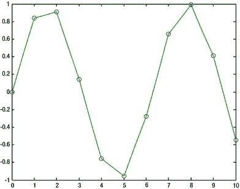

## 二维线性插值 (`interp2`)

`Zi = interp2(X,Y,Z,Xi,Yi)`、`Zi = interp2(Z,Xi,Yi)`、`Zi = interp2(Z,n)` 或 `Zi = interp2(X,Y,Z,Xi,Yi, method)` 函数返回一个向量 `Zi`，使得 `(Xi, Yi, Zi)` 是通过对给定点集 `(X, Y, Z)` 进行二维线性插值得到的所有点集合。当 `X = 1:n` 且 `Y = 1:m` 时（其中 `(n, m) = size(Z)`），后两种形式等价于第一种。函数返回通过在每一维度上对区间重复划分 `n` 次所形成的精细化网格上的插值。此外还指定插值的 `method`。可能的插值方法有 `nearest`（最近邻）、`linear`（线性）、`cubic`（三次埃尔米特）和 `spline`（样条）插值。

在以下示例中，我们考虑一组年份、服务年限和工资，并尝试通过插值找到 1975 年一位拥有 15 年服务年限的员工所获得的薪水。

```matlab
>> years = 10:1950:1990;
   service = 10:10:30;
   wages = [150.697 199.592 187.625
            179.323 195.072 250.287
            203.212 179.092 322.767
            226.505 153.706 426.730
            249.633 120.281 598.243];
   w = interp2(service,years,wages,15,1975)

w =
  190.6288
```

## 三维线性插值 (`interp3`)

`vi = interp3(X,Y,Z,V,Xi,Yi,Zi)`、`vi = interp3(V, Xi, Yi, Zi)`、`vi = interp3(V,n)` 或 `vi = interp3(…, method)` 函数返回一个三变量函数在特定查询点处的插值结果，使用线性插值。结果始终经过函数的原始采样点。`X`、`Y` 和 `Z` 包含样本点的坐标。`V` 包含每个样本点对应的函数值。`Xi`、`Yi` 和 `Zi` 包含查询点的坐标。当网格为由 `size(V)` 定义的默认网格时，后两种形式等价于第一种。返回通过在每一维度上对区间重复划分 `n` 次所形成的精细化网格上的插值。使用指定的 `method` 进行插值。

以下示例计算并展示了 MATLAB 函数 `flow` 的插值结果，通过对数据进行多个切片并显示每个切片上的插值数据。三个轴以 0.5 的等间距采样，`x` 的范围为 0.1 到 10，`y` 和 `z` 的范围为 -3 到 3。

```matlab
>> [x, y, z, v] = flow (10);
   [xi, yi, zi] = meshgrid(.1:.5:10,-3:.5:3,-3:.5:3);
   vi = interp3(x,y,z,v,xi,yi,zi);
   slice(xi,yi,zi,vi,[6 9.5],2,[-2 .2]), shading flat
```

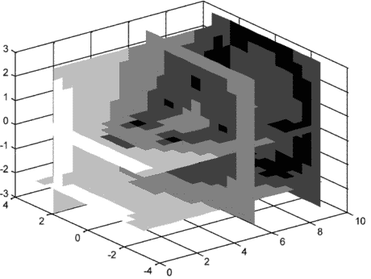

## 基于FFT的一维插值 (`interpft`)

`Y = interpft(X,n)` 或 `y = interpft(x, n, dim)` 函数使用 FFT 方法进行一维插值。返回向量 `Y`，其中包含周期性函数 `X` 在 `n` 个等间距点上的采样值。原始向量 `X` 通过快速傅里叶变换 (FFT) 变换到傅里叶域。可以沿指定的维度 `dim` 进行操作。

以下示例比较了原始点和使用 FFT 方法得到的插值点。

```matlab
>> y = [0:.5:2 1.5:-.5:-2 -1.5:.5:0]; % 等间距点
   factor = 5; % 缩放因子为 5
   m = length(y) * factor;
   x = 1:factor:m;
   XI = 1:m;
   Yi = interpft(y, m);
   plot(x,y,'o',xi,yi,'*')
   legend('原始数据','插值数据')
```

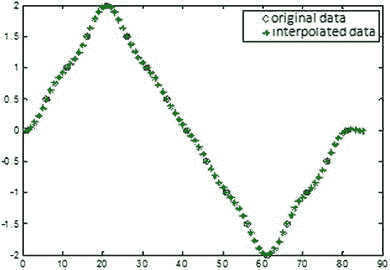

## n维线性插值 (`interpn`)

`Vi = interpn(X,Y,Z,…V, Xi, Yi, Zi…)`、`Vi = interpn(V, Xi, Yi, Zi)`、`Vi = interpn(V, n)` 或 `Vi = interpn(…,method)` 函数返回一个 `n` 变量函数在特定查询点处的插值结果，使用线性插值。结果始终经过函数的原始采样点。`X,Y,Z,…` 包含样本点的坐标。`V` 包含每个样本点对应的函数值。`Xi,Yi,Zi,…` 包含查询点的坐标。当使用默认网格时，后两种形式等价于第一种。返回通过在每一维度上对区间重复划分 `n` 次所形成的精细化网格上的插值。使用指定的 `method` 进行插值。

## 分段三次插值 (`pchip` 和 `spline`)

### 分段三次Hermite插值 (`pchip`)

`Yi = pchip(X, Y, Xi)` 函数返回一个向量 `Yi`，其中包含与 `Xi` 各元素对应的值，这些值由向量 `X` 和 `Y` 内的分段三次插值确定。

`pp = pchip(X,Y)` 函数返回一个分段多项式结构 `pp`，供 `ppval` 使用。

### 三次样条插值 (`spline`)

`Yi = spline(X, Y, Xi)` 函数使用三次样条插值查找 `Yi`，即底层函数 `Y` 在插值点 `Xi` 处的值。断点由 `X` 确定。

`pp = spline(X,Y)` 函数返回三次样条插值的分段多项式形式，供后续与 `ppval` 及样条工具 `unmkpp` 一起使用。

在以下示例中，原始点与使用 `pchip` 和 `spline` 方法得到的插值点进行了比较。

```matlab
>> x = -3:3;
   y = [-1 -1 -1 0 1 1 1];
   t = -3:.01:3;
   plot(x, y, 'o', t, [pchip(x,y,t); spline(x,y,t)])
   legend('数据','pchip','spline',4)
```

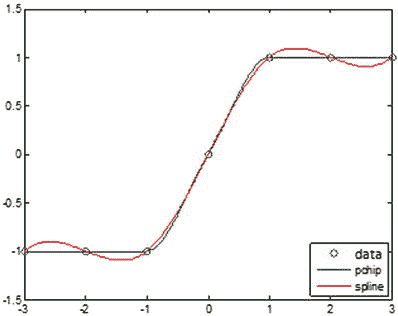

## 散乱数据插值 (`griddata`)

`Zi = griddata(X,Y,Z,Xi,Yi)`、`[Xi, Yi, Zi] = griddata(X,Y,Z,Xi,Yi)` 或 `[…] = griddata(…,method)` 函数将形式为 `Z = f(X,Y)` 的曲面拟合到向量 `(X,Y,Z)` 中的离散数据。该函数在由 `(Xi,Yi)` 指定的查询点处对曲面进行插值，并返回插值结果 `Zi`。该曲面始终经过由 `X` 和 `Y` 定义的数据点。默认的插值方法是 `linear`。当使用 `[Xi, Yi, Zi]` 形式时，除了返回 `Zi`，还会返回向量 `Xi` 和 `Yi`。使用指定的 `method` 进行插值。

下面的示例在网格上对离散数据进行插值。

## 求解方程与方程组

| | |
| :--- | :--- |
| `x = rand(100,1)*4-2; y = rand(100,1)*4-2;`<br>`z = x.*exp(-x.²-y.²);`<br>`ti = -2:.25:2;`<br>`[xi,yi] = meshgrid(ti,ti);`<br>`Zi = griddata(x,y,z,xi,yi);`<br>`mesh(xi,yi,zi), hold on, plot3(x,y,z,'o'), hold off` | |
| 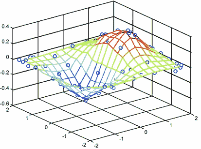 | |
| `W = griddata3(X,Y,Z,V,Xi,Yi,Zi)`<br>`W = griddata3(…,'method')` | 将形式为 `V = f(X,Y,Z)` 的超曲面拟合到向量 `(X,Y,Z,V)` 中的离散数据。该函数在由 `(Xi,Yi,Zi)` 指定的查询点处对超曲面进行插值，并返回插值结果 `W`。该曲面始终经过由 `X`、`Y` 和 `Z` 定义的数据点。默认的插值方法是 `linear`。使用指定的 `method` 进行插值。以下是通过插值将超曲面拟合到离散数据的示例。 |
| | |
| `>> x = 2*rand(5000,1)-1; y = 2*rand(5000,1)-1; z = 2*rand(5000,1)-1;`<br>`v = x.² + y.² + z.²;`<br>`d = -0.8:0.05:0.8;`<br>`[xi,yi,zi] = meshgrid(d,d,d);`<br>`w = griddata3(x,y,z,v,xi,yi,zi);`<br>`p = patch(isosurface(xi,yi,zi,w,0.8));`<br>`isonormals(xi,yi,zi,w,p);`<br>`set(p,'FaceColor','blue','EdgeColor','none');`<br>`view(3), axis equal, axis off, camlight, lighting phong` | |
|  | |

MATLAB 包含多个用于求解方程和方程组的命令。以下各节将介绍这些方法的语法和主要功能。

### 通用方法

以下是用于求解方程和方程组的最常用 MATLAB 命令。

| 命令 | 说明 |
| :--- | :--- |
| `solve('equation','x')` | 求解变量 `x` 的方程。方程求解如下： <br>```<br>>> solve('p*sin(x) = r')<br>ans =<br>asin(r/pi)<br>pi - asin(r/pi)<br>``` |
| `syms x; solve(equ(x), x)` | 求解变量 `x` 的方程 `equ`。方程求解如下： <br>```<br>>> syms x r; solve(p * cos(x) - r, x)<br>ans =<br>acos((8192*r)/1433639)<br>-acos((8192*r)/1433639)<br>``` |
| `solve('eq1,eq2,…,eqn', 'x1, x2,…,xn')` | 求解 `n` 个联立方程 `eq1,…, eqn`（解赋给变量 `x1,…, xn`）<br>```<br>>> [x, y] = solve('x² + x*y + y = 3','x²-4*x + 3 = 0')<br>x =<br>1<br>3<br>y =<br>1<br>-3/2<br>``` |
| `syms x1 x2…xn; solve(eq1,eq2,…,eqn, x1, x2,…,xn)` | 求解 `n` 个联立方程 `eq1,…, eqn`（解赋给变量 `x1,…, xn`）<br>```<br>>> syms x y; [x, y] = solve(x² + x*y + y-3, x²-4*x + 3)<br>x =<br>1<br>3<br>y =<br>1<br>-3/2<br>``` |
| `X = linsolve(A, B)` | 求解方程 `A * X = B`，其中 `A`、`B` 和 `X` 是矩阵。求解系统： <br>```<br>>> A = [2,1,1,1;1,2,1,1;1,1,2,1;1,1,1,2]; B = [1,2,3,4]';<br>>> linsolve(A, B)<br>ans =<br>-1<br>0<br>1<br>2<br>``` |
| `x = lscov(A,B)`<br>`x = lscov(A,B,V)` | 以最小二乘意义求解方程 `A * x = B`，即 `x` 是使平方误差和最小的 n×1 向量。以最小二乘意义求解，协方差矩阵与 `V` 成比例，即 `x` 最小化。 <br>```<br>>> A = [2,1,1,1;1,2,1,1;1,1,2,1;1,1,1,2]; B = [1,2,3,4]';<br>>> lscov(A, B)<br>ans =<br>-1<br>0<br>1<br>2<br>``` |
| `X = A\B` | 求解系统。 <br>```<br>>> A = [2,1,1,1;1,2,1,1;1,1,2,1;1,1,1,2]; B = [1,2,3,4]';<br>>> A\B<br>ans =<br>-1.0000<br>-0.0000<br>1.0000<br>2.0000<br>``` |
| `X = A/B` | 求解系统。 |
| `roots(A)` | 返回多项式的根，其系数由向量 `A` 给出（从最高次到最低次）。示例为求多项式的根。 <br>```<br>>> roots([1 2 3 4])<br>ans =<br>-1.6506<br>-0.1747 + 1.5469i<br>-0.1747 - 1.5469i<br>``` |
| `poly(V)` | 返回多项式的系数，其根由向量 `V` 给出。 <br>```<br>>> poly([1 2 3 4])<br>ans =<br>1 1 -10 -10 35 -50 24<br>``` |
| `x = fzero(x0) (function)` | 返回函数在 `x0` 附近的零点。 <br>```<br>>> X = fzero('sin(x) - 1', pi/2)<br>X =<br>1.5708<br>``` |
| `[x, fval] = fzero(x0, fun)` | 还返回函数在 `x` 处的目标值。 <br>```<br>>> [F, x] = fzero('sin(x) - 1', pi/2)<br>X =<br>1.5708<br>f =<br>0<br>``` |

### 双共轭梯度法

以下是可通过双共轭梯度法求解方程和方程组的 MATLAB 命令。

| 命令 | 说明 |
| :--- | :--- |
| `x = bicg(A,b)`<br>`bicg(A,b,tol)`<br>`bicg(A,b,tol,maxit)`<br>`bicg(A,b,tol,maxit,M)`<br>`bicg(A,b,tol,maxit,M1,M2)`<br>`bicg(A,b,tol,maxit,M1,M2,x0)`<br>`[x,f] = bicg(A,b,…)` | 尝试通过双共轭梯度法求解系统 `Ax = b`。 <br>```<br>>> A = [2 pi * pi 3 * pi - pi; 1 0 - 1 2; exp(1) exp(2) exp(3) exp(4); i 2i 3i - i];<br>>> B = [1 2 3 4]';<br>>> bicg(A, B)<br>bicg stopped at iteration 4 without converging to the desired tolerance 1e-006 because the maximum number of iterations was reached. The iterate returned (number 0) has relative residual 1<br>ans =<br>0<br>0<br>0<br>0<br>```<br>通过指定容差求解 `Ax = b`。通过指定容差和最大迭代次数求解 `Ax = b`。 <br>```<br>>> bicg(A,B, 1e-009,100)<br>ans =<br>1.0e + 016 *<br>4.1449 0.7033i<br>-7.1997 + 1.2216i<br>3.2729 0.5553i<br>-0.4360 + 0.0740i<br>```<br>求解系统 `inv(M) * A * x = inv(M) * b`。用 `M = M1 * M2` 求解系统 `inv(M) * A * x = inv(M) * b`。用 `M = M1 * M2` 和初始值 `x0` 求解系统 `inv(M) * A * x = inv(M) * b`。尝试求解系统并返回收敛指示符 `f`（0 = 收敛，1 = 未收敛，2 = 病态，3 = 停滞，4 = 极极端数值）。 <br>```<br>>> [x, f] = bicg(A,B, 1e-009,100)<br>x =<br>1.0e + 016 *<br>4.1449 0.7033i<br>-7.1997 + 1.2216i<br>3.2729 0.5553i<br>-0.4360 + 0.0740i<br>f =<br>3<br>``` |

## 稳定双共轭梯度法 (bicgstab)

以下是使用稳定双共轭梯度法求解方程和方程组的 MATLAB 命令。

| `x = bicgstab(A,b)` `bicgstab(A,b,tol)` `bicgstab(A,b,tol,maxit)` | 尝试通过稳定双共轭梯度法求解系统 `Ax = b`。 |
|---|---|
| `bicgstab(A,b,tol,maxit,M)` `bicgstab(A,b,tol,maxit,M1,M2)` `bicgstab(A,b,tol,maxit,M1,M2,x0)` | 求解系统 `inv(M) * A * x = inv(M) * b`。用 `M = M1 * M2` 求解系统 `inv(M) * A * x = inv(M) * b`。用 `M = M1 * M2` 和初始值 `x0` 求解系统 `inv(M) * A * x = inv(M) * b`。 |
| `[x,f] = bicgstab(A,b,…)` `[x,f,relres] = bicgstab(A,b,…)` `[x,f,relres,iter] = bicgstab(A,b,…)` | 尝试求解系统并返回收敛指示符 `f`（0 = 收敛，1 = 未收敛，2 = 病态，3 = 停滞，4 = 极端数值）。还返回相对残差 `norm(b-A*x) /norm(b)`。还返回迭代次数。 |

通过指定容差求解 `Ax = b`。通过指定容差和最大迭代次数求解 `Ax = b`。

```matlab
>> bicgstab(A, B)
bicgstab stopped at iteration 4 without converging to the desired tolerance 1e-006 because the maximum number of iterations was reached. The iterate returned (number 4) has relative residual 0.88
ans =
    1.0e + 011 *
   0.6696-0.4857i
  -1.1631 + 0.8437i
   0.5287 0.3835i
  -0.0704 + 0.0511i
```

```matlab
>> bicg(A,B, 1e-009,100)
ans =
    1.0e + 016 *
   4.1449 0.7033i
  -7.1997 + 1.2216i
   3.2729 0.5553i
  -0.4360 + 0.0740i
```

```matlab
>> [x, f, r, i] = bicg(A,B, 1e-006,100)
x =
    1.0e + 016 *
   4.1449 0.7033i
  -7.1997 + 1.2216i
   3.2729 0.5553i
  -0.4360 + 0.0740i
f =
     3
r =
    26.0415
i =
    18
```

### 共轭梯度法

以下是使用共轭梯度法求解方程和方程组的 MATLAB 命令。

| 语法 | 说明 |
|---|---|
| `x = pcg(A,b)` `pcg(A,b,tol)` `pcg(A,b,tol,maxit)` | 尝试使用预处理共轭梯度法求解系统 `Ax = b`。通过指定容差求解 `Ax = b`。通过指定容差和最大迭代次数求解 `Ax = b`。 |
| `pcg(A,b,tol,maxit,M)` `pcg(A,b,tol,maxit,M1,M2)` `pcg(A,b,tol,maxit,M1,M2,x0)` | 求解系统 `inv(M) * A * x = inv(M) * b`。使用 `M = M1 * M2` 求解系统 `inv(M) * A * x = inv(M) * b`。使用 `M = M1 * M2` 和初始值 `x0` 求解系统 `inv(M) * A * x = inv(M) * b`。 |
| `[x,f] = pcg(A,b,…)` `[x,f,relres] = pcg(A,b,…)` `[x,f,relres,iter] = pcg(A,b,…)` | 尝试求解系统并返回收敛指示符 `f`（0 = 收敛，1 = 未收敛，2 = 病态，3 = 停滞，4 = 数值极端）。同时返回相对残差范数 `(b-A*x) /norm(b)`。同时返回迭代次数。 |

| 语法 | 说明 |
|---|---|
| `x = lsqr(A,b)` `lsqr(A,b,tol)` `lsqr(A,b,tol,maxit)` | 尝试使用 LSQR 方法求解系统 `Ax = b`。通过指定容差求解 `Ax = b`。通过指定容差和最大迭代次数求解 `Ax = b`。 |
| `lsqr(A,b,tol,maxit,M)` `lsqr(A,b,tol,maxit,M1,M2)` `lsqr(A,b,tol,maxit,M1,M2,x0)` | 求解系统 `inv(M) * A * x = inv(M) * b`。使用 `M = M1 * M2` 求解系统 `inv(M) * A * x = inv(M) * b`。使用 `M = M1 * M2` 和初始值 `x0` 求解系统 `inv(M) * A * x = inv(M) * b`。 |
| `[x,f] = lsqr(A,b,…)` `[x,f,relres] = lsqr(A,b,…)` `[x,f,relres,iter] = lsqr(A,b,…)` | 尝试求解系统并返回收敛指示符 `f`（0 = 收敛，1 = 未收敛，2 = 病态，3 = 停滞，4 = 数值极端）。同时返回相对残差范数 `(b-A*x) /norm (b)`。同时返回迭代次数。 |

```matlab
>> A=[pi 2*pi 3*pi -pi; 1 0 -1 2; exp(1) exp(2) exp(3) exp(4); i 2i 3i -i];
>> B=[1 2 3 4]';
>> [x,f,r,i]=pcg(A,B, 1e-006,1000)
x =
     0
     0
     0
     0
f =
     4
r =
     1
i =
     0
```

```matlab
>> A=[pi 2*pi 3*pi -pi; 1 0 -1 2; exp(1) exp(2) exp(3) exp(4); i 2i 3i -i];
>> B = [1 2 3 4]';
>> [x, f, r, i] = lsqr(A,B, 1e-006,1000)
x =
   1.1869 0. 0910i
   0.4295 0. 0705i
  -0.5402 - 0. 0362i
   0.1364 + 0. 0274i
f =
     0
r =
    0.6981
i =
     3
```

### 残差法

以下是使用残差法求解方程和方程组的 MATLAB 命令。

| 语法 | 说明 |
|---|---|
| `x = qmr(A,b)` `qmr(A,b,tol)` `qmr(A,b,tol,maxit)` | 尝试使用拟最小残差法求解系统 `Ax = b`。通过指定容差求解 `Ax = b`。通过指定容差和最大迭代次数求解 `Ax = b`。 |
| `qmr(A,b,tol,maxit,M)` `qmr(A,b,tol,maxit,M1,M2)` `qmr(A,b,tol,maxit,M1,M2,x0)` | 求解系统 `inv(M) * A * x = inv(M) * b`。使用 `M = M1 * M2` 求解系统 `inv(M) * A * x = inv(M) * b`。使用 `M = M1 * M2` 和初始值 `x0` 求解系统 `inv(M) * A * x = inv(M) * b`。 |
| `[x,f] = qmr(A,b,…)` `[x,f,relres] = qmr(A,b,…)` `[x,f,relres,iter] = qmr(A,b,…)` | 尝试求解系统并返回收敛指示符 `f`（0 = 收敛，1 = 未收敛，2 = 病态，3 = 停滞，4 = 数值极端）。同时返回残差范数 `(b-A*x) /norm(b)`。同时返回迭代次数。 |

### 迭代法求解线性系统

| 语法 | 描述 |
| :--- | :--- |
| `x = gmres(A,b)` `gmres(A,b,tol)` `gmres(A,b,tol,maxit)` `gmres(A,b,tol,maxit,M)` `gmres(A,b,tol,maxit,M1,M2)` `gmres(A,b,tol,maxit,M1,M2,x0)` `[x,f] = gmres(A,b,…)` `[x,f,relres] = gmres(A,b,…)` `[x,f,relres,iter] = gmres(A,b,…)` | 尝试使用广义最小残差法求解系统 `Ax = b`。通过指定容差求解 `Ax = b`。通过指定容差和最大迭代次数求解 `Ax = b`。求解系统 `inv(M) * A * x = inv(M) * b`。使用 `M = M1 * M2` 求解系统 `inv(M) * A * x = inv(M) * b`。使用 `M = M1 * M2` 和初始值 `x0` 求解系统 `inv(M) * A * x = inv(M) * b`。尝试求解系统并返回收敛指示符 `f`（`0` = 收敛，`1` = 未收敛，`2` = 收敛性差，`3` = 停滞，`4` = 数值极端）。同时返回相对残差范数 `(b-A*x)/norm(b)`。同时返回迭代次数。 |
| `x = minres(A,b)` `minres(A,b,tol)` `minres(A,b,tol,maxit)` `minres(A,b,tol,maxit,M)` `minres(A,b,tol,maxit,M1,M2)` `minres(A,b,tol,maxit,M1,M2,x0)` `[x,f] = minres(A,b,…)` `[x,f,relres] = minres(A,b,…)` `[x,f,relres,iter] = minres(A,b,…)` | 尝试使用最小残差法求解系统 `Ax = b`。通过指定容差求解 `Ax = b`。通过指定容差和最大迭代次数求解 `Ax = b`。求解系统 `inv(M) * A * x = inv(M) * b`。使用 `M = M1 * M2` 求解系统 `inv(M) * A * x = inv(M) * b`。使用 `M = M1 * M2` 和初始值 `x0` 求解系统 `inv(M) * A * x = inv(M) * b`。尝试求解系统并返回收敛指示符 `f`（`0` = 收敛，`1` = 未收敛，`2` = 病态，`3` = 停滞，`4` = 数值极端）。同时返回相对残差范数 `(b-A*x)/norm(b)`。同时返回迭代次数。 |

```matlab
>> A=[pi 2*pi 3*pi -pi; 1 0 -1 2; exp(1) exp(2) exp(3) exp(4); i 2i 3i -i];
>> B=[1 2 3 4]';
>> [x,f,r,i]=qmr(A,B, 1e-006,1000)
x =
   1.0e+016 *
   0.4810 - 4.0071i
  -0.8356 + 6.9603i
   0.3798 - 3.1640i
  -0.0506 + 0.4215i
f =
     3
r =
   19.5999
i =
    11
```

```matlab
>> A=[pi 2*pi 3*pi -pi; 1 0 -1 2; exp(1) exp(2) exp(3) exp(4); i 2i 3i -i];
>> B=[1 2 3 4]';
>> [x,f,r,i]=gmres(A,B)
x =
   1.5504 + 0.0085i
  -0.2019 - 0.2433i
  -0.2532 + 0.0423i
   0.0982 + 0.0169i
f =
     3
r =
    0.6981
i =
     1     4
```

```matlab
>> A=[pi 2*pi 3*pi -pi; 1 0 -1 2; exp(1) exp(2) exp(3) exp(4); i 2i 3i -i];
>> B=[1 2 3 4]';
>> [x,f,r,i]=minres(A,B, 1e-006,1000)
x =
   0.0748 - 0.0070i
  -0.0761 - 0.0001i
   0.5934 - 0.1085i
  -0.1528 + 0.0380i
f =
     1
r =
    0.0592
i =
  1000
```

### 对称和非负最小二乘法

以下是使用对称和非负最小二乘法求解方程及方程组的 MATLAB 命令。

| 语法 | 描述 |
| :--- | :--- |
| `x = symmlq(A,b)` `symmlq(A,b,tol)` `symmlq(A,b,tol,maxit)` `symmlq(A,b,tol,maxit,M)` `symmlq(A,b,tol,maxit,M1,M2)` `symmlq(A,b,tol,maxit,M1,M2,x0)` `[x,flag] = symmlq(A,b,…)` `[x,flag,relres] = symmlq(A,b,…)` `[x,flag,relres,iter] = symmlq(A,b,…)` | 尝试通过对称 LQ 方法求解方程组 `Ax = b`。通过指定容忍度求解 `Ax = b`。通过指定容忍度和最大迭代次数求解 `Ax = b`。求解方程组 `inv(M) * A * x = inv(M) * b`。在 `M = M1 * M2` 条件下求解方程组 `inv(M) * A * x = inv(M) * b`。在 `M = M1 * M2` 且初始值为 `x0` 的条件下求解方程组 `inv(M) * A * x = inv(M) * b`。尝试求解方程组并返回一个收敛标志（`0` = 收敛，`1` = 未收敛，`2` = 病态，`3` = 停滞，`4` = 极端数值）。同时返回相对残差范数 `(b-A*x)/norm(b)`。还返回迭代次数。 |
| `x = lsqnonneg(C,d)` `x = lsqnonneg(C,d,x0)` `x = lsqnonneg(C,d,x0,opt)` `[x,resnorm] = lsqnonneg(…)` `[x,resnorm,residual] = lsqnonneg(…)` `[x,resnorm,residual,f] = lsqnonneg(…)` `[x,resnorm,residual,f,out,lambda] = lsqnonneg(…)` | 返回满足 `x >= 0` 条件下使 `norm(C*x-d)` 最小化的向量 `x`。`C` 和 `d` 必须为实数。使用 `x0 >= 0` 作为初始值以及一个可能的选项。选项包括用于 `x` 终止容忍度的 `TolX` 和用于控制输出显示的 `Display`（`'off'` 不显示输出，`'final'` 仅显示最终输出，`'notify'` 仅当未收敛时显示输出）。返回残差的平方 2-范数值：`norm(C*x-d)^2`。此外还返回残差 `C*x-d`。另外给出一个收敛标志 `f`（正数表示收敛，`0` 表示未收敛）。除上述内容外，还返回描述所用算法、迭代次数和退出信息的输出数据，以及拉格朗日乘数向量 `lambda`。 |

```matlab
>> A=[1 2 3;5 7 1;2 3 6]; B=[1 3 5]'; lsqnonneg(A,B)
ans =
    0.4857
         0
    0.5714
```

好的，作为一名高级文档工程师和翻译员，我将严格遵循您提供的格式和注意事项，将给定的英文文本翻译成中文。

## 求解线性方程组

在前面的章节中，我们学习了方程和方程组的一般概念。现在我们将专注于线性方程组。求解此类方程组，我们可以简单地使用目前已学过的命令，但是 MATLAB 提供了一系列特别为线性方程组设计的专用命令。下表列出了这些命令。

| 命令 | 说明 |
|------|------|
| `X = linsolve (A, B)` | 求解线性系统 `A * X = B`。我们求解系统：<br>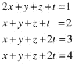<br>`>> A = [2,1,1,1;1,2,1,1;1,1,2,1;1,1,1,2];B = [1,2,3,4]';`<br>`linsolve (A, B)`<br>`ans =`<br>`-1`<br>`0`<br>`1`<br>`2` |
| `[X, R] = linsolve (A, B)` | 求解线性系统 `A * X = B`，如果 `A` 是方阵，则额外返回 `A` 的条件数的倒数；如果 `A` 不是方阵，则返回 `A` 的秩。<br>`>> A = [2,1,1,1;1,2,1,1;1,1,2,1;1,1,1,2];B = [1,2,3,4]';`<br>`[X, R] = linsolve (A, B)`<br>`X =`<br>`-1`<br>`0`<br>`1`<br>`2`<br>`R =`<br>`0.1429` |
| `X = linsolve (A, B, options)` | 使用矩阵 `A` 的各种选项（`UT` 表示上三角，`LT` 表示下三角，`SYM` 表示对称实矩阵或复埃尔米特矩阵，`RECT` 表示一般矩形矩阵，`POSDEF` 表示正定矩阵，`UHESS` 表示上黑森伯格矩阵，`TRANSA` 表示共轭转置）求解线性系统 `A * X = B`。 |
| `rank (A)` | 矩阵 `A` 的秩。<br>`>> rank (A)`<br>`ans =`<br>`4` |
| `det (A)` | 方阵 `A` 的行列式。<br>`>> det (A)`<br>`ans =`<br>`5` |
| `Z = null (A, 'r')` | 矩阵 `A` 的零空间的有理基。 |

线性方程组可以转换为数组形式，并通过矩阵计算来求解。一个系统可以写成 `M.X = B` 的形式，其中 `X` 是变量向量，`B` 是常数项向量，`M` 是系统的系数矩阵。如果 `M` 是方阵且行列式非零，则 `M` 可逆，系统的唯一解可以写成：`X = M^(-1)B`。在这种情况下，前面已经描述过的命令 `solve`、`linsolve`、`lscov`、`bicg`、`pcg`、`lsqr`、`gmr`、`gmres`、`minres`、`symmlq` 或 `M\B` 都可以提供解。

如果 `M` 的行列式为零，则系统有无穷多解，因为 `M` 中存在线性相关的行或列。在这种情况下，可以计算冗余方程的数量，以找出描述解所需的变量个数。如果矩阵 `M` 是矩形的（非方阵），则系统可能是欠定的（方程数少于变量数）、超定的（方程数多于变量数）或非奇异的（方程数等于变量数且 `M` 的行列式非零）。欠定系统可能有无穷多解，也可能无解；超定系统也是如此。如果一个系统无解，则称为不相容（矛盾）系统；如果至少有一个解，则称为相容系统。当向量 `B` 是零向量时，系统 `M . X = B` 被称为齐次系统，即系统形式为 `M . X= 0`。如果 `M` 的行列式非零，系统的唯一解是零向量（使用命令 `linsolve` 获得）。如果 `M` 的行列式为零，则系统有无穷多解。可以使用命令 `solve`、`linsolve`、`lsqr` 或前面为一般线性系统描述的其他命令来求解。

分析和求解方程组的一个基本工具是 Rouche-Frobenius 定理。该定理指出，一个包含 `m` 个方程和 `n` 个未知数的系统有解，当且仅当系数矩阵的秩等于增广矩阵（将系数矩阵与系统常数项列向量拼接）的秩。如果两个秩相等，且等于未知数的个数，则系统有唯一解。如果两个秩相等，但小于未知数的个数，则系统有无穷多解。如果两个秩不相等，则系统无解。

总结如下：设 `A` 是系统的系数矩阵，`B` 是矩阵 `A` 增广了常数项列向量后的矩阵。

如果 `rank(A) = rank(B)`，系统是不相容的（无解）。

如果 `rank (A) = rank(B) < n`，系统是不定的（有无穷多解）。

如果 `= rank(A) = rank(B) = n`，系统有唯一解。

这个定理允许我们在求解之前分析方程组的解。

我们已经遇到过齐次系统。如果常数项向量 `B` 为零，则系统 `A. X = B` 被称为齐次系统，因此每个齐次系统的形式都是 `A. X = 0`。在齐次系统中，系数矩阵的秩与增广了常数项列向量后的矩阵的秩总是相等。如果我们应用 Rouche-Frobenius 定理，当矩阵 `A` 的行列式非零时，齐次系统将有唯一解。由于零向量总是齐次系统的一个解，因此它必须是唯一解。当矩阵 `A` 的行列式为零时，齐次系统将有无穷多解。在这种情况下，解的计算方法与一般系统相同（使用命令 `solve`），或者使用函数 `null (A)`。

## 示例1

作为第一个例子，我们求解系统：

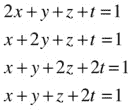

我们将计算系统矩阵的秩和增广矩阵（通过用常数项列向量扩展矩阵得到）的秩。

```
>> A = [2,1,1,1;1,2,1,1;1,1,2,1;1,1,1,2];
>> B = [2,1,1,1,1;1,2,1,1,1;1,1,2,1,1;1,1,1,2,1];
>> [rank (A), rank (B)]
ans =
4 4
```

我们注意到两个矩阵的秩等于未知数的个数。根据 Rouche-Frobenius 定理，这告诉我们系统是相容的且有唯一解。我们可以通过以下方式计算解：

```
>> B = [1 1 1 1]';
>> linsolve (A, B)
ans =
0.2000
0.2000
0.2000
0.2000
```

也可以使用以下命令找到解：

```
>> lscov (A, B)
ans =
0.2000
0.2000
0.2000
0.2000

>> bicg (A, B)
bicg converged at iteration 1 to a solution with relative residual 0
ans =
0.2000
0.2000
0.2000
0.2000

>> pcg (A, B)
PCG converged at iteration 1 to a solution with relative residual 0
ans =
0.2000
0.2000
0.2000
0.2000

>> lsqr (A, B)
lsqr converged at iteration 1 to a solution with relative residual 0
ans =
0.2000
0.2000
0.2000
0.2000

>> qmr (A, B)
QMR converged at iteration 1 to a solution with relative residual 0
ans =
0.2000
0.2000
0.2000
0.2000

>> gmres (A, B)
gmres converged at iteration 1 to a solution with relative residual 1.5e-016
ans =
0.2000
0.2000
0.2000
0.2000

>> symmlq (A, B)
symmlq converged at iteration 1 to a solution with relative residual 0
ans =
0.2000
0.2000
0.2000
0.2000
```

## 示例2

作为第二个例子，我们求解系统：

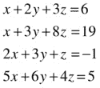

我们计算系统矩阵的秩和增广矩阵的秩。

```
>> A=[1,2,3;1,3,8;2,3,1;5,6,4];
>> B=[1,2,3,6;1,3,8,19;2,3,1,-1;5,6,4,5];
>> [rank(A), rank(B)]
ans =
3     3
```

我们注意到两个矩阵的秩等于未知数的个数。根据 Rouche-Frobenius 定理，这告诉我们系统是相容的且有唯一解。我们可以通过以下方式计算解：

```
>> A = [1,2,3;1,3,8;2,3,1;5,6,4];
>> B = [19-6 - 5-1]';
>> linsolve (A, B)
ans =
1.0000
-2.0000
3.0000
```

## 示例3

作为第三个例子，我们求解系统：

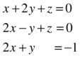

由于这是一个齐次系统，我们将计算系统系数矩阵的行列式。

```
>> A = [1,2, - 1; 2, - 1, 1; 3,1,0];
>> det (A)
ans =
5. 5511e-016
```

这个答案非常接近零，实际上行列式就是零，因此齐次系统将有无穷多解，可以使用命令 `solve` 计算，如下所示。

```
>> [x, y, z] = solve('x+2*y-z, 2*x-y+z, 3*x+y', 'x,y,z')
x =
-z1/5
y =
(3 * z1) / 5
z =
z1
```

因此，这组无穷多解依赖于一个参数 `z1`，并描述为 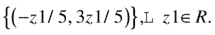

## 练习 4-1

展开以下代数表达式：

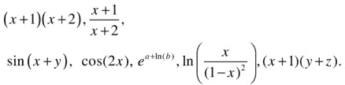

```
>> syms x y z b t
>> pretty (expand ((x + 1) * (2.4.x+2)))
2
x + 3 x + 2

>> pretty (expand ((x + 1) / (2.4.x+2)))
  x       1
------ + -------
x + 2     x + 2

>> pretty (expand (sin(x + y)))
sin(x) cos (y) + cos (x) sin(y)

>> pretty (expand (cos(2*x)))
    2
2 cos (x) - 1

>> pretty (expand (exp (a+log (b)))
exp (a) b

>> pretty (expand (log (x/(1-x)^ 2)))
log (x) - 2-log(1-x)

>> pretty (expand ((x + 1) * (y+z)))
x y + x z + y + z
```

## 练习 4-2

因式分解以下代数表达式：

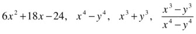

```
>> syms x y
>> pretty (factor(6*x²+18*x-24))
6 (x + 4) (x - 1)

>> pretty (factor(x⁴-y⁴))
               2   2
(x y) (x + y) (x + y)

>> pretty (factor(x³+y³))
         2         2
(x + y) (x - x y + y )

>> pretty (factor ((x³-y³) /(x⁴-y⁴)))
2         2
x + x y + y
-----------------
         2   2
(x + y) (x + y )
```

## 练习 4-3

简化以下代数表达式：

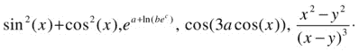

```
>> syms x y b c
>> simplify (sin (x) ^ 2 + cos (x) ^ 2)
ans =
1

>> pretty (simplify (exp (a+log (b * exp (c)))))
b exp(a + c)

>> pretty (sym (simple (cos (3 * acos (x)))))
  3
4 x - 3 x

>> pretty(simple((x²-y²) /(x-y) ^ 3))
x + y
-------
      2
(x - y)
```

## 练习 4-4

将下列代数表达式重写为 `x` 的幂的形式：

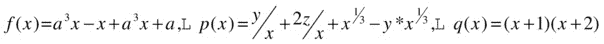

将下列表达式重写为 `x` 的幂的形式：

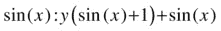

将下列表达式重写为 `x` 的幂的形式：

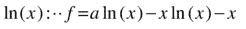

将下列表达式重写为 `x` 的幂的形式：

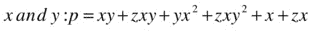

```
>> syms x y z
>> pretty (collect(a³*x-x+a³+a, x))
 3         3
(a -1) x + a + a

>> pretty (collect (y / x+2 * z/x + x ^(1/3) - y * ^(1/3) x, x))
y + 2 z – x 4/3 y + x4/3
----------------------
         x

>> pretty(collect((x+1) * (x+2)))
2
x + 3 x + 2

>> p = x * y + z * x * y + y * x ^ 2-z * y * x ^ 2 + x + z * x;
>> pretty(collect(p, [x,y]))
      2
(1-z) x y + (z + 1) x y + (z + 1) x

>> f = a * log (x) - log (x) * x-x;
>> pretty (collect (f, log (x)))
(a - x) log (x) - x
```

## 练习 4-5

尽可能合并以下表达式中的项：

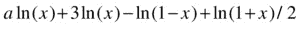

假设 `a` 是实数且 `x > 0`，简化该表达式。

```
>> pretty (sym (simple (a * log (x) + 3 * log (x) - log(1-x) + log(1+x)/2)))
log(x + 1)/2- log(1-x) + 3 log (x) + log (x)

>> x = sym ('x', 'positive')
x =
x

>> a = sym ('a', 'real')
a =
a

>> pretty (sym (simple (a * log (x) + 3 * log (x) - log(1-x) + log(1+x)/2)))
    /       x - 1        \
-log| - ---------------- |
    |    3  a     1/2    |
    \   x  x  (x + 1)    /
```

## 练习 4-6

展开并简化以下三角函数表达式：

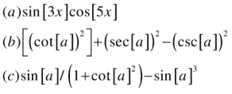

```
>> pretty (simple (expand (sym (sin(3*x) * cos(5*x)))))
sin(8 x)   sin (2 x)
-------- - --------
   2          2

>> pretty (simple (expand (((cot (a)) ^ 2 + (sec (a)) ^ 2-(csc (a)) ^ 2))))
  1
------- - 1
  2
cos (a)

>> pretty (simple (expand (sin (a) / (1 + cot (a) ^ 2)- sin (a) ^ 3)))
0
```

## 练习 4-7

尽可能简化以下代数表达式：

```
x       y     2 x y        1 + a    1 - b     a - b
————— - ————— + —————  ,     ————— +  ————— - —————————
x + y   x - y   2   2          b        a        a b
              x - y
```

# 练习 4-8 到 4-14

## 练习 4-8

尽可能简化以下代数分式：

```
   3   2      2    2            2        2
   a - a b + ac - bc           (x - 9) (x - 2 x + 1) (x - 3)
——————————————————————————,—————————————————————————————————
   3    2   2       2          2             2
   a + ac + a b + b c         (x - 6 x + 9) (x - 1) (x - 1)
```

```
>> pretty(simple(factor(a³-a²*b+a*c²-b*c²)/(a³+a*c²+a²*b+b*c²)))
a - b
-----
a + b

>> pretty(simple(factor((x²-9)*(x²-2*x+1)*(x-3))/((x²-6*x+9)*(x²-1) *(x-1))))
2
----- + 1
x + 1
```

## 练习 4-9

计算以下多项式的根：

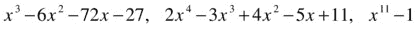

在 3 阶单位矩阵处计算第一个多项式，在 3 阶全 1 矩阵处计算第二个多项式，在 3 阶均匀随机矩阵处计算第三个多项式。

求给定多项式的导数系数，并以多项式形式显示结果。

```
>> p1 = [1 – 6 -72 - 27]; r = roots (p)
r =
12.1229
-5.7345
-0.3884

>> p2 = [2 -3 4 -5 11];r=roots(p)
r =
1.2817 + 1.0040i
1.2817 - 1.0040i
-0.5317 + 1.3387i
-0.5317 - 1.3387i

>> p3 = [1 0 0 0 0 0 0 0 0 0 0 1]; r = roots (p)
r =
-1.0000
-0.8413 + 0. 5406i
-0.8413 - 0. 5406i
-0.4154 + 0. 9096i
-0.4154 - 0. 9096i
0.1423 + 0. 9898i
0.1423 0. 9898i
0.6549 + 0. 7557i
0.6549-0. 7557i
0.9595 + 0. 2817i
0.9595 0. 2817i

>> Y1 = polyval (p1, eye (3))
Y1 =
-104 - 27 - 27
-27  -104 - 27
-27  – 27 -104

>> Y2 = polyval (p2, ones (3))
Y2 =
9 -9 -9
9 -9 -9
9 -9 -9

>> Y3 = polyval (p3, rand (3))
Y3 =
1.1050 1.3691 1.0000
1.3368 1.0065 1.0013
1.0000 1.0000 1.6202

>> d1 = polyder (p1)
D1 =
3 -12 -72

>> pretty (poly2sym(d1,'x'))
  2
3 x - 12 x - 72

>> d2 = polyder (p2)
D2 =
8 -9  8 - 5

>> pretty (poly2sym(d2,'x'))
  3     2
8 x - 9 x + 8 x - 5

>> d3 = polyder (p3)
D3 =
11     0     0     0     0     0     0     0     0     0     0

>> pretty (poly2sym(d3,'x'))
   10
11 x
```

## 练习 4-10

考虑区间 `[0,5]` 内间隔为 0.1 的等距点集。在这些点处插值误差函数，并拟合一个 6 次多项式。在同一张图上绘制原始曲线和插值曲线。

```
>> x = (0: 0.1: 5)';
y = erf (x);
f = polyval(p,x);
>> p = polyfit(x,y,6)
p =
0.0012 - 0.0173 0.0812 - 0.0791 - 0.4495 1.3107 - 0.0128

>> f = polyval(p,x);
plot(x,y,'o',x,f,'-')
axis([0 5 0 2])
```

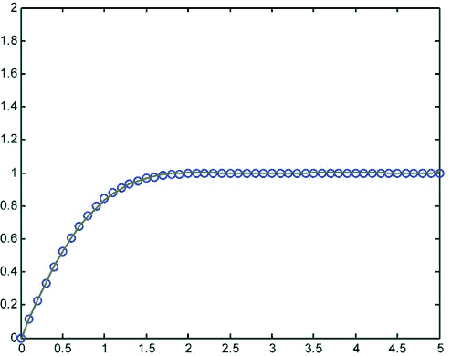

## 练习 4-11

计算以最小二乘法通过点 `(-1,4)`、`(0,2)` 和 `(1,6)` 的二次插值多项式。

```
>> x = [- 1, 0, 1];y=[4,2,6];p=poly2sym(polyfit(x,y,2))
p =
3 * x ^ 2 + x + 2
```

## 练习 4-12

在由 `y= e^x` 给出的点 `(x, y)` 之间（`x` 值在 0 到 2 之间的 20 个等间距区间内）绘制 200 个三次插值点。

首先，我们定义 20 个点 `(x, y)`，其中 `x` 在 0 和 2 之间等间距分布：

```
>> x = 0:0.1:2;
>> y = exp(x);
```

现在，我们找到三次插值点 `(xi, yi)`，其中 `xi` 值在 0 和 2 之间的 200 个等间距点处，并将它们与初始点 `(x, y)`（用星号表示）一起绘制在图上。

```
>> xi = 0:0. 01:2;
>> yi = interp1(x,y,xi,'cubic');
>> plot(x,y,'*',xi,yi)
```

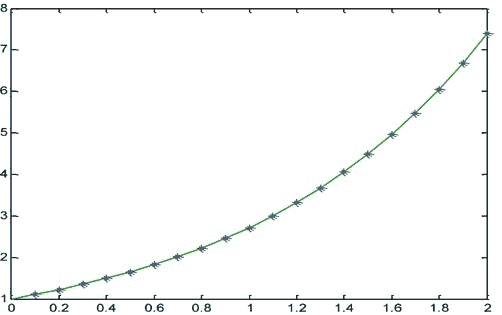

## 练习 4-13

查找参数函数 `X = cosh (t)`、`Y = sinh (t)`、`Z = tanh (t)` 在 `t` 值介于 0 和 π/6 之间的 25 个等间距区间内的插值点。

首先，我们为在 0 和 π/6 之间等间距的 `t` 值定义给定点 `(x, y, z)`。

```
>> t = 0: pi/150: pi/6;
>> x = cosh (t); y = sinh (t); z = tanh (t);
```

现在，我们找到 26 个插值点 `(x[i], y[i], z[i])`，参数 `t` 的值在 0 和 π/6 之间等间距分布。

```
>> xi = cosh (t); yi = sinh (t);
>> zi = griddata(x,y,z,xi,yi);
>> points = [xi, yi, zi]
points =
1.0000 0 0
1.0002 0.0209 0.0209
1.0009 0.0419 0.0419
1.0020 0.0629 0.0627
1.0035 0.0839 0.0836
1.0055 0.1049 0.1043
1.0079 0.1260 0.1250
1.0108 0.1471 0.1456
1.0141 0.1683 0.1660
1.0178 0.1896 0.1863
1.0220 0.2110 0.2064
1.0267 0.2324 0.2264
1.0317 0.2540 0.2462
1.0373 0.2756 0.2657
1.0433 0.2974 0.2851
1.0498 0.3194 0.3042
1.0567 0.3414 0.3231
1.0641 0.3636 0.3417
1.0719 0.3860 0.3601
1.0802 0.4085 0.3782
1.0890 0.4312 0.3960
1.0983 0.4541 0.4135
1.1080 0.4772 0.4307
1.1183 0.5006 0.4476
1.1290 0.5241 0.4642
1.1402 0.5479 0.4805
```

## 练习 4-14

使用快速傅里叶变换（FFT）插值，找到近似函数 `y = sinh (x)` 的 30 个点 `(xi, yi)`。`x` 值在 0 到 2π 之间的等间距区间内，这些点在由 `y = sinh (x)` 给出的点 `(x, y)` 之间进行插值，其中 `x` 值在 `(0,2π)` 的 20 个等间距区间内。绘制这些点的图形。

首先，我们定义在 0 到 2π 之间的 20 个区间内等间距的 `x` 值。

```
>> x =(0:pi/10:2*pi);
```

现在，我们找到插值点 `(x, y)`。

```
>> y = interpft (sinh (x), 30);
>> points = [y ', (asinh (y))']
points =
-0.0000 - 0.0000
-28.2506 - 4.0346
23.3719 3.8451
-4.9711 - 2.3067
-7.7918 - 2.7503
14.0406 3.3364
-4.8129 - 2.2751
-0.8717 - 0.7877
11.5537 3.1420
-3.3804 - 1.9323
4.4531 2.1991
11.8616 3.1682
-0.2121 - 0.2105
10.9811 3.0914
15.1648 3.4132
6.1408 2.5147
21.2540 3.7502
23.3792 3.8455
18.5918 3.6166
39.4061 4.3672
40.6473 4.3982
42.8049 4.4499
73.2876 4.9876
74.8962 5.0093
89.7159 5.1898
139.0371 5.6279
139.3869 5.6304
180.2289 5.8874
282.4798 6.3368
201.7871 6.0004

>> plot (points)
```

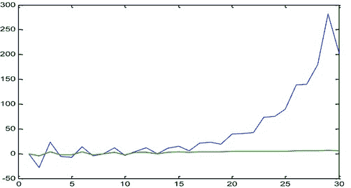

## 练习 4-15

找到一个 3 次多项式，它是以最小二乘法通过点 `(i, i²)`（`1 ≤ i ≤ 7`）的最佳拟合。在 `x = 10` 处计算该多项式，并图形化表示最佳拟合曲线。

```
>> x =(1:7);y=[1,4,9,16,25,36,49];p=vpa(poly2sym(polyfit(x,y,2))))
p =
x ^ 2 - 0.000000000000009169181662272871686413366801652 * x + 0.000000000000020761891472015924526365781895317
```

现在，我们在 `x = 10` 处计算多项式 `p` 的数值。

```
>> subs(p,10)
ans =
100.0000
```

接下来，我们绘制该多项式的图形：

```
>> ezplot(p,[-5,5])
```

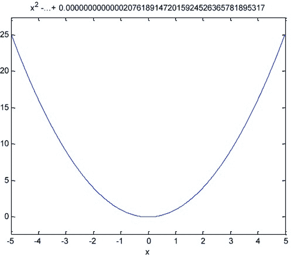

## 练习 4-16

求解以下方程：

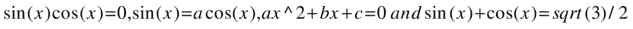

```
>> solve ('sin (x) * cos (x) = 0')
ans =
[       0]
[1/2 * pi]
[-1/2 * pi]

>> solve ('sin (x) = a * cos (x) ',' x')
ans =
atan (a)

>> solve('a*x²+b*x+c=0','x')
ans =
[1/2/a * (-b + (b ^ 2-4 * a * c) ^(1/2))]
[1/2/a * (-b-(b²-4*a*c) ^(1/2))]

>> solve (' sin (x) + cos (x) = sqrt (3) / 2')
ans =
[1/2 * 3 ^(1/2)]
[1/2 * 3 ^(1/2)]
```

## 练习 4-17

为以下两个三角方程和指数方程各找出至少两个解：

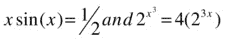

首先，我们使用命令 `solve`：

```
>> vpa (solve ('x * sin (x) = 1/2 ', 'x'))
ans =
matrix([[-226.19688152398440474751335389781]])

>> vpa (solve ('2 ^(x³) = 4 * 2 ^(3*x)', 'x'))
ans =
2.0
-1.0
-1.0
```

对于第一个方程我们没有得到解，但对于第二个我们得到了。为了更好地分析第一个方程，我们将函数图形化表示，以确定可能解所在的近似区间。

```
>> fplot ('[x * sin (x) - 1/2.0]', [0, 4 * pi])
```

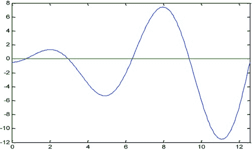

我们观察到在 `0` 和 `2` 之间有一个解，在 `2` 和 `4` 之间有一个解，在 `4` 和 `8` 之间有一个解，依此类推。我们可以使用命令 `fzero` 计算其中三个。

```
>> s1 = fzero ('x * sin (x) - 1/2 ', 2)
s1 =
0.7408

>> s2 = fzero ('x * sin (x) - 1/2 ', 4)
s2 =
2.9726

>> s3 = fzero ('x * sin (x) - 1/2 ', 6)
S3 =
6.3619
```

## 练习 4-18

求解以下对数方程和根式方程：

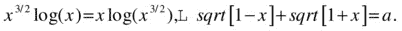

```
>> vpa (solve ('^(3/2) x * log (x) = x * log (x) ^(3/2)'))
ans =
1.0
0.31813150520476413531265425158766 1.3372357014306894089011621431937 * i
```

我们绘制函数图形以确定可以找到解的区间。图形显示 `x=1` 是唯一的实数解。

```
>> fplot ('[^(3/2) x * log (x), x * log (x) ^(3/2)]', [0.3, - 1, 6])
```

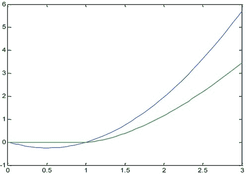

现在，我们求解根式方程：

```
>> pretty (sym (solve ('sqrt(1-x) + sqrt (1 + x) = a ', 'x')))
+-                -+
|           2 1/2  |
|   a (4 - a )     |
|   -------------  |
|        2         |
|                  |
|            2 1/2 |
|    a (4 - a )    |
|  - ------------- |
|         2        |
+-                -+
```
