# 5. 矩阵、向量空间与线性变换

## 矩阵符号表示

在变量专用章节中我们已经了解了如何在 MATLAB 中表示向量和矩阵，但在此我们重新回顾一下表示法。

考虑矩阵

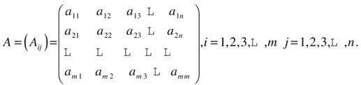

你可以通过以下方式在 MATLAB 中输入该矩阵：

`A = [a11,a12,...,a1n ; a21,a22,...,a2n ; ... ; am1,am2,...,amn]`

`A = [a11 a12 ... a1n ; a21 a22 ... a2n ; ... ; am1 am2 ... amn]`

另一方面，向量 `V =(v1,v2,...,vn)` 作为单行矩阵（即维度为 `1×n` 的矩阵）的特例，可按以下形式输入：

`V = [v1, v2, ..., vn]`

`V = [v1 v2 ... vn]`

## 矩阵运算

MATLAB 包含多种命令，可对矩阵执行最常见的符号运算和数值运算。下表列出了其中最重要的运算操作。

| 运算 | 描述 |
| :--- | :--- |
| `A + B` | 矩阵 `A` 和 `B` 的和 |

## 矩阵运算

定义两个复数矩阵 `A` 和 `B`。

```matlab
>> A=[-1 7 2;i -i 8; 3 1 4]
A =
  -1.0000             7.0000             2.0000
  0 + 1.0000i        0 - 1.0000i             8.0000
  3.0000             1.0000             4.0000
>> B=[1 2 3; 1+i 1-2i 1-3i; -3 -5 -i]
B =
  1.0000             2.0000                 3.0000
  1.0000 + 1.0000i   1.0000 - 2.0000i       1.0000 - 3.0000i
 -3.0000            -5.0000            0 - 1.0000i
```

### 矩阵加法

| `A + B` | 矩阵 `A` 和 `B` 的和 |
|---------|----------------------|

```matlab
>> A+B
ans =
  0              9.0000                 5.0000
  1.0000 + 2.0000i   1.0000 - 3.0000i      9.0000 - 3.0000i
  0             -4.0000      4.0000 - 1.0000i
```

### 矩阵减法

| `A - B` | 矩阵 `A` 和 `B` 的差 |
|---------|----------------------|

```matlab
>> A-B
ans =
 -2.0000                       5.0000                      -1.0000
 -1.0000            -1.0000 + 1.0000i             7.0000 + 3.0000i
  6.0000                       6.0000             4.0000 + 1.0000i
```

### 矩阵乘法

| `A * B` | 矩阵 `A` 和 `B` 的积 |
|---------|----------------------|

```matlab
>> A*B
ans =
  0 + 7.0000i  -5.0000 -14.0000i   4.0000 -23.0000i
 -23.0000 -42.0000 + 1.0000i  -3.0000 - 6.0000i
 -8.0000 + 1.0000i -13.0000 - 2.0000i  10.0000 - 7.0000i
```

### 标量乘法

| `c * A` | 标量与矩阵的乘积 |
|---------|------------------|

```matlab
>> i*A
ans =
  0 - 1.0000i         0 + 7.0000i              0 + 2.0000i
 -1.0000              1.0000              0 + 8.0000i
  0 + 3.0000i         0 + 1.0000i              0 + 4.0000i
```

### 矩阵函数

| `expm(A)` | 通过特征值计算的矩阵指数 `e^A` |
|-----------|--------------------------------|

```matlab
>> expm(A)
ans =
  1.0e+003 *
  0.5710 + 0.0674i   0.7081 - 0.0337i   1.7019 - 0.0338i
  0.5710 + 0.0674i   0.7081 - 0.0337i   1.7018 - 0.0337i
  0.5710 + 0.0675i   0.7082 - 0.0337i   1.7018 - 0.0337i
```

| `expm1(A)` | 通过 Padé 近似计算的矩阵指数 `e^A` |
|------------|-------------------------------------|

```matlab
>> expm1(A)
ans =
  1.0e+003 *
 -0.0006             1.0956             0.0064
 -0.0005 + 0.0008i  -0.0005 - 0.0008i   2.9800
  0.0191             0.0017             0.0536
```

| `logm(A)` | `A` 的矩阵自然对数 |
|-----------|--------------------|

```matlab
>> logm(A)
ans =
  1.3756 + 0.0063i   2.4201 + 0.4906i  -1.7163 - 0.4969i
 -0.9903 + 0.1445i   1.7284 - 0.2954i   1.3413 + 0.1509i
  0.6464 - 0.0412i   -0.6375 - 0.1572i    2.0705 + 0.1984i
```

| `sqrtm(A)` | 方阵 `A` 的平方根 |
|------------|--------------------|

```matlab
>> sqrtm(A)
ans =
  1.1538 - 0.0556i   2.4904 + 0.3474i  -0.8158 - 0.2918i
 -0.6332 + 0.2331i   1.5192 - 0.3779i   1.9424 + 0.1449i
  0.8187 - 0.0083i  -0.2678 - 0.0893i   2.2775 + 0.0975i
```

| `funm(A, 'function')` | 对方阵 `A` 应用函数。可用的函数有 `EXP`、`LOG`、`COS`、`SIN`、`COSH`、`SINH`、`SQRTM` 和 `EXPM` |
|-----------------------|----------------------------------------------------------------------------------------------|

```matlab
>> funm(A,'log')
ans =
  1.3756 +  0.0063i   2.4201 + 0.4906i  -1.7163 - 0.4969i
 -0.9903 + 0.1445i   1.7284 - 0.2954i   1.3413 + 0.1509i
  0.6464 - 0.0412i   -0.6375 - 0.1572i   2.0705 + 0.1984i
>> funm(A,'sinh')
ans =
  1.0e+002 *
  2.8840 + 0.3729i   3.4704 - 0.1953i   8.5505 - 0.1776i
  2.8821 + 0.3256i   3.5574 - 0.1265i   8.4652 - 0.1992i
  2.8359 + 0.3291i   3.5556 - 0.1738i   8.5133 - 0.1553i
>> funm(A,'cos')
ans =
 -22.0565 + 8.2759i    20.1371 -22.2895i   1.7740 +14.0136i
  2.0152 + 10.6436i   -22.5464 + 2.7537i  20.3857 -13.3973i
  6.7526 - 6.1638i     1.5253 + 5.1214i  -8.4234 + 1.0424i
```

### 矩阵转置与逆

| `transpose(A)` 或 `A'` | 矩阵 `A` 的转置 |
|------------------------|-----------------|

```matlab
>> transpose(A)
ans =
 -1.0000         0 + 1.0000i   3.0000
  7.0000         0 - 1.0000i   1.0000
  2.0000              8.0000   4.0000
```

| `inv(A)` | 方阵 `A` 的逆 `(A^(-1))` |
|----------|--------------------------|

# MATLAB 矩阵运算函数参考

## 矩阵求逆

使用 `inv(A)` 计算矩阵的逆。示例中展示了求逆运算 `inv(A)` 的结果以及乘积 `A*inv(A)` 接近单位矩阵的验证。

```matlab
>> inv(A)
ans =
 -0.0430 - 0.0266i   -0.1465 - 0.0133i   0.3145 + 0.0400i
  0.1373 - 0.0102i   -0.0564 - 0.0051i   0.0441 + 0.0154i
 -0.0020 + 0.0225i     0.1240 + 0.0113i   0.0031 - 0.0338i
>> A*inv(A)
ans =
  1.0000 + 0.0000i             0 + 0.0000i             -0.0000
  0        1.0000 + 0.0000i    0.0000 + 0.0000i
  0.0000 + 0.0000i        0.0000 + 0.0000i              1.0000
```

## 行列式

`det(A)` 返回方阵 `A` 的行列式。

```matlab
>> det(A)
ans =
  1.7600e+002 -1.6000e+001i
```

## 秩

`rank(A)` 返回矩阵 `A` 的秩。

```matlab
>> rank(A)
ans =
  3
```

## 迹

`trace(A)` 返回 `A` 的迹，即 `A` 的对角线元素之和。

```matlab
>> trace(A)
ans =
  3.0000 - 1.0000i
```

## 奇异值分解

`svd(A)` 返回 `A` 的奇异值向量，这些奇异值是实对称矩阵 `A'A` 特征值的平方根。

```matlab
>> svd(A)
ans =
  9.7269
  6.6228
  2.7434
```

`[U, S, V] = svd(A)` 返回 `A` 的奇异值对角矩阵 `S`（按降序排列）以及矩阵 `U` 和 `V`，使得 `A = U * S * V'`。

```matlab
>> [U,S,V]=svd(A)
U =
 -0.1891 - 0.4193i  -0.6966 - 0.5354i  -0.0595 + 0.1139i
 -0.5350 - 0.5583i   0.3725 + 0.1937i  -0.4752 - 0.0029i
 -0.2989 - 0.3181i   0.2210 - 0.0543i   0.8621 - 0.1204i
S =
  9.7269         0         0
  0    6.6228         0
  0         0    2.7434
V =
 -0.1301             0.2346             0.9634
 -0.1094 - 0.3895i  -0.7321 - 0.5179i   0.1635 + 0.0735i
 -0.6018 - 0.6762i   0.3731 + 0.0396i  -0.1721 - 0.1010i
```

## 条件数倒数估计

`rcond(A)` 返回矩阵 `A` 条件数的倒数估计值。

```matlab
>> rcond(A)
ans =
  0.1796
```

## 范数

`norm(A)` 返回 `A` 的标准范数或 2-范数（`A` 的最大奇异值）。

```matlab
>> norm(A)
ans =
  9.7269
```

`norm(A, 1)` 返回 `A` 的 1-范数（最大列和，其中一列的列和是该列元素绝对值的和）。

```matlab
>> norm(A,1)
ans =
  14
```

`norm(A, inf)` 返回 `A` 的无穷范数（最大行和，其中一行的行和是该行元素绝对值的和）。

```matlab
>> norm(A,inf)
ans =
  10
```

`norm(A, 'fro')` 返回 `A` 的 Frobenius 范数，定义为 `sqrt(sum(diag(A'A)))`。

```matlab
>> norm(A,'fro')
ans =
  12.0830
```

## 条件数

`cond(A)` 或 `cond(A,2)` 给出矩阵 `A` 的条件数（默认使用 2-范数计算条件数，因此它是 `A` 的最大奇异值与最小奇异值之比）。

`cond(A,1)` 给出使用 1-范数计算的条件数。

`cond(A,inf)` 给出使用无穷范数计算的条件数。

`cond(A,fro)` 给出使用 Frobenius 范数计算的条件数。

```matlab
>> cond(A)
ans =
  3.5456
>> cond(A,1)
ans =
  5.5676
>> cond(A,inf)
ans =
  5.1481
>> cond(A,'fro')
ans =
  4.9266
```

## 零空间

`Z = null(A)` 从奇异值分解中给出 `A` 的零空间的一组标准正交基，即 `AZ` 的元素可忽略，`size(Z,2)` 是 `A` 的零度，并且 `Z'Z = I`。

```matlab
>> null([1 2 3;4 5 6;7 8 9])
ans =
 -0.4082
  0.8165
 -0.4082
```

`Z = null(A, 'r')` 从简化行阶梯形中给出零空间的一组有理基。`AZ` 为零，`size(Z,2)` 是 `A` 零度的估计值，并且如果 `A` 是元素为整数的小矩阵，则简化行阶梯形（使用 `rref` 计算）的元素是小整数的比值。

# MATLAB 矩阵函数参考

## `null([1 2 3;4 5 6;7 8 9],'r')`
```
>> null([1 2 3;4 5 6;7 8 9],'r')
ans =
  1
 -2
  1
```

## `orth(A)`
返回 `A` 的值域的一组标准正交基。`Q` 的列是跨越 `A` 值域的向量。`Q` 中的列数等于 `A` 的秩。`Q'Q = I`。
```
>> orth([1 2 3;4 5 6;7 8 9])
ans =
 -0.2148    0.8872
 -0.5206    0.2496
 -0.8263   -0.3879
```

## `subspace(A, B)`
找出由 `A` 和 `B` 的列指定的两个子空间之间的夹角。如果 `A` 和 `B` 是单位长度的列向量，则这与 `acos(abs(A'*B))` 相同。
```
>> subspace(A,B)
ans =
  1.1728e-015
```

## `rref(A)`
使用部分主元 Gauss-Jordan 消去法生成 `A` 的简化行阶梯形。`rref(A)` 的非零行数即为 `A` 的秩。
```
>> rref([1 2 3;4 5 6;7 8 9])
ans =
  1     0    -1
  0     1     2
  0     0     0
```

## `A ^ p`
将矩阵 `A` 提升到标量 `p` 的幂。
```
>> A^3
ans =
  1.0e+002 *
  1.8600 - 0.1200i   1.0400 + 0.5400i   2.2200 - 0.4200i
  0.6400 - 0.1000i   2.1400 - 0.2000i   2.3400 + 0.3000i
  0.8200 + 0.2400i   0.9200 - 0.1800i   3.3800 - 0.0600i
```

## `p ^ A`
将标量 `p` 提升到矩阵 `A` 的幂。
```
>> 3^A
ans =
  1.0e+003 *
  1.2568 + 0.1484i   1.5585 - 0.0742i   3.7457 - 0.0742i
  1.2568 + 0.1484i   1.5586 - 0.0742i   3.7456 - 0.0742i
  1.2568 + 0.1485i   1.5586 - 0.0742i   3.7456 - 0.0742i
```

## `diag(V, k)`
根据向量 `V` 的 `n` 个元素，构建一个阶数为 `n + |k|` 的对角方阵，其对角线位于第 `k` 条对角线。如果 `k = 0`，则对角线为主对角线；如果 `k > 0`，则对角线在主对角线上方 `k` 个位置；如果 `k < 0`，则对角线在主对角线下方 `k` 个位置。此外，`diag(V) = diag(V,0)`。
```
>> diag([1 2 3 4 5 6])
ans =
  1     0     0     0     0     0
  0     2     0     0     0     0
  0     0     3     0     0     0
  0     0     0     4     0     0
  0     0     0     0     5     0
  0     0     0     0     0     6
>> diag([1 2 3 4 5 6],1)
ans =
  0     1     0     0     0     0     0
  0     0     2     0     0     0     0
  0     0     0     3     0     0     0
  0     0     0     0     4     0     0
  0     0     0     0     0     5     0
  0     0     0     0     0     0     6
  0     0     0     0     0     0     0
>> diag([1 2 3 4 5 6],-2)
ans =
  0     0     0     0     0     0     0     0
  0     0     0     0     0     0     0     0
  1     0     0     0     0     0     0     0
  0     2     0     0     0     0     0     0
  0     0     3     0     0     0     0     0
  0     0     0     4     0     0     0     0
  0     0     0     0     5     0     0     0
  0     0     0     0     0     6     0     0
```

## `triu(A, k)`
从 `A` 中位于第 `k` 条对角线上方的元素构建一个上三角矩阵。如果 `k = 0`，则对角线为主对角线；如果 `k > 0`，则对角线在主对角线上方 `k` 个位置；如果 `k < 0`，则对角线在主对角线下方 `k` 个位置。此外，`triu(A) = triu(A,0)`。

# MATLAB 矩阵操作与特征值

| 函数/语法 | 描述与示例 |
| :--- | :--- |
| `triu(A, k)` | 从 `A` 中位于第 `k` 条对角线上方的元素构建一个上三角矩阵。如果 `k = 0`，则对角线为主对角线；如果 `k > 0`，则对角线在主对角线上方 `k` 个位置；如果 `k < 0`，则对角线在主对角线下方 `k` 个位置。此外，`triu(A) = triu(A,0)`。 |
```matlab
>> triu([1 2 3;4 5 6; 7 8 9],1)
ans =
  0 2 3
  0 0 6
  0 0 0
>> triu([1 2 3;4 5 6; 7 8 9],1)
ans =
  0 2 3
  0 0 6
  0 0 0
>> triu([1 2 3;4 5 6; 7 8 9],-1)
ans =
  1 2 3
  4 5 6
  0 8 9
```
| `tril(A, k)` | 从 `A` 中位于第 `k` 条对角线下方的元素构建一个下三角矩阵。如果 `k = 0`，则对角线为主对角线；如果 `k > 0`，则对角线在主对角线上方 `k` 个位置；如果 `k < 0`，则对角线在主对角线下方 `k` 个位置。此外，`tril(A) = tril(A,0)`。 |
```matlab
>> tril([1 2 3 ;4 5 6; 7 8 9])
ans =
  1     0     0
  4     5     0
  7     8     9
>> tril([1 2 3 ;4 5 6; 7 8 9],1)
ans =
  1     2     0
  4     5     6
  7     8     9
>> tril([1 2 3 ;4 5 6; 7 8 9],-1)
ans =
  0 0 0
  4 0 0
  7 8 0
```
| `A = sym('[f1;f2,...,fm]')` | 定义符号 `m×n` 矩阵，其行从 `f1` 到 `fn`，其中 `fi = [ai1, ai2,..., ain]`。符号矩阵的运算和函数与数值矩阵类似。 |
```matlab
>> A=sym('[a,a+1,a+2;a,a-1,a-2;1,2,3]')
A =
[ a, a + 1, a + 2]
[ a, a - 1, a - 2]
[ 1,     2,     3]
>> B=sym('[b,b+1,b+2;b,b-1,b-2;1,2,3]')
B =
[ b, b + 1, b + 2]
[ b, b - 1, b - 2]
[ 1,     2,     3]
>> A+B
ans =
[ a + b, a + b + 2, a + b + 4]
[ a + b, a + b - 2, a + b - 4]
[     2,         4,         6]
>> det(A)
ans =
  0
>> rank(A)
ans =
  2
>> trace(A)
ans =
  2*a + 2
>> triu(A,2)
ans =
[ 0, 0, a + 2]
[ 0, 0,     0]
[ 0, 0,     0]
```
| `dot(A, B)` | 向量 `A` 和 `B` 的标量积 |
```matlab
>> a = [1 2 3]; b = [4 5 6];
c = dot(a,b)
c =
  32
```
| `cross(A, B)` | 向量 `A` 和 `B` 的向量积 |
```matlab
>> a = [1 2 3]; b = [4 5 6];
c = cross(a,b)
c =
 -3     6    -3
```

## 矩阵分解。特征向量与特征值

MATLAB 实现了大多数已知矩阵分解的命令，并能让您轻松处理特征值与特征向量。下表展示了最常用命令的语法。

| `eig(A)` | 计算方阵 `A` 的特征值。 |
```matlab
>> A=rand(4)
A =
0.8147    0.6324    0.9575    0.9572
0.9058    0.0975    0.9649    0.4854
0.1270    0.2785    0.1576    0.8003
0.9134    0.5469    0.9706    0.1419
>> B=sym('[1, a, a²;1, a, -a;0, 0, 1]')
B =
[ 1, a, a²]
[ 1, a,  -a]
[ 0, 0,   1]
>> eig(A)
ans = 2.4021 -0.0346 -0.7158 -0.4400
>> [V1,D1]=eig(B)
V1 =
[ -a, a², 1]
[  1,  -a, 1]
[  0,   1, 0]
D1 =
[ 0, 0,     0]
[ 0, 1,     0]
[ 0, 0, a + 1]
```
| `eig(A, B)` | 返回一个向量，包含方阵 `A` 和 `B` 的广义特征值。 |
```matlab
>> C=randn(4)
C =
-0.1241    0.6715    0.4889    0.2939
1.4897   -1.2075    1.0347   -0.7873
1.4090    0.7172    0.7269    0.8884
1.4172    1.6302   -0.3034   -1.1471
>> eig(A,C)
ans =
0.6654 + 0.6533i
0.6654 - 0.6533i
0.0259
0.1997
```
| `[V, D] = eig(A, B)` | 返回对角矩阵 `D`（包含 `A` 和 `B` 的广义特征值）和矩阵 `V`（其列是相应的特征向量），使得 `A * V = B * V * D`。 |
```matlab
>> [V2,D2]=eig(A,C)
V2 =
0.2665 - 0.0340i   0.2665 + 0.0340i   1.0000   0.4002
-0.3908 + 0.0213i  -0.3908 - 0.0213i   0.0953  -1.0000
-0.8463 - 0.1537i  -0.8463 + 0.1537i  -0.9489  -0.1449
0.6062 - 0.2931i   0.6062 + 0.2931i   0.0211   0.3193
D2 =
0.6654 + 0.6533i                   0          0                  0
0    0.6654 - 0.6533i          0                  0
0                   0     0.0259                  0
0                   0          0             0.1997
```
| `[AA, BB, Q, Z, V] = qz(A, B)` | 计算上三角矩阵 `AA` 和 `BB` 以及矩阵 `Q` 和 `Z`，使得 `Q * A * Z = AA` 和 `Q * B * Z = BB`，并给出 `A` 和 `B` 的广义特征向量矩阵 `V`，使得 `A * V * diag(BB) = B * V * diag(AA)`。 |

# 矩阵运算函数示例

## `qz` 函数

以下代码展示了 `qz(A, C)` 的调用及其返回矩阵 `AA`, `CC`, `Q`, `Z`, `V`。

```matlab
>> [AA, CC, Q, Z, V] = qz (A, C)
AA =
0.6430 - 0.6312i   0.9129 - 1.0466i   1.2477 - 0.7149i  -0.1102 + 0.2576i
0   0.9818 + 0.9639i  -0.1338 + 0.8139i   0.2874 + 0.0652i
0                  0             0.0482             0.0822
0                  0                  0             0.4374
CC =
0.9663             0.1979 + 0.6630i   1.5008 - 0.7681i  -0.2960 + 0.0079i
0                       1.4756  -0.0309 + 1.0436i  -0.1974 - 0.3071i
0                            0             1.8638             0.1951
0                            0                  0             2.1900
Q =
0.4727 - 0.0698i   0.3875 - 0.1637i   0.1251 + 0.3290i   0.4287 - 0.5358i
0.2342 + 0.4500i   0.0410 + 0.2938i   0.5545 + 0.3640i  -0.4572 + 0.0751i
-0.5656            -0.0713             0.6541             0.4972
0.4410            -0.8544             0.0909             0.2594
Z =
-0.1939 - 0.1152i   0.0800 + 0.0321i   0.8930            -0.3798
0.2939 + 0.1469i  -0.0424 - 0.0841i   0.4423             0.8292
0.7032 + 0.1644i   0.4323 - 0.4410i   0.0188            -0.3110
-0.3690 - 0.4283i   0.7481 - 0.2067i  -0.0812             0.2673
V =
-0.2235 - 0.1328i   0.1328 + 0.2235i   1.0000 + 0.0000i  -0.4002 - 0.0000i
0.3388 + 0.1694i  -0.1694 - 0.3388i   0.0953 - 0.0000i   1.0000 + 0.0000i
0.8106 + 0.1894i  -0.1894 - 0.8106i  -0.9489 - 0.0000i   0.1449 + 0.0000i
-0.4253 - 0.4937i   0.4937 + 0.4253i   0.0211 - 0.0000i  -0.3193 + 0.0000i
```

## `balance` 函数

| 函数 | 说明 |
| :--- | :--- |
| `[T, B] = balance(A)` | 返回一个相似变换矩阵`T`，使得`B = T\A*T`，并且`B`具有尽可能接近相等的行范数和列范数。矩阵`B`被称为`A`的平衡矩阵。 |
| `balance(A)` | 计算`A`的平衡矩阵`B`。这用于在`A`的特征值难以估计时对其进行近似。我们有`eig(A) = eig(balance(A))`。 |

```matlab
>> [T,B2]=balance(A)
T =
1.0000         0         0         0
0    1.0000         0         0
0         0    0.5000         0
0         0         0    1.0000
B2 =
0.8147    0.6324    0.4788    0.9572
0.9058    0.0975    0.4824    0.4854
0.2540    0.5570    0.1576    1.6006
0.9134    0.5469    0.4853    0.1419
```

```matlab
>> balance(A)
ans =
0.8147    0.6324    0.4788    0.9572
0.9058    0.0975    0.4824    0.4854
0.2540    0.5570    0.1576    1.6006
0.9134    0.5469    0.4853    0.1419
```

## `cdf2rdf` 函数

| 函数 | 说明 |
| :--- | :--- |
| `[V,D] = cdf2rdf(V,D)` | 如果特征系统`[V,D]= eig(X)`具有以共轭复数对形式出现的复数特征值，`cdf2rdf`会变换该系统，使得`D`为实对角形式，沿对角线用`2×2`实块替换原始复数对。特征向量经过变换，使得`X = V*D/V`仍然成立。 |

```matlab
>> [V,D]=cdf2rdf(A,C)
V =
0.8147    0.6324    0.9575    0.9572
0.9058    0.0975    0.9649    0.4854
0.1270    0.2785    0.1576    0.8003
0.9134    0.5469    0.9706    0.1419
D =
-0.1241    0.6715    0.4889    0.2939
1.4897   -1.2075    1.0347   -0.7873
1.4090    0.7172    0.7269    0.8884
1.4172    1.6302   -0.3034   -1.1471
```

## `schur` 函数

| 函数 | 说明 |
| :--- | :--- |
| `[U, T] = schur(A)` | 返回矩阵`T`和酉矩阵`U`，使得`A = U * T * U'`且`U' * U = eye(U)`。如果`A`是复数，`T`是上三角矩阵，其对角线为`A`的特征值。如果`A`是实数，`T`的对角线上是`A`的特征值，对应的复数特征值对应于`T`的`2×2`对角块。 |
| `schur(A)` | 仅返回上述分解中的矩阵`T`。 |

```matlab
>> [U,T] = schur(A)
U =
-0.6621   -0.5327    0.5206   -0.0825
-0.4819    0.1301   -0.5815   -0.6424
-0.2766    0.8273    0.4848   -0.0637
-0.5029    0.1217   -0.3947    0.7593
T =
2.4021   -0.8133   -0.6225   -0.1304
0   -0.0346   -0.1940    0.2110
0         0   -0.7158    0.3496
0         0         0   -0.4400
```

```matlab
>> schur(A)
ans =
2.4021   -0.8133   -0.6225   -0.1304
0   -0.0346   -0.1940    0.2110
0         0   -0.7158    0.3496
0         0         0   -0.4400
```

## `rsf2csf` 函数

| 函数 | 说明 |
| :--- | :--- |
| `[U, T] = rsf2csf(U, T)` | 将实 Schur 形式转换为复数形式。 |

```matlab
>> [U1,T1] = rsf2csf(A,C)
U1 =
0.0394 + 0.2165i  -0.8561 + 0.0945i  -0.9360   1.1092
0.5415 + 0.2407i  -0.7067 - 0.0479i  -0.8523   0.6459
-0.1702 + 0.0337i  -0.2203 + 0.0689i  -0.1028   0.8155
0.1937 + 0.2427i  -0.8861 + 0.0600i  -1.0560   0.3086
T1 =
-0.8576 + 0.4577i  -1.7102 + 0.4507i   0.1154 + 0.1647i     0.9728 - 0.0995i
                0  -0.8576 - 0.4577i   0.7230 + 0.1166i     0.0766 + 0.2499i
1.4090                  0              0.9535              -0.9437
1.4172             1.6302                   0              -0.9901
```

## `hess` 函数

| 函数 | 说明 |
| :--- | :--- |
| `[H, P] = hess(A)` | 返回酉矩阵`P`和 Hessenberg 矩阵`H`，使得`A = P * H * P'`且`P' * P = eye(size(P))`。 |


```
>> [P,H] = hess(A)
P =
1.0000         0         0         0
0   -0.7007    0.1180   -0.7036
0   -0.0982   -0.9928   -0.0687
0   -0.7066    0.0210    0.7073
H =
0.8147   -1.2135   -0.8559    0.1663
-1.2926    0.8399    1.2997    0.0668
0     0.6987   -0.0233   -0.3394
0         0     0.0323   -0.4196
```

| `[L, U] = lu(A)` | 将矩阵`A`分解为乘积`A = L * U`（LU 分解），其中`U`是上三角矩阵，`L`是下三角矩阵的置换形式。

```
>> [L,U] = lu(A)
L =
0.8920   -0.3250    1.0000         0
0.9917    1.0000         0         0
0.1390   -0.4552    0.2567    1.0000
1.0000         0         0         0
U =
0.9134    0.5469    0.9706    0.1419
0   -0.4448    0.0024    0.3447
0         0    0.0925    0.9426
0         0         0    0.6955
```

| `[L, U, P] = lu(A)` | 返回下三角矩阵`L`、上三角矩阵`U`和置换矩阵`P`，使得`P * A = L * U`。

```
>> [L,U,P] = lu(A)
L =
1.0000         0         0         0
0.9917    1.0000         0         0
0.8920   -0.3250    1.0000         0
0.1390   -0.4552    0.2567    1.0000
U =
0.9134    0.5469    0.9706    0.1419
0   -0.4448    0.0024    0.3447
0         0    0.0925    0.9426
0         0         0    0.6955
P =
0     0     0     1
0     1     0     0
1     0     0     0
0     0     1     0
```

| `R = chol(A)` | 返回上三角矩阵`R`，使得`R' * R = A`（Cholesky 分解），其中`A`是正定的。如果`A`不是正定的，则返回错误。

| `[Q, R] = qr(A)` | 返回与`A`维度相同的上三角矩阵`R`和正交矩阵`Q`，使得`A = Q * R`（QR 分解）。此分解可应用于非方阵。

```
>> [Q,R] = qr(A)
Q =
0.5332    0.4892    0.6519   -0.2267
0.5928   -0.7162    0.1668    0.3284
0.0831    0.4507   -0.0991    0.8833
0.5978    0.2112   -0.7331   -0.2462
R =
1.5279    0.7451    1.6759    0.9494
0    0.4805    0.0534    0.5113
0         0    0.0580    0.5216
0         0         0    0.6143
```

| `[Q, R, E] = qr(A)` | 返回与`A`维度相同的上三角矩阵`R`、置换矩阵`E`和正交矩阵`Q`，使得`A * E = Q * R`。

```
>> [Q,R,E] = qr(A)
Q =
0.5707    0.4307    0.2564   -0.6504
0.5751   -0.0867   -0.8029    0.1308
0.0939    0.7694    0.0861    0.6259
0.5785   -0.4636    0.5313    0.4100
R =
1.6777    0.9827    0.7595    1.5263
0    0.9201    0.2246   -0.0534
0         0    0.3983   -0.0222
0         0         0    0.0425
E =
0     0     0     1
0     0     1     0
1     0     0     0
0     1     0     0
```

| `jordan(A)` `[V, J] = jordan(A)` | 返回矩阵`A`的若尔当标准型矩阵`J`（`J`的对角线是`A`的特征值）。返回矩阵`A`的若尔当矩阵`J`和阶梯矩阵`V`（其列是`A`的特征向量），使得`V^(-1) * A * V = J`。

```
>> jordan(A)
ans =
-0.0346 + 0.0000i                      0                   0                 0
0        2.4021 - 0.0000i                   0                 0
0                       0   -0.4400 + 0.0000i                 0
0                       0                   0 -0.7158 - 0.0000i
>> [V, J] = jordan (A)
V =
16.3153 + 0.0000i   1.3164 + 0.0000i   3.1933 + 0.0000i  -0.3768 - 0.0000i
0.6653 + 0.0000i   0.9583 + 0.0000i -16.2888 - 0.0000i   1.3588 + 0.0000i
-15.9101 - 0.0000i   0.5499 - 0.0000i   5.5734 - 0.0000i  -1.2947 - 0.0000i
1.0000             1.0000             1.0000             1.0000
J =
-0.0346 + 0.0000i                     0                    0                 0
0      2.4021 - 0.0000i                    0                 0
0                     0    -0.4400 + 0.0000i                 0
0                     0                    0 -0.7158 - 0.0000i
```

| `condeig(A)` | 返回`A`的特征值的条件数向量。

```
>> condeig(A)
ans =
1.0733
1.1338
1.7360
1.6539
```

| `[V,D,s] = condeig(A)` | 等价于`[V,D]=eig(A)`和`s=condeig(A)`。

```
>> [V,D,s]=condeig(A)
V =
-0.6621   -0.7149    0.1745    0.1821
-0.4819   -0.0292   -0.6291   -0.9288
-0.2766    0.6972    0.5995    0.3178
-0.5029   -0.0438   -0.4630    0.0570
D =
2.4021         0         0         0
0   -0.0346         0         0
0         0   -0.7158         0
0         0         0   -0.4400
s =
1.0733
1.1338
1.7360
1.6539
```


# 常用矩阵函数参考

| 函数调用 | 说明 |
| :--- | :--- |
| `[U,V,X,C,S]= gsvd(A,B)` `[U,V,X,C,S]= gsvd(A,B,0)` `sigma = gsvd(A,B)` | 返回酉矩阵`U`和`V`、方阵`X`以及非负对角矩阵`C`和`S`，使得`A = U * C * X'`，`B = V * S * X'`且`C' * C + S' * S = I`。矩阵`A`是`m×p`，`B`是`n×p`，`U`是`m×m`，`V`是`n×n`，`X`是`p×q`且`q = min(n, p)`。当`m`或`n ≥ p`时，与上一个命令相同。`U`和`V`最多有`p`列，`C`和`S`最多有`p`行。返回广义奇异值的向量`sqrt(diag(C'*C) ./ diag(S'*S))`。 |
| `X = pinv(A)` | 返回矩阵`X`（`A`的伪逆），其维度与`A'`相同，使得`A * X * A = A`且`X * A * X = X`，其中`A * X`和`X * A`是埃尔米特矩阵。 |

```
>> X = pinv(A)
X =
-15.2997    3.0761   14.7235    9.6445
-0.2088   -1.8442    1.0366    1.8711
14.5694   -1.9337  -14.6497   -9.0413
-0.3690    0.5345    1.4378   -0.4008
```

| `hess(A)` | 返回`A`的 Hessenberg 矩阵。 |

```
>> hess(A)
ans =
0.8147   -1.2135   -0.8559    0.1663
-1.2926    0.8399    1.2997    0.0668
0    0.6987   -0.0233   -0.3394
0         0    0.0323   -0.4196
```

| `poly(A)` | 返回矩阵`A`的特征多项式。 |

```
>> poly(A)
ans =
1.0000   -1.2118   -2.5045   -0.8416   -0.0261
```

| `poly(V)` | 返回一个向量，其分量是以向量`V`的元素为根的 polynomials 的系数。 |

```
>> poly([1 2 3 4 5 6])
ans =
1         -21         175        -735        1624       -1764         720
```

| `vander(C)` | 返回范德蒙德矩阵，其列是向量`C`的幂，即`A(i,j) = C(i)^(n-j)`，其中`n = length(C)`。 |

```
>> vander([1-1 0 6 3])
ans =
1           1           1           1           1
1          -1           1          -1           1
0           0           0           0           1
1296          216          36           6           1
81           27           9           3           1
```

| `eigs(A)` `eigs(A,B)` `eigs(A,k)` `eigs(A,B,k)` `eigs(A,k,σ)` `eigs(A,B,k,σ)` `[V, D] = eigs(A,...)` | 返回`A`的六个最大模特征值的向量。求解具有对称`B`的方程`A * V = B * V * D`。返回`A`的`k`个最大模特征值的向量。返回`A * V = B * V * D`的`k`个最大解。根据`σ`指定的顺序返回`A`的前`k`个特征值，其中`σ`可以是`'lm'`（最大模）、`'sm'`（最小模）、`'lr'`（最大实部）、`'sr'`（最小实部）、`'li'`（最大虚部）和`'si'`（最小虚部）。根据顺序`σ`给出方程`k * V = B * V * D`的前`k`个解。返回`A`矩阵的特征值的对角矩阵`D`和矩阵`V`（其列是相应的特征向量）。 |

```
>> [V,D] = eigs(A)
V =
-0.6621    0.1745    0.1821   -0.7149
-0.4819   -0.6291   -0.9288   -0.0292
-0.2766    0.5995    0.3178    0.6972
-0.5029   -0.4630    0.0570   -0.0438
D =
2.4021         0         0         0
0   -0.7158         0         0
0         0   -0.4400         0
0         0         0   -0.0346
```

| `svds(A)` `svds(A,k)` `svds(A,k,0)` `[U,S,V] = svds(A,...)` | 返回`A`的 5 个最大奇异值。返回`A`的`k`个最大奇异值。使用`eigs`返回`A`的`k`个最大奇异值。返回具有正交列的矩阵`U(m,k)`、对角矩阵`S(k,k)`和具有正交列的矩阵`V(n,k)`，使得`U*S*V'`是`A`的最近似 rank-k 逼近。 |

```
>> [U,S,V] = svds(A)
U =
-0.6380    0.3590    0.2155    0.6462
-0.5202   -0.2451   -0.8111   -0.1069
-0.2287    0.7358    0.0083   -0.6373
-0.5197   -0.5193    0.5436   -0.4059
S =
2.6201         0         0         0
0    0.8590         0         0
0         0    0.3796         0
0         0         0    0.0306
V =
-0.5705   -0.3613   -0.1621   -0.7196
-0.3061    0.1444    0.9401   -0.0416
-0.6310   -0.3268   -0.1247    0.6924
-0.4274    0.8613   -0.2729   -0.0321
```

| `H = hadamard(n)` | 返回一个元素为`1`或`-1`的矩阵，使得`H' * H = n * eye(n)`。 |

```
>> H=hadamard(4)
H =
1     1     1     1
1    -1     1    -1
1     1    -1    -1
1    -1    -1     1
```

| `hankel(V)` | 返回一个矩阵，其第一列为向量`V`，且第一条反对角线以下的元素为零。矩阵`hankel(C,R)`以`C`为第一列向量，以`R`为最后一行向量。 |

```
>> hankel([1 2 3 4 5])
ans =
1     2     3     4     5
2     3     4     5     0
3     4     5     0     0
4     5     0     0     0
5     0     0     0     0
```

| `hilb(n)` | 返回`n`阶希尔伯特矩阵，使得`Aij = 1/(i+j-1)`。 |

```
>> hilb(4)
ans =
1.0000    0.5000    0.3333    0.2500
0.5000    0.3333    0.2500    0.2000
0.3333    0.2500    0.2000    0.1667
0.2500    0.2000    0.1667    0.1429
```

| `invhilb(n)` | 返回`n`阶希尔伯特矩阵的逆矩阵。 |

```
>> invhilb(4)
ans =
16        -120         240        -140
-120        1200       -2700        1680
240        -2700        6480       -4200
-140        1680       -4200        2800
```

| `magic(n)` | 返回`n`阶幻方。其元素是`1`到`n²`的整数，且行和与列和相等。 |

```
>> magic(4)
ans =
16     2     3    13
5    11    10     8
9     7     6    12
4    14    15     1
```

| `pascal(n)` | 返回`n`阶帕斯卡矩阵（对称、正定且基于帕斯卡三角形）。 |

# 特殊矩阵与向量空间操作

## 特殊矩阵生成

### `pascal` 函数

```
>> pascal(4)
ans =
1     1     1     1
1     2     3     4
1     3     6    10
1     4    10    20
```

### `rosser` 函数

返回`8×8`矩阵（Rosser 矩阵），用于评估特征值问题。Rosser 矩阵具有一个重特征值、三个近似相等的特征值、符号相反的 dominant 特征值、一个零特征值和一个小的非零特征值。

```
>> rosser
ans =
611   196  -192   407    -8   -52   -49    29
196   899   113  -192   -71   -43    -8   -44
-192   113   899   196    61    49     8    52
407  -192   196   611     8    44    59   -23
-8   -71    61     8   411  -599   208   208
-52   -43    49    44  -599   411   208   208
-49    -8     8    59   208   208    99  -911
 29   -44    52   -23   208   208  -911    99
```

### `toeplitz` 函数

返回 Toeplitz 矩阵（非对称，以向量`C`为第一列，以向量`R`为第一行）。

```
>> toeplitz([1 2 3 4 ],[1 6 7 8])
ans =
1     6     7     8
2     1     6     7
3     2     1     6
4     3     2     1
```

### `wilkinson` 函数

返回`n`阶威尔金森矩阵（对称三对角矩阵，具有接近但不相同的特征值对）。

```
>> wilkinson(5)
ans =
2     1     0     0     0
1     1     1     0     0
0     1     0     1     0
0     0     1     1     1
0     0     0     1     2
```

### `compan` 函数

返回系数为`P`的伴随矩阵。

```
>> compan([1 2 3 4 5])
ans =
-2     -3    -4    -5
1      0     0     0
0      1     0     0
0      0     1     0
```

## 向量空间、线性映射与二次型

上述矩阵命令可用于处理向量空间、线性映射和二次型。利用这些命令，可以判断向量集合的线性相关性与线性无关性，进行基的变换，并处理二维和三维向量几何中的一般问题。我们在以下示例中展示这些应用。

### 示例 1：判断线性相关性

第一个示例是判断向量 `{{1,2, - 3, 4}, {3, - 1, 2, 1}, {1,-5.8, - 7}, {2,3,1,-1}}` 是否线性无关。

```
>> A = [1,2,-3,4;3,-1,2,1;1,-5,8,-7;2,3,1,-1]
A =
1  2 -3 -4
3 -1  2  1
1 -5  8 -7
2  3  1 -1
>> det (A)
ans =
0
```

由于以这些向量为行构成的矩阵的行列式为零，因此这些向量线性相关。

### 示例 2：判断线性无关性

第二个示例是判断 `R⁴` 中的三个向量 `{{1,2,2,1},{3,4,4,3},{1,0,0,1}}` 是否线性无关。

```
>> B = [1,2,2,1;3,4,4,3;1,0,0,1]
B =
1 2 2 1
3 4 4 3
1 0 0 1
>> rank (B)
ans =
2
```

由于我们在 `R⁴` 中有三个向量，如果以这些向量为行构成的矩阵的秩为 3，则它们线性无关。然而，由于该秩为 2，因此这些向量线性相关。

### 示例 3：求子空间的维数与基

第三个示例是求由向量 `{{2,3,4,-1,1},{3,4,7,-2,-1},{1,3,-1,1,8},{0,5,5,-1,4}}` 生成的线性子空间的维数和一组基。

为了求线性空间的维数，我们计算由这些生成向量构成的矩阵的秩。该秩即为所求的维数。

```
>> A = [2,3,4,-1,1;3,4,7,-2,-1;1,3,-1,1,8;0,5,5,-1,4]
A =
2     3     4    -1     1
3     4     7    -2    -1
1     3    -1     1     8
0     5     5    -1     4
>> rank (A)
ans =
3
```

因此线性空间的维数为 3，一组基将由矩阵 `A` 中任意一个 3 阶非奇异子式对应的行向量构成。

```
>> det([3 4 7; 1 3 -1;0 5 5])
ans =
75
```

因此，一组基由向量 `{{3,4,7,-2,-1}, {1,3, - 1, 1, 8}, {0,5,5,-1,4}}` 构成。

### 示例 4：判断基与坐标计算

第四个示例是判断向量 `{{2.3, - 1}, {0,0,1}, {2,1,0}}` 是否构成 `R³` 的一组基，并求向量 `{3,5,1}` 在该基下的坐标。

由于这是三维空间中的三个向量，它们构成 `R³` 一组基的充分条件是以这些向量为行构成的矩阵的行列式非零。

```
>> det([2,3,-1;0,0,1;2,1,0])
ans =
4
```

这些向量构成一组基。为了求向量 `{3,5,1}` 在该基下的坐标，我们执行以下操作：

```
>> inv([2,0,2;3,0,1;-1,1,0]) * [3,5,1]'
ans =
1.7500
2.7500
-0.2500
```

### 示例 5：基变换与坐标变换

在第五个示例中，我们考虑 `R³` 的两组基：`B = {{1,0,0}, {- 1, 1, 0}, {0,1, - 1}}` 和 `B1 = {{1,0, - 1}, {2,1,0}, {- 1, 1, 1}}`，求从基 `B` 到基 `B1` 的过渡矩阵，并计算 `B` 基下的向量 `{2,1,3}` 在基 `B1` 下的坐标。

需要执行的操作如下：

```
>> B = [1,0,0;-1,1,0;0,1,-1]
B =
1    0    0
-1    1    0
1   -0   -1
>> B1 = [1, 0, -1; 2, 1, 0; -1, 1, 1]
B1 =
1 0 -1
2 1  0
-1 1  1
>> A = inv(B1') * B'
A =
-0.5000  1.5000  2.5000
0.5000 -0.5000 -0.5000
-0.5000  1.5000  1.5000
```

为了利用过渡矩阵 `A` 求 `B` 基下的向量 `{2,1,3}` 在 `B1` 基下的坐标，我们执行以下操作：

```
>> inv(B1') * B'* [2,1,3]'
ans =
8
-1
5
```

### 示例 6：标量三重积与三角形面积

第六个示例是求向量 `{{1,1,2},{0,1,0},{0,1,1}}` 的标量三重积，并计算顶点坐标为 `(0,0)`、`(5,1)` 和 `(3,7)` 的三角形的面积。

```
>> dot ([1,1,2], cross ([0,1,0], [0,1,1]))
ans =
1
>> (1/2) * det ([0,0,1;5,1,1;3,7,1])
ans =
16
```

### 示例 7：线性变换的核与像

第七个示例考虑一个从 `R⁵` 到 `R³` 的线性变换，该变换在标准基下的矩阵如下所示：

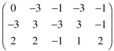

我们求该变换核的一组基（从而得到其维数），并求向量 `{4,2,0,0,-6}` 和 `{1.2, - 1, - 2, 3}` 的像。我们还要求该变换的像空间的一组基。

定义矩阵`A`：

```
>> A = [0,-3,-1,-3,-1;-3,3,-3,-3,-1;2,2,-1,1,2]
A =
   0    -3    -1    -3    -1
  -3     3    -3    -3    -1
   2     2    -1     1     2
```

求矩阵`A`的零空间：

```
>> null(A)
ans =
  -0.5397  -0.1251
  -0.2787  -0.2942
  -0.0266  -0.6948
   0.0230   0.6021
   0.7936  -0.2292
```

这两个列向量构成了`A`的零空间的一组基。因此，该变换的核的维数为 2。

求向量`v`在线性变换下的像，只需计算`A*v`。

```
>> A*[4 2 0 0 -6]'
ans =
   0
   0
   0
```

```
>> A*[1 2 -1 -2 3]'
ans =
  -2
   9
  11
```

该线性变换的像的维数等于`A`的秩。

```
>> rank (A)
```

因此，该变换的像的维数为 3，像的一组基将由`A`的任意三个线性无关的列向量给出。

```matlab
>> det([0 -3 -2;-3 3 2;-1 -3 -1])
```

```
ans =

  -9
```

所以，向量组`{{0 - 3 - 2};{-3 3 2}; {- 1 -3 - 1}}`构成了像的一组基。

作为第八个例子，我们考虑实数三维空间中两个向量子空间`U`和`V`之间的线性变换`f`，对于`U`中的`(a, b, c)`，有`f (a, b, c) = (a + b, b + c, a + c)`。我们找到对应于变换`f`、`f⁵`和`e^f`的矩阵。

为了找到`f`的矩阵，我们找到`f`作用下标准基向量的像：

```matlab
>> f
```

```
f =

  [a + b, b + c, a + c]
```

```matlab
>> subs(f,{a,b,c},{1,0,0})
```

```
ans =

  1     0     1
```

```matlab
>> subs(f,{a,b,c},{0,1,0})
```

```
ans =

  1     1     0
```

```matlab
>> subs(f,{a,b,c},{0,0,1})
```

```
ans =

  0     1     1
```

与线性变换`f`相关联的矩阵`A`将以上述找到的基向量的像作为其列向量。因此：

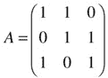

与`f⁵`关联的矩阵将是`A⁵`，与`e^f`关联的矩阵将是`e^A`。

```matlab
>> A = ([1 0 1;1 1 0;0 1 1])'
```

```
A =

   1     1     0
   0     1     1
   1     0     1
```

```matlab
>> A ^ 5
```

```
ans =

  11    10    11
  11    11    10
  10    11    11
```

```matlab
>> expm(A)
```

```
ans =

  3.1751  2.8321  1.3819
  1.3819  3.1751  2.8321
  2.8321  1.3819  3.1751
```

对于第九个例子，我们对如下定义的双线性型`f:U×V→R`和二次型`g:U→R`进行分类：

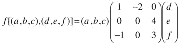

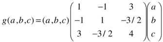

```matlab
>> A = [1, - 2, 0; 0, 0, 4; - 1, 0, - 3]
```

```
A =

   1  -2   0
   0   0   4
  -1   0  -3
```

```matlab
>> det (A)
```

```
ans =

   8
```

由于`f`的矩阵的行列式非零，该双线性型是正则非退化的。

```matlab
>> B = [1, - 1, 3; - 1, 1, - 3/2; 3, - 3/2, 4]
```

```
B =

   1.0000  -1.0000   3.0000
  -1.0000   1.0000  -1.5000
   3.0000  -1.5000   4.0000
```

为了对二次型进行分类，我们计算其对角线行列式。

```matlab
>> det (B)
```

```
ans =

  -2.2500
```

```matlab
>> det([1,-1;-1,1])
```

```
ans =

   0
```

结果表明该二次型是负半定的。

我们也可以通过二次型矩阵的特征值来获得分类。当且仅当所有特征值都严格为正时，二次型被定义为正定。当且仅当所有特征值都严格为负时，二次型被定义为负定。当且仅当所有特征值都非负时，二次型是正半定的。当且仅当所有特征值都非正时，二次型是负半定的。如果同时存在正和负的特征值，则二次型是不定的。

```matlab
>> eig (B)
```

```
ans =

  -0.8569
   0.4071
   6.4498
```

存在正特征值和负特征值，因此该二次型是不定的。

练习 5-1

考虑以下矩阵：

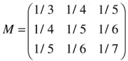

求其转置、逆矩阵、行列式、秩、迹、奇异值、条件数、范数、`M³`、`e^M`、`log(M)`和`sqrt(M)`。

```matlab
>> M = [1/3.1/4.1/5; 1/4.1/5.1/6; 1/5.1/6.1/7]
```

```
M =

   0.3333  0.2500  0.2000
   0.2500  0.2000  0.1667
   0.2000  0.1667  0.1429
```

```matlab
>> transpose = M'
```

```
transpose =

   0.3333  0.2500  0.2000
   0.2500  0.2000  0.1667
   0.2000  0.1667  0.1429
```

```matlab
>> inverse = inv (M)
```

```
inverse =

1.0e+003 *

0.3000  -0.9000  0.6300
-0.9000   2.8800 -2.1000
0.6300  -2.1000  1.5750
```

为了验证这确实是逆矩阵，我们将其与`M`相乘，得到三阶单位矩阵：

```matlab
>> M * inv (M)
ans =

1.0000 0.0000 0.0000
0.0000 1.0000 0.0000
0.0000 0.0000 1.0000
```

```matlab
>> determinant = det (M)
```

```
determinant =

2.6455e-006
```

```matlab
>> rank = rank (M)
```

```
rank =

3
```

```matlab
>> trace = trace (M)
```

```
trace =

0.6762
```

```matlab
>> vsingular = svd (M)
```

```
vsingular =

0.6571
0.0189
0.0002
```

```matlab
>> condition = cond(M)
```

```
condition =

3.0886e+003
```

在计算范数时，我们求标准范数、1-范数、无穷范数和 Frobenius 范数：

```matlab
>> norm (M)
ans =

0.6571
```

```matlab
>> norm(M,1)
ans =

0.7833
```

```matlab
>> norm(M,inf)
ans =

0.7833
```

```matlab
>> norm(M,'fro')
ans =

0.6573
```

```matlab
>> M ^ 3
ans =

0.1403 0.1096 0.0901
0.1096 0.0856 0.0704
0.0901 0.0704 0.0578
```

```matlab
>> logm (M)
ans =

-2.4766   2.2200   0.5021
2.2200  -5.6421   2.8954
0.5021   2.8954 -4.7240
```

```matlab
>> sqrtm (M)
ans =

0.4631 0.2832 0.1966
0.2832 0.2654 0.2221
0.1966 0.2221 0.2342
```

要计算`e ^M`，我们尝试特征值法、Padé 逼近法、泰勒展开法和条件数变体：

```matlab
>> expm (M)
ans =

1.4679 0.3550 0.2863
0.3550 1.2821 0.2342
0.2863 0.2342 1.1984
```

```matlab
>> expm1 (M)
ans =

1.4679 0.3550 0.2863
0.3550 1.2821 0.2342
0.2863 0.2342 1.1984
```

```matlab
>> expm2 (M)
ans =

1.4679 0.3550 0.2863
0.3550 1.2821 0.2342
0.2863 0.2342 1.1984
```

```matlab
>> expm3 (M)
ans =

1.4679 0.3550 0.2863
0.3550 1.2821 0.2342
0.2863 0.2342 1.1984
```

正如我们所见，所有方法都得到了相同的指数矩阵。

## 练习 5-2

考虑以下矩阵：


求其转置、逆矩阵、行列式、秩、迹、奇异值、`M³`、`log(M)`和`sqrt(M)`。

## 练习 5-3

考虑以下符号矩阵：

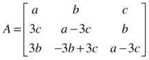

计算 `A'`、`A^(-1)`、`determinant(A)`、`trace(A)`、`rank(A)`、`inv(A)` 和 `A²`。

```matlab
>> A = sym('[a,b,c; 3*c,a-3*c,b; 3*b,-3*b+3*c,a-3*c]')
A =

[   a,         b,       c]
[3 * c, a - 3 * c, b]
[3 * b, 3 * c - 3 * b, a - 3 * c]

>> transpose (A)
ans =

[   a,   3 * c,   3 * b]
[   b, a-3*c, 3*c-3*b]
[   c,   b, a-3*c]
```

`[c, b, a - 3 * c]`

```matlab
>> pretty (det (A))
```

```
3     2          2               2     3        2     3
a - 6 a c + 3 a b – 9a b c + 9 a c + 3 b + 9 b c + 9 c
```

```matlab
>> pretty (trace (A))
```

`3 a - 6 c`

```matlab
>> rank (A)
```

`ans =`

`3`

```matlab
>> simplify(inv(A))
```

`ans =`

```
[ (a² - 6*a*c + 3*b² - 3*b*c + 9*c²)/(c²*(9*a + 9*b) - c*(6*a² + 9*b*a) + 3*a*b² + a³ + 3*b³ + 9*c³),          -(a*b - 3*c²)/(c²*(9*a + 9*b) - c*(6*a² + 9*b*a) + 3*a*b² + a³ + 3*b³ + 9*c³),    (b² + 3*c² - a*c)/(c²*(9*a + 9*b) - c*(6*a² + 9*b*a) + 3*a*b² + a³ + 3*b³ + 9*c³)]
[               (3*b² + 9*c² - 3*a*c)/(c²*(9*a + 9*b) - c*(6*a² + 9*b*a) + 3*a*b² + a³ + 3*b³ + 9*c³),  -(c*(3*a + 3*b) - a²)/(9*b*c² - 6*a²*c + a*(3*b² - 9*b*c + 9*c²) + a³ + 3*b³ + 9*c³),         -(a*b - 3*c²)/(c²*(9*a + 9*b) - c*(6*a² + 9*b*a) + 3*a*b² + a³ + 3*b³ + 9*c³)]
[                      -(3*a*b - 9*c²)/(c²*(9*a + 9*b) - c*(6*a² + 9*b*a) + 3*a*b² + a³ + 3*b³ + 9*c³), (3*b² + 3*a*b - 3*a*c)/(c²*(9*a + 9*b) - c*(6*a² + 9*b*a) + 3*a*b² + a³ + 3*b³ + 9*c³), -(c*(3*a + 3*b) - a²)/(9*b*c² - 6*a²*c + a*(3*b² - 9*b*c + 9*c²) + a³ + 3*b³ + 9*c³)]
```

```matlab
>> pretty(simplify(A²))
```

---

### MATLAB 符号矩阵操作示例

```matlab
>> M = sym ('[1/3.1/4.1/5; 1/4.1/5.1/6; 1/5.1/6.1/7]')
M =

[1/3, 1/4, 1/5]
[1/4, 1/5, 1/6]
[1/5, 1/6, 1/7]

>> transpose = M'
transpose =

[1/3, 1/4, 1/5]
[1/4, 1/5, 1/6]
[1/5, 1/6, 1/7]

>> inverse = inv (M)
inverse =

[300, -900, 630]
[-900, 2880, -2100]
[630, -2100, 1575]

>> determinant = det (M)
determinant =

1/378000

>> rank = rank (M)
rank =

3

>> trace = trace (M)
trace =

71/105

>> vsingular = svd (M)
vsingular =

(12703/88200 - (1045602865/351298031616 + (102103 ^(1/2) * i) / 49787136) ^(1/3)/2 - 1030177 / (99574272 * (1045602865/351298031616 + (102103 ^(1/2) * i) / 49787136) ^(1/3))-(3-^(1/2) * (1030177 / (49787136 * (1045602865/351298031616 + (102103 ^(1/2) * i) / 49787136) ^(1/3))-((102103 ^(1/2) * i) / 49787136 + 1045602865/351298031616) ^(1/3)) * i) / 2) ^(1/2)
(12703/88200 - (1045602865/351298031616 + (102103 ^(1/2) * i) / 49787136) ^(1/3)/2 - 1030177 / (99574272 * (1045602865/351298031616 + (102103 ^(1/2) * i) / 49787136) ^(1/3)) + (3 ^(1/2) * (1030177 / (49787136 * (1045602865/351298031616 + (102103 ^(1/2) * i) / 49787136) ^(1/3))-((102103 ^(1/2) * i) / 49787136 + 1045602865/351298031616) ^(1/3)) * i) / 2) ^(1/2)
(1030177 / (49787136 * (1045602865/351298031616 + (102103 ^(1/2) * i) / 49787136) ^(1/3)) + (1045602865/351298031616 + (102103 ^(1/2) * i) / 49787136) ^(1/3) + 12703/88200) ^(1/2)

>> M ^ 3
ans =

[10603/75600, 1227/11200, 26477/294000]
[1227/11200, 10783/126000, 74461/1058400]
[26477/294000, 74461/1058400, 8927/154350]

>> log (M)
ans =

[-log (3),-log (4),-log (5)]
[-log (4),-log (5),-log (6)]
[-log (5),-log (6),-log (7)]

>> sqrt (M)
ans =

[3 ^(1/2)/3, 1/2, 5 ^(1/2)/5]
[1/2, 5 ^(1/2)/5, 6 ^(1/2)/6]
[5 ^(1/2)/5, 6 ^(1/2)/6, 7 ^(1/2)/7]
```

# 练习 5-4

考虑以下矩阵 `A` 和 `B`：

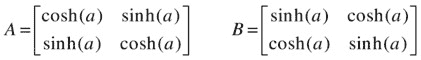

## 矩阵运算与性质计算

计算 `M1 = A² + B²`，`M2 = A² - B²`，`A^n`，`B^n`，`e^A`，`e^B`。找出矩阵 `A` 和 `B` 的逆矩阵、行列式、迹和范数。

### 定义矩阵 `A` 和 `B`

`>> A = sym('[cosh(a),sinh(a);sinh(a),cosh(a)]')`

`A =`

```
[ cosh(a), sinh(a)]
[ sinh(a), cosh(a)]
```

`>> B = sym('[sinh(a),cosh(a);cosh(a),sinh(a)]')`

`B =`

```
[ sinh(a), cosh(a)]
[ cosh(a), sinh(a)]
```

### 计算 `M1 = A² + B²` 与 `M2 = A² - B²`

`>> M1 = A²+B²`

`M1 =`

```
[ 2*cosh(a)² + 2*sinh(a)²,         4*cosh(a)*sinh(a)]
[ 4*cosh(a)*sinh(a),         2*cosh(a)² + 2*sinh(a)²]
```

`>> pretty(simplify(M1))`

```
+-                                -+
|           2                      |
|  4 sinh(a)  + 2,   2 sinh(2 a)   |
|                                  |
|                           2      |
|    2 sinh(2 a),  4 sinh(a)  + 2  |
+-                                -+
```

`>> M2 = A²-B²`

`M2 =`

```
[ 0, 0]
[ 0, 0]
```

### 计算 `A^n` 和 `B^n`

为了计算 `A^n` 和 `B^n`，我们首先找出它们的连续幂次，以试图看出一般规律：

`>> [simplify(A²),simplify(A³),simplify(A⁴)]`

`ans =`

```
[ cosh(2*a), sinh(2*a), cosh(3*a), sinh(3*a), cosh(4*a), sinh(4*a)]
[ sinh(2*a), cosh(2*a), sinh(3*a), cosh(3*a), sinh(4*a), cosh(4*a)]
```

`>> [simplify(B²),simplify(B³),simplify(B⁴)]`

`ans =`

```
[ cosh(2*a), sinh(2*a), sinh(3*a), cosh(3*a), cosh(4*a), sinh(4*a)]
[ sinh(2*a), cosh(2*a), cosh(3*a), sinh(3*a), sinh(4*a), cosh(4*a)]
```

现在一般规律的形式已经很明显了：

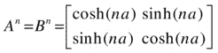

### 计算逆矩阵、行列式、迹

`>> simplify(inv(A))`

`ans =`

```
[  cosh(a), -sinh(a)]
[ -sinh(a),  cosh(a)]
```

`>> simplify(inv(B))`

`ans =`

```
[ -sinh(a),  cosh(a)]
[  cosh(a), -sinh(a)]
```

`>> simplify(det(A))`

`ans =`

`1`

`>> simplify(det(B))`

`ans =`

`-1`

`>> simplify(trace(A))`

`ans =`

`2*cosh(a)`

`>> simplify(trace(B))`

`ans =`

`2*sinh(a)`

### 计算矩阵指数 `e^A` 和 `e^B`

`>> simplify(exp(A))`

`ans =`

```
[ exp(cosh(a)), exp(sinh(a))]
[ exp(sinh(a)), exp(cosh(a))]
```

`>> simplify(exp(B))`

`ans =`

# 练习 5-5

考虑一个服从正态分布的 3 阶随机方阵 `A`。计算以 `A` 的特征值为对角元素的对角矩阵 `D`，以及列向量为对应特征向量的矩阵 `V`（若输出结果为复数，请将其转换为实数形式）。

求 `A` 的平衡矩阵，以及其 Schur 分解的实数和复数形式。

求矩阵 `A` 的特征多项式的系数。

计算与矩阵 `A` 同维度的上三角矩阵 `R`、置换矩阵 `E` 和正交矩阵 `Q`，使得 `A * E = Q * R`，并验证结果。

考虑 `A` 的 Hessenberg 矩阵 `B`，计算 `A` 和 `B` 的广义特征值对角矩阵 `D`，以及列向量为对应特征向量的矩阵 `V`，使其满足 `A * V = B * V * D`。同时计算 `A` 和 `B` 的广义奇异值向量。

## 示例代码与输出

### 生成随机矩阵 `A` 与计算特征值/特征向量

```matlab
>> A=randn(3)
A =
   -0.4326    0.2877    1.1892
   -1.6656   -1.1465   -0.0376
    0.1253    1.1909    0.3273
```

```matlab
>> [V,D] = eig(A)
V =
    0.2827    0.4094 - 0.3992i   0.4094 + 0.3992i
    0.8191   -0.0950 + 0.5569i  -0.0950 - 0.5569i
   -0.4991              0.5948             0.5948
D =
   -1.6984                  0                        0
         0       33 + 1.0309i                        0
         0                  0         0.2233 - 1.0309i
```

# 矩阵分解示例与练习

## 示例

```matlab
>> [V,D] = cdf2rdf(V,D)
V =
    0.2827     0.4094    -0.3992
    0.8191    -0.0950     0.5569
   -0.4991     0.5948          0
D =
   -1.6984         0         0
         0    0.2233    1.0309
         0   -1.0309    0.2233
```

```matlab
>> [T,B] = balance(A)
T =
     1     0     0
     0     1     0
     0     0     1
B =
   -0.4326    0.2877    1.1892
   -1.6656   -1.1465   -0.0376
    0.1253    1.1909    0.3273
```

```matlab
>> [U, T] = schur(A)
U =
    0.2827    0.2924    0.9136
    0.8191   -0.5691   -0.0713
   -0.4991   -0.7685    0.4004
T =
   -1.6984    0.2644   -1.2548
         0    0.2233    0.7223
         0   -1.4713    0.2233
```

```matlab
>> [U, T] = rsf2csf(U, T)
U =
    0.2827   -0.7482 + 0.1678i   0.2395 - 0.5242i
    0.8191    0.0584 - 0.3266i  -0.4661 + 0.0409i
   -0.4991   -0.3279 - 0.4410i  -0.6294 - 0.2298i
T =
   -1.6984   1.0277 + 0.1517i   0.2165 + 0.7201i
         0   0.2233 + 1.0309i   0.7490 - 0.0000i
         0                  0   0.2233 - 1.0309i
```

```matlab
>> poly(A)
ans =
    1.0000    1.2517    0.3540    1.8895
```

接下来，我们计算与上述示例中矩阵 `A` 同维度的上三角矩阵 `R`、置换矩阵 `E` 和正交矩阵 `Q`，使得 `A * E = Q * R`，并验证结果。

```matlab
>> [Q, R, E] = qr(A)
Q =
   -0.2507    0.4556   -0.8542
   -0.9653   -0.0514    0.2559
    0.0726    0.8887    0.4527
R =
    1.7254    1.1211   -0.2380
         0    1.2484    0.8346
         0         0   -0.8772
E =
     1     0     0
     0     1     0
     0     0     1
```

```matlab
>> A * E
ans =
   -0.4326    0.2877    1.1892
   -1.6656   -1.1465   -0.0376
    0.1253    1.1909    0.3273
```

```matlab
>> Q * R
ans =
   -0.4326    0.2877    1.1892
   -1.6656   -1.1465   -0.0376
    0.1253    1.1909    0.3273
```

因此，这些矩阵确实满足 `A * E = Q * R`。

现在我们考虑 `A` 的 Hessenberg 矩阵 `B`，计算 `A` 和 `B` 的广义特征值对角矩阵 `D`，以及列向量为对应特征向量的矩阵 `V`，使得 `A * V = B * V * D`。此外，我们还计算 `A` 和 `B` 的广义奇异值向量。

```matlab
>> B = hess(A)
B =
   -0.4326   -0.1976    1.2074
    1.6703   -1.2245    0.1544
         0   -1.0741    0.4053
```

```matlab
>> [V, D] = eig(A, B)
V =
    0.0567    1.0000    1.0000
   -0.0354   -0.4998    0.5297
   -1.0000    0.4172    0.3785
D =
    1.0000           0          0
         0     -0.4722          0
         0           0     -2.1176
```

```matlab
>> A * V
ans =
   -1.2245   -0.0803    0.1699
   -0.0137   -1.1082   -2.2872
   -0.3649   -0.3334    0.8801
```

```matlab
>> B * V * D
ans =
   -1.2245   -0.0803    0.1699
   -0.0137   -1.1082   -2.2872
   -0.3649   -0.3334    0.8801
```

```matlab
>> sigma = gsvd(A, B)
sigma =
    0.2874
    1.0000
    3.4799
```

## 练习 5-6

考虑下面这个 3×3 矩阵 `A`：

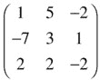

求矩阵 `A` 的 LU、QR、Cholesky、Schur、Hessenberg 分解和奇异值分解，并检验结果是否正确。同时求矩阵 `A` 的伪逆。

首先，我们求 Schur 分解，并检验结果是否正确。

```matlab
>> A = [1, 5, - 2; - 7, 3, 1; 2, 2, - 2];
```

```matlab
>> [U, T] = schur (A)
U =
-0.0530 - 0.8892 - 0.4544
-0.9910 - 0.0093   0.1337
0.1231 - 0.4573   0.8807
T =
2.4475 - 5.7952 - 4.6361
5.7628   0.3689   2.4332
0        0      - 0.8163
```

现在验证 `U * T * U' = A` 和 `U * U' = eye(3)`：

```matlab
>> [U * T * U', U * U']
ans =
1.0000 5.0000 - 2.0000 1.0000 0.0000 0.0000
-7.0000 3,0000   1.0000 0.0000 1.0000 0.0000
2.0000 2.0000 - 2.0000 0.0000 0.0000 1.0000
```

现在求 LU、QR、Cholesky、Hessenberg 分解和奇异值分解，并逐一检验结果：

### LU 分解

```matlab
>> [L, U, P] = lu (A)
L =
1.0000 0 0
-0.1429 1.0000 0 下三角矩阵
-0.2857 0.5263 1.0000
U =
-7.0000 3,0000 1.0000
0 5.4286 - 1.8571 上三角矩阵
0 0 - 0.7368
P =
0 1 0
1 0 0
0 0 1
```

```matlab
>> [P * A, L * U]
ans =
-7     3     1      -7     3     1
5     1   - 2      1     5   - 2  我们得到 P * A = L * U
2     2    -2      2     2    -2
```

### QR 分解

```matlab
>> [Q, R, E] = qr (A)
Q =
-0.1361 - 0.8785 - 0.4579
0.9526 - 0.2430   0.1831
-0.2722 - 0.4112   0.8700
R =
-7.3485   1.6330   1.7691
0 - 5.9442   2.3366    上三角矩阵
0        0 - 0.6410
E =
1 0 0
0 1 0
0 0 1
```

```matlab
>> [A * E, Q * R]
ans =
1.0000 5.0000 - 2.0000 1.0000 5.0000 - 2.0000
-7.0000 3.0000   1.0000 - 7.0000 3.0000 1.0000
2.0000 2.0000 - 2.0000 2.0000 2.0000 - 2.0000
于是，A * E = Q * R。
```

### Cholesky 分解

```matlab
>> R = chol (A)
??? 错误使用 == > chol
矩阵必须为正定矩阵。
```

矩阵分析示例

报错信息显示该矩阵不是正定矩阵。

```
>> [H, p] = hess (A)
P =
1.0000        0      0
0 - 0.9615 0.2747
0   0.2747 0.9615
H =
1.0000 - 5.3571 - 0.5494
7.2801   1.8302 - 2.0943
0 - 3.0943 - 0.8302
```

```
>> [P * H * P ', P' * P]
ans =
1.0000  5.0000 - 2.0000 1.0000       0       0
-7.0000  3,0000   1.0000      0  1.0000       0
2.0000  2.0000 - 2.0000      0       0  1.0000
```

于是 `PHP' = A` 且 `P'P = I`。

```
>> [U, S, V] = svd (A)
U =
-0.1034 - 0.8623   0.4957
-0.9808   0.0056 - 0.1949
0.1653 - 0.5064 - 0.8463
S =
7.8306       0           0
0  6.2735           0    对角矩阵
0       0      0.5700
V =
0.9058 - 0.3051 0.2940
-0.3996 - 0.8460 0.3530
-0.1411   0.4372 0.8882
```

```
>> U * S * V'
ans =
1.0000 5.0000 - 2.0000
-7.0000 3,0000   1.0000         我们看到 USV' = A
2.0000 2.0000 - 2.0000
```

现在计算矩阵 `A` 的伪逆：

```
>> X = pinv (A)
X =
0.2857 - 0.2143 - 0.3929
0.4286 - 0.0714 - 0.4643
0.7143 - 0.2857 - 1.3571
```

```
>> [A * X * A, X * A * X]
ans =
1.0000 5.0000 - 2.0000 0.2857 - 0.2143 - 0.3929
-7.0000 3,0000   1.0000 0.4286 - 0.0714 - 0.4643
2.0000 2.0000 - 2.0000 0.7143 - 0.2857 - 1.3571
```

因此，我们看到 `AXA = A`，`XAX = X`。

## 练习 5-7

考虑以下矩阵：

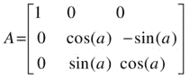

计算其特征值、特征多项式、若尔当标准型和奇异值。

首先，将矩阵 `A` 定义为符号矩阵：

```
>> A = sym ('[1 0 0; 0 cos (a) - sin (a); 0 sin (a) cos (a)]')
A =
[ 1,     0,      0]
[0, cos (a) - sin (a)]
[0, sin (a), cos (a)]
```

```
>> eigensys (A)
ans =
[                                  1]
[cos (a) + 1/2 * (- 4 * sin (a) ^ 2) ^(1/2)]
[cos (a) - 1/2 * (- 4 * sin (a) ^ 2) ^(1/2)]
```

```
>> pretty (simple (poly (A)))
3      2               2
x - 2 x cos (a) + x - x + 2 x cos (a) - 1
```

```
>> jordan (A)
ans =
[1, 0,                                               0]
[0, cos (a) + 1/2 * (- 4 * without (a) ^ 2) ^ (1/2), 0]
[0, 0, cos (a) - 1/2 * (- 4 * without (a) ^ 2) ^(1/2)]
```

```
>> simple (svd (A))
ans =
[                                                              1]
[1/2 * (4 * cos (a-comp (a)) + 2 * (- 2 + 2 * cos (2 * a-2 * conj (a))) ^(1/2)) ^(1/2)]
```

`[1/2 * (4 * cos (a-comp (a)) - 2 * (- 2 + 2 * cos (2 * a-2 * conj (a))) ^(1/2)) ^(1/2)]`

## 练习 5-8

将行向量为以下数值的对称矩阵对角化：

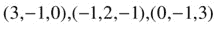

求相似变换矩阵 `V`，确认原始矩阵的特征值等于对角矩阵的对角线元素，并且对角矩阵与原矩阵相似。

我们计算矩阵 `A` 的对角矩阵 `J`，其对角线由 `A` 的特征值构成，同时求出相似变换矩阵 `V`。为此，我们使用命令 `[V, J] = jordan (A)`：

```
>> A = [3, -1, 0; -1, 2, -1; 0, -1, 3]

A =

3 -1  0
-1 -2 -1
0 -3 -1

>> [V, J] = jordan (A)

V =

1 -1 -1
2  0 -1
1 -1 -1

J =

1 0 0
0 3 0
0 0 4
```

现在验证对角矩阵 `J` 的对角线是否确实是 `A` 的特征值：

```
>> eig (A)

ans =

1.0000
3.0000
4.0000
```

矩阵 `A` 和 `J` 相似，因为矩阵 `V` 满足关系式 `V ^(-1) * A * V = J`：

```
>> inv (V) * A * V

ans =

1.0000      0     -0.0000
0      3.0000            0
0        0         4.0000
```

## 练习 5-9

为以下每一个数组求一个相似的对角矩阵：

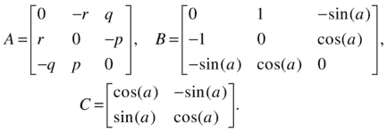

将这些矩阵对角化。求出每一个矩阵的特征多项式。

```
>> A = sym('[0,-r,q;r,0,-p;-q,p,0]');

>> [V, J] = jordan (A)

V =

[(q *(-p²-q²-r²) ^(1/2)) /(p² + q²) - (p * r) /(p² + q²),-(q *(-p²-q²-r²) ^(1/2)) /(p² + q²) - (p * r) /(p² + q²), p/r]

[-(p) *(-p²-q²-r²) ^(1/2)) /(p² + q²) - (q * r) /(p² + q²), (p) *(-p²-q²-r²) ^(1/2)) /(p² + q²) - (q * r) /(p² + q²), q/r]

[  1, 1,   1]

J =

[ -(- p² - q² - r²)^(1/2),                         0, 0]
[                          0, (- p² - q² - r²)^(1/2), 0]
[                          0,                         0, 0]
```

现在，我们分析矩阵 `B`：

```
>> B = sym ('[0,1,-sin (a); - 1, 0, cos (a) - sin (a), cos (a), 0]')

>> J = simple (jordan (B))

J =

[0, 0, 0]
[0, 0, 0]
[0, 0, 0]
```

这表明矩阵 `B` 只有一个三重特征值零。此外，`B - 0 * eye (3) = B` 的核的维数小于三，因为 `B` 的行列式为零。具体来说，它的维数为一（如下文使用命令 `null (B)` 计算基向量所示）。由于重数与核的维数不一致，我们得出结论：矩阵 `B` 不可对角化：

```
>> null (B)

ans =

[cos (a)]
[sin (a)]
[     1]
```

我们计算了 `B` 的核的一组基，该基仅由一个向量构成，因此 `B` 的核的维数为 1：

```
>> det (B)

ans =

0
```

我们现在分析矩阵 `C`：

```
>> C = sym ('[cos(a), – sin(a); sin(a), cos(a)]');

>> [V, J] = jordan (C)

V =

[1/2, 1/2]
[I/2, - I/2]

J =

[cos (a) - sin (a) * i, 0]
[0, cos (a) + sin (a) * i]
```

现在我们计算这三个矩阵的特征多项式：

```
>> pretty (poly (A))

3    2   2   2
x + (p + q + r ) x

>> pretty (simple (sym (poly (B))))

3
x

>> pretty(simple(sym(poly(C))))

2
x - 2 cos (a) x + 1
```

## 练习 5-10

求出 8 阶威尔金森矩阵、8 阶幻方矩阵`magic(8)`以及罗瑟矩阵的特征值。

```
>> [eig (wilkinson (8)), eig (rosser), eig (magic (8))]

ans =

1.0e + 003 *

-0.0010 -1.0200  0.2600
0.0002  0.0000  0.0518
0.0011  0.0001 -0.0518
0.0017  1.0000  0.0000
0.0026  1.0000 -0.0000 + 0.0000i
0.0028  1.0199 -0.0000 - 0.0000i
0.0042  1.0200 -0.0000 + 0.0000i
0.0043  1.0200 -0.0000 - 0.0000i
```

我们注意到威尔金森矩阵有若干对特征值非常接近，但并不相等。罗瑟矩阵有一个二重特征值、三个近似相等的特征值、一对符号相反的主导特征值、一个零特征值以及一个很小的非零特征值。

## 练习 5-11

考虑两个向量子空间`U`（包含于 R³）和`V`（包含于 R⁴）之间的线性变换`f`，对于`U`中的任意点`(a, b, c)`有：

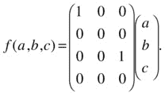

求`f`的核和像。

```
>> A = ([1,0,0;0,0,0;0,0,1;0,0,0]);
```

核是`U`中像为零向量的集合：

```
>> null (A)

ans =

0
1
0
```

因此核是向量`{0,b, 0}`的集合，其中`b`可变。此外，核的维数显然为1，因为它以`{0,1,0}`为基。

```
>> rank (A)

ans =

2
```

`f`的像的维数必须等于矩阵`A`的秩，我们刚刚看到这个秩是2。`A`的任意一个包含一个非奇异 2×2 子矩阵的两列子矩阵的列将构成`f`的像的一组基。

```
>> det([1,0;0,1])

ans =

1
```

因此，`f`的像的一组基由`{{1,0,0,0},{0,0,1,0}}`给出。

## 练习 5-12

给定二次型`g:U®R`定义如下：

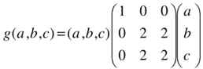

对其进行分类，并求出其约化方程、秩和符号差。

为了对二次型进行分类，我们计算其对角行列式。

```
>> G = [1,0,0;0,2,2;0,2,2]

G =

1 0 0
0 2 2
0 2 2

>> det (G)

ans =

0

>> det([1,0;0,2])

ans =

2
```

该二次型是退化的半正定二次型。

为了求出约化方程，我们对矩阵进行对角化。

```
>> J = jordan (G)

J =

0 0 0
0 1 0
0 0 4
```

则二次型的约化方程为：

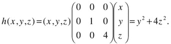

```
>> rank (J)

ans =

2
```

该二次型的秩为2，因为矩阵的秩为2。其符号差也为2，因为对角矩阵中正项的个数为2。