# 4. 代数表达式、多项式、方程与方程组

## 代数表达式的展开、化简与因式分解

MATLAB 包含一系列强大的命令，可用于处理代数表达式，包括化简、展开和因式分解。下表列出了处理代数表达式时最常用的命令。

| `expand(expr)` | 展开代数表达式，将结果显示为乘积与幂的和形式，对三角函数应用倍角公式，并应用指数函数和对数函数的形式性质。它还能将多项式分式分解为更简单的多项式分式之和。
```matlab
>> syms x y z t a b
>> pretty(expand((x+2)*(x+3)))
 2
x  + 5 x + 6
>> pretty(expand((x+2)/(x+3)))
  x       2
 ----- + -----
 x + 3   x + 3
>> pretty(expand(cos(x+y)))
cos(x) cos(y) - sin(x) sin(y)
``` |
| `factor(expr)` | `expand` 的逆运算。将代数表达式写成因式乘积的形式。
```matlab
>> syms x y
>> pretty(factor(6*x²+18*x-24))
6 (x + 4) (x - 1)
>> pretty (factor ((x³-y³)/(x⁴-y⁴)))
         2         2
x + x y + y
-----------------
   2   2
(x + y) (x + y )
>> pretty(factor(x³+y³))
         2         2
(x + y) (x - x y + y )
``` |
| `simplify(expr)` | 尽可能地将代数表达式化简。
```matlab
>> syms x y b c
>> simplify (sin (x) ^ 2 + cos (x) ^ 2) * 2
ans =
2
>> simplify (log (exp (a+log (exp (c)))))
ans =
log (exp(a + c))
``` |
| `simple(expr)` | 搜索代数表达式的最简形式。
```matlab
>> syms a positive;
f = (1/a³ + 6/a² + 12/a + 8)^(1/3);
>> simplify(f)
ans =
(8*a³ + 12*a² + 6*a + 1)^(1/3)/a
>> simple(f)
simplify:
(2*a + 1)/a
radsimp:
(12/a + 6/a² + 1/a³ + 8)^(1/3)
simplify(100):
1/a + 2
combine(sincos):
(12/a + 6/a² + 1/a³ + 8)^(1/3)
combine(sinhcosh):
(12/a + 6/a² + 1/a³ + 8)^(1/3)
combine(ln):
(12/a + 6/a² + 1/a³ + 8)^(1/3)
factor:
(12/a + 6/a² + 1/a³ + 8)^(1/3)
expand:
(12/a + 6/a² + 1/a³ + 8)^(1/3)
combine:
(12/a + 6/a² + 1/a³ + 8)^(1/3)
rewrite(exp):
(12/a + 6/a² + 1/a³ + 8)^(1/3)
rewrite(sincos):
(12/a + 6/a² + 1/a³ + 8)^(1/3)
rewrite(sinhcosh):
(12/a + 6/a² + 1/a³ + 8)^(1/3)
rewrite(tan):
(12/a + 6/a ^ 2 + 1/a ^ 3 + 8) ^(1/3)
mwcos2sin:
(12/a + 6/a ^ 2 + 1/a ^ 3 + 8) ^(1/3)
collect(a):
(12/a + 6/a² + 1/a³ + 8)^(1/3)
ans =
1/a + 2
>> g=simple(f)
g =
1/a + 2
``` |
| `collect(expr)` | 将表达式中的项按变量幂次进行合并。
```matlab
>> syms x;
f = x*(x*(x - 6) + 11) - 6;
>> collect(f)
ans =
x³ - 6*x² + 11*x – 6
>> f = (1+x)*t + x*t;
>> collect(f)
ans =
(2*t)*x + t
``` |
| `Horner(expr)` | 将表达式表示为嵌套格式（霍纳形式）。
```matlab
>> syms x;
f = x³ - 6*x² + 11*x - 6;
>> horner(f)
ans =
x*(x*(x - 6) + 11) - 6
``` |

## 多项式

MATLAB 提供了专门用于处理多项式的命令，例如求根、微分和插值。下表列出了其中最重要命令的语法和示例。

| `poly2sym(vector)` | 将系数向量转换为对应的符号多项式（从最高次幂到最低次幂）。
```matlab
>> poly2sym([3 5 0 8 9])
ans =
3*x⁴ + 5*x³ + 8*x + 9
``` |
| `poly2sym(vector, 'v')` | 将系数向量转换为关于`v`的对应符号多项式（从最高次幂到最低次幂）。
```matlab
>> poly2sym([3 5 0 8 9], 'z')
ans =
3*z⁴ + 5*z³ + 8*z + 9
``` |
| `sym2poly(polynomial)` | 将符号多项式转换为系数向量（系数按降幂顺序给出）。
```matlab
>> syms x
>> sym2poly(x⁵ - 3*x⁴ + 2*x² - 7*x + 12)
ans =
1    -3     0     2    -7    12
``` |
| `q = conv(u, v)` | 给出两个多项式的乘积多项式的系数，这两个多项式的系数由向量`u`和`v`给出。
```matlab
>> u = [3 -1 4 2]; v = [2 1 4 6 8 3];
>> p = conv(u, v)
p =
6     1    19    22    36    33    41    28     6
>> poly2sym(p)
ans =
6*x⁸ + x⁷ + 19*x⁶ + 22*x⁵ + 36*x⁴ + 33*x³ + 41*x² + 28*x + 6
``` |
| `[q, r] = deconv(v, u)` | 给出多项式`u`和`v`相除的多项式商和余数，使得`v = conv(u, q) + r`。
```matlab
>> [q, r] = deconv(v, u)
q =
0.6667    0.5556    0.6296
r =
0         0         0    3.0741    4.3704    1.7407
>> poly2sym(q)
ans =
(2*x²)/3 + (5*x)/9 + 17/27
>> poly2sym(r)
ans =
(83*x²)/27 + (118*x)/27 + 47/27
``` |
| `p = poly(r)` | 给出多项式`p`的系数，该多项式的根由向量`r`指定。
```matlab
>> p = poly(u)
p =
1    -8    17     2   -24
>> poly2sym(p)
ans =
x⁴ - 8*x³ + 17*x² + 2*x - 24
``` |

| 函数签名 | 说明与示例 |
| :--- | :--- |
| `k = polyder(p)`<br>`k = polyder(a, b)`<br>`[q, d] = polyder(a, b)` | 给出多项式 `p` 的导数的系数 `k`。给出多项式 `a` 和 `b` 乘积的导数的系数 `k`。给出 `a/b` 的导数的分子 `q` 和分母 `d`。<br>示例：<br>```>> polyder([1 -8 17 2 -24])```<br>```ans =```<br>```   4   -24    34     2```<br>```>> poly2sym([1 -8 17 2 -24])```<br>```ans =```<br>```x⁴ - 8*x³ + 17*x² + 2*x - 24```<br>```>> poly2sym(polyder([1 -8 17 2 -24]))```<br>```ans =```<br>```4*x³ - 24*x² + 34*x + 2```<br>```>> u = [3 -1 4 2]; v = [2 1 4 6 8 3];```<br>```>> k = polyder(u, v)```<br>```k =```<br>```   48     7   114   110   144    99    82    28```<br>```>> poly2sym(k)```<br>```ans =```<br>```48*x⁷ + 7*x⁶ + 114*x⁵ + 110*x⁴ + 144*x³ + 99*x² + 82*x + 28```<br>```>> [q, d] = polyder(u, v)```<br>```q =```<br>```  -12     3   -30   -10     8   -29   -30    -4```<br>```d =```<br>```    4     4    17    32    60    76   106   120   100    48     9``` |
| `p = polyfit(x, y, n)`<br>`[p, S] = polyfit(x, y, n)`<br>`[p, S, u] = polyfit(x, y, n)` | 找到最能拟合点集 `(x, y)` 的 `n` 次多项式。找到最能拟合点集 `(x, y)` 的 `n` 次多项式，并返回拟合的结构数据 `S`。找到最能拟合数据的 `` 中的多项式系数，并返回结构数据 `S` 和行向量 ``，其中 `m` 是数据 `x` 的均值，`s` 是标准差。<br>示例：<br>```>> u = [3 -1 4 2]; v = [2 1 4 6];```<br>```>> p = poly2sym(polyfit(u, v, 3))```<br>```p =```<br>```(53*x³)/60 - (99*x²)/20 + (119*x)/30 + 54/5```<br>```>> [p, S, u] = polyfit(u, v, 3)```<br>```p =```<br>```   8.9050    1.6333   -11.3053    6.0000```<br>```S =```<br>```    R: [4x4 double]```<br>```   df: 0```<br>```normr: 1.2686e-014```<br>```u =```<br>```   2.0000```<br>```   2.1602``` |
| `y = polyval(p, x)`<br>`y = polyval(p, x, [], u)`<br>`[y, delta] = polyval(p, x, S)`<br>`[y, delta] = polyval(p, x, S, u)` | 在 `x` 处计算多项式 `p`。如果 ``，则在 `` 处计算多项式 `p`。使用 `polyfit` 生成的可选输出结构 `S` 来生成误差估计 `delta`。用 `` 代替 `x` 执行上述操作，其中 `u = [m, s]`。<br>示例：<br>```>> p = [2 0 -1 7 9]```<br>```p =```<br>```     2     0    -1     7     9```<br>```>> poly2sym(p)```<br>```ans =```<br>```2*x⁴ - x² + 7*x + 9```<br>```>> polyval(p, 10)```<br>```ans =```<br>```  19979``` |
| `Y = polyvalm(p, X)` | 对于多项式 `p` 和矩阵 `X`，以矩阵方式计算 `p(X)`。<br>示例：<br>```>> X = [1 2 3; 4 5 6; 7 8 9]```<br>```X =```<br>```     1     2     3```<br>```     4     5     6```<br>```     7     8     9```<br>```>> p = [2 0 -1 7 9]```<br>```p =```<br>```     2     0    -1     7     9```<br>```>> A = polyval(p, X)```<br>```A =```<br>```       17         51         183```<br>```      533        1269       2607```<br>```     4811       8193       13113``` |
| `[r, p, k] = residue(b, a)`<br>`[b, a] = residue(r, p, k)` | 找到 `b/a` 的有理展开的留数、极点和直接项。`` 将部分分式展开转换回多项式商。<br>示例：<br>```>> u = [3 -1 4 2]; v = [2 1 4 6 8 3];```<br>```>> [r, p, k] = residue(v, u)```<br>```r =```<br>```   0.4751 - 0.6032i```<br>```   0.4751 + 0.6032i```<br>```   0.0745```<br>```p =```<br>```   0.3705 + 1.2240i```<br>```   0.3705 - 1.2240i```<br>```  -0.4076```<br>```k =```<br>```   0.6667    0.5556    0.6296```<br>```>> [v, u] = residue(r, p, k)```<br>```v =```<br>```   0.6667    0.3333    1.3333    2.0000    2.6667    1.0000```<br>```u =```<br>```   1.0000   -0.3333    1.3333    0.6667``` |
| `r = roots(c)` | 给出系数为 `c` 的多项式的根组成的列向量 `r`。<br>示例：<br>```>> v = [0.6667    0.3333    1.3333    2.0000    2.6667    1.0000];```<br>```>> r = roots(v)```<br>```r =```<br>```   0.6662 + 1.4813i```<br>```   0.6662 - 1.4813i```<br>```  -0.6662 + 0.8326i```<br>```  -0.6662 - 0.8326i```<br>```  -0.5000``` |

## 多项式插值

MATLAB 提供了用于多项式插值的代数命令和图形命令，下表中总结了其中最重要的部分。

| 函数签名 | 说明与示例 |
| :--- | :--- |
| `Yi = interp1(X, Y, Xi)`<br>`Yi = interp1(Y, Xi)`<br>`Yi = interp1(X, Y, Xi, method)`<br>`Yi = interp1(X, Y, Xi, method, ext)` | 返回一个向量 `Yi`，使得 `(Xi, Yi)` 是通过对给定点集 `(X, Y)` 进行一维线性插值得到的所有点集合。等价于 `X = 1:n` 时的 `interp1(X,Y,Xi)`，其中 `n` 是 `Y` 的长度。使用指定的 `method` 进行插值，`method` 可以是 `nearest`（最近邻）、`linear`（线性）、`cubic`（三次埃尔米特）、`v5cubic`（MATLAB 5 三次）、`spline`（样条）或 `pchip`（三次埃尔米特）。此外还可以指定策略 `ext` 用于评估位于 `X` 域之外的点。在以下示例中，21 个点 `(x,y)` 根据函数 `y = sin(x)` 对于在 0 到 10 之间等间距的 `x` 值进行插值。 |

# 插值函数示例

## 一维线性插值 (`interp1`)

首先，我们来看一维线性插值的基本示例。

```matlab
>> x = 0:10; y = sin(x); Xi = 0:.5:10; yi = interp1(x, y, xi); points = [xi', yi']
```

计算得到的点坐标 `points` 如下：

```
points =
         0         0
    0.5000    0.4207
    1.0000    0.8415
    1.5000    0.8754
    2.0000    0.9093
    2.5000    0.5252
    3.0000    0.1411
    3.5000   -0.3078
    4.0000   -0.7568
    4.5000   -0.8579
    5.0000   -0.9589
    5.5000   -0.6192
    6.0000   -0.2794
    6.5000    0.1888
    7.0000    0.6570
    7.5000    0.8232
    8.0000    0.9894
    8.5000    0.7007
    9.0000    0.4121
    9.5000   -0.0660
   10.0000   -0.5440
```

我们可以用以下形式表示这些点：`plot(x,y,'o',xi,yi)`

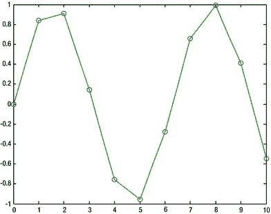

## 二维线性插值 (`interp2`)

`Zi = interp2(X,Y,Z,Xi,Yi)`、`Zi = interp2(Z,Xi,Yi)`、`Zi = interp2(Z,n)` 或 `Zi = interp2(X,Y,Z,Xi,Yi, method)` 函数返回一个向量 `Zi`，使得 `(Xi, Yi, Zi)` 是通过对给定点集 `(X, Y, Z)` 进行二维线性插值得到的所有点集合。当 `X = 1:n` 且 `Y = 1:m` 时（其中 `(n, m) = size(Z)`），后两种形式等价于第一种。函数返回通过在每一维度上对区间重复划分 `n` 次所形成的精细化网格上的插值。此外还指定插值的 `method`。可能的插值方法有 `nearest`（最近邻）、`linear`（线性）、`cubic`（三次埃尔米特）和 `spline`（样条）插值。

在以下示例中，我们考虑一组年份、服务年限和工资，并尝试通过插值找到 1975 年一位拥有 15 年服务年限的员工所获得的薪水。

```matlab
>> years = 10:1950:1990;
   service = 10:10:30;
   wages = [150.697 199.592 187.625
            179.323 195.072 250.287
            203.212 179.092 322.767
            226.505 153.706 426.730
            249.633 120.281 598.243];
   w = interp2(service,years,wages,15,1975)

w =
  190.6288
```

## 三维线性插值 (`interp3`)

`vi = interp3(X,Y,Z,V,Xi,Yi,Zi)`、`vi = interp3(V, Xi, Yi, Zi)`、`vi = interp3(V,n)` 或 `vi = interp3(…, method)` 函数返回一个三变量函数在特定查询点处的插值结果，使用线性插值。结果始终经过函数的原始采样点。`X`、`Y` 和 `Z` 包含样本点的坐标。`V` 包含每个样本点对应的函数值。`Xi`、`Yi` 和 `Zi` 包含查询点的坐标。当网格为由 `size(V)` 定义的默认网格时，后两种形式等价于第一种。返回通过在每一维度上对区间重复划分 `n` 次所形成的精细化网格上的插值。使用指定的 `method` 进行插值。

以下示例计算并展示了 MATLAB 函数 `flow` 的插值结果，通过对数据进行多个切片并显示每个切片上的插值数据。三个轴以 0.5 的等间距采样，`x` 的范围为 0.1 到 10，`y` 和 `z` 的范围为 -3 到 3。

```matlab
>> [x, y, z, v] = flow (10);
   [xi, yi, zi] = meshgrid(.1:.5:10,-3:.5:3,-3:.5:3);
   vi = interp3(x,y,z,v,xi,yi,zi);
   slice(xi,yi,zi,vi,[6 9.5],2,[-2 .2]), shading flat
```

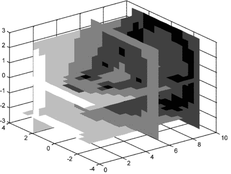

## 基于FFT的一维插值 (`interpft`)

`Y = interpft(X,n)` 或 `y = interpft(x, n, dim)` 函数使用 FFT 方法进行一维插值。返回向量 `Y`，其中包含周期性函数 `X` 在 `n` 个等间距点上的采样值。原始向量 `X` 通过快速傅里叶变换 (FFT) 变换到傅里叶域。可以沿指定的维度 `dim` 进行操作。

以下示例比较了原始点和使用 FFT 方法得到的插值点。

```matlab
>> y = [0:.5:2 1.5:-.5:-2 -1.5:.5:0]; % 等间距点
   factor = 5; % 缩放因子为 5
   m = length(y) * factor;
   x = 1:factor:m;
   XI = 1:m;
   Yi = interpft(y, m);
   plot(x,y,'o',xi,yi,'*')
   legend('原始数据','插值数据')
```

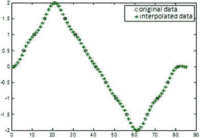

## n维线性插值 (`interpn`)

`Vi = interpn(X,Y,Z,…V, Xi, Yi, Zi…)`、`Vi = interpn(V, Xi, Yi, Zi)`、`Vi = interpn(V, n)` 或 `Vi = interpn(…,method)` 函数返回一个 `n` 变量函数在特定查询点处的插值结果，使用线性插值。结果始终经过函数的原始采样点。`X,Y,Z,…` 包含样本点的坐标。`V` 包含每个样本点对应的函数值。`Xi,Yi,Zi,…` 包含查询点的坐标。当使用默认网格时，后两种形式等价于第一种。返回通过在每一维度上对区间重复划分 `n` 次所形成的精细化网格上的插值。使用指定的 `method` 进行插值。

## 分段三次插值 (`pchip` 和 `spline`)

### 分段三次Hermite插值 (`pchip`)

`Yi = pchip(X, Y, Xi)` 函数返回一个向量 `Yi`，其中包含与 `Xi` 各元素对应的值，这些值由向量 `X` 和 `Y` 内的分段三次插值确定。

`pp = pchip(X,Y)` 函数返回一个分段多项式结构 `pp`，供 `ppval` 使用。

### 三次样条插值 (`spline`)

`Yi = spline(X, Y, Xi)` 函数使用三次样条插值查找 `Yi`，即底层函数 `Y` 在插值点 `Xi` 处的值。断点由 `X` 确定。

`pp = spline(X,Y)` 函数返回三次样条插值的分段多项式形式，供后续与 `ppval` 及样条工具 `unmkpp` 一起使用。

在以下示例中，原始点与使用 `pchip` 和 `spline` 方法得到的插值点进行了比较。

```matlab
>> x = -3:3;
   y = [-1 -1 -1 0 1 1 1];
   t = -3:.01:3;
   plot(x, y, 'o', t, [pchip(x,y,t); spline(x,y,t)])
   legend('数据','pchip','spline',4)
```

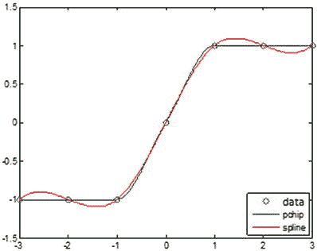

## 散乱数据插值 (`griddata`)

`Zi = griddata(X,Y,Z,Xi,Yi)`、`[Xi, Yi, Zi] = griddata(X,Y,Z,Xi,Yi)` 或 `[…] = griddata(…,method)` 函数将形式为 `Z = f(X,Y)` 的曲面拟合到向量 `(X,Y,Z)` 中的离散数据。该函数在由 `(Xi,Yi)` 指定的查询点处对曲面进行插值，并返回插值结果 `Zi`。该曲面始终经过由 `X` 和 `Y` 定义的数据点。默认的插值方法是 `linear`。当使用 `[Xi, Yi, Zi]` 形式时，除了返回 `Zi`，还会返回向量 `Xi` 和 `Yi`。使用指定的 `method` 进行插值。

下面的示例在网格上对离散数据进行插值。

## 求解方程与方程组

| | |
| :--- | :--- |
| `x = rand(100,1)*4-2; y = rand(100,1)*4-2;`<br>`z = x.*exp(-x.²-y.²);`<br>`ti = -2:.25:2;`<br>`[xi,yi] = meshgrid(ti,ti);`<br>`Zi = griddata(x,y,z,xi,yi);`<br>`mesh(xi,yi,zi), hold on, plot3(x,y,z,'o'), hold off` | |
| 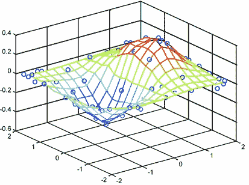 | |
| `W = griddata3(X,Y,Z,V,Xi,Yi,Zi)`<br>`W = griddata3(…,'method')` | 将形式为 `V = f(X,Y,Z)` 的超曲面拟合到向量 `(X,Y,Z,V)` 中的离散数据。该函数在由 `(Xi,Yi,Zi)` 指定的查询点处对超曲面进行插值，并返回插值结果 `W`。该曲面始终经过由 `X`、`Y` 和 `Z` 定义的数据点。默认的插值方法是 `linear`。使用指定的 `method` 进行插值。以下是通过插值将超曲面拟合到离散数据的示例。 |
| | |
| `>> x = 2*rand(5000,1)-1; y = 2*rand(5000,1)-1; z = 2*rand(5000,1)-1;`<br>`v = x.² + y.² + z.²;`<br>`d = -0.8:0.05:0.8;`<br>`[xi,yi,zi] = meshgrid(d,d,d);`<br>`w = griddata3(x,y,z,v,xi,yi,zi);`<br>`p = patch(isosurface(xi,yi,zi,w,0.8));`<br>`isonormals(xi,yi,zi,w,p);`<br>`set(p,'FaceColor','blue','EdgeColor','none');`<br>`view(3), axis equal, axis off, camlight, lighting phong` | |
|  | |

MATLAB 包含多个用于求解方程和方程组的命令。以下各节将介绍这些方法的语法和主要功能。

### 通用方法

以下是用于求解方程和方程组的最常用 MATLAB 命令。

| 命令 | 说明 |
| :--- | :--- |
| `solve('equation','x')` | 求解变量 `x` 的方程。方程求解如下： <br>```<br>>> solve('p*sin(x) = r')<br>ans =<br>asin(r/pi)<br>pi - asin(r/pi)<br>``` |
| `syms x; solve(equ(x), x)` | 求解变量 `x` 的方程 `equ`。方程求解如下： <br>```<br>>> syms x r; solve(p * cos(x) - r, x)<br>ans =<br>acos((8192*r)/1433639)<br>-acos((8192*r)/1433639)<br>``` |
| `solve('eq1,eq2,…,eqn', 'x1, x2,…,xn')` | 求解 `n` 个联立方程 `eq1,…, eqn`（解赋给变量 `x1,…, xn`）<br>```<br>>> [x, y] = solve('x² + x*y + y = 3','x²-4*x + 3 = 0')<br>x =<br>1<br>3<br>y =<br>1<br>-3/2<br>``` |
| `syms x1 x2…xn; solve(eq1,eq2,…,eqn, x1, x2,…,xn)` | 求解 `n` 个联立方程 `eq1,…, eqn`（解赋给变量 `x1,…, xn`）<br>```<br>>> syms x y; [x, y] = solve(x² + x*y + y-3, x²-4*x + 3)<br>x =<br>1<br>3<br>y =<br>1<br>-3/2<br>``` |
| `X = linsolve(A, B)` | 求解方程 `A * X = B`，其中 `A`、`B` 和 `X` 是矩阵。求解系统： <br>```<br>>> A = [2,1,1,1;1,2,1,1;1,1,2,1;1,1,1,2]; B = [1,2,3,4]';<br>>> linsolve(A, B)<br>ans =<br>-1<br>0<br>1<br>2<br>``` |
| `x = lscov(A,B)`<br>`x = lscov(A,B,V)` | 以最小二乘意义求解方程 `A * x = B`，即 `x` 是使平方误差和最小的 n×1 向量。以最小二乘意义求解，协方差矩阵与 `V` 成比例，即 `x` 最小化。 <br>```<br>>> A = [2,1,1,1;1,2,1,1;1,1,2,1;1,1,1,2]; B = [1,2,3,4]';<br>>> lscov(A, B)<br>ans =<br>-1<br>0<br>1<br>2<br>``` |
| `X = A\B` | 求解系统。 <br>```<br>>> A = [2,1,1,1;1,2,1,1;1,1,2,1;1,1,1,2]; B = [1,2,3,4]';<br>>> A\B<br>ans =<br>-1.0000<br>-0.0000<br>1.0000<br>2.0000<br>``` |
| `X = A/B` | 求解系统。 |
| `roots(A)` | 返回多项式的根，其系数由向量 `A` 给出（从最高次到最低次）。示例为求多项式的根。 <br>```<br>>> roots([1 2 3 4])<br>ans =<br>-1.6506<br>-0.1747 + 1.5469i<br>-0.1747 - 1.5469i<br>``` |
| `poly(V)` | 返回多项式的系数，其根由向量 `V` 给出。 <br>```<br>>> poly([1 2 3 4])<br>ans =<br>1 1 -10 -10 35 -50 24<br>``` |
| `x = fzero(x0) (function)` | 返回函数在 `x0` 附近的零点。 <br>```<br>>> X = fzero('sin(x) - 1', pi/2)<br>X =<br>1.5708<br>``` |
| `[x, fval] = fzero(x0, fun)` | 还返回函数在 `x` 处的目标值。 <br>```<br>>> [F, x] = fzero('sin(x) - 1', pi/2)<br>X =<br>1.5708<br>f =<br>0<br>``` |

### 双共轭梯度法

以下是可通过双共轭梯度法求解方程和方程组的 MATLAB 命令。

| 命令 | 说明 |
| :--- | :--- |
| `x = bicg(A,b)`<br>`bicg(A,b,tol)`<br>`bicg(A,b,tol,maxit)`<br>`bicg(A,b,tol,maxit,M)`<br>`bicg(A,b,tol,maxit,M1,M2)`<br>`bicg(A,b,tol,maxit,M1,M2,x0)`<br>`[x,f] = bicg(A,b,…)` | 尝试通过双共轭梯度法求解系统 `Ax = b`。 <br>```<br>>> A = [2 pi * pi 3 * pi - pi; 1 0 - 1 2; exp(1) exp(2) exp(3) exp(4); i 2i 3i - i];<br>>> B = [1 2 3 4]';<br>>> bicg(A, B)<br>bicg stopped at iteration 4 without converging to the desired tolerance 1e-006 because the maximum number of iterations was reached. The iterate returned (number 0) has relative residual 1<br>ans =<br>0<br>0<br>0<br>0<br>```<br>通过指定容差求解 `Ax = b`。通过指定容差和最大迭代次数求解 `Ax = b`。 <br>```<br>>> bicg(A,B, 1e-009,100)<br>ans =<br>1.0e + 016 *<br>4.1449 0.7033i<br>-7.1997 + 1.2216i<br>3.2729 0.5553i<br>-0.4360 + 0.0740i<br>```<br>求解系统 `inv(M) * A * x = inv(M) * b`。用 `M = M1 * M2` 求解系统 `inv(M) * A * x = inv(M) * b`。用 `M = M1 * M2` 和初始值 `x0` 求解系统 `inv(M) * A * x = inv(M) * b`。尝试求解系统并返回收敛指示符 `f`（0 = 收敛，1 = 未收敛，2 = 病态，3 = 停滞，4 = 极极端数值）。 <br>```<br>>> [x, f] = bicg(A,B, 1e-009,100)<br>x =<br>1.0e + 016 *<br>4.1449 0.7033i<br>-7.1997 + 1.2216i<br>3.2729 0.5553i<br>-0.4360 + 0.0740i<br>f =<br>3<br>``` |

## 稳定双共轭梯度法 (bicgstab)

以下是使用稳定双共轭梯度法求解方程和方程组的 MATLAB 命令。

| `x = bicgstab(A,b)` `bicgstab(A,b,tol)` `bicgstab(A,b,tol,maxit)` | 尝试通过稳定双共轭梯度法求解系统 `Ax = b`。 |
|---|---|
| `bicgstab(A,b,tol,maxit,M)` `bicgstab(A,b,tol,maxit,M1,M2)` `bicgstab(A,b,tol,maxit,M1,M2,x0)` | 求解系统 `inv(M) * A * x = inv(M) * b`。用 `M = M1 * M2` 求解系统 `inv(M) * A * x = inv(M) * b`。用 `M = M1 * M2` 和初始值 `x0` 求解系统 `inv(M) * A * x = inv(M) * b`。 |
| `[x,f] = bicgstab(A,b,…)` `[x,f,relres] = bicgstab(A,b,…)` `[x,f,relres,iter] = bicgstab(A,b,…)` | 尝试求解系统并返回收敛指示符 `f`（0 = 收敛，1 = 未收敛，2 = 病态，3 = 停滞，4 = 极端数值）。还返回相对残差 `norm(b-A*x) /norm(b)`。还返回迭代次数。 |

通过指定容差求解 `Ax = b`。通过指定容差和最大迭代次数求解 `Ax = b`。

```matlab
>> bicgstab(A, B)
bicgstab stopped at iteration 4 without converging to the desired tolerance 1e-006 because the maximum number of iterations was reached. The iterate returned (number 4) has relative residual 0.88
ans =
    1.0e + 011 *
   0.6696-0.4857i
  -1.1631 + 0.8437i
   0.5287 0.3835i
  -0.0704 + 0.0511i
```

```matlab
>> bicg(A,B, 1e-009,100)
ans =
    1.0e + 016 *
   4.1449 0.7033i
  -7.1997 + 1.2216i
   3.2729 0.5553i
  -0.4360 + 0.0740i
```

```matlab
>> [x, f, r, i] = bicg(A,B, 1e-006,100)
x =
    1.0e + 016 *
   4.1449 0.7033i
  -7.1997 + 1.2216i
   3.2729 0.5553i
  -0.4360 + 0.0740i
f =
     3
r =
    26.0415
i =
    18
```

### 共轭梯度法

以下是使用共轭梯度法求解方程和方程组的 MATLAB 命令。

| 语法 | 说明 |
|---|---|
| `x = pcg(A,b)` `pcg(A,b,tol)` `pcg(A,b,tol,maxit)` | 尝试使用预处理共轭梯度法求解系统 `Ax = b`。通过指定容差求解 `Ax = b`。通过指定容差和最大迭代次数求解 `Ax = b`。 |
| `pcg(A,b,tol,maxit,M)` `pcg(A,b,tol,maxit,M1,M2)` `pcg(A,b,tol,maxit,M1,M2,x0)` | 求解系统 `inv(M) * A * x = inv(M) * b`。使用 `M = M1 * M2` 求解系统 `inv(M) * A * x = inv(M) * b`。使用 `M = M1 * M2` 和初始值 `x0` 求解系统 `inv(M) * A * x = inv(M) * b`。 |
| `[x,f] = pcg(A,b,…)` `[x,f,relres] = pcg(A,b,…)` `[x,f,relres,iter] = pcg(A,b,…)` | 尝试求解系统并返回收敛指示符 `f`（0 = 收敛，1 = 未收敛，2 = 病态，3 = 停滞，4 = 数值极端）。同时返回相对残差范数 `(b-A*x) /norm(b)`。同时返回迭代次数。 |

| 语法 | 说明 |
|---|---|
| `x = lsqr(A,b)` `lsqr(A,b,tol)` `lsqr(A,b,tol,maxit)` | 尝试使用 LSQR 方法求解系统 `Ax = b`。通过指定容差求解 `Ax = b`。通过指定容差和最大迭代次数求解 `Ax = b`。 |
| `lsqr(A,b,tol,maxit,M)` `lsqr(A,b,tol,maxit,M1,M2)` `lsqr(A,b,tol,maxit,M1,M2,x0)` | 求解系统 `inv(M) * A * x = inv(M) * b`。使用 `M = M1 * M2` 求解系统 `inv(M) * A * x = inv(M) * b`。使用 `M = M1 * M2` 和初始值 `x0` 求解系统 `inv(M) * A * x = inv(M) * b`。 |
| `[x,f] = lsqr(A,b,…)` `[x,f,relres] = lsqr(A,b,…)` `[x,f,relres,iter] = lsqr(A,b,…)` | 尝试求解系统并返回收敛指示符 `f`（0 = 收敛，1 = 未收敛，2 = 病态，3 = 停滞，4 = 数值极端）。同时返回相对残差范数 `(b-A*x) /norm (b)`。同时返回迭代次数。 |

```matlab
>> A=[pi 2*pi 3*pi -pi; 1 0 -1 2; exp(1) exp(2) exp(3) exp(4); i 2i 3i -i];
>> B=[1 2 3 4]';
>> [x,f,r,i]=pcg(A,B, 1e-006,1000)
x =
     0
     0
     0
     0
f =
     4
r =
     1
i =
     0
```

```matlab
>> A=[pi 2*pi 3*pi -pi; 1 0 -1 2; exp(1) exp(2) exp(3) exp(4); i 2i 3i -i];
>> B = [1 2 3 4]';
>> [x, f, r, i] = lsqr(A,B, 1e-006,1000)
x =
   1.1869 0. 0910i
   0.4295 0. 0705i
  -0.5402 - 0. 0362i
   0.1364 + 0. 0274i
f =
     0
r =
    0.6981
i =
     3
```

### 残差法

以下是使用残差法求解方程和方程组的 MATLAB 命令。

| 语法 | 说明 |
|---|---|
| `x = qmr(A,b)` `qmr(A,b,tol)` `qmr(A,b,tol,maxit)` | 尝试使用拟最小残差法求解系统 `Ax = b`。通过指定容差求解 `Ax = b`。通过指定容差和最大迭代次数求解 `Ax = b`。 |
| `qmr(A,b,tol,maxit,M)` `qmr(A,b,tol,maxit,M1,M2)` `qmr(A,b,tol,maxit,M1,M2,x0)` | 求解系统 `inv(M) * A * x = inv(M) * b`。使用 `M = M1 * M2` 求解系统 `inv(M) * A * x = inv(M) * b`。使用 `M = M1 * M2` 和初始值 `x0` 求解系统 `inv(M) * A * x = inv(M) * b`。 |
| `[x,f] = qmr(A,b,…)` `[x,f,relres] = qmr(A,b,…)` `[x,f,relres,iter] = qmr(A,b,…)` | 尝试求解系统并返回收敛指示符 `f`（0 = 收敛，1 = 未收敛，2 = 病态，3 = 停滞，4 = 数值极端）。同时返回残差范数 `(b-A*x) /norm(b)`。同时返回迭代次数。 |

### 迭代法求解线性系统

| 语法 | 描述 |
| :--- | :--- |
| `x = gmres(A,b)` `gmres(A,b,tol)` `gmres(A,b,tol,maxit)` `gmres(A,b,tol,maxit,M)` `gmres(A,b,tol,maxit,M1,M2)` `gmres(A,b,tol,maxit,M1,M2,x0)` `[x,f] = gmres(A,b,…)` `[x,f,relres] = gmres(A,b,…)` `[x,f,relres,iter] = gmres(A,b,…)` | 尝试使用广义最小残差法求解系统 `Ax = b`。通过指定容差求解 `Ax = b`。通过指定容差和最大迭代次数求解 `Ax = b`。求解系统 `inv(M) * A * x = inv(M) * b`。使用 `M = M1 * M2` 求解系统 `inv(M) * A * x = inv(M) * b`。使用 `M = M1 * M2` 和初始值 `x0` 求解系统 `inv(M) * A * x = inv(M) * b`。尝试求解系统并返回收敛指示符 `f`（`0` = 收敛，`1` = 未收敛，`2` = 收敛性差，`3` = 停滞，`4` = 数值极端）。同时返回相对残差范数 `(b-A*x)/norm(b)`。同时返回迭代次数。 |
| `x = minres(A,b)` `minres(A,b,tol)` `minres(A,b,tol,maxit)` `minres(A,b,tol,maxit,M)` `minres(A,b,tol,maxit,M1,M2)` `minres(A,b,tol,maxit,M1,M2,x0)` `[x,f] = minres(A,b,…)` `[x,f,relres] = minres(A,b,…)` `[x,f,relres,iter] = minres(A,b,…)` | 尝试使用最小残差法求解系统 `Ax = b`。通过指定容差求解 `Ax = b`。通过指定容差和最大迭代次数求解 `Ax = b`。求解系统 `inv(M) * A * x = inv(M) * b`。使用 `M = M1 * M2` 求解系统 `inv(M) * A * x = inv(M) * b`。使用 `M = M1 * M2` 和初始值 `x0` 求解系统 `inv(M) * A * x = inv(M) * b`。尝试求解系统并返回收敛指示符 `f`（`0` = 收敛，`1` = 未收敛，`2` = 病态，`3` = 停滞，`4` = 数值极端）。同时返回相对残差范数 `(b-A*x)/norm(b)`。同时返回迭代次数。 |

```matlab
>> A=[pi 2*pi 3*pi -pi; 1 0 -1 2; exp(1) exp(2) exp(3) exp(4); i 2i 3i -i];
>> B=[1 2 3 4]';
>> [x,f,r,i]=qmr(A,B, 1e-006,1000)
x =
   1.0e+016 *
   0.4810 - 4.0071i
  -0.8356 + 6.9603i
   0.3798 - 3.1640i
  -0.0506 + 0.4215i
f =
     3
r =
   19.5999
i =
    11
```

```matlab
>> A=[pi 2*pi 3*pi -pi; 1 0 -1 2; exp(1) exp(2) exp(3) exp(4); i 2i 3i -i];
>> B=[1 2 3 4]';
>> [x,f,r,i]=gmres(A,B)
x =
   1.5504 + 0.0085i
  -0.2019 - 0.2433i
  -0.2532 + 0.0423i
   0.0982 + 0.0169i
f =
     3
r =
    0.6981
i =
     1     4
```

```matlab
>> A=[pi 2*pi 3*pi -pi; 1 0 -1 2; exp(1) exp(2) exp(3) exp(4); i 2i 3i -i];
>> B=[1 2 3 4]';
>> [x,f,r,i]=minres(A,B, 1e-006,1000)
x =
   0.0748 - 0.0070i
  -0.0761 - 0.0001i
   0.5934 - 0.1085i
  -0.1528 + 0.0380i
f =
     1
r =
    0.0592
i =
  1000
```

### 对称和非负最小二乘法

以下是使用对称和非负最小二乘法求解方程及方程组的 MATLAB 命令。

| 语法 | 描述 |
| :--- | :--- |
| `x = symmlq(A,b)` `symmlq(A,b,tol)` `symmlq(A,b,tol,maxit)` `symmlq(A,b,tol,maxit,M)` `symmlq(A,b,tol,maxit,M1,M2)` `symmlq(A,b,tol,maxit,M1,M2,x0)` `[x,flag] = symmlq(A,b,…)` `[x,flag,relres] = symmlq(A,b,…)` `[x,flag,relres,iter] = symmlq(A,b,…)` | 尝试通过对称 LQ 方法求解方程组 `Ax = b`。通过指定容忍度求解 `Ax = b`。通过指定容忍度和最大迭代次数求解 `Ax = b`。求解方程组 `inv(M) * A * x = inv(M) * b`。在 `M = M1 * M2` 条件下求解方程组 `inv(M) * A * x = inv(M) * b`。在 `M = M1 * M2` 且初始值为 `x0` 的条件下求解方程组 `inv(M) * A * x = inv(M) * b`。尝试求解方程组并返回一个收敛标志（`0` = 收敛，`1` = 未收敛，`2` = 病态，`3` = 停滞，`4` = 极端数值）。同时返回相对残差范数 `(b-A*x)/norm(b)`。还返回迭代次数。 |
| `x = lsqnonneg(C,d)` `x = lsqnonneg(C,d,x0)` `x = lsqnonneg(C,d,x0,opt)` `[x,resnorm] = lsqnonneg(…)` `[x,resnorm,residual] = lsqnonneg(…)` `[x,resnorm,residual,f] = lsqnonneg(…)` `[x,resnorm,residual,f,out,lambda] = lsqnonneg(…)` | 返回满足 `x >= 0` 条件下使 `norm(C*x-d)` 最小化的向量 `x`。`C` 和 `d` 必须为实数。使用 `x0 >= 0` 作为初始值以及一个可能的选项。选项包括用于 `x` 终止容忍度的 `TolX` 和用于控制输出显示的 `Display`（`'off'` 不显示输出，`'final'` 仅显示最终输出，`'notify'` 仅当未收敛时显示输出）。返回残差的平方 2-范数值：`norm(C*x-d)^2`。此外还返回残差 `C*x-d`。另外给出一个收敛标志 `f`（正数表示收敛，`0` 表示未收敛）。除上述内容外，还返回描述所用算法、迭代次数和退出信息的输出数据，以及拉格朗日乘数向量 `lambda`。 |

```matlab
>> A=[1 2 3;5 7 1;2 3 6]; B=[1 3 5]'; lsqnonneg(A,B)
ans =
    0.4857
         0
    0.5714
```

好的，作为一名高级文档工程师和翻译员，我将严格遵循您提供的格式和注意事项，将给定的英文文本翻译成中文。

# 求解线性方程组

在前面的章节中，我们学习了方程和方程组的一般概念。现在我们将专注于线性方程组。求解此类方程组，我们可以简单地使用目前已学过的命令，但是 MATLAB 提供了一系列特别为线性方程组设计的专用命令。下表列出了这些命令。

| 命令 | 说明 |
|------|------|
| `X = linsolve (A, B)` | 求解线性系统 `A * X = B`。我们求解系统：<br>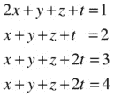<br>`>> A = [2,1,1,1;1,2,1,1;1,1,2,1;1,1,1,2];B = [1,2,3,4]';`<br>`linsolve (A, B)`<br>`ans =`<br>`-1`<br>`0`<br>`1`<br>`2` |
| `[X, R] = linsolve (A, B)` | 求解线性系统 `A * X = B`，如果 `A` 是方阵，则额外返回 `A` 的条件数的倒数；如果 `A` 不是方阵，则返回 `A` 的秩。<br>`>> A = [2,1,1,1;1,2,1,1;1,1,2,1;1,1,1,2];B = [1,2,3,4]';`<br>`[X, R] = linsolve (A, B)`<br>`X =`<br>`-1`<br>`0`<br>`1`<br>`2`<br>`R =`<br>`0.1429` |
| `X = linsolve (A, B, options)` | 使用矩阵 `A` 的各种选项（`UT` 表示上三角，`LT` 表示下三角，`SYM` 表示对称实矩阵或复埃尔米特矩阵，`RECT` 表示一般矩形矩阵，`POSDEF` 表示正定矩阵，`UHESS` 表示上黑森伯格矩阵，`TRANSA` 表示共轭转置）求解线性系统 `A * X = B`。 |
| `rank (A)` | 矩阵 `A` 的秩。<br>`>> rank (A)`<br>`ans =`<br>`4` |
| `det (A)` | 方阵 `A` 的行列式。<br>`>> det (A)`<br>`ans =`<br>`5` |
| `Z = null (A, 'r')` | 矩阵 `A` 的零空间的有理基。 |

线性方程组可以转换为数组形式，并通过矩阵计算来求解。一个系统可以写成 `M.X = B` 的形式，其中 `X` 是变量向量，`B` 是常数项向量，`M` 是系统的系数矩阵。如果 `M` 是方阵且行列式非零，则 `M` 可逆，系统的唯一解可以写成：`X = M^(-1)B`。在这种情况下，前面已经描述过的命令 `solve`、`linsolve`、`lscov`、`bicg`、`pcg`、`lsqr`、`gmr`、`gmres`、`minres`、`symmlq` 或 `M\B` 都可以提供解。

如果 `M` 的行列式为零，则系统有无穷多解，因为 `M` 中存在线性相关的行或列。在这种情况下，可以计算冗余方程的数量，以找出描述解所需的变量个数。如果矩阵 `M` 是矩形的（非方阵），则系统可能是欠定的（方程数少于变量数）、超定的（方程数多于变量数）或非奇异的（方程数等于变量数且 `M` 的行列式非零）。欠定系统可能有无穷多解，也可能无解；超定系统也是如此。如果一个系统无解，则称为不相容（矛盾）系统；如果至少有一个解，则称为相容系统。当向量 `B` 是零向量时，系统 `M . X = B` 被称为齐次系统，即系统形式为 `M . X= 0`。如果 `M` 的行列式非零，系统的唯一解是零向量（使用命令 `linsolve` 获得）。如果 `M` 的行列式为零，则系统有无穷多解。可以使用命令 `solve`、`linsolve`、`lsqr` 或前面为一般线性系统描述的其他命令来求解。

分析和求解方程组的一个基本工具是 Rouche-Frobenius 定理。该定理指出，一个包含 `m` 个方程和 `n` 个未知数的系统有解，当且仅当系数矩阵的秩等于增广矩阵（将系数矩阵与系统常数项列向量拼接）的秩。如果两个秩相等，且等于未知数的个数，则系统有唯一解。如果两个秩相等，但小于未知数的个数，则系统有无穷多解。如果两个秩不相等，则系统无解。

总结如下：设 `A` 是系统的系数矩阵，`B` 是矩阵 `A` 增广了常数项列向量后的矩阵。

如果 `rank(A) = rank(B)`，系统是不相容的（无解）。

如果 `rank (A) = rank(B) < n`，系统是不定的（有无穷多解）。

如果 `= rank(A) = rank(B) = n`，系统有唯一解。

这个定理允许我们在求解之前分析方程组的解。

我们已经遇到过齐次系统。如果常数项向量 `B` 为零，则系统 `A. X = B` 被称为齐次系统，因此每个齐次系统的形式都是 `A. X = 0`。在齐次系统中，系数矩阵的秩与增广了常数项列向量后的矩阵的秩总是相等。如果我们应用 Rouche-Frobenius 定理，当矩阵 `A` 的行列式非零时，齐次系统将有唯一解。由于零向量总是齐次系统的一个解，因此它必须是唯一解。当矩阵 `A` 的行列式为零时，齐次系统将有无穷多解。在这种情况下，解的计算方法与一般系统相同（使用命令 `solve`），或者使用函数 `null (A)`。

## 示例1

作为第一个例子，我们求解系统：

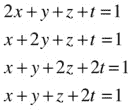

我们将计算系统矩阵的秩和增广矩阵（通过用常数项列向量扩展矩阵得到）的秩。

```
>> A = [2,1,1,1;1,2,1,1;1,1,2,1;1,1,1,2];
>> B = [2,1,1,1,1;1,2,1,1,1;1,1,2,1,1;1,1,1,2,1];
>> [rank (A), rank (B)]
ans =
4 4
```

我们注意到两个矩阵的秩等于未知数的个数。根据 Rouche-Frobenius 定理，这告诉我们系统是相容的且有唯一解。我们可以通过以下方式计算解：

```
>> B = [1 1 1 1]';
>> linsolve (A, B)
ans =
0.2000
0.2000
0.2000
0.2000
```

也可以使用以下命令找到解：

```
>> lscov (A, B)
ans =
0.2000
0.2000
0.2000
0.2000

>> bicg (A, B)
bicg converged at iteration 1 to a solution with relative residual 0
ans =
0.2000
0.2000
0.2000
0.2000

>> pcg (A, B)
PCG converged at iteration 1 to a solution with relative residual 0
ans =
0.2000
0.2000
0.2000
0.2000

>> lsqr (A, B)
lsqr converged at iteration 1 to a solution with relative residual 0
ans =
0.2000
0.2000
0.2000
0.2000

>> qmr (A, B)
QMR converged at iteration 1 to a solution with relative residual 0
ans =
0.2000
0.2000
0.2000
0.2000

>> gmres (A, B)
gmres converged at iteration 1 to a solution with relative residual 1.5e-016
ans =
0.2000
0.2000
0.2000
0.2000

>> symmlq (A, B)
symmlq converged at iteration 1 to a solution with relative residual 0
ans =
0.2000
0.2000
0.2000
0.2000
```

## 示例2

作为第二个例子，我们求解系统：

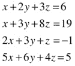

我们计算系统矩阵的秩和增广矩阵的秩。

```
>> A=[1,2,3;1,3,8;2,3,1;5,6,4];
>> B=[1,2,3,6;1,3,8,19;2,3,1,-1;5,6,4,5];
>> [rank(A), rank(B)]
ans =
3     3
```

我们注意到两个矩阵的秩等于未知数的个数。根据 Rouche-Frobenius 定理，这告诉我们系统是相容的且有唯一解。我们可以通过以下方式计算解：

```
>> A = [1,2,3;1,3,8;2,3,1;5,6,4];
>> B = [19-6 - 5-1]';
>> linsolve (A, B)
ans =
1.0000
-2.0000
3.0000
```

## 示例3

作为第三个例子，我们求解系统：

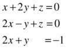

由于这是一个齐次系统，我们将计算系统系数矩阵的行列式。

```
>> A = [1,2, - 1; 2, - 1, 1; 3,1,0];
>> det (A)
ans =
5. 5511e-016
```

这个答案非常接近零，实际上行列式就是零，因此齐次系统将有无穷多解，可以使用命令 `solve` 计算，如下所示。

```
>> [x, y, z] = solve('x+2*y-z, 2*x-y+z, 3*x+y', 'x,y,z')
x =
-z1/5
y =
(3 * z1) / 5
z =
z1
```

因此，这组无穷多解依赖于一个参数 `z1`，并描述为 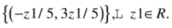

## 练习 4-1

展开以下代数表达式：

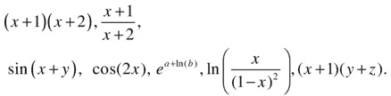

```
>> syms x y z b t
>> pretty (expand ((x + 1) * (2.4.x+2)))
2
x + 3 x + 2

>> pretty (expand ((x + 1) / (2.4.x+2)))
  x       1
------ + -------
x + 2     x + 2

>> pretty (expand (sin(x + y)))
sin(x) cos (y) + cos (x) sin(y)

>> pretty (expand (cos(2*x)))
    2
2 cos (x) - 1

>> pretty (expand (exp (a+log (b)))
exp (a) b

>> pretty (expand (log (x/(1-x)^ 2)))
log (x) - 2-log(1-x)

>> pretty (expand ((x + 1) * (y+z)))
x y + x z + y + z
```

## 练习 4-2

因式分解以下代数表达式：

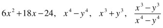

```
>> syms x y
>> pretty (factor(6*x²+18*x-24))
6 (x + 4) (x - 1)

>> pretty (factor(x⁴-y⁴))
               2   2
(x y) (x + y) (x + y)

>> pretty (factor(x³+y³))
         2         2
(x + y) (x - x y + y )

>> pretty (factor ((x³-y³) /(x⁴-y⁴)))
2         2
x + x y + y
-----------------
         2   2
(x + y) (x + y )
```

## 练习 4-3

简化以下代数表达式：

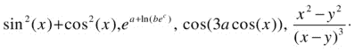

```
>> syms x y b c
>> simplify (sin (x) ^ 2 + cos (x) ^ 2)
ans =
1

>> pretty (simplify (exp (a+log (b * exp (c)))))
b exp(a + c)

>> pretty (sym (simple (cos (3 * acos (x)))))
  3
4 x - 3 x

>> pretty(simple((x²-y²) /(x-y) ^ 3))
x + y
-------
      2
(x - y)
```

## 练习 4-4

将下列代数表达式重写为 `x` 的幂的形式：

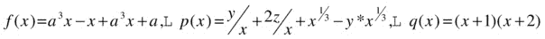

将下列表达式重写为 `x` 的幂的形式：

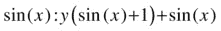

将下列表达式重写为 `x` 的幂的形式：

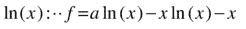

将下列表达式重写为 `x` 的幂的形式：

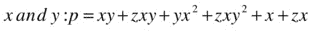

```
>> syms x y z
>> pretty (collect(a³*x-x+a³+a, x))
 3         3
(a -1) x + a + a

>> pretty (collect (y / x+2 * z/x + x ^(1/3) - y * ^(1/3) x, x))
y + 2 z – x 4/3 y + x4/3
----------------------
         x

>> pretty(collect((x+1) * (x+2)))
2
x + 3 x + 2

>> p = x * y + z * x * y + y * x ^ 2-z * y * x ^ 2 + x + z * x;
>> pretty(collect(p, [x,y]))
      2
(1-z) x y + (z + 1) x y + (z + 1) x

>> f = a * log (x) - log (x) * x-x;
>> pretty (collect (f, log (x)))
(a - x) log (x) - x
```

## 练习 4-5

尽可能合并以下表达式中的项：

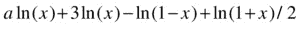

假设 `a` 是实数且 `x > 0`，简化该表达式。

```
>> pretty (sym (simple (a * log (x) + 3 * log (x) - log(1-x) + log(1+x)/2)))
log(x + 1)/2- log(1-x) + 3 log (x) + log (x)

>> x = sym ('x', 'positive')
x =
x

>> a = sym ('a', 'real')
a =
a

>> pretty (sym (simple (a * log (x) + 3 * log (x) - log(1-x) + log(1+x)/2)))
    /       x - 1        \
-log| - ---------------- |
    |    3  a     1/2    |
    \   x  x  (x + 1)    /
```

## 练习 4-6

展开并简化以下三角函数表达式：

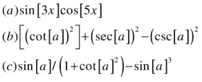

```
>> pretty (simple (expand (sym (sin(3*x) * cos(5*x)))))
sin(8 x)   sin (2 x)
-------- - --------
   2          2

>> pretty (simple (expand (((cot (a)) ^ 2 + (sec (a)) ^ 2-(csc (a)) ^ 2))))
  1
------- - 1
  2
cos (a)

>> pretty (simple (expand (sin (a) / (1 + cot (a) ^ 2)- sin (a) ^ 3)))
0
```

## 练习 4-7

尽可能简化以下代数表达式：

```
x       y     2 x y        1 + a    1 - b     a - b
————— - ————— + —————  ,     ————— +  ————— - —————————
x + y   x - y   2   2          b        a        a b
              x - y
```

# 练习 4-8 到 4-14

## 练习 4-8

尽可能简化以下代数分式：

```
   3   2      2    2            2        2
   a - a b + ac - bc           (x - 9) (x - 2 x + 1) (x - 3)
——————————————————————————,—————————————————————————————————
   3    2   2       2          2             2
   a + ac + a b + b c         (x - 6 x + 9) (x - 1) (x - 1)
```

```
>> pretty(simple(factor(a³-a²*b+a*c²-b*c²)/(a³+a*c²+a²*b+b*c²)))
a - b
-----
a + b

>> pretty(simple(factor((x²-9)*(x²-2*x+1)*(x-3))/((x²-6*x+9)*(x²-1) *(x-1))))
2
----- + 1
x + 1
```

## 练习 4-9

计算以下多项式的根：

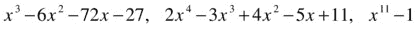

在 3 阶单位矩阵处计算第一个多项式，在 3 阶全 1 矩阵处计算第二个多项式，在 3 阶均匀随机矩阵处计算第三个多项式。

求给定多项式的导数系数，并以多项式形式显示结果。

```
>> p1 = [1 – 6 -72 - 27]; r = roots (p)
r =
12.1229
-5.7345
-0.3884

>> p2 = [2 -3 4 -5 11];r=roots(p)
r =
1.2817 + 1.0040i
1.2817 - 1.0040i
-0.5317 + 1.3387i
-0.5317 - 1.3387i

>> p3 = [1 0 0 0 0 0 0 0 0 0 0 1]; r = roots (p)
r =
-1.0000
-0.8413 + 0. 5406i
-0.8413 - 0. 5406i
-0.4154 + 0. 9096i
-0.4154 - 0. 9096i
0.1423 + 0. 9898i
0.1423 0. 9898i
0.6549 + 0. 7557i
0.6549-0. 7557i
0.9595 + 0. 2817i
0.9595 0. 2817i

>> Y1 = polyval (p1, eye (3))
Y1 =
-104 - 27 - 27
-27  -104 - 27
-27  – 27 -104

>> Y2 = polyval (p2, ones (3))
Y2 =
9 -9 -9
9 -9 -9
9 -9 -9

>> Y3 = polyval (p3, rand (3))
Y3 =
1.1050 1.3691 1.0000
1.3368 1.0065 1.0013
1.0000 1.0000 1.6202

>> d1 = polyder (p1)
D1 =
3 -12 -72

>> pretty (poly2sym(d1,'x'))
  2
3 x - 12 x - 72

>> d2 = polyder (p2)
D2 =
8 -9  8 - 5

>> pretty (poly2sym(d2,'x'))
  3     2
8 x - 9 x + 8 x - 5

>> d3 = polyder (p3)
D3 =
11     0     0     0     0     0     0     0     0     0     0

>> pretty (poly2sym(d3,'x'))
   10
11 x
```

## 练习 4-10

考虑区间 `[0,5]` 内间隔为 0.1 的等距点集。在这些点处插值误差函数，并拟合一个 6 次多项式。在同一张图上绘制原始曲线和插值曲线。

```
>> x = (0: 0.1: 5)';
y = erf (x);
f = polyval(p,x);
>> p = polyfit(x,y,6)
p =
0.0012 - 0.0173 0.0812 - 0.0791 - 0.4495 1.3107 - 0.0128

>> f = polyval(p,x);
plot(x,y,'o',x,f,'-')
axis([0 5 0 2])
```

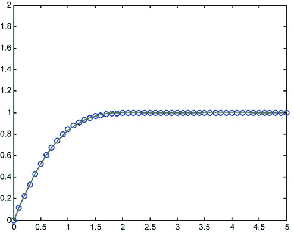

## 练习 4-11

计算以最小二乘法通过点 `(-1,4)`、`(0,2)` 和 `(1,6)` 的二次插值多项式。

```
>> x = [- 1, 0, 1];y=[4,2,6];p=poly2sym(polyfit(x,y,2))
p =
3 * x ^ 2 + x + 2
```

## 练习 4-12

在由 `y= e^x` 给出的点 `(x, y)` 之间（`x` 值在 0 到 2 之间的 20 个等间距区间内）绘制 200 个三次插值点。

首先，我们定义 20 个点 `(x, y)`，其中 `x` 在 0 和 2 之间等间距分布：

```
>> x = 0:0.1:2;
>> y = exp(x);
```

现在，我们找到三次插值点 `(xi, yi)`，其中 `xi` 值在 0 和 2 之间的 200 个等间距点处，并将它们与初始点 `(x, y)`（用星号表示）一起绘制在图上。

```
>> xi = 0:0. 01:2;
>> yi = interp1(x,y,xi,'cubic');
>> plot(x,y,'*',xi,yi)
```

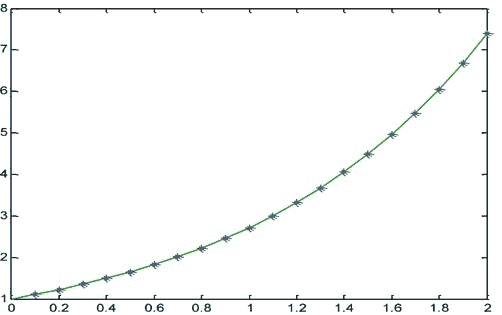

## 练习 4-13

查找参数函数 `X = cosh (t)`、`Y = sinh (t)`、`Z = tanh (t)` 在 `t` 值介于 0 和 π/6 之间的 25 个等间距区间内的插值点。

首先，我们为在 0 和 π/6 之间等间距的 `t` 值定义给定点 `(x, y, z)`。

```
>> t = 0: pi/150: pi/6;
>> x = cosh (t); y = sinh (t); z = tanh (t);
```

现在，我们找到 26 个插值点 `(x[i], y[i], z[i])`，参数 `t` 的值在 0 和 π/6 之间等间距分布。

```
>> xi = cosh (t); yi = sinh (t);
>> zi = griddata(x,y,z,xi,yi);
>> points = [xi, yi, zi]
points =
1.0000 0 0
1.0002 0.0209 0.0209
1.0009 0.0419 0.0419
1.0020 0.0629 0.0627
1.0035 0.0839 0.0836
1.0055 0.1049 0.1043
1.0079 0.1260 0.1250
1.0108 0.1471 0.1456
1.0141 0.1683 0.1660
1.0178 0.1896 0.1863
1.0220 0.2110 0.2064
1.0267 0.2324 0.2264
1.0317 0.2540 0.2462
1.0373 0.2756 0.2657
1.0433 0.2974 0.2851
1.0498 0.3194 0.3042
1.0567 0.3414 0.3231
1.0641 0.3636 0.3417
1.0719 0.3860 0.3601
1.0802 0.4085 0.3782
1.0890 0.4312 0.3960
1.0983 0.4541 0.4135
1.1080 0.4772 0.4307
1.1183 0.5006 0.4476
1.1290 0.5241 0.4642
1.1402 0.5479 0.4805
```

## 练习 4-14

使用快速傅里叶变换（FFT）插值，找到近似函数 `y = sinh (x)` 的 30 个点 `(xi, yi)`。`x` 值在 0 到 2π 之间的等间距区间内，这些点在由 `y = sinh (x)` 给出的点 `(x, y)` 之间进行插值，其中 `x` 值在 `(0,2π)` 的 20 个等间距区间内。绘制这些点的图形。

首先，我们定义在 0 到 2π 之间的 20 个区间内等间距的 `x` 值。

```
>> x =(0:pi/10:2*pi);
```

现在，我们找到插值点 `(x, y)`。

```
>> y = interpft (sinh (x), 30);
>> points = [y ', (asinh (y))']
points =
-0.0000 - 0.0000
-28.2506 - 4.0346
23.3719 3.8451
-4.9711 - 2.3067
-7.7918 - 2.7503
14.0406 3.3364
-4.8129 - 2.2751
-0.8717 - 0.7877
11.5537 3.1420
-3.3804 - 1.9323
4.4531 2.1991
11.8616 3.1682
-0.2121 - 0.2105
10.9811 3.0914
15.1648 3.4132
6.1408 2.5147
21.2540 3.7502
23.3792 3.8455
18.5918 3.6166
39.4061 4.3672
40.6473 4.3982
42.8049 4.4499
73.2876 4.9876
74.8962 5.0093
89.7159 5.1898
139.0371 5.6279
139.3869 5.6304
180.2289 5.8874
282.4798 6.3368
201.7871 6.0004

>> plot (points)
```

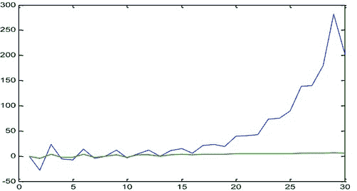

## 练习 4-15

找到一个 3 次多项式，它是以最小二乘法通过点 `(i, i²)`（`1 ≤ i ≤ 7`）的最佳拟合。在 `x = 10` 处计算该多项式，并图形化表示最佳拟合曲线。

```
>> x =(1:7);y=[1,4,9,16,25,36,49];p=vpa(poly2sym(polyfit(x,y,2))))
p =
x ^ 2 - 0.000000000000009169181662272871686413366801652 * x + 0.000000000000020761891472015924526365781895317
```

现在，我们在 `x = 10` 处计算多项式 `p` 的数值。

```
>> subs(p,10)
ans =
100.0000
```

接下来，我们绘制该多项式的图形：

```
>> ezplot(p,[-5,5])
```

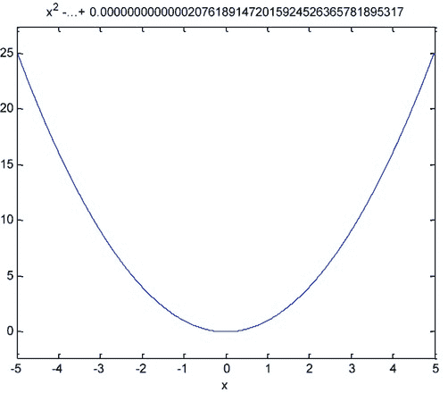

## 练习 4-16

求解以下方程：

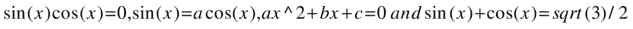

```
>> solve ('sin (x) * cos (x) = 0')
ans =
[       0]
[1/2 * pi]
[-1/2 * pi]

>> solve ('sin (x) = a * cos (x) ',' x')
ans =
atan (a)

>> solve('a*x²+b*x+c=0','x')
ans =
[1/2/a * (-b + (b ^ 2-4 * a * c) ^(1/2))]
[1/2/a * (-b-(b²-4*a*c) ^(1/2))]

>> solve (' sin (x) + cos (x) = sqrt (3) / 2')
ans =
[1/2 * 3 ^(1/2)]
[1/2 * 3 ^(1/2)]
```

## 练习 4-17

为以下两个三角方程和指数方程各找出至少两个解：

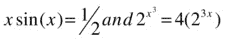

首先，我们使用命令 `solve`：

```
>> vpa (solve ('x * sin (x) = 1/2 ', 'x'))
ans =
matrix([[-226.19688152398440474751335389781]])

>> vpa (solve ('2 ^(x³) = 4 * 2 ^(3*x)', 'x'))
ans =
2.0
-1.0
-1.0
```

对于第一个方程我们没有得到解，但对于第二个我们得到了。为了更好地分析第一个方程，我们将函数图形化表示，以确定可能解所在的近似区间。

```
>> fplot ('[x * sin (x) - 1/2.0]', [0, 4 * pi])
```

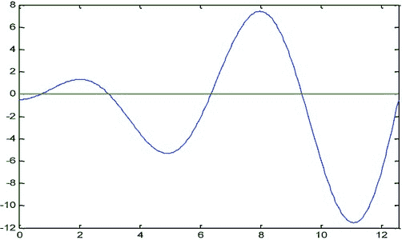

我们观察到在 `0` 和 `2` 之间有一个解，在 `2` 和 `4` 之间有一个解，在 `4` 和 `8` 之间有一个解，依此类推。我们可以使用命令 `fzero` 计算其中三个。

```
>> s1 = fzero ('x * sin (x) - 1/2 ', 2)
s1 =
0.7408

>> s2 = fzero ('x * sin (x) - 1/2 ', 4)
s2 =
2.9726

>> s3 = fzero ('x * sin (x) - 1/2 ', 6)
S3 =
6.3619
```

## 练习 4-18

求解以下对数方程和根式方程：

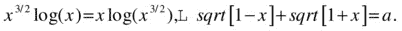

```
>> vpa (solve ('^(3/2) x * log (x) = x * log (x) ^(3/2)'))
ans =
1.0
0.31813150520476413531265425158766 1.3372357014306894089011621431937 * i
```

我们绘制函数图形以确定可以找到解的区间。图形显示 `x=1` 是唯一的实数解。

```
>> fplot ('[^(3/2) x * log (x), x * log (x) ^(3/2)]', [0.3, - 1, 6])
```

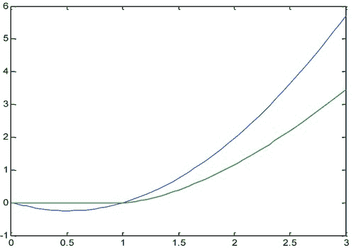

现在，我们求解根式方程：

```
>> pretty (sym (solve ('sqrt(1-x) + sqrt (1 + x) = a ', 'x')))
+-                -+
|           2 1/2  |
|   a (4 - a )     |
|   -------------  |
|        2         |
|                  |
|            2 1/2 |
|    a (4 - a )    |
|  - ------------- |
|         2        |
+-                -+
```

# 5. 矩阵、向量空间与线性变换

## 矩阵符号表示

在变量专用章节中我们已经了解了如何在 MATLAB 中表示向量和矩阵，但在此我们重新回顾一下表示法。

考虑矩阵

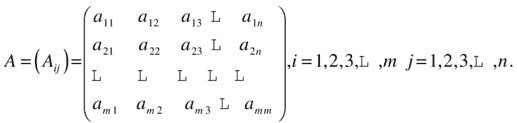

你可以通过以下方式在 MATLAB 中输入该矩阵：

`A = [a11,a12,...,a1n ; a21,a22,...,a2n ; ... ; am1,am2,...,amn]`

`A = [a11 a12 ... a1n ; a21 a22 ... a2n ; ... ; am1 am2 ... amn]`

另一方面，向量 `V =(v1,v2,...,vn)` 作为单行矩阵（即维度为 `1×n` 的矩阵）的特例，可按以下形式输入：

`V = [v1, v2, ..., vn]`

`V = [v1 v2 ... vn]`

## 矩阵运算

MATLAB 包含多种命令，可对矩阵执行最常见的符号运算和数值运算。下表列出了其中最重要的运算操作。

| 运算 | 描述 |
| :--- | :--- |
| `A + B` | 矩阵 `A` 和 `B` 的和 |

## 矩阵运算

定义两个复数矩阵 `A` 和 `B`。

```matlab
>> A=[-1 7 2;i -i 8; 3 1 4]
A =
  -1.0000             7.0000             2.0000
  0 + 1.0000i        0 - 1.0000i             8.0000
  3.0000             1.0000             4.0000
>> B=[1 2 3; 1+i 1-2i 1-3i; -3 -5 -i]
B =
  1.0000             2.0000                 3.0000
  1.0000 + 1.0000i   1.0000 - 2.0000i       1.0000 - 3.0000i
 -3.0000            -5.0000            0 - 1.0000i
```

### 矩阵加法

| `A + B` | 矩阵 `A` 和 `B` 的和 |
|---------|----------------------|

```matlab
>> A+B
ans =
  0              9.0000                 5.0000
  1.0000 + 2.0000i   1.0000 - 3.0000i      9.0000 - 3.0000i
  0             -4.0000      4.0000 - 1.0000i
```

### 矩阵减法

| `A - B` | 矩阵 `A` 和 `B` 的差 |
|---------|----------------------|

```matlab
>> A-B
ans =
 -2.0000                       5.0000                      -1.0000
 -1.0000            -1.0000 + 1.0000i             7.0000 + 3.0000i
  6.0000                       6.0000             4.0000 + 1.0000i
```

### 矩阵乘法

| `A * B` | 矩阵 `A` 和 `B` 的积 |
|---------|----------------------|

```matlab
>> A*B
ans =
  0 + 7.0000i  -5.0000 -14.0000i   4.0000 -23.0000i
 -23.0000 -42.0000 + 1.0000i  -3.0000 - 6.0000i
 -8.0000 + 1.0000i -13.0000 - 2.0000i  10.0000 - 7.0000i
```

### 标量乘法

| `c * A` | 标量与矩阵的乘积 |
|---------|------------------|

```matlab
>> i*A
ans =
  0 - 1.0000i         0 + 7.0000i              0 + 2.0000i
 -1.0000              1.0000              0 + 8.0000i
  0 + 3.0000i         0 + 1.0000i              0 + 4.0000i
```

### 矩阵函数

| `expm(A)` | 通过特征值计算的矩阵指数 `e^A` |
|-----------|--------------------------------|

```matlab
>> expm(A)
ans =
  1.0e+003 *
  0.5710 + 0.0674i   0.7081 - 0.0337i   1.7019 - 0.0338i
  0.5710 + 0.0674i   0.7081 - 0.0337i   1.7018 - 0.0337i
  0.5710 + 0.0675i   0.7082 - 0.0337i   1.7018 - 0.0337i
```

| `expm1(A)` | 通过 Padé 近似计算的矩阵指数 `e^A` |
|------------|-------------------------------------|

```matlab
>> expm1(A)
ans =
  1.0e+003 *
 -0.0006             1.0956             0.0064
 -0.0005 + 0.0008i  -0.0005 - 0.0008i   2.9800
  0.0191             0.0017             0.0536
```

| `logm(A)` | `A` 的矩阵自然对数 |
|-----------|--------------------|

```matlab
>> logm(A)
ans =
  1.3756 + 0.0063i   2.4201 + 0.4906i  -1.7163 - 0.4969i
 -0.9903 + 0.1445i   1.7284 - 0.2954i   1.3413 + 0.1509i
  0.6464 - 0.0412i   -0.6375 - 0.1572i    2.0705 + 0.1984i
```

| `sqrtm(A)` | 方阵 `A` 的平方根 |
|------------|--------------------|

```matlab
>> sqrtm(A)
ans =
  1.1538 - 0.0556i   2.4904 + 0.3474i  -0.8158 - 0.2918i
 -0.6332 + 0.2331i   1.5192 - 0.3779i   1.9424 + 0.1449i
  0.8187 - 0.0083i  -0.2678 - 0.0893i   2.2775 + 0.0975i
```

| `funm(A, 'function')` | 对方阵 `A` 应用函数。可用的函数有 `EXP`、`LOG`、`COS`、`SIN`、`COSH`、`SINH`、`SQRTM` 和 `EXPM` |
|-----------------------|----------------------------------------------------------------------------------------------|

```matlab
>> funm(A,'log')
ans =
  1.3756 +  0.0063i   2.4201 + 0.4906i  -1.7163 - 0.4969i
 -0.9903 + 0.1445i   1.7284 - 0.2954i   1.3413 + 0.1509i
  0.6464 - 0.0412i   -0.6375 - 0.1572i   2.0705 + 0.1984i
>> funm(A,'sinh')
ans =
  1.0e+002 *
  2.8840 + 0.3729i   3.4704 - 0.1953i   8.5505 - 0.1776i
  2.8821 + 0.3256i   3.5574 - 0.1265i   8.4652 - 0.1992i
  2.8359 + 0.3291i   3.5556 - 0.1738i   8.5133 - 0.1553i
>> funm(A,'cos')
ans =
 -22.0565 + 8.2759i    20.1371 -22.2895i   1.7740 +14.0136i
  2.0152 + 10.6436i   -22.5464 + 2.7537i  20.3857 -13.3973i
  6.7526 - 6.1638i     1.5253 + 5.1214i  -8.4234 + 1.0424i
```

### 矩阵转置与逆

| `transpose(A)` 或 `A'` | 矩阵 `A` 的转置 |
|------------------------|-----------------|

```matlab
>> transpose(A)
ans =
 -1.0000         0 + 1.0000i   3.0000
  7.0000         0 - 1.0000i   1.0000
  2.0000              8.0000   4.0000
```

| `inv(A)` | 方阵 `A` 的逆 `(A^(-1))` |
|----------|--------------------------|

# MATLAB 矩阵运算函数参考

## 矩阵求逆

使用 `inv(A)` 计算矩阵的逆。示例中展示了求逆运算 `inv(A)` 的结果以及乘积 `A*inv(A)` 接近单位矩阵的验证。

```matlab
>> inv(A)
ans =
 -0.0430 - 0.0266i   -0.1465 - 0.0133i   0.3145 + 0.0400i
  0.1373 - 0.0102i   -0.0564 - 0.0051i   0.0441 + 0.0154i
 -0.0020 + 0.0225i     0.1240 + 0.0113i   0.0031 - 0.0338i
>> A*inv(A)
ans =
  1.0000 + 0.0000i             0 + 0.0000i             -0.0000
  0        1.0000 + 0.0000i    0.0000 + 0.0000i
  0.0000 + 0.0000i        0.0000 + 0.0000i              1.0000
```

## 行列式

`det(A)` 返回方阵 `A` 的行列式。

```matlab
>> det(A)
ans =
  1.7600e+002 -1.6000e+001i
```

## 秩

`rank(A)` 返回矩阵 `A` 的秩。

```matlab
>> rank(A)
ans =
  3
```

## 迹

`trace(A)` 返回 `A` 的迹，即 `A` 的对角线元素之和。

```matlab
>> trace(A)
ans =
  3.0000 - 1.0000i
```

## 奇异值分解

`svd(A)` 返回 `A` 的奇异值向量，这些奇异值是实对称矩阵 `A'A` 特征值的平方根。

```matlab
>> svd(A)
ans =
  9.7269
  6.6228
  2.7434
```

`[U, S, V] = svd(A)` 返回 `A` 的奇异值对角矩阵 `S`（按降序排列）以及矩阵 `U` 和 `V`，使得 `A = U * S * V'`。

```matlab
>> [U,S,V]=svd(A)
U =
 -0.1891 - 0.4193i  -0.6966 - 0.5354i  -0.0595 + 0.1139i
 -0.5350 - 0.5583i   0.3725 + 0.1937i  -0.4752 - 0.0029i
 -0.2989 - 0.3181i   0.2210 - 0.0543i   0.8621 - 0.1204i
S =
  9.7269         0         0
  0    6.6228         0
  0         0    2.7434
V =
 -0.1301             0.2346             0.9634
 -0.1094 - 0.3895i  -0.7321 - 0.5179i   0.1635 + 0.0735i
 -0.6018 - 0.6762i   0.3731 + 0.0396i  -0.1721 - 0.1010i
```

## 条件数倒数估计

`rcond(A)` 返回矩阵 `A` 条件数的倒数估计值。

```matlab
>> rcond(A)
ans =
  0.1796
```

## 范数

`norm(A)` 返回 `A` 的标准范数或 2-范数（`A` 的最大奇异值）。

```matlab
>> norm(A)
ans =
  9.7269
```

`norm(A, 1)` 返回 `A` 的 1-范数（最大列和，其中一列的列和是该列元素绝对值的和）。

```matlab
>> norm(A,1)
ans =
  14
```

`norm(A, inf)` 返回 `A` 的无穷范数（最大行和，其中一行的行和是该行元素绝对值的和）。

```matlab
>> norm(A,inf)
ans =
  10
```

`norm(A, 'fro')` 返回 `A` 的 Frobenius 范数，定义为 `sqrt(sum(diag(A'A)))`。

```matlab
>> norm(A,'fro')
ans =
  12.0830
```

## 条件数

`cond(A)` 或 `cond(A,2)` 给出矩阵 `A` 的条件数（默认使用 2-范数计算条件数，因此它是 `A` 的最大奇异值与最小奇异值之比）。

`cond(A,1)` 给出使用 1-范数计算的条件数。

`cond(A,inf)` 给出使用无穷范数计算的条件数。

`cond(A,fro)` 给出使用 Frobenius 范数计算的条件数。

```matlab
>> cond(A)
ans =
  3.5456
>> cond(A,1)
ans =
  5.5676
>> cond(A,inf)
ans =
  5.1481
>> cond(A,'fro')
ans =
  4.9266
```

## 零空间

`Z = null(A)` 从奇异值分解中给出 `A` 的零空间的一组标准正交基，即 `AZ` 的元素可忽略，`size(Z,2)` 是 `A` 的零度，并且 `Z'Z = I`。

```matlab
>> null([1 2 3;4 5 6;7 8 9])
ans =
 -0.4082
  0.8165
 -0.4082
```

`Z = null(A, 'r')` 从简化行阶梯形中给出零空间的一组有理基。`AZ` 为零，`size(Z,2)` 是 `A` 零度的估计值，并且如果 `A` 是元素为整数的小矩阵，则简化行阶梯形（使用 `rref` 计算）的元素是小整数的比值。

# MATLAB 矩阵函数参考

## `null([1 2 3;4 5 6;7 8 9],'r')`
```
>> null([1 2 3;4 5 6;7 8 9],'r')
ans =
  1
 -2
  1
```

## `orth(A)`
返回 `A` 的值域的一组标准正交基。`Q` 的列是跨越 `A` 值域的向量。`Q` 中的列数等于 `A` 的秩。`Q'Q = I`。
```
>> orth([1 2 3;4 5 6;7 8 9])
ans =
 -0.2148    0.8872
 -0.5206    0.2496
 -0.8263   -0.3879
```

## `subspace(A, B)`
找出由 `A` 和 `B` 的列指定的两个子空间之间的夹角。如果 `A` 和 `B` 是单位长度的列向量，则这与 `acos(abs(A'*B))` 相同。
```
>> subspace(A,B)
ans =
  1.1728e-015
```

## `rref(A)`
使用部分主元 Gauss-Jordan 消去法生成 `A` 的简化行阶梯形。`rref(A)` 的非零行数即为 `A` 的秩。
```
>> rref([1 2 3;4 5 6;7 8 9])
ans =
  1     0    -1
  0     1     2
  0     0     0
```

## `A ^ p`
将矩阵 `A` 提升到标量 `p` 的幂。
```
>> A^3
ans =
  1.0e+002 *
  1.8600 - 0.1200i   1.0400 + 0.5400i   2.2200 - 0.4200i
  0.6400 - 0.1000i   2.1400 - 0.2000i   2.3400 + 0.3000i
  0.8200 + 0.2400i   0.9200 - 0.1800i   3.3800 - 0.0600i
```

## `p ^ A`
将标量 `p` 提升到矩阵 `A` 的幂。
```
>> 3^A
ans =
  1.0e+003 *
  1.2568 + 0.1484i   1.5585 - 0.0742i   3.7457 - 0.0742i
  1.2568 + 0.1484i   1.5586 - 0.0742i   3.7456 - 0.0742i
  1.2568 + 0.1485i   1.5586 - 0.0742i   3.7456 - 0.0742i
```

## `diag(V, k)`
根据向量 `V` 的 `n` 个元素，构建一个阶数为 `n + |k|` 的对角方阵，其对角线位于第 `k` 条对角线。如果 `k = 0`，则对角线为主对角线；如果 `k > 0`，则对角线在主对角线上方 `k` 个位置；如果 `k < 0`，则对角线在主对角线下方 `k` 个位置。此外，`diag(V) = diag(V,0)`。
```
>> diag([1 2 3 4 5 6])
ans =
  1     0     0     0     0     0
  0     2     0     0     0     0
  0     0     3     0     0     0
  0     0     0     4     0     0
  0     0     0     0     5     0
  0     0     0     0     0     6
>> diag([1 2 3 4 5 6],1)
ans =
  0     1     0     0     0     0     0
  0     0     2     0     0     0     0
  0     0     0     3     0     0     0
  0     0     0     0     4     0     0
  0     0     0     0     0     5     0
  0     0     0     0     0     0     6
  0     0     0     0     0     0     0
>> diag([1 2 3 4 5 6],-2)
ans =
  0     0     0     0     0     0     0     0
  0     0     0     0     0     0     0     0
  1     0     0     0     0     0     0     0
  0     2     0     0     0     0     0     0
  0     0     3     0     0     0     0     0
  0     0     0     4     0     0     0     0
  0     0     0     0     5     0     0     0
  0     0     0     0     0     6     0     0
```

## `triu(A, k)`
从 `A` 中位于第 `k` 条对角线上方的元素构建一个上三角矩阵。如果 `k = 0`，则对角线为主对角线；如果 `k > 0`，则对角线在主对角线上方 `k` 个位置；如果 `k < 0`，则对角线在主对角线下方 `k` 个位置。此外，`triu(A) = triu(A,0)`。

# MATLAB 矩阵操作与特征值

| 函数/语法 | 描述与示例 |
| :--- | :--- |
| `triu(A, k)` | 从 `A` 中位于第 `k` 条对角线上方的元素构建一个上三角矩阵。如果 `k = 0`，则对角线为主对角线；如果 `k > 0`，则对角线在主对角线上方 `k` 个位置；如果 `k < 0`，则对角线在主对角线下方 `k` 个位置。此外，`triu(A) = triu(A,0)`。 |
```matlab
>> triu([1 2 3;4 5 6; 7 8 9],1)
ans =
  0 2 3
  0 0 6
  0 0 0
>> triu([1 2 3;4 5 6; 7 8 9],1)
ans =
  0 2 3
  0 0 6
  0 0 0
>> triu([1 2 3;4 5 6; 7 8 9],-1)
ans =
  1 2 3
  4 5 6
  0 8 9
```
| `tril(A, k)` | 从 `A` 中位于第 `k` 条对角线下方的元素构建一个下三角矩阵。如果 `k = 0`，则对角线为主对角线；如果 `k > 0`，则对角线在主对角线上方 `k` 个位置；如果 `k < 0`，则对角线在主对角线下方 `k` 个位置。此外，`tril(A) = tril(A,0)`。 |
```matlab
>> tril([1 2 3 ;4 5 6; 7 8 9])
ans =
  1     0     0
  4     5     0
  7     8     9
>> tril([1 2 3 ;4 5 6; 7 8 9],1)
ans =
  1     2     0
  4     5     6
  7     8     9
>> tril([1 2 3 ;4 5 6; 7 8 9],-1)
ans =
  0 0 0
  4 0 0
  7 8 0
```
| `A = sym('[f1;f2,...,fm]')` | 定义符号 `m×n` 矩阵，其行从 `f1` 到 `fn`，其中 `fi = [ai1, ai2,..., ain]`。符号矩阵的运算和函数与数值矩阵类似。 |
```matlab
>> A=sym('[a,a+1,a+2;a,a-1,a-2;1,2,3]')
A =
[ a, a + 1, a + 2]
[ a, a - 1, a - 2]
[ 1,     2,     3]
>> B=sym('[b,b+1,b+2;b,b-1,b-2;1,2,3]')
B =
[ b, b + 1, b + 2]
[ b, b - 1, b - 2]
[ 1,     2,     3]
>> A+B
ans =
[ a + b, a + b + 2, a + b + 4]
[ a + b, a + b - 2, a + b - 4]
[     2,         4,         6]
>> det(A)
ans =
  0
>> rank(A)
ans =
  2
>> trace(A)
ans =
  2*a + 2
>> triu(A,2)
ans =
[ 0, 0, a + 2]
[ 0, 0,     0]
[ 0, 0,     0]
```
| `dot(A, B)` | 向量 `A` 和 `B` 的标量积 |
```matlab
>> a = [1 2 3]; b = [4 5 6];
c = dot(a,b)
c =
  32
```
| `cross(A, B)` | 向量 `A` 和 `B` 的向量积 |
```matlab
>> a = [1 2 3]; b = [4 5 6];
c = cross(a,b)
c =
 -3     6    -3
```

## 矩阵分解。特征向量与特征值

MATLAB 实现了大多数已知矩阵分解的命令，并能让您轻松处理特征值与特征向量。下表展示了最常用命令的语法。

| `eig(A)` | 计算方阵 `A` 的特征值。 |
```matlab
>> A=rand(4)
A =
0.8147    0.6324    0.9575    0.9572
0.9058    0.0975    0.9649    0.4854
0.1270    0.2785    0.1576    0.8003
0.9134    0.5469    0.9706    0.1419
>> B=sym('[1, a, a²;1, a, -a;0, 0, 1]')
B =
[ 1, a, a²]
[ 1, a,  -a]
[ 0, 0,   1]
>> eig(A)
ans = 2.4021 -0.0346 -0.7158 -0.4400
>> [V1,D1]=eig(B)
V1 =
[ -a, a², 1]
[  1,  -a, 1]
[  0,   1, 0]
D1 =
[ 0, 0,     0]
[ 0, 1,     0]
[ 0, 0, a + 1]
```
| `eig(A, B)` | 返回一个向量，包含方阵 `A` 和 `B` 的广义特征值。 |
```matlab
>> C=randn(4)
C =
-0.1241    0.6715    0.4889    0.2939
1.4897   -1.2075    1.0347   -0.7873
1.4090    0.7172    0.7269    0.8884
1.4172    1.6302   -0.3034   -1.1471
>> eig(A,C)
ans =
0.6654 + 0.6533i
0.6654 - 0.6533i
0.0259
0.1997
```
| `[V, D] = eig(A, B)` | 返回对角矩阵 `D`（包含 `A` 和 `B` 的广义特征值）和矩阵 `V`（其列是相应的特征向量），使得 `A * V = B * V * D`。 |
```matlab
>> [V2,D2]=eig(A,C)
V2 =
0.2665 - 0.0340i   0.2665 + 0.0340i   1.0000   0.4002
-0.3908 + 0.0213i  -0.3908 - 0.0213i   0.0953  -1.0000
-0.8463 - 0.1537i  -0.8463 + 0.1537i  -0.9489  -0.1449
0.6062 - 0.2931i   0.6062 + 0.2931i   0.0211   0.3193
D2 =
0.6654 + 0.6533i                   0          0                  0
0    0.6654 - 0.6533i          0                  0
0                   0     0.0259                  0
0                   0          0             0.1997
```
| `[AA, BB, Q, Z, V] = qz(A, B)` | 计算上三角矩阵 `AA` 和 `BB` 以及矩阵 `Q` 和 `Z`，使得 `Q * A * Z = AA` 和 `Q * B * Z = BB`，并给出 `A` 和 `B` 的广义特征向量矩阵 `V`，使得 `A * V * diag(BB) = B * V * diag(AA)`。 |

# 矩阵运算函数示例

## `qz` 函数

以下代码展示了 `qz(A, C)` 的调用及其返回矩阵 `AA`, `CC`, `Q`, `Z`, `V`。

```matlab
>> [AA, CC, Q, Z, V] = qz (A, C)
AA =
0.6430 - 0.6312i   0.9129 - 1.0466i   1.2477 - 0.7149i  -0.1102 + 0.2576i
0   0.9818 + 0.9639i  -0.1338 + 0.8139i   0.2874 + 0.0652i
0                  0             0.0482             0.0822
0                  0                  0             0.4374
CC =
0.9663             0.1979 + 0.6630i   1.5008 - 0.7681i  -0.2960 + 0.0079i
0                       1.4756  -0.0309 + 1.0436i  -0.1974 - 0.3071i
0                            0             1.8638             0.1951
0                            0                  0             2.1900
Q =
0.4727 - 0.0698i   0.3875 - 0.1637i   0.1251 + 0.3290i   0.4287 - 0.5358i
0.2342 + 0.4500i   0.0410 + 0.2938i   0.5545 + 0.3640i  -0.4572 + 0.0751i
-0.5656            -0.0713             0.6541             0.4972
0.4410            -0.8544             0.0909             0.2594
Z =
-0.1939 - 0.1152i   0.0800 + 0.0321i   0.8930            -0.3798
0.2939 + 0.1469i  -0.0424 - 0.0841i   0.4423             0.8292
0.7032 + 0.1644i   0.4323 - 0.4410i   0.0188            -0.3110
-0.3690 - 0.4283i   0.7481 - 0.2067i  -0.0812             0.2673
V =
-0.2235 - 0.1328i   0.1328 + 0.2235i   1.0000 + 0.0000i  -0.4002 - 0.0000i
0.3388 + 0.1694i  -0.1694 - 0.3388i   0.0953 - 0.0000i   1.0000 + 0.0000i
0.8106 + 0.1894i  -0.1894 - 0.8106i  -0.9489 - 0.0000i   0.1449 + 0.0000i
-0.4253 - 0.4937i   0.4937 + 0.4253i   0.0211 - 0.0000i  -0.3193 + 0.0000i
```

## `balance` 函数

| 函数 | 说明 |
| :--- | :--- |
| `[T, B] = balance(A)` | 返回一个相似变换矩阵`T`，使得`B = T\A*T`，并且`B`具有尽可能接近相等的行范数和列范数。矩阵`B`被称为`A`的平衡矩阵。 |
| `balance(A)` | 计算`A`的平衡矩阵`B`。这用于在`A`的特征值难以估计时对其进行近似。我们有`eig(A) = eig(balance(A))`。 |

```matlab
>> [T,B2]=balance(A)
T =
1.0000         0         0         0
0    1.0000         0         0
0         0    0.5000         0
0         0         0    1.0000
B2 =
0.8147    0.6324    0.4788    0.9572
0.9058    0.0975    0.4824    0.4854
0.2540    0.5570    0.1576    1.6006
0.9134    0.5469    0.4853    0.1419
```

```matlab
>> balance(A)
ans =
0.8147    0.6324    0.4788    0.9572
0.9058    0.0975    0.4824    0.4854
0.2540    0.5570    0.1576    1.6006
0.9134    0.5469    0.4853    0.1419
```

## `cdf2rdf` 函数

| 函数 | 说明 |
| :--- | :--- |
| `[V,D] = cdf2rdf(V,D)` | 如果特征系统`[V,D]= eig(X)`具有以共轭复数对形式出现的复数特征值，`cdf2rdf`会变换该系统，使得`D`为实对角形式，沿对角线用`2×2`实块替换原始复数对。特征向量经过变换，使得`X = V*D/V`仍然成立。 |

```matlab
>> [V,D]=cdf2rdf(A,C)
V =
0.8147    0.6324    0.9575    0.9572
0.9058    0.0975    0.9649    0.4854
0.1270    0.2785    0.1576    0.8003
0.9134    0.5469    0.9706    0.1419
D =
-0.1241    0.6715    0.4889    0.2939
1.4897   -1.2075    1.0347   -0.7873
1.4090    0.7172    0.7269    0.8884
1.4172    1.6302   -0.3034   -1.1471
```

## `schur` 函数

| 函数 | 说明 |
| :--- | :--- |
| `[U, T] = schur(A)` | 返回矩阵`T`和酉矩阵`U`，使得`A = U * T * U'`且`U' * U = eye(U)`。如果`A`是复数，`T`是上三角矩阵，其对角线为`A`的特征值。如果`A`是实数，`T`的对角线上是`A`的特征值，对应的复数特征值对应于`T`的`2×2`对角块。 |
| `schur(A)` | 仅返回上述分解中的矩阵`T`。 |

```matlab
>> [U,T] = schur(A)
U =
-0.6621   -0.5327    0.5206   -0.0825
-0.4819    0.1301   -0.5815   -0.6424
-0.2766    0.8273    0.4848   -0.0637
-0.5029    0.1217   -0.3947    0.7593
T =
2.4021   -0.8133   -0.6225   -0.1304
0   -0.0346   -0.1940    0.2110
0         0   -0.7158    0.3496
0         0         0   -0.4400
```

```matlab
>> schur(A)
ans =
2.4021   -0.8133   -0.6225   -0.1304
0   -0.0346   -0.1940    0.2110
0         0   -0.7158    0.3496
0         0         0   -0.4400
```

## `rsf2csf` 函数

| 函数 | 说明 |
| :--- | :--- |
| `[U, T] = rsf2csf(U, T)` | 将实 Schur 形式转换为复数形式。 |

```matlab
>> [U1,T1] = rsf2csf(A,C)
U1 =
0.0394 + 0.2165i  -0.8561 + 0.0945i  -0.9360   1.1092
0.5415 + 0.2407i  -0.7067 - 0.0479i  -0.8523   0.6459
-0.1702 + 0.0337i  -0.2203 + 0.0689i  -0.1028   0.8155
0.1937 + 0.2427i  -0.8861 + 0.0600i  -1.0560   0.3086
T1 =
-0.8576 + 0.4577i  -1.7102 + 0.4507i   0.1154 + 0.1647i     0.9728 - 0.0995i
                0  -0.8576 - 0.4577i   0.7230 + 0.1166i     0.0766 + 0.2499i
1.4090                  0              0.9535              -0.9437
1.4172             1.6302                   0              -0.9901
```

## `hess` 函数

| 函数 | 说明 |
| :--- | :--- |
| `[H, P] = hess(A)` | 返回酉矩阵`P`和 Hessenberg 矩阵`H`，使得`A = P * H * P'`且`P' * P = eye(size(P))`。 |


```
>> [P,H] = hess(A)
P =
1.0000         0         0         0
0   -0.7007    0.1180   -0.7036
0   -0.0982   -0.9928   -0.0687
0   -0.7066    0.0210    0.7073
H =
0.8147   -1.2135   -0.8559    0.1663
-1.2926    0.8399    1.2997    0.0668
0     0.6987   -0.0233   -0.3394
0         0     0.0323   -0.4196
```

| `[L, U] = lu(A)` | 将矩阵`A`分解为乘积`A = L * U`（LU 分解），其中`U`是上三角矩阵，`L`是下三角矩阵的置换形式。

```
>> [L,U] = lu(A)
L =
0.8920   -0.3250    1.0000         0
0.9917    1.0000         0         0
0.1390   -0.4552    0.2567    1.0000
1.0000         0         0         0
U =
0.9134    0.5469    0.9706    0.1419
0   -0.4448    0.0024    0.3447
0         0    0.0925    0.9426
0         0         0    0.6955
```

| `[L, U, P] = lu(A)` | 返回下三角矩阵`L`、上三角矩阵`U`和置换矩阵`P`，使得`P * A = L * U`。

```
>> [L,U,P] = lu(A)
L =
1.0000         0         0         0
0.9917    1.0000         0         0
0.8920   -0.3250    1.0000         0
0.1390   -0.4552    0.2567    1.0000
U =
0.9134    0.5469    0.9706    0.1419
0   -0.4448    0.0024    0.3447
0         0    0.0925    0.9426
0         0         0    0.6955
P =
0     0     0     1
0     1     0     0
1     0     0     0
0     0     1     0
```

| `R = chol(A)` | 返回上三角矩阵`R`，使得`R' * R = A`（Cholesky 分解），其中`A`是正定的。如果`A`不是正定的，则返回错误。

| `[Q, R] = qr(A)` | 返回与`A`维度相同的上三角矩阵`R`和正交矩阵`Q`，使得`A = Q * R`（QR 分解）。此分解可应用于非方阵。

```
>> [Q,R] = qr(A)
Q =
0.5332    0.4892    0.6519   -0.2267
0.5928   -0.7162    0.1668    0.3284
0.0831    0.4507   -0.0991    0.8833
0.5978    0.2112   -0.7331   -0.2462
R =
1.5279    0.7451    1.6759    0.9494
0    0.4805    0.0534    0.5113
0         0    0.0580    0.5216
0         0         0    0.6143
```

| `[Q, R, E] = qr(A)` | 返回与`A`维度相同的上三角矩阵`R`、置换矩阵`E`和正交矩阵`Q`，使得`A * E = Q * R`。

```
>> [Q,R,E] = qr(A)
Q =
0.5707    0.4307    0.2564   -0.6504
0.5751   -0.0867   -0.8029    0.1308
0.0939    0.7694    0.0861    0.6259
0.5785   -0.4636    0.5313    0.4100
R =
1.6777    0.9827    0.7595    1.5263
0    0.9201    0.2246   -0.0534
0         0    0.3983   -0.0222
0         0         0    0.0425
E =
0     0     0     1
0     0     1     0
1     0     0     0
0     1     0     0
```

| `jordan(A)` `[V, J] = jordan(A)` | 返回矩阵`A`的若尔当标准型矩阵`J`（`J`的对角线是`A`的特征值）。返回矩阵`A`的若尔当矩阵`J`和阶梯矩阵`V`（其列是`A`的特征向量），使得`V^(-1) * A * V = J`。

```
>> jordan(A)
ans =
-0.0346 + 0.0000i                      0                   0                 0
0        2.4021 - 0.0000i                   0                 0
0                       0   -0.4400 + 0.0000i                 0
0                       0                   0 -0.7158 - 0.0000i
>> [V, J] = jordan (A)
V =
16.3153 + 0.0000i   1.3164 + 0.0000i   3.1933 + 0.0000i  -0.3768 - 0.0000i
0.6653 + 0.0000i   0.9583 + 0.0000i -16.2888 - 0.0000i   1.3588 + 0.0000i
-15.9101 - 0.0000i   0.5499 - 0.0000i   5.5734 - 0.0000i  -1.2947 - 0.0000i
1.0000             1.0000             1.0000             1.0000
J =
-0.0346 + 0.0000i                     0                    0                 0
0      2.4021 - 0.0000i                    0                 0
0                     0    -0.4400 + 0.0000i                 0
0                     0                    0 -0.7158 - 0.0000i
```

| `condeig(A)` | 返回`A`的特征值的条件数向量。

```
>> condeig(A)
ans =
1.0733
1.1338
1.7360
1.6539
```

| `[V,D,s] = condeig(A)` | 等价于`[V,D]=eig(A)`和`s=condeig(A)`。

```
>> [V,D,s]=condeig(A)
V =
-0.6621   -0.7149    0.1745    0.1821
-0.4819   -0.0292   -0.6291   -0.9288
-0.2766    0.6972    0.5995    0.3178
-0.5029   -0.0438   -0.4630    0.0570
D =
2.4021         0         0         0
0   -0.0346         0         0
0         0   -0.7158         0
0         0         0   -0.4400
s =
1.0733
1.1338
1.7360
1.6539
```


# 常用矩阵函数参考

| 函数调用 | 说明 |
| :--- | :--- |
| `[U,V,X,C,S]= gsvd(A,B)` `[U,V,X,C,S]= gsvd(A,B,0)` `sigma = gsvd(A,B)` | 返回酉矩阵`U`和`V`、方阵`X`以及非负对角矩阵`C`和`S`，使得`A = U * C * X'`，`B = V * S * X'`且`C' * C + S' * S = I`。矩阵`A`是`m×p`，`B`是`n×p`，`U`是`m×m`，`V`是`n×n`，`X`是`p×q`且`q = min(n, p)`。当`m`或`n ≥ p`时，与上一个命令相同。`U`和`V`最多有`p`列，`C`和`S`最多有`p`行。返回广义奇异值的向量`sqrt(diag(C'*C) ./ diag(S'*S))`。 |
| `X = pinv(A)` | 返回矩阵`X`（`A`的伪逆），其维度与`A'`相同，使得`A * X * A = A`且`X * A * X = X`，其中`A * X`和`X * A`是埃尔米特矩阵。 |

```
>> X = pinv(A)
X =
-15.2997    3.0761   14.7235    9.6445
-0.2088   -1.8442    1.0366    1.8711
14.5694   -1.9337  -14.6497   -9.0413
-0.3690    0.5345    1.4378   -0.4008
```

| `hess(A)` | 返回`A`的 Hessenberg 矩阵。 |

```
>> hess(A)
ans =
0.8147   -1.2135   -0.8559    0.1663
-1.2926    0.8399    1.2997    0.0668
0    0.6987   -0.0233   -0.3394
0         0    0.0323   -0.4196
```

| `poly(A)` | 返回矩阵`A`的特征多项式。 |

```
>> poly(A)
ans =
1.0000   -1.2118   -2.5045   -0.8416   -0.0261
```

| `poly(V)` | 返回一个向量，其分量是以向量`V`的元素为根的 polynomials 的系数。 |

```
>> poly([1 2 3 4 5 6])
ans =
1         -21         175        -735        1624       -1764         720
```

| `vander(C)` | 返回范德蒙德矩阵，其列是向量`C`的幂，即`A(i,j) = C(i)^(n-j)`，其中`n = length(C)`。 |

```
>> vander([1-1 0 6 3])
ans =
1           1           1           1           1
1          -1           1          -1           1
0           0           0           0           1
1296          216          36           6           1
81           27           9           3           1
```

| `eigs(A)` `eigs(A,B)` `eigs(A,k)` `eigs(A,B,k)` `eigs(A,k,σ)` `eigs(A,B,k,σ)` `[V, D] = eigs(A,...)` | 返回`A`的六个最大模特征值的向量。求解具有对称`B`的方程`A * V = B * V * D`。返回`A`的`k`个最大模特征值的向量。返回`A * V = B * V * D`的`k`个最大解。根据`σ`指定的顺序返回`A`的前`k`个特征值，其中`σ`可以是`'lm'`（最大模）、`'sm'`（最小模）、`'lr'`（最大实部）、`'sr'`（最小实部）、`'li'`（最大虚部）和`'si'`（最小虚部）。根据顺序`σ`给出方程`k * V = B * V * D`的前`k`个解。返回`A`矩阵的特征值的对角矩阵`D`和矩阵`V`（其列是相应的特征向量）。 |

```
>> [V,D] = eigs(A)
V =
-0.6621    0.1745    0.1821   -0.7149
-0.4819   -0.6291   -0.9288   -0.0292
-0.2766    0.5995    0.3178    0.6972
-0.5029   -0.4630    0.0570   -0.0438
D =
2.4021         0         0         0
0   -0.7158         0         0
0         0   -0.4400         0
0         0         0   -0.0346
```

| `svds(A)` `svds(A,k)` `svds(A,k,0)` `[U,S,V] = svds(A,...)` | 返回`A`的 5 个最大奇异值。返回`A`的`k`个最大奇异值。使用`eigs`返回`A`的`k`个最大奇异值。返回具有正交列的矩阵`U(m,k)`、对角矩阵`S(k,k)`和具有正交列的矩阵`V(n,k)`，使得`U*S*V'`是`A`的最近似 rank-k 逼近。 |

```
>> [U,S,V] = svds(A)
U =
-0.6380    0.3590    0.2155    0.6462
-0.5202   -0.2451   -0.8111   -0.1069
-0.2287    0.7358    0.0083   -0.6373
-0.5197   -0.5193    0.5436   -0.4059
S =
2.6201         0         0         0
0    0.8590         0         0
0         0    0.3796         0
0         0         0    0.0306
V =
-0.5705   -0.3613   -0.1621   -0.7196
-0.3061    0.1444    0.9401   -0.0416
-0.6310   -0.3268   -0.1247    0.6924
-0.4274    0.8613   -0.2729   -0.0321
```

| `H = hadamard(n)` | 返回一个元素为`1`或`-1`的矩阵，使得`H' * H = n * eye(n)`。 |

```
>> H=hadamard(4)
H =
1     1     1     1
1    -1     1    -1
1     1    -1    -1
1    -1    -1     1
```

| `hankel(V)` | 返回一个矩阵，其第一列为向量`V`，且第一条反对角线以下的元素为零。矩阵`hankel(C,R)`以`C`为第一列向量，以`R`为最后一行向量。 |

```
>> hankel([1 2 3 4 5])
ans =
1     2     3     4     5
2     3     4     5     0
3     4     5     0     0
4     5     0     0     0
5     0     0     0     0
```

| `hilb(n)` | 返回`n`阶希尔伯特矩阵，使得`Aij = 1/(i+j-1)`。 |

```
>> hilb(4)
ans =
1.0000    0.5000    0.3333    0.2500
0.5000    0.3333    0.2500    0.2000
0.3333    0.2500    0.2000    0.1667
0.2500    0.2000    0.1667    0.1429
```

| `invhilb(n)` | 返回`n`阶希尔伯特矩阵的逆矩阵。 |

```
>> invhilb(4)
ans =
16        -120         240        -140
-120        1200       -2700        1680
240        -2700        6480       -4200
-140        1680       -4200        2800
```

| `magic(n)` | 返回`n`阶幻方。其元素是`1`到`n²`的整数，且行和与列和相等。 |

```
>> magic(4)
ans =
16     2     3    13
5    11    10     8
9     7     6    12
4    14    15     1
```

| `pascal(n)` | 返回`n`阶帕斯卡矩阵（对称、正定且基于帕斯卡三角形）。 |

# 特殊矩阵与向量空间操作

## 特殊矩阵生成

### `pascal` 函数

```
>> pascal(4)
ans =
1     1     1     1
1     2     3     4
1     3     6    10
1     4    10    20
```

### `rosser` 函数

返回`8×8`矩阵（Rosser 矩阵），用于评估特征值问题。Rosser 矩阵具有一个重特征值、三个近似相等的特征值、符号相反的 dominant 特征值、一个零特征值和一个小的非零特征值。

```
>> rosser
ans =
611   196  -192   407    -8   -52   -49    29
196   899   113  -192   -71   -43    -8   -44
-192   113   899   196    61    49     8    52
407  -192   196   611     8    44    59   -23
-8   -71    61     8   411  -599   208   208
-52   -43    49    44  -599   411   208   208
-49    -8     8    59   208   208    99  -911
 29   -44    52   -23   208   208  -911    99
```

### `toeplitz` 函数

返回 Toeplitz 矩阵（非对称，以向量`C`为第一列，以向量`R`为第一行）。

```
>> toeplitz([1 2 3 4 ],[1 6 7 8])
ans =
1     6     7     8
2     1     6     7
3     2     1     6
4     3     2     1
```

### `wilkinson` 函数

返回`n`阶威尔金森矩阵（对称三对角矩阵，具有接近但不相同的特征值对）。

```
>> wilkinson(5)
ans =
2     1     0     0     0
1     1     1     0     0
0     1     0     1     0
0     0     1     1     1
0     0     0     1     2
```

### `compan` 函数

返回系数为`P`的伴随矩阵。

```
>> compan([1 2 3 4 5])
ans =
-2     -3    -4    -5
1      0     0     0
0      1     0     0
0      0     1     0
```

## 向量空间、线性映射与二次型

上述矩阵命令可用于处理向量空间、线性映射和二次型。利用这些命令，可以判断向量集合的线性相关性与线性无关性，进行基的变换，并处理二维和三维向量几何中的一般问题。我们在以下示例中展示这些应用。

### 示例 1：判断线性相关性

第一个示例是判断向量 `{{1,2, - 3, 4}, {3, - 1, 2, 1}, {1,-5.8, - 7}, {2,3,1,-1}}` 是否线性无关。

```
>> A = [1,2,-3,4;3,-1,2,1;1,-5,8,-7;2,3,1,-1]
A =
1  2 -3 -4
3 -1  2  1
1 -5  8 -7
2  3  1 -1
>> det (A)
ans =
0
```

由于以这些向量为行构成的矩阵的行列式为零，因此这些向量线性相关。

### 示例 2：判断线性无关性

第二个示例是判断 `R⁴` 中的三个向量 `{{1,2,2,1},{3,4,4,3},{1,0,0,1}}` 是否线性无关。

```
>> B = [1,2,2,1;3,4,4,3;1,0,0,1]
B =
1 2 2 1
3 4 4 3
1 0 0 1
>> rank (B)
ans =
2
```

由于我们在 `R⁴` 中有三个向量，如果以这些向量为行构成的矩阵的秩为 3，则它们线性无关。然而，由于该秩为 2，因此这些向量线性相关。

### 示例 3：求子空间的维数与基

第三个示例是求由向量 `{{2,3,4,-1,1},{3,4,7,-2,-1},{1,3,-1,1,8},{0,5,5,-1,4}}` 生成的线性子空间的维数和一组基。

为了求线性空间的维数，我们计算由这些生成向量构成的矩阵的秩。该秩即为所求的维数。

```
>> A = [2,3,4,-1,1;3,4,7,-2,-1;1,3,-1,1,8;0,5,5,-1,4]
A =
2     3     4    -1     1
3     4     7    -2    -1
1     3    -1     1     8
0     5     5    -1     4
>> rank (A)
ans =
3
```

因此线性空间的维数为 3，一组基将由矩阵 `A` 中任意一个 3 阶非奇异子式对应的行向量构成。

```
>> det([3 4 7; 1 3 -1;0 5 5])
ans =
75
```

因此，一组基由向量 `{{3,4,7,-2,-1}, {1,3, - 1, 1, 8}, {0,5,5,-1,4}}` 构成。

### 示例 4：判断基与坐标计算

第四个示例是判断向量 `{{2.3, - 1}, {0,0,1}, {2,1,0}}` 是否构成 `R³` 的一组基，并求向量 `{3,5,1}` 在该基下的坐标。

由于这是三维空间中的三个向量，它们构成 `R³` 一组基的充分条件是以这些向量为行构成的矩阵的行列式非零。

```
>> det([2,3,-1;0,0,1;2,1,0])
ans =
4
```

这些向量构成一组基。为了求向量 `{3,5,1}` 在该基下的坐标，我们执行以下操作：

```
>> inv([2,0,2;3,0,1;-1,1,0]) * [3,5,1]'
ans =
1.7500
2.7500
-0.2500
```

### 示例 5：基变换与坐标变换

在第五个示例中，我们考虑 `R³` 的两组基：`B = {{1,0,0}, {- 1, 1, 0}, {0,1, - 1}}` 和 `B1 = {{1,0, - 1}, {2,1,0}, {- 1, 1, 1}}`，求从基 `B` 到基 `B1` 的过渡矩阵，并计算 `B` 基下的向量 `{2,1,3}` 在基 `B1` 下的坐标。

需要执行的操作如下：

```
>> B = [1,0,0;-1,1,0;0,1,-1]
B =
1    0    0
-1    1    0
1   -0   -1
>> B1 = [1, 0, -1; 2, 1, 0; -1, 1, 1]
B1 =
1 0 -1
2 1  0
-1 1  1
>> A = inv(B1') * B'
A =
-0.5000  1.5000  2.5000
0.5000 -0.5000 -0.5000
-0.5000  1.5000  1.5000
```

为了利用过渡矩阵 `A` 求 `B` 基下的向量 `{2,1,3}` 在 `B1` 基下的坐标，我们执行以下操作：

```
>> inv(B1') * B'* [2,1,3]'
ans =
8
-1
5
```

### 示例 6：标量三重积与三角形面积

第六个示例是求向量 `{{1,1,2},{0,1,0},{0,1,1}}` 的标量三重积，并计算顶点坐标为 `(0,0)`、`(5,1)` 和 `(3,7)` 的三角形的面积。

```
>> dot ([1,1,2], cross ([0,1,0], [0,1,1]))
ans =
1
>> (1/2) * det ([0,0,1;5,1,1;3,7,1])
ans =
16
```

### 示例 7：线性变换的核与像

第七个示例考虑一个从 `R⁵` 到 `R³` 的线性变换，该变换在标准基下的矩阵如下所示：

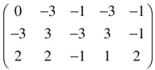

我们求该变换核的一组基（从而得到其维数），并求向量 `{4,2,0,0,-6}` 和 `{1.2, - 1, - 2, 3}` 的像。我们还要求该变换的像空间的一组基。

定义矩阵`A`：

```
>> A = [0,-3,-1,-3,-1;-3,3,-3,-3,-1;2,2,-1,1,2]
A =
   0    -3    -1    -3    -1
  -3     3    -3    -3    -1
   2     2    -1     1     2
```

求矩阵`A`的零空间：

```
>> null(A)
ans =
  -0.5397  -0.1251
  -0.2787  -0.2942
  -0.0266  -0.6948
   0.0230   0.6021
   0.7936  -0.2292
```

这两个列向量构成了`A`的零空间的一组基。因此，该变换的核的维数为 2。

求向量`v`在线性变换下的像，只需计算`A*v`。

```
>> A*[4 2 0 0 -6]'
ans =
   0
   0
   0
```

```
>> A*[1 2 -1 -2 3]'
ans =
  -2
   9
  11
```

该线性变换的像的维数等于`A`的秩。

```
>> rank (A)
```

因此，该变换的像的维数为 3，像的一组基将由`A`的任意三个线性无关的列向量给出。

```matlab
>> det([0 -3 -2;-3 3 2;-1 -3 -1])
```

```
ans =

  -9
```

所以，向量组`{{0 - 3 - 2};{-3 3 2}; {- 1 -3 - 1}}`构成了像的一组基。

作为第八个例子，我们考虑实数三维空间中两个向量子空间`U`和`V`之间的线性变换`f`，对于`U`中的`(a, b, c)`，有`f (a, b, c) = (a + b, b + c, a + c)`。我们找到对应于变换`f`、`f⁵`和`e^f`的矩阵。

为了找到`f`的矩阵，我们找到`f`作用下标准基向量的像：

```matlab
>> f
```

```
f =

  [a + b, b + c, a + c]
```

```matlab
>> subs(f,{a,b,c},{1,0,0})
```

```
ans =

  1     0     1
```

```matlab
>> subs(f,{a,b,c},{0,1,0})
```

```
ans =

  1     1     0
```

```matlab
>> subs(f,{a,b,c},{0,0,1})
```

```
ans =

  0     1     1
```

与线性变换`f`相关联的矩阵`A`将以上述找到的基向量的像作为其列向量。因此：

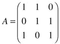

与`f⁵`关联的矩阵将是`A⁵`，与`e^f`关联的矩阵将是`e^A`。

```matlab
>> A = ([1 0 1;1 1 0;0 1 1])'
```

```
A =

   1     1     0
   0     1     1
   1     0     1
```

```matlab
>> A ^ 5
```

```
ans =

  11    10    11
  11    11    10
  10    11    11
```

```matlab
>> expm(A)
```

```
ans =

  3.1751  2.8321  1.3819
  1.3819  3.1751  2.8321
  2.8321  1.3819  3.1751
```

对于第九个例子，我们对如下定义的双线性型`f:U×V→R`和二次型`g:U→R`进行分类：

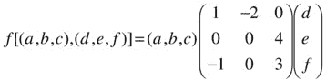

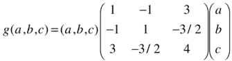

```matlab
>> A = [1, - 2, 0; 0, 0, 4; - 1, 0, - 3]
```

```
A =

   1  -2   0
   0   0   4
  -1   0  -3
```

```matlab
>> det (A)
```

```
ans =

   8
```

由于`f`的矩阵的行列式非零，该双线性型是正则非退化的。

```matlab
>> B = [1, - 1, 3; - 1, 1, - 3/2; 3, - 3/2, 4]
```

```
B =

   1.0000  -1.0000   3.0000
  -1.0000   1.0000  -1.5000
   3.0000  -1.5000   4.0000
```

为了对二次型进行分类，我们计算其对角线行列式。

```matlab
>> det (B)
```

```
ans =

  -2.2500
```

```matlab
>> det([1,-1;-1,1])
```

```
ans =

   0
```

结果表明该二次型是负半定的。

我们也可以通过二次型矩阵的特征值来获得分类。当且仅当所有特征值都严格为正时，二次型被定义为正定。当且仅当所有特征值都严格为负时，二次型被定义为负定。当且仅当所有特征值都非负时，二次型是正半定的。当且仅当所有特征值都非正时，二次型是负半定的。如果同时存在正和负的特征值，则二次型是不定的。

```matlab
>> eig (B)
```

```
ans =

  -0.8569
   0.4071
   6.4498
```

存在正特征值和负特征值，因此该二次型是不定的。

练习 5-1

考虑以下矩阵：

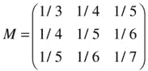

求其转置、逆矩阵、行列式、秩、迹、奇异值、条件数、范数、`M³`、`e^M`、`log(M)`和`sqrt(M)`。

```matlab
>> M = [1/3.1/4.1/5; 1/4.1/5.1/6; 1/5.1/6.1/7]
```

```
M =

   0.3333  0.2500  0.2000
   0.2500  0.2000  0.1667
   0.2000  0.1667  0.1429
```

```matlab
>> transpose = M'
```

```
transpose =

   0.3333  0.2500  0.2000
   0.2500  0.2000  0.1667
   0.2000  0.1667  0.1429
```

```matlab
>> inverse = inv (M)
```

```
inverse =

1.0e+003 *

0.3000  -0.9000  0.6300
-0.9000   2.8800 -2.1000
0.6300  -2.1000  1.5750
```

为了验证这确实是逆矩阵，我们将其与`M`相乘，得到三阶单位矩阵：

```matlab
>> M * inv (M)
ans =

1.0000 0.0000 0.0000
0.0000 1.0000 0.0000
0.0000 0.0000 1.0000
```

```matlab
>> determinant = det (M)
```

```
determinant =

2.6455e-006
```

```matlab
>> rank = rank (M)
```

```
rank =

3
```

```matlab
>> trace = trace (M)
```

```
trace =

0.6762
```

```matlab
>> vsingular = svd (M)
```

```
vsingular =

0.6571
0.0189
0.0002
```

```matlab
>> condition = cond(M)
```

```
condition =

3.0886e+003
```

在计算范数时，我们求标准范数、1-范数、无穷范数和 Frobenius 范数：

```matlab
>> norm (M)
ans =

0.6571
```

```matlab
>> norm(M,1)
ans =

0.7833
```

```matlab
>> norm(M,inf)
ans =

0.7833
```

```matlab
>> norm(M,'fro')
ans =

0.6573
```

```matlab
>> M ^ 3
ans =

0.1403 0.1096 0.0901
0.1096 0.0856 0.0704
0.0901 0.0704 0.0578
```

```matlab
>> logm (M)
ans =

-2.4766   2.2200   0.5021
2.2200  -5.6421   2.8954
0.5021   2.8954 -4.7240
```

```matlab
>> sqrtm (M)
ans =

0.4631 0.2832 0.1966
0.2832 0.2654 0.2221
0.1966 0.2221 0.2342
```

要计算`e ^M`，我们尝试特征值法、Padé 逼近法、泰勒展开法和条件数变体：

```matlab
>> expm (M)
ans =

1.4679 0.3550 0.2863
0.3550 1.2821 0.2342
0.2863 0.2342 1.1984
```

```matlab
>> expm1 (M)
ans =

1.4679 0.3550 0.2863
0.3550 1.2821 0.2342
0.2863 0.2342 1.1984
```

```matlab
>> expm2 (M)
ans =

1.4679 0.3550 0.2863
0.3550 1.2821 0.2342
0.2863 0.2342 1.1984
```

```matlab
>> expm3 (M)
ans =

1.4679 0.3550 0.2863
0.3550 1.2821 0.2342
0.2863 0.2342 1.1984
```

正如我们所见，所有方法都得到了相同的指数矩阵。

## 练习 5-2

考虑以下矩阵：


求其转置、逆矩阵、行列式、秩、迹、奇异值、`M³`、`log(M)`和`sqrt(M)`。

## 练习 5-3

考虑以下符号矩阵：

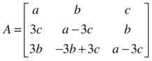

计算 `A'`、`A^(-1)`、`determinant(A)`、`trace(A)`、`rank(A)`、`inv(A)` 和 `A²`。

```matlab
>> A = sym('[a,b,c; 3*c,a-3*c,b; 3*b,-3*b+3*c,a-3*c]')
A =

[   a,         b,       c]
[3 * c, a - 3 * c, b]
[3 * b, 3 * c - 3 * b, a - 3 * c]

>> transpose (A)
ans =

[   a,   3 * c,   3 * b]
[   b, a-3*c, 3*c-3*b]
[   c,   b, a-3*c]
```

`[c, b, a - 3 * c]`

```matlab
>> pretty (det (A))
```

```
3     2          2               2     3        2     3
a - 6 a c + 3 a b – 9a b c + 9 a c + 3 b + 9 b c + 9 c
```

```matlab
>> pretty (trace (A))
```

`3 a - 6 c`

```matlab
>> rank (A)
```

`ans =`

`3`

```matlab
>> simplify(inv(A))
```

`ans =`

```
[ (a² - 6*a*c + 3*b² - 3*b*c + 9*c²)/(c²*(9*a + 9*b) - c*(6*a² + 9*b*a) + 3*a*b² + a³ + 3*b³ + 9*c³),          -(a*b - 3*c²)/(c²*(9*a + 9*b) - c*(6*a² + 9*b*a) + 3*a*b² + a³ + 3*b³ + 9*c³),    (b² + 3*c² - a*c)/(c²*(9*a + 9*b) - c*(6*a² + 9*b*a) + 3*a*b² + a³ + 3*b³ + 9*c³)]
[               (3*b² + 9*c² - 3*a*c)/(c²*(9*a + 9*b) - c*(6*a² + 9*b*a) + 3*a*b² + a³ + 3*b³ + 9*c³),  -(c*(3*a + 3*b) - a²)/(9*b*c² - 6*a²*c + a*(3*b² - 9*b*c + 9*c²) + a³ + 3*b³ + 9*c³),         -(a*b - 3*c²)/(c²*(9*a + 9*b) - c*(6*a² + 9*b*a) + 3*a*b² + a³ + 3*b³ + 9*c³)]
[                      -(3*a*b - 9*c²)/(c²*(9*a + 9*b) - c*(6*a² + 9*b*a) + 3*a*b² + a³ + 3*b³ + 9*c³), (3*b² + 3*a*b - 3*a*c)/(c²*(9*a + 9*b) - c*(6*a² + 9*b*a) + 3*a*b² + a³ + 3*b³ + 9*c³), -(c*(3*a + 3*b) - a²)/(9*b*c² - 6*a²*c + a*(3*b² - 9*b*c + 9*c²) + a³ + 3*b³ + 9*c³)]
```

```matlab
>> pretty(simplify(A²))
```

---

### MATLAB 符号矩阵操作示例

```matlab
>> M = sym ('[1/3.1/4.1/5; 1/4.1/5.1/6; 1/5.1/6.1/7]')
M =

[1/3, 1/4, 1/5]
[1/4, 1/5, 1/6]
[1/5, 1/6, 1/7]

>> transpose = M'
transpose =

[1/3, 1/4, 1/5]
[1/4, 1/5, 1/6]
[1/5, 1/6, 1/7]

>> inverse = inv (M)
inverse =

[300, -900, 630]
[-900, 2880, -2100]
[630, -2100, 1575]

>> determinant = det (M)
determinant =

1/378000

>> rank = rank (M)
rank =

3

>> trace = trace (M)
trace =

71/105

>> vsingular = svd (M)
vsingular =

(12703/88200 - (1045602865/351298031616 + (102103 ^(1/2) * i) / 49787136) ^(1/3)/2 - 1030177 / (99574272 * (1045602865/351298031616 + (102103 ^(1/2) * i) / 49787136) ^(1/3))-(3-^(1/2) * (1030177 / (49787136 * (1045602865/351298031616 + (102103 ^(1/2) * i) / 49787136) ^(1/3))-((102103 ^(1/2) * i) / 49787136 + 1045602865/351298031616) ^(1/3)) * i) / 2) ^(1/2)
(12703/88200 - (1045602865/351298031616 + (102103 ^(1/2) * i) / 49787136) ^(1/3)/2 - 1030177 / (99574272 * (1045602865/351298031616 + (102103 ^(1/2) * i) / 49787136) ^(1/3)) + (3 ^(1/2) * (1030177 / (49787136 * (1045602865/351298031616 + (102103 ^(1/2) * i) / 49787136) ^(1/3))-((102103 ^(1/2) * i) / 49787136 + 1045602865/351298031616) ^(1/3)) * i) / 2) ^(1/2)
(1030177 / (49787136 * (1045602865/351298031616 + (102103 ^(1/2) * i) / 49787136) ^(1/3)) + (1045602865/351298031616 + (102103 ^(1/2) * i) / 49787136) ^(1/3) + 12703/88200) ^(1/2)

>> M ^ 3
ans =

[10603/75600, 1227/11200, 26477/294000]
[1227/11200, 10783/126000, 74461/1058400]
[26477/294000, 74461/1058400, 8927/154350]

>> log (M)
ans =

[-log (3),-log (4),-log (5)]
[-log (4),-log (5),-log (6)]
[-log (5),-log (6),-log (7)]

>> sqrt (M)
ans =

[3 ^(1/2)/3, 1/2, 5 ^(1/2)/5]
[1/2, 5 ^(1/2)/5, 6 ^(1/2)/6]
[5 ^(1/2)/5, 6 ^(1/2)/6, 7 ^(1/2)/7]
```

# 练习 5-4

考虑以下矩阵 `A` 和 `B`：

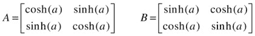

## 矩阵运算与性质计算

计算 `M1 = A² + B²`，`M2 = A² - B²`，`A^n`，`B^n`，`e^A`，`e^B`。找出矩阵 `A` 和 `B` 的逆矩阵、行列式、迹和范数。

### 定义矩阵 `A` 和 `B`

`>> A = sym('[cosh(a),sinh(a);sinh(a),cosh(a)]')`

`A =`

```
[ cosh(a), sinh(a)]
[ sinh(a), cosh(a)]
```

`>> B = sym('[sinh(a),cosh(a);cosh(a),sinh(a)]')`

`B =`

```
[ sinh(a), cosh(a)]
[ cosh(a), sinh(a)]
```

### 计算 `M1 = A² + B²` 与 `M2 = A² - B²`

`>> M1 = A²+B²`

`M1 =`

```
[ 2*cosh(a)² + 2*sinh(a)²,         4*cosh(a)*sinh(a)]
[ 4*cosh(a)*sinh(a),         2*cosh(a)² + 2*sinh(a)²]
```

`>> pretty(simplify(M1))`

```
+-                                -+
|           2                      |
|  4 sinh(a)  + 2,   2 sinh(2 a)   |
|                                  |
|                           2      |
|    2 sinh(2 a),  4 sinh(a)  + 2  |
+-                                -+
```

`>> M2 = A²-B²`

`M2 =`

```
[ 0, 0]
[ 0, 0]
```

### 计算 `A^n` 和 `B^n`

为了计算 `A^n` 和 `B^n`，我们首先找出它们的连续幂次，以试图看出一般规律：

`>> [simplify(A²),simplify(A³),simplify(A⁴)]`

`ans =`

```
[ cosh(2*a), sinh(2*a), cosh(3*a), sinh(3*a), cosh(4*a), sinh(4*a)]
[ sinh(2*a), cosh(2*a), sinh(3*a), cosh(3*a), sinh(4*a), cosh(4*a)]
```

`>> [simplify(B²),simplify(B³),simplify(B⁴)]`

`ans =`

```
[ cosh(2*a), sinh(2*a), sinh(3*a), cosh(3*a), cosh(4*a), sinh(4*a)]
[ sinh(2*a), cosh(2*a), cosh(3*a), sinh(3*a), sinh(4*a), cosh(4*a)]
```

现在一般规律的形式已经很明显了：

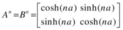

### 计算逆矩阵、行列式、迹

`>> simplify(inv(A))`

`ans =`

```
[  cosh(a), -sinh(a)]
[ -sinh(a),  cosh(a)]
```

`>> simplify(inv(B))`

`ans =`

```
[ -sinh(a),  cosh(a)]
[  cosh(a), -sinh(a)]
```

`>> simplify(det(A))`

`ans =`

`1`

`>> simplify(det(B))`

`ans =`

`-1`

`>> simplify(trace(A))`

`ans =`

`2*cosh(a)`

`>> simplify(trace(B))`

`ans =`

`2*sinh(a)`

### 计算矩阵指数 `e^A` 和 `e^B`

`>> simplify(exp(A))`

`ans =`

```
[ exp(cosh(a)), exp(sinh(a))]
[ exp(sinh(a)), exp(cosh(a))]
```

`>> simplify(exp(B))`

`ans =`

# 练习 5-5

考虑一个服从正态分布的 3 阶随机方阵 `A`。计算以 `A` 的特征值为对角元素的对角矩阵 `D`，以及列向量为对应特征向量的矩阵 `V`（若输出结果为复数，请将其转换为实数形式）。

求 `A` 的平衡矩阵，以及其 Schur 分解的实数和复数形式。

求矩阵 `A` 的特征多项式的系数。

计算与矩阵 `A` 同维度的上三角矩阵 `R`、置换矩阵 `E` 和正交矩阵 `Q`，使得 `A * E = Q * R`，并验证结果。

考虑 `A` 的 Hessenberg 矩阵 `B`，计算 `A` 和 `B` 的广义特征值对角矩阵 `D`，以及列向量为对应特征向量的矩阵 `V`，使其满足 `A * V = B * V * D`。同时计算 `A` 和 `B` 的广义奇异值向量。

## 示例代码与输出

### 生成随机矩阵 `A` 与计算特征值/特征向量

```matlab
>> A=randn(3)
A =
   -0.4326    0.2877    1.1892
   -1.6656   -1.1465   -0.0376
    0.1253    1.1909    0.3273
```

```matlab
>> [V,D] = eig(A)
V =
    0.2827    0.4094 - 0.3992i   0.4094 + 0.3992i
    0.8191   -0.0950 + 0.5569i  -0.0950 - 0.5569i
   -0.4991              0.5948             0.5948
D =
   -1.6984                  0                        0
         0       33 + 1.0309i                        0
         0                  0         0.2233 - 1.0309i
```

# 矩阵分解示例与练习

## 示例

```matlab
>> [V,D] = cdf2rdf(V,D)
V =
    0.2827     0.4094    -0.3992
    0.8191    -0.0950     0.5569
   -0.4991     0.5948          0
D =
   -1.6984         0         0
         0    0.2233    1.0309
         0   -1.0309    0.2233
```

```matlab
>> [T,B] = balance(A)
T =
     1     0     0
     0     1     0
     0     0     1
B =
   -0.4326    0.2877    1.1892
   -1.6656   -1.1465   -0.0376
    0.1253    1.1909    0.3273
```

```matlab
>> [U, T] = schur(A)
U =
    0.2827    0.2924    0.9136
    0.8191   -0.5691   -0.0713
   -0.4991   -0.7685    0.4004
T =
   -1.6984    0.2644   -1.2548
         0    0.2233    0.7223
         0   -1.4713    0.2233
```

```matlab
>> [U, T] = rsf2csf(U, T)
U =
    0.2827   -0.7482 + 0.1678i   0.2395 - 0.5242i
    0.8191    0.0584 - 0.3266i  -0.4661 + 0.0409i
   -0.4991   -0.3279 - 0.4410i  -0.6294 - 0.2298i
T =
   -1.6984   1.0277 + 0.1517i   0.2165 + 0.7201i
         0   0.2233 + 1.0309i   0.7490 - 0.0000i
         0                  0   0.2233 - 1.0309i
```

```matlab
>> poly(A)
ans =
    1.0000    1.2517    0.3540    1.8895
```

接下来，我们计算与上述示例中矩阵 `A` 同维度的上三角矩阵 `R`、置换矩阵 `E` 和正交矩阵 `Q`，使得 `A * E = Q * R`，并验证结果。

```matlab
>> [Q, R, E] = qr(A)
Q =
   -0.2507    0.4556   -0.8542
   -0.9653   -0.0514    0.2559
    0.0726    0.8887    0.4527
R =
    1.7254    1.1211   -0.2380
         0    1.2484    0.8346
         0         0   -0.8772
E =
     1     0     0
     0     1     0
     0     0     1
```

```matlab
>> A * E
ans =
   -0.4326    0.2877    1.1892
   -1.6656   -1.1465   -0.0376
    0.1253    1.1909    0.3273
```

```matlab
>> Q * R
ans =
   -0.4326    0.2877    1.1892
   -1.6656   -1.1465   -0.0376
    0.1253    1.1909    0.3273
```

因此，这些矩阵确实满足 `A * E = Q * R`。

现在我们考虑 `A` 的 Hessenberg 矩阵 `B`，计算 `A` 和 `B` 的广义特征值对角矩阵 `D`，以及列向量为对应特征向量的矩阵 `V`，使得 `A * V = B * V * D`。此外，我们还计算 `A` 和 `B` 的广义奇异值向量。

```matlab
>> B = hess(A)
B =
   -0.4326   -0.1976    1.2074
    1.6703   -1.2245    0.1544
         0   -1.0741    0.4053
```

```matlab
>> [V, D] = eig(A, B)
V =
    0.0567    1.0000    1.0000
   -0.0354   -0.4998    0.5297
   -1.0000    0.4172    0.3785
D =
    1.0000           0          0
         0     -0.4722          0
         0           0     -2.1176
```

```matlab
>> A * V
ans =
   -1.2245   -0.0803    0.1699
   -0.0137   -1.1082   -2.2872
   -0.3649   -0.3334    0.8801
```

```matlab
>> B * V * D
ans =
   -1.2245   -0.0803    0.1699
   -0.0137   -1.1082   -2.2872
   -0.3649   -0.3334    0.8801
```

```matlab
>> sigma = gsvd(A, B)
sigma =
    0.2874
    1.0000
    3.4799
```

## 练习 5-6

考虑下面这个 3×3 矩阵 `A`：

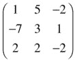

求矩阵 `A` 的 LU、QR、Cholesky、Schur、Hessenberg 分解和奇异值分解，并检验结果是否正确。同时求矩阵 `A` 的伪逆。

首先，我们求 Schur 分解，并检验结果是否正确。

```matlab
>> A = [1, 5, - 2; - 7, 3, 1; 2, 2, - 2];
```

```matlab
>> [U, T] = schur (A)
U =
-0.0530 - 0.8892 - 0.4544
-0.9910 - 0.0093   0.1337
0.1231 - 0.4573   0.8807
T =
2.4475 - 5.7952 - 4.6361
5.7628   0.3689   2.4332
0        0      - 0.8163
```

现在验证 `U * T * U' = A` 和 `U * U' = eye(3)`：

```matlab
>> [U * T * U', U * U']
ans =
1.0000 5.0000 - 2.0000 1.0000 0.0000 0.0000
-7.0000 3,0000   1.0000 0.0000 1.0000 0.0000
2.0000 2.0000 - 2.0000 0.0000 0.0000 1.0000
```

现在求 LU、QR、Cholesky、Hessenberg 分解和奇异值分解，并逐一检验结果：

### LU 分解

```matlab
>> [L, U, P] = lu (A)
L =
1.0000 0 0
-0.1429 1.0000 0 下三角矩阵
-0.2857 0.5263 1.0000
U =
-7.0000 3,0000 1.0000
0 5.4286 - 1.8571 上三角矩阵
0 0 - 0.7368
P =
0 1 0
1 0 0
0 0 1
```

```matlab
>> [P * A, L * U]
ans =
-7     3     1      -7     3     1
5     1   - 2      1     5   - 2  我们得到 P * A = L * U
2     2    -2      2     2    -2
```

### QR 分解

```matlab
>> [Q, R, E] = qr (A)
Q =
-0.1361 - 0.8785 - 0.4579
0.9526 - 0.2430   0.1831
-0.2722 - 0.4112   0.8700
R =
-7.3485   1.6330   1.7691
0 - 5.9442   2.3366    上三角矩阵
0        0 - 0.6410
E =
1 0 0
0 1 0
0 0 1
```

```matlab
>> [A * E, Q * R]
ans =
1.0000 5.0000 - 2.0000 1.0000 5.0000 - 2.0000
-7.0000 3.0000   1.0000 - 7.0000 3.0000 1.0000
2.0000 2.0000 - 2.0000 2.0000 2.0000 - 2.0000
于是，A * E = Q * R。
```

### Cholesky 分解

```matlab
>> R = chol (A)
??? 错误使用 == > chol
矩阵必须为正定矩阵。
```

矩阵分析示例

报错信息显示该矩阵不是正定矩阵。

```
>> [H, p] = hess (A)
P =
1.0000        0      0
0 - 0.9615 0.2747
0   0.2747 0.9615
H =
1.0000 - 5.3571 - 0.5494
7.2801   1.8302 - 2.0943
0 - 3.0943 - 0.8302
```

```
>> [P * H * P ', P' * P]
ans =
1.0000  5.0000 - 2.0000 1.0000       0       0
-7.0000  3,0000   1.0000      0  1.0000       0
2.0000  2.0000 - 2.0000      0       0  1.0000
```

于是 `PHP' = A` 且 `P'P = I`。

```
>> [U, S, V] = svd (A)
U =
-0.1034 - 0.8623   0.4957
-0.9808   0.0056 - 0.1949
0.1653 - 0.5064 - 0.8463
S =
7.8306       0           0
0  6.2735           0    对角矩阵
0       0      0.5700
V =
0.9058 - 0.3051 0.2940
-0.3996 - 0.8460 0.3530
-0.1411   0.4372 0.8882
```

```
>> U * S * V'
ans =
1.0000 5.0000 - 2.0000
-7.0000 3,0000   1.0000         我们看到 USV' = A
2.0000 2.0000 - 2.0000
```

现在计算矩阵 `A` 的伪逆：

```
>> X = pinv (A)
X =
0.2857 - 0.2143 - 0.3929
0.4286 - 0.0714 - 0.4643
0.7143 - 0.2857 - 1.3571
```

```
>> [A * X * A, X * A * X]
ans =
1.0000 5.0000 - 2.0000 0.2857 - 0.2143 - 0.3929
-7.0000 3,0000   1.0000 0.4286 - 0.0714 - 0.4643
2.0000 2.0000 - 2.0000 0.7143 - 0.2857 - 1.3571
```

因此，我们看到 `AXA = A`，`XAX = X`。

## 练习 5-7

考虑以下矩阵：

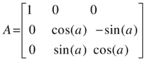

计算其特征值、特征多项式、若尔当标准型和奇异值。

首先，将矩阵 `A` 定义为符号矩阵：

```
>> A = sym ('[1 0 0; 0 cos (a) - sin (a); 0 sin (a) cos (a)]')
A =
[ 1,     0,      0]
[0, cos (a) - sin (a)]
[0, sin (a), cos (a)]
```

```
>> eigensys (A)
ans =
[                                  1]
[cos (a) + 1/2 * (- 4 * sin (a) ^ 2) ^(1/2)]
[cos (a) - 1/2 * (- 4 * sin (a) ^ 2) ^(1/2)]
```

```
>> pretty (simple (poly (A)))
3      2               2
x - 2 x cos (a) + x - x + 2 x cos (a) - 1
```

```
>> jordan (A)
ans =
[1, 0,                                               0]
[0, cos (a) + 1/2 * (- 4 * without (a) ^ 2) ^ (1/2), 0]
[0, 0, cos (a) - 1/2 * (- 4 * without (a) ^ 2) ^(1/2)]
```

```
>> simple (svd (A))
ans =
[                                                              1]
[1/2 * (4 * cos (a-comp (a)) + 2 * (- 2 + 2 * cos (2 * a-2 * conj (a))) ^(1/2)) ^(1/2)]
```

`[1/2 * (4 * cos (a-comp (a)) - 2 * (- 2 + 2 * cos (2 * a-2 * conj (a))) ^(1/2)) ^(1/2)]`

## 练习 5-8

将行向量为以下数值的对称矩阵对角化：

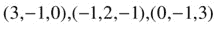

求相似变换矩阵 `V`，确认原始矩阵的特征值等于对角矩阵的对角线元素，并且对角矩阵与原矩阵相似。

我们计算矩阵 `A` 的对角矩阵 `J`，其对角线由 `A` 的特征值构成，同时求出相似变换矩阵 `V`。为此，我们使用命令 `[V, J] = jordan (A)`：

```
>> A = [3, -1, 0; -1, 2, -1; 0, -1, 3]

A =

3 -1  0
-1 -2 -1
0 -3 -1

>> [V, J] = jordan (A)

V =

1 -1 -1
2  0 -1
1 -1 -1

J =

1 0 0
0 3 0
0 0 4
```

现在验证对角矩阵 `J` 的对角线是否确实是 `A` 的特征值：

```
>> eig (A)

ans =

1.0000
3.0000
4.0000
```

矩阵 `A` 和 `J` 相似，因为矩阵 `V` 满足关系式 `V ^(-1) * A * V = J`：

```
>> inv (V) * A * V

ans =

1.0000      0     -0.0000
0      3.0000            0
0        0         4.0000
```

## 练习 5-9

为以下每一个数组求一个相似的对角矩阵：

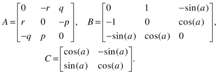

将这些矩阵对角化。求出每一个矩阵的特征多项式。

```
>> A = sym('[0,-r,q;r,0,-p;-q,p,0]');

>> [V, J] = jordan (A)

V =

[(q *(-p²-q²-r²) ^(1/2)) /(p² + q²) - (p * r) /(p² + q²),-(q *(-p²-q²-r²) ^(1/2)) /(p² + q²) - (p * r) /(p² + q²), p/r]

[-(p) *(-p²-q²-r²) ^(1/2)) /(p² + q²) - (q * r) /(p² + q²), (p) *(-p²-q²-r²) ^(1/2)) /(p² + q²) - (q * r) /(p² + q²), q/r]

[  1, 1,   1]

J =

[ -(- p² - q² - r²)^(1/2),                         0, 0]
[                          0, (- p² - q² - r²)^(1/2), 0]
[                          0,                         0, 0]
```

现在，我们分析矩阵 `B`：

```
>> B = sym ('[0,1,-sin (a); - 1, 0, cos (a) - sin (a), cos (a), 0]')

>> J = simple (jordan (B))

J =

[0, 0, 0]
[0, 0, 0]
[0, 0, 0]
```

这表明矩阵 `B` 只有一个三重特征值零。此外，`B - 0 * eye (3) = B` 的核的维数小于三，因为 `B` 的行列式为零。具体来说，它的维数为一（如下文使用命令 `null (B)` 计算基向量所示）。由于重数与核的维数不一致，我们得出结论：矩阵 `B` 不可对角化：

```
>> null (B)

ans =

[cos (a)]
[sin (a)]
[     1]
```

我们计算了 `B` 的核的一组基，该基仅由一个向量构成，因此 `B` 的核的维数为 1：

```
>> det (B)

ans =

0
```

我们现在分析矩阵 `C`：

```
>> C = sym ('[cos(a), – sin(a); sin(a), cos(a)]');

>> [V, J] = jordan (C)

V =

[1/2, 1/2]
[I/2, - I/2]

J =

[cos (a) - sin (a) * i, 0]
[0, cos (a) + sin (a) * i]
```

现在我们计算这三个矩阵的特征多项式：

```
>> pretty (poly (A))

3    2   2   2
x + (p + q + r ) x

>> pretty (simple (sym (poly (B))))

3
x

>> pretty(simple(sym(poly(C))))

2
x - 2 cos (a) x + 1
```

## 练习 5-10

求出 8 阶威尔金森矩阵、8 阶幻方矩阵`magic(8)`以及罗瑟矩阵的特征值。

```
>> [eig (wilkinson (8)), eig (rosser), eig (magic (8))]

ans =

1.0e + 003 *

-0.0010 -1.0200  0.2600
0.0002  0.0000  0.0518
0.0011  0.0001 -0.0518
0.0017  1.0000  0.0000
0.0026  1.0000 -0.0000 + 0.0000i
0.0028  1.0199 -0.0000 - 0.0000i
0.0042  1.0200 -0.0000 + 0.0000i
0.0043  1.0200 -0.0000 - 0.0000i
```

我们注意到威尔金森矩阵有若干对特征值非常接近，但并不相等。罗瑟矩阵有一个二重特征值、三个近似相等的特征值、一对符号相反的主导特征值、一个零特征值以及一个很小的非零特征值。

## 练习 5-11

考虑两个向量子空间`U`（包含于 R³）和`V`（包含于 R⁴）之间的线性变换`f`，对于`U`中的任意点`(a, b, c)`有：

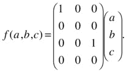

求`f`的核和像。

```
>> A = ([1,0,0;0,0,0;0,0,1;0,0,0]);
```

核是`U`中像为零向量的集合：

```
>> null (A)

ans =

0
1
0
```

因此核是向量`{0,b, 0}`的集合，其中`b`可变。此外，核的维数显然为1，因为它以`{0,1,0}`为基。

```
>> rank (A)

ans =

2
```

`f`的像的维数必须等于矩阵`A`的秩，我们刚刚看到这个秩是2。`A`的任意一个包含一个非奇异 2×2 子矩阵的两列子矩阵的列将构成`f`的像的一组基。

```
>> det([1,0;0,1])

ans =

1
```

因此，`f`的像的一组基由`{{1,0,0,0},{0,0,1,0}}`给出。

## 练习 5-12

给定二次型`g:U®R`定义如下：

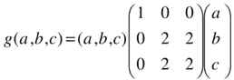

对其进行分类，并求出其约化方程、秩和符号差。

为了对二次型进行分类，我们计算其对角行列式。

```
>> G = [1,0,0;0,2,2;0,2,2]

G =

1 0 0
0 2 2
0 2 2

>> det (G)

ans =

0

>> det([1,0;0,2])

ans =

2
```

该二次型是退化的半正定二次型。

为了求出约化方程，我们对矩阵进行对角化。

```
>> J = jordan (G)

J =

0 0 0
0 1 0
0 0 4
```

则二次型的约化方程为：

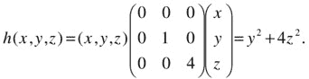

```
>> rank (J)

ans =

2
```

该二次型的秩为2，因为矩阵的秩为2。其符号差也为2，因为对角矩阵中正项的个数为2。