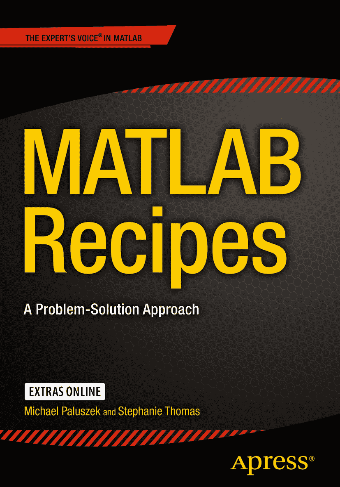

 迈克尔·帕卢谢克与斯蒂芬妮·托马斯 MATLAB 编程实例：问题解决方案指南

ISBN 978-1-4842-0560-0 电子书 ISBN 978-1-4842-0559-4 DOI 10.1007/978-1-4842-0559-4 美国国会图书馆控制号：2015955885 © 迈克尔·帕卢谢克 与 斯蒂芬妮·托马斯 2015 本书前言部分包含标准 Apress 版权声明。书中可能出现具有商标的名称、标识和图像。我们仅在编辑风格下使用这些名称、标识和图像，以维护商标所有者的利益，并无意侵犯其商标权。本书中使用的商品名称、商标、服务标记及类似术语，即使未明确标识，也不应被视为对它们是否受所有权保护的表达。尽管本书中的建议和信息在出版时被认为是真实准确的，但作者、编辑及出版商均不对可能存在的任何错误或疏漏承担法律责任。出版商不对本书所含内容作任何明示或暗示的担保。本书采用无酸纸印刷。谨以此书献给玛丽莲和马特。

## 引言

编写软件几乎已成为每位专业工程师和工科学生工作描述的一部分。虽然市面上有许多优秀的预制工程软件，但几乎每个人都能从为自己问题编写定制软件中受益。

MATLAB® 正是源于这一原因。需要进行矩阵运算的科学家们曾使用 FORTRAN 编写的数值软件。当时，使用计算机语言需要用户经历编写、编译、链接和执行的流程，既耗时又容易出错。MATLAB 提供了一种脚本语言，用户只需编写几行脚本即可瞬时解决许多问题。MATLAB 内置的可视化工具帮助用户更好地理解结果。编写 MATLAB 代码比编写 FORTRAN 代码高效且有趣得多。

自诞生以来，MATLAB 已有了巨大的发展。基础 MATLAB 软件的功能大幅增强，如今已有数百个 MATLAB 库可供使用，既有商业版也有开源版。MATLAB 非常复杂精深，大多数新用户仅使用了其功能的一小部分。

《MATLAB 编程实例》的目标是帮助所有用户充分利用 MATLAB 的强大功能。本书分为两部分。第一部分（第 1 章至第 5 章）提供了一个框架，供您编写高质量 MATLAB 代码，这些代码可供您、您的同事乃至您的客户使用。我们以问题-解决方案的格式涵盖了编码实践、图形、调试及其他主题。您可以通读这些章节，也可以只浏览感兴趣的实例，并将其应用于您最新的 MATLAB 代码中。

本书第二部分（第 6 章至第 12 章）展示了围绕动态系统控制与仿真的完整 MATLAB 应用。每章都提供了相应主题的技术背景、如何编写简单控制系统的思路，以及如何仿真该系统的示例。每个系统均通过一个 MATLAB 脚本来实现，并由多个 MATLAB 函数支持。每章还会重点介绍一个通用 MATLAB 主题，例如图形处理或图形用户界面（GUI）的编写。我们特意将控制系统设计得简单易懂，这样读者无需学习控制理论课程也能获得成果。控制专家则可以轻松地利用脚本实现自己的想法。我们涵盖了从化学过程到卫星的多个领域——如果我们未能为您的兴趣领域编写示例，在此表示歉意！

本书适合所有读者——从 MATLAB 新手到商业 MATLAB 包的作者。在撰写本书的过程中，我们自己也学到了新东西！希望您喜欢本书，并期待看到它激发您创作的软件。