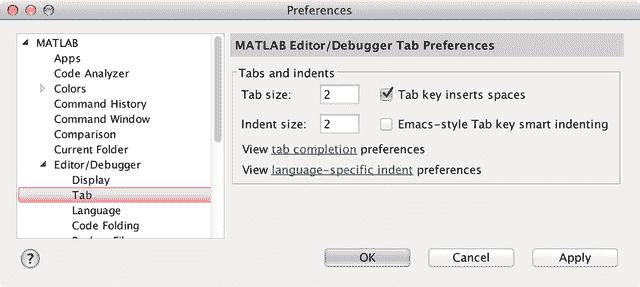
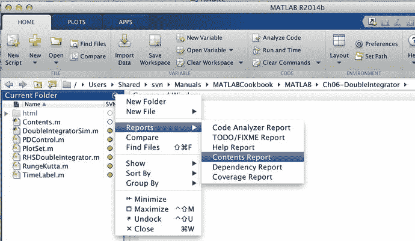
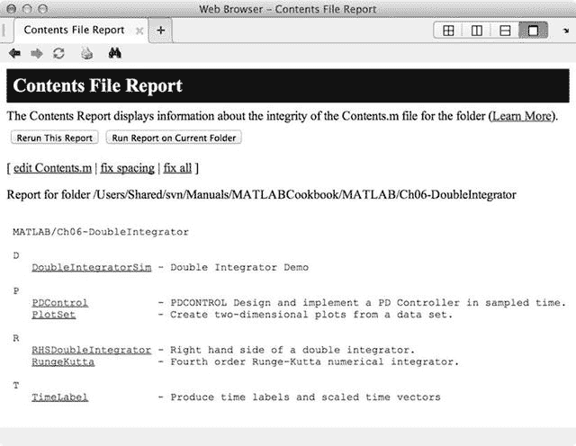
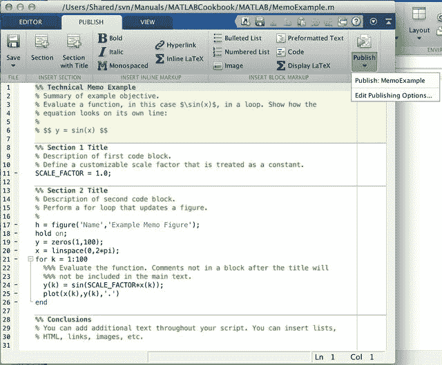
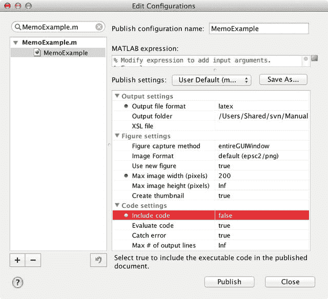
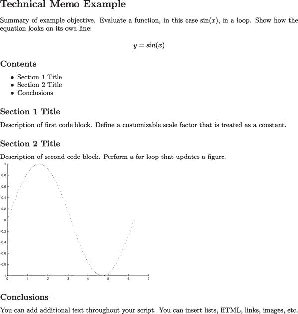
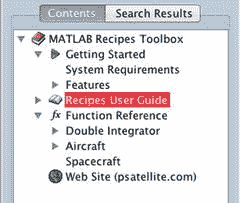

# 2. MATLAB 风格

电子补充材料：本章的在线版本（doi: 10.1007/978-1-4842-0559-4_2）包含仅供授权用户使用的补充材料。

本章提供了关于建议风格元素的指南和技巧，旨在使您的代码和工具更易于理解和使用。

在构建函数时，我们有具体的指导原则。注释应清晰且具有描述性，并遵循您所在机构设定的格式指南。命名约定也应如此。此外，我们建议提供“内置”输入和输出；即示例参数，使得函数无需用户输入即可完整执行。这些额外的演示形式应与您为函数创建的不同语法一起列出。

对代码进行文档化处理不仅仅是在代码中添加页眉和一些注释。MATLAB 现在允许您将 HTML 帮助集成到工具箱中，该帮助会与 MATLAB 文档一起在浏览器中显示。您还可以使用发布工具来创建综合性的技术报告。从一开始就将这些特性纳入您的风格指南中，将为您在日后向他人发布工具箱时节省大量工作。

## 2.1 制定您自己的 MATLAB 风格指南

### 问题

您团队中的每位工程师都偏好各自喜爱的命名和空白样式。当大家协作处理彼此代码时，最终会形成一种混杂的风格，导致代码更难阅读。

### 解决方案

制定并发布您自己的风格指南。MATLAB 可以在首选项设置中帮助强制执行某些指南，例如制表符大小。

### 工作原理

我们推荐经典书籍《MATLAB 风格要素》（Richard K. Johnson 著，剑桥大学出版社，2010 年）作为制定个人风格指南的起点。其中许多建议适用于跨编程语言的通用良好编码实践，另一些则针对 MATLAB 特有内容，例如在注释中使用发布标记语法。该书涵盖了格式化、命名、文档和编程等方面。

我们在某些方面与书中的建议略有不同。例如，我们更倾向于将函数名首字母大写。这样做能在脚本中区分自定义函数与 MATLAB 内置函数。我们还倾向于对结构体使用单字母变量，而非冗长的驼峰式名称。然而，编写清晰 MATLAB 代码的关键——该书也强调了这一点——在于将 MATLAB 代码视为编译型代码来对待。要注意变量类型，即使 MATLAB 未明确要求也要使用括号，并编写充足的注释。

例如，当变量值为双精度浮点数时，通过添加小数点来表明这一点可避免混淆该参数可能为整数。

将

```
length = 1;
```

替换为

```
length = 1.0;
```

在 `if` 语句中，始终使用括号。若将来计划将代码移植到其他语言，这能节省时间，并且能使代码对掌握多种语言的程序员而言更清晰易读。

将

```
if thisIsTrue && thatIsTrue
```

替换为

```
if (thisIsTrue && thatIsTrue)
```

应始终避免在代码中使用“魔法数字”——这些数字在快速编写函数测试概念时很容易被使用。它们是指直接键入到逻辑语句等处的数值，而非赋值给变量。应花时间定义一个命名得当的变量，并添加注释说明该数字的来源。

将

```
if (value > 2.0 || value < 0.0)
```

替换为

```
if (value > minValue || value < maxValue)
```

随着彩色编码集成开发环境（如 MATLAB 编辑器）的出现，在风格指南中通过大量空白来划分代码段的做法已不再流行。通常，代码块之间留一行空行即可。我们建议在函数结束与子函数开始之间额外添加一行空白。紧密相关的代码行之间不应添加空白。

有些程序员喜欢让代码块在等号处对齐。这在某些情况下很有帮助，特别是编码来自参考文献的方程组时。然而，当代码处于活跃开发阶段时，维护这种对齐可能很繁琐。若喜欢此风格，建议等到函数通过内部代码审查并准备发布时，再添加对齐空格。在我们的代码中，通常只在注释或空白分隔的小型代码块内进行等号对齐。

请考虑以下代码：

```
% 初始化
myVar1 = linspace(0,1);
b = 1.0;

% 计算
[result1, result2] = MyFunction(myVar1,b);
plotH = plot(myVar1,result2);
```

这可以通过多种方式对齐，例如：

```
% 初始化
myVar1 = linspace(0,1);
b    = 1.0;

% 计算
[result1, result2] = MyFunction(myVar1,b);
plotH             = plot(myVar1,result2);
```

或者，若跨块对齐，可写为：

```
% 初始化
myVar1            = linspace(0,1);
b                 = 1.0;

% 计算
[result1, result2] = MyFunction(myVar1,b);
plotH              = plot(myVar1,result2);
```

在本书的代码中，您将看到前面那种按块对齐的风格。

关于空白的另一个考虑是制表符大小。某些指南建议使用四个或八个空格的较大制表符，理由是 MATLAB 代码很少深度嵌套。我们经常编写大量深度嵌套的代码，因此内部指南是使用两个空格。在 MATLAB 首选项中设置制表符大小，并设置为用空格代替制表符后，便可使用智能缩进功能轻松高亮并更新代码块。图 2-1 显示了 Mac 上 MATLAB R2014b 的制表符首选项窗格。



图 2-1. 大小为 2 且选中“使用空格”选项的制表符首选项

我们倾向于对函数名使用大写字母（例如 `MyFunction`），特别是为了将它们与 MATLAB 内置函数的小写函数名区分开来。此外，我们对变量使用驼峰式命名（例如 `myVariableName`）；对结构体常用单字母或极短的名称。对于索引变量，我们倾向于使用 `k`，以避免与虚数相关的变量 `i` 和 `j` 混淆。我们遵循常量名大写的标准惯例；例如，地球引力常数为 `MU_EARTH`。

换句话说，您需要为以下项制定命名规范：

*   函数名
*   变量名
*   结构体名
*   索引变量
*   常量

额外的命名规范可能包括对特定类型文件或变量使用标准前缀或后缀。例如，在提供积分动力学的函数名中使用字母“RHS”（方程右侧，当导数位于左侧时）；在演示特定函数或功能的脚本名中使用“Demo”一词很有帮助。变量名元素的顺序应保持一致。例如，如果 `r` 表示半径，第二个元素是行星名称，则使用 `R_EARTH` 和 `R_MOON`，而不要将第二个变量命名为 `MOON_R`。在整个代码库中，顺序应保持一致。

其他规则可能涉及布尔变量的名称或在函数名中使用动词。最重要的步骤是：为您的组织创建并记录一套命名约定，或创建一些函数模板，以便工程师编写出风格一致的代码。

本书通篇使用了以下指南：

*   **命名：** 命名指南。
*   **函数名：** 函数名使用首字母大写的驼峰式。第一个单词最好为动作动词或“RHS”。
*   **脚本名：** 若脚本是特定函数或函数集的演示，则在名称后追加“Demo”。
*   **变量名：** 变量名使用首字母小写的驼峰式。
*   **常量：** 使用大写字母标识常量。
*   **变量名长度：** 大多数变量名应至少包含三个字符。例外情况包括常用的数据结构、索引变量，以及复制方程式中使用单字母变量名（该领域人员易于识别）的情况。
*   **索引变量：** 使用单个索引变量时，用 `k`；使用两个索引变量时，用 `j` 和 `k`；更多变量时，用 `l`, `m`。
*   **双精度浮点数：** 在写出双精度浮点数值时，始终使用小数点。
*   **魔法数字：** 避免在代码中使用魔法数字；应优先使用变量来指定数字。
*   **注释：** 对于代码中硬编码的数字，始终添加注释说明其来源或理由。
*   **If 语句：** 始终在 `if` 语句的条件部分使用括号。
*   **制表符：** 使用两个空格的制表符大小，并将 MATLAB 设置为用空格代替制表符。在提交文件前，使用智能缩进确保制表符一致性。
*   **空行：** 大多数代码段之间使用一个空行，子函数之间使用两个空行。
*   **对齐：** 仅在代码块内部（按空行分隔的块）于等号处对齐代码。

关于函数头的指南将在下一个技巧中介绍。

## 2.2 编写良好的函数帮助

# 问题

你在编写某个函数几个月（或几年）后回顾它，或者回顾同事编写的函数时，发现其顶部只有一条晦涩难懂的注释。你不再记得该函数是如何工作的，它本应做什么，或者你的注释到底是什么意思。

# 解决方案

为你的函数头建立一种格式并坚持使用。利用发布标记，使你能够从 m 文件中生成漂亮的文档。

# 工作原理

在函数顶部使用发布标记编写函数头。这意味着第一行应以节分隔符 `%%` 开头，并包含函数名称，因为这将作为发布页面的标题。这一行还应包含对该函数的一句话总结；这必须是文件中第一个非空注释行，也称为 H1 行。MATLAB 在为你文件夹生成 `Contents.m` 文件以及执行 `lookfor` 函数（该函数在路径中搜索文件中的关键字）时，会自动使用此总结。

使用节标题分别记录输入和输出。指明变量类型或大小，并提供描述。在注释符号 `%` 和该行之间使用两个空格，以便为输入和输出列表生成等宽文本。使用以下键来指明变量类型和大小：

* `{}` 元胞数组

* `(1,1)` 标量值

* `(:)` 字符串

* `(:,:)` 大小可变的矩阵

* `(1,:)` 长度可变的行

* `(:,1)` 长度可变的列

* `(m,n)` 行列大小分别为 (m,n) 的矩阵，必须与其他输入或输出匹配

* `(.)` 数据结构

* `(:)` 数据结构数组

* `(*)` 函数句柄

务必包含版权声明。为你编写代码的工作争取署名！标准做法是以函数创建的初始年份开头，然后当你更新函数时添加一个年份范围，例如，`Copyright (c) 2012, 2014–2015`。括号内的 "c" 近似表示实际的版权符号。版权声明之后，下一行应注明 "All Rights Reserved"。在主函数头和版权声明之间添加一个空行，以使其在命令行帮助显示中被抑制。

以下示例展示了一个按列计算两个矩阵点积的函数。请注意，该函数在 `help Dot` 的命令行输出中仍然清晰可读，其中单元格分隔符的第一个 `%` 被抑制。使用 `*` 标记来创建项目符号列表。输出始终为一行，这在大小键中已指明。

## 函数头示例

```
%% DOT 两个数组的点积。
%% 形式
% d = Dot ( w, y )
% d = Dot ( w )
%% 描述
% 支持数组的点积。w 和 y 的列数可以是：
%
% * 两者都大于 1 且相等
% * 其中一个可以有一列，另一个有任意数量的列
%
% 如果只有一个输入，则点积将针对自身进行。
%% 输入
% w (:,:) 向量数组
% y (:,:) 向量数组
%% 输出
% d (1,:) w 和 y 的点积
%% 另请参见
% Cross
%% 版权
% Copyright (c) 2015 Princeton Satellite Systems, Inc.
% All Rights Reserved.
```

发布到 HTML 时，除了已生成的 Contents 部分外，显示效果如下：

### DOT 两个数组的点积。

#### 形式

`d = Dot( w, y )`

`d = Dot( w )`

#### 描述

支持数组的点积。`w` 和 `y` 的列数可以是：

* 两者都大于 1 且相等

* 其中一个可以是单列，另一个有任意数量的列

如果只有一个输入，则点积将针对自身进行。

#### 输入

`w (:,:) 向量`

`y (:,:) 向量`

#### 输出

`d (1,:) w 和 y 的点积`

#### 另请参见

`Cross`

最后，记得描述任何创建的图形或生成的文件；即“副作用”。识别函数是否使用了持久变量或全局变量也是个好主意，这些变量可能需要使用 `clear` 命令来重置。以下列表总结了函数头的各部分顺序。

1. **H1 行** 应以对函数的一行描述开头。

2. **语法** 列出支持的语法。

3. **描述** 提供更详细的描述。描述任何内置演示、参数的默认值、用户需要了解的持久变量或全局变量，以及任何“副作用”，包括保存的图形或文件。指明函数是否会向用户请求输入。

4. **输入** 使用大小/格式键列出输入。如果适用，包括单位。

5. **输出** 像列出输入一样列出输出。

6. **另请参见** 列出任何相关函数。

7. **参考** 如果适用，列出任何参考资料。

8. **版权** 包含版权声明。头部其余部分与版权声明之间应有一个空行。

## 2.3 重载函数与使用 `varargin`

### 问题

你想要重用已编写的某段代码，但在不同情况下，你可能以不同方式使用它，或者在某些情况下需要从中提取额外数据，在其他情况下则不需要。

### 解决方案

你可以在 MATLAB 中轻松且隐式地重载函数。`varargin` 和 `varargout` 使得管理可变长度的输入和输出列表变得简单。

### 工作原理

MATLAB 允许你在定义函数的文件中，以任何你喜欢的方式重载该函数。这适用于输入和输出。通常情况下，你需要权衡利弊：一种是编写最清晰的代码，使用单一的调用语法；另一种是避免代码重复。也许某些中间变量在某些情况下作为输出是很有用的，或者你想提供对旧版语法的向后兼容性。在创建用于数值计算的库时，总会有额外的语法被证明是有用的。关于重载函数，我们建议如下：

* 尽可能使用 `varargin` 和 `varargout`，并尽可能在函数顶部附近将变量重命名为描述性名称。

* 务必在函数头中清晰地记录所有输入和输出的变体。添加另一个可选输入或输出而忘记记录它，是导致函数头过时的首要原因。

* 当重命名输出以匹配函数语法时，或者使用 `varargout` 时，务必使用注释清晰标识输出是什么。

* 如果你正在创建图形且不需要函数输出，请清除函数输出，以避免在命令行进行不必要的打印。

以下示例突显了这些指南的使用。我们通常使用带有字符串“动作”的函数，通过名称定义多种输入变体。这提供了超越仅依赖输入数量或类型来选择重载方法的额外清晰性。

### 函数重载

```matlab
% d = OverloadedFunction('default data');
% OverloadedFunction('demo');
% [y,d] = OverloadedFunction('update',x,d);

function varargout = OverloadedFunction ( action, varargin )

switch action

case 'default data'
    d = DefaultData;
    varargout{1} = d;

case 'demo'
    d = DefaultData;
    x = linspace(0,1);
    y = OverloadedFunction('update',x,d);
    figure('name', 'OverloadedFunction Demo');
    plot(x,y);

case 'update'
    x = varargin{1};
    d = varargin{2};
    y = Update(x,d);
    varargout{1} = y;
    varargout{2} = d;

end
```

## 2.4 为函数添加内置输入和输出

### 问题

您希望为某些可选输入提供默认值，或者对函数的工作原理进行简短演示。

### 解决方案

使用动作输入或 `nargin` 为函数添加内置输入和输出。这可以包括一个完整的演示，该演示调用函数并酌情生成图形。

### 工作原理

内置输入提供了一组可生成输出的示例参数。在很多情况下，我们会提供一个输入范围，用于创建展示函数中所执行计算的图表。在 MATLAB 中，你必须在代码中显式处理输入选项，因为无法在函数定义本身中添加默认值。

我们发现一个有用的约定是允许输入空矩阵 `[]` 来使用其默认值。这样你可以为某个输入请求默认值，同时为后续输入提供具体值。以下示例既展示了创建图表的演示过程，也展示了为常量设置默认值的方法。

```matlab
function output = MyFunction( variable, constant )

if (nargin == 0)

   % 执行演示
   variable = linspace(0,100);
   MyFunction( variable );
   return;

end

if (nargin < 2 || isempty (constant))

   % constant 的默认值
   constant = VALUE;

end
```

请注意，在没有任何输入时执行的内置演示会调用自身并返回。这使得该演示同时成为一项内置测试。生成内置输出（可能是命令行中的文本报告或图表）的代码通常位于函数末尾。这样你就可以使用用户指定的输入（而不仅仅是内置输入）来生成内置输出。例如，常量可能有替代值。请注意，在以下输出生成示例中，指定了图表的名称，其中包含函数名称，如果你在工作中经常生成数十张图表，这将非常有用。

```matlab
... 包含计算的函数体 ...

if (nargout==0)

   % 默认输出是图表
   figure('Name', 'Demo of MyFunction')
   plot(variable, output)
   clear output

end
```


**提示：** 为你创建的图表指定名称。为了清晰起见，应在名称中包含函数或演示的名称。该名称将显示在图表的标题栏以及MATLAB的窗口菜单中。

以这种方式编写所有函数有若干优点。其一，你可以在函数开头就展示有效的变量范围，而无需读者去另一个文件夹查阅单独的测试函数或演示。每次打开函数时都能看到这些硬数据，有助于保持代码与注释的一致性。此外，你拥有了一个函数测试，可以随时从编辑器中轻松重新运行。你可以在启用执行的情况下发布该函数，这样就能在HTML文件（或LaTeX/Word，如果选择的话）中直接运行演示并包含命令行输出和图表。所有这些都有助于减少错误，并为其他读者或未来的你记录函数的功能。

遵循此指南，以下是本书中所有函数遵循的通用格式：

1.  详细标头
2.  版权信息
3.  函数定义
4.  默认输入
5.  函数演示——调用自身
6.  包含计算的代码主体
7.  默认输出

注意，不需要最终的`return`语句。

总之，通过添加默认输入和输出，该函数启用了以下几种用法：

- `output = MyFunction( variable, constant );`
- `output = MyFunction( variable );`（使用`constant`的默认值）
- `MyFunction;`（执行内置演示）
- `MyFunction(variable, constant);`（为给定输入创建图表）

## 脚本的智能组织

### 问题

你在脚本中写了几行代码来测试某个想法。一年后你还能搞清楚它做了什么吗？

### 解决方案

像对待函数一样对待你的脚本，并对其进行良好的组织。花点时间遵循一个模板。

### 工作原理

脚本是放入文件中并一次性执行的所有命令的集合。在我们的工具箱中，我们将脚本视为工具箱函数的演示，因此也视为指导性材料。以下是我们建议在创建脚本时遵循的一些准则：

1.  **创建帮助标头** – 帮助标头不仅适用于函数；也为你的脚本编写它们。一年后，你还会记得这个脚本是做什么的吗？你公司的其他人能理解它吗？编写详细的描述，包括任何需要或生成的文件列表。
2.  **使用发布标记** – 在脚本中创建章节（使用`%%`）来划分不同部分。在章节标题后编写详细的注释。将脚本发布为HTML并查看效果。你甚至可以使用LaTeX标记或插入图片来添加公式。
3.  **初始化变量** – 确保完全初始化变量，否则在连续运行多个脚本时可能会产生冲突。这一点尤其适用于数据结构和元胞数组。请参阅第1章中关于数据类型的使用指南，了解正确初始化不同变量的方法。
4.  **指定保存文件的目录** – 确保将所有数据保存到特定位置，而不仅仅是当前目录所在的位置。

我们的脚本采用以下模式。各部分之间使用章节分隔符。

1.  使用发布标记的详细标头
2.  版权声明
3.  用户参数（意为可在运行间修改）集中在顶部
4.  定义常量
5.  在循环前初始化绘图数组
6.  执行计算
7.  创建图表
8.  根据需要将输出存储到文件中

以下是一个完整的可执行示例：

```matlab
%% DEMO 这是脚本布局的模板。
% 脚本的详细描述包括加载或生成的文件，
% 以及将创建哪些数据和图表的概览。
% 我们将计算带或不带输入缩放的正弦或余弦。
% 该脚本创建一个图表，并将工作区保存到名为
% Demo.mat 的文件中。

%% 另请参阅
% sin, cos

%% 用户参数
param1 = 0.5;
nPoints = 50;
useSine = false;

%% 常量
MY_CONSTANT = 0.25;

%% 计算循环
yPlot = zeros(2,nPoints);
x = linspace(0,4*pi,nPoints);
for k = 1:nPoints
    if (useSine)
        y = sin( [1.0;param1]*x(k) + MY_CONSTANT );
    else
        y = cos( [1.0;param1]*x(k) + MY_CONSTANT );
    end
    yPlot(:,k) = y;
end

%% 绘图
figure('Name', 'DEMO');
plot(x,yPlot);

%% 将工作区保存到文件
saveDir = fileparts(mfilename('fullpath'));
save(fullfile(saveDir, 'Demo'))
```

你可以通过清除工作区并在演示运行后加载`.mat`文件来验证数据是否已存储。

```matlab
>> clear all
>> ScriptDemo
>> clear all
>> load Demo.mat
>> who

你的变量是：

MY_CONSTANT  nPoints  useSine  y
k            param1   x        yPlot
```

## 为文件夹实现MATLAB命令行帮助

### 问题

你的代码库中有一组文件夹，你希望用户能像浏览内置MATLAB库一样轻松地浏览它们。

### 解决方案

在每个文件夹中放置`Contents.m`文件可以提供文件夹内容的元数据，这些信息可以在命令行中显示。

### 工作原理

命令行帮助不仅适用于函数和脚本。文件夹还可以通过内容列表的形式提供帮助，其中包含函数名称及每个函数的单行描述。工具箱也可以响应`ver`命令提供文档，并附带工具箱级别的内容列表。这些信息存储在完全由注释组成的`Contents.m`文件中。

“内容报告”可以为你生成`Contents.m`文件。它还可以检查和修复现有的`Contents.m`文件。该功能会自动使用函数或脚本中的H1行（即标题的第一行）。配方2-2提供了一个包含该行的函数标题示例。要了解更多信息，并了解如何在你使用的操作系统上运行此报告，请参阅MATLAB帮助主题“创建帮助摘要文件”。

版本信息并不限于每个工具箱的单个Contents文件；它通过插入到任何`Contents.m`文件顶部的特殊行生成：

```matlab
% Version xxx dd-mmm-yyyy
```

你还可以在版本信息上方添加描述行，并为文件组添加子标题。例如，考虑MATLAB中`codetools`目录的输出：

```matlab
>> help codetools

Commands for creating and debugging code

MATLAB Version 8.4 (R2014b) 08-Sep-2014

Editing and publishing

edit - Edit or create a file

grabcode - Copy MATLAB code from published HTML

mlint - Check files for possible problems

notebook - Open MATLAB Notebook in Microsoft Word (on Microsoft

Windows platforms)

publish - Publish file containing cells to output file

snapnow - Force snapshot of image for published document

Directory tools

mlintrpt - Run mlint for file or folder, reporting results in browser

visdiff - Compare two files (text, MAT, or binary) or folders
```

与函数标题一样，Contents文件中不能有空行，只能包含注释。本书第6章中的双积分器示例展示了这一点，我们在其中使用了字母作为章节分隔符。

```matlab
% MATLAB/Ch06-DoubleIntegrator

%

% D

% DoubleIntegratorSim - Double Integrator Demo

%

% P

% PDControl - Design and implement a PD Controller in sampled time.

% PlotSet - Create two-dimensional plots from a data set.

%

% R

% RHSDoubleIntegrator - Right hand side of a double integrator.

% RungeKutta - Fourth order Runge-Kutta numerical integrator.

%

% T

% TimeLabel - Produce time labels and scaled time vectors
```

图2-2显示了如何从命令窗口访问此文件夹的内容报告。



图2-2. 访问双积分器的内容报告


实际的报告如图 2-3 所示。你可以看到其中有用于编辑`Contents.m`文件的链接，例如添加版本信息、修正间距或修复所有问题。报告会检测你是否更改了函数的`H1`描述行，并且该行是否与`Contents`文件中的文本存在冲突。



图 2-3. 完成的双积分器内容报告

## 2.7 将代码发布为技术报告

### 问题

你正在基于在`MATLAB`中进行的某些分析创建一份报告。你费力地将代码片段和图形复制粘贴到报告文档中。接着你发现了代码中的一个错误，不得不全部重新做一遍……

### 解决方案

`MATLAB`中的发布功能允许你运行脚本，并自动生成包含结果的文档，其中包含每个生成的图形的图像以及代码本身，以及你插入的文本和公式。当你修改代码时，这些报告可以轻松地重新生成。

### 工作原理

发布功能允许您从代码生成`HTML`、`LaTeX`、`Word`和`PowerPoint`文档。这些文档可以显示代码本身，以及命令行输出和图表。您甚至可以在循环中捕获图形的快照，并使用`LaTeX`标记包含公式。每个程序员都应该熟悉这些特性。主要功能将在下文简要介绍。

文件顶部的第一个章节为发布的文档提供了标题。标题中的后续注释将按照“配方 2-2”中的说明进行发布。拥有一个良好的标题非常重要，因为它可以在命令行中显示，直到函数的第一个空白行。然而，您还可以在代码中添加更多章节、文本、方程式和图像。`MATLAB`会自动生成所有章节的目录，并将生成的图表和命令行输出插入到各个章节中。

您需要小心不要在循环内放置章节分隔符，因为这会在每次迭代时生成图形的快照。如果您想捕捉图形的演变过程，这可能是一种理想的行为，但也可能意外产生数百个不需要的图像。以下是一个为演示发布功能而创建的示例脚本。

### 从代码创建技术备忘录

```
%% Technical Memo Example
% Summary of example objective.
% Evaluate a function, in this case $\sin(x)$, in a loop. Show how the
% equation looks on its own line:
%
% $$ y = sin(x) $$
%% Section 1 Title
% Description of first code block.
% Define a customizable scale factor that is treated as a constant.
SCALE_FACTOR = 1.0;
%% Section 2 Title
% Description of second code block.
% Perform a for loop that updates a figure.
%
h = figure('Name','Example Memo Figure');
hold on;
y = zeros(1,100);
x = linspace(0,2*pi);
for k = 1:100
%%% Evaluate the function. Comments not in a block after the title will
%%% not be included in the main text.
y(k) = sin(SCALE_FACTOR*x(k));
plot(x(k),y(k),'.')
end
%% Conclusions
% You can add additional text throughout your script. You can insert lists,
% HTML, links, images, etc.
```

图 2-4 显示了在`MATLAB`编辑器的发布选项卡中的此脚本，其中打开了弹出菜单以访问发布选项。



图 2-4. 准备在编辑器中发布脚本

有许多适用于发布的设置。您可以保存一组设置并为其命名，以便轻松地将其复用于所有文件。代码的默认设置是既评估代码又将其源代码包含在发布的文档中，但这些设置可以独立关闭。要从脚本创建技术备忘录而不包含源代码本身，请将“包含代码”选项设置为`false`。您可以设置图形的最大尺寸，并选择格式：`JPEG`、`PNG`、`bitmap`或`TIFF`。您甚至可以为函数指定一个`MATLAB`表达式以包含输入参数，而不是将其作为内置演示运行。

图 2-5 显示了设置窗口，其中选择了`PDF`作为输出类型。请注意“另存为...”按钮，它允许您保存设置。为了本书的目的，我们将图形的最大宽度设置为 200 像素，以使备忘录能够适应一页。



图 2-5. 编辑文件的发布设置

图 2-6 显示了为上述列表生成并编译的`LaTeX`备忘录，该备忘录在发布时未包含代码，但包含了循环中生成的图形。请注意目录、方程式和图形的插入。我们不得不删除`MATLAB`添加到`LaTeX`中的一些额外的`\vspace`命令，以使备忘录能适应一页。



图 2-6. 发布到 LaTeX 并编译为 PDF 的技术备忘录

## 2.8 将工具箱文档集成到 MATLAB 帮助系统中

### 问题

您希望编写用户指南并将其随工具箱一起提供。

### 解决方案

如果您编写`HTML`帮助文件，您实际上可以在分发工具箱时将其包含在内，并且这些帮助将显示在`MATLAB`的帮助浏览器中。

### 工作原理

在为代码或工具箱提供文档时，您不仅限于命令行帮助。`MATLAB`现提供了一套`API`，用于编写`HTML`格式的文档，并在帮助浏览器中向用户显示。您可以编写完整的`HTML`手册，并包含已发布版本的演示。

为了将您的`HTML`帮助文件集成到`MATLAB`帮助系统中，您需要生成一些`XML`文件。其中一个文件为您的工具箱提供顶层目录。另一个文件提供演示或示例的列表。第三个文件用于标识您的产品。需要阅读的帮助主题是“显示自定义文档”和“显示自定义示例”。第三方产品的帮助信息显示在`MATLAB`帮助浏览器的一个独立分区中，标题为“补充软件”。您需要生成的文件列于表 2-1。

**表 2-1. 自定义文档文件**

| `info.xml` | 标识您的文档 |
| --- | --- |
| `helptoc.xml` | 目录 |
| `demos.xml` | 示例表格 |

`MATLAB`文档描述了您所需的`XML`标签，并提供了模板文档。文件中可以使用标准`HTML`注释（使用`<!--`和`-->`）来包含注释。

`info.xml`文件的主要目的是为您的工具箱提供一个名称，将其标识为工具箱或模块集，并提供其余`HTML`文档的路径。以下是我们的 recipes 代码的一个示例。

**示例 INFO.XML**

```
<productinfo xmlns:xsi="http://www.w3.org/2001/XMLSchema-instance"
xsi:noNamespaceSchemaLocation="optional">
<?xml-stylesheet type="text/xsl"href="optional"?>
<matlabrelease>R2014b</matlabrelease>
<name>MATLAB Recipes</name>
<type>toolbox</type>
<icon></icon>
<help_location>Documentation</help_location>
<help_contents_icon>$toolbox/matlab/icons/bookicon.gif</help_contents_icon>
</productinfo>
```

目录文件`helptoc.xml`必须提供您帮助文件中所有`HTML`文件的列表。这是通过可嵌套的`<tocitem>`标签实现的。您通常需要为您的工具箱提供一个起始页或主页、一个“入门”页面、用户指南页面、版本说明，以及列出所提供函数的其他页面。`<tocitem>`可以引用`HTML`锚点，并非所有都需要指向独立的`HTML`文件。

其中包含一小套图标，可在帮助目录中显示。请参考以下`helptoc.xml`。

**示例 HELPTOC.XML**

```markdown
## 结构化工具箱

### 问题

你有一堆零散的函数和脚本，想要将它们整理成一个可以分发给其他人的工具箱。

### 解决方案

之前的文章展示了如何为工具箱中的各个文件夹创建或生成 `Contents.m` 文件。你也可以创建一个顶层 `Contents.m` 文件。我们将描述常用的工具箱结构，包括这些文件的放置位置。

### 工作原理

我们为商业工具箱采用了一种固定结构，该结构被构建工具和测试程序所使用。

- 将相关函数分组放在文件夹中
- 将脚本放在单独的文件夹中
- 将脚本文件夹统一放在 `Demos` 文件夹中
- 函数文件夹与对应的演示文件夹使用相同的名称
- 将文件夹组组织成模块或工具箱

按照之前文章所述的方法创建帮助文件后，它们会以如下所示的方式出现在目录结构中——但并非严格的字母顺序。请注意，已发布的演示文稿存储在演示文件夹内的 `html` 目录中。我们没有全部列出，但每个文件夹都应该有自己的 `Contents.m` 文件。

```
Module
| Contents.m
| Folder1
| | Contents.m
| | Function1.m
| Folder2
| | Function2.m
| Demos
| | Folder1
| | | Function1Demo.m
| | | html
| | Folder2
| | | Function2Demo.m
| | | html
| | CombinedDemos
| | | SuperDemo.m
| | | html
| Documentation
| | demos.xml
| | info.xml
| | ToolboxHelp
| | | helptoc.xml
| | | GettingStarted.html
| | | ...
```

这将生成图 2-7 所示的帮助浏览器中的目录列表。使用了主要图标来区分帮助部分。`features.html` 和 `function_categories.html` 都使用了锚点 ID。甚至还包含一个外部网站的引用。请注意，这意味着您需要编写以下 HTML 文件：



**图 2-7. 自定义工具箱目录**

- `index.html`
- `getting_started.html`
- `requirements.html`
- `features.html`
- `guide_intro.html`
- `setup.html`
- `data_processing.html`
- `verification.html`
- `test_failures.html`
- `function_categories.html`
- `function_1.html`
- `function_2.html`
- ...

显然，手动为大型工具箱生成函数列表可能非常繁琐。在 PSS，我们使用 `dir` 函数从一个目录自动生成这些 XML。您也可以使用 `publish` 的函数形式，将函数和脚本自动发布为 HTML。

演示文件与 `toc` 文件类似，它提供演示或示例的嵌套列表。有两个主要标签：`<demosection>` 和 `<demoitem>`。项目可以是 m 文件或视频。已发布的演示会显示演示中某个图形的缩略图（如果存在）；缩略图图像与 HTML 文件同名，但扩展名不同。演示完全独立于 HTML 目录，您可以在不创建任何其他 HTML 帮助页面的情况下实现示例列表。

以下是我们 CubeSat 工具箱的一个简短示例，其中包含一个名为 `MagneticControlDemo` 的已发布演示。

**示例 DEMOS.XML**

```xml
<?xml version="1.0" encoding="utf-8"?>
<demos>
<name>CubeSat</name>
<type>toolbox</type>
<icon>$toolbox/matlab/icons/demoicon.gif</icon>
<description>包含 CubeSat 的所有演示文件</description>
<website>
<a href="http://www.psatellite.com">更多信息请参见 psatellite.com</a>
</website>
<demosection>
<label>姿态控制</label>
<demoitem>
<label>MagneticControlDemo: 磁控需求分析</label>
<callback>MagneticControlDemo</callback>
<file>../CubeSat/Demos/AttitudeControl/html/MagneticControlDemo.html</file>
</demoitem>
</demosection>
</demos>
```

创建一组 HTML 文件后，您可以创建一个数据库，使 MATLAB 能够高效地搜索它们。为此，您可以使用 `builddocsearchdb`，并传入包含帮助文件的文件夹路径；即您在 `info.xml` 文件中输入的路径。此函数会创建一个名为 `helpsearch` 的子文件夹，其中包含数据库。将此子文件夹添加到您的帮助安装中后，用户在帮助浏览器中进行搜索时，将从您的文档中获得结果。

最后，这是一个用于配置帮助浏览器目录结构的 XML 示例 (`helptoc.xml`)。

```xml
<?xml version='1.0' encoding="utf-8"?>
<toc version="2.0">
<!-- 第一个 tocitem 指定帮助浏览器目录中的顶层页面 -->
<tocitem target="index.html">Recipes 工具箱
<!-- “入门”页面通常是第一个 -->
<tocitem target="getting_started.html" image="HelpIcon.GETTING_STARTED">
入门
<tocitem target="requirements.html">系统要求</tocitem>
<tocitem target="features.html">功能特性
<!-- 目录级别可包含锚点 ID -->
<tocitem target="features.html#10187">功能特性 1</tocitem>
<tocitem target="features.html#10193">功能特性 2</tocitem>
</tocitem>
</tocitem>
<!-- 用户指南有特殊图标 -->
<tocitem target="guide_intro.html"
image="HelpIcon.USER_GUIDE">Recipes 用户指南
<tocitem target="setup.html">设置</tocitem>
<tocitem target="data_processing.html">数据处理</tocitem>
<tocitem target="verification.html">验证输出
<tocitem target="test_failures.html">处理测试失败</tocitem>
</tocitem>
</tocitem>
<!-- 接下来是带有 FUNCTION 图标的函数参考 -->
<!-- 第一个项目是描述函数类别的页面（如有） -->
<tocitem target="function_categories.html"
image="HelpIcon.FUNCTION">函数参考
<tocitem target="function_categories.html#1">双积分器
<!-- 在类别内，列出函数 -->
<tocitem target="function_1.html">function_1</tocitem>
<tocitem target="function_2.html">function_2</tocitem>
<!-- ... -->
</tocitem>
<tocitem target="function_categories.html#2">飞行器
<tocitem target="function_3.html">function_3</tocitem>
<tocitem target="function_4.html">function_4</tocitem>
</tocitem>
<tocitem target="function_categories.html#3">航天器
<!-- ... -->
</tocitem>
</tocitem>
<!-- 使用 webicon.gif 的网页链接 -->
<tocitem target="http://www.psatellite.com"
image="$toolbox/matlab/icons/webicon.gif">
网站 (psatellite.com)
</tocitem>
</tocitem>
</toc>
```
```

你会注意到，在 Module 内部有一个顶层的 `Contents.m` 文件，与各个文件夹处于同一层级。MATLAB 没有自动工具来为你生成这个文件。你可以手动创建一个，其中包含版本行、工具箱名称，以及当用户输入 `help Module` 时你想要显示的任何其他信息；我们使用 `dir` 来生成模块内的文件夹列表。下面是一个例子，请注意 `Contents.m` 文件中的所有行都是注释：

```
% PSS Toolbox Folder NewModule
% Version 2015.1 05-Mar-2015
%
% Directories:
% Folder1
% Folder1
% Demos
% Demos/Folder1
% Demos/Folder1
```

现在，当用户在命令行输入 `ver` 时，你的工具箱模块将会显示出来。例如：

```
>> ver
----------------------------------------------------------------------------------------
MATLAB Version: 8.4.0.150421 (R2014b)
MATLAB License Number: 6xxxxx
Operating System: Mac OS X Version: 10.9.5 Build: 13F1066
Java Version: Java 1.7.0_55-b13 with Oracle Corporation Java HotSpot(TM) 64-Bit Server
VM mixed mode
----------------------------------------------------------------------------------------
MATLAB Version 8.4 (R2014b)
PSS Toolbox Folder NewModule Version 2015.1
```

### 总结

本章回顾了编写 MATLAB 代码的风格指南，并指出了 MATLAB 与其他语言在风格上的一些差异。在为你的工具箱制定指南时，可以考虑你可能想要使用的特性，例如自动生成内容文件、将结果发布为 HTML 或 Microsoft Word 格式，甚至在 Web 浏览器中集成 HTML 帮助。同时，在生成代码时，请花时间创建合适的头部信息和初始化设置，以避免将来出现令人不快的意外！表 2-2 列出了本章开发的代码。

**表 2-2.** 本章代码清单

| 文件 | 描述 |
| --- | --- |
| `Dot` | 点积头部示例。 |
| `MemoExample` | 用于发布的技术备忘录示例。 |
| `OverloadedFunction` | 一个内部重载的函数。 |
| `ScriptDemo` | 脚本布局的演示模板。 |


