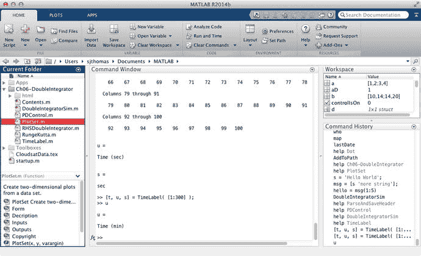
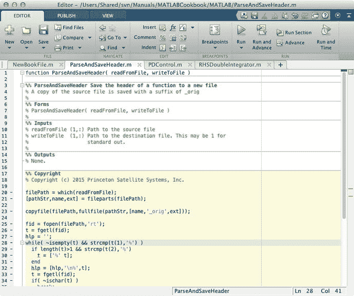
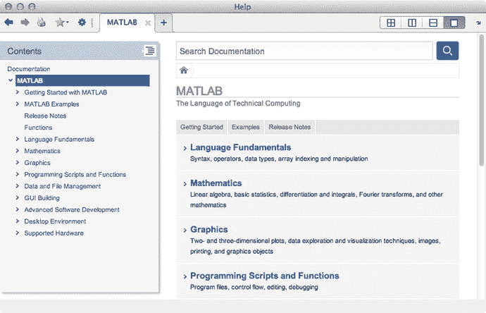

# 编码手册

电子补充材料：本章的在线版本 (doi: [10.1007/978-1-4842-0559-4_1](http://dx.doi.org/10.1007/978-1-4842-0559-4_1)) 包含补充材料，可供授权用户使用。

本章旨在概述 MATLAB 语法和编程，重点介绍许多用户可能未充分利用的功能，并指出 MATLAB 与其他编程语言和集成开发环境 (IDE) 之间的重要区别。您还应熟悉帮助浏览器中 MathWorks 提供的非常详细的文档。MathWorks 网站的“语言基础”部分描述了输入命令、运算符和数据类型。

在过去的二十年里，MATLAB 从其作为线性代数包的起源已经成熟了很多。最初，所有变量都是双精度矩阵。如今，MATLAB 提供了不同的变量类型，例如整数、数据结构、面向对象编程和类以及与 Java 的集成。MATLAB 应用程序是一个完整的 IDE，具有集成的编辑器、调试器、命令历史记录和代码分析器，并提供报告功能。使用 MATLAB 多年的工程师可能会发现自己没有充分利用现在提供的全部功能。在本文中，我们希望能重点介绍更有用的新功能。

本章的第一部分概述了最常用的 MATLAB 类型和构造。然后，我们将提供一些使用这些构造的实践方案，向您展示现代 MATLAB 的一些实际应用。

#### MATLAB 语言入门

##### MATLAB 简介

MATLAB 既是一个应用程序，也是一种编程语言。它主要针对数值计算而开发，在学术界和工业界得到广泛应用。MATLAB 最初由一位大学教授在 20 世纪 70 年代开发，旨在提供对线性代数库的便捷访问。MathWorks 成立于 1984 年，以继续开发该产品。其名称源于 MATrix LABoratory（矩阵实验室）。如今，MATLAB 使用 LAPACK（线性代数包）库进行底层矩阵运算。有多种工具箱可用于不同的工程学科；本书侧重于基本 MATLAB 应用程序中可用的功能。

MATLAB 应用程序是 MATLAB 语言的丰富开发环境。它提供了编辑器、命令终端、调试器、绘图功能、图形用户界面的创建以及最近安装第三方应用程序的功能。MATLAB 可以与其他语言交互，包括 Fortran、C、C++、Java 和 Python。内置了代码分析器和性能分析器。广泛的在线社区提供了用于共享代码和提问的论坛。

以下是 MATLAB 应用程序的主要组件：

*   **命令窗口** 用于输入命令和对基础工作空间中的变量进行操作的终端。MATLAB 提示符是 `>>`。
*   **命令历史记录** 先前执行过的命令的列表。
*   **工作空间显示** 列出当前工作空间（应用程序内存）中的变量及其值。变量一旦创建就会保留在内存中，直到您显式清除它们或关闭 MATLAB。
*   **当前文件夹** 文件浏览器，显示当前文件夹的内容并提供文件系统导航。最新版本的 MATLAB 还可以显示受配置管理文件的 SVN 状态。
*   **文件详细信息** 一个面板，显示在“当前文件夹”面板中选择的文件的信息。
*   **编辑器** 用于编辑 m 文件的编辑器，具有语法着色和内置调试器。它还可以显示任何类型的文本文件，并识别其他语言（包括 Java、C/C++ 和 XML/HTML）并对其进行适当的着色。
*   **变量编辑器** 用于工作空间变量的电子表格式图形编辑器。
*   **GUIDE** 图形界面开发窗口。
*   **帮助浏览器** 可搜索的帮助文档，涵盖所有 MATLAB 产品以及您已安装的第三方产品。
*   **性能分析器** 用于对正在运行的代码进行计时的工具。

这些组件可以停靠在各种配置中。主应用程序窗口或桌面的默认布局包含列出的前五个组件，如图 1-1 所示。命令窗口位于中心。左上方面板显示了一个文件浏览器，其中包含“当前文件夹”的内容。其下方是文件信息显示。右侧是工作空间显示和命令历史记录面板。基础工作空间是当前应用程序内存中的所有变量。历史记录中的命令可以双击或拖放到命令行上执行。广泛的工具栏包括用于运行代码分析器、打开代码分析器和帮助窗口的按钮，以及典型的文件和数据操作按钮。请注意工具栏上方的 PLOTS 和 APPS 选项卡。PLOTS 选项卡允许从工作空间浏览器中选择的数据以图形方式创建和管理绘图。APPS 选项卡允许您访问和管理您安装的第三方应用程序。



图 1-1. 带有命令窗口的 MATLAB 桌面

带有默认语法着色的编辑器如图 1-2 所示（您可以看到本章的一个文件）。水平线显示了使用双百分号将代码划分为“单元”，这可用于代码的顺序执行以及在发布时创建文本部分。单元标题在编辑器中以粗体显示。MATLAB 关键字以蓝色高亮显示，注释以绿色高亮显示，字符串以粉红色高亮显示。工具栏包括用于注释代码、缩进以及运行或调试代码的按钮。转到弹出菜单允许访问大型文件中的子函数。请注意带有附加功能的 PUBLISH 和 VIEW 选项卡（涉及发布，将在下一章介绍）以及编辑器视图的选项。



图 1-2. MATLAB 文件编辑器

帮助浏览器如图 1-3 所示。MATLAB 提供广泛的帮助，包括示例以及指向在线视频和教程的链接。第三方工具箱也可以在此浏览器中安装帮助。与任何浏览器一样，您可以打开多个选项卡；有一个搜索工具；并且您可以标记收藏的主题。本书通篇都会提及帮助浏览器中可用的主题。



图 1-3. MATLAB 帮助窗口

### 一切都是矩阵

默认情况下，MATLAB 中的所有变量都是双精度矩阵。您无需为这些变量声明类型。矩阵可以是多维的，并使用基于 1 的索引通过圆括号进行访问。您可以使用单个索引（按列获取）或每个维度一个索引来寻址矩阵的元素。要创建矩阵变量，只需为其赋值，就像这样创建一个 2 × 2 矩阵 `a`：

```matlab
>> a = [1 2; 3 4];
>> a(1,1)
1
>> a(3)
2
```

您可以使用无需特殊语法即可对矩阵进行加、减、乘、除。矩阵必须具有适合所请求的线性代数运算的大小。转置使用单引号后缀 `'` 表示，矩阵幂使用运算符 `^`。

```matlab
>> b = a'*a;
>> c = a²;
>> d = b + c;
```

默认情况下，每个变量都是数值变量。您可以使用 `zeros`、`ones`、`eye` 或 `rand` 函数将矩阵初始化为给定大小，这些函数分别生成全零矩阵、全一矩阵、单位矩阵（对角线元素为 1）和随机数矩阵。使用 `isnumeric` 来识别数值变量。表 1-1 显示了一些关键的矩阵函数。

表 1-1. 矩阵的关键函数

| 函数 | 目的 |
| --- | --- |
| `zeros` | 将矩阵初始化为零 |
| `ones` | 将矩阵初始化为全一 |
| `eye` | 初始化一个单位矩阵 |
| `rand`, `randn` | 初始化一个随机数矩阵 |
| `isnumeric` | 识别矩阵或标量数值 |
| `isscalar` | 识别标量值（一个 1 × 1 矩阵） |
| `size` | 返回矩阵的大小 |

### 字符串很简单

字符串和字符变量使用单引号定义。可以使用与矩阵相同的语法（即方括号）进行连接。它们的索引方式与矩阵相同。以下是一个字符串操作的简短示例：

```matlab
>> s = 'Hello World' ;
>> msg = [s 'more string'];
>> hello = msg(1:5)
hello =
Hello
```

使用 `ischar` 来识别字符串变量。另请注意，`isempty` 对空字符串返回 true；即 `''`。

有关字符串语法的描述，请在 MATLAB 命令行输入 `help strings`，要获取字符串函数的完整列表，请输入 `help strfun`。表 1-2 显示了一些关键的字符串函数。

表 1-2. 字符串的关键函数

| 函数 | 目的 |
| --- | --- |
| `ischar` | 识别一个字符串 |
| `char` | 将整数代码或元胞数组转换为字符串 |
| `sprintf` | 将格式化数据写入字符串 |
| `strcmp`, `strncmp` | 比较字符串 |
| `strfind` | 在一个字符串中查找另一个字符串 |
| `num2str`, `mat2str` | 将数字或矩阵转换为字符串 |
| `lower` | 将字符串转换为小写 |

##### 使用严格的数据结构

MATLAB 中的数据结构非常灵活，由用户自行在字段和类型上强制执行一致性。您无需在分配字段之前初始化数据结构，但这样做是个好主意，尤其是在脚本中，以避免变量冲突。

替换

```matlab
d.fieldName = 0;
```

为

```matlab
d = struct;
d.fieldName = 0;
```

事实上，我们发现，通常最好创建一个特殊的函数来初始化在一组函数中使用的大型结构。这类似于创建类定义。从函数生成数据结构，而不是在脚本中键入字段，意味着您总是从正确的字段开始。拥有一个初始化函数还允许您指定变量的类型并提供示例或默认数据。请记住，由于 MATLAB 不要求您声明变量类型，因此使用默认数据自行声明会使您的代码更加清晰。

> **提示** 为数据结构创建初始化函数。

只需分配一个额外的副本即可将数据结构转换为数组。字段必须按相同顺序排列，这也是使用函数初始化结构的另一个原因。您可以嵌套数据结构，深度不受限制。

```matlab
d = MyStruct;
d(2) = MyStruct;

function d = MyStruct
d = struct;
d.a = 1.0;
d.b = 'string';
```

MATLAB 现在允许使用变量实现动态字段名；例如，`structName.(dynamicExpression)`。这比将字段名作为字符串传递的 `getfield` 提供了更好的性能。这允许各种创造性的结构编程。以上一个代码片段中的数据结构数组为例，使用动态字段名获取字段 a 的值；这些值以元胞数组形式返回。

```matlab
>> field = 'a';
>> values = {d.(field)}
values =
[1] [1]
```

使用 `isstruct` 来识别结构变量，使用 `isfield` 来检查字段是否存在。请注意，对于使用 `struct` 初始化的结构，即使它没有字段，`isempty` 也会返回 false。表 1-3 显示了一些关键的结构体函数。

表 1-3. 结构体的关键函数

| 函数 | 目的 |
| --- | --- |
| `struct` | 初始化一个带或不带字段的结构体 |
| `isstruct` | 识别一个结构体 |
| `isfield` | 确定结构体中是否存在某个字段 |
| `fieldnames` | 以元胞数组形式获取结构体的字段 |
| `rmfield` | 从结构体中删除一个字段 |
| `deal` | 将结构体中的字段设置为特定值 |

### 元胞数组容纳一切

MATLAB 特有的一种变量类型是元胞数组。这实际上是一个列表容器，您可以在元胞数组的元素中存储任何类型的变量。元胞数组可以像矩阵一样是多维的，并且在许多情况下非常有用。

元胞数组用花括号 `{}` 表示。它们可以是任何维度，并包含任何数据，包括字符串、结构体和对象。您可以使用 `cell` 函数初始化它们，使用 `celldisp` 以递归方式显示内容，并使用圆括号访问子集，就像矩阵一样。以下是一个简短示例。

```matlab
>> c = cell(3,1);
>> c{1} = 'string';
>> c{2} = false;
>> c{3} = [1 2; 3 4];
>> b = c(1:2);
>> celldisp(b)
b{1} =
string
b{2} =
0
```

使用花括号访问会返回底层类型的元素数据。当您使用圆括号访问元胞数组的元素时，返回的内容是另一个元胞数组，而不是元胞内容。MATLAB 帮助中有一个专门的“逗号分隔列表”部分，重点介绍了元胞数组作为列表的用法。代码分析器也建议使用元胞数组的有效方法。例如，请看下面。

替换

```matlab
a = {b{:} c};
```

为

```matlab
a = [b {c}];
```

元胞数组对于字符串集合特别有用，许多 MATLAB 的字符串搜索函数（例如 `strcmp`）都针对元胞数组进行了优化。

使用 `iscell` 来识别元胞数组变量。使用 `deal` 来操作结构数组和元胞数组的内容。表 1-4 显示了一些关键的元胞数组函数。

表 1-4. 元胞数组的关键函数

| 函数 | 目的 |
| --- | --- |
| `cell` | 初始化一个元胞数组 |
| `cellstr` | 从字符数组创建元胞数组 |
| `iscell` | 识别一个元胞数组 |
| `iscellstr` | 识别一个仅包含字符串的元胞数组 |
| `celldisp` | 递归显示元胞数组的内容 |

### 使用逻辑数组优化代码

逻辑数组仅由 1 和 0 组成。您可以使用 `true` 和 `false` 函数初始化逻辑矩阵，并且可以使用 `islogical` 函数测试矩阵是否为逻辑矩阵。逻辑数组是许多内置函数（如 `isnan`）的输出，并且代码分析器通常建议将其作为操作数组索引的更快替代方案。例如，您可能需要将数组中的任何负值设置为零。

替换

```matlab
k = find(x<0);
x(k) = 0;
```

为

```matlab
x(x<0) = 0;
```

其中 `x<0` 生成一个逻辑数组，当 `x` 的值为负时，该数组的元素为 1，其他位置为 0。

MATLAB 既提供传统的关系运算符（例如 `&&` 表示 AND，`||` 表示 OR），也提供独特的逐元素运算符。这些逐元素运算符（例如单个 `&` 和 `|`）会比较相同大小的矩阵并返回逻辑数组。

### 使用持久和全局作用域最小化数据传递

通常，在函数中定义的变量具有局部作用域，仅在该函数内可用。在脚本中定义的变量在工作空间中可用，因此也可以从命令行使用。

MATLAB 具有全局作用域，与其他任何语言相同，适用于基础工作空间，并在整个 MATLAB 会话期间保持变量的值。全局变量在声明后为空，直到被初始化。`clear` 和 `clearvars` 函数都有用于仅删除全局变量的标志。

```matlab
>> global MY_GLOBAL_VAR; % variable is empty
>> MY_GLOBAL_VAR = 1.0;
>> whos
  Name               Size         Bytes  Class      Attributes
  MY_GLOBAL_VAR      1x1             8  double     global
>> clearvars -GLOBAL
```

表 1-5 显示了一些用于逻辑运算的关键函数。

表 1-5. 逻辑运算的关键函数

| 函数 | 目的 |
| --- | --- |
| `logical` | 将数值转换为逻辑值 |
| `islogical` | 识别一个逻辑数组（由 1 和 0 组成） |
| `true` | 返回真值 (1) 或数组 (M,N) |
| `false` | 返回假值 (0) 或数组 (M,N) |
| `any` | 如果数组中有任何非零数，则返回 true |
| `all` | 如果数组中没有一个值为 0，则返回 true |
| `and`, `or` | 逐元素运算符 `&` 和 `&#124;` 的函数形式 |
| `isnan`, `isinf`, `isfinite` | 返回逻辑数组的值测试函数 |

MATLAB 有一个独特的作用域，它适用于单个函数：`persistent`（持久）。这对于初始化需要大量数据或计算的函数，然后保存该数据以供后续调用使用非常有用。可以使用 `clear` 命令对函数重置该变量，例如 `clear functionName`。这也可能是错误的来源，因此务必在函数的帮助注释中注明持久变量的使用，以免在切换模型时得到意外结果。

> **提示** 使用持久变量存储后续函数调用的初始化数据。

如果适当使用了 `end` 关键字，则对于在单个文件中定义的多个函数，变量也可以处于作用域内。通常，您可以省略函数的最后一个 `end`，但如果您使用它来包装内部函数，则这些函数将成为嵌套函数，并且可以访问在父函数中定义的变量。这允许子例程共享数据而无需传递大量参数。编辑器会高亮显示这样定义的变量。

在以下示例中，`constant` 变量可用于父函数内部的嵌套函数。

```matlab
function y = parentFunction( x )
  constant = 3.0;
  y = nestedFunction( x );
  
  function z = nestedFunction( x )
    z = constant *x;
  end
end
```

表 1-6 显示了一些作用域函数。

表 1-6. 作用域操作的关键函数

| 函数 | 目的 |
| --- | --- |
| `persistent` | 为函数中的变量指定持久作用域 |
| `global` | 为变量指定全局作用域 |
| `clear` | 清除一个函数或变量 |
| `who`, `whos` | 列出一个工作空间中的变量 |
| `mlock`, `munlock` | 锁定（和解锁）一个函数或 MEX 文件，以防止其被清除 |

### 理解独特的 MATLAB 运算符和关键字

在 MATLAB 中，一些常见的运算符具有特殊功能，我们在此提请注意。

#### 冒号

用于在数组中创建索引列表的冒号运算符是 MATLAB 独有的。单独使用的冒号寻址该给定维度中的所有元素；在整数对之间使用的冒号创建一个列表。

```matlab
>> a(1,1:2)
ans =
1 2
>> a(:,1)
ans =
1
3
```

当访问数组元素时，冒号运算符适用于所有变量类型：元胞数组、字符串和数据结构数组。

冒号运算符还可用于使用间隔创建数组，作为 `linspace` 的简写形式。间隔和端点可以是双精度数。将其用于矩阵索引实际上是使用默认间隔 1 的一种边界情况。例如，`0.1:0.2:0.5` 生成 `0.1 0.3 0.5`。

```matlab
>> a = 0.1:0.2:0.5
a =
0.1 0.3 0.5
```

#### 波浪号

波浪号 (`~`) 是 MATLAB 中的逻辑“非”运算符。输出是一个与输入大小相同的逻辑矩阵，如果输入值为零，则输出值为 1，否则输出值为 0。

```matlab
>> a = [0 -1; 1 0];
>> ~a
ans =
1 0
0 1
```

在较新的版本中，它还可以用于忽略函数的输入或输出；代码分析器经常建议这样做，而不是使用虚拟变量。

```matlab
[~,b] = MyFunction(x,y);
```

#### 点号

这里的点号是指将句点与标准算术运算符一起使用，例如 `.*` 或 `.\` 或 `.^`。这是 MATLAB 中的特殊语法，用于对矩阵逐个元素地应用运算符，而不是执行原本暗示的线性代数运算。这也称为数组运算，而不是矩阵运算。由于矩阵和数组运算对于加法和减法来说是相同的，因此不需要点号。

```matlab
y = a.*b;
```

MATLAB 针对数组运算进行了优化。使用此语法是在 MATLAB 代码中减少 `for` 循环并使其运行更快的关键方法。考虑传统的替代代码。

```matlab
a = rand(1,1000);
b = rand(1,1000);
y = zeros(1,1000);
for k = 1:1000
  y(k) = a(k)*b(k);
end
```

即使这个简单的示例，其运行时间也是所示向量化版本的两到三倍。

#### `end`

`end` 关键字在 MATLAB 中有多种用途。它用于终止 `for`、`while`、`switch`、`try` 和 `if` 语句，而不是像其他语言那样使用花括号。它还可用于表示变量在给定维度中的最后一个索引。适当使用 `end` 可以使您的代码对将来数据大小的变化更加健壮。

```matlab
>> a = [1 2 3; 4 5 6; 7 8 9];
>> b = a(1:end-1,2:end)
b =
2 3
5 6
```

### 利用多输入和多输出的强大功能

独特的是，MATLAB 函数可以有多个输出。它们与输入一样，以逗号分隔列表的形式指定。此外，您不需要指定输入或输出的数据类型，并且可以通过将任何数据分配给变量来静默覆盖输出类型。因此，一个函数可以在单个文件中定义无限数量的语法。输出必须分配有签名中给出的名称；您不能将变量传递给 `return` 关键字。

MATLAB 提供了用于指定可变数量输入或输出的辅助函数，即 `varargin` 和 `varargout`。这些变量是元胞数组，您可以使用花括号访问和分配元素。以下是一个示例函数定义：

```matlab
function [y,varargout] = varargFunction(x,varargin)
  y = varargin{1};
  varargout{1} = size(x,1);
  varargout{2} = size(x,2);
```

以下示例演示了输出被正确分配。

```matlab
>> [y,a,b] = varargFunction( rand(3,2),1.0)
y =
1
a =
3
b =
2
```

这允许您在函数中接受无限数量的参数或参数对。您需要为函数创建一致的格式，并在帮助注释中清晰地记录它们。

您还可以使用 `nargin` 和 `nargout` 计算对函数特定调用的输入和输出参数数量，并将其与逻辑语句或 `switch` 语句结合使用来处理多种情况。

如果您需要非常复杂的输入处理，MATLAB 现在提供了一个 `inputParser` 类，它允许您解析和验证输入方案。您可以定义函数来验证输入、可选参数并预定义参数对。

### 使用函数句柄提高效率

函数句柄是指向函数的指针。它们与匿名函数密切相关，匿名函数允许您内联定义一个简短的函数，并返回函数句柄。当您创建句柄时，您可以更改输入方案并为某些输入（例如参数）提供值。将句柄作为输入传递给积分器和类似例程比传递函数名字符串变量要快得多。

在以下代码片段中，我们为 `myFunction` 创建了一个匿名函数句柄，具有不同的签名和 `a` 的特定值。请注意与号的使用，它表示一个函数句柄。该句柄可以像常规函数一样使用输入进行评估。

```matlab
function y = myFunction(a, b, c)
  ...
end

a = 2;
h = @(c,b) myFunction(a,b,c);
y = h(c,b);
```

句柄 `h` 可以传递给一个函数，例如一个期望只具有两个变量的签名的积分器。您还会经常使用函数句柄来为积分器或类似工具指定事件函数，以及在主要步骤之间调用的输出函数。输出函数可以将信息打印到屏幕或图形上；例如，`odeplot` 和 `odeprint`。

为了测试一个变量是否是函数句柄，您需要使用 `isa` 和函数句柄的类名，例如：

```matlab
isa(f,'function_handle')
```

`ishandle` 仅适用于图形句柄。有关更多信息，请参阅 `function_handle` 的帮助文档。表 1-7 提供了处理函数句柄的几个关键函数。

表 1-7. 句柄的关键函数

| 函数 | 目的 |
| --- | --- |
| `feval` | 从句柄或字符串执行函数 |
| `func2str` | 从函数句柄构造字符串 |
| `str2func` | 从函数名字符串构造句柄 |
| `isa` | 测试是否为函数句柄 |

##### 高级数据类型

到目前为止讨论的数据类型对于大多数工程编程来说已经足够。然而，对于专门的应用程序，还有额外的数据类型选项，包括以下内容。

*   **类** 可以使用 `classdef` 关键字在 m 文件中定义具有属性和方法的类，类似于编写函数。另请参阅 `properties`、`methods` 和 `events` 关键字。
*   **表格** 表格是 MATLAB R2013 版本中的新功能，允许将表格数据及其元数据存储在一个变量中。这是一种存储和处理可能放在电子表格中的数据并与之交互的有效方法。表格列可以命名、分配单位和描述，并且可以像数据结构的字段一样访问，例如 `T.DataName`。有关从文件创建表格，请参阅函数 `readtable`。
*   **分类数组** 来自离散类别集（枚举）的数据数组可以存储在这种特殊类型中，与元胞数组的元素相比，它提供了更高效的搜索。请参阅 `categorical` 和 `categories`。
*   **时间序列** `timeseries` 对象及其相关的 `tscollection` 对象提供了将数据样本与时间戳相关联的方法。绘制 `timeseries` 对象会自动使用存储的时间向量。
*   **映射容器** 映射容器允许您使用可能非数值的键来存储和查找数据。这是一个通过 `containers.Map` 实例化的对象。

如果您发现这些数据类型对您的应用程序有利，那么 MATLAB 文档是相当详尽的。

## 入门实践方案

本章的下一部分提供了一些现代 MATLAB 中常见任务的实践方案，例如向函数添加帮助、加载二进制数据、写入文本文件、创建 MEX 文件以及将函数解析为“pcode”。


