# 3. 可视化

电子补充材料：本章的在线版本 (doi: [10.1007/978-1-4842-0559-4_3](http://dx.doi.org/10.1007/978-1-4842-0559-4_3)) 包含补充材料，仅授权用户可访问。

`MATLAB` 为数据可视化提供了强大的能力。你可以生成二维图、三维图和动画；查看图像；以及创建直方图、等高线图、曲面图以及其他数据图形表示。你可能熟悉制作带有线条和标记的简单二维图、饼图和柱状图，但你可能还了解到底层例程所提供的其他可能性。此外，还有交互式功能可用于编辑图形和图像，以及在打印或导出之前添加注释。

`MATLAB` 在科学可视化和工程三维对象可视化方面表现出色。三维可视化用于可视化作为两个参数函数的数据，例如地球表面的高度，或用于可视化三维物体。前者应用于科学和工程的各个领域。后者在设计和模拟任何类型的机器（例如机器人、飞机、汽车和航天器）时特别有用。

物体的三维可视化可进一步分为工程可视化和照片级真实感可视化。后者有助于你理解物体的外观及其构造方式。当考虑物体内部时，就进入了实体建模领域，它用于创建适合制造物体的模型。照片级真实感可视化的目标是使三维视图看起来像照片一样。照片级真实感渲染侧重于光与物体和眼睛的交互。`MATLAB` 确实提供了一些光照和相机交互功能，但它不提供真正的照片级真实感渲染。

主要的绘图例程在命令行帮助中组织为几个类别：

- `graphics` 用于图形、坐标轴、线条、文本和其他图形对象的底层例程。
- `graph2d` 二维图形，如线性图、对数尺度图和极坐标图。
- `graph3d` 三维图形，如线图、网格图和曲面图；控制颜色、光照和相机。
- `specgraph` 专用图形，是最大的类别。特殊的二维图形，如条形图和饼图、直方图、等高线图、特殊的三维图、体积和矢量可视化、图像显示、电影和动画。

在线帮助有一个完整的顶层部分专门介绍图形，包括绘图、格式化和注释、图像、打印和保存、图形对象和性能，以及 R2014b 版本中对绘图内部机制的重大更改。

熟练掌握这些函数，你可以创建非常复杂的图形，并能根据不同的出版媒介进行调整，无论是需要调整图形的尺寸、颜色还是字体属性。在本章中，我们提供了一些方案，涵盖了你需要了解的内容，以有效使用 `MATLAB` 图形。我们没有足够的篇幅讨论每一种可用的绘图例程（这方面在现有的帮助文档中已有详细记载），但我们确实涵盖了基本功能，并提供了常用场景的解决方案。

## 3.1 从 MATLAB 桌面交互式绘图

### 问题

你想要绘制工作区中的数据，但不确定哪种可视化方法最好。

### 解决方案

你可以使用 `MATLAB` 桌面中的“绘图”选项卡，通过在工作区显示中选择变量来直接绘制数据。你可以从多种绘图选项中进行选择，`MATLAB` 会自动只显示那些适用于所选数据集的选项。

### 工作原理

让我们创建一些样本来演示这种交互功能，这是 `MATLAB` 中一个相当新的特性。首先使用一些三角函数来生成振荡的样本数据。

```matlab
theta = linspace(0, 4*pi);
y = sin(theta).*cos(2*theta) + 0.05*theta;
```

现在工作区中有两个向量变量。选择桌面的 `PLOTS` 选项卡，然后在工作区显示中选择 `y` 变量（见图 3-1）。该变量会出现在 `PLOTS` 选项卡区域最左侧，并且功能区的各种绘图图标变为可用：`plot`、`bar`、`area`、`pie` 等。请注意最左侧的单选按钮，它们用于选择是在当前图形中重复绘图，还是创建新图形。

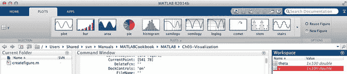

图 3-1. 带有绘图图标功能区的 `PLOTS` 选项卡

使用 `close all` 关闭所有打开的图形，然后点击 `plot` 图标，创建一个包含数据简单二维折线图的新图形。请注意，点击该图标会在命令行中打印出绘图命令：

```matlab
>> plot(y)
```

数据沿 `x` 轴以线性索引方式打印，如图 3-2 所示。

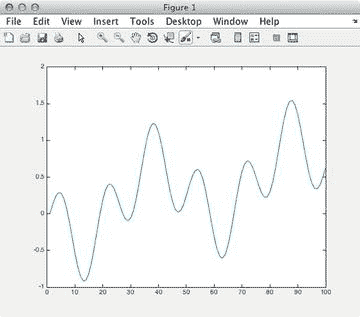

图 3-2. 三角数据的线性折线图

只需点击另一个绘图图标，即可使用不同的函数重新绘制数据，并且该函数调用同样会打印到命令行。显示的绘图图标并非所有可用绘图，而只是众多选项中的默认收藏项；要查看更多图标，请点击功能区右侧的弹出箭头。可用的绘图类型按类别组织。还有一个 `Catalog` 按钮，按下后可以打开一个专用的绘图目录窗口，其中包含每个函数的文档。

要针对输入 `theta` 绘制数据 `y`，您需要在工作区视图中同时选中这两个变量。它们会显示在绘图功能区中，并附有一个用于反转顺序的按钮。现在点击一个面积图，即可得到以角度为 `x` 轴的图形，如图 3-3 所示。

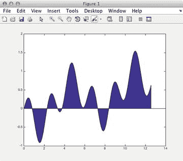

图 3-3. 三角数据的参数面积图

```matlab
>> area(theta, y)
```

注意，这次正如预期，`x` 轴范围是从 0 到 4π。

您可以使用“绘图编辑”工具栏和“图形面板”窗口以交互方式在图形上添加箭头和文本注释、添加子图、更改线条属性等。这些工具可从图形窗口的“视图”菜单以及单击标准图形工具栏中的“显示绘图工具”按钮获得。例如，使用绘图工具，您可以选择坐标轴，双击打开属性编辑器，输入 `X` 轴标签，并打开网格线。您可以添加另一个子图，绘制 `theta` 值相对于线性索引的图形，然后将绘图类型更改为茎秆图，所有这些操作都在此窗口中完成。见图 3-4。

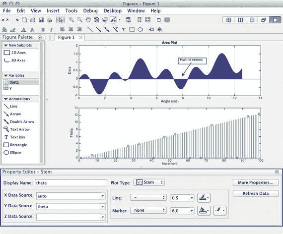

图 3-4. 在图形面板中绘制的三角数据

同样的更改也可以通过编程方式实现，如后续技巧所示。事实上，您可以从图形面板生成代码，`MATLAB` 将创建一个包含所有必要命令的函数，以便从您的数据中复制图形。“生成代码”命令位于窗口的“文件”菜单下。它允许您以交互方式创建适用于某些示例数据的可视化，然后以编程方式将其适配到工具箱中。`MATLAB` 将新自动生成的函数命名为 `createfigure`。您可以看到以下函数的使用：`figure`、`axes`、`box`、`hold`、`ylabel`、`xlabel`、`title`、`area`、`stem` 和 `annotation`。

```matlab
function createfigure(X1, yvector1)
% CREATEFIGURE(X1, YVECTOR1)
%  X1: area x
%  YVECTOR1: area yvector
%  Auto-generated by MATLAB on 03-Jun-2015 14:32:43

%  Create figure
figure1 = figure;

%  Create axes
axes1 = axes('Parent', figure1, 'XGrid', 'on', 'OuterPosition', [0 0.5 1 0.5]);
box(axes1,'on');
hold(axes1,'on');

%  Create ylabel
ylabel('Data');

%  Create xlabel
xlabel('Angle (rad)');

%  Create title
title('Area Plot');

%  Create area
area(X1,yvector1,'DisplayName','Area','Parent',axes1);

%  Create axes
axes2 = axes('Parent',figure1,'OuterPosition',[0 0 1 0.5]);
box(axes2,'on');
hold(axes2,'on');

%  Create ylabel
ylabel('Theta');

%  Create xlabel
xlabel('Increment');

%  Create stem
stem(X1,'DisplayName','theta','Parent',axes2,'Marker','none',...
    'Color',[0 0.447 0.741]);

%  Create textarrow
annotation(figure1,'textarrow',[0.609822646657571 0.568894952251023],...
    [0.827828828828829 0.717117117117118]);

%  Create textbox
annotation(figure1,'textbox',...
    [0.553888130968622 0.814895792699917 0.120787482806052 0.0489690721649485],...
    'String',{'Point of interest'});
```

请注意，这段代码实际上并未使用 `subplot` 函数，而是使用 `'OuterPosition'` 属性来指定坐标轴在图形中的精确位置。另外请注意，坐标轴位置和注释的单位范围在 0 到 1 之间；即归一化单位。这实际上是坐标轴的一个可选项，如下面的调用所示，使用 `gca` 获取当前坐标轴的句柄：

```
>> set(gca, 'units')
'inches'
'centimeters'
'characters'
'normalized'
'points'
'pixels'
```

使用其他单位可能对某些应用有帮助，但归一化单位始终是默认选项。以下是图形工具栏中其他值得提及的交互式按钮：

-   放大

-   缩小

-   手形工具：在图形平面内移动对象

-   旋转工具：旋转视图

-   数据光标

-   刷亮/选择数据

-   颜色条

-   图例

手形工具和旋转工具在处理 3D 数据时非常有用。数据光标直接在图形中显示绘图点的数值。刷亮工具使用您通过颜色弹出菜单选择的对比色来高亮显示数据段。颜色条和图例按钮起开关作用。

## 3.2 递增地为绘图添加注释

### 问题

您需要为曲线上的部分点添加注释。

### 解决方案

使用 `text` 函数为绘图添加注释。

### 工作原理

在 `AnnotatePlot` 中的 `for` 循环内调用 `text`。使用 `sprintf` 创建注释文本，这样您可以控制任何数字的格式。在此示例中，使用 `%d` 来显示整数。`linspace` 在数据中创建一个均匀间隔的索引数组，以提供要注释的选定点；在此示例中，选择了 5 个点。

```
%% Annotate a plot
% Add text annotations evenly spaced along a curve.

%% Parameters
nPoints = 5; % Number of plot points to have annotations

%% Create the line
v = [1;2;3];
t = linspace(0,1000);
r = [v(1)*t;v(2)*t;v(3)*t];

%% Create the figure and plot
s = 'Annotated Plot';
h = figure('name',s);
plot3(r(1,:),r(2,:),r(3,:));
xlabel('X');
ylabel('Y');
zlabel('Z');
title(s)
grid

%% Add the annotations
n = length(t);
j = ceil(linspace(1,n,nPoints));
for k = j
    text(r(1,k), r(2,k), r(3,k), sprintf('- Time %d', floor(t(k))));
end
```

请注意，您将索引数组 `j` 直接传递给了循环索引 `k`。图 3-5 显示了添加注释后的图形。您创建了一条需要注释的三维直线。

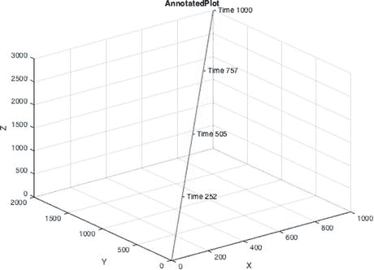

图 3-5. 带注释的三维图

## 3.3 使用子图创建自定义绘图页面

### 问题

在特定应用中，你需要绘制数据的多个图表，而每次重新运行脚本时，这些图表都会堆满屏幕并占用内存。在使用商业工具箱时，我们常常会创建数十个图表。

### 解决方案

创建一个包含多个子图的单一图形，这样只需一个图形窗口就能查看应用程序一次运行的所有结果。

### 工作原理

`subplot` 函数允许你在一个图形中创建二维对称排列的子图阵列。它会自动生成一个 `m` × `n` 的小坐标系阵列，并在图形中均匀分布。一个很好的示例是带有不同视角的三维轨迹图。你可以创建一个包含 2 × 2 坐标系阵列的图形，其中左下角为三维图，周围则是各个方向的视角图。该功能由 `QuadPlot` 函数实现。它内置了一个演示程序，可生成如图 3-6 所示的图形。

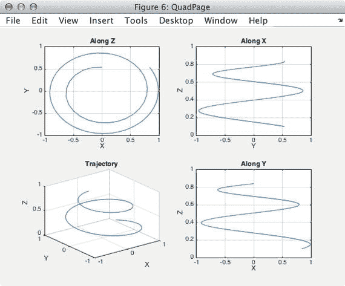

图 3-6. 使用 `subplot` 进行坐标系位置分配的 `QuadPlot`

请注意，每次调用 `subplot` 时，都必须指定坐标系阵列的尺寸——在此例中为 `(2,2)`。

```
%% QUADPLOT 使用 subplot 创建四象限图页面。
% 此函数在一个图形中创建一个三维视图和三个二维视图的轨迹。
%% 格式
% QuadPlot( x )
%% 输入参数
% x (3,:) 轨迹数据
%
%% 输出参数
% 无。但你可能希望返回图形句柄以便进行进一步的程序化定制。
%
function QuadPlot(x)
if nargin == 0
    disp('QuadPlot 演示');
    th = logspace(0, log10(4*pi),101);
    in = logspace(-1,0,101);
    x = [sin(th).*cos(in); cos(th).*cos(in); sin(in)];
    QuadPlot(x);
    return;
end
h = figure('Name','QuadPage');
set(h,'InvertHardcopy','off')
% 使用 subplot 创建子图
subplot(2,2,3)
plot3(x(1,:),x(2,:),x(3,:));
xlabel('X')
ylabel('Y')
zlabel('Z')
grid on
title('轨迹')
rotate3d on
subplot(2,2,1)
plot(x(1,:),x(2,:));
xlabel('X')
ylabel('Y')
grid on
title('沿 Z 轴')
subplot(2,2,2)
plot(x(2,:),x(3,:));
xlabel('Y')
ylabel('Z')
grid on
title('沿 X 轴')
subplot(2,2,4)
plot(x(1,:),x(3,:));
xlabel('X')
ylabel('Z')
grid on
title('沿 Y 轴')
```

在最新版本的 MATLAB 中，你可以使用字段名称轻松访问图形和坐标系属性。例如，让我们使用 `gcf` 获取演示生成的图形，然后查看其子对象，其中应包含这四个子图。

```
>> h = gcf
h = 
  Figure (5: PlotPage) 包含属性:
      Number: 5
      Name: 'PlotPage'
      Color: [0.94 0.94 0.94]
      Position: [440 378 560 420]
      Units: 'pixels'
  显示所有属性
>> h.Children
ans = 
  5x1 图形数组:
    ContextMenu
    Axes (沿 Y 轴)
    Axes (沿 X 轴)
    Axes (沿 Z 轴)
    Axes (轨迹)
```

请注意，坐标系的标题会被清晰地显示出来。如果你想要添加额外的对象或更改坐标系的属性，可以通过这种方式访问句柄。或者，你可能希望将这些句柄作为函数的输出返回。你也可以通过再次调用 `subplot` 并指定阵列尺寸和 ID（如 `(2,2,1)`），在当前坐标系所在的图形中创建一个子图。

## 3.4 创建具有自定义尺寸坐标系的数据图页面

### 问题

你希望将一个图形中的一些图表组合在一起，但又不希望它们像子图那样均匀排列。

### 解决方案

你可以使用坐标系的 `'OuterPosition'` 属性创建自定义尺寸的坐标系，并将它们放置在图形中的任意位置。

### 工作原理

你将创建一个包含两个图表的自定义图形，其中一个图表横跨图形的整个宽度，另一个则是较小的坐标系，如图 3-7 所示。这样可以为一段描述性文本留出空间，这段文本可以描述图形本身或显示结果。为了让图表更生动，你将使用 `num2str` 添加标记和文本注释。

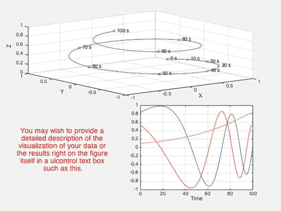

图 3-7. 使用自定义尺寸图表的 `PlotPage`

该功能由 `PlotPage` 函数实现。对坐标系使用 `'OuterPosition'` 而不是 `'Position'`，意味着其范围包含了坐标轴标签，因此你可以使用从 0 到 1（归一化单位）的图形完整范围。

# PLOTPAGE

`PLOTPAGE` 在一个图形中创建包含多个自定义图表的页面。
% 在图形上指定自定义尺寸的坐标系。

## 格式

```matlab
PlotPage(t, x)
```

## 输入参数

- `t` `(1,:)` 时间向量
- `x` `(3,:)` 轨迹数据

## 输出参数

无。但你可能希望返回图形句柄以便进行进一步的程序化定制。

```matlab
function PlotPage(t, x)
if nargin == 0
    disp('PlotPage 演示');
    t = linspace(0,100,101);
    th = logspace(0, log10(4*pi),101);
    in = logspace(-1,0,101);
    x = [sin(th).*cos(in); cos(th).*cos(in); sin(in)];
end
h = figure('Name','PlotPage');
set(h,'InvertHardcopy','off')
% 指定坐标系位置为 [left, bottom, width, height]
axes('outerposition',[0.5 0 0.5 0.5]);
plot(t,x);
xlabel('时间')
grid on
% 指定另一个坐标系并绘制三维图
axes('outerposition',[0 0.5 1 0.5]);
plot3(x(1,:),x(2,:),x(3,:));
xlabel('X')
ylabel('Y')
zlabel('Z')
grid on
% 按时间均匀添加标记
hold on
for k=1:10:length(t)
    plot3(x(1,k),x(2,k),x(3,k),'x');
    % 添加文本标签
    label = ['  ' num2str(t(k)) ' s'];
    text(x(1,k),x(2,k),x(3,k),label);
end
hold off
uh = uicontrol('Style','text','String','图表描述',...
    'units','normalized','position',[0.05 0.1 0.35 0.3]);
set(uh,'string',['您可能希望将数据可视化或结果的详细描述直接放在图形上的 '...
    'uicontrol 文本框中，就像这样。']);
set(uh,'fontsize',14);
set(uh,'foregroundcolor',[1 0 0]);
```

## 3.5 使用日期绘图

### 问题

你想使用 x 轴上的日期绘制作为时间函数的数据。

### 解决方案

使用坐标轴句柄直接访问刻度标签，或者配合序列日期数使用 `datetick`。

### 工作原理

首先，您可以手动指定刻度标签。您将数据作为索引的函数进行绘制，然后用您选择的字符串替换 x 轴标签；在这个案例中，选择的是具体的月份。例如，您绘制了一个家庭的用电量（以千瓦时为单位），请参见图 3-8。注意，在生成图表后，如何使用 `set` 函数设置 `xlim`、`xtick` 和 `xticklabel` 属性。为了适应条形的宽度，限制范围设置为 `[0 13]`，而不是 `[1 12]`。

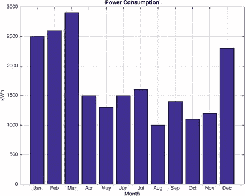

图 3-8. 使用手动月份标签绘图

```matlab
%% Plot using months as the x label
% First we will set the labels manually. Then we will use MATLAB's serial date
% numbers to set the labels automatically.
%% Specify specific months as labels
kWh = [ 2500 2600 2900 1500 1300 1500 1600 1000 1400 1100 1200 2300];
month = {'Jan' 'Feb' 'Mar' 'Apr' 'May' 'Jun' 'Jul' 'Aug' 'Sep' 'Oct' 'Nov' 'Dec'};
figure('Name','Plotting With Manual Date Labels');
bar(1:12,kWh)
xlabel('Month');
ylabel('kWh')
title('Power Consumption');
grid on
set(gca,'xlim',[0 13],'xtick',1:12,'xticklabel',month);
```

如果您要针对完整的日期绘制数据，也可以使用 MATLAB 的序列日期数字，这些数字可以通过 `datetick` 自动显示为刻度标记。您可以使用 `datestr`、`datenum` 和 `datevec` 在日历日期和序列数字之间进行转换。日期向量是六组件日期，格式为 `[年 月 日 时 分 秒]`。因此，举个例子，让我们将前一个示例中的数据分配到 2014 年的实际日期。默认的日期刻度标记仅显示月份，就像手动示例一样，但为了演示目的，我们指定一个包含年份的格式：`'mmmyy'`。请参见图 3-9。

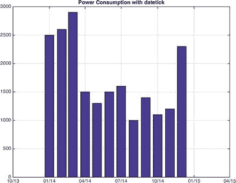

图 3-9. 使用 `datetick` 和序列日期绘图

```matlab
%% Specify full dates and use serial dates to automatically produce labels
% Specifying only the month will use the current year by default. We will set
% the year to 2014 by using datevec.
N = datenum(month,'mmm');
V = datevec(N);
V(:,1) = 2014;
N = datenum(V);
figure('Name','Plotting With Serial Dates');
bar(N,kWh)
xlabel('Date');
title('Power Consumption with datetick');
datetick('x','mm/yy')
grid on
```

请注意，刻度本身不再是每月一个；如果您想手动指定它们，您现在需要使用日期数字。这里使用 `get` 打印了属性，以显示所使用的 `XTicks`。

```matlab
>> get(gca)
...
XLim: [735508 735965]
XLimMode: 'manual'
XMinorGrid: 'off'
XMinorTick: 'off'
XScale: 'linear'
XTick: [735508 735600 735690 735781 735873 735965]
XTickLabel: [6x5 char]
```

MATLAB 的序列日期数字与其他序列日期格式（如儒略日）不对应。MATLAB 只是从 0000 年 1 月 1 日开始计算天数，因此 2000 年从序列号 2000 * 365 = 730,000 开始。以下快速示例演示了这一点，并且还使用了 `now` 来获取当前日期：

```matlab
>> v = datevec(now)
v =
  2015     7    31    11    37    0.6198
>> n = datenum(v)
n =
   7.3618e+05
>> s = datestr(n,'local')
s =
31-Jul-2015 11:37:00
```

## 3.6 生成颜色分布

### 问题

您希望为绘图中的标记或线条分配颜色。

### 解决方案

从色轮上按算法指定 HSV 分量，并将其转换为 RGB。

### 工作原理

`ColorDistribution` 从色轮上选择颜色，如图 3-10 所示。这些颜色使用 HSV 的色调分量进行选择，范围从 0 到 1。参数允许用户分别指定饱和度和明度，所有生成的颜色都相同。您也可以使用这些分量来选择一种色调的多种颜色。

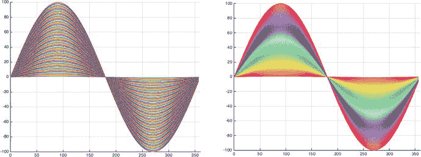

图 3-10. 原始线条以及具有颜色分布（明度和饱和度均为 1）的线条

降低饱和度 (`sat`) 会使颜色变浅，同时保持在色轮的同一“辐条”上。饱和度为 0 产生全灰色。明度 (`val`) 保持 RGB 分量之间的比例不变，但降低幅度会使颜色变暗；例如，`[1 0.85 0]` 和 `[0.684 0.581 0]`。

## 3.7 在二维或三维网格上可视化数据

### 问题

您需要在一个数据网格上执行计算并查看结果。

### 解决方案

函数 `meshgrid` 生成 `x` 和 `y` 上的网格，这些网格可用于计算，然后作为 `surf` 的输入。这同样适用于 `contour` 和 `quiver` 图。

### 工作原理

首先，你需要定义构成网格的 `x` 和 `y` 向量。你可以通过 `for` 循环或向量化函数执行计算。这些向量不必是物理尺寸；实际上，在参数化研究中，它们通常是完全不同的量。经典的例子是一个双变量的指数函数，如图 3-11 中的曲面所示。

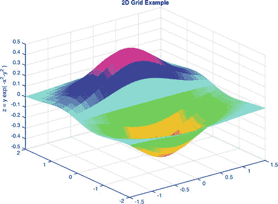

图 3-11. 在二维网格上生成的三维曲面

```matlab
%% 二维 meshgrid 示例
figure ('Name','2D Visualization');
xv = -1.5:0.1:1.5;
yv = -2:0.2:2;
[X,Y] = meshgrid (xv, yv);
Z = Y .* exp (-X.ˆ2 - Y.ˆ2);
surf (X,Y,Z,'edgecolor','none')
title ('2D Grid Example')
zlabel ('z = y exp( -xˆ2-yˆ2 )')
colormap hsv
size (X)
size (Y)
```

生成的矩阵是方阵，由输入向量在正确的维度上复制而成。你也可以手动使用 `repmat` 达到相同的结果，但 `meshgrid` 消除了记忆具体细节的必要。

```
>> size (X)
ans =
41 41
>> size (Y)
ans =
41 41
>> X(1:5,1:5)
ans =
-2 -1.9 -1.8 -1.7 -1.6
-2 -1.9 -1.8 -1.7 -1.6
-2 -1.9 -1.8 -1.7 -1.6
-2 -1.9 -1.8 -1.7 -1.6
-2 -1.9 -1.8 -1.7 -1.6
>> Y(1:5,1:5)
ans =
-2 -2 -2 -2 -2
-1.9 -1.9 -1.9 -1.9 -1.9
-1.8 -1.8 -1.8 -1.8 -1.8
-1.7 -1.7 -1.7 -1.7 -1.7
-1.6 -1.6 -1.6 -1.6 -1.6
```

为了增加趣味性，你也可以绘制数据的等高线。你可以使用 `gradient` 函数计算斜率，并通过 `quiver` 绘制。见图 3-12。

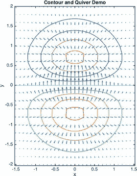

图 3-12. 以等高线形式呈现的三维曲面

```matlab
figure ('Name','Contour and Quiver')
[px,py] = gradient (Z,0.1,0.2);
contour (X,Y,Z), hold on
quiver (X,Y,px,py)
title ('Contour and Quiver Demo')
xlabel ('x')
ylabel ('y')
colormap hsv
axis equal
```

你还可以生成一个三维网格，并在该体积上计算数据，以便展示第四维度。为了查看这个体积上的额外数据，你可以使用 `slice`。它使用插值法在你指定的任何轴线上绘制切片。如果你想查看数据中的确切平面，可以在单个图形中使用 `pcolor`、`surf` 或 `contour`。`quiver3` 也可以用于在三维空间中绘制箭头。结果显示在图 3-13 中。

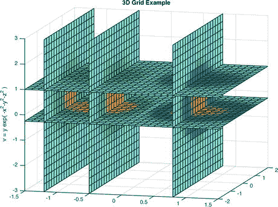

图 3-13. 带切片的三维体数据

```matlab
%% 三维 meshgrid 示例
% meshgrid 可用于生成三维矩阵，slice 可以使用插值显示选定的平面。
figure ('Name','3D Visualization');
zv = -3:0.3:3;
[x,y,z] = meshgrid (xv, yv, zv);
v = x .* exp (-x.ˆ2 - y.ˆ2 - z.ˆ2);
slice (x,y,z,v,[-1.2 -0.5 0.8],[],[-0.25 1])
title ('3D Grid Example')
zlabel ('v = y exp( -xˆ2-yˆ2-zˆ2 )')
colormap hsv
```

## 3.8 使用 Patch 生成三维物体

### 问题

你想绘制一个三维盒子。

### 解决方案

你可以使用 `patch` 函数创建如图 3-14 所示的三维盒子。

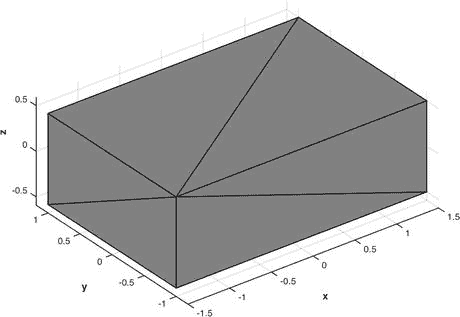

图 3-14. 使用 `patch` 生成的盒子

### 工作原理

MATLAB 中的 `patch` 函数使用顶点和面来定义二维或三维区域。顶点列表是一个 `n` × 3 的数组，指定了顶点的位置。面数组是一个 `n` × `m` 的数组，其中 `m` 是每个多边形的顶点数。面数组包含顶点的行索引。我们通常将 `m` 设置为 3，因为所有图形引擎最终都会将多边形简化为三角形。我们在 `BoxPatch` 中绘制一个盒子，如下所示。通常，在绘制物理对象时，将 `axis` 设置为 `equal` 以获得正确的纵横比。`patch` 具有许多属性。在此例中，只需使用 RGB 将面的颜色设置为灰色。边线颜色（也可以指定）默认为黑色。调用 `view(3)` 将相机设置为 `x`、`y` 和 `z` 值相等的位置。`rotate3d on` 允许我们移动相机。这对于检查模型非常方便。

```matlab
%% 使用 patch 生成一个立方体
% 创建一个图形并在其中绘制一个立方体。直接指定顶点和面。
% 使用 'axis equal' 以准确的纵横比显示立方体。
%% 盒子设计
x = 3;
y = 2;
z = 1;
% 面
f = [2 3 6;3 7 6;3 4 8;3 8 7;4 5 8;4 1 5;2 6 5;2 5 1;1 3 2;1 4 3;5 6 7;5 7 8];
% 顶点
v = [ -x x x -x -x x x -x;...
      -y -y y y -y -y y y;...
      -z -z -z -z z z z z]'/2;
%% 绘制对象
h = figure ('name','Box');
patch ('vertices',v,'faces',f,'facecolor',[0.5 0.5 0.5]);
axis equal
grid on
axis ([-3 3 -3 3 -3 3])
xlabel ('x')
ylabel ('y')
zlabel ('z')
view (3)
rotate3d on
```

## 3.9 使用光照对象

### 问题

你想为上一节绘制的三维盒子添加光照。

### 解决方案

你可以使用 `light` 函数创建环境光或定向光对象。光照对象会影响由 `surf`、`mesh`、`pcolor`、`fill`、`fill3` 和 `patch` 创建的片状和曲面对象。

### 工作原理

处理光照对象的主要属性包括 `Color`、`Style`、`Position` 和 `Visible`。样式可以是无限光（光线从指定方向平行照射），也可以是局部光（点光源向各个方向照射）。`Position` 属性对于每种样式具有不同的含义。`PatchWithLighting` 脚本在盒子中添加了局部光。你可以使用 `material` 修改盒子表面的属性，以获得不同的效果。

## 光照与材质

```matlab
%% 为立方体面添加光照
% 我们使用 findobj 定位 Patch 中绘制的面，然后修改其属性
% 使其适合光照。我们添加一个局部光。
%% 创建盒子面对象
BoxPatch;
%% 查找并更新面对象
p = findobj(gcf,'type','patch');
c = [0.7 0.7 0.1];
set(p,'facecolor',c,'edgecolor',c,...
    'edgelighting','gouraud','facelighting','gouraud');
material('metal');
%% 光照
l = light('style','local','position',[10 10 10]);
```

图 3-15 展示了相同光照下哑光（dull）材质和金属（metal）材质的区别。MATLAB 生成的光照受限于 OpenGL 光照。现代 3D 图形使用纹理和着色器来实现照片级真实感的场景光照。此外，您无法在 MATLAB 中生成阴影。

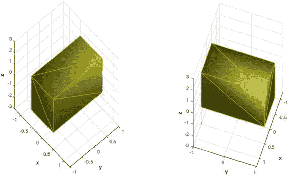

图 3-15. 使用局部光照对象照射的盒子。左侧盒子使用“哑光”材质，右侧盒子使用“金属”材质。

`material`的哑光、闪光（shiny）和金属设置会调整面属性以产生这些效果。您可以使用`get`轻松将这些效果打印到命令行。

```
>> material dull
>> get(p)
DiffuseStrength: 0.8
...
SpecularColorReflectance: 1
SpecularExponent: 10
SpecularStrength: 0
>> material metal
>> get(p)
DiffuseStrength: 0.3
...
SpecularColorReflectance: 0.5
SpecularExponent: 25
SpecularStrength: 1
>> material shiny
>> get(p)
DiffuseStrength: 0.6
...
SpecularColorReflectance: 1
SpecularExponent: 20
SpecularStrength: 0.9
```

请注意，列出的所有材质设置中，`AmbientStrength`均为 0.3。如果您想仅观察光照对象的效果而不受环境光影响，则必须手动将其设置为 0。在图 3-16 中，环境光强度设置为 0，并应用了闪光材质。

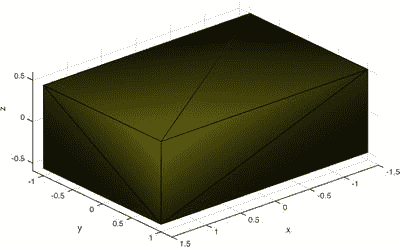

图 3-16. 移除环境光后的闪光盒子（`AmbientStrength`设置为 0）及不同的相机视角

MATLAB 提供了`lighting`函数，用于通过四种设置控制光照模型：无（none）、Gouraud、Phong 和平坦（flat）。Gouraud 光照在面之间插值，可产生最逼真的效果。请注意，对盒子设置`lighting gouraud`会将`FaceLighting`属性设置为`gouraud`，但会将`EdgeLighting`设置为`none`，这与我们脚本中的效果不同（脚本中边光照也通过其属性设置为 Gouraud）。平坦光照使每个面整体光照均匀，如图 3-17 所示，我们将视角设置为(-50,30)，光照设置为平坦。

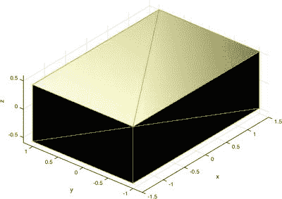

图 3-17. 平坦光照下的闪光盒子

MATLAB 的建议是：对多面体对象使用平坦光照，对曲面对象使用 Gouraud 光照。比较这两种光照最简单的方法是创建一个球体，使用`sphere`函数生成曲面即可轻松实现。以下`SphereLighting`脚本展示了具体做法，其中无限光源从 x 轴方向照射。

```matlab
%% 创建球体并添加光照
%% 在新图形中创建球体曲面
[X,Y,Z] = sphere(16);
figure('Name','Sphere Demo')
s = surf(X,Y,Z);
xlabel('x')
ylabel('y')
zlabel('z')
axis equal
view(70,15)
%% 添加光照对象并显示属性
light('position',[1 0 0])
disp(s)
title('Flat Lighting')
pause
%% 切换为 Gouraud 光照并再次显示
lighting gouraud
title('Gouraud Lighting')
disp(s)
```

除了`sphere`函数，MATLAB 还提供了`cylinder`和`ellipsoid`函数。

## 3.10 通过编程设置相机属性

### 问题
您希望在场景中拥有一个指向特定位置的相机。

### 解决方案
使用 MATLAB 的`cam`系列函数。这些函数提供了与相机工具栏中按钮相同的功能，但具有可重复性，并且能够为参数传递变量。

### 工作原理
在场景中创建两个盒子：其中一个经过缩放，并在 x 方向上与另一个相距 5。使用 MATLAB 函数`camdolly`、`camorbit`、`campan`、`camzoom`和`camroll`来控制相机。将所有函数放入`PatchWithCamera.m`脚本中，并提供两组参数示例。请注意，如果没有光照，边缘将不可见。

```matlab
%% 使用 patch 生成两个立方体，并将相机对准场景
% 相机参数将使用 cam 系列函数通过编程方式设置。
%% 相机参数
% 轨道旋转
thetaOrbit = 0;
phiOrbit = 0;
% 滑动
xDolly = 0;
yDolly = 0;
zDolly = 0;
% 缩放
zoom = 1;
% 旋转
roll = 50;
% 平移
thetaPan = 1;
phiPan = 0;
%% 盒子设计
x = 1;
y = 2;
z = 3;
% 面
f = [2 3 6;3 7 6;3 4 8;3 8 7;4 5 8;4 1 5;2 6 5;2 5 1;1 3 2;1 4 3;5 6 7;5 7 8];
% 顶点
v = [-x x x -x -x x x -x;...
    -y -y y y -y -y y y;...
    -z -z -z -z z z z z]'/2;
%% 绘制对象
h = figure('name','Box');
c = [0.7 0.7 0.1];
patch('vertices',v,'faces',f,'facecolor',c,'edgecolor',c,...
    'edgelighting','gouraud','facelighting','gouraud');
c = [0.2 0 0.9];
v = 0.5*v;
v(:,1) = v(:,1) + 5;
patch('vertices',v,'faces',f,'facecolor',c,'edgecolor',c,...
    'edgelighting','gouraud','facelighting','gouraud');
material('metal');
lighting gouraud
axis equal
grid on
XLabelS('x')
YLabelS('y')
ZLabelS('z')
view(3)
rotate3d on
%% 相机命令
campan(thetaPan,phiPan)
camzoom(zoom)
camdolly(xDolly,yDolly,zDolly);
camorbit(thetaOrbit,phiOrbit);
camroll(roll);
s = sprintf('Pan %3.1f %3.1f\nZoom %3.1f\nDolly %3.1f %3.1f %3.1f\nOrbit %3.1f %3.1f\nRoll %3.1f',...
    thetaPan,phiPan,zoom,xDolly,yDolly,zDolly,thetaOrbit,phiOrbit,roll);
text(2,0,0,s);
```

其他用于与场景相机交互的函数包括`campos`和`camtarget`，可用于设置相机位置和目标。这可用来从一个对象的视角对另一个对象成像。`camva`用于设置相机视角，因此您可以模拟真实相机的视场角。`camup`

## 3.11 显示图像

### 问题
您希望绘制一幅图像。

### 解决方案
您可以直接从图像文件读取图像，并在图形窗口中绘制它。MATLAB 支持多种格式，包括 GIF、JPG、TIFF、PNG 和 BMP。

### 工作原理
使用`imread`读取黑白图像，并通过`imagesc`显示。`imagesc`将颜色数据缩放至颜色映射表中。必须应用灰度颜色映射表；否则将获得默认颜色映射表中的颜色。对于 parula 颜色映射表，其颜色为蓝色和黄色。

# 绘制JPEG图像

以下示例展示了多种方式来绘制一张JPEG图像。

## 使用 pcolor 和 imagesc

首先读入一张JPEG图像，并使用 `pcolor` 和 `imagesc` 两种方法绘制它。

```
%% Draw a JPEG image in a figure multiple ways
% We will load and display an image of a mug.

%% See also
% imread, pcolor, imagesc, imshow, colormap

%% Read in the JPEG image
i = imread('Mug.jpg');

%% Draw the picture with imagesc
% This preserves an axes. Each pixel center of the image lies at integer
% coordinates ranging between 1 and M or N. Compare the result of imagesc to
% that of pcolor. axis image sets the aspect ratio so that tick marks on both
% axes are equal, and makes the plot box fit tightly around the data.
h = figure('name','Mug')
subplot(1,2,1)
pcolor(i)
shading('interp')
colorbar
axis image
title('pcolor with colorbar')
a = subplot(1,2,2)

% scale the image into the colormap
imagesc( i );
colormap(a,'gray')
axis image
grid on
title('imagesc with gray colormap')
```

图 3-20 首先展示了使用`pcolor`绘制的杯子，`pcolor`会创建矩阵的伪彩色图，但实际上它是一个从上往下俯视的`surf`图。为突出这一点，我们添加了颜色条。在右侧，图像使用`imagesc`结合灰度颜色映射表绘制。注意`imagesc`已改变坐标轴方向，使图像正向显示。两个图均带有刻度标记的坐标轴。

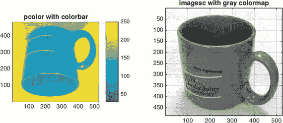

图 3-20. 使用 `pcolor` 和 `imagesc` 显示的杯子

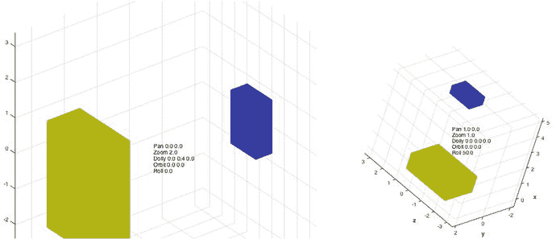

图 3-19. 不同相机参数的盒子

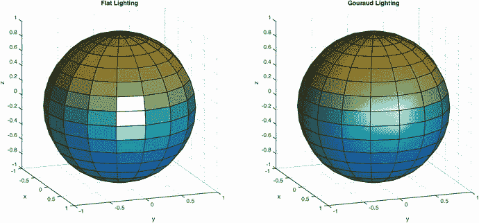

图 3-18. 用无限光源照射的球体。左侧球体为平直光照。右侧球体为 gouraud 光照

## 使用 imshow

MATLAB 还有另一个名为`imshow`的图像显示函数，它被认为是基本的图像显示函数。它会优化图窗、坐标轴和图像对象的属性来显示图像。如果您拥有图像处理工具箱，`imtool`则在`imshow`的基础上扩展了更多功能。注意图像显示时没有坐标轴框。该函数会自动缩放并选择合适的灰度颜色映射表。

```
%% Draw with imshow
% The axes will be turned off. The image will be scaled to fit the figure if it
% is too large.
f = figure('Name','Mug Image');
subplot(1,2,1)
imshow(i)
title('imshow')
subplot(1,2,2)
imshow(i,[30 200])
title('imshow with limits [30 200]')
```

并非所有图像都使用完整的色深；例如，这个杯子图像的最小值为 30，最大值为 250。`imshow`允许您直接设置图像的颜色范围，像素会相应地进行缩放。您可以通过提高颜色下限来使图像变暗，通过降低颜色上限来使图像变亮。

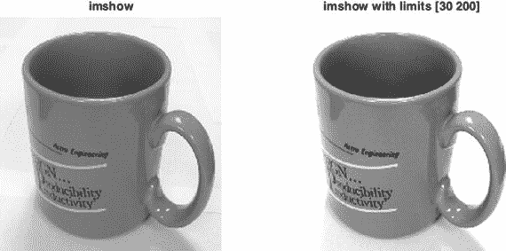

图 3-21. 使用 `imshow` 显示的杯子，右侧应用了颜色范围

# 添加水印

## 问题描述

您的工具箱中有大量精美的图形，希望为它们添加标记，以表明是由贵公司创建的。或者，您可能希望为这些图像添加日期或生成该图像的软件版本号作为标记。

## 解决方案

您可以使用底层图形函数，为工具箱中生成的图窗添加文本水印或图像水印。棘手之处在于需要按正确顺序将项目添加到图窗中，以免它们被覆盖。

## 工作原理

添加水印的最佳方法是为要添加的每个文本或图像项目创建一个特殊的坐标轴。关闭坐标轴框，以便仅看到文本或图像。在第一个示例中，我们在图的左下角添加了一个图标和文本。我们还为文本周围的边框添加了一种颜色，使其轮廓清晰。如图 3-22 所示。在该示例中，我们将硬拷贝反转设置为关闭，这样在打印图窗时将获得灰色背景；这使本书中的图示更清晰易读。

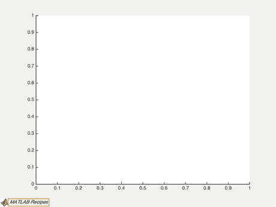

图 3-22. 公司水印

以下为一个水印函数的示例：

```
>> h = figure;
>> set(h,'InvertHardcopy','off')
>> axes
>> Watermark(h)

function Watermark( fig, pos )
%% WATERMARK Add a watermark to a figure.
% This function creates two axes, one for the image and one for the text.
% Calling it BEFORE plotting can cause unexpected results. It will reset
% the current axes after adding the watermark. The default position is
% the lower left corner, (2,2).

%% Form
% Watermark( fig, pos )

%% Inputs
% fig (1,1) Figure hangle
% pos (1,2) Coordinates, (left, bottom)

%% Outputs
% None.

if ( nargin <1 || isempty(fig))
   fig = figure('Name','Watermark Demo');
   set(fig,'color',[0.85 0.9 0.85]);
end
if ( nargin <2 || isempty(pos))
   pos = [2 2];
end
string = 'MATLAB Recipes';

% Save the current axes so we can restore it
aX = [];
if ~ isempty ( get(fig,'CurrentAxes'))
   aX = gca ;
end

% Draw the icon
%---------------
[d,map] = imread('matlabicon','gif');
posIcon = [pos(1:2) 16 16];
a = axes ( 'Parent', fig, 'box', 'off', 'units', 'pixels', 'position', posIcon );
image ( d );
colormap(a,map)
axis off

% Draw the text
%---------------
posText = [pos(1)+18 pos(2)+1 100 15];
axes ( 'Parent', fig, 'box', 'off', 'units', 'pixels', 'position', posText );
t = text (0,0.5,string,'fontangle','italic');
set (t,'edgecolor',[0.87 0.5 0])
axis off

% Restore current axes in figure
if ~ isempty (aX)
   set (fig,'CurrentAxes',aX);
end
set (fig,'tag','Watermarked')
```

作为另一个示例，我们使用文本旋转功能，沿图的左侧和右侧添加了文本。我们将文本颜色设为浅色。这表示该图形为草稿。在添加草稿标记之前，我们创建了一个空白图窗和坐标轴，如图 3-23 所示。

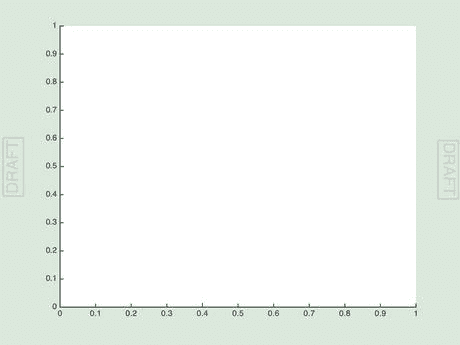

图 3-23. 草稿水印

```markdown
# Draftmark 函数使用与定义

## 使用示例

```matlab
>> h = figure('Name','Draftmark Demo');
>> set(h,'color',[0.85 0.9 0.85]);
>> set(h,'InvertHardCopy','off')
>> axes;
>> Draftmark(h);
```

## 函数定义

```matlab
function Draftmark( fig, pos )
%% DRAFTMARK Add a draft marking to a figure.
% This function creates two axes, one each block of text.
% Calling it BEFORE plotting can cause unexpected results. It will reset
% the current axes after adding the watermark. The default position is
% the lower left corner, (2,2).

%% Form
% Draftmark( fig, pos )

%% Inputs
% fig (1,1) Figure hangle
% pos (1,2) Coordinates, (left, bottom)

%% Outputs
% None.

if ( nargin <1 || isempty(fig))
   fig = figure('Name','Draft Demo');
   set(fig,'color',[0.85 0.9 0.85]);
end
if ( nargin <2 || isempty(pos))
   pos = [2 2];
end
string = 'DRAFT';

% Save the current axes so we can restore it
aX = [];
if ~ isempty ( get(fig,'CurrentAxes'))
   aX = gca ;
end

% Draw the text
%---------------
pf = get(fig,'position');
posText = [pos(1)+5 pos(2)+0.5*pf(4)-40 20 80];
axes ( 'Parent', fig, 'box', 'on', 'units', 'pixels', 'outerposition', posText );
t1 = text (0,0,string,'fontsize',20,'color',[0.8 0.8 0.8]);
set (t1,'rotation',90,'edgecolor',[0.8 0.8 0.8],'linewidth',2)
```

# 格式化 `axis` `off`

```
posText = [pos(1)+pf(3)-25 pos(2)+0.5*pf(4)-40 20 80];
axes('Parent', fig, 'box', 'on', 'units', 'pixels', 'outerposition', posText);
t2 = text(0,1,string,'fontsize',20,'color',[0.8 0.8 0.8]);
set(t2,'rotation',270,'edgecolor',[0.8 0.8 0.8],'linewidth',2)
axis off
% 恢复图形中的当前坐标轴
if ~isempty(aX)
    set(fig,'CurrentAxes',aX);
end
```

如果你想要更炫酷的效果，可以在图形前方绘制对象并为其设置透明度，但这些对象必须是填充或面片对象；文本无法设置透明度。

## 总结

本章回顾了 MATLAB 可视化的关键特性，从基础绘图到 3D 可视化，包括对象和光照。我们演示了如何获取图形和坐标轴的句柄、以编程方式设置属性，以及使用图形交互工具。创建实用的可视化程序是任何工具箱的关键组成部分。MATLAB 提供了出色的数据管理程序，包括能够管理大型数据网格的程序，以及多种着色选项。表 3-1 列出了本章中开发的代码。

### 表 3-1. 章节代码清单

| 文件 | 描述 |
| --- | --- |
| `AnnotatePlot` | 沿曲线等间距添加文本标注。 |
| `Boxpatch` | 使用面片生成立方体。 |
| `ColorDistribution` | 演示一组线条的颜色分布。 |
| `DraftMark` | 为图形添加草稿标记。 |
| `GridVisualization` | 在二维和三维网格上可视化数据。 |
| `PatchWithCamera` | 使用面片生成两个立方体，并将相机对准场景。 |
| `PatchWithLighting` | 为立方体面片添加光照。 |
| `PlotPage` | 在一个图形中创建包含多个自定义绘图的绘图页面。 |
| `PlottingWithDates` | 使用月份作为 x 轴标签进行绘图。 |
| `QuadPlot` | 使用子图创建四象限绘图页面。 |
| `ReadImage` | 用多种方式在图形中绘制 JPEG 图像。 |
| `SphereLighting` | 创建并点亮一个球体。 |
| `Watermark` | 为图形添加水印。 |

# 4. 交互式图形

电子补充材料：本章的在线版本（doi: [10.1007/978-1-4842-0559-4_4](http://dx.doi.org/10.1007/978-1-4842-0559-4_4)）包含补充材料，供授权用户使用。

上一章介绍了静态图形的生成。本章提供了生成动态图形的方案。这包括线条和面片对象的动画；在图形中使用 `uicontrol` 对象；使用 GUIDE 开发环境设计 GUI；以及将 GUI 部署为 MATLAB 应用程序。我们还提供了一些技巧，以最大限度地提高动态图形函数的性能。

## 4.1 创建简单动画

### 问题

你需要一种随时间变化的可视化效果，而不希望生成数百个不同的图形。

### 解决方案

你可以通过在循环中连续更新图形中的面片对象来创建动画。图 4-1 展示了此类动画的一帧。

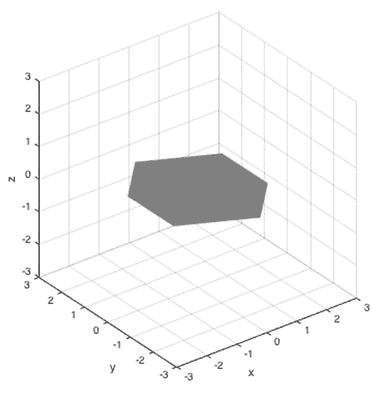

**图 4-1.** 旋转立方体的动画

### 工作原理

首先，创建一个包含上一章三维盒子的图形。然后在一个循环中更新它。如果能为现有图形对象分配新数据，这将是最高效的方式。这可以更改对象的颜色、样式或物理位置。另一种方法是先删除对象，再在当前坐标系中重新创建。在这两种情况下，你都需要存储图形句柄以便进行更新。

在本例中，你通过乘以旋转矩阵 `b` 来更新顶点。然后，通过句柄使用 `set(p, 'vertices', vK)` 将顶点传递到补片（patch）对象中。请注意转置的使用，因为顶点存储在一个 `n×3` 的数组中。一个光照对象能让最终的动画更有趣。你将补片对象的 `'linestyle'` 设置为 `'none'`，以消除三角形之间的线条。

```
%% 使用补片（patch）制作立方体动画

% 创建一个图形并在其中绘制一个立方体。顶点和面直接指定。
% 我们仅更新顶点以得到流畅的动画。

%% 盒子设计

x = 3;
y = 2;
z = 1;

% 面
f = [2 3 6;3 7 6;3 4 8;3 8 7;4 5 8;4 1 5;2 6 5;2 5 1;1 3 2;1 4 3;5 6 7;5 7 8];

% 顶点
v = [-x x x -x -x x x -x;...
    -y -y y y -y -y y y;...
    -z -z -z -z z z z z]'/2;

%% 绘制对象

h = figure('name','Box');
p = patch('vertices',v,'faces',f,'facecolor',[0.5 0.5 0.5],...
    'linestyle','none','facelighting','gouraud');
ax = gca;
set(ax,'DataAspectRatio',[1 1 1],'DataAspectRatioMode','manual')
axis([-3 3 -3 3 -3 3])
grid on
xlabel('x')
ylabel('y')
zlabel('z')
view(3)
rotate3d on
light('position',[0 0 1])

%% 动画

% 我们使用 tic 和 toc 来计时动画。Pause 配合小于一秒的输入用以减慢动画。

tic
n = 10000;
a = linspace(0,8*pi,n);
c = cos(a);
s = sin(a);
for k = 1:n
    b = [c(k) 0 s(k);0 1 0;-s(k) 0 c(k)];
    vK = (b*v')';
    set(p,'vertices',vK);
    pause(0.001);
end
toc
```

在一台 MacBook Pro 笔记本电脑上，完整旋转四次的动画大约需要 16 秒。其中预计约 10 秒来自 `pause` 命令，即 10000 步乘以 0.001 秒。使用 `pause` 可以减慢动画速度，否则动画可能过快而失去实用价值。请记住，可以使用 `pause off` 临时禁用 `pause` 命令；这在测试使用了 `pause` 的图形函数时非常有用。

**提示**：根据需要，使用 `pause` 来减慢动画速度。测试时，请记得使用 `pause off` 来禁用暂停，以全速运行。

检查你电脑上的执行时间！运行脚本两次，第二次时关闭 pause。

```
>> pause on
>> PatchAnimation;
Elapsed time is 15.641664 seconds.

>> pause off
>> PatchAnimation;
Elapsed time is 0.780012 seconds.
```

注意，`pause` 会刷新系统图形队列，将更新后的补片绘制到屏幕上。当 `pause` 关闭时，图形不会更新，你只能在窗口中看到初始帧。另外请注意，由暂停和图形更新引起的实际时间增加了将近 15 秒。要强制更新图形而不使用 `pause`，请使用 `drawnow`。

此脚本利用代码段（cells）允许独立运行各个部分。这意味着你可以通过重新执行该代码段来重新运行动画，而无需重新创建图形。这可以通过工具栏中的“运行节”按钮或键盘命令（例如 Mac 上的 Command-Enter）来完成。

假设你想向动画中添加一个显示旋转角度的文本项。你可以轻松地使用 `title` 来实现：

```
title(sprintf('Angle: %f deg',a(k)*180/pi));
```

然而，你会惊讶于它对性能的影响。现在动画耗时超过了 90 秒！显示文本的效率远低于更新图形顶点。首先，你可以尝试直接使用轴标题对象的句柄并设置字符串。但这几乎没什么区别，仍然耗时约 90 秒。另一种解决方案是添加一个内层循环来降低更新标题的频率。反复试验表明，每 50 步更新一次对运行时间影响甚微。带有标题的图形如图 4-2 所示。

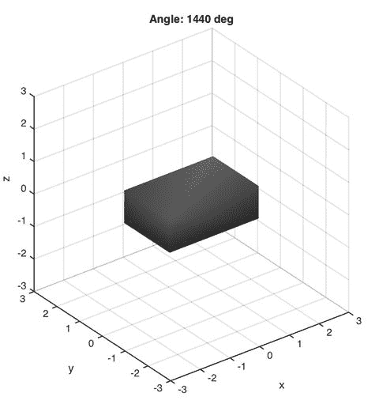

图 4-2. 带有动态标题的盒子动画

```
if rem(k,50)==0
    set(ax.Title,'string',sprintf('Angle: %.5g deg',a(k)*180/pi));
end
```

表 4-1 总结了在参考 MacBook 上的执行时间。这些时间由 `toc` 打印输出，来自单次运行，并非平均值。多次运行之间，执行时间的变化预计可达 10%。

**表 4-1.** `PatchAnimation` 的执行时间

| 无标题 |
| --- |
| `pause off` / `pause on` (0.001 秒) | 0.780154 秒 / 17.254507 秒 |
| 有标题 |
| 标题 | 90.761500 秒 |
| 每步设置 | 90.213318 秒 |
| 每 50 步设置 | 20.218774 秒 |

## 4.2 播放动画

### 问题

你想要存储并播放一段动画。

### 解决方案

使用 `VideoWriter` 类将动画的每一帧保存到一个 AVI 文件中。

### 工作原理

在下面的代码清单中，你使用 `VideoWriter` 保存动画并将其读入一个 AVI 文件。这行代码打开一个 AVI 文件：

```
vObj = VideoWriter('RotatingBox.avi');
```

该脚本名为 `PatchAnimationStorage.m`。创建盒子和图形的部分未显示，因为它们与上一个示例相同。在这个例子中，你仅使用 100 个点来完成四次旋转；在暂停关闭的情况下，执行时间（包括保存影片）约为 4 秒。在分析器（Profiler）中运行此脚本显示，近 90% 的执行时间花费在 `writeVideo` 命令上。

```
%% 使用补片（patch）制作立方体动画并存储为 AVI 文件

% 图形和盒子的创建方式与 PatchAnimation 相同。这次我们使用
% VideoWriter 将帧存储到影片中。

%% 动画

n = 100;
a = linspace(0,8*pi,n);
c = cos(a);
s = sin(a);

% 创建视频文件
vObj = VideoWriter('RotatingBox.avi');
open(vObj);
tic
for k = 1:n
    pause(0.01);
    b = [c(k) 0 s(k);0 1 0;-s(k) 0 c(k)];
    vK = (b*v')';
    set(p,'vertices',vK);
    writeVideo(vObj, getframe(h));
end
toc
close(h)
close(vObj)
```

然后你可以在任何视频播放器中播放动画，如图 4-3 所示。

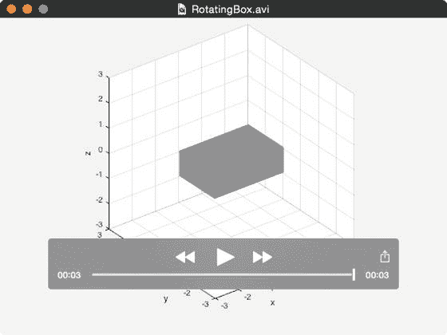

图 4-3. 在视频播放器中回放的影片文件

## 4.3 线条对象动画

### 问题

你希望在循环中更新一个包含线条对象的绘图。

### 解决方案

这与示例 4-1 类似，但你需要更新图形对象的不同属性。你将使用第 3 章的四边形图，并添加一个沿轨迹移动的标记动画。这还将演示如何使用 `uimenu` 向图形添加菜单。

### 工作原理

从 `QuadPlot.m` 函数开始。该函数创建四个子图以查看轨迹：一个三维视图和三个来自不同方向的二维视图（参见图 4-4）。要添加一个可制作动画的标记，你需要执行以下几步：

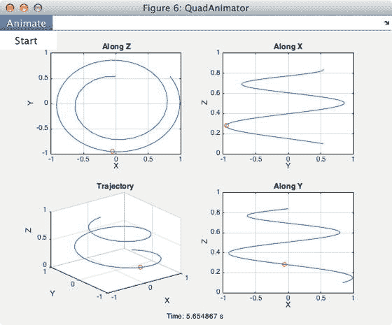
图 4-4. 四象限图动画的一帧

1. 添加时间输入。
2. 在每个子图中添加标记并保存句柄。
3. 添加一个文本 `uicontrol` 控件，用于在动画进行时显示当前时间。
4. 将轨迹数据和句柄存储在图形对象的 `UserData` 中。
5. 关闭常规图形菜单，并添加一个包含 `Start` 函数的动画菜单。

你使用一个 `nargin` 检查来判断是通过 `t` 和 `x` 数据创建图形，还是通过输入 `'update'` 进入回调函数。另一种替代方案是将回调函数放在一个单独的函数中；执行回调的图形可以通过 `Tag` 属性或此处使用的 `gcbf` 来识别。

```matlab
%% QUADANIMATOR Create a quad plot page with animation.
% This creates a 3D view and three 2D views of a trajectory in one figure. A
% menu is provided to animate the trajectory over time.

%% Form
% QuadAnimator( t, x )

%% Input
% t (1,:) Time data
% x (3,:) Trajectory data
%
%% Output
% None.

function QuadAnimator(t,x)

if nargin == 0
   disp('Demo of QuadAnimator');
   t = linspace(0,4*pi,101);
   th = logspace(0,log10(4*pi),101);
   in = logspace(-1,0,101);
   x = [sin(th).*cos(in); cos(th).*cos(in); sin(in)];
   QuadAnimator(t,x);
   return;
end

if nargin == 2
   h = figure('Name','QuadAnimator');
   set(h,'InvertHardcopy','off','menubar','none')
   ma = uimenu(h,'Label','Animate');
   ms = uimenu(ma,'Label','Start','Callback','QuadAnimator(''update'')');
   m = Plot(x);
   p = get(h,'position');
   ut = uicontrol('Style','text','String','Time: 0.0 s',...
                  'Position',[0 0 p(3) 20]);
   d.t = t;
   d.x = x;
   d.m = m;
   d.ut = ut;
   set(h,'UserData',d);
else
   h = gcbf;
   d = get(h,'UserData');
   Animate(d);
end

function m = Plot(x)
% Use subplot to create four plots of a trajectory
subplot(2,2,3)
plot3(x(1,:),x(2,:),x(3,:));
hold on
m(3) = plot3(x(1,1),x(2,1),x(3,1),'o');
hold off
xlabel('X')
ylabel('Y')
zlabel('Z')
grid on
title('Trajectory')

subplot(2,2,1)
plot(x(1,:),x(2,:));
hold on
m(1) = plot(x(1,1),x(2,1),'o');
hold off
xlabel('X')
ylabel('Y')
grid on
title('Along Z')

subplot(2,2,2)
plot(x(2,:),x(3,:));
hold on
m(2) = plot(x(2,1),x(3,1),'o');
hold off
xlabel('Y')
ylabel('Z')
grid on
title('Along X')

subplot(2,2,4)
plot(x(1,:),x(3,:));
hold on
m(4) = plot(x(1,1),x(3,1),'o');
hold off
xlabel('X')
ylabel('Z')
grid on
title('Along Y')

function Animate( d )
% Animate the markers on the subplots over time
for k = 1:length(d.t)
   x = d.x(:,k);
   set(d.m(3),'XData',x(1),'YData',x(2),'ZData',x(3));
   set(d.m(1),'XData',x(1),'YData',x(2));
   set(d.m(2),'XData',x(2),'YData',x(3));
   set(d.m(4),'XData',x(1),'YData',x(3));
   set(d.ut,'string',sprintf('Time: %f s',d.t(k)));
   drawnow;
end
```

可以看到，两个子函数分别实现了绘图和动画功能。动画部分设置当前时间下标记的 `XData`、`YData` 和 `ZData`，并更新文本控件。我们使用了 `drawnow` 来刷新事件队列。该动画在不使用 `pause` 命令的情况下以良好的速度运行，但你的计算机上可能有所不同，请做好实验的准备！

## 4.4 uicontrol 按钮的实现

### 问题

你想在对话框中使用一个按钮来在脚本运行时停止它。

### 解决方案

使用 `uicontrol` 和 `figure` 创建一个带有控件的弹出窗口，如图 4-5 所示。

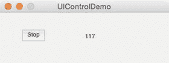
图 4-5. UIControlDemo 窗口

### 工作原理

使用脚本`UIControlDemo.m`中的两个`uicontrol`调用。第一个在窗口中放置一个文本框。第二个在窗口中放置一个按钮。您不必为按钮指定样式，因为这是默认样式，但为了清晰起见，您可以指定它。按钮控件有一个回调。回调可以是任何MATLAB代码或函数句柄。在这种情况下，只需将全局`stop`设为`true`以停止循环。请注意，为了清晰起见，我们使用`true`和`false`作为全局布尔值，尽管`1`和`0`也可以工作。

```
%% Demonstrate the use of a uicontrol button with a callback

% Create a window with a button that interacts with a global variable in the script.

%% Build the GUI

% This is a global to communicate the button push from the GUI
global stop;
stop = false;

% Build the GUI
set (0,'units','pixels')
p = get (0,'screensize');
bottom = p(4) - 190;
fig = figure ('name','UIControlDemo','position',[340 bottom 298 90],...
    'NumberTitle','off','menubar','none',...
    'resize','off');

% The display text
speed = uicontrol ( 'Parent', fig, 'position', [ 20 40 280 15],...
    'style', 'text','string','Waiting to start.');

% This has a callback setting stop to 1
step = uicontrol ( 'parent', fig, 'position',[ 40 40 40 20],...
    'string','Stop', 'callback','stop = true;');

%% Run the GUI
for k = 1:1000
    pause (0.01)
    set ( speed, 'String', k );
    if ( stop )
        break ; %#ok<UNRCH>
    end
    %drawnow % alternative to pause
end
```

位置`input`定义为`[left bottom width height]`。获取计算机屏幕尺寸的目的是通过将底部位置参数设置为屏幕尺寸减去图形尺寸（90 像素高）再加上 100 像素边距，即`p(4) − 190`，将窗口放置在屏幕顶部附近。

MATLAB 的代码分析器在包含`break`的行上放置一个警报，提示当`stop`为`false`时该行不可达。事实确实如此，但您有`uicontrol`来更改该参数。MATLAB 无法确定这一点，因此您可以添加`%#ok<UNRCH>`注释来抑制该警告。如果您右键单击带有警告的行并在弹出菜单中选择“抑制此语句...”，此注释可以由 MATLAB 自动添加（即自动修复）。

**提示**：抑制仅在您的布尔逻辑更改后才可到达的代码行上的警告。

让我们检查执行时间。使用`tic`和`toc`运行脚本两次，第二次关闭`pause`。

```
>> tic; UIControlDemo; toc
Elapsed time is 11.601678 seconds.
>> pause off
>> tic; UIControlDemo; toc
Elapsed time is 0.147663 seconds.
```

如果您希望动画持续超过或少于 11 秒，可以调整`pause`时间。您可以看到，即使更新了 1000 次，仅图形循环本身也只占用了一小部分秒！这是因为关闭`pause`后，图形不会在循环的每一步强制更新。MATLAB 仅在脚本结束时刷新图形，除非您有刷新系统队列的命令，例如`pause`、`drawnow`或`getframe`。如果您不想或不需要`pause`，请使用`drawnow`来强制在循环的每一步进行图形更新。表 4-2 显示了在`pause`开启或关闭以及使用`drawnow`时的执行时间。这些是单次在参考 MacBook 上运行的时间，并非平均值；预计运行时间可能会有高达 10%的差异。

**表 4-2.** `PatchAnimation`的执行时间

| `pause off` | 0.147663 秒 |
| `pause on` (0.01 秒) | 11.601678 秒 |
| `drawnow` | 2.642504 秒 |
| `pause` AND `drawnow` | 13.785564 秒 |

## 4.5 显示正在运行的模拟或循环的状态

### 问题

您希望在循环中显示耗时任务剩余的运行时间。

### 解决方案

创建一个包含文本`uicontrol`的窗口以显示剩余时间（见图 4-6）。

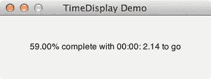

**图 4-6.** 时间显示窗口

### 工作原理

`TimeDisplayGUI` 实现了时间窗口。它使用了三个带有 `varargin` 的动作。一个持久变量 `hGUI` 存储了步骤数，并在每次更新调用时自动递增。以下是在此函数中需要注意的一些事项：

- 使用 MATLAB 函数 `now` 来获取当前日期，以进行计时。

- 已完成的步骤数存储在 `hGUI.stepsDone` 中。

- GUI 每半秒钟更新一次文本字符串。

- 假设所有步骤耗时相同，它会计算脚本完成前的预估剩余时间。

- 内置演示使用了 `pause`。

```
function TimeDisplayGUI( action, varargin )
```

```
%% TimeDisplayGUI 在循环中显示预计剩余时间
% 每次步骤调用 TimeDisplayGUI('update')；步骤计数器通过持久变量自动递增。
% 每 0.5 秒间隔更新一次。
%
% TimeDisplayGUI('initialize', nameOfGUI, totalSteps )
% TimeDisplayGUI('update')
% TimeDisplayGUI('close')
%
% 一次只能运行一个 TimeDisplayGUI。内置演示使用 pause 运行约 5 秒。
```

```
%% 格式：
% TimeDisplay( action, varargin )
```

```
%% 输入
% action (1,:) 'initialize', 'update' 或 'close'
% nameOfGUI (1,:) 要显示的名称
% totalSteps (1,1) 总步骤数
%
%% 输出
% 无
```

```
persistent hGUI
if nargin == 0
   % 演示
   disp('正在初始化包含 100 步的演示窗口。')
   TimeDisplayGUI( 'initialize', 'TimeDisplay Demo', 100 );
   for k = 1:100
      pause(0.05)
      TimeDisplayGUI( 'update' );
   end
   return;
end

switch action
   case 'initialize'
      hGUI = BuildGUI( varargin{1} );
      hGUI.totalSteps = varargin{2};
      hGUI.stepsDone = 0;
      hGUI.date0 = now;
      hGUI.lastDate = now;
   case 'update'
      if( isempty( hGUI ) )
         return
      end
      hGUI.stepsDone = hGUI.stepsDone + 1;
      hGUI = Update( hGUI );
   case 'close'
      if ~isempty(hGUI) && ishandle(hGUI.fig)
         delete( hGUI.fig );
      else
         delete( gcf )
      end
      hGUI = [];
end
```

function hGUI = Update( hGUI )
% 更新显示
thisDate = now;
dTReal = thisDate - hGUI.lastDate; % 天数
if( dTReal > 0.5/86400 )
   % 每 0.5 秒递增一次
   stepPer = hGUI.stepsDone/(thisDate - hGUI.date0);
   stepsToGo = hGUI.totalSteps - hGUI.stepsDone;
   tToGo = stepsToGo/stepPer;
   datev = datevec(tToGo);
   str = FormatString( hGUI.stepsDone/hGUI.totalSteps, datev );
   set( hGUI.percent, 'String', str );
   drawnow;
   hGUI.lastDate = thisDate;
end
```

```matlab
function h = BuildGUI( name )
% 初始化 GUI
set(0,'units','pixels')
p = get(0,'screensize');
bottom = p(4) - 190;
h.fig = figure('name',name,'Position',[340 bottom 298 90],'NumberTitle','off',...
   'menubar','none','resize','off','closerequestfcn',...
   'TimeDisplayGUI(''close'')');
v = {'Parent',h.fig,'Units','pixels','fontunits','pixels'};
str = FormatString( 0, [0 0 0 0 0 0] );
h.percent = uicontrol( v{:}, 'Position',[ 20 35 260 20], 'Style','text',...
   'fontsize',12,'string',str,'Tag','StaticText2');
drawnow;
```

```matlab
function str = FormatString( fSteps, date )
% 格式化倒计时时间字符串
str = sprintf('%4.2f%% 已完成，剩余 %2.2i:%2.2i:%5.2f',...
   100*fSteps, date(4), date(5), date(6));
```

下面的脚本`TimeDisplayDemo`演示了如何使用此函数。图 4-6 展示了结果窗口。

```matlab
%% 演示一个显示进程剩余时间的 GUI

%% 另请参阅
% TimeDisplayGUI

%% 脚本常量
n = 10000;
dT = 0.1;
a = rand(10,10);

%% 初始化时间显示
TimeDisplayGUI( 'initialize', 'SVD', n )

%% 循环
for j = 1:n
   % 执行一些耗时的操作
   for k = 1:100
      svd(a);
   end
   % 显示状态消息
   TimeDisplayGUI( 'update' );
end

%% 结束
TimeDisplayGUI( 'close' );
```

## 4.6 使用 GUIDE 创建自定义 GUI

### 问题

你有一个重复性的工作流程，并且希望构建一个 GUI，以避免反复在脚本中更改参数。例如，让我们采用配方 4-1 中的旋转立方体动画，并将其放入 GUI 中，这样你就可以轻松查看不同暂停时长的影响。

### 解决方案

你将使用 GUI 设计环境 (GUIDE) 来创建 GUI，从一个空白图形窗口开始。你需要一个用于输入暂停时长的编辑框，以及用于交互的按钮。

### 工作原理

输入 `guide` 启动 GUIDE 快速入门窗口。在“创建新 GUI”选项卡中，选择“空白 GUI”。这将在编辑器中打开一个名为 `untitled1.fig` 的空白图形，如图 4-7 所示。

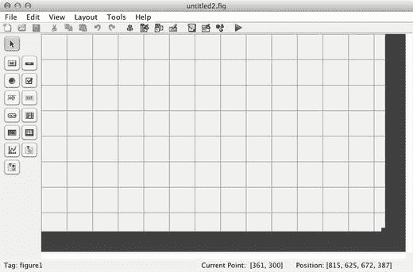

**图 4-7.** GUIDE 编辑器中的空白 GUI

使用左侧的按钮在 GUI 中创建以下项目：

- 用于输入暂停时间的编辑框
- 文本框的文本标签
- 启动动画的按钮

从文本标签开始，它看起来像一个包含 TXT 的方框。单击该按钮，然后用鼠标拖拽，直到拉出一个大小合适的方框。其中会填充“Static Text”字样。双击文本框打开控件检查器。在这里，可以更改文本的样式和内容。将“String”更改为“Pause Duration (s)”，然后按 Tab 键离开该字段或按 Enter 键。

接下来，添加编辑框。此按钮看起来像一个包含 EDIT 的方框。在文本标签的右侧为编辑框拖拽出一个方框。双击它以打开检查器。将“String”更改为“0.01”，即默认暂停持续时间。请注意，“String”字段下方有一个“Tag”字段。默认情况下，它类似于 `edit1`。它是 GUI 代码中此编辑框句柄的标识符。将其更改为 `pauseDur`。

最后，添加按钮。它看起来像一个带有 OK 字母的按钮。将按钮放在文本和编辑框的下方。默认情况下，它显示为“Push Button”。在检查器中，将其更改为“Start”。将“Tag”更改为 `startButton`。

您还可以通过双击控件外部（背景）来更改图形本身的参数。将“Color”更改为您选择的背景色。取消选中“InvertHardcopy”复选框，这样在打印图形时背景色才能显示出来。在更改后的背景色下，您添加的控件会更容易看清。

有多种实现动画的选项。您可以直接在 GUI 中添加坐标轴，或者为动画维护一个单独的窗口，使其与之前的外观一致。现在，我们将为动画使用一个单独的图形窗口。

根据需要，将图形缩小。使用**工具** ➤ **对齐对象...** 对齐控件，然后保存新的图形。您的图形现在应类似于图 4-8。

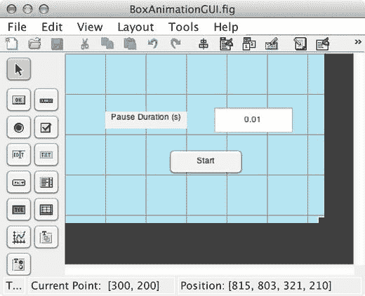

**图 4-8.** 新保存的 GUI

此时，MATLAB 会创建一个 m 文件来控制该图形。FIG 文件维护您在检查器中看到的几何、样式和标签数据。m 文件处理控件回调的执行。图 4-9 显示了新 m 文件中的函数列表，这些函数使用了您在编辑控件时指定的标签名称。

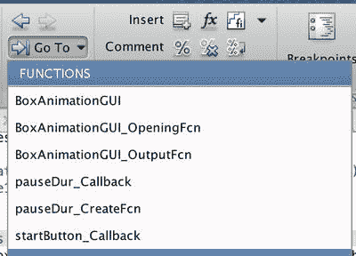

**图 4-9.** 新保存的 GUI m 文件中的函数

主函数 `BoxAnimationGUI` 包含一段标有“请勿编辑”的初始化代码。您可以在此段代码之后添加额外的初始化代码，或者添加到 `OpeningFcn` 中，在那里您可以访问 `handles` 数据。编辑框（您用于输入暂停持续时间的控件）有两个相关函数：`callback` 和 `create` 函数。启动按钮只有一个回调函数。

您需要在代码中执行以下操作：

1. 在 `BoxAnimationGUI_OpeningFcn` 中创建图形窗口并绘制立方体，存储用于访问顶点数据的 `patch` 对象句柄。
2. 将编辑框中的字符串转换为数字并存储。
3. 在 `startButton_Callback` 中运行动画。将编辑框内容字符串转换为数字有两种选择。您可以在编辑框回调中执行此操作（当用户按 Tab 键离开该框或在该框处于活动状态时按 Enter 键时触发），也可以等到用户按下“启动”按钮时才转换数据。这是一个架构决策，在较大的 GUI 中，可能会受到用户可能输入的不同参数之间关系的影响。在这个简单案例中，影响不大，我们将在编辑框回调中进行转换。然而，这确实带来了数据初始化的问题：您必须在初始化期间将暂停持续时间的默认字符串转换为双精度浮点数，否则用户必须首先激活回调才能运行动画。因此，您需要在编码任务列表中添加以下步骤：
4. 在 `pauseDur_CreateFcn` 中初始化暂停持续时间值。
5. 最后，您正在使用 GUI 创建一个外部图形。使用这组默认函数，当主窗口关闭时，无法关闭额外的 GUI。但是，可以添加一个关闭函数来处理这个清理步骤。在 FIG 窗口的图形检查器中，默认的 `CloseRequestFcn` 是 `closereq`。如果您单击它左侧的小按钮，MATLAB 会创建一个关闭函数并将其添加到您的 m 文件中。这是您在 GUI 中的最后一段编码：
6. 在 `figure1_CloseRequestFcn` 中关闭额外的图形窗口。

完整的 GUI 函数如下所示。请注意，添加到 `handles` 数据结构中的自定义数据字段被分组到一个名为 `data` 的子结构中，以避免与 `uicontrol` 句柄发生名称冲突。因无意中将控件对象和相关参数使用相同的名称而引入错误是非常容易的。

# BoxAnimationGUI MATLAB 代码说明

## 文件概述

```matlab
function varargout = BoxAnimationGUI(varargin)
% BOXANIMATIONGUI MATLAB code for BoxAnimationGUI.fig
%      BOXANIMATIONGUI, by itself, creates a new BOXANIMATIONGUI or raises the existing singleton*.
%
%      H = BOXANIMATIONGUI returns the handle to a new BOXANIMATIONGUI or the handle to
%      the existing singleton*.
%
%      BOXANIMATIONGUI('CALLBACK',hObject,eventData,handles,...) calls the local
%      function named CALLBACK in BOXANIMATIONGUI.M with the given input arguments.
%
%      BOXANIMATIONGUI('Property','Value',...) creates a new BOXANIMATIONGUI or raises the
%      existing singleton*. Starting from the left, property value pairs are
%      applied to the GUI before `BoxAnimationGUI_OpeningFcn` gets called. An
%      unrecognized property name or invalid value makes property application
%      stop. All inputs are passed to `BoxAnimationGUI_OpeningFcn` via `varargin`.
%
%      *See GUI Options on GUIDE's Tools menu. Choose "GUI allows only one
%      instance to run (singleton)".
%
% See also: GUIDE, GUIDATA, GUIHANDLES

% Edit the above text to modify the response to help BoxAnimationGUI
% Last Modified by GUIDE v2.5 25-Aug-2015 15:10:40
```

## 初始化代码

```matlab
% Begin initialization code - DO NOT EDIT
gui_Singleton = 1;
gui_State = struct('gui_Name',       mfilename, ...
                   'gui_Singleton',  gui_Singleton, ...
                   'gui_OpeningFcn', @BoxAnimationGUI_OpeningFcn, ...
                   'gui_OutputFcn',  @BoxAnimationGUI_OutputFcn, ...
                   'gui_LayoutFcn',  [] , ...
                   'gui_Callback',   []);
if nargin && ischar(varargin{1})
    gui_State.gui_Callback = str2func(varargin{1});
end

if nargout
    [varargout{1:nargout}] = gui_mainfcn(gui_State, varargin{:});
else
    gui_mainfcn(gui_State, varargin{:});
end
% End initialization code - DO NOT EDIT
```

## 主窗口打开函数

```matlab
% --- Executes just before `BoxAnimationGUI` is made visible.
function `BoxAnimationGUI_OpeningFcn`(hObject, eventdata, handles, varargin)
% This function has no output args, see `OutputFcn`.
% hObject    handle to figure
% eventdata  reserved - to be defined in a future version of MATLAB
% handles    structure with handles and user data (see GUIDATA)
% varargin   command line arguments to `BoxAnimationGUI` (see `VARARGIN`)

% ADDED CUSTOM CODE FOR RECIPE
% Design the box
x = 3;
y = 2;
z = 1;
f = [2 3 6;3 7 6;3 4 8;3 8 7;4 5 8;4 1 5;2 6 5;2 5 1;1 3 2;1 4 3;5 6 7;5 7 8];
v = [−x x x −x −x x x −x;...
     −y −y y y −y −y y y;...
     −z −z −z −z z z z z]'/2;

% Create the figure
h = figure('name','Box');
p = patch('vertices',v,'faces',f,'facecolor',[0.5 0.5 0.5],...
          'linestyle','none','facelighting','gouraud');
ax = gca;
set(ax,'DataAspectRatio',[1 1 1],'DataAspectRatioMode','manual')
grid on
axis([−3 3 −3 3 −3 3])
xlabel('x')
ylabel('y')
zlabel('z')
view(3)
light('position',[0 0 1]);

% Choose default command line output for `BoxAnimationGUI`
handles.output = hObject;

% Additional variables required
handles.data.box = p;
handles.data.vertices = v;
handles.data.axis = ax;
handles.data.figure = h;
% END CUSTOM CODE

% Update handles structure
guidata(hObject, handles);

% `UIWAIT` makes `BoxAnimationGUI` wait for user response (see `UIRESUME`)
% uiwait(handles.figure1);
```

## 输出函数

```matlab
% --- Outputs from this function are returned to the command line.
function varargout = `BoxAnimationGUI_OutputFcn`(hObject, eventdata, handles)
% varargout  cell array for returning output args (see `VARARGOUT`);
% hObject    handle to figure
% eventdata  reserved - to be defined in a future version of MATLAB
% handles    structure with handles and user data (see GUIDATA)

% Get default command line output from handles structure
varargout{1} = handles.output;
```

## 暂停时长编辑框回调

```matlab
function `pauseDur_Callback`(hObject, eventdata, handles)
% hObject    handle to `pauseDur` (see GCBO)
% eventdata  reserved - to be defined in a future version of MATLAB
% handles    structure with handles and user data (see GUIDATA)

% Hints: `get(hObject,'String')` returns contents of `pauseDur` as text
%        `str2double(get(hObject,'String'))` returns contents of `pauseDur` as a double

% ADDED CUSTOM CODE FOR RECIPE
pauseDur = str2double(get(hObject,'String'));
% Optional: add checking of pause value; can't be negative
handles.data.pauseVal = pauseDur;
guidata(hObject, handles);
```

## 暂停时长编辑框创建函数

```matlab
% --- Executes during object creation, after setting all properties.
function `pauseDur_CreateFcn`(hObject, eventdata, handles)
% hObject    handle to `pauseDur` (see GCBO)
% eventdata  reserved - to be defined in a future version of MATLAB
% handles    empty - handles not created until after all CreateFcns called

% Hint: edit controls usually have a white background on Windows.
%       See `ISPC` and `COMPUTER`.
if ispc && isequal(get(hObject,'BackgroundColor'), get(0,'defaultUicontrolBackgroundColor'))
    set(hObject,'BackgroundColor','white');
end

% ADDED CUSTOM CODE FOR RECIPE
pauseDur = str2double(get(hObject,'String'));
% Optional: add checking of pause value; can't be negative
handles.data.pauseVal = pauseDur;
guidata(hObject, handles);
```

## 启动按钮回调函数

```matlab
% --- Executes on button press in `startButton`.
function `startButton_Callback`(hObject, eventdata, handles)
% hObject    handle to `startButton` (see GCBO)
% eventdata  reserved - to be defined in a future version of MATLAB
% handles    structure with handles and user data (see GUIDATA)

% ADDED CUSTOM CODE FOR RECIPE
dT = handles.data.pauseVal; % pause duration from our edit box
p = handles.data.box;       % handle to the patch object
v0 = handles.data.vertices; % initial vertices, before rotation
ax = handles.data.axis;     % axis, for updating title
n = 1000;
a = linspace(0,8*pi,n);
c = cos(a);
s = sin(a);

for k = 1:n
    b = [c(k) 0 s(k);0 1 0;−s(k) 0 c(k)];
    vK = (b*v0')';
    set(p,'vertices',vK);
    if rem(k,25)==0
        title(ax, sprintf('Angle: %.5g deg',a(k)*180/pi));
    end
    pause(dT);
end
```

## 窗口关闭请求函数

```matlab
% --- Executes when user attempts to close `figure1`.
function `figure1_CloseRequestFcn`(hObject, eventdata, handles)
% hObject    handle to `figure1` (see GCBO)
% eventdata  reserved - to be defined in a future version of MATLAB
% handles    structure with handles and user data (see GUIDATA)
% Hint: `delete(hObject)` closes the figure
delete(hObject);

% ADDED CUSTOM CODE FOR RECIPE
delete(handles.data.figure)
```

> **提示：** 将您添加的数据存储在一个唯一的子结构中，这样它就不会与任何图形句柄混淆。

要运行 GUI，可以执行`m`文件，或使用`GUIDE`图形编辑器中的“运行”按钮。带有绘图窗口的 GUI 将打开，如图 4-10 所示。

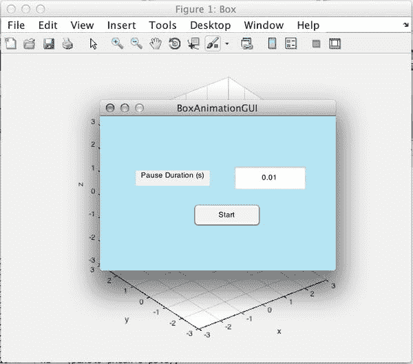

`图 4-10.` 带有绘图窗口的完整 GUI

您可以验证更改暂停持续时间并运行动画是否奏效。关闭 GUI 会同时关闭绘图窗口。但是，如果您先关闭绘图窗口，然后尝试运行 GUI，则会出错；这种情况在此实现中并未处理。您可以为`绘图图形`添加一个关闭函数，询问用户确认（使用`questdlg`），或者让它连同 GUI 一起关闭。另一种方式是，GUI 可以检查图形窗口是否存在，如果意外关闭则重新创建它。为此，需要将初始化代码移动到其自己的函数中。

作为练习，尝试使用滑块而不是编辑框来实现暂停时间，范围设置为 0 到 0.1 秒。您可能还想尝试为动画中的步数添加额外的控件。

```
if (condVar > someVal) {console.log("xxx")}
```

# 4.7 从 GUI 构建 MATLAB App

## 问题

您希望将新的 GUI 作为打包的应用程序与他人共享。

## 解决方案

MATLAB 提供了一个工具，可以将 GUI（或脚本）打包为应用程序，用户随后可以轻松安装和卸载该应用程序。这里将使用上一节中创建的 GUI 作为示例。

## 工作原理

通过指定运行应用程序的主文件（在本例中，即上一节中 `BoxAnimationGUI` 的主函数）来创建应用程序。打包工具会执行依赖项检查，并将路径中任何其他相关的函数和文件包含进来。生成的二进制文件随后可以由他人分发和安装。

应用程序工具可以从 MATLAB 命令窗口的“应用程序”选项卡访问。该选项卡包含“获取更多 App”、“安装 App”按钮，以及对于本教程最重要的“打包 App”按钮。该选项卡还显示一个功能区，列出您当前已安装的所有 App。单击“打包 App”会打开一个窗口，您可以在其中输入应用程序的文件和元数据信息。

第一步，从“打包 App”窗口的左上角开始，选择应用程序的主文件。请记住，这不一定是 GUI；例如，您可能有一个从命令行收集用户输入的脚本，使用了 `input` 或 `inputdlg`。点击“添加主文件”并选择 `BoxAnimationGUI.m`。MATLAB 会根据主文件名自动填充应用程序的名称，并执行依赖项检查。在本例中，唯一的依赖项是对应的 FIG 文件 `BoxAnimationGUI.fig`。在左下角，您可以添加 MATLAB 搜索工具无法找到的任何其他共享资源，例如通过 `eval` 或 `load` 调用且带有字符串名称的文件。

在“打包 App”窗口的中央，您可以添加用于描述应用程序的额外信息。您可以选择一个图标（如果有自定义图标也可以使用）；指定版本号；编写摘要和更详细的描述；并提供截图。当用户安装您的应用程序时，您选择的图标将显示在 MATLAB 的 App 工具栏中。

一旦您输入了应用程序的所有信息并验证了依赖项，就可以在“打包 App”窗口的右侧将文件打包到应用程序中。您可以在创建包之前更改输出文件夹；生成的应用程序安装程序将以 `.mlappinstall` 扩展名保存。

您的打包数据会保存在一个扩展名为 `.prj` 的项目文件中。这允许您在开发过程中根据需要重新打包应用程序；您可以针对错误修复或重大版本变更来增加版本号。

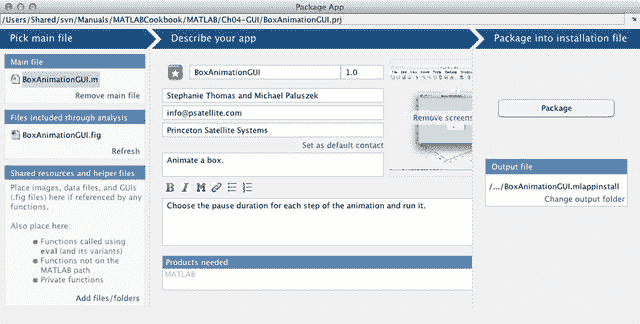
图 4-12. 打包后的应用程序结果及项目文件

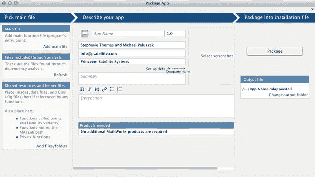
图 4-11. 打包 App 窗口摘要

本章介绍了图形控件以及在循环中更新图形的方法。MATLAB 提供了丰富的 GUI 构建环境，包括按钮、滑块、列表框、菜单和绘图坐标轴。您可以直接创建 `uicontrols`，或使用 GUIDE 工具通过鼠标放置控件。在设计需要更新的图形时，考虑性能非常重要，因为某些操作（如字符串与对象几何体）的性能差异巨大。表 4-3 列出了本章开发的代码。

### 表 4-3. 本章代码清单

| 文件 | 描述 |
| :--- | :--- |
| `BoxAnimationGUI.fig` | 包含 GUI 定义的文件。 |
| `BoxAnimationGUI.m` | 实现 `BoxAnimationGUI.fig` 的 MATLAB 代码。 |
| `BoxAnimationGUI.prj` | 存储从 `BoxAnimationGUI.m` 创建应用程序信息的文件。 |
| `PatchAnimation` | 在 `for` 循环中对 3D 补丁进行动画处理。 |
| `PatchAnimationStorage` | 使用补丁对立方体进行动画处理并存储为 AVI 文件。 |
| `QuadAnimator` | 创建带有动画的四象限绘图页面。 |
| `TimeDisplayDemo` | 演示显示过程剩余时间的 GUI。 |
| `UIControlDemo` | 演示带有回调函数的 `uicontrol` 按钮的使用。 |


