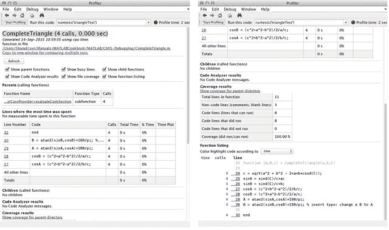
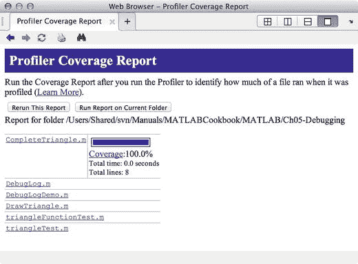
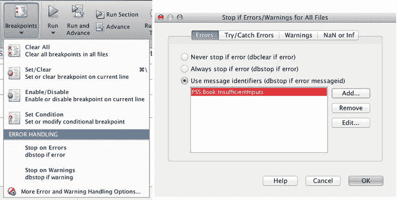

# 5. 测试与调试

电子补充材料：本章的在线版本（doi: [10.1007/978-1-4842-0559-4_5](http://dx.doi.org/10.1007/978-1-4842-0559-4_5)）包含补充材料，仅供授权用户使用。

MATLAB 单元测试框架现在允许您将测试整合到 MATLAB 软件中，就像您对 C++ 或 Java 包所做的那样。由于关于测试方法论的整本教科书已有许多，本章仅限覆盖使用测试框架本身的机制。我们还将提供几个对调试有用的技巧。

然而，我们应该就软件测试的目标说几句。测试应确定您的软件是否按设计运行。第一步是要有一个您正在编码的具体设计。功能需要作为一组需求被仔细描述。需求需要指定软件期望的输入以及它将生成的输出。测试需要验证，对于所有有效的输入，它都能生成预期的输出。第二个考虑因素是软件应能处理预期的错误并向用户发出警告。例如，一个简单的函数将两个 MATLAB 变量相加：

```
c = a + b;
```

您需要验证它对任何数值类型的 `a` 和 `b` 都有效。通常，如果 `a` 或 `b` 不是数值类型，您不需要警告用户；那样只会用不必要的测试塞满您的代码。一个可能需要检查的案例是包含以下内容的函数：

```
b = acos(a);
```

如果它应该返回一个实数（例如，作为另一个函数的一部分），您可能希望将 `a` 的幅度限制为小于 1。如果您有以下代码：

```
if (abs(a) > 1)
    a = sign(a);
end

b = acos(a);
```

在这种情况下，您的测试代码需要传入大于 1 的 `a` 值。这也是一个可能需要在执行幅度限制代码时向用户添加自定义警告的案例，如下所示。如果您的代码中有自定义警告和错误，您也需要对它们进行测试。

```
if (abs(a) > 1)
    warning('MyToolbox:MyFunction:OutOfBounds','输入 a 超出范围');
    a = sign(a);
end

b = acos(a);
```

对于工程软件，您的测试代码应包含由已知输入生成的已知输出。在前面的代码中，您可能会包含输入 1.1、1、0.5、0、-0.5、-1 和 -1.1。这将覆盖预期的输入范围。您也可以非常彻底，输入 `linspace(-1.1, 1.1)` 并对照反余弦函数的其他值来源进行测试。如后续章节所示，我们通常会包含一个演示函数，该函数使用一组有趣的输入来测试函数。您的测试代码可以使用演示函数中的代码作为测试的一部分。

所有测试过程都应使用 MATLAB 代码覆盖率工具。覆盖率报告与 MATLAB 性能分析器一起使用，可以跟踪执行期间哪些代码行被执行。对于给定的函数或脚本，确保所有代码在测试中都被执行至关重要。研究表明，没有覆盖率工具的测试通常只执行了 55% 的代码。实际上，除了最简单的软件之外，几乎不可能真正测试到每一条路径，并且必须在软件开发和 QA 过程中考虑到这一点。MATLAB 目前不支持在一套测试中或回归测试期间运行覆盖率工具，因此您应该在设计测试时逐个运行覆盖率工具。

一旦您开始使用软件，发现的任何错误都应被用来向测试中添加额外的测试用例。

## 5.1 创建单元测试

### 问题

您的函数需要单元测试。

### 解决方案

利用 MATLAB 内置的测试功能（现在可通过 Java 类实现）来编写和执行单元测试函数。测试函数和脚本通过文件名中加上前缀或后缀`test`来识别，并通过`runtests`函数运行。

# 工作原理

`matlab.unittest` 是一个为 MATLAB 设计的 xUnit 风格单元测试框架。你可以编写以单元格标题分隔测试用例的脚本，或使用子函数包含测试用例的函数，并通过该框架执行它们。我们将分别展示一个示例。MATLAB 文档中提供了该框架的详尽文档和示例；以下列表可助你快速入门：

以下是实现该框架的相关 MATLAB 包：
- `matlab.unittest`
- `matlab.unittest.constraints`
- `matlab.unittest.fixtures`
- `matlab.unittest.qualifications`

`matlab.unittest.qualifications` 包提供了检查函数结果（包括数值、错误和警告）的所有方法。`matlab.unittest.fixtures` 包允许你为单个测试或测试组提供设置和拆卸代码。

以下是编写测试时将会使用的相关类：
- `matlab.unittest.TestCase`
- `matlab.unittest.TestResult`
- `matlab.unittest.TestSuite`
- `matlab.unittest.qualifications.Verifiable`

`TestCase` 是编写测试类的超类。

以下是相关函数：
- `assert`
- `runtests`
- `functiontests`
- `localfunctions`

为函数实现测试的最简单方法是编写脚本。每个测试用例使用 `%%` 通过单元格标题标识。使用 `assert` 函数检查函数输出。然后可通过 `runtests` 运行脚本，即使之前的测试失败，它也会运行每个测试，并将输出整理成有用的报告。

让我们为一个示例函数 `CompleteTriangle` 编写测试，该函数根据给定的两条边及其夹角计算三角形的其余数据：

```
function [A,B,c] = CompleteTriangle (a,b,C)
c = sqrt (aˆ2 + bˆ2 − 2*a*b*cosd(C));
sinA = sind (C)/c*a;
sinB = sind (C)/c*b;
cosA = (cˆ2+bˆ2 − aˆ2)/2/b/c;
cosB = (cˆ2+aˆ2-bˆ2)/2/a/c;
A = atan2 (sinA,cosA)*180/ pi;
B = atan2 (sinB,cosB)*180/ pi; % 插入笔误：将 B 改为 A
end
```

这类似于 MATLAB 文档中用作示例的直角三角形函数，但由于允许钝角三角形，因此需要四象限反正切函数。由于两个角度 `A` 和 `B` 的代码行非常相似，需要注意其中一行可能出现笔误，尤其是在编写函数时使用复制/粘贴时；我们将通过测试来演示这种笔误的影响。

现在让我们看一个为该函数定义几个测试用例的脚本 `TriangleTest`。每次检查都使用带逻辑语句的 `assert`。

```
%% Test1: 角度和
% 测试角度之和是否为 180 度。
C = 30;
[A,B] = CompleteTriangle(1,2,C);
theSum = A+B+C;
assert (theSum == 180,'PSS:Book:triangle','sum of angles: %f',theSum)

%% Test 2: 等腰直角三角形
% 测试如果边 a 和 b 相等，角度 A 和 B 是否相等。
C = 90;
[A,B] = CompleteTriangle(2,2,C);
assert (A ==B,'PSS:Book:triangle','Isoceles Triangle')

%% Test 3: 3-4-5 直角三角形
% 测试如果边 a 为 3，边 b 为 4，斜边 c 是否为 5。
C=90;
[˜,˜,c] = CompleteTriangle(3,4,C);
assert (c == 5,'PSS:Book:triangle','3-4-5 Triangle')

%% Test 4: 等边三角形
% 测试如果边 a 和 b 相等，所有角度是否均为 60。
[A, B, c] = CompleteTriangle(1,1,60);
assert (A == 60,'PSS:Book:triangle','Equilateral Triangle %d',1)
assert (B == 60, 'PSS:Book:triangle','Equilateral Triangle %d',2)
assert (c == 1,'PSS:Book:triangle','Equilateral Triangle %d',3)
```

注意如何使用 `assert` 可用的额外输入来添加消息 ID 字符串和错误消息。错误消息可以使用 `sprintf` 支持的任何说明符（如 `%d` 和 `%f`）的格式化字符串。

你可以直接执行此脚本，它会在第一个失败的 `assert` 处退出。更好的方法是使用 `runtests` 运行它，这会自动区分测试用例，并在某个测试失败时独立地运行它们。

```
>> runtests('TriangleTest');
Running TriangleTest
...
================================================================================
Error occurred in TriangleTest/Test4_EquilateralTriangle and it did not run to
completion.
--------------
Error Details:
--------------
Equilateral Triangle 1
================================================================================
.
Done TriangleTest
__________
Failure Summary:
Name              Failed  Incomplete  Reason(s)
=======================================================================
TriangleTest/Test4_EquilateralTriangle   X       X        Errored.
```

等边三角形测试失败了。从打印的索引 `Equilateral Triangle 1` 可以看出，是第一个 `assert` 失败了。如果你在命令行中运行该测试的代码，会发现输出看起来实际上是正确的：

```
>> [A,B,c] = CompleteTriangle (1,1,60)
A =
    60
B =
    60
c =
     1
```

如果实际从 `A` 和 `B` 中减去期望值 60，你就会看到测试失败的原因。

```
>> A − 60
ans =
   7.1054e−15
>> B − 60
ans =
   7.1054e−15
```

这个值在 MATLAB 三角函数的容差范围内，但 `assert` 语句并未考虑到这一点。你可以添加一个容差，如下所示：

```
assert (abs(A − 60) < 1e−10,'PSS:Book:triangle', 'Equilateral Triangle %d',1)
assert (abs(B − 60) < 1e−10,'PSS:Book:triangle','Equilateral Triangle %d',2)
```

现在所有测试都通过了：

```
>> runtests('TriangleTest')
Running TriangleTest
....
Done TriangleTest
__________
ans =
  1×4 TestResult array with properties:
    Name
    Passed
    Failed
    Incomplete
    Duration
Totals:
   4 Passed, 0 Failed, 0 Incomplete.
   0.012243 seconds testing time.
```

注意末尾没有分号；因此除了简短的报告外，你还可以看到 `runtests` 返回了一个 `TestResult` 对象数组，并打印了额外的总计信息，包括测试持续时间。

现在，考虑一下函数中尚未调试的笔误情况。将函数最后一行的 `B` 改为 `A`，使其变为：
`B = atan2 (sinB, cosA)*180/ pi ; % 插入笔误：将 B 改为 A`

使用容差检查再次运行测试。使用 `TestResult` 输出和表格类来获取格式良好的测试结果。

```
>> tr = runtests('TriangleTest');
>> table(tr)
ans =
      Name                           Passed    Failed    Incomplete    Duration
    _______________________________  ______    ______    ________     ________
    'TriangleTest/Test1_SumOfAngles'  false     true       true        0.0040209
    'TriangleTest/Test2_IsoscelesRightTriangles' true  false      false      0.002971
    'TriangleTest/Test3_3_4_5RightTriangle'      true  false      false      0.0027831
    'TriangleTest/Test4_EquilateralTriangle'     true  false      false      0.0031556
```

尽管代码中存在重大错误，但只有一个测试失败了：角度和测试。等腰三角形和等边三角形测试仍然通过，因为在这两种情况下 `A` 和 `B` 是相等的。你可以故意在代码的每一行引入错误，看看你的测试是否能够捕获它们！

现在考虑单元测试的另一种可能性：测试函数，而不是脚本。在这种情况下，每个测试用例必须放在自己的子函数中，主函数必须返回一个测试函数对象数组。这为你提供了为测试编写设置和拆卸函数的机会。它还利用了 `TestCase` 类和 `qualifications` 包。以下是这种格式下的测试：

```
function tests = TriangleFunctionTest
% 创建一个局部函数数组
tests = functiontests (localfunctions);
end

%% 测试函数
function testAngleSum(testCase) %#ok<*DEFNU>
C = 30;
[A,B] = CompleteTriangle(1, 2, C);
theSum = A+B+C;
testCase.verifyEqual (theSum,180)
end

function testIsosceles(testCase)
C = 90;
[A,B] = CompleteTriangle(2,2,C);
testCase.verifyEqual (A,B)
end

function test345(testCase)
C = 90;
[˜,˜,c] = CompleteTriangle(3,4,C);
testCase.verifyEqual (c,5)
end

function testEquilateral(testCase)
[A,B,c] = CompleteTriangle(1,1,60);
assert (abs(A-60)<testCase.TestData.tol)
testCase.verifyEqual (B,60,'absTol',1e-10)
testCase.verifyEqual (c,1)
end

%% 可选的文件夹具
function setupOnce(testCase) % 请勿更改函数名
% 设置一个所有测试都可以使用的容差
testCase.TestData.tol=1e-10;
end

function teardownOnce(testCase) % 请勿更改函数名
% 例如，恢复原始路径
end

%% 可选的新鲜夹具
function setup(testCase) % 请勿更改函数名
% 例如，打开一个图形窗口
end

function teardown(testCase) % 请勿更改函数名
% 例如，关闭图形窗口
end
```

如果只是运行这个函数，你会得到一个包含四个测试方法的数组。

```
>> TriangleFunctionTest
ans =
  1×4 Test array with properties:
    Name
    Parameterization
    SharedTestFixtures
```

在 `testEquilateral` 中显示了两种为测试设置容差的方法；一种方法是使用 `absTol` 参数硬编码容差，另一种方法是使用设置函数通过 `TestData` 传递容差。有两种类型的设置和拆卸函数可供选择：文件夹具（仅对文件中的整个测试集运行一次）和新鲜夹具（对每个测试用例运行）。文件夹具以 `Once` 后缀标识。对于此容差，`setupOnce` 函数是合适的。

要运行测试，请像对脚本一样使用 `runtests`。令人高兴的是，所有测试都通过了！

```
>> runtests('TriangleFunctionTest')
Running TriangleFunctionTest
....
Done TriangleFunctionTest
__________
...
Totals:
   4 Passed, 0 Failed, 0 Incomplete.
   0.043001 seconds testing time.
```

你可以在性能分析器中运行任意一组测试（即“运行并计时”）来验证被测试函数的覆盖率。使用脚本版本的测试来导航到 `CompleteTriangle` 的结果会稍微容易一些；测试函数的结果会列出测试框架中的许多函数。图 5-1 显示了性能分析器中的结果，显示该函数达到了 100% 的覆盖率。



**图 5-1.** 性能分析器中的三角形测试

运行性能分析器后，你可以运行覆盖率报告。要运行该报告，你必须使用编辑器的“当前文件夹”窗格，并从上下文菜单中选择 `Reports/Coverage Report`（报告/覆盖率报告）。图 5-2 显示了一个示例。示例函数运行速度太快，无法测量任何时间，但通常，此报告能让你深入了解函数的执行时间以及实现的覆盖率。



**图 5-2.** `CompleteTriangle` 的覆盖率报告

## 5.2 运行测试套件

### 问题

你的工具箱中有数十个或数百个函数，每个函数都附带有单元测试。你需要一种高效的方法来运行所有测试，甚至更好的是，能够运行其中的子集。

### 解决方案

MATLAB 的测试框架支持构建测试套件。

### 工作原理

在您为工具箱中的函数生成测试后，可以通过几种方式将它们分组到测试套件中。`TestSuite` 类的帮助文档列出了这些选项：

`TestSuite` 方法：

- `fromName` - 根据测试元素的名称创建测试套件

- `fromFile` - 根据 `TestCase` 类文件名创建测试套件

- `fromFolder` - 根据文件夹中的所有测试创建测试套件

- `fromPackage` - 根据包中的所有测试创建测试套件

- `fromClass` - 根据 `TestCase` 类创建测试套件

- `fromMethod` - 根据单个测试方法创建测试套件

你还可以连接使用这些方法创建的测试套件，并将数组传递给测试运行器。通过这种方式，你可以轻松生成要运行的测试子集。

在之前的技巧中，你为 `CompleteTriangle` 创建了两个测试文件：一个测试脚本和一个测试函数。你可以为包含这些代码的文件夹创建一个测试套件，它将自动找到这两组测试用例。假设当前文件夹包含两个测试文件。

```
>> import matlab.unittest.TestSuite
>> testSuite = TestSuite.fromFolder(pwd);
>> result = run(testSuite)

Running TriangleFunctionTest
....
Done TriangleFunctionTest
__________
Running TriangleTest
.......
Done TriangleTest
__________
result = 
  1×8 TestResult array with properties:

    Name
    Passed
    Failed
    Incomplete
    Duration

Totals:
   8 Passed, 0 Failed, 0 Incomplete.
   0.04218 seconds testing time.
```

如您所见，测试套件其实非常简单。一些高级功能包括能够对套件应用选择器以获取测试子集。要在命令行查看 `TestSuite` 的完整文档，请键入以下任意一条命令：

```
>> help matlab.unittest.TestSuite
```

或

## 5.3 在测试中设置详细级别

### 问题

你测试中的输出信息开始失控，但你不想仅仅删除或注释掉所有在开发测试时所需的信息。如果将来某个测试失败，你可能需要那些消息。

### 解决方案

测试框架包含一个日志记录功能，该功能有四个详细级别的日志。要使用它，你需要使用日志记录插件创建一个测试运行器，并在测试用例中添加 `log` 调用。

### 工作原理

支持的四个详细级别是：Terse（精简）、Concise（简洁）、Detailed（详细）和 Verbose（冗长），如表 5-1 所列。

**表 5-1.**

| 级别 | 名称 | 描述 |
|---|---|---|
| 1 | Terse（精简） | 最少量的信息 |
| 2 | Concise（简洁） | 典型量的信息 |
| 3 | Detailed（详细） | 补充量的信息 |
| 4 | Verbose（冗长） | 多余的信息 |

默认的测试运行器使用最低的详细级别（Terse）。你在测试用例中使用的 `log` 函数是 `TestCase` 的一个方法，因此要访问其帮助文档，你需要使用完全限定名称：

```
>> help matlab.unittest.TestCase/log
```

以下是帮助文档中 `log` 方法的语法：

- `log(TESTCASE, LEVEL, DIAG)` 在指定的 `LEVEL`（级别）记录诊断信息。`LEVEL` 可以是一个数值（1、2、3 或 4），也可以是 `matlab.unittest.Verbosity` 枚举中的值。当未指定级别时，`log` 方法使用 Concise（简洁）级别（2）。

日志记录需要一个 `TestCase` 对象。`DIAG` 的诊断数据可以是一个字符串或一个 `matlab.unittest.diagnostics.Diagnostic` 实例。让我们为 `eig` 编写一个示例测试来演示详细级别。

```matlab
%% VerboseEigTest 在测试中演示详细级别
% 使用日志消息运行对 eig 函数的测试。演示所有四个详细级别。
% 要运行测试，请在命令行使用配置了 LoggingPlugIn 的 TestRunner：
%
% import matlab.unittest.TestRunner;
% import matlab.unittest.plugins.LoggingPlugin;
% runner = TestRunner.withNoPlugins;
% runner.addPlugin(LoggingPlugin.withVerbosity(4));
% results = runner.run(VerboseEigTest);
%% 格式
% tests = VerboseEigTest
%% 输入
% 无。
%% 输出
% tests (:) 测试函数数组
function tests = VerboseEigTest
% 创建局部函数数组
tests = functiontests(localfunctions);
end
%% 测试函数
function eigTest(testCase)
log(testCase, '正在生成测试数据'); % 默认为级别 2
m = rand(2000);
A = m'*m;
log(testCase,'即将调用 eig.');
[V,D,W] = eig(A);
log(testCase, 4, 'Eig 完成。');
assert(norm(W'*A-D*W')<1e-6)
log(testCase,3, 'eig 测试完成。');
end
% 如果你想在代码中使用 Verbose 枚举而不是数字，
% 请导入类 matlab.unittest.Verbosity
function eigWithEnumTest(testCase)
import matlab.unittest.Verbosity
m = rand(1000);
A = m'*m;
log(testCase, Verbosity.Detailed, '即将调用 eig (使用枚举)。');
[V,D,W] = eig(A);
assert(norm(W'*A-D*W')<1e-6)
log(testCase, Verbosity.Terse, 'eig 测试完成 (使用枚举)。');
end
```

如果你直接用 `runtests` 运行这个测试，你会得到 Terse（精简）级别的输出。请注意，系统时间会与你的日志消息一起显示。

```
>> runtests('VerboseEigTest');
Running VerboseEigTest
[Terse] Diagnostic logged (2015–09–14 T12:15:29): 即将调用 eig.
. [Terse] Diagnostic logged (2015-09-14 T12:15:40): eig 测试完成 (使用枚举)。
.
Done VerboseEigTest
__________
```

要获得更高的详细级别，需要使用带有日志记录插件的测试运行器。这需要在命令行（或你的脚本中）进行一些导入。你需要生成一个“普通”的运行器（不带插件），然后添加具有所需详细级别的日志记录插件。消息的详细级别会显示在输出中。

```
>> import matlab.unittest.TestRunner;
>> import matlab.unittest.plugins.LoggingPlugin;
>> runner = TestRunner.withNoPlugins;
>> runner.addPlugin(LoggingPlugin.withVerbosity(4));
>> results = runner.run(VerboseEigTest);
[Concise] Diagnostic logged (2015-09-14 T12:19:57): 正在生成测试数据
[Terse] Diagnostic logged (2015-09-14 T12:19:57): 即将调用 eig.
[Verbose] Diagnostic logged (2015-09-14 T12:20:01): Eig 完成。
[Detailed] Diagnostic logged (2015-09-14 T12:20:07): eig 测试完成。
[Detailed] Diagnostic logged (2015-09-14 T12:20:07): 即将调用 eig (使用枚举)。
[Terse] Diagnostic logged (2015-09-14 T12:20:08): eig 测试完成 (使用枚举)。
```

## 5.4 创建日志函数来显示数据

### 问题

通过移除语句末尾的分号来打印变量值既简单又方便，但如此留下的代码可能会产生难以追踪的多余输出。即使是使用 `disp` 和 `fprintf` 也可能使多余输出难以查找，因为你可能在其他地方也用了这些函数。

# 解决方案

创建一个自定义日志函数，用于在显示变量时附带有助于识别的标识信息。你可以将其扩展为具有详细程度设置的日志记录机制，类似于上一个配方中描述的、在 MATLAB 测试框架以及大多数 C++ 和 Java 测试框架中使用的方法。

# 工作原理

`DebugLog` 中实现了一个示例日志函数。`DebugLog` 会打印出一条可以是任意内容的消息，并在其之前显示调用 `DebugLog` 的位置路径。该回溯信息通过 `dbstack` 获取。

```
%% DEBUGLOG 用于调试的日志函数

% 使用此函数代替添加 disp() 语句或省略分号。

%% 格式

% DebugLog( msg, fullPath )

%% 描述

% 使用 disp() 打印 msg 中的数据，并显示消息的路径。

% 完整路径选项将打印完整的回溯信息。

%% 输入参数

% msg (.) 任意消息

% fullPath (1,1) 如果输入，则打印完整的回溯信息

%% 输出参数

% 无

function DebugLog( msg, fullPath )

% 演示

if ( nargin < 1 )

DebugLog( rand (2,2));

return;

end

% 获取调用此函数的函数

f = dbstack;

% 仅在直接从命令行调用时取第二条路径

if ( length (f) > 1)

f1 = 2;

else

f1 = 1;

end

if ( nargin > 1 && fullPath )

f2 = length (f);

else

f2 = f1;

end

for k = f1:f2

disp (['- > ' f(k).name]);

end

disp (msg);
```

`DebugLog` 在 `DebugLogDemo` 中进行了演示。该函数包含一个子函数，用于演示回溯信息。

```
%% 演示 DebugLog

% 使用 DebugLog 将变量记录到命令窗口。

function DebugLogDemo

y = linspace (0,10);

i = FindInY(y);

function I = FindInY(y)

i = find (y < 0.5);

DebugLog( i, true );
```

这是该演示的输出：

```
>> DebugLogDemo

-> FindInY

-> DebugLogDemo

1 2 3 4 5
```

此函数的一个扩展是，如果 `msg` 是变量，则使用函数 `inputname` 添加被记录变量的名称。增加这些代码行后如下所示：

```
str = inputname(1);

if ~isempty (str)

disp (['变量: ' str]);

end
```

现在演示输出如下：

```
>> DebugLogDemo

-> FindInY

-> DebugLogDemo

变量: i

1 2 3 4 5
```

持续使用你自己的日志函数向用户显示消息并打印调试数据，将使你的代码更易于维护。

## 生成和追踪 MATLAB 错误与警告

### 问题

你希望以有序的方式向用户显示错误和警告。

### 解决方案

始终使用 `warning` 和 `error` 的附加输入参数来指定消息 ID。这允许你的消息被追踪回代码中生成它的函数，并且可以控制某些警告的显示。

### 工作原理

`warning` 函数有几个有用的参数，用于自定义和控制警告显示。当你生成一个警告时，请使用带有消息标识符的完整语法：

```
warning('消息 ID','消息内容', A, B, ...)
```

`消息 ID` 是一种助记符，形式为 `<组件>[:<组件>]:<助记符>`，例如 `PSS:函数名:非法输入`。通常，当你发出警告时，ID 不会显示，除非你通过 `warning on verbose` 和 `warning off verbose` 打开了详细显示。这很容易在命令行中演示：

```
>> warning('PSS:示例:警告演示', '这是一个示例警告')

警告: 这是一个示例警告

>> warning verbose on

>> warning('PSS:示例:警告演示','这是一个示例警告')

警告: 这是一个示例警告

(输入 "warning off PSS:示例:警告演示" 可抑制此警告。)
```

如上所示，你可以使用其消息 ID，通过显示的命令形式或函数形式 `warning('off', 'msgid')` 来关闭某个特定的警告。

如果传递额外的输出参数，`lastwarn` 函数也可以返回消息 ID，例如：

```
>> [最后消息, 最后 ID] = lastwarn

最后消息 =

这是一个示例警告

最后 ID =

PSS:示例:警告演示
```

`error` 和 `lasterr` 函数的工作方式相同。使用消息标识符的一个额外好处是，你可以在调试时选择它们，作为遇到错误或警告时停止的一个选项。调试器集成在编辑器窗口中，调试器选项分组在“断点”工具栏按钮下。该按钮和“更多选项”弹出窗口如图 5-3 所示。在此例中，我们输入了一个示例 PSS 消息标识符。



**图 5-3.** 在调试器中根据错误停止的选项

记住，你始终应该在函数的头部说明该函数可能生成的所有警告和错误！

## 测试自定义错误和警告

### 问题

你有一段代码，会对有问题的输入生成警告或错误，你需要测试它。

### 解决方案

你有两种可能的方法来测试代码中错误的生成：结合使用 `try`/`catch` 块与 `assert`，以及 `TestCase` 可用的 `verifyError` 方法。对于警告，你可以使用 `lastwarn` 或 `verifyWarning`。

### 工作原理

为代码编写一套全面的测试应该涵盖所有路径，或者尽可能接近所有路径；并且必须检验代码可能生成的所有警告和错误。你可以手动使用 `try`/`catch` 块来捕获错误，并将错误（`MException` 对象）与预期错误进行比较。对于警告，你可以检查 `lastwarn` 来确认是否已发出警告，如下所示：

```
>> lastwarn('');
>> warning('PSS:Book:id','Warning!')
警告: 警告！
>> [anywarn, anyid] = lastwarn;
>> assert(strcmp(anyid, 'PSS:Book:wrongid'))
断言失败。
```

下面是一个使用 `try`/`catch` 块配合 `assert` 来检测特定错误的示例：

```
%% 测试我们是否得到预期错误，并通过测试
errFun = @() error('PSS:Book:id','错误！');
try
    feval(errFun);
catch ME
    assert(strcmp(ME.identifier,'PSS:Book:id'));
end
```

此测试验证了抛出的错误是否为预期的错误；然而，它不会检测是否根本没有抛出任何错误。为此，你需要在 `try` 块中添加一个布尔变量。

```
%% 这次我们根本没有得到任何错误
wrongFun = @() disp('一些无错误的代码。');
tf = false;
try
    feval(wrongFun);
    tf = true;
catch ME
    assert(strcmp(ME.identifier,'PSS:Book:id'));
end
if (tf)
    assert(false,'CatchErrorTest: 未抛出错误');
end
```

当你运行这段代码时，会得到以下输出：

```
一些无错误的代码。
CatchErrorTest: 未抛出错误
```

如果你将此测试作为 `runtests` 测试脚本的一部分来运行，该测试将会失败。

一个更好的测试警告和错误的方法是使用单元测试框架的限定符来检查是否生成了预期的警告或错误。以下是一个验证警告的示例，其中一个测试将通过，另一个测试将失败；请注意，你需要向 `verifyWarning` 函数传递一个函数句柄。

```
function tests = WarningsTest
% 创建一个本地函数数组
tests = functiontests(localfunctions);
end

%% 测试函数
function passTest(testCase)
    warnFun = @()warning('PSS:Book:id','警告！');
    testCase.verifyWarning(warnFun,'PSS:Book:id');
end

function failTest(testCase)
    warnFun = @() warning('Wrong:id','警告！');
    testCase.verifyWarning(warnFun,'PSS:id','错误的 id');
end
```

当你使用 `runtests` 运行此测试函数时，可以看到 `failTest` 确实失败了。

# 标题

```
>> runtests('WarningsTest')
正在运行 WarningsTest
.警告: 警告！
===========================================================
WarningsTest/failTest 中验证失败。
----------------
测试诊断:
----------------
错误的 id
---------------------
框架诊断:
---------------------
verifyWarning 失败。
--> 函数句柄未发出预期的警告。

实际警告:
    Wrong:id

预期警告:
    PSS:id

评估函数:
    @()warning('Wrong:id','警告！')
------------------
堆栈信息:
------------------
位于 /Users/Shared/svn/Manuals/MATLABCookbook/MATLAB/Ch05-Debugging/WarningsTest.m
(failTest) 第 12 行
===========================================================
.
完成 WarningsTest
_________
失败摘要:
    名称                    失败  不完整  原因
======================================================================
    WarningsTest/failTest    X                 验证失败。

总计:
    1 通过, 1 失败, 0 不完整。
测试时间 0.047691 秒。
```

`verifyError` 的工作方式相同。在实践中，你需要创建一个函数句柄，其中包含会导致生成错误或警告的输入。

对于高级程序员，还有一个进一步的机制，可以使用 `verifyThat` 结合 `Constraint` 类来构建测试。你也可以提供自己的 `Diagnostic` 对象。有关更多信息，请参阅这些类以及 `Verifiable` 类的参考页面。

## 5.7 测试图形的生成

### 问题

你的函数生成一个图形而不是输出变量。你如何测试它？

### 解决方案

虽然你可能需要人工来验证图形看起来是否正确，但至少你可以使用 `findobj` 来验证你的函数是否生成了正确的图形集。

### 工作原理

为你的图形常规分配名称，即使你无法访问其句柄，也能很容易地测试它们是否已被生成。你还可以为图形分配标签，例如为整个工具箱设置一个单一标签，这样你就可以定位一组图形。

```matlab
>> figure('Name', '图形 1', 'Tag', 'PSS');
>> figure('Name', '图形 2', 'Tag', 'PSS')
>> h = findobj('Tag', 'PSS')
h =
  2×1 图形数组:
    图形 (PSS)
    图形 (PSS)

>> h = findobj('Name','图形 1')
h =
  带属性的图形 (PSS):
    编号: 1
    名称: '图形 1'
    颜色: [0.94 0.94 0.94]
    位置: [440 378 560 420]
    单位: '像素'
```

在你的测试中，你可以使用 `length(h)` 检查是否生成了正确数量的图形，或者使用 `strcmp` 检查每个特定命名的图形是否存在。如果你使用 `UserData` 在图形中存储了任何数据，你同样可以测试它。

如果你没有使用标签，或者需要检查没有名称或标签的图形，你可以使用 `findobj` 的 `type` 输入来查找当前所有打开的图形：

```matlab
>> findobj('type','figure')
ans =
  2×1 图形数组:
    图形 (PSS)
    图形 (PSS)
```

请注意，只有当图形通过其 `HandleVisibility` 属性对命令行可见时，`findobj` 才会返回它们。此属性可以取值 `'on'`、`'off'` 和 `'callback'`。由设计工具 GUIDE 生成的 GUI 通常是隐藏的，以防止用户使用 plot 或类似命令意外更改 GUI；这些图形使用值 `'callback'`。常规图形使用值 `'on'` 并且可以被定位。将 `HandleVisibility` 设置为 `'off'` 的图形只能通过其句柄访问。

### 总结

本章演示了如何使用 MATLAB 的单元测试框架，并提供了帮助调试函数的实用方法。表 5-2 列出了代码文件。

**表 5-2.** 章节代码清单

| 文件 | 描述 |
| --- | --- |
| `CatchErrorTest` | 演示如何在 `try` 块中捕获错误的脚本。 |
| `CompleteTriangle` | 计算三角形角度的示例函数。 |
| `DebugLog` | 自定义数据记录函数。 |
| `DebugLogDemo` | `DebugLog` 的演示，显示回溯信息。 |
| `TriangleFunctionTest` | 包含 `CompleteTriangle` 测试用例的函数。 |
| `TriangleTest` | 包含 `CompleteTriangle` 测试用例的脚本。 |
| `VerboseEigTest` | 显示所有详细级别的测试函数。 |
| `WarningsTest` | 使用 `verifyWarning` 的测试函数。 |


