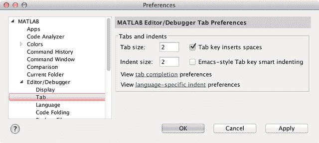

# 2. MATLAB 风格

电子补充材料：本章的在线版本（doi: [10.1007/978-1-4842-0559-4_2](http://dx.doi.org/10.1007/978-1-4842-0559-4_2)）包含仅供授权用户使用的补充材料。

本章提供了关于建议风格元素的指南和技巧，旨在使您的代码和工具更易于理解和使用。

在构建函数时，我们有具体的指导原则。注释应清晰且具有描述性，并遵循您所在机构设定的格式指南。命名约定也应如此。此外，我们建议提供“内置”输入和输出；即示例参数，使得函数无需用户输入即可完整执行。这些额外的演示形式应与您为函数创建的不同语法一起列出。

对代码进行文档化处理不仅仅是在代码中添加页眉和一些注释。MATLAB 现在允许您将 HTML 帮助集成到工具箱中，该帮助会与 MATLAB 文档一起在浏览器中显示。您还可以使用发布工具来创建综合性的技术报告。从一开始就将这些特性纳入您的风格指南中，将为您在日后向他人发布工具箱时节省大量工作。

## 2.1 制定您自己的 MATLAB 风格指南

### 问题

您团队中的每位工程师都偏好各自喜爱的命名和空白样式。当大家协作处理彼此代码时，最终会形成一种混杂的风格，导致代码更难阅读。

### 解决方案

制定并发布您自己的风格指南。MATLAB 可以在首选项设置中帮助强制执行某些指南，例如制表符大小。


### 工作原理

我们推荐经典书籍 *《MATLAB 风格要素》*（Richard K. Johnson 著，剑桥大学出版社，2010 年）作为制定个人风格指南的起点。其中许多建议适用于跨编程语言的通用良好编码实践，另一些则针对 MATLAB 特有内容，例如在注释中使用发布标记语法。该书涵盖了格式化、命名、文档和编程等方面。

我们在某些方面与书中的建议略有不同。例如，我们更倾向于将函数名首字母大写。这样做能在脚本中区分自定义函数与 MATLAB 内置函数。我们还倾向于对结构体使用单字母变量，而非冗长的驼峰式名称。然而，编写清晰 MATLAB 代码的关键——该书也强调了这一点——在于将 MATLAB 代码视为编译型代码来对待。要注意变量类型，即使 MATLAB 未明确要求也要使用括号，并编写充足的注释。

例如，当变量值为双精度浮点数时，通过添加小数点来表明这一点可避免混淆该参数可能为整数。

将

`length = 1;`

替换为

`length = 1.0;`

在 `if` 语句中，始终使用括号。若将来计划将代码移植到其他语言，这能节省时间，并且能使代码对掌握多种语言的程序员而言更清晰易读。

将

`if thisIsTrue && thatIsTrue`

替换为

`if (thisIsTrue && thatIsTrue)`

应始终避免在代码中使用“魔法数字”——这些数字在快速编写函数测试概念时很容易被使用。它们是指直接键入到逻辑语句等处的数值，而非赋值给变量。应花时间定义一个命名得当的变量，并添加注释说明该数字的来源。

将

`if (value > 2.0 || value < 0.0)`

替换为

`if (value > minValue || value < maxValue)`

随着彩色编码集成开发环境（如 MATLAB 编辑器）的出现，在风格指南中通过大量空白来划分代码段的做法已不再流行。通常，代码块之间留一行空行即可。我们建议在函数结束与子函数开始之间额外添加一行空白。紧密相关的代码行之间不应添加空白。

有些程序员喜欢让代码块在等号处对齐。这在某些情况下很有帮助，特别是编码来自参考文献的方程组时。然而，当代码处于活跃开发阶段时，维护这种对齐可能很繁琐。若喜欢此风格，建议等到函数通过内部代码审查并准备发布时，再添加对齐空格。在我们的代码中，通常只在注释或空白分隔的小型代码块内进行等号对齐。

请考虑以下代码：

```
% 初始化
myVar1 = linspace(0,1);
b = 1.0;

% 计算
[result1, result2] = MyFunction(myVar1,b);
plotH = plot(myVar1,result2);
```

这可以通过多种方式对齐，例如：

```
% 初始化
myVar1 = linspace(0,1);
b    = 1.0;

% 计算
[result1, result2] = MyFunction(myVar1,b);
plotH             = plot(myVar1,result2);
```

或者，若跨块对齐，可写为：

```
% 初始化
myVar1            = linspace(0,1);
b                 = 1.0;

% 计算
[result1, result2] = MyFunction(myVar1,b);
plotH              = plot(myVar1,result2);
```

在本书的代码中，您将看到前面那种按块对齐的风格。

关于空白的另一个考虑是制表符大小。某些指南建议使用四个或八个空格的较大制表符，理由是 MATLAB 代码很少深度嵌套。我们经常编写大量深度嵌套的代码，因此内部指南是使用两个空格。在 MATLAB 首选项中设置制表符大小，并设置为用空格代替制表符后，便可使用智能缩进功能轻松高亮并更新代码块。图 2-1 显示了 Mac 上 MATLAB R2014b 的制表符首选项窗格。



**图 2-1.** 大小为 2 且选中“使用空格”选项的制表符首选项

我们倾向于对函数名使用大写字母（例如 `MyFunction`），特别是为了将它们与 MATLAB 内置函数的小写函数名区分开来。此外，我们对变量使用驼峰式命名（例如 `myVariableName`）；对结构体常用单字母或极短的名称。对于索引变量，我们倾向于使用 `k`，以避免与虚数相关的变量 `i` 和 `j` 混淆。我们遵循常量名大写的标准惯例；例如，地球引力常数为 `MU_EARTH`。

换句话说，您需要为以下项制定命名规范：

*   函数名
*   变量名
*   结构体名
*   索引变量
*   常量

额外的命名规范可能包括对特定类型文件或变量使用标准前缀或后缀。例如，在提供积分动力学的函数名中使用字母“RHS”（方程右侧，当导数位于左侧时）；在演示特定函数或功能的脚本名中使用“Demo”一词很有帮助。变量名元素的顺序应保持一致。例如，如果 `r` 表示半径，第二个元素是行星名称，则使用 `R_EARTH` 和 `R_MOON`，而不要将第二个变量命名为 `MOON_R`。在整个代码库中，顺序应保持一致。

其他规则可能涉及布尔变量的名称或在函数名中使用动词。最重要的步骤是：为您的组织创建并记录一套命名约定，或创建一些函数模板，以便工程师编写出风格一致的代码。

本书通篇使用了以下指南：

*   **命名：** 命名指南。
*   **函数名：** 函数名使用首字母大写的驼峰式。第一个单词最好为动作动词或“RHS”。
*   **脚本名：** 若脚本是特定函数或函数集的演示，则在名称后追加“Demo”。
*   **变量名：** 变量名使用首字母小写的驼峰式。
*   **常量：** 使用大写字母标识常量。
*   **变量名长度：** 大多数变量名应至少包含三个字符。例外情况包括常用的数据结构、索引变量，以及复制方程式中使用单字母变量名（该领域人员易于识别）的情况。
*   **索引变量：** 使用单个索引变量时，用 `k`；使用两个索引变量时，用 `j` 和 `k`；更多变量时，用 `l`, `m`。
*   **双精度浮点数：** 在写出双精度浮点数值时，始终使用小数点。
*   **魔法数字：** 避免在代码中使用魔法数字；应优先使用变量来指定数字。
*   **注释：** 对于代码中硬编码的数字，始终添加注释说明其来源或理由。
*   **If 语句：** 始终在 IF 语句的条件部分使用括号。
*   **制表符：** 使用两个空格的制表符大小，并将 MATLAB 设置为用空格代替制表符。在提交文件前，使用智能缩进确保制表符一致性。
*   **空行：** 大多数代码段之间使用一个空行，子函数之间使用两个空行。
*   **对齐：** 仅在代码块内部（按空行分隔的块）于等号处对齐代码。

关于函数头的指南将在下一个技巧中介绍。

## 2.2 编写良好的函数帮助


