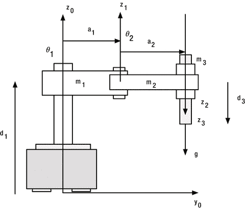
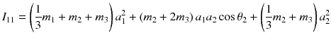
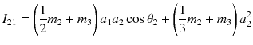
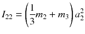
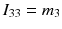
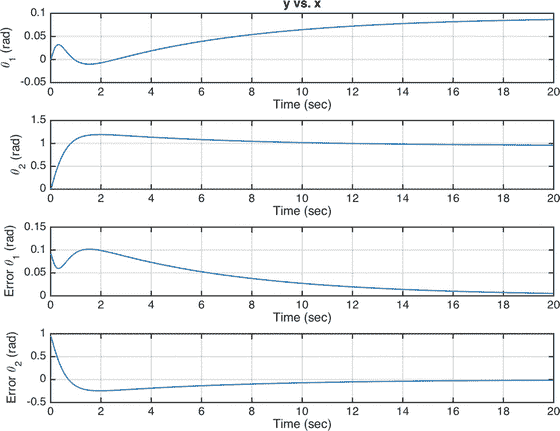
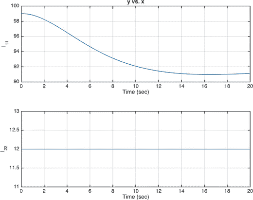

# 7. 机器人学

电子补充材料：本章的在线版本（doi: [10.1007/978-1-4842-0559-4_7](http://dx.doi.org/10.1007/978-1-4842-0559-4_7)）包含补充材料，仅供授权用户使用。

## SCARA 机器人概述

SCARA 机器人（选择性顺应性装配机器人手臂）是一种简单的工业机器人，用于在二维空间中放置元件。您将学习具有两个旋转关节和一个棱柱关节的 SCARA 机器人手臂的运动方程。每个关节具有一个自由度。SCARA 机器人广泛适用于需要在二维空间中插入零件或进行钻孔的工作。

机器人系统的输入将是机械臂末端执行器的一个新位置。您需要解决两个控制问题。一个是确定将机械臂放置在特定 xy 坐标处所需的角度。这是逆运动学问题。第二个是控制两个关节，使得对移动机械臂的命令做出平滑响应。您还将开发一个自定义可视化函数，可用于创建机器人运动的动画。

有关本章所用动力学的更多信息，请参见 Lung-Wen Tsai 的著作《机器人分析：串联和并联操作机构的力学》（John Wiley & Sons, 1999）中的示例 9.8.2（第 405 页）。

## 7.1 创建 SCARA 机器人的动力学模型

### 问题

该机器人有两个旋转关节和一个线性“关节”。您需要编写连接施加在机械臂上的力和力矩与其运动的动力学方程，以便能够仿真机械臂。

### 解决方案

运动方程被写为二阶微分方程。右手边涉及求解一组线性方程。

### 工作原理

SCARA 机器人如图 7-1 所示。它有两个在 xy 平面内移动的机械臂，以及一个在 z 方向移动的柱塞。角度 `θ[1]` 和 `θ[2]` 分别围绕 `z[0]` 和 `z[1]` 轴测量。



图 7-1. SCARA 机器人。两个机械臂在一个平面内移动。柱塞垂直于该平面移动

SCARA 机器人的运动方程如下

![ $$ I\left[\begin{array}{r}\hfill {\ddot{\theta}}_1\\ {}\hfill {\ddot{\theta}}_2\\ {}\hfill {\ddot{d}}_3\end{array}\right]+\left[\begin{array}{l}-\left({m}_2+2{m}_3\right){a}_1{a}_2 \sin {\theta}_2\left({\dot{\theta}}_1{\dot{\theta}}_2+\frac{1}{2}{\dot{\theta}}_2²\right)\hfill \\ {}\left(\frac{1}{2}{m}_2+{m}_3\right){a}_1{a}_2 \sin {\theta}_2{\dot{\theta}}_1²\hfill \\ {}-{m}_3g\hfill \end{array}\right]=\left[\begin{array}{r}\hfill {T}_1\\ {}\hfill {T}_2\\ {}\hfill {F}_3\end{array}\right] $$ ](A335353_1_En_7_Chapter_Equ1.gif)

(7.1)

第一项是广义惯性矩阵与加速度向量的乘积。第二个数组包含旋转耦合项。最后一个数组是控制向量。广义惯性矩阵 `I` 为

![ $$ \left[\begin{array}{rrr}\hfill {I}_{11}& \hfill {I}_{21}& \hfill 0\\ {}\hfill {I}_{21}& \hfill {I}_{22}& \hfill 0\\ {}\hfill 0& \hfill 0& \hfill {I}_{33}\\ {}\hfill & \hfill & \hfill \end{array}\right] $$ ](A335353_1_En_7_Chapter_Equ2.gif)

(7.2) 其中



(7.3)



(7.4)



(7.5)



(7.6)

请注意，在推导该惯性矩阵时，作者将连杆视为质点而非刚体。

该矩阵是对称的，理应如此。两个旋转自由度之间存在耦合，但柱塞与旋转铰链之间没有耦合。

首先，为机器人定义一个数据结构，定义连杆的长度和质量，并包含可施加的力和扭矩的字段。该函数可以提供一个待填充的默认结构，也可以预先指定这些字段。

```
% d = SCARADataStructure
% d = SCARADataStructure( a1, a2, d1, m1, m2, m3 )
%
%% 描述
% 创建一个 SCARA 机器人数据结构。输入 d = SCARADataStructure 将使用默认参数。
% 力和扭矩均设置为零。
%
%% 输入参数
% a1 (1,1) 连杆 1 长度
% a2 (1,1) 连杆 2 长度
% d1 (1,1) 连杆 1 距地面的距离
% m1 (1,1) 连杆 1 质量
% m2 (1,1) 连杆 2 质量
% m3 (1,1) 连杆 3 质量
% t1 (1,1) 关节 1 扭矩
% t2 (1,1) 关节 2 扭矩
% f3 (1,1) 关节 3 力
%
%% 输出参数
% d (.) 数据结构
function d = SCARADataStructure( a1, a2, d1, m1, m2, m3 )
if ( nargin < 1 )
d = struct ('a1',0.1,'a2',0.1,'d1',0.05,'m1',1,'m2',1,'m3',1,'t1',0,'t2',0,'f3',0);
else
d = struct ('a1',a1,'a2',a2,'d1',d1,'m1',m1,'m2',m2,'m3',m3,'t1',0,'t2',0,'f3',0);
end
```

然后根据方程编写右侧（`RHS`）函数。你需要求解状态导数 `θ̈1, θ̈2, d̈3`，这可以通过左矩阵除法实现。在 MATLAB 中，这可以通过反斜杠运算符轻松完成，它会根据输入类型选择 QR、三角、LDL、Cholesky、Hessenberg 或 LU 求解器。该函数没有内置演示，因为这会影响在 `RHS` 函数中的性能，而该函数会被积分器反复调用。请注意文件顶部重力常数的定义。惯性矩阵作为额外输出返回。

%% `RHSSCARA` SCARA 机器人手臂方程的右侧。
%
%% 格式
% `[xDot, i] = RHSSCARA( t, x, d )`
%
%% 描述
% 根据当前状态、时间和描述 `SCARA` 机器人配置的数据结构生成加速度向量。
```matlab
function [xDot, i] = RHSSCARA( t, x, d )
```
%% 描述
% 生成加速度向量。
%
%% 输入参数
% `t` `(1,1)` 时间 (`s`)
% `x` `(6,:)` 状态向量 `[theta1;theta2;d3;omega1;omega2;v3]`
% `d` `(.)` `SCARA` 数据结构
%
%% 输出参数
% `xDot` `(6,:)` 状态导数
% `i` `(3,3)` 广义惯性矩阵
%
%% 参见
% `SCARADataStructure`

```matlab
g = 9.806; % 重力加速度 ( m/s² )
c2 = cos( x(2) );
s2 = sin( x(2) );
theta1Dot = x(4);
theta2Dot = x(5);

% 惯性矩阵
i = zeros(3,3);
a1Sq = d.a1.²;
a2Sq = d.a2.²;
a12 = d.a1 * d.a2;
m23 = 0.5 * d.m2 + d.m3;
i(1,1) = (d.m1/3 + d.m2 + d.m3) * a1Sq + 0.5 * m23 * a12 * c2 + (d.m2/3 + d.m3) * a2Sq;
i(2,2) = (d.m2/3 + d.m3) * a2Sq;
i(3,3) = d.m3;
i(1,2) = m23 * a12 * c2 + (d.m2/3 + d.m3);
i(2,1) = i(1,2);

% 右侧
u = [d.t1; d.t2; d.f3];
f = [-(d.m2 + 2 * d.m3) * a12 * s2 * (theta1Dot * theta2Dot + 0.5 * theta2Dot.²);...
     0.5 * m23 * a12 * s2 * theta1Dot.²;...
     -d.m3 * g];
xDot = [x(4:6); i \ (f - u)];
```

# 7.2 为机器人定制可视化函数

## 问题

你希望能够以三维方式可视化机器人手臂的运动。

## 解决方案

你将编写一个函数来绘制 `3D` `SCARA` 机器人手臂。这将使你能够轻松地可视化机器人手臂的运动情况。

## 工作原理

此函数演示了底层绘图函数 `patch` 和 `light` 的使用方法。你可以为机器人手臂的组件创建盒体和圆柱体形状。该函数还演示了如何使用 `getframe` 生成机器人运动的 `MATLAB` 电影。最终的可视化结果如图 7-2 所示。


图 7-2. 使用 `patch` 的 `SCARA` 机器人可视化

该函数的第一个参数是一个动作。你需要定义一个初始化动作来生成所有面片对象，这些对象存储在一个持久变量中。然后，在更新动作期间，你只需要更新面片的顶点。该函数有一个输出，即来自动画的电影帧。请注意，输入 `x` 是向量化的，这意味着你可以向函数传递一组状态，而不仅仅是一次一个。以下是该函数的头部。

```matlab
%% `DRAWSCARA` 绘制一个 `SCARA` 机器人手臂。
%
%% 形式
% `DrawSCARA( 'initialize', d )`
% `m = DrawSCARA( 'update', x )`
%
%% 描述
% 使用面片对象绘制一个 `SCARA` 机器人。使用一个持久变量来存储两次更新调用之间的图形句柄。
%
% `SCARA` 是选择性顺应性装配机器人手臂（Selective Compliance Assembly Robot Arm）
% 或选择性顺应性关节型机器人手臂（Selective Compliance Articulated Robot Arm）的缩写。
%
% 输入 `DrawSCARA` 可运行演示。
%
%% 输入
% `action` `(1,:)` 动作字符串
% `x` `(3,:)` `[theta1;theta2;d3]`
% 或
% `d` `(1,1)` 维度数据结构体
% `.a1` `(1,1)` 连杆臂 `1` 关节到关节
% `.a2` `(1,1)` 连杆臂 `2` 关节到关节
% `.d1` `(1,1)` 连杆 `1` 和连杆 `2` 的高度
%
%% 输出
% `m` `(1,:)` 如果有输出，则使用 `getframe` 制作电影
```

接下来，展示主函数的函数体。请注意，该函数内置了一个演示程序，演示了包含 `100` 个状态的向量输入。如果省略了数据结构体 `d`，该函数会使用默认数据进行自我初始化。

```matlab
function m = DrawSCARA( action, x )
persistent p
% 演示
%-----
if ( nargin < 1 )
    DrawSCARA( 'initialize' );
    t = linspace(0,100);
    omega1 = 0.1;
    omega2 = 0.2;
    omega3 = 0.3;
    x = [ sin(omega1*t); sin(omega2*t);0.01* sin(omega3*t)];
    m = DrawSCARA( 'update', x );
    if ( nargout < 1 )
        clear m;
    end
    return
end

switch ( lower(action) )
    case 'initialize'
        if ( nargin < 2 )
            d = SCARADataStructure;
        else
            d = x;
        end
        p = Initialize( d );
    case 'update'
        if ( nargout == 1 )
            m = Update( p, x );
        else
            Update( p, x );
        end
end
```

请注意，子函数被用于 `Initialize` 和 `Update` 动作。这保持了 `switch` 语句的整洁和易读。在 `Initialize` 函数中，你可以定义额外的参数来创建用于可视化整个机器人手臂的盒体和圆柱体对象。然后，你使用 `patch` 创建图形对象，并使用参数对代替 `(x, y, z)` 输入。以这种方式指定唯一的顶点可以减少定义面片所需的数据量，并且在概念上很简单。有关更多信息，请参阅 `MATLAB` 帮助中的“面片对象介绍”和“指定面片对象形状”部分。句柄存储在持久变量 `p` 中。

## 初始化函数

```matlab
%--------------------------------------------------------------------------
% 初始化图片。机器人使用以下参数定义：
% .b (1,3) 盒体尺寸 [x y z] 参见 Box
% .l1 (1,5) 连杆臂 1 尺寸 [x y z t d] 参见 UChannel
% .l2 (1,3) 连杆臂 2 尺寸 [x y z] 参见 Box
% .c1 (1,2) 圆柱体 1 [r l]
% .c2 (1,2) 圆柱体 2 [r l]
% .c3 (1,2) 圆柱体 3 [r l]
% .c4 (1,2) 圆柱体 4 [r l]
%--------------------------------------------------------------------------
function p = Initialize( d )

p.fig = figure( 'name','SCARA' );

% 创建部件
c = [0.5 0.5 0.5]; % 颜色
r = [1.0 0.0 0.0];

% 存储以便在更新时使用
p.a1 = d.a1;
p.a2 = d.a2;

% 用于绘制的物理参数
d.b = [1 1 1]*d.d1/2;
d.l1 = [0.12 0.02 0.02 0.005 0.03]*10*d.a1;
d.l2 = [0.12 0.02 0.01]*10*d.a2;
d.c1 = [0.1 0.4]*d.a1;
d.c2 = [0.06 0.3]*d.a1;
d.c3 = [0.06 0.5]*d.a2;
d.c4 = [0.05 0.6]*d.a2;

% 基座
[vB, fB] = Box( d.b(1), d.b(2), d.b(3) );
[vC, fC] = Cylinder( d.c1(1), d.c1(2) );
F = [fB;fC+ size(vB,1)];
vB(:,3) = vB(:,3) + d.b(3)/2;
vC(:,3) = vC(:,3) + d.b(3);
v = [vB;vC];
p.base = patch( 'vertices', v, 'faces', f,...
    'facecolor', c, 'edgecolor', c,...
    'facelighting', 'phong' );

% 连杆 1
% 臂
[vA, fA] = UChannel( d.l1(1), d.l1(2), d.l1(3), d.l1(4), d.l1(5) );
vA(:,3) = vA(:,3) + d.d1;
vA(:,1) = vA(:,1) - d.b(1)/2;
% 销
[vC, fC] = Cylinder( d.c2(1), d.c2(2) );
vC(:,3) = vC(:,3) + d.d1 - d.c2(2)/2;
vC(:,1) = vC(:,1) + d.a1 - d.c2(1);
p.v1 = [vC;vA];
f = [fC;fA+ size(vC,1)];
p.link1 = patch( 'vertices', p.v1, 'faces', f,...
    'facecolor', r, 'edgecolor', r,...
    'facelighting', 'phong' );

% 查找坐标轴范围
zLim = max(vC(:,3));

% 连杆 2
[vB, fB] = Box(d.l2(1), d.l2(2), d.l2(3) );
[vC, fC] = Cylinder( d.c3(1), d.c3(2) );
vC(:,1) = vC(:,1) + d.l2(1)/2 - 2*d.c3(1);
vC(:,3) = vC(:,3) - d.c3(2)/2;
p.v2 = [vC;vB];
p.v2(:,1) = p.v2(:,1) + d.l2(1)/2 - 2*d.c3(1);
p.v2(:,3) = p.v2(:,3) + d.d1;
f = [fC;fB+ size(vC,1)];
v2 = p.v2;
v2(:,1) = v2(:,1) + d.a1;
p.link2 = patch( 'vertices', v2, 'faces', f,...
    'facecolor', r, 'edgecolor', r,...
    'facelighting', 'phong' );

% 连杆 3
[vC, fC] = Cylinder( d.c4(1), d.c4(2) );
p.v3 = vC;
p.r3 = d.l2(1) - 4*d.c3(1);
p.v3(:,3) = p.v3(:,3) + d.d1/4;
vC(:,1) = vC(:,1) + p.r3 + d.a1;
f = fC;
p.link3 = patch( 'vertices', vC, 'faces', f,...
    'facecolor', c, 'edgecolor', c,...
    'facelighting', 'phong' );

xLim = 1.3*(d.a1+d.a2);
xlabel( 'x' );
ylabel( 'y' );
zlabel( 'z' );
grid on
rotate3d on
axis( [-xLim xLim -xLim xLim 0 zLim] )
set( gca, 'DataAspectRatio',[1 1 1],'DataAspectRatioMode','manual' )
s = 10* max( Mag(v') );
light('position',s*[1 1 1])
view( [1 1 1] )
```

`Update` 函数会更新每个面片对象的顶点。名义顶点存储在持久变量 `p` 中，并使用根据连杆角度的正弦和余弦计算出的变换矩阵进行旋转。如果存在输出参数，该函数将使用 `getframe` 将图形捕获为电影帧。

## 更新函数

```matlab
%--------------------------------------------------------------------------
% 更新图片，如果请求则获取帧
%--------------------------------------------------------------------------
function m = Update( p, x )

for k = 1: size(x,2)
    % 连杆 1
    c = cos(x(1,k));
    s = sin(x(1,k));
    b1 = [c -s 0;s c 0;0 0 1];
    v = (b1*p.v1')';
    set( p.link1,'vertices',v);

    % 连杆 2
    r2 = b1*[p.a1;0;0];
    c = cos(x(2,k));
    s = sin(x(2,k));
    b2 = [c -s 0;s c 0;0 0 1];
    v = (b2*b1*p.v2')';
    v(:,1) = v(:,1) + r2(1);
    v(:,2) = v(:,2) + r2(2);
    set( p.link2,'vertices',v);

    % 连杆 3
    r3 = b2*b1*[p.r3;0;0] + r2;
    v = p.v3;
    v(:,1) = v(:,1) + r3(1);
    v(:,2) = v(:,2) + r3(2);
    v(:,3) = v(:,3) + x(3,k);
    set( p.link3,'vertices',v);

    if( nargout > 0 )
        m(k) = getframe(p.fig);
    else
        drawnow;
    end
end
```

子函数 `Box`、`Cylinder` 和 `UChannel` 用于创建每种 3D 对象的顶点和面。面使用顶点索引定义；在本例中，使用的是三角形。此处展示了 `Box` 函数，以演示如何创建顶点和面矩阵。

## 7.3 使用数值搜索实现机器人逆运动学

### 问题

机器人控制器的目标是将末端执行器放置在期望位置。你需要知道与该位置对应的连杆状态。

### 解决方案

你将使用数值求解器计算机器人状态。MATLAB 求解器为`fminsearch`，它实现了 Nelder-Mead 最小化算法。

### 工作原理

我们控制系统的目标是将末端执行器定位到期望位置`[x,y,z]`。`z`由配方 7-1 中图 7-1 的 `d[1]-d[3]` 决定。`x`和`y`则由两个角度`a[1]`和`a[2]`求出。机械臂末端执行器的位置向量为：

$$ \left[\begin{array}{l}x\hfill \\ {}y\hfill \\ {}z\hfill \end{array}\right]=\left[\begin{array}{l}{a}_1 \sin {\theta}_1+{a}_2 \sin \left({\theta}_1+{\theta}_2\right)\hfill \\ {}{a}_1 \cos {\theta}_1+{a}_2 \cos \left({\theta}_1+{\theta}_2\right)\hfill \\ {}{d}_1-{d}_3\hfill \end{array}\right] $$ (A335353_1_En_7_Chapter_Equ7.gif)

(7.7)

虽然这些方程看起来并不复杂，但无法直接用于求解`x`和`y`。首先，如果`a[2]`小于`a[1]`，原点附近会存在一个无法到达的区域。此外，每个`x`、`y`对可能存在多个解。

我们利用这个位置方程来构建一个代价函数，并将其传递给`fminsearch`。该函数计算得到能产生期望位置的状态。最终的函数演示了嵌套代价函数、内置演示程序和默认绘图输出。请注意，我们使用了由`optimset`返回的数据结构来向`fminsearch`传递参数。

```matlab
%% SCARAIK 为期望的末端执行器位置和角度生成 SCARA 状态。
%
%% 格式：
% x = SCARAIK( r, d )
%
%% 描述
% 使用 fminsearch 根据末端执行器位置查找连杆状态。
% 代价函数已嵌入。输入 SCARAIK 可运行演示程序，该演示会创建图形和视频。
%
%% 输入
% r (3,:) 末端执行器位置 [x;y;z]
% d (.) 机器人数据结构
%   .a1 (1,1) 连杆 1 长度
%   .a2 (1,1) 连杆 2 长度
%   .d1 (1,1) 连杆 1 距地面的距离
%
%% 输出
% x (3,:) SCARA 状态 [theta1;theta2;d3]

function x = SCARAIK( r, d )

% 演示程序
% -----
if ( nargin < 1 )
    r = [ linspace(0,0.2); zeros(2,100)];
    d = SCARADataStructure;
    SCARAIK( r, d );
    return;
end

n = size(r,2);
xY = zeros(2,n);
TolX = 1e-5;
TolFun = 1e-9;
MaxFunEvals = 1500;
Options = optimset('TolX',TolX,'TolFun',TolFun,'MaxFunEvals',MaxFunEvals);
x0 = [0;0];
for k = 1:n
    d.xT = r(1:2,k);
    xY(:,k) = fminsearch(@Cost, x0, Options, d );
    x0 = xY(:,k);
end
x = [xY;d.d1 - r(3,:)];

% 默认输出是创建图形
%-----------------------------------
if ( nargout == 0 )
    DrawSCARA( 'initialize', d );
    m = DrawSCARA( 'update', x );
    vidObj = VideoWriter('SCARAIK.avi');
    open(vidObj);
    writeVideo(vidObj,m);
end

%--------------------------------------------------------------------------
% 代价函数
% 代价是根据状态计算出的位置与目标位置 xT 之间的差值。
%--------------------------------------------------------------------------
function y = Cost( x, d )
    xE = d.a1*cos(x(1)) + d.a2*cos(x(1)+x(2));
    yE = d.a1*sin(x(1)) + d.a2*sin(x(1)+x(2));
    y = sqrt((xE-d.xT(1))²+(yE-d.xT(2))²);
```

该函数使用`VideoWriter`对象和`DrawSCARA`返回的帧数据创建视频。在引入`VideoWriter`之前，这可以通过`movie2avi`实现。

## 7.4 开发机器人控制系统

### 问题

机械臂控制是机器人技术中的一项关键技术。你需要能够平滑且可靠地改变末端执行器的位置。控制速度决定了在给定时间内可以完成的操作数量，进而决定了机器人的生产力。

### 解决方案

这个问题通过使用前面讨论的逆运动学函数来解决，然后将期望角度输入到两个 PD 控制器中，如第 6 章所开发的。

### 工作原理

应用第 6 章描述的 PD 控制器，使用`c`数组作为期望角度和位置向量。我们计算控制加速度（而非扭矩），然后乘以惯性矩阵得到控制扭矩：

$$ T=Ia $$ (img/A335353_1_En_7_Chapter_Equ8.gif)

(7.8)

其中`T`是控制扭矩，`I`是惯性矩阵，`a`是计算出的控制加速度。这样做是因为惯性矩阵中存在交叉耦合项，并且`I[11]`会随着外部臂位置的变化而变化。我们忽略了运动方程中的非线性项。这些项是角度和角速度的函数。如果移动缓慢，这应该不会造成问题。如果移动快速，可以对非线性扭矩进行前馈补偿以抵消它们。

第一步是指定末端执行器的期望位置，并使用逆运动学函数计算与该位置对应的目标状态。

```matlab
% 选择放置末端执行器的位置 [x;y;z]
r = [4;2;0];

% 找到关节的两个角度
setPoint = SCARAIK( r, d );
```

接下来是使用`PDControl`设计控制器的代码，每个关节一个控制器。注意，两个控制器使用了相同的参数。将阻尼比`zeta`设为 1.0 以避免超调。回想一下，无阻尼自然频率`wN`是控制器的带宽；该频率越高，响应越快。导数项滤波器截止频率`wD`设置为`wN`的 5–10 倍，这样滤波器不会在低于`wN`的频率上引起滞后。变量`dT`是仿真的时间步长。

```matlab
%% 控制设计
% 我们将使用两个 PD 控制器，每个旋转关节一个。

% 控制器参数
dC1 = PDControl( 'struct' );
dC1.zeta = 1.0;
dC1.wN = 0.6;
dC1.wD = 60.0;
dC1.tSamp = dT;
dC2 = dC1;

% 创建两个控制器
dC1 = PDControl( 'initialize', dC1 );
dC2 = PDControl( 'initialize', dC2 );
```

这是计算并应用控制的部分。通过计算关节加速度并乘以每个时间步计算的惯性矩阵，来消除惯性耦合，从而得到期望的控制扭矩。注意，我们使用了 RHS 函数的一个特性，即从当前状态计算惯性矩阵。

```matlab
%--------------------------------------------------------------------------
% 输入
% ------
% Box
% x (1,1) x 方向长度
% y (1,1) y 方向长度
% z (1,1) z 方向长度
%
% 输出
% -------
% v (:,3) 顶点
% f (:,3) 面
%--------------------------------------------------------------------------
function [v, f] = Box( x, y, z )

f = [2 3 6;3 7 6;3 4 8;3 8 7;4 5 8;4 1 5;2 6 5;2 5 1;1 3 2;1 4 3;5 6 7;5 7 8];
x = x/2;
y = y/2;
z = z/2;
v = [-x x x -x -x x x -x;...
    -y -y y y -y -y y y;...
    -z -z -z -z z z z z]';
```

## 7.5 仿真受控机器人

### 问题

你想测试受控状态下的机械臂。输入将是末端执行器的期望 xy 坐标。

### 解决方案

解决方案是构建一个 `MATLAB` 脚本，在其中按照之前的步骤设计 PD 控制器矩阵，然后在循环中模拟控制器，施加计算出的扭矩，直至状态与期望角度匹配。在本方案中，你无需控制末端执行器的垂直位置。

### 工作原理

这是一个离散仿真，采用固定时间步长，且控制扭矩与动力学分别计算。仿真在循环中运行，首先调用来自配方 7-4 的控制器代码，然后调用四阶龙格-库塔函数中的右侧函数。仿真结束后，绘制角度和角度误差，并显示 3D 动画。你可以绘制更多变量，但所有关键信息都已包含在角度和误差中。

当时间步长非常小（0.025 秒）时，你可以提高控制器的带宽以加快响应速度。请记住，滤波器的截止频率也必须低于奈奎斯特频率。任何高于奈奎斯特频率的信号将被视为其真实频率的混叠，而非真实频率。

请注意，你并未处理大的角度误差，即大于 `2π` 的误差。此外，如果期望角度是 `2π − e`，而当前位置是 `2π + e`，控制器不一定会选择最短路径。可以通过添加计算单位圆上两点间最小误差的代码来处理这种情况。读者可以为此添加代码，使控制器更稳健。

以下是脚本 `SCARARobotSim.m`，其中跳过了配方 7-4 中的控制设计部分。首先，初始化仿真数据，包括时间参数和机器人几何参数。在进入仿真循环之前，使用 `zeros` 初始化绘图数组。有一个控制标志，允许仿真以开环或闭环方式运行。积分操作发生在循环的最后一行。

```matlab
%% 初始化

% 指定时间、机器人几何参数和控制目标。

% 仿真时间设置
tEnd = 20.0;  % 秒
dT = 0.025;
nSim = tEnd/dT+1;
controlIsOn = true;

% 机器人参数
d = SCARADataStructure(3,2,1,4,6,1);

% 设置初始机械臂状态
x0 = zeros(6,1);
%x0(5) = 0.05;

% 选择末端执行器的放置位置 [x;y;z]
r = [4;2;0];

% 计算两个关节的角度
setPoint = SCARAIK( r, d );

%% 仿真

% 仿真可以在有控制或无控制的情况下运行，即闭环或开环。
x = x0;
xPlot = zeros(4,nSim);
tqPlot = zeros(2,nSim);
inrPlot = zeros(2,nSim);

for k = 1:nSim
    % 控制误差
    thetaError = setPoint(1:2) - x(1:2);
    [~,inertia] = RHSSCARA( 0, x, d );
    acc = zeros(2,1);
    
    % 施加控制
    if ( controlIsOn )
        [acc(1,1), dC1] = PDControl('update',thetaError(1),dC1);
        [acc(2,1), dC2] = PDControl('update',thetaError(2),dC2);
        torque = inertia(1:2,1:2)*acc;
    else
        torque = zeros(2,1);
    end
    
    d.t1 = torque(1);
    d.t2 = torque(2);
    
    % 绘图数组
    xPlot(:,k) = [x(1:2);thetaError];
    tqPlot(:,k) = torque;
    inrPlot(:,k) = [inertia(1,1);inertia(2,2)];
    
    % 将电机扭矩输入动力学模型
    x = RungeKutta( @RHSSCARA, 0, x, dT, d );
end

%% 绘制度量结果

% 绘制时间历程并执行动画。

% 绘图标签
yL = {'\theta_1 (rad)' '\theta_2 (rad)' '误差 \theta_1 (rad)' '误差 \theta_2 (rad)'};

% 时间历程
[t,tL] = TimeLabel(dT*(0:(nSim-1)));
PlotSet( t, xPlot, 'y label', yL, 'x label', tL );
PlotSet( t, tqPlot, 'y label', {'T_x','T_y'}, 'x label', tL );
PlotSet( t, inrPlot, 'y label', {'I_{11}','I_{22}'}, 'x label', tL );

% 动画
DrawSCARA( 'initialize', d );
```

图 7-3 显示了两个关节的瞬态响应。两者都收敛到设定点，但看起来与前一章中看到的双积分器响应不同。由于连杆之间的耦合，该系统是非线性的。例如，在双积分器中，对于阻尼比为 1.0 的情况，你可能期望目标角度没有超调。然而，在第二个子图（`θ[2]`）中确实看到了一些超调，但除此之外，其形状与双积分器响应相似。相反，你会看到 `θ[1]` 在对外部关节的运动做出反应时改变了方向；大约 2 秒后，当 `θ[2]` 达到峰值时，`θ[1]` 也表现得像一个双积分器。请记住，这两个控制器是独立的，并且在某些方面相互矛盾。



图 7-4 显示了由此产生的惯性分量。预计 `I[11]` 会变化，而 `I[22]` 保持不变，实际情况确实如此。



仿真结束后，脚本会运行机械臂运动的动画。二维图和 3D 动画对于调试控制器和生产运行都是必需的。

相同的脚本可以扩展以显示机械臂的一系列指令。

### 总结

本章演示了如何为一个双连杆机械臂（SCARA 机器人）编写动力学方程并实现一个简单的控制律。你使用上一章开发的简单控制器，在右侧函数中实现了耦合的非线性方程。仿真格式与双积分器非常相似。存在更复杂的方法来执行此控制，这些方法会考虑连杆之间的耦合，并且可以添加到当前框架中。你并未对运动或控制扭矩施加任何约束。

本章还演示了如何使用 MATLAB 图形引擎生成 3D 图形以及如何制作动画。动画是向他人传达结果以及调试程序的好方法。表 7-1 列出了本章中开发的代码。

**表 7-1. 本章代码清单**

| 文件 | 描述 |
| --- | --- |
| `DrawSCARA` | 绘制 SCARA 机器人手臂。 |
| `RHSSCARA` | SCARA 机器人手臂方程的右侧函数。 |
| `SCARADataStructure` | 初始化所有 SCARA 函数的数据结构。 |

| `SCARAIK` | 为期望的末端执行器位置和角度生成 SCARA 状态。 |
| --- | --- |
| `SCARARobotSim` | SCARA 机器人演示。 |


