# 9. 故障检测

电子补充材料：本章的在线版本（doi: [10.1007/978-1-4842-0559-4_9](http://dx.doi.org/10.1007/978-1-4842-0559-4_9)）包含补充材料，仅供授权用户使用。

## 引言

故障检测是在动态系统中检测失效（也称为故障）的过程。对于需要在无人监督情况下运行的系统来说，这是一个重要的领域。检测失效的方法有很多种。最简单的是使用布尔逻辑对照固定阈值进行检查。例如，您可以检查汽车的速度是否超过限速。其他方法包括模糊逻辑、参数估计、专家系统、统计分析和奇偶空间方法。本章实现了一种类型的故障检测系统——检测滤波器。其基于线性滤波。检测滤波器是一种状态估计器，被调谐用于检测特定的故障。您将为空气涡轮机设计一个检测滤波器系统。您还将学习如何构建一个图形用户界面 (GUI) 作为故障检测仿真的前端。

### 9.1 为空气涡轮机建模

#### 问题

您需要一个空气涡轮机的数值模型来演示检测滤波器。

#### 解决方案

写出空气涡轮机的运动方程。您将使用空气涡轮机的线性模型以简化模型和检测滤波器的设计。这将允许您使用状态空间模型对该系统进行建模。

#### 工作原理

图 9-1 展示了一个空气涡轮机。¹ 它有一个恒压气源。您可以通过控制气源的阀门（即调压阀）来调节涡轮机的转速。空气流经涡轮叶片使其旋转。控制系统需要调节气压以应对负载变化。您需要测量阀门下游的气压 `p`，并通过转速计测量涡轮机的转速 `ω`。

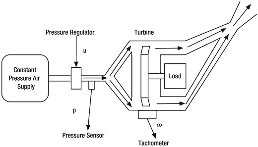
图 9-1. 空气涡轮机。箭头表示气流方向。空气流过涡轮叶片顶端，使其旋转。

空气涡轮机的动力学模型如下：

![ $$ \left[\begin{array}{l}\dot{p}\hfill \\ {}\dot{\omega}\hfill \end{array}\right]=\left[\begin{array}{rr}\hfill -\frac{1}{\tau_p}& \hfill 0\\ {}\hfill \frac{K_t}{\tau_t}& \hfill -\frac{1}{\tau_t}\end{array}\right]\left[\begin{array}{l}p\hfill \\ {}\omega \hfill \end{array}\right]+\left[\begin{array}{l}\frac{K_p}{\tau_p}\hfill \\ {}0\hfill \end{array}\right]u $$ ](A335353_1_En_9_Chapter_Equ1.gif)
(9.1)

这是一个状态空间系统：

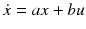
(9.2)

其中：

![ $$ a=\left[\begin{array}{rr}\hfill -\frac{1}{\tau_p}& \hfill 0\\ {}\hfill \frac{K_t}{\tau_t}& \hfill -\frac{1}{\tau_t}\end{array}\right] $$ ](A335353_1_En_9_Chapter_Equ3.gif)
(9.3)

![ $$ b=\left[\begin{array}{l}\frac{K_p}{\tau_p}\hfill \\ {}0\hfill \end{array}\right] $$ ](A335353_1_En_9_Chapter_Equ4.gif)
(9.4)

状态向量为：

![ $$ \left[\begin{array}{l}p\hfill \\ {}\omega \hfill \end{array}\right] $$ ](A335353_1_En_9_Chapter_Equ5.gif)
(9.5)

当系统处于平衡状态时，调压阀下游的压力等于 `K_p * u`。`τ_p` 是调压阀的时间常数，`τ_t` 是涡轮机的时间常数。当系统处于平衡状态时，涡轮机转速为 `K_t * p`。转速计测量 `ω`，压力传感器测量 `p`。负载的影响被纳入涡轮机的时间常数中。

动力学方程右侧的代码如下所示。其中只有一行代码是右侧项，其余部分用于返回默认的数据结构。该模型的简洁性得益于它采用状态空间模型。状态的数量可能很大，但代码结构保持不变。

```
function xDot = RHSAirTurbine(~, x, d )
% 默认数据结构
if ( nargin < 1 )
  kP = 1;
  kT = 2;
  tauP = 10;
  tauT = 40;
  c = eye(2);
  b = [kP/tauP;0];
  a = [-1/tauP 0; kT/tauT -1/tauT];
  xDot = struct('a',a,'b',b,'c',c,'u',0);
  return
end
% 导数
xDot = d.a*x + d.b*d.u;
```

系统对 `u` 的阶跃输入的响应如图 9-2 所示。压力比涡轮机更快地达到稳定状态。这是由于涡轮机的时间常数以及气压变化的滞后所致。残差非常小，因为没有故障发生。

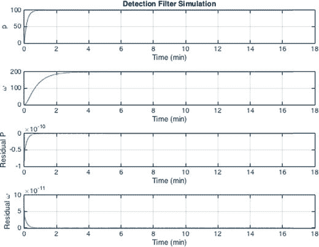
图 9-2. 空气涡轮机对调压阀阶跃输入的响应

### 9.2 构建检测滤波器

#### 问题

您希望利用上一节中建立的线性模型，构建一个系统来检测空气涡轮机中的故障。

#### 解决方案

您将构建一个能够检测调压阀故障和转速计故障的检测滤波器。我们的被控对象模型（即连续时间状态空间矩阵 `a`、`b` 和 `c`）将作为滤波器构建函数的输入。

#### 工作原理

该检测滤波器是一个带有特定增益矩阵的估计器，该矩阵对残差进行乘法运算。

![ $$ \left[\begin{array}{l}\dot{\widehat{p}}\hfill \\ {}\dot{\widehat{\omega}}\hfill \end{array}\right]=\left[\begin{array}{rr}\hfill -\frac{1}{\tau_p}& \hfill 0\\ {}\hfill \frac{K_t}{\tau_t}& \hfill -\frac{1}{\tau_t}\end{array}\right]\left[\begin{array}{l}\widehat{p}\hfill \\ {}\widehat{\omega}\hfill \end{array}\right]+\left[\begin{array}{l}\frac{K_p}{\tau_p}\hfill \\ {}0\hfill \end{array}\right]u+\left[\begin{array}{rr}\hfill {d}_{11}& \hfill {d}_{12}\\ {}\hfill {d}_{21}& \hfill {d}_{22}\end{array}\right]\left[\begin{array}{l}p-\widehat{p}\hfill \\ \omega -\widehat{\omega}\hfill \end{array}\right] $$ ](A335353_1_En_9_Chapter_Equ6.gif)
（9.6）其中 `\widehat{p}` 是估计压力，`\widehat{\omega}` 是涡轮的估计角速率。`D` 矩阵是检测滤波器的增益矩阵。这些增益将残差（即测量状态与估计状态之间的差值）反馈到检测滤波器中。残差向量为

![ $$ r=\left[\begin{array}{l}p-\widehat{p}\hfill \\ \omega -\widehat{\omega}\hfill \end{array}\right] $$ ](A335353_1_En_9_Chapter_Equ7.gif)
（9.7）

需要选择 `D` 矩阵，使得该向量能够告知您故障的性质。应选择增益，使得：

*   滤波器保持稳定。
*   如果调压器发生故障，第一个残差 `p-\widehat{p}` 不为零，但第二个残差保持为零。
*   如果涡轮发生故障，第二个残差 `\omega -\widehat{\omega}` 不为零，但第一个残差保持为零。

增益矩阵为

![ $$ D=a+\left[\begin{array}{rr}\hfill \frac{1}{\tau_1}& \hfill 0\\ {}\hfill 0& \hfill \frac{1}{\tau_2}\end{array}\right] $$ ](A335353_1_En_9_Chapter_Equ8.gif)
（9.8）

时间常数`τ[1]`是压力残差时间常数。时间常数`τ[2]`是转速计残差时间常数。实际上，您抵消了被控对象的动态特性，并用去耦的检测滤波器动态特性替代它们。这些时间常数应比动力学模型中的时间常数更短，以便能够快速检测到故障。然而，为了避免数值不稳定性，它们至少应该是采样周期的两倍长。

编写一个具有三种操作模式的函数：初始化（initialize）、更新（update）和重置（reset）。使用`varargin`允许三种模式具有不同的输入列表。函数签名为

```
function d = DetectionFilter( action, varargin )
```

`DetectionFilter`的标头和语法如下所示。使用一些LaTeX方程来描述该函数。

```
%% DetectionFilter 构建并更新一个线性检测滤波器。
%  检测滤波器增益矩阵 d 在初始化操作期间设计。
%  然后使用内部函数 CToDZOH 将连续矩阵离散化。
%  估计状态和残差向量被初始化为由 a 决定的维度。
%  在更新操作期间，计算残差和新的估计状态，并存储在数据结构 d 中。
%
%  残差计算公式为
%
%  $$r = y - c\hat{x}$$
%
%  使用检测滤波器增益计算出的估计状态为
%
%  $$\hat{x}_{k+1} = a*\hat{x} + b*u + d*r$$
%
%% 语法
%  d = DetectionFilter( 'initialize', d, tau, dT );
%  d = DetectionFilter( 'update', u, y, d );
%  d = DetectionFilter( 'reset', d );
%
%% 输入参数
%  action (1,:) 'initialize' 或 'update'
%  d (.) 数据结构
%      .a (:,:) 状态空间连续 a 矩阵
%      .b (:,1) 状态空间连续 b 矩阵
%      .c (:,:) 状态空间连续 c 矩阵
%  tau (:,1) 时间常数向量
%  dT (1,1) 时间步长
%  u (:,1) 执行器输入
%  y (:,1) 测量向量
%
%% 输出参数
%  d (.) 更新后的数据结构
%      .a (:,:) 状态空间离散 a 矩阵
%      .b (:,1) 状态空间离散 b 矩阵
%      .c (:,:) 状态空间离散 c 矩阵
%      .d (:,:) 检测滤波器增益矩阵
%      .x (:,1) 估计状态
%      .r (:,1) 残差向量
```

以下`DetectionFilter`中的代码构建并初始化了该滤波器。被控对象的连续状态空间模型（在此例中为我们的线性空气涡轮模型）作为一个输入。所选的时间常数`τ`也是一个输入，它们被添加到被控对象模型中，如公式9.8所示。该函数对被控对象的`a`和`b`矩阵以及计算出的检测滤波器增益矩阵`d`进行离散化。

```
switch lower(action)
    case 'initialize'
        d   = varargin{1};
        tau = varargin{2};
        dT  = varargin{3};

        % 设计检测滤波器
        d.d = d.a + diag(1./tau);

        % 对两者进行离散化
        d.d    = CToDZOH( d.d, d.b, dT );
        [d.a, d.b] = CToDZOH( d.a, d.b, dT );

        % 初始化状态
        m   = size(d.a,1);
        d.x = zeros(m,1);
        d.r = zeros(m,1);
```

检测滤波器的更新位于同一个函数中。注意这些方程是按照标头中的描述实现的。

```
    case 'update'
        u = varargin{1};
        y = varargin{2};
        d = varargin{3};

        r   = y - d.c * d.x;
        d.x = d.a * d.x + d.b * u + d.d * r;
        d.r = r;
```

最后，创建一个重置操作，允许您在仿真之间重置滤波器的残差和状态值。

```
    case 'reset'
        d = varargin{1};
        m = size(d.a,1);
        d.x = zeros(m,1);
        d.r = zeros(m,1);
end
```

## 9.3 仿真故障检测系统

### 问题

您希望仿真被控对象中的故障，并演示故障检测的性能。

### 解决方案

您将构建一个MATLAB脚本，该脚本使用上一节中的函数设计检测滤波器，然后通过用户可选择的调压器或转速计故障对其进行仿真。该故障可以是完全故障或部分故障。

# 工作原理

## 脚本设计与实现

该脚本利用前一教程中的 `DetectionFilter` 设计了一个检测滤波器，并通过循环实现其功能。龙格-库塔积分法用于传播空气涡轮机的连续域右侧函数 `RHSAirTurbine`。检测滤波器是离散时间的。

该脚本包含两个比例因子 `uF` 和 `tachF`，它们分别乘以调节器输入和转速计输出以模拟故障。将比例因子设置为零表示完全故障，设置为 1 表示设备正常工作。如果其中一个发生故障，其对应的残差将不为零，而另一个残差将保持为零。

```
%% 检测滤波器仿真

% 仿真空气涡轮机的故障检测。

% 空气涡轮机具有一个恒压空气源，空气通过管道驱动涡轮叶片。
% 涡轮机连接到一个负载上。

% 空气涡轮机模型是线性的。通过将调节器输入和转速计输出乘以一个常数来模拟故障。
% 常数为 0 表示完全故障，1 表示正常工作。

%% 用户输入

% 故障参数。可设置为任意数值。0 表示完全故障，1 表示正常工作。
% uF 缩放执行器输入 u。tachF 缩放速率测量值。
uF = 1;
tachF = 0;

% 故障检测的时间常数
tau1 = 0.3; % 秒
tau2 = 0.3; % 秒

% 结束时间
tEnd = 1000; % 秒

% 状态空间系统
d = RHSAirTurbine;

%% 初始化

dT = 0.02; % 秒
n = ceil(tEnd/dT);

% 初始状态
x = [0;0];

%% 检测滤波器设计

dF = DetectionFilter('initialize',d,[tau1;tau2],dT);

%% 运行仿真

% 控制输入。这是调节器输入。
u = 100;

% 绘图数组
xP = zeros(4,n);
t = (0:n-1)*dT;

for k = 1:n

    % 包含测量故障的测量向量
    y = [x(1);tachF*x(2)]; % 传感器故障

    xP(:,k) = [x;dF.r];

    % 更新检测滤波器
    dF = DetectionFilter('update',u,y,dF);

    % 积分一步
    d.u = uF*u; % 执行器故障
    x = RungeKutta( @RHSAirTurbine, t(k), x, dT, d );

end

%% 绘制状态和残差

[t,tL] = TimeLabel(t);
yL = {'p' '\omega' '残差 P' '残差 \omega' };
tTL = '检测滤波器仿真';
PlotSet( t, xP,'x label',tL,'y label',yL,'plot title',tTL,'figure title',tTL)
```

## 结果解释

在图 9-3 中，调节器发生故障，其残差不为零。在图 9-4 中，转速计发生故障，其残差不为零。残差清晰地显示了故障所在。简单的布尔逻辑（例如 `if end` 语句）就足以实现此功能。

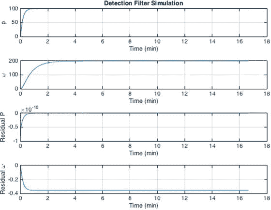

图 9-4. 空气涡轮机对转速计故障的响应

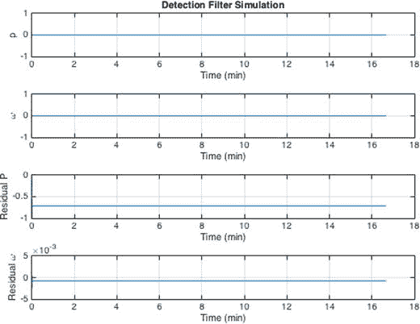

图 9-3. 空气涡轮机对调节器故障的响应

# 9.4 为检测滤波器仿真构建图形用户界面

## 问题

你需要一个图形用户界面（GUI）来为故障检测仿真提供图形化接口，以便评估滤波器的性能。

## 解决方案

你将使用 MATLAB 的 GUIDE 工具构建一个 GUI，该 GUI 允许你：

- 设置残差时间常数。
- 设置仿真的结束时间。
- 设置压力调节器输入。
- 随时引入压力调节器或转速计故障。
- 在图表中显示状态和残差。

## 工作原理

MATLAB 的 GUI 构建系统 GUIDE 通过在命令行输入 `guide` 来启动。有几种 GUI 模板选项，也可以选择空白 GUI；你将从一个包含 `uicontrols` 的 GUI 开始。首先，根据你期望的功能列表，列出所需的控件：

- 用于输入仿真持续时间、残差时间常数 τ[1] 和 τ[2]、压力调节器设定值 `u` 的编辑框
- 用于输入压力调节器和转速计故障参数的编辑框，并带有按钮，用于将新设定的值发送到仿真程序
- 用于显示计算出的检测滤波器增益的文本框
- 用于启动仿真的运行按钮
- 绘图坐标轴

### 基础操作

为了在仿真运行期间更改故障参数，你需要循环检查一个可由 GUI 外部设置的变量。你可以使用全局变量来实现这一点。

GUI 控件的模板提供了几个带标签的编辑框、一组单选按钮以及“计算”和“重置”两个操作按钮。你将使用编辑框来实现控件列表中的前两项，并使用带有单选按钮的区域来处理故障参数。图 9-5 显示了你进行任何修改之前在 GUIDE 中的模板 GUI。

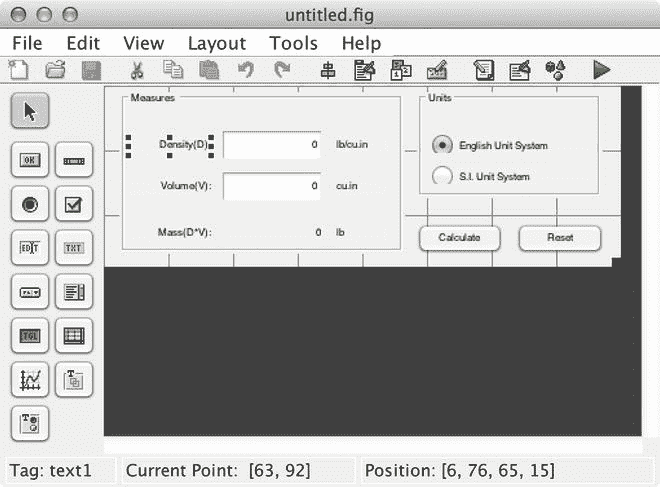

图 9-5. 包含 `uicontrols` 的 GUI 模板

只需在 GUIDE 的模板 GUI 中双击某个项目，即可打开检查器并编辑该项目的文本、字体大小等属性。对于文本项目，更改该项目检查器中的 `String` 字段。对于框架项目（如 `Measures` 框架），更改 `Title` 字段。对于编辑框，更改 `Tag` 字段。对左侧的控件集进行以下修改：

1. 将 `Density(D)` 标签的 `String` 改为“Duration”。
2. 将 `Volume(V)` 标签的 `String` 改为“Input”。
3. 将标签字体大小增加到 10 磅。
4. 将密度编辑框的 `Tag` 改为 `duration`。
5. 将体积编辑框的 `Tag` 改为 `input`。
6. 将质量文本框的 `Tag` 改为 `gains`。
7. 将 `Measures` 框架的 `Title` 改为“Parameters”。

完成这些修改后，点击绿色三角形按钮保存并运行 GUI。MATLAB 会将 `.fig` 文件以你指定的名称保存，并生成相应的 `.m` 文件。我们将 GUI 命名为 `DetectionFilterGUI`。生成的初始 GUI 如图 9-6 所示。

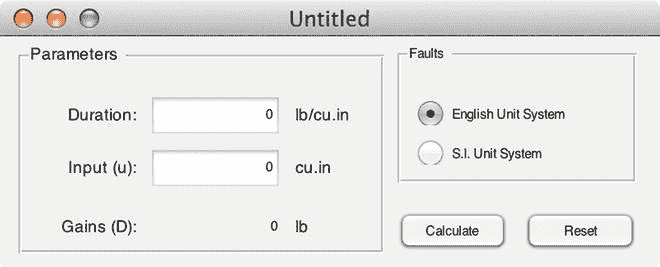

图 9-6. 初步修改后的 GUI 快照

### 代码适配

至此，你可以开始编写 GUI 代码本身了。模板 GUI 将其数据（根据用户在编辑框中输入的数据计算得出）存储在一个名为 `metricdata` 的字段中。你可以在整个 m 文件中执行查找/替换操作，将此字段改为 `filterdata`。类似地，你可以将 `density` 替换为 `duration`，将 `volume` 替换为 `input`。更改编辑框的 Tag 会改变回调函数的名称（例如，从 `density_Callback` 变为 `duration_Callback`），但不会改变函数体内变量的名称。查找/替换的步骤如图 9-7 所示。

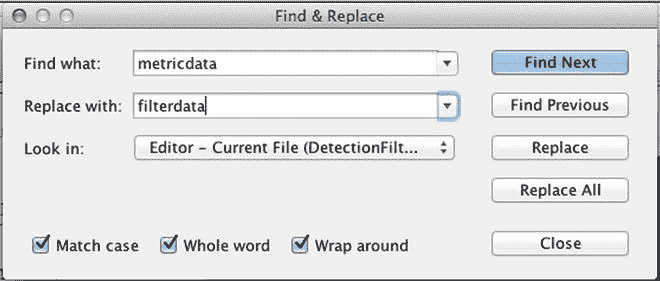

图 9-7. 查找/替换 `metricdata` 字段名

更新后的 `duration_Callback` 函数如下所示。你可以保留确保输入为合法数字的错误检查代码。请注意，MATLAB 提供了关于如何将图形对象内容从字符串转换为双精度浮点数，或如何将其保留为字符串的最佳方法的良好提示。`guidata` 函数使用图形句柄将更改后的参数的新值存储在图形本身中。

```matlab
function duration_Callback(hObject, eventdata, handles)
% hObject 指向 duration 的句柄（参见 GCBO）
% eventdata 保留 - 将在 MATLAB 的未来版本中定义
% handles 包含句柄和用户数据的结构体（参见 GUIDATA）
```

# GUI 代码修改与布局设计

`% 提示：get(hObject, 'String') 以文本形式返回 duration 的内容`
`% str2double(get(hObject, 'String')) 以双精度浮点数形式返回 duration 的内容`

```
duration = str2double(get(hObject, 'String'));
if isnan(filterdata)
    set(hObject, 'String', 0);
    errordlg('Input must be a number','Error');
end
```

`% 保存新的 duration 值`

```
handles.filterdata.duration = duration;
guidata(hObject,handles)
```

与 `uicontrols` 控件一起存储的回调字符串，可以通过双击控件在检查器中查看，如图 9-8 所示，对应 "duration" 编辑框。

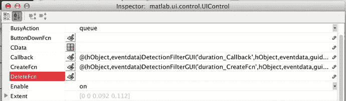

图 9-8. `uicontrol` 的回调字符串

GUI 中编辑框右侧的单位，是由单位单选按钮调用的函数控制的。首先，移除整个 Units 面板；如果现在尝试运行 GUI，由于缺少英制和公制单位的字段，将会抛出错误。接下来，在 GUI 的 m 文件中移除与此 "unitgroup" 相关的代码。你还可以移除设置单位字段的代码，因为你可以将这些字符串硬编码；在模板中，它们被标记为 "text4"、"text5" 和 "text6"。移除 `initialize_gui` 中的代码行，并删除整个 `unitgroup_SelectionChangedFcn` 函数。

在 `initialize_gui()` 中移除：

```
set(handles.unitgroup, 'SelectedObject', handles.english);
set(handles.text4, 'String', 'lb/cu.in');
set(handles.text5, 'String', 'cu.in');
set(handles.text6, 'String', 'lb');
```

将 "duration" 和输入变量的初始值设置为仿真脚本中的值：

```
handles.filterdata.duration = 1000;
handles.filterdata.input = 100;
```

现在，GUI 可以运行了。由于已经移除了设置单位字符串的函数，你现在可以在检查器中更改 Duration、Input 和 Gains 的单位字符串。你可以为图形窗口指定一个新名称：检测滤波器 GUI（点击图形背景，而非某个控件）。

## 添加新面板与控件

下一步是在 GUI 右侧添加一个新面板，其中包含用于故障参数 `uF` 和 `tachF` 的编辑框和按钮。每个项目需要一个静态文本 `uicontrol`、一个编辑框和一个按钮。添加了这些项目的框架如图 9-9 所示。

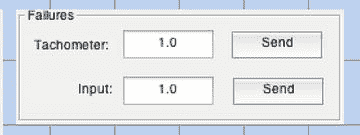

图 9-9. 带有编辑框和按钮 `uicontrols` 的面板

然后，你可以将 GUI 和右侧面板放大；插入用于时间常数 τ [1] 和 τ [2] 的框；并添加两个绘图坐标轴。你需要在坐标轴左侧为轴标签留出大量空间。将上方坐标轴的 Tag 改为 `states`，下方坐标轴的 Tag 改为 `residuals`。带有全部 `uicontrols` 的最终 GUI 如图 9-10 所示。请注意，坐标轴上显示了标签。

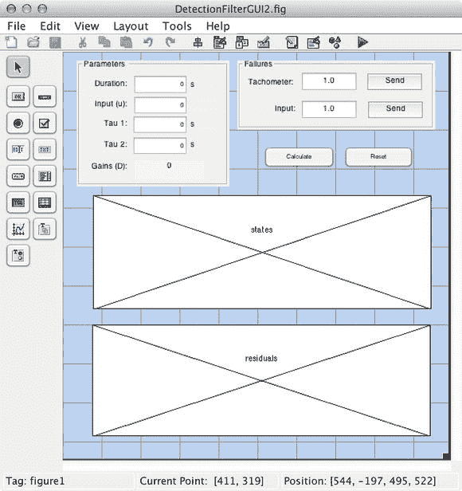

图 9-10. 在 GUIDE 中显示的已完成 GUI

## 添加代码逻辑

现在，你需要为 GUI 添加相当多的代码。检测滤波器仿真放在 Calculate 回调中。你必须添加代码，将新的编辑框项转换为双精度浮点数，即 `tachF`、`uF`、`tau1` 和 `tau2`，就像在 `duration_Callback` 中一样。你需要向 `initialize_gui` 函数中添加代码来设置所有字段的值。最后，你需要为故障参数上的 Send 按钮添加全局变量的处理。

首先，确保初始化函数定义了所有必需的变量，然后修复编辑框回调。你需要定义用于故障的两个全局变量。

```
% ---------------------------------------------------------
function initialize_gui(fig_handle, handles, isreset)
global tachFSent
global inputFSent
% 如果 filterdata 字段存在且重置标志为 false，则表示
% 我们只是通过命令行调用 GUI 来重新初始化它
```

```matlab
% while it is up. So, bail out as we dont want to reset the data.
if isfield(handles, 'filterdata') && ~isreset
    return;
end

handles.filterdata.duration = 1000;
handles.filterdata.input = 100;
handles.filterdata.tau1 = 0.3;
handles.filterdata.tau2 = 0.3;
handles.filterdata.tachF = 1.0;
handles.filterdata.uF = 1.0;
handles.filterdata.dT = 0.1; % sec
handles.filterdata.dF = [];

set(handles.duration, 'String', handles.filterdata.duration);
set(handles.input, 'String', handles.filterdata.input);
set(handles.tau1, 'String', handles.filterdata.tau1);
set(handles.tau2, 'String', handles.filterdata.tau2);
set(handles.uF, 'String', handles.filterdata.uF);
set(handles.tachF, 'String', handles.filterdata.tachF);
set(handles.gains, 'String', '[]');

tachFSent = false;
inputFSent = false;

% Update handles structure
guidata(handles.figure1, handles);
UpdateGains(handles.figure1, [], handles);
```

重置功能来源于模板 GUI；你会保留它，因为当用户将滤波器调整到不稳定状态时，它允许用户将所有字段恢复为标称值。注意，你在此处添加了一个 `dT` 字段和一个变量 `dF`，后者用于存储检测滤波器数据结构。在通过 handles 设置 GUI 数据后，你添加了对函数 `UpdateGains` 的调用；当 `tau1` 或 `tau2` 字段被更改时，此函数会更新存储的检测滤波器。这让你能够在 `gains` 文本框中显示它们，并避免每次进行仿真时都重新计算滤波器矩阵。你使用 `num2str` 来显示增益矩阵，并采用最大精度位数，以使矩阵能够在分配的空间中完整显示。`UpdateGains` 函数如下所示。

```matlab
function UpdateGains(hObject, eventdata, handles)
tau1 = handles.filterdata.tau1;
tau2 = handles.filterdata.tau2;
dT = handles.filterdata.dT;
d = RHSAirTurbine;
dF = DetectionFilter('initialize',d,[tau1;tau2],dT);
handles.filterdata.dF = dF;
set(handles.gains, 'String', num2str(dF.d,3));
guidata(hObject,handles)
```

现在你可以更新 `tau1` 和 `tau2` 的回调函数。在通过 handles 设置值之后，你需要调用新的更新函数，就像在初始化函数中所做的那样。接下来展示 `tau1` 的函数；`tau2` 必须进行相同的更改。

# 总结

本章演示了如何设计用于检测动态系统中故障的检测滤波器。该系统通过一台可能经历压力调节器故障和转速计故障的涡轮机进行演示。此外，您还学习了使用`GUIDE`设计图形用户界面来自动化滤波器仿真。该图形用户界面展示了实时绘图以及在持续仿真循环中注入故障的功能。表 9-1 列出了本章开发的代码。

表 9-1. 章节代码清单

| 文件 | 描述 |
| --- | --- |
| `RHSAirTurbine` | 连续状态空间形式的涡轮机动力学模型。 |
| `DetectionFilter` | 构建并更新一个线性检测滤波器。 |

现在，你需要设置发送按钮的回调函数以设置全局变量。发送按钮的标签分别设置为 `sendTach` 和 `sendInput`。回调函数中唯一需要的代码是声明全局变量并将其设置为 `true`。接下来展示 `sendInput` 的函数；`sendTach` 必须进行相同的更改，但要使用 `tachFSent` 全局变量。

```matlab
function tau1_Callback(hObject, eventdata, handles)
% hObject handle to tau1 (see GCBO)
% eventdata reserved - to be defined in a future version of MATLAB
% handles structure with handles and user data (see GUIDATA)
tau1 = str2double(get(hObject, 'String'));
if isnan(tau1)
    set(hObject, 'String', 0);
    errordlg('Input must be a number','Error');
end
% Save the new duration value
handles.filterdata.tau1 = tau1;
guidata(hObject,handles)
UpdateGains(hObject,[],handles);
```

现在，可以添加计算函数了。它基于之前配方中的仿真脚本。你添加了对全局变量的处理，以便在仿真循环中更改故障参数。你还添加了实时绘图更新，以便向用户提供残差的即时反馈。在仿真循环开始之前，使用 `TimeLabel` 函数根据时长字段获取时间标签的比例因子。

你通过 `floor` 计算一个参数 `dP`，表示两次绘图之间的步数。基本上，你会在仿真过程中更新绘图 100 次。在循环中，如果当前步 `k` 除以 `dP` 的余数为零，则绘制当前状态和残差的点。在循环中使用 `drawnow` 或通过选择坐标轴来更新图形可能非常缓慢，因此这是一种限制图形计算时间的简单方法。

**提示：** 如果每一步都绘图太慢，可以在循环中使用带有 `rem` 的内部 `if` 语句来实现间歇性图形更新。

还要注意，你使用了可以传入坐标轴句柄的 `plot` 形式，以避免使用 `axes` 将坐标轴设为当前坐标轴。MATLAB 会警告你这样做可能非常缓慢。但是，一旦循环结束，在创建图例时，没有理由不这样做。

```matlab
function sendInput_Callback(hObject, eventdata, handles)
% hObject handle to sendInput (see GCBO)
% eventdata reserved 2013 to be defined in a future version of MATLAB
% handles structure with handles and user data (see GUIDATA)
global inputFSent
inputFSent = true;
```

现在，你有了一个功能完备的 GUI，可以绘制仿真进度，并允许你随时注入故障。图 9-11 显示了一次无故障仿真的结果。

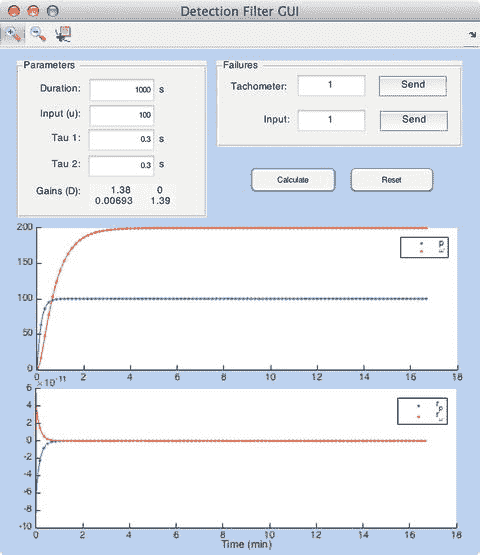

**图 9-11.** 无故障运行的 GUI

你现在已经构建了一个工具，可以在不生成数十个绘图窗口的情况下探索模型的参数空间。请注意，添加几个工具栏按钮可以让用户放大或从绘图中获取数据点。可以添加的其他功能包括菜单项，例如保存和重新加载特定案例，或将运行结果导出到工作区、mat 文件或文本文件。图 9-12 显示了一次在仿真中途注入输入故障的运行。这会影响状态和残差。为了复现这样的运行，你需要随时间记录 `tachF` 和 `uF` 的值以及初始条件。

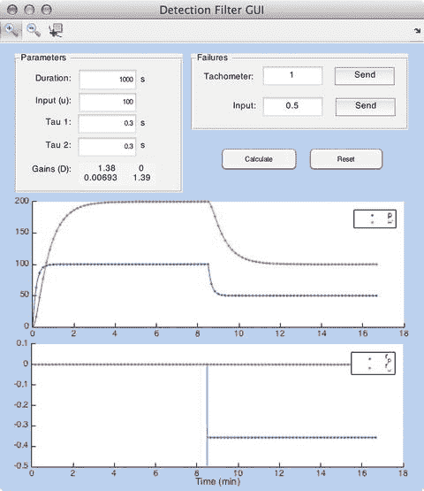

**图 9-12.** 注入输入故障的 GUI 运行

```matlab
function calculate_Callback(hObject, eventdata, handles)
% hObject handle to calculate (see GCBO)
% eventdata reserved – to be defined in a future version of MATLAB
% handles structure with handles and user data (see GUIDATA)
global inputFSent
global tachFSent

% get the data from the handles
u = handles.filterdata.input;
duration = handles.filterdata.duration;
tachF = handles.filterdata.tachF;
uF = handles.filterdata.uF;
dT = handles.filterdata.dT;

% initialize the simulation states and arrays
n = ceil(duration/dT);
x = [0;0];
d = RHSAirTurbine;
dF = handles.filterdata.dF;
dF = DetectionFilter('reset',dF);
xP = zeros(4,n);
t = (0:n-1)*dT;
dP = floor(n/100);

% prepare for plotting during the simulation
[tt,tL] = TimeLabel(duration);
tF = tt/duration;
axes(handles.states)
cla
hold on
axes(handles.residuals)
cla
hold on
xlabel(tL)

for k = 1:n
    if inputFSent
        inputFSent = false;
        data = guidata(hObject);
        uF = data.filterdata.uF;
    end
    if tachFSent
        tachFSent = false;
        data = guidata(hObject);
        tachF = data.filterdata.tachF;
    end
    y = [x(1);tachF*x(2)]; % Sensor failure
    xP(:,k) = [x;dF.r];
    dF = DetectionFilter('update',u,y,dF);
    d.u = uF*u; % Actuator failure
    x = RungeKutta( @RHSAirTurbine, t(k), x, dT, d );
    if rem(k,dP)==0
        plot(handles.states,tF*t(k), xP(1,k),'b.' );
        plot(handles.states,tF*t(k), xP(2,k),'r.' );
        plot(handles.residuals,tF*t(k), xP(3,k), 'b.' );
        plot(handles.residuals,tF*t(k), xP(4,k), 'r.' );
        drawnow
    end
end

% Plot the states and residuals
axes(handles.states)
plot(tF*t, xP(1:2,:) )
legend('p','\omega')
axes(handles.residuals)
plot(tF*t, xP(3:4,:) )
legend('r_p','r_{\omega}')
```

| 程序/文件名 | 描述 |
| :--- | :--- |
| `DetectionFilterSim` | 检测滤波器的仿真程序。 |
| `DetectionFilterGUI` | 通过图形用户界面运行检测滤波器仿真。 |
| `DetectionFilterGUI.fig` | 供`GUIDE`使用的图形用户界面布局。 |

脚注 1: Jere Schenck Meserole 的博士论文，“用于涡扇发动机容错控制的检测滤波器”，麻省理工学院航空航天系，1981 年。


